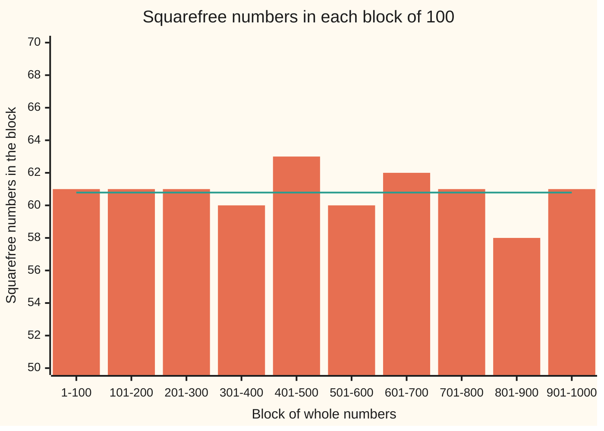

# Squarefree numbers: why six in every ten integers are divisible by no square

[Syllabus](../../../SYLLABUS.md) → [Algebraic and analytic number theory](../README.md) → [Arithmetic Functions Again](../README.md#s01) → Squarefree numbers

---

## General Overview

Take the square roots √1 to √1,000 and pull out of each one any square that divides the number under it. √12 = 2√3, because 4 divides 12. √18 = 3√2, because 9 divides 18. The split form is what lets roots combine: √12 + √27 = 2√3 + 3√3 = 5√3. Exact-algebra software writes every root this way for that reason. But √30 stays as it is: 30 = 2 × 3 × 5, and no prime appears twice.

The roots with no square to pull out are those of the **squarefree** numbers: numbers with no prime repeated in their factorisation ([The Mobius function](03-mobius-inversion.md) introduced the word). Of the thousand roots, 608 have no square to pull out.

The share barely moves as the list grows. Each of the ten blocks of 100 up to 1,000 keeps between 58 and 63. Up to a million, 607,926 numbers are squarefree. The share heads to 0.607927, which is $`6/\pi^2`$: the same constant that [The zeta function](../../07-Complex%20analysis/09-Special%20Functions%20and%20the%20Zeta%20Function/05-zeta-function-and-euler-product.md) found as the share of coprime pairs.

The card's tool is the **Mobius sieve**. It counts the squarefree numbers without factoring a single one. Strike the multiples of 4, 9, 25 and the other prime squares. Then add back the multiples of 36, 100 and the like, which were struck twice, and so on. At 1,000 only the squares of 2 to 31 matter, because a square bigger than 1,000 divides nothing in the list.

**A signed sum over the squares up to x counts the squarefree numbers exactly, and it comes to six over pi squared times x, give or take three square roots of x.**

**What kind of fact this is:** a theorem, proved on this card in Why it works, with its error constant written out. How much smaller the error really is remains open; "Where proof ends" separates proof from the computer count.

### The picture: ten blocks of a hundred



The bars are the counts in each block; the flat line is the prediction, 60.79 per hundred. The ten bars add to 608.

---

## The formula

Notation first, in words.

- $`\mu(d)`$ is the Mobius function: +1 if $`d`$ is squarefree with an even number of primes, −1 if squarefree with an odd number, 0 if a square divides $`d`$ ([The Mobius function](03-mobius-inversion.md)).
- $`\lfloor y \rfloor`$ means $`y`$ rounded down to a whole number.
- $`Q(x)`$ is the count of squarefree numbers from 1 to $`x`$.
- The **natural density** of a set of whole numbers is the limit of the share of $`1, 2, \dots, x`$ that lie in the set, as $`x`$ grows without end, when that limit exists. This card introduces the term.
- $`O`$ is as in [Big O and twiddle](01-asymptotic-notation-and-error-terms.md): $`O(\sqrt{x})`$ means "at most a fixed multiple of $`\sqrt{x}`$".

```math
Q(x) = \sum_{d \le \sqrt{x}} \mu(d) \left\lfloor \frac{x}{d^2} \right\rfloor = \frac{6}{\pi^2}\,x + E(x), \qquad |E(x)| \le D + \frac{x}{D}, \quad D = \lfloor \sqrt{x} \rfloor
```

**Read it aloud:** the squarefree count up to x is the sum, over every d up to root x, of mu of d times the number of multiples of d squared up to x. It equals six over pi squared times x, plus an error no bigger than D plus x over D, where D is root x rounded down.

At $`x = 1000`$: $`D = 31`$, the sum gives 608, the main term gives 607.927, and the error 0.073 sits far inside the allowed 63.3.

Dividing by $`x`$, the share $`Q(x)/x`$ tends to $`6/\pi^2 = 0.607927`$. So the squarefree numbers have natural density $`6/\pi^2`$.

| Symbol | Plain meaning | In our example | Push it up and the answer… |
| --- | --- | --- | --- |
| $`x`$, $`t`$ | how far the list runs; t stands in for x inside an integral | 1,000 | Q grows in step with x |
| $`n`$, $`k`$ | whole numbers: a number under the root; a counter in a sum | n = 720,720 | — |
| $`d`$, $`D`$ | a number whose square is struck out; the largest one that matters, $`\lfloor\sqrt{x}\rfloor`$ | d = 2 strikes 250 numbers; D = 31 | larger d strikes fewer numbers |
| $`a`$ | a number whose square splits off $`n`$ | 12 for 720,720 | — |
| $`p`$ | a prime | 2, 3, …, 31 | larger p removes a smaller share, $`1/p^2`$ |
| $`\mu(d)`$ | the Mobius sign: strike, add back, or skip | μ(2) = −1, μ(6) = +1, μ(4) = 0 | — |
| $`\lfloor y \rfloor`$, $`\{y\}`$ | y rounded down; the fractional part left over | $`\lfloor 1000/9 \rfloor = 111`$ | — |
| $`Q(x)`$ | squarefree numbers from 1 to x | 608 | rises with x |
| $`E(x)`$, $`O`$ | the error, Q(x) minus the main term; $`O(\sqrt{x})`$ means at most a fixed multiple of $`\sqrt{x}`$ | 0.073 | proved at most 63.3 here |
| $`6/\pi^2`$ | the density, equal to $`1/\zeta(2)`$, with $`\zeta(2) = \pi^2/6`$ from the zeta card | 0.607927 | fixed |
| $`S(x)`$, $`C`$, $`\log`$ | the sum of $`1/n`$ over squarefree $`n \le x`$; the constant it settles above $`(6/\pi^2)\log x`$, with log the natural logarithm | S(1000) = 5.242393; C near 1.043893 | S grows like $`(6/\pi^2)\log x`$ |
| $`\lambda(n)`$, $`L(x)`$ | Liouville's sign of n (Step 6); its running total up to x | λ(12) = −1; L(1000) = −14 | — |

### When it holds

- **A full run from 1 to a large x.** The density is a long-run share. A short window can hold none: 48, 49, 50 are all divisible by a square, and so are 242 to 245.
- **The signs of the Mobius function.** Strike every square's multiples once each, with no add-back, and the count comes out at 399, not 608: multiples of 36 are struck by 4, by 9 and by 36.
- **The whole infinite sum behind $`6/\pi^2`$.** The product over primes up to 31 predicts 611.706 at 1,000; the exact limit needs every prime, through $`\zeta(2) = \pi^2/6`$.
- **All whole numbers, not a chosen subset.** The density counts every one of $`1, 2, \dots, x`$. Restrict to a subset and the share can change: among the multiples of 4 it is 0.

---

## Why it works

### Step 0: every number is a square times a squarefree number

Collect the prime pairs of a number into a square, and what is left over has no prime twice. The house number shows it:

```math
720720 = 2^4 \cdot 3^2 \cdot 5 \cdot 7 \cdot 11 \cdot 13 = 12^2 \times 5005
```

Here 5005 = 5 × 7 × 11 × 13 is squarefree, so √720720 = 12√5005 and no further square comes out. The split is unique, because factorisation into primes is unique. So $`n`$ is squarefree exactly when its square part $`a^2`$ is 1.

The tool that turns "equals 1" into arithmetic is the Mobius detector. The sum of $`\mu(d)`$ over the divisors $`d`$ of $`a`$ is 1 when $`a = 1`$ and 0 otherwise ([The Mobius function](03-mobius-inversion.md) proves it).

### Step 1: a detector for squarefree numbers

The squares dividing $`n`$ are exactly $`d^2`$ for the divisors $`d`$ of $`a`$. So

```math
\mu(n)^2 = \sum_{d^2 \mid n} \mu(d)
```

The left side is 1 for squarefree $`n`$ and 0 otherwise. For 720,720, with $`a = 12`$, the divisors of 12 give $`\mu`$ values 1, −1, −1, 0, 1, 0 (for d = 1, 2, 3, 4, 6, 12), which add to 0. For 5005 only $`d = 1`$ qualifies, so the sum is 1.

<details>
<summary>Detailed proof: the squares dividing n are the squares of the divisors of a</summary>

Write $`n`$ as $`a^2`$ times a squarefree number. If $`d`$ divides $`a`$, then $`d^2`$ divides $`a^2`$ and so divides $`n`$.

Conversely, suppose $`d^2`$ divides $`n`$, and take a prime $`p`$. The squarefree part holds $`p`$ at most once, so $`n`$ holds $`p`$ twice as often as $`a`$ does, or one more time than that. And $`d^2`$ holds $`p`$ twice as often as $`d`$ does. Twice the count in $`d`$ is at most twice the count in $`a`$ plus one, so the count in $`d`$ is at most the count in $`a`$. This holds for every prime, so $`d`$ divides $`a`$.

Summing $`\mu(d)`$ over the divisors of $`a`$ gives 1 when $`a = 1`$ and 0 otherwise, and $`a = 1`$ means $`n`$ is squarefree.

</details>

### Step 2: add up and swap the order

Add the detector over every $`n`$ up to $`x`$. Then swap: instead of fixing $`n`$ and running over its square divisors, fix $`d`$ and count the $`n`$ that $`d^2`$ divides. There are $`\lfloor x/d^2 \rfloor`$ of them, so

```math
Q(x) = \sum_{n \le x} \sum_{d^2 \mid n} \mu(d) = \sum_{d \le \sqrt{x}} \mu(d) \left\lfloor \frac{x}{d^2} \right\rfloor
```

Only $`d \le \sqrt{x}`$ appear, because a larger $`d^2`$ has no multiple up to $`x`$. This is inclusion-exclusion (strike each set, add back what was struck twice, and so on) in disguise:

- $`\mu(d) = -1`$ strikes, for $`d`$ with an odd number of primes.
- $`\mu(d) = +1`$ adds back an overlap, for $`d`$ with an even number of primes.
- $`\mu(d) = 0`$ skips a $`d`$ like 4. Every multiple of its square, 16, is already a multiple of 2's square, 4.

### Step 3: the main term and an explicit error

Write $`\lfloor x/d^2 \rfloor = x/d^2 - \{x/d^2\}`$, where the braces mean the fractional part, between 0 and 1. Then

```math
Q(x) = x \sum_{d=1}^{\infty} \frac{\mu(d)}{d^2} \;-\; x \sum_{d > D} \frac{\mu(d)}{d^2} \;-\; \sum_{d \le D} \mu(d) \left\{ \frac{x}{d^2} \right\}
```

Three facts finish the proof.

1. **The full sum is $`6/\pi^2`$.** Multiply $`\sum \mu(d)/d^2`$ by $`\sum 1/k^2`$, with $`k`$ running over all whole numbers. The coefficient of $`1/n^2`$ is the sum of $`\mu(d)`$ over the divisors of $`n`$: 1 at $`n = 1`$ and 0 after. So the product is 1, and the first sum is $`1/\zeta(2) = 6/\pi^2`$.
2. **The tail is small.** Since $`1/d^2 < 1/(d-1) - 1/d`$, the sizes beyond $`D`$ add to less than $`1/D`$, by telescoping. The middle term is at most $`x/D`$.
3. **The fractional parts are bounded.** There are $`D`$ of them, each below 1, so the last term is at most $`D`$.

Together, $`|E(x)| \le D + x/D`$. For $`x \ge 1`$, $`D \ge \sqrt{x}/2`$, so $`|E(x)| \le 3\sqrt{x}`$: an $`O(\sqrt{x})`$ error with the constant written out. At a million the bound allows 2,000 and the true error is −1.102.

### Step 4: the density, and why the primes look independent

Divide by $`x`$: $`Q(x)/x = 6/\pi^2 + O(1/\sqrt{x})`$. The limit exists and is $`6/\pi^2`$, so that is the natural density.

A quicker guess gives the same number. A random whole number is divisible by $`p^2`$ with chance $`1/p^2`$. If the primes acted independently, the chance of escaping every prime square would be the product of $`1 - 1/p^2`$, which is $`1/\zeta(2)`$ by the Euler product on the zeta card.

The guess proves nothing by itself. At 1,000 the product over primes up to 31 gives 611.706, not 608. The sieve of Step 2 is what makes the guess exact in the limit. The zeta card ran the same guess for coprime pairs, where a pair fails at $`p`$ with chance $`1/p^2`$ too; that is why one constant serves both.

### Step 5: partial summation turns the count into a weighted sum

[Partial summation](06-abel-and-partial-summation.md) trades a weighted sum for an integral against a running total. Take the running total $`Q(t)`$ and the weight $`1/t`$:

```math
S(x) = \sum_{\substack{n \le x \\ n \text{ squarefree}}} \frac{1}{n} = \frac{Q(x)}{x} + \int_1^x \frac{Q(t)}{t^2}\,dt
```

Here $`t`$ is the integration variable, running from 1 to $`x`$. Put in $`Q(t) = 6t/\pi^2 + E(t)`$. The main part gives $`(6/\pi^2)\log x`$, with log the natural logarithm. The error part converges, because $`|E(t)|/t^2 \le 3/t^{3/2}`$ and that integral is finite. So

```math
S(x) = \frac{6}{\pi^2}\log x + C + O\!\left(\frac{1}{\sqrt{x}}\right)
```

for a fixed constant $`C`$. The proof gives its existence, not its value. The code reads it off: the difference is 1.042981 at 1,000 and 1.043893 at a million.

### Step 6: Liouville's function, the Mobius sign without the zeros

**Liouville's function** $`\lambda(n)`$ is +1 when $`n`$ has an even number of prime factors counted with repeats, and −1 when the number is odd. This card introduces it.

- On squarefree numbers it agrees with $`\mu`$; the code checks every one up to a million.
- Elsewhere $`\mu`$ is 0 but $`\lambda`$ is not: 12 = 2 × 2 × 3 has three factors, so λ(12) = −1 while μ(12) = 0. The house number 720,720 has ten factors, so λ = +1.
- Summed over the divisors of $`n`$, $`\lambda`$ gives 1 when $`n`$ is a perfect square and 0 otherwise. The code checks this up to 1,000; the proof is one prime at a time, as in Step 1.

Its running total $`L(x)`$ is a warning about evidence. Pólya asked in 1919 whether $`L(x) \le 0`$ for every $`x \ge 2`$. Up to a million the largest value is exactly 0, reached 9 times, and $`L(10^6) = -530`$.

Yet the claim is false. Haselgrove proved in 1958 that it fails somewhere, and Tanaka found the first failure in 1980, at 906,150,257. A count to a million is evidence, never proof.

### Where proof ends

- **Proved here:** $`Q(x) = 6x/\pi^2 + E(x)`$ with $`|E(x)| \le D + x/D \le 3\sqrt{x}`$, so the density is $`6/\pi^2`$.
- **Evidence only:** for every $`x`$ up to a million, $`|E(x)|/\sqrt{x}`$ stays below 0.68. The largest value, 0.67909, comes at $`x = 3`$. At a million it is 0.00110.
- **Open until 2026-11-21:** an error at most a power of $`x`$ below one half, such as $`x^{0.49}`$. The error is governed by the zeros of zeta, the subject of [The Riemann hypothesis](../02-The%20Zeta%20Function%20and%20the%20Prime%20Number%20Theorem/09-riemann-hypothesis-statement-and-equivalents.md). Such a power was known only by assuming the hypothesis, until a formal proof of it was certified on 2026-11-21 ([its status](../../25-Frontier/02-The%20Millennium%20Problems/01-riemann-hypothesis.md)).

---

## Worked numbers, by hand

The list runs from 1 to 1,000, so $`D = \lfloor\sqrt{1000}\rfloor = 31`$. Group the Mobius terms by how many primes $`d`$ holds.

| Step | Arithmetic | Value |
| --- | --- | --- |
| Start with every number | 1 to 1,000 | 1,000 |
| Strike multiples of prime squares | 250 (of 4) + 111 (of 9) + 40 (of 25) + 20 (of 49) + 8 + 5 + 3 + 2 + 1 + 1 + 1 | −442, leaving 558 |
| Add back two-prime squares | 27 (of 36) + 10 (of 100) + 5 (of 196) + 4 (of 225) + 2 (of 441) + 2 (of 484) + 1 (of 676) | +51, giving 609 |
| Strike the three-prime square | 900 = 30², struck once | −1, giving **608** |
| The main term | 0.607927 × 1,000 | 607.927 |
| The error | 608 − 607.927 | 0.073 |
| The proved bound | 31 + 1,000 / 31 | 63.3 |

**608 of the roots √1 to √1,000 have no square to pull out**, within 0.073 of the 607.927 that the density predicts.

### What breaks if you drop a piece

| Mistake | Comes out at | What went wrong |
| --- | --- | --- |
| Strike every square's multiples, no signs | 399 | 36 is struck by 4, 9 and 36; 16 is struck by 4 and again by 16 |
| Prime squares only, no add-back | 558 | multiples of 36, 100, … struck twice, never restored |
| Primes-to-31 product used as the count | 611.706 | the independence guess, cut off at 31, is not an exact count |
| Density read on a short window | 0 of 3 at 48–50; 0 of 4 at 242–245 | a long-run share promises nothing about a few consecutive numbers |

The last row is the hypothesis "a full run from 1" failing. The code finds both runs by search.

---

## Code, from first principles, and it actually runs

The code builds the smallest prime factor of every number up to a million, and from it $`\mu`$ and $`\lambda`$. It then reaches $`Q(x)`$ by three independent roads: striking out the multiples of every square, the Mobius sum over $`d^2`$, and the square-part split of Step 0, which says the $`Q(\lfloor x/a^2 \rfloor)`$ add up to $`x`$. It prints the error at four sizes against the proved bound, the partial-summation constant, and the Liouville checks.

### Python

```python
# Squarefree numbers -- the check behind the card.  Standard library only.
# A number is squarefree when no square bigger than 1 divides it.  The count
# Q(x) of squarefree numbers up to x is made three ways: by striking out the
# multiples of every square, by the Mobius sieve sum of mu(d) * floor(x / d^2),
# and by the split of every number into a square times a squarefree part.
import math

N = 10**6
DENS = 6 / (math.pi * math.pi)                    # 1 / zeta(2), proved on the zeta card

spf = list(range(N + 1))                  # smallest prime factor of each n
for p in range(2, math.isqrt(N) + 1):
    if spf[p] == p:
        for m in range(p * p, N + 1, p):
            if spf[m] == m:
                spf[m] = p
mu, lam = [0, 1] + [0] * (N - 1), [0, 1] + [0] * (N - 1)
for n in range(2, N + 1):                 # mu and Liouville's lambda from spf
    p, m = spf[n], n // spf[n]
    lam[n] = -lam[m]
    mu[n] = 0 if m % p == 0 else -mu[m]

free = [True] * (N + 1)                   # road 1: strike multiples of d^2
free[0] = False
for d in range(2, math.isqrt(N) + 1):
    for m in range(d * d, N + 1, d * d):
        free[m] = False
Q = [0] * (N + 1)                         # Q[x] = squarefree numbers up to x
for n in range(1, N + 1):
    Q[n] = Q[n - 1] + free[n]

def mobius_count(x):                      # road 2: the Mobius sieve over d^2
    return sum(mu[d] * (x // (d * d)) for d in range(1, math.isqrt(x) + 1))

def split_total(x):                       # road 3: n = a^2 * (squarefree part)
    return sum(Q[x // (a * a)] for a in range(1, math.isqrt(x) + 1))

print("first 30 numbers, squarefree ones:", [n for n in range(1, 31) if free[n]])
yn = lambda claim: "yes" if claim else "no"
print(f"720720 = 144 x 5005; 5005 squarefree: {yn(free[5005])}; 720720 squarefree: {yn(free[720720])}")
terms = [(d, mu[d], 1000 // (d * d)) for d in range(1, 32) if mu[d] != 0]
print("Mobius sieve at 1000, terms (d, mu(d), floor(1000/d^2)):")
for i in range(0, len(terms), 5):
    print("  " + "  ".join(f"({d}, {m:+d}, {f})" for d, m, f in terms[i:i + 5]))
omega = lambda d: sum(1 for p in range(2, d + 1) if d % p == 0 and spf[p] == p)
groups = [sum(m * f for d, m, f in terms if omega(d) == k) for k in (1, 2, 3)]
print(f"grouped by primes in d: one prime {groups[0]:+d}, two primes {groups[1]:+d}, three primes {groups[2]:+d}")
q = mobius_count(1000)
print(f"numbers 1 to 1000: struck-out count {Q[1000]}, Mobius sum {q}, split total {split_total(1000)}")
assert Q[1000] == q == 608 and split_total(1000) == 1000
blocks = [Q[k + 100] - Q[k] for k in range(0, 1000, 100)]
print(f"squarefree per block of 100, 1-100 to 901-1000: {blocks}; predicted {100 * DENS:.2f} each")
partial = sum(mu[d] / (d * d) for d in range(1, 32))
euler = 1.0
for p in range(2, 32):
    if spf[p] == p:
        euler *= 1 - 1 / (p * p)
print(f"6/pi^2 = {DENS:.9f}; sum mu(d)/d^2 to 31 = {partial:.9f}; product over primes to 31 = {euler:.9f}")
print(f"predicted at 1000: 6/pi^2 x 1000 = {1000 * DENS:.3f}; primes-to-31 product x 1000 = {1000 * euler:.3f}")
print("x | Q(x) | 6x/pi^2 | E = Q - 6x/pi^2 | E/sqrt(x) | Q/(6x/pi^2) | proved bound D + x/D")
for x in (10**3, 10**4, 10**5, 10**6):
    pred, D = x * DENS, math.isqrt(x)
    e = Q[x] - pred
    print(f"{x} | {Q[x]} | {pred:.3f} | {e:.3f} | {e / math.sqrt(x):.5f} | {Q[x] / pred:.7f} | {D + x / D:.1f}")
    assert Q[x] == mobius_count(x) and split_total(x) == x       # three roads agree
    assert abs(e) <= D + x / D                                   # the proved bound
worst, at = 0.0, 0
for x in range(1, N + 1):
    r = abs(Q[x] - x * DENS) / math.sqrt(x)
    if r > worst:
        worst, at = r, x
print(f"largest |E(x)|/sqrt(x) for x from 1 to {N}: {worst:.5f}, at x = {at}")
print("partial summation: S(x) = sum of 1/n over squarefree n <= x, against (6/pi^2) log x")
s, marks = 0.0, {10**3, 10**4, 10**5, 10**6}
for n in range(1, N + 1):
    if free[n]:
        s += 1 / n
    if n in marks:
        print(f"  x = {n}: S = {s:.6f}, (6/pi^2) log x = {DENS * math.log(n):.6f}, difference {s - DENS * math.log(n):.6f}")
same = all(lam[n] == mu[n] for n in range(1, N + 1) if free[n])
sq = all((sum(lam[d] for d in range(1, n + 1) if n % d == 0) == 1) == (math.isqrt(n) ** 2 == n)
         for n in range(1, 1001))
print(f"lambda = mu on every squarefree n <= {N}: {yn(same)}; lambda summed over divisors is 1 exactly on squares to 1000: {yn(sq)}")
assert same and sq
rad = math.prod(p for p in range(2, 14) if spf[p] == p and 720720 % p == 0)
print(f"lambda(12) = {lam[12]:+d}, mu(12) = {mu[12]}; lambda(720720) = {lam[720720]:+d}, mu(720720) = {mu[720720]}; radical of 720720 = {rad}")
assert lam[12] == -1 and lam[720720] == 1 and rad * 24 == 720720
L, top, zeros = 0, -10**9, 0
for n in range(1, N + 1):
    L += lam[n]
    if n >= 2:
        top, zeros = max(top, L), zeros + (L == 0)
    if n == 1000:
        print(f"L(1000) = sum of lambda(n) to 1000 = {L}")
print(f"Polya's L(x) <= 0 for 2 <= x <= {N}: largest L(x) = {top}, reached {zeros} times; L({N}) = {L}")
assert top <= 0
nosign = 1000 - sum(1000 // (d * d) for d in range(2, 32))
primes_only = 1000 - sum(1000 // (p * p) for p in range(2, 32) if spf[p] == p)
print(f"mistake 1, strike every square's multiples with no add-back: {nosign}")
print(f"mistake 2, prime squares only, no add-back: {primes_only}")
def first_run(k):                         # first k consecutive non-squarefree numbers
    return next(n for n in range(1, N) if not any(free[n + i] for i in range(k)))
r3, r4 = first_run(3), first_run(4)
print(f"mistake 3, density read on a short window: {r3}-{r3 + 2} has 0 of 3; {r4}-{r4 + 3} has 0 of 4")
assert (r3, r4) == (48, 242) and nosign < 608 and primes_only < 608
print("ALL CHECKS PASS")
```

**Ran 2026-11-15 on macOS, Python 3.14.10, standard library only. All checks passed. Output, pasted from the run:**

```
first 30 numbers, squarefree ones: [1, 2, 3, 5, 6, 7, 10, 11, 13, 14, 15, 17, 19, 21, 22, 23, 26, 29, 30]
720720 = 144 x 5005; 5005 squarefree: yes; 720720 squarefree: no
Mobius sieve at 1000, terms (d, mu(d), floor(1000/d^2)):
  (1, +1, 1000)  (2, -1, 250)  (3, -1, 111)  (5, -1, 40)  (6, +1, 27)
  (7, -1, 20)  (10, +1, 10)  (11, -1, 8)  (13, -1, 5)  (14, +1, 5)
  (15, +1, 4)  (17, -1, 3)  (19, -1, 2)  (21, +1, 2)  (22, +1, 2)
  (23, -1, 1)  (26, +1, 1)  (29, -1, 1)  (30, -1, 1)  (31, -1, 1)
grouped by primes in d: one prime -442, two primes +51, three primes -1
numbers 1 to 1000: struck-out count 608, Mobius sum 608, split total 1000
squarefree per block of 100, 1-100 to 901-1000: [61, 61, 61, 60, 63, 60, 62, 61, 58, 61]; predicted 60.79 each
6/pi^2 = 0.607927102; sum mu(d)/d^2 to 31 = 0.605974941; product over primes to 31 = 0.611706245
predicted at 1000: 6/pi^2 x 1000 = 607.927; primes-to-31 product x 1000 = 611.706
x | Q(x) | 6x/pi^2 | E = Q - 6x/pi^2 | E/sqrt(x) | Q/(6x/pi^2) | proved bound D + x/D
1000 | 608 | 607.927 | 0.073 | 0.00231 | 1.0001199 | 63.3
10000 | 6083 | 6079.271 | 3.729 | 0.03729 | 1.0006134 | 200.0
100000 | 60794 | 60792.710 | 1.290 | 0.00408 | 1.0000212 | 632.5
1000000 | 607926 | 607927.102 | -1.102 | -0.00110 | 0.9999982 | 2000.0
largest |E(x)|/sqrt(x) for x from 1 to 1000000: 0.67909, at x = 3
partial summation: S(x) = sum of 1/n over squarefree n <= x, against (6/pi^2) log x
  x = 1000: S = 5.242393, (6/pi^2) log x = 4.199412, difference 1.042981
  x = 10000: S = 6.643413, (6/pi^2) log x = 5.599216, difference 1.044198
  x = 100000: S = 8.042912, (6/pi^2) log x = 6.999019, difference 1.043892
  x = 1000000: S = 9.442716, (6/pi^2) log x = 8.398823, difference 1.043893
lambda = mu on every squarefree n <= 1000000: yes; lambda summed over divisors is 1 exactly on squares to 1000: yes
lambda(12) = -1, mu(12) = 0; lambda(720720) = +1, mu(720720) = 0; radical of 720720 = 30030
L(1000) = sum of lambda(n) to 1000 = -14
Polya's L(x) <= 0 for 2 <= x <= 1000000: largest L(x) = 0, reached 9 times; L(1000000) = -530
mistake 1, strike every square's multiples with no add-back: 399
mistake 2, prime squares only, no add-back: 558
mistake 3, density read on a short window: 48-50 has 0 of 3; 242-245 has 0 of 4
ALL CHECKS PASS
```

### Rust

Same numbers, same labels, built with `rustc --edition 2021 -O`.

```rust
// Squarefree numbers -- the same check as the Python, in Rust.  No crates.
// A number is squarefree when no square bigger than 1 divides it.  The count
// Q(x) of squarefree numbers up to x is made three ways: by striking out the
// multiples of every square, by the Mobius sieve sum of mu(d) * floor(x / d^2),
// and by the split of every number into a square times a squarefree part.
use std::f64::consts::PI;

const N: usize = 1_000_000;

fn isqrt(x: usize) -> usize {
    let mut r = (x as f64).sqrt() as usize;
    while r * r > x { r -= 1 }
    while (r + 1) * (r + 1) <= x { r += 1 }
    r
}

fn yn(claim: bool) -> &'static str { if claim { "yes" } else { "no" } }

fn main() {
    let dens = 6.0 / (PI * PI); // 1 / zeta(2), proved on the zeta card
    let mut spf: Vec<usize> = (0..=N).collect(); // smallest prime factor of each n
    for p in 2..=isqrt(N) {
        if spf[p] == p {
            let mut m = p * p;
            while m <= N { if spf[m] == m { spf[m] = p } m += p }
        }
    }
    let (mut mu, mut lam) = (vec![0i64; N + 1], vec![0i64; N + 1]);
    mu[1] = 1;
    lam[1] = 1;
    for n in 2..=N { // mu and Liouville's lambda from spf
        let (p, m) = (spf[n], n / spf[n]);
        lam[n] = -lam[m];
        mu[n] = if m % p == 0 { 0 } else { -mu[m] };
    }
    let mut free = vec![true; N + 1]; // road 1: strike multiples of d^2
    free[0] = false;
    for d in 2..=isqrt(N) {
        let mut m = d * d;
        while m <= N { free[m] = false; m += d * d }
    }
    let mut q = vec![0usize; N + 1]; // q[x] = squarefree numbers up to x
    for n in 1..=N { q[n] = q[n - 1] + free[n] as usize }
    // road 2: the Mobius sieve over d^2;  road 3: n = a^2 * (squarefree part)
    let mobius_count = |x: usize| -> i64 { (1..=isqrt(x)).map(|d| mu[d] * (x / (d * d)) as i64).sum() };
    let split_total = |x: usize| -> usize { (1..=isqrt(x)).map(|a| q[x / (a * a)]).sum() };
    let first: Vec<usize> = (1..31).filter(|&n| free[n]).collect();
    println!("first 30 numbers, squarefree ones: {:?}", first);
    println!("720720 = 144 x 5005; 5005 squarefree: {}; 720720 squarefree: {}", yn(free[5005]), yn(free[720720]));
    let terms: Vec<(usize, i64, i64)> =
        (1..32).filter(|&d| mu[d] != 0).map(|d| (d, mu[d], (1000 / (d * d)) as i64)).collect();
    println!("Mobius sieve at 1000, terms (d, mu(d), floor(1000/d^2)):");
    for chunk in terms.chunks(5) {
        let parts: Vec<String> = chunk.iter().map(|(d, m, f)| format!("({}, {:+}, {})", d, m, f)).collect();
        println!("  {}", parts.join("  "));
    }
    let omega = |d: usize| (2..=d).filter(|&p| d % p == 0 && spf[p] == p).count();
    let g: Vec<i64> = (1..=3).map(|k| terms.iter().filter(|t| omega(t.0) == k).map(|t| t.1 * t.2).sum()).collect();
    println!("grouped by primes in d: one prime {:+}, two primes {:+}, three primes {:+}", g[0], g[1], g[2]);
    let q1000 = mobius_count(1000);
    println!("numbers 1 to 1000: struck-out count {}, Mobius sum {}, split total {}", q[1000], q1000, split_total(1000));
    assert!(q[1000] == 608 && q1000 == 608 && split_total(1000) == 1000);
    let blocks: Vec<usize> = (0..1000).step_by(100).map(|k| q[k + 100] - q[k]).collect();
    println!("squarefree per block of 100, 1-100 to 901-1000: {:?}; predicted {:.2} each", blocks, 100.0 * dens);
    let mut partial = 0.0;
    for d in 1..32usize { partial += mu[d] as f64 / (d * d) as f64 }
    let mut euler = 1.0;
    for p in 2..32usize { if spf[p] == p { euler *= 1.0 - 1.0 / (p * p) as f64 } }
    println!("6/pi^2 = {:.9}; sum mu(d)/d^2 to 31 = {:.9}; product over primes to 31 = {:.9}", dens, partial, euler);
    println!("predicted at 1000: 6/pi^2 x 1000 = {:.3}; primes-to-31 product x 1000 = {:.3}", 1000.0 * dens, 1000.0 * euler);
    println!("x | Q(x) | 6x/pi^2 | E = Q - 6x/pi^2 | E/sqrt(x) | Q/(6x/pi^2) | proved bound D + x/D");
    for &x in &[1_000usize, 10_000, 100_000, 1_000_000] {
        let (pred, dd) = (x as f64 * dens, isqrt(x));
        let e = q[x] as f64 - pred;
        let bound = dd as f64 + x as f64 / dd as f64;
        println!("{} | {} | {:.3} | {:.3} | {:.5} | {:.7} | {:.1}", x, q[x], pred, e, e / (x as f64).sqrt(), q[x] as f64 / pred, bound);
        assert!(q[x] as i64 == mobius_count(x) && split_total(x) == x); // three roads agree
        assert!(e.abs() <= bound); // the proved bound
    }
    let (mut worst, mut at) = (0.0f64, 0usize);
    for x in 1..=N {
        let r = (q[x] as f64 - x as f64 * dens).abs() / (x as f64).sqrt();
        if r > worst { worst = r; at = x }
    }
    println!("largest |E(x)|/sqrt(x) for x from 1 to {}: {:.5}, at x = {}", N, worst, at);
    println!("partial summation: S(x) = sum of 1/n over squarefree n <= x, against (6/pi^2) log x");
    let mut s = 0.0;
    for n in 1..=N {
        if free[n] { s += 1.0 / n as f64 }
        if [1_000, 10_000, 100_000, 1_000_000].contains(&n) {
            let l = dens * (n as f64).ln();
            println!("  x = {}: S = {:.6}, (6/pi^2) log x = {:.6}, difference {:.6}", n, s, l, s - l);
        }
    }
    let same = (1..=N).filter(|&n| free[n]).all(|n| lam[n] == mu[n]);
    let sq = (1..=1000usize).all(|n| {
        let t: i64 = (1..=n).filter(|d| n % d == 0).map(|d| lam[d]).sum();
        (t == 1) == (isqrt(n) * isqrt(n) == n)
    });
    println!("lambda = mu on every squarefree n <= {}: {}; lambda summed over divisors is 1 exactly on squares to 1000: {}", N, yn(same), yn(sq));
    assert!(same && sq);
    let rad: usize = (2..14usize).filter(|&p| spf[p] == p && 720720 % p == 0).product();
    println!("lambda(12) = {:+}, mu(12) = {}; lambda(720720) = {:+}, mu(720720) = {}; radical of 720720 = {}", lam[12], mu[12], lam[720720], mu[720720], rad);
    assert!(lam[12] == -1 && lam[720720] == 1 && rad * 24 == 720720);
    let (mut l, mut top, mut zeros) = (0i64, -1_000_000_000i64, 0usize);
    for n in 1..=N {
        l += lam[n];
        if n >= 2 { top = top.max(l); if l == 0 { zeros += 1 } }
        if n == 1000 { println!("L(1000) = sum of lambda(n) to 1000 = {}", l) }
    }
    println!("Polya's L(x) <= 0 for 2 <= x <= {}: largest L(x) = {}, reached {} times; L({}) = {}", N, top, zeros, N, l);
    assert!(top <= 0);
    let nosign = 1000 - (2..32usize).map(|d| 1000 / (d * d)).sum::<usize>();
    let primes_only = 1000 - (2..32usize).filter(|&p| spf[p] == p).map(|p| 1000 / (p * p)).sum::<usize>();
    println!("mistake 1, strike every square's multiples with no add-back: {}", nosign);
    println!("mistake 2, prime squares only, no add-back: {}", primes_only);
    let first_run = |k: usize| (1..N).find(|&n| (0..k).all(|i| !free[n + i])).unwrap(); // first k in a row
    let (r3, r4) = (first_run(3), first_run(4));
    println!("mistake 3, density read on a short window: {}-{} has 0 of 3; {}-{} has 0 of 4", r3, r3 + 2, r4, r4 + 3);
    assert!((r3, r4) == (48, 242) && nosign < 608 && primes_only < 608);
    println!("ALL CHECKS PASS");
}
```

**Ran 2026-11-15 on macOS, rustc 1.98.1, no crates. All checks passed. Output, pasted from the run:**

```
first 30 numbers, squarefree ones: [1, 2, 3, 5, 6, 7, 10, 11, 13, 14, 15, 17, 19, 21, 22, 23, 26, 29, 30]
720720 = 144 x 5005; 5005 squarefree: yes; 720720 squarefree: no
Mobius sieve at 1000, terms (d, mu(d), floor(1000/d^2)):
  (1, +1, 1000)  (2, -1, 250)  (3, -1, 111)  (5, -1, 40)  (6, +1, 27)
  (7, -1, 20)  (10, +1, 10)  (11, -1, 8)  (13, -1, 5)  (14, +1, 5)
  (15, +1, 4)  (17, -1, 3)  (19, -1, 2)  (21, +1, 2)  (22, +1, 2)
  (23, -1, 1)  (26, +1, 1)  (29, -1, 1)  (30, -1, 1)  (31, -1, 1)
grouped by primes in d: one prime -442, two primes +51, three primes -1
numbers 1 to 1000: struck-out count 608, Mobius sum 608, split total 1000
squarefree per block of 100, 1-100 to 901-1000: [61, 61, 61, 60, 63, 60, 62, 61, 58, 61]; predicted 60.79 each
6/pi^2 = 0.607927102; sum mu(d)/d^2 to 31 = 0.605974941; product over primes to 31 = 0.611706245
predicted at 1000: 6/pi^2 x 1000 = 607.927; primes-to-31 product x 1000 = 611.706
x | Q(x) | 6x/pi^2 | E = Q - 6x/pi^2 | E/sqrt(x) | Q/(6x/pi^2) | proved bound D + x/D
1000 | 608 | 607.927 | 0.073 | 0.00231 | 1.0001199 | 63.3
10000 | 6083 | 6079.271 | 3.729 | 0.03729 | 1.0006134 | 200.0
100000 | 60794 | 60792.710 | 1.290 | 0.00408 | 1.0000212 | 632.5
1000000 | 607926 | 607927.102 | -1.102 | -0.00110 | 0.9999982 | 2000.0
largest |E(x)|/sqrt(x) for x from 1 to 1000000: 0.67909, at x = 3
partial summation: S(x) = sum of 1/n over squarefree n <= x, against (6/pi^2) log x
  x = 1000: S = 5.242393, (6/pi^2) log x = 4.199412, difference 1.042981
  x = 10000: S = 6.643413, (6/pi^2) log x = 5.599216, difference 1.044198
  x = 100000: S = 8.042912, (6/pi^2) log x = 6.999019, difference 1.043892
  x = 1000000: S = 9.442716, (6/pi^2) log x = 8.398823, difference 1.043893
lambda = mu on every squarefree n <= 1000000: yes; lambda summed over divisors is 1 exactly on squares to 1000: yes
lambda(12) = -1, mu(12) = 0; lambda(720720) = +1, mu(720720) = 0; radical of 720720 = 30030
L(1000) = sum of lambda(n) to 1000 = -14
Polya's L(x) <= 0 for 2 <= x <= 1000000: largest L(x) = 0, reached 9 times; L(1000000) = -530
mistake 1, strike every square's multiples with no add-back: 399
mistake 2, prime squares only, no add-back: 558
mistake 3, density read on a short window: 48-50 has 0 of 3; 242-245 has 0 of 4
ALL CHECKS PASS
```

The two outputs match line for line.

### Lean

Lean proves the Mobius sieve and the error bound for every x ≥ 1, the density 6/π², and the card's small counts.

- Take x ≥ 1 and D = ⌊√x⌋. Then Q(x) is the sum, over d from 1 to D, of μ(d) times ⌊x/d²⌋.
- Take x ≥ 1. Then the error E(x) is at most D + x/D, and so at most 3√x.
- The squarefree numbers have natural density 6/π². The share Q(x)/x tends to 6/π² as x grows.
- 608 of the numbers 1 to 1,000 are squarefree. The sieve sum at D = 31 also gives 608.
- The ten blocks of 100 up to 1,000 hold 61, 61, 61, 60, 63, 60, 62, 61, 58 and 61.
- The prime squares strike 442 numbers up to 1,000, and 1,000 − 442 + 51 − 1 = 608.
- Striking every square's multiples once each, with no signs, leaves 399.
- 720,720 = 12² × 5005, where 5005 is squarefree and 720,720 is not.
- No number from 48 to 50, or from 242 to 245, is squarefree.
- λ(12) = −1 while μ(12) = 0. λ(720,720) = +1 while μ(720,720) = 0.

Decimal values, counts up to a million, the constant C and Pólya's L(x) are left to the Python and Rust checks.

```lean
-- Squarefree numbers: the Mobius sieve over the squares d² ≤ x counts the squarefree numbers up to x exactly, the count is 6x/π² with an error at most ⌊√x⌋ + x/⌊√x⌋ ≤ 3√x, and so the squarefree numbers have natural density 6/π².
import Mathlib.Data.Nat.Squarefree
import Mathlib.NumberTheory.ArithmeticFunction.Moebius
import Mathlib.NumberTheory.ArithmeticFunction.Misc
import Mathlib.NumberTheory.ZetaValues
import Mathlib.Analysis.SpecialFunctions.Sqrt
import Mathlib.NumberTheory.LSeries.Dirichlet
import Mathlib.NumberTheory.LSeries.HurwitzZetaValues
import Mathlib.Algebra.Order.Floor.Semifield

open ArithmeticFunction Filter Topology
open scoped ArithmeticFunction.Moebius ArithmeticFunction.Omega

/-- `d² ∣ b² a` with `a` squarefree forces `d ∣ b`. -/
theorem sqfree_sq_dvd_iff {a b d : ℕ} (ha : Squarefree a) (hb : 0 < b) :
    d ^ 2 ∣ b ^ 2 * a ↔ d ∣ b := by
  constructor
  · intro h
    obtain ⟨g, d', b', hg, hcop, rfl, rfl⟩ := Nat.exists_coprime' (Nat.gcd_pos_of_pos_right d hb)
    have h2 : d' ^ 2 ∣ b' ^ 2 * a := by
      have : g ^ 2 * d' ^ 2 ∣ g ^ 2 * (b' ^ 2 * a) := by
        have e1 : (d' * g) ^ 2 = g ^ 2 * d' ^ 2 := by ring
        have e2 : (b' * g) ^ 2 * a = g ^ 2 * (b' ^ 2 * a) := by ring
        rw [← e1, ← e2]; exact h
      exact Nat.dvd_of_mul_dvd_mul_left (by positivity) this
    have h3 : d' ^ 2 ∣ a :=
      (Nat.Coprime.pow 2 2 hcop).dvd_of_dvd_mul_left h2
    have h4 : IsUnit d' := ha d' (by simpa [sq] using h3)
    rw [Nat.isUnit_iff.mp h4, one_mul]
    exact Dvd.intro_left _ rfl
  · intro h
    exact Dvd.dvd.mul_right (pow_dvd_pow_of_dvd h 2) a

#print axioms sqfree_sq_dvd_iff

/-- The sum of `μ d` over `d` with `d² ∣ n`, `d ≤ D`, is the indicator of squarefree `n`,
whenever `n ≤ x` and `D = ⌊√x⌋`. -/
theorem sum_moebius_sq_dvd {n x : ℕ} (hn : 0 < n) (hnx : n ≤ x) :
    ∑ d ∈ Finset.Icc 1 (Nat.sqrt x), (if d ^ 2 ∣ n then μ d else 0) =
      if Squarefree n then 1 else 0 := by
  obtain ⟨a, b, ha, hb, rfl, hsq⟩ := Nat.sq_mul_squarefree_of_pos hn
  rw [← Finset.sum_filter]
  have hset : (Finset.Icc 1 (Nat.sqrt x)).filter (fun d => d ^ 2 ∣ b ^ 2 * a) = b.divisors := by
    ext d
    simp only [Finset.mem_filter, Finset.mem_Icc, Nat.mem_divisors, sqfree_sq_dvd_iff hsq hb]
    constructor
    · rintro ⟨_, h⟩; exact ⟨h, hb.ne'⟩
    · rintro ⟨h, -⟩
      have hd : 0 < d := Nat.pos_of_dvd_of_pos h hb
      have hdb : d ≤ b := Nat.le_of_dvd hb h
      refine ⟨⟨hd, ?_⟩, h⟩
      rw [Nat.le_sqrt']
      calc d ^ 2 ≤ b ^ 2 := Nat.pow_le_pow_left hdb 2
        _ ≤ b ^ 2 * a := Nat.le_mul_of_pos_right _ ha
        _ ≤ x := hnx
  rw [hset]
  have key : ∑ d ∈ b.divisors, μ d = (1 : ArithmeticFunction ℤ) b := by
    rw [← moebius_mul_coe_zeta, coe_mul_zeta_apply]
  rw [key, ArithmeticFunction.one_apply]
  have : Squarefree (b ^ 2 * a) ↔ b = 1 := by
    constructor
    · intro h
      have : IsUnit b := h b (Dvd.dvd.mul_right (by rw [sq]) a)
      exact Nat.isUnit_iff.mp this
    · rintro rfl; simpa using hsq
  by_cases h1 : b = 1
  · simp [h1, hsq]
  · simp [h1, show ¬ Squarefree (b ^ 2 * a) from fun h => h1 (this.mp h)]

#print axioms sum_moebius_sq_dvd

theorem sieve_identity (x : ℕ) :
    ((((Finset.Icc 1 x).filter Squarefree).card : ℕ) : ℤ) =
        ∑ d ∈ Finset.Icc 1 (Nat.sqrt x), μ d * ((x / d ^ 2 : ℕ) : ℤ) := by
  have hI : Finset.Icc 1 x = Finset.Ioc 0 x := by ext; simp; omega
  have h1 : ∀ d, ((x / d ^ 2 : ℕ) : ℤ) = ∑ n ∈ Finset.Icc 1 x, if d ^ 2 ∣ n then (1 : ℤ) else 0 := by
    intro d
    rw [Finset.sum_boole, hI, Nat.Ioc_filter_dvd_card_eq_div]
  simp_rw [h1, Finset.mul_sum, mul_boole]
  rw [Finset.sum_comm]
  rw [Finset.card_filter, Nat.cast_sum]
  apply Finset.sum_congr rfl
  intro n hn
  rw [Finset.mem_Icc] at hn
  rw [sum_moebius_sq_dvd (by omega) hn.2]
  split_ifs <;> simp

#print axioms sieve_identity

theorem hasSum_moebius_div_sq :
    HasSum (fun n : ℕ => (μ n : ℝ) / (n : ℝ) ^ 2) (6 / Real.pi ^ 2) := by
  have hs : (1 : ℝ) < (2 : ℂ).re := by norm_num
  have h1 := LSeries_zeta_mul_Lseries_moebius hs
  rw [LSeries_zeta_eq_riemannZeta hs, riemannZeta_two] at h1
  have hL : LSeries (fun n => (μ n : ℂ)) 2 = ((6 / Real.pi ^ 2 : ℝ) : ℂ) := by
    have hpi : (Real.pi : ℂ) ≠ 0 := by exact_mod_cast Real.pi_ne_zero
    push_cast
    field_simp
    linear_combination 6 * h1
  have hsum : LSeriesHasSum (fun n => (μ n : ℂ)) 2 (LSeries (fun n => (μ n : ℂ)) 2) :=
    (LSeriesSummable_moebius_iff.mpr hs).LSeriesHasSum
  rw [hL] at hsum
  unfold LSeriesHasSum at hsum
  rw [← Complex.hasSum_ofReal]
  convert hsum using 1
  funext n
  rcases Nat.eq_zero_or_pos n with rfl | hn
  · simp
  · rw [LSeries.term_of_ne_zero hn.ne', Complex.cpow_two]
    push_cast
    rfl

#print axioms hasSum_moebius_div_sq

theorem telescope_bound (D : ℕ) (hD : 1 ≤ D) (m : ℕ) :
    ∑ k ∈ Finset.range m, 1 / ((D + 1 + k : ℕ) : ℝ) ^ 2 ≤ 1 / (D : ℝ) - 1 / ((D + m : ℕ) : ℝ) := by
  induction m with
  | zero => simp
  | succ m ih =>
    rw [Finset.sum_range_succ]
    have hDm : (1 : ℝ) ≤ ((D + m : ℕ) : ℝ) := by exact_mod_cast (by omega : 1 ≤ D + m)
    have step : 1 / ((D + 1 + m : ℕ) : ℝ) ^ 2 ≤ 1 / ((D + m : ℕ) : ℝ) - 1 / ((D + (m + 1) : ℕ) : ℝ) := by
      have e1 : ((D + 1 + m : ℕ) : ℝ) = ((D + m : ℕ) : ℝ) + 1 := by push_cast; ring
      have e2 : ((D + (m + 1) : ℕ) : ℝ) = ((D + m : ℕ) : ℝ) + 1 := by push_cast; ring
      rw [e1, e2]
      set y := ((D + m : ℕ) : ℝ)
      rw [div_sub_div _ _ (by positivity) (by positivity), div_le_div_iff₀ (by positivity) (by positivity)]
      nlinarith
    linarith

#print axioms telescope_bound

theorem tail_bound (D : ℕ) (hD : 1 ≤ D) :
    |6 / Real.pi ^ 2 - ∑ d ∈ Finset.Icc 1 D, (μ d : ℝ) / (d : ℝ) ^ 2| ≤ 1 / (D : ℝ) := by
  set f : ℕ → ℝ := fun n => (μ n : ℝ) / (n : ℝ) ^ 2 with hf
  have hIcc : ∑ d ∈ Finset.Icc 1 D, f d = ∑ d ∈ Finset.range (D + 1), f d := by
    apply Finset.sum_subset
    · intro d hd; simp at hd ⊢; omega
    · intro d hd hnot
      have : d = 0 := by simp at hd hnot; omega
      subst this; simp [hf]
  rw [hIcc]
  have ht := (hasSum_moebius_div_sq.tendsto_sum_nat).comp (tendsto_add_atTop_nat (D + 1))
  have ht2 : Tendsto (fun m => |(∑ i ∈ Finset.range (m + (D + 1)), f i) -
      ∑ d ∈ Finset.range (D + 1), f d|) atTop
      (𝓝 |6 / Real.pi ^ 2 - ∑ d ∈ Finset.range (D + 1), f d|) :=
    ((ht.sub tendsto_const_nhds).abs)
  refine le_of_tendsto ht2 (Eventually.of_forall fun m => ?_)
  rw [add_comm m, Finset.sum_range_add, add_sub_cancel_left]
  calc |∑ k ∈ Finset.range m, f (D + 1 + k)|
      ≤ ∑ k ∈ Finset.range m, |f (D + 1 + k)| := Finset.abs_sum_le_sum_abs _ _
    _ ≤ ∑ k ∈ Finset.range m, 1 / ((D + 1 + k : ℕ) : ℝ) ^ 2 := by
        apply Finset.sum_le_sum
        intro k _
        rw [hf]
        simp only
        rw [abs_div, abs_of_nonneg (by positivity : (0:ℝ) ≤ ((D + 1 + k : ℕ) : ℝ) ^ 2)]
        apply div_le_div_of_nonneg_right _ (by positivity)
        exact_mod_cast abs_moebius_le_one
    _ ≤ 1 / (D : ℝ) - 1 / ((D + m : ℕ) : ℝ) := telescope_bound D hD m
    _ ≤ 1 / (D : ℝ) := by
        have : (0 : ℝ) ≤ 1 / ((D + m : ℕ) : ℝ) := by positivity
        linarith

#print axioms tail_bound

theorem floor_div_sq_close (x d : ℕ) (hd : 1 ≤ d) :
    |((x / d ^ 2 : ℕ) : ℝ) - (x : ℝ) / (d : ℝ) ^ 2| ≤ 1 := by
  have hd' : (0 : ℝ) < ((d ^ 2 : ℕ) : ℝ) := by
    have : 0 < d ^ 2 := by positivity
    exact_mod_cast this
  have h1 := Nat.floor_le (a := (x : ℝ) / ((d ^ 2 : ℕ) : ℝ)) (by positivity)
  have h2 := Nat.lt_floor_add_one ((x : ℝ) / ((d ^ 2 : ℕ) : ℝ))
  rw [Nat.floor_div_eq_div] at h1 h2
  push_cast at h1 h2
  rw [abs_le]
  constructor <;> linarith

#print axioms floor_div_sq_close

/-- The Mobius sieve and its error. Let Q(x) be the count of squarefree numbers from 1 to x,
and D = ⌊√x⌋. For every whole number x ≥ 1, the signed sum over d up to √x of μ(d) times the
number of multiples of d² up to x counts the squarefree numbers exactly:
Q(x) = ∑_{d ≤ √x} μ(d) ⌊x/d²⌋.
And Q(x) is six over pi squared times x, with an error E(x) no bigger than D + x/D:
|Q(x) − (6/π²) x| ≤ D + x/D. -/
theorem squarefree_count_mobius_sieve_and_error (x : ℕ) (hx : 1 ≤ x) :
    ((((Finset.Icc 1 x).filter Squarefree).card : ℕ) : ℤ) =
        ∑ d ∈ Finset.Icc 1 (Nat.sqrt x), μ d * ((x / d ^ 2 : ℕ) : ℤ) ∧
      |((((Finset.Icc 1 x).filter Squarefree).card : ℕ) : ℝ) - 6 / Real.pi ^ 2 * (x : ℝ)| ≤
        (Nat.sqrt x : ℝ) + (x : ℝ) / (Nat.sqrt x : ℝ) := by
  refine ⟨sieve_identity x, ?_⟩
  set D := Nat.sqrt x with hDdef
  have hD : 1 ≤ D := Nat.sqrt_pos.mpr hx
  have hQ := congrArg (Int.cast : ℤ → ℝ) (sieve_identity x)
  simp only [Int.cast_natCast, Int.cast_sum, Int.cast_mul] at hQ
  rw [← hDdef] at hQ
  rw [hQ]
  set c := 6 / Real.pi ^ 2
  have e : ∀ d : ℕ, (μ d : ℝ) * (((x / d ^ 2 : ℕ) : ℝ) - (x : ℝ) / (d : ℝ) ^ 2) =
      (μ d : ℝ) * ((x / d ^ 2 : ℕ) : ℝ) - (x : ℝ) * ((μ d : ℝ) / (d : ℝ) ^ 2) := fun d => by ring
  have hsplit : ∑ d ∈ Finset.Icc 1 D, (μ d : ℝ) * ((x / d ^ 2 : ℕ) : ℝ) - c * (x : ℝ) =
      ∑ d ∈ Finset.Icc 1 D, (μ d : ℝ) * (((x / d ^ 2 : ℕ) : ℝ) - (x : ℝ) / (d : ℝ) ^ 2) -
        (x : ℝ) * (c - ∑ d ∈ Finset.Icc 1 D, (μ d : ℝ) / (d : ℝ) ^ 2) := by
    rw [Finset.sum_congr rfl (fun d _ => e d), Finset.sum_sub_distrib, ← Finset.mul_sum]
    ring
  rw [hsplit]
  have hA : |∑ d ∈ Finset.Icc 1 D, (μ d : ℝ) * (((x / d ^ 2 : ℕ) : ℝ) - (x : ℝ) / (d : ℝ) ^ 2)|
      ≤ (D : ℝ) := by
    calc _ ≤ ∑ d ∈ Finset.Icc 1 D, |(μ d : ℝ) * (((x / d ^ 2 : ℕ) : ℝ) - (x : ℝ) / (d : ℝ) ^ 2)| :=
          Finset.abs_sum_le_sum_abs _ _
      _ ≤ ∑ d ∈ Finset.Icc 1 D, (1 : ℝ) := by
          apply Finset.sum_le_sum
          intro d hd
          rw [Finset.mem_Icc] at hd
          rw [abs_mul]
          have hm : |(μ d : ℝ)| ≤ 1 := by exact_mod_cast abs_moebius_le_one
          have hf := floor_div_sq_close x d hd.1
          calc |(μ d : ℝ)| * _ ≤ 1 * 1 :=
                mul_le_mul hm hf (abs_nonneg _) zero_le_one
            _ = 1 := one_mul 1
      _ = (D : ℝ) := by simp
  have hB : |c - ∑ d ∈ Finset.Icc 1 D, (μ d : ℝ) / (d : ℝ) ^ 2| ≤ 1 / (D : ℝ) := tail_bound D hD
  have hx0 : (0 : ℝ) ≤ (x : ℝ) := by positivity
  calc _ ≤ |∑ d ∈ Finset.Icc 1 D, (μ d : ℝ) * (((x / d ^ 2 : ℕ) : ℝ) - (x : ℝ) / (d : ℝ) ^ 2)| +
        |(x : ℝ) * (c - ∑ d ∈ Finset.Icc 1 D, (μ d : ℝ) / (d : ℝ) ^ 2)| := abs_sub _ _
    _ ≤ (D : ℝ) + (x : ℝ) * (1 / (D : ℝ)) := by
        rw [abs_mul, abs_of_nonneg hx0]
        gcongr
    _ = (D : ℝ) + (x : ℝ) / (D : ℝ) := by ring

#print axioms squarefree_count_mobius_sieve_and_error

/-- The error is O(√x) with the constant written out: for every whole number x ≥ 1, the count
Q(x) of squarefree numbers from 1 to x is within three square roots of x of (6/π²) x. -/
theorem squarefree_count_error_le_three_sqrt (x : ℕ) (hx : 1 ≤ x) :
    |((((Finset.Icc 1 x).filter Squarefree).card : ℕ) : ℝ) - 6 / Real.pi ^ 2 * (x : ℝ)| ≤
      3 * Real.sqrt (x : ℝ) := by
  refine (squarefree_count_mobius_sieve_and_error x hx).2.trans ?_
  have hD1 : (1 : ℝ) ≤ (Nat.sqrt x : ℝ) := by exact_mod_cast Nat.sqrt_pos.mpr hx
  have hle : (Nat.sqrt x : ℝ) ≤ Real.sqrt x := Real.nat_sqrt_le_real_sqrt
  have hlt : Real.sqrt x < (Nat.sqrt x : ℝ) + 1 := Real.real_sqrt_lt_nat_sqrt_succ
  have hs0 : 0 ≤ Real.sqrt x := Real.sqrt_nonneg _
  have hsq : Real.sqrt x ^ 2 = (x : ℝ) := Real.sq_sqrt (by positivity)
  have h2 : (x : ℝ) / (Nat.sqrt x : ℝ) ≤ 2 * Real.sqrt x := by
    rw [div_le_iff₀ (by linarith)]
    nlinarith
  linarith

#print axioms squarefree_count_error_le_three_sqrt

/-- The squarefree numbers have natural density 6/π²: the share Q(x)/x of the numbers
1, 2, …, x that are squarefree tends to six over pi squared as x grows without end. -/
theorem squarefree_natural_density :
    Tendsto (fun x : ℕ => ((((Finset.Icc 1 x).filter Squarefree).card : ℕ) : ℝ) / (x : ℝ))
      atTop (𝓝 (6 / Real.pi ^ 2)) := by
  rw [tendsto_iff_norm_sub_tendsto_zero]
  have hlim : Tendsto (fun x : ℕ => 3 / Real.sqrt (x : ℝ)) atTop (𝓝 0) :=
    tendsto_const_nhds.div_atTop (Real.tendsto_sqrt_atTop.comp tendsto_natCast_atTop_atTop)
  refine squeeze_zero' (Eventually.of_forall fun _ => norm_nonneg _) ?_ hlim
  filter_upwards [eventually_ge_atTop 1] with x hx
  have hE := squarefree_count_error_le_three_sqrt x hx
  have hxpos : (0 : ℝ) < (x : ℝ) := by exact_mod_cast hx
  have hs : 0 < Real.sqrt (x : ℝ) := Real.sqrt_pos.mpr hxpos
  have hsq : Real.sqrt x ^ 2 = (x : ℝ) := Real.sq_sqrt hxpos.le
  set Q := ((((Finset.Icc 1 x).filter Squarefree).card : ℕ) : ℝ)
  have e : Q / (x : ℝ) - 6 / Real.pi ^ 2 = (Q - 6 / Real.pi ^ 2 * (x : ℝ)) / (x : ℝ) := by
    field_simp
  rw [Real.norm_eq_abs, e, abs_div, abs_of_pos hxpos, div_le_div_iff₀ hxpos hs]
  nlinarith [abs_nonneg (Q - 6 / Real.pi ^ 2 * (x : ℝ))]

#print axioms squarefree_natural_density

-- 608 of the numbers 1 to 1,000 are squarefree.
example : ((Finset.Icc 1 1000).filter Squarefree).card = 608 := by decide +kernel

-- The Mobius sieve at 1,000: D = 31, and the signed sum over d ≤ 31 gives the same 608.
example : Nat.sqrt 1000 = 31 := by decide +kernel
example : ∑ d ∈ Finset.Icc 1 (Nat.sqrt 1000), μ d * ((1000 / d ^ 2 : ℕ) : ℤ) = 608 := by decide +kernel

-- The ten blocks of 100 up to 1,000 hold 61, 61, 61, 60, 63, 60, 62, 61, 58, 61.
example : (List.range 10).map (fun k => ((Finset.Icc (100 * k + 1) (100 * k + 100)).filter
    Squarefree).card) = [61, 61, 61, 60, 63, 60, 62, 61, 58, 61] := by decide +kernel

-- Worked numbers: the prime squares strike 442 (leaving 558); two-prime squares add back 51;
-- 30² strikes 1 more.
example : ∑ p ∈ (Finset.Icc 2 31).filter Nat.Prime, 1000 / p ^ 2 = 442 := by decide +kernel
example : 1000 - 442 + 51 - 1 = 608 := by decide +kernel

-- The mistake with no signs: striking every square's multiples once each leaves 399.
example : 1000 - ∑ d ∈ Finset.Icc 2 31, 1000 / d ^ 2 = 399 := by decide +kernel

-- The house number: 720720 = 12² × 5005, with 5005 squarefree and 720720 not.
example : 720720 = 12 ^ 2 * 5005 ∧ Squarefree 5005 ∧ ¬ Squarefree 720720 := by decide +kernel

-- Short windows: 48 to 50 and 242 to 245 hold no squarefree number.
example : ∀ n ∈ Finset.Icc 48 50, ¬ Squarefree n := by decide +kernel
example : ∀ n ∈ Finset.Icc 242 245, ¬ Squarefree n := by decide +kernel

-- Liouville's sign λ(n) = (−1)^Ω(n): λ(12) = −1 while μ(12) = 0; λ(720720) = +1, μ(720720) = 0.
example : (-1 : ℤ) ^ Ω 12 = -1 ∧ μ 12 = 0 := by decide +kernel
example : (-1 : ℤ) ^ Ω 720720 = 1 ∧ μ 720720 = 0 := by decide +kernel
```

**Checked 2026-11-15 on macOS, Lean 4.36.0-rc2, Mathlib v4.36.0-rc2. Every proof is complete and uses only Lean's standard axioms. Output, pasted from the run:**

```
'sqfree_sq_dvd_iff' depends on axioms: [propext, Quot.sound]
'sum_moebius_sq_dvd' depends on axioms: [propext, Classical.choice, Quot.sound]
'sieve_identity' depends on axioms: [propext, Classical.choice, Quot.sound]
'hasSum_moebius_div_sq' depends on axioms: [propext, Classical.choice, Quot.sound]
'telescope_bound' depends on axioms: [propext, Classical.choice, Quot.sound]
'tail_bound' depends on axioms: [propext, Classical.choice, Quot.sound]
'floor_div_sq_close' depends on axioms: [propext, Classical.choice, Quot.sound]
'squarefree_count_mobius_sieve_and_error' depends on axioms: [propext, Classical.choice, Quot.sound]
'squarefree_count_error_le_three_sqrt' depends on axioms: [propext, Classical.choice, Quot.sound]
'squarefree_natural_density' depends on axioms: [propext, Classical.choice, Quot.sound]
```

> [!TIP]
> **Try changing**
> Guess first, then run it.
> - **Drop the signs of mu.** In `mobius_count`, use `abs(mu[d])`. Guess: every squarefree d now adds instead of striking, so the sum climbs above 1,000 and the first assert stops it.
> - **Forget the prime 2.** Start the strike-out loop at `d = 3`. Guess: multiples of 4 survive, so road 1 overcounts, the Mobius sum no longer agrees, and the first assert stops it.
> - **Cut the split short.** In `split_total`, stop at `math.isqrt(x)` instead of one past it. Guess: the 31st square, 961, is dropped, its one number is lost, and the total reads 999.
> - **Ask Pólya at a larger range.** Raise `N` to `10**7`. Guess: L(x) still never goes above 0. The run is ten times longer, and the conjecture still looks true, though it fails near 906 million.

---

## The usual mistake

> [!warning]
> **Subtracting the multiples of each square and stopping there.** Striking the multiples of 4, 9, 25 and the other prime squares removes 442 numbers and leaves 558. But 36 was struck twice, once by 4 and once by 9. The Mobius sign +1 on 6 adds those 27 numbers back; the full sieve gives 608.
>
> - **Every square, every time.** Striking the multiples of 16 as well as 4 counts them twice; with no signs at all the count is 399.
> - **The density as a promise about a window.** The four numbers 242 to 245 are all divisible by a square: 0 of 4.
> - **Lambda for mu.** They agree only on squarefree numbers: λ(12) = −1 but μ(12) = 0.
> - **A count as a proof.** L(x) ≤ 0 holds up to a million, largest value 0, and is still false.

---

## Where you meet it in real life

- **Quadratic number fields.** Every field made by adjoining $`\sqrt{d}`$ to the rationals can be written with $`d`$ squarefree, so squarefree numbers label these fields. [Rings of integers](../06-Algebraic%20Numbers/03-rings-of-integers-and-integral-bases.md) sorts them by $`d`$ modulo 4.
- **RSA and Carmichael numbers.** An RSA modulus, a product of two different large primes, is squarefree. Every Carmichael number (a composite that passes Fermat's test for every base coprime to it) is squarefree too.
- **Factoring.** No known method decides whether a large number is squarefree much faster than factoring it, so the cheap-looking question is as hard as the expensive one.
- **The radical of a number.** The product of a number's distinct primes is its largest squarefree divisor: 30,030 for 720,720. [The abc conjecture](../07-Diophantine%20and%20Modular/09-abc-conjecture-and-szpiro.md) is built on it.

> **Say it back**
> A number is squarefree when no prime appears twice in it. Sum the Mobius sign over the square divisors of n and you get 1 exactly when n is squarefree. Adding over n up to x and swapping the order gives the Mobius sieve, which counts 608 up to 1,000. Replacing each rounded-down count by x over d squared gives six over pi squared times x, with an error at most D plus x over D. So six in every ten integers are divisible by no square, and the share settles at 0.607927.

---

## What this builds on

- [The Mobius function](03-mobius-inversion.md): the sign $`\mu`$, the word squarefree, and the detector that makes the sieve work.
- [Partial summation](06-abel-and-partial-summation.md): Abel's identity, which turns the count into the sum of $`1/n`$ over squarefree numbers in Step 5.
- [The zeta function](../../07-Complex%20analysis/09-Special%20Functions%20and%20the%20Zeta%20Function/05-zeta-function-and-euler-product.md): $`\zeta(2) = \pi^2/6`$, the Euler product, and the same $`6/\pi^2`$ as the share of coprime pairs, found by sorting pairs by their greatest common divisor.

## Where this goes next

- [Chebyshev's bounds](08-chebyshev-bounds.md): the next card applies the same habit of exact count against proved estimate to the primes themselves.
- [Mertens' theorems](09-mertens-theorems.md): sums over primes that grow like a logarithm, found by partial summation as in Step 5.
- [Sieving by inclusion-exclusion](../04-Sieves%20and%20Prime%20Gaps/01-the-legendre-sieve-and-the-parity-problem.md): Legendre runs this strike-and-add-back for primes, where the error grows too large to control.
- [The Riemann hypothesis](../02-The%20Zeta%20Function%20and%20the%20Prime%20Number%20Theorem/09-riemann-hypothesis-statement-and-equivalents.md): what the zeros of zeta would say about the error $`E(x)`$.
- [Typical numbers have about log log n distinct prime factors](../08-Additive%20Combinatorics%20and%20Probabilistic%20Number%20Theory/01-hardy-ramanujan-and-typical-prime-factor-counts.md): counting a number's primes, with and without repeats, the count that sets the sign of $`\lambda`$.

The card proves an error of at most three square roots of x and sees an error near 1 at a million; how small the error really is remains the open question.

---

## Sources

Verified 2026-11-15: every link below resolves to the publisher's page.

- Hardy, G. H., and E. M. Wright. *An Introduction to the Theory of Numbers*, 6th ed. Oxford University Press, 2008. [doi:10.1093/oso/9780199219858.001.0001](https://doi.org/10.1093/oso/9780199219858.001.0001). Proves the squarefree count with its square-root error and the density $`6/\pi^2`$.
- Apostol, Tom M. *Introduction to Analytic Number Theory*. Springer, 1976. [doi:10.1007/978-1-4757-5579-4](https://doi.org/10.1007/978-1-4757-5579-4). The Mobius function, Liouville's function and Abel's identity.
- Haselgrove, C. B. "A disproof of a conjecture of Pólya." *Mathematika* 5 (1958): 141–145. [doi:10.1112/S0025579300001480](https://doi.org/10.1112/S0025579300001480). Shows that L(x) ≤ 0 fails for some x.
- Tanaka, Minoru. "A numerical investigation on cumulative sum of the Liouville function." *Tokyo Journal of Mathematics* 3 (1980): 187–189. [doi:10.3836/tjm/1270216093](https://doi.org/10.3836/tjm/1270216093). Finds the first failure, at 906,150,257.
- OEIS Foundation. "A071172: Number of squarefree integers ≤ 10^n." [OEIS A071172](https://oeis.org/A071172). Independent table of 608, 6,083, 60,794 and 607,926.
