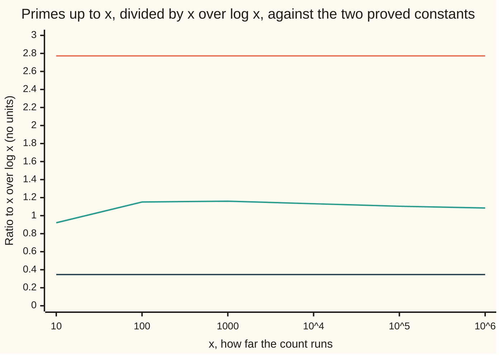

# Chebyshev's bounds: trapping the prime count between two multiples of x over log x

[Syllabus](../../../SYLLABUS.md) → [Algebraic and analytic number theory](../README.md) → [Arithmetic Functions Again](../README.md#s01) → Chebyshev's bounds

---

## General Overview

A hash table (a lookup table that files each item under a computed number) has 500 slots and is full. Many designs grow it to a prime number of slots, at most double the old size. So the program needs a prime between 500 and 1,000. Here there is one: 503, just above 500. In fact 73 primes lie between 500 and 1,000.

Bertrand guessed in 1845 that this never fails: between any number and its double there is always a prime. Chebyshev proved it in 1852. The proof on this card is a later, shorter one, found by Erdős in 1932, and it uses a single number as a measuring scale.

The number is C(1000, 500), the count of ways to choose 500 things from 1,000. It has 300 digits. Two facts about it do all the work:

- **We know its size.** It is a little under 4 multiplied by itself 500 times: that number divided by 39.6.
- **We can read its prime factors exactly.** Every prime between 500 and 1,000 divides it exactly once. No prime between 333 and 500 divides it at all. Small primes divide it, but only a few times each.

Too many primes between 500 and 1,000 would make the number too big. Too few primes below 1,000 overall would make it too small. Squeezed from both sides, the prime count is trapped. The same squeeze, pushed one step further, leaves no room for a stretch from 500 to 1,000 with no prime in it.

**The middle binomial coefficient C(2n, n) has a known size and a readable list of prime factors, so it caps how many primes lie between n and 2n, forces enough primes below 2n, and leaves no room for a gap from n to 2n.**

**What kind of fact this is:** three theorems, all proved on this card in Why it works: an upper bound and a lower bound on the prime count, and Bertrand's postulate. The code's counts to a million are evidence beside the proofs, not part of them.

### The picture: the ratio stays inside the trap



The top line is the proved ceiling, 2.7726. The middle line is the true ratio, counted by a sieve. The bottom line is the proved floor, 0.3466. The trap is wide, but it holds at every size, and it is a proof, not a test.

---

## The formula

Notation first, in words. $`\pi(x)`$ counts the primes up to $`x`$ (wing 02's prime counting function, nothing to do with circles). $`\log`$ is the natural log, base e, as everywhere in this wing. $`p`$ always stands for a prime.

This card introduces one new symbol. $`v_p(a)`$ is the number of times the prime $`p`$ divides the whole number $`a`$. For example, $`v_3(C(1000,500)) = 4`$: three divides C(1000, 500) four times, and no more.

The prime factors of the middle coefficient come from one sum, Legendre's formula, with $`\lfloor y\rfloor`$ meaning $`y`$ rounded down:

```math
v_p\big(C(2n,n)\big) = \sum_{k \ge 1} \Big( \Big\lfloor \frac{2n}{p^k} \Big\rfloor - 2\Big\lfloor \frac{n}{p^k} \Big\rfloor \Big), \qquad \text{each term is } 0 \text{ or } 1
```

**Read it aloud:** the power of p in the middle coefficient is a sum of zeros and ones, one for each power of p up to 2n.

That sum gives the two bounds on the prime count, for every real number x from 2 up:

```math
\frac{\log 2}{2} \cdot \frac{x}{\log x} \;\le\; \pi(x) \;\le\; 4\log 2 \cdot \frac{x}{\log x}
```

**Read it aloud:** the number of primes up to x is at least 0.3466 times x over log x and at most 2.7726 times x over log x.

At x = 1,000 that reads 50.17 ≤ 168 ≤ 401.37. The squeeze also gives Bertrand's postulate:

```math
\text{for every whole number } n \ge 1 \text{ there is a prime } p \text{ with } n < p \le 2n
```

**Read it aloud:** between any whole number and its double there is at least one prime.

| Symbol | Plain meaning | In our example | Push it up and the answer… |
| --- | --- | --- | --- |
| $`x`$ | how far the prime count runs, any real number from 2 up | 1,000 | more primes, but a thinner share of all numbers |
| $`\pi(x)`$ | how many primes there are up to $`x`$ | 168 | — |
| $`\log x`$ | the natural log of $`x`$ | log 1,000 = 6.9078 | grows very slowly |
| $`n`$ | half the row number: the coefficient is C(2n, n) | 500 | the coefficient grows about fourfold per step |
| $`p`$ | a prime | 503, the first above 500 | — |
| $`C(2n,n)`$ | the middle entry of row 2n of Pascal's triangle | C(1000, 500): 300 digits, log 689.47 | — |
| $`v_p(a)`$ | how many times $`p`$ divides the whole number $`a`$ | 4, for p = 3 and a = C(1000, 500) | — |
| $`k`$ | which power of $`p`$ a term of Legendre's sum tests | p, then p², up to 2n | — |
| $`\lfloor y\rfloor`$ | $`y`$ rounded down to a whole number | 1,000/3 rounds down to 333 | — |
| $`\prod_{p \le y} p`$; $`\psi(x)`$ | all the primes up to $`y`$, multiplied together; the log of the least common multiple of 1 to $`x`$ (What this builds on) | used in Step 6 with y = 2n/3; ψ(1000) ≥ 689.47 | — |
| $`m`$, $`h`$ | in the upper-bound fold: a whole number, and half of it rounded up | 1,000 and 500 | — |
| $`j`$; $`q`$, $`q'`$; $`f(n)`$ | the number of primes in one block (Step 3); two neighbours in the prime chain (Step 6); the log of the left side minus the log of the right in Bertrand's test (Step 6 fold) | 73; 317 and 631; 686.24 − 680.54 at n = 500 | — |

### When it holds

- **x is at least 2.** Below 2 there are no primes, yet for x between 1 and 2 the floor is positive (1.28 at x = 1.5), so the lower bound fails. At x = 1, log x = 0 and the formula divides by zero.
- **The constants are the proved ones.** Use log 2 = 0.6931 as the floor from x = 2 and the bound asks for 2.00 primes up to 2, where there is 1. The better constant only holds for large x.
- **The window is n to 2n, closed at 2n.** For n = 1 the only prime is 2 = 2n. Shrink the window to a fixed width, such as n to n + 30, and it fails: nothing lies between 1,327 and 1,361.
- **n is at least 468 for the squeeze.** For every n below 468 the two sides of Step 6's inequality do not clash, so the squeeze proves nothing there. A list of primes, given in Step 6, has to supply the prime instead.

---

## Why it works

### Step 0: one number, known two ways

The central binomial coefficient C(2n, n) is the middle entry of row 2n of Pascal's triangle. [The middle of the row](../../04-Combinatorics%20and%20graphs/03-Binomial%20Coefficients%20and%20Identities/07-central-binomial-and-bounds.md) proves its size:

```math
\frac{4^n}{2n+1} \;\le\; C(2n,n) \;\le\; 4^n
```

For n = 500, in logs: 686.24 ≤ 689.47 ≤ 693.15. Logs turn products of primes into sums, which is why the rest of the card works in logs.

The second way to know the number is its prime factors. If the factors can be read exactly, the known size becomes a statement about primes. That is the whole idea.

### Step 1: reading the prime factors

The power of p in a factorial is Legendre's formula: $`v_p(m!)`$ adds up $`\lfloor m/p^k\rfloor`$ over k = 1, 2, 3 and so on. The first term counts the multiples of p up to m, the second the multiples of p², and so on. A number divisible by p three times is counted three times, once in each term.

The middle coefficient is $`(2n)!/(n!\,n!)`$, so its power of p is the top's count minus twice the bottom's. That is the sum in The formula.

Each term is 0 or 1. Doubling a number and rounding down gives either twice the rounded-down number or one more. So the sum has at most one term for each power of p up to 2n, and three facts follow:

1. **Primes above n, up to 2n, divide C(2n, n) exactly once.** They appear in (2n)! but not in n!.
2. **No prime power in C(2n, n) exceeds 2n.** The full power of p in it, $`p^{v_p(C(2n,n))}`$, is at most 2n.
3. **Primes above $`\sqrt{2n}`$ divide it at most once.** Their square is already past 2n.

For C(1000, 500), the code reads the primes up to 31 three independent ways: by Legendre's sum, by counting carries (the 1s carried into the next column) when 500 is added to itself in base p, and by dividing the 300-digit number itself. All three agree: 2^6 3^4 5^1 7^0 11^0 13^1 17^1 19^0 23^2 29^1 31^1. Every power stays under 1,000.

### Step 2: where the size comes from

Sort the primes up to 1,000 into four bands and add up how much of log C(1000, 500) each band supplies.

```
Share of log C(1000, 500) = 689.47, by band of primes. One block is about 10.
(500, 1000]: 73 of 73 primes   ████████████████████████████████████████████████  481.69
(333, 500]:   0 of 28 primes                                                        0.00
(31, 333]:   35 of 56 primes   ██████████████████                                 179.14
[2, 31]:      8 of 11 primes   ███                                                 28.63
```

The top band does most of the work. The band between 333 and 500 contributes nothing. Step 6 uses that empty band.

### Step 3: the ceiling on one block

The primes above n, up to 2n, each divide C(2n, n) once, so their product is at most C(2n, n), which is below $`4^n`$. Each of them is bigger than n. If there are $`j`$ of them, then $`n^{j} < 4^n`$, and taking logs:

```math
\pi(2n) - \pi(n) \;<\; \frac{n \log 4}{\log n}
```

**Read it aloud:** the primes between n and 2n number fewer than n log 4 over log n.

For n = 500: 500 × 1.3863 / 6.2146 = 111.54, so at most 111 primes lie between 500 and 1,000. The sieve finds 73.

### Step 4: the floor on the whole count

Now go the other way. C(2n, n) is made only of primes up to 2n, and by Step 1 each one contributes at most a factor of 2n. There are $`\pi(2n)`$ such primes, so $`C(2n,n) \le (2n)^{\pi(2n)}`$. Taking logs:

```math
\pi(2n) \;\ge\; \frac{\log C(2n,n)}{\log 2n} \;\ge\; \frac{n \log 4 - \log(2n+1)}{\log 2n}
```

**Read it aloud:** the primes up to 2n number at least the log of the middle coefficient over the log of 2n.

For n = 500: 689.47 / 6.9078 = 99.81, so at least 100 primes lie below 1,000. The sieve finds 168.

### Step 5: from blocks to every x

Steps 3 and 4 speak only about even numbers and single blocks. Two short arguments turn them into the bounds for every real x from 2 up.

- **Floor.** For x at least 10, Step 4 at the even number just below x already clears 0.3466 x / log x. A direct check covers x from 2 to 10. Equality holds exactly at x = 2.
- **Ceiling.** Stack the blocks. The primes up to m are the primes up to half of m, plus one block. By induction (proving a claim for each m from the claim for smaller m), the count stays under 2.7726 m / log m. The induction step holds from m = 22, and a direct check covers m below 22.

<details>
<summary>Detailed proof: the floor and the ceiling for every x from 2 up</summary>

**Floor, x from 10 up.** Let n be x/2 rounded down, so n is at least 5 and 2n ≤ x < 2n + 2. Then π(x) ≥ π(2n). The function x/log x rises for x above e, so it is enough to show π(2n) ≥ (log 2/2)(2n + 2)/log(2n + 2). By Step 4 it is enough that

$`\displaystyle \frac{2n\log 2 - \log(2n+1)}{\log 2n} \ge \frac{(n+1)\log 2}{\log(2n+2)}`$

Since log 2n is smaller than log(2n + 2), this follows from 2n log 2 − log(2n + 1) ≥ (n + 1) log 2. That is $`2^{n-1} \ge 2n+1`$, true for n ≥ 5, where 16 beats 11, and the left side doubles at each step while the right grows by 2.

**Floor, x from 2 to 10.** For x from 2 to 3, π(x) = 1, and x/log x is largest at x = 2, where the bound is exactly 1. For x from 3 to 10, π(x) is at least 2, and x/log x is largest at x = 10, so the bound is at most 0.3466 × 4.34 = 1.51.

**Ceiling.** Let m ≥ 2 and let h be m/2 rounded up. Every prime p with h < p ≤ m divides C(m, h): it appears in m! but not in h! or (m − h)!, which stop at h. C(m, h) is one entry of row m, which adds to $`2^m`$, so C(m, h) < $`2^m`$. Each such prime exceeds h, so if there are j of them then $`h^{j} < 2^m`$ and j < m log 2 / log h.

Assume π(h) ≤ 4 log 2 · h/log h, the claim for the smaller number h. Then π(m) < (4 log 2 · h + m log 2)/log h. Put h ≤ (m + 1)/2 on top and log h ≥ log m − log 2 underneath:

$`\displaystyle \pi(m) < \frac{\log 2\,(3m+2)}{\log m - \log 2}`$

This is at most 4 log 2 · m / log m exactly when log m ≥ 4 log 2 + 2 log m / m. The left side rises with m and the right side falls, and the code finds the first m where it holds: 22. Below 22 the code checks π(m) directly. Real x follow, since π(x) = π(m) for m the whole part of x, and m/log m ≤ x/log x once m ≥ 3. For x below 3 the bound is above 1 = π(x).

</details>

### Step 6: Bertrand's postulate

Suppose, for some n, no prime lies between n and 2n. Then every prime factor of C(2n, n) is at most n. Step 1 says more:

- **Primes from 2n/3 to n do not divide it at all**, once n is at least 5. Such a prime appears twice in (2n)!, as p and 2p, and twice in n! n!, once in each. Its square is past 2n, so nothing else counts. The code confirms the band is empty for every n up to 2,000, with one exception: at n = 2 the prime 2 divides C(4, 2), because 2 squared is not past 4.
- **Primes from $`\sqrt{2n}`$ to 2n/3 divide it at most once**, so together they give at most the product of all primes up to 2n/3. That product is below $`4^{2n/3}`$ (the fold proves it).
- **Primes up to $`\sqrt{2n}`$** number at most $`\sqrt{2n}`$, and each gives at most a factor 2n.

Put together, and compared with the lower end of the sandwich, this is Erdős's inequality:

```math
\frac{4^n}{2n+1} \;\le\; C(2n,n) \;\le\; (2n)^{\sqrt{2n}} \cdot 4^{2n/3}
```

**Read it aloud:** if there were no prime between n and 2n, the middle coefficient would have to fit under a much smaller ceiling.

The left side grows like $`4^n`$ and the right like $`4^{2n/3}`$ times something slower, so the inequality must fail for large n. When it fails, the supposition was false and a prime exists. For n = 500, in logs: 218.44 + 462.10 = 680.54 on the right against 686.24 on the left. It fails, so a prime lies between 500 and 1,000.

The code finds that the inequality fails for every n from 468 up. For n below 468, Landau's chain of primes, each less than twice the one before, does the job: 2, 3, 5, 7, 13, 23, 43, 83, 163, 317, 631. Any n from 2 to 630 sits between two neighbours q and q′ of the chain, with q ≤ n < q′ < 2q ≤ 2n. For n = 1 the prime is 2.

<details>
<summary>Detailed proof: the product of the primes up to y is below 4^y, and the inequality keeps failing</summary>

**The product bound.** Claim: for every whole number y ≥ 1, the primes up to y multiply to less than $`4^y`$. Check y = 1 and 2 by hand: 1 < 4 and 2 < 16. For even y above 2, y is not prime, so the product equals the one for y − 1, which is below $`4^{y-1}`$. For odd y = 2k + 1, the primes from k + 2 to 2k + 1 all divide C(2k + 1, k), which is at most $`4^k`$: it and its twin C(2k + 1, k + 1) are two equal entries of a row that adds to $`2^{2k+1}`$. So the product is below $`4^{k+1} \cdot 4^{k} = 4^{2k+1}`$, using the claim for k + 1.

**The inequality keeps failing.** Write f(n) for the log of the left side minus the log of the right:

$`\displaystyle f(n) = \frac{n\log 4}{3} - \log(2n+1) - \sqrt{2n}\,\log 2n`$

Its rate of change is log 4/3 − 2/(2n + 1) − (log 2n + 2)/√(2n). The last two parts shrink as n grows, so once the rate is positive it stays positive. The code finds the first n with f(n) > 0 and a positive rate: 468. From there f stays positive, so the inequality fails for every n ≥ 468.

</details>

---

## Worked numbers, by hand

The scale is C(1000, 500), with n = 500.

| Step | Arithmetic | Value |
| --- | --- | --- |
| first prime above 500 | the sieve, read upward from 500 | 503 |
| size of the scale, in logs | 686.24 ≤ log C(1000, 500) ≤ 693.15 | 689.47 |
| ceiling on the block 500 to 1,000 | 500 × 1.3863 / 6.2146 | 111.54, so at most 111 |
| floor on the primes below 1,000 | 689.47 / 6.9078 | 99.81, so at least 100 |
| the general bounds at 1,000 | 0.3466 × 144.76 and 2.7726 × 144.76 | 50.17 and 401.37 |
| Bertrand's test, right side | 31.62 × 6.9078 + 1,000 × 1.3863 / 3 | 218.44 + 462.10 = 680.54 |
| Bertrand's test, left side | 693.15 − log 1,001 | **686.24 > 680.54: a prime exists** |

Without listing a single prime, the squeeze proves at least 100 primes below 1,000, at most 111 between 500 and 1,000, and at least one there. The sieve finds 168 in all, 73 of them in the top block, the first being 503.

### What breaks if you drop a piece

| Mistake | Comes out at | What went wrong |
| --- | --- | --- |
| Using row n's total $`2^n`$ in place of row 2n's $`4^n`$ in Step 3 | at most 55 primes from 500 to 1,000; there are 73 | Row 1,000 adds to $`4^{500}`$, so the ceiling was set far too low |
| Reading x/log x as a ceiling on the count | 144.76 at 1,000; there are 168 primes | x/log x is an estimate, and it runs low (How primes thin out) |
| Using the asymptotic floor log 2 from x = 2 | asks for 2.00 primes up to 2; there is 1 | the better constant needs large x; the proved one is half of it |
| A fixed window, n to n + 30, in place of n to 2n | empty for n = 1,327: the next prime is 1,361 | prime gaps grow without limit; only a window that grows with n is safe |

The code prints all four.

---

## Code, from first principles, and it actually runs

The script sieves the primes up to a million and counts them exactly. It takes three independent roads to the prime factors of C(1000, 500): Legendre's sum of floors, the carries in adding 500 to itself in base p, and (in Python) the 300-digit number itself, built by its own loop rather than a library call. It then tests each theorem against the count: the two bounds at six sizes and over every x up to a million, and Bertrand's postulate both by the squeeze plus the prime chain and by checking every n up to 500,000 with the sieve. The output is identical in both languages.

### Python

```python
# Chebyshev's bounds -- the check behind the card.  Standard library only;
# math.comb is not used, since the middle binomial coefficient is the idea here.
from math import log, sqrt

N = 1_000_000                                # every count below is exact to N
sieve = bytearray([1]) * (N + 1)
sieve[0] = sieve[1] = 0
for i in range(2, int(N ** 0.5) + 1):
    if sieve[i]:
        sieve[i * i::i] = bytearray(len(range(i * i, N + 1, i)))
pi, c = [0] * (N + 1), 0                     # pi[x]: primes up to x, by sieve
for x in range(N + 1):
    c += sieve[x]
    pi[x] = c
primes = [p for p in range(2, N + 1) if sieve[p]]

def legendre(n, p):                          # road 1: v_p(C(2n,n)) by floors
    v, q = 0, p
    while q <= 2 * n:
        t = 2 * n // q - 2 * (n // q)
        assert t in (0, 1)                   # each term is 0 or 1
        v, q = v + t, q * p
    return v

def carries(n, p):                           # road 2: carries in n + n, base p
    v, carry = 0, 0
    while n > 0 or carry:
        carry = 1 if 2 * (n % p) + carry >= p else 0
        v, n = v + carry, n // p
    return v

n = 500
nxt = next(p for p in primes if p > n)
cbig = 1                                     # road 3: C(1000,500) as a whole number
for i in range(1, n + 1):
    cbig = cbig * (n + i) // i
lnC = sum(legendre(n, p) * log(p) for p in primes if p <= 2 * n)
print(f"n = {n}: first prime above n = {nxt}, primes in (n, 2n] = {pi[2*n] - pi[n]}")
digits = int(lnC / log(10)) + 1
assert digits == len(str(cbig))
print(f"C(1000,500): {digits} digits, log = {lnC:.2f}")
print(f"sandwich: {n*log(4) - log(2*n+1):.2f} <= {lnC:.2f} <= {n*log(4):.2f}; 4^500 / C(1000,500) = {4**n / cbig:.1f}")
small = []
for p in primes:
    if p > 2 * n:
        break
    v, w, rest = legendre(n, p), carries(n, p), cbig
    assert v == w                            # floors agree with carries
    k = 0
    while rest % p == 0:
        rest, k = rest // p, k + 1
    assert k == v and p ** v <= 2 * n        # and with the whole number
    if p * p <= 2 * n:
        small.append(f"{p}^{v}")
print("primes up to 31 in C(1000,500):", " ".join(small))
bands = [("(500, 1000]", 500, 1000), ("(333, 500]", 333, 500),
         ("(31, 333]", 31, 333), ("[2, 31]", 1, 31)]
for name, lo, hi in bands:
    ps = [p for p in primes if lo < p <= hi]
    hit = [p for p in ps if legendre(n, p) > 0]
    share = sum(legendre(n, p) * log(p) for p in hit)
    print(f"band {name:<12} {len(hit):>3} of {len(ps):>3} primes divide, log share {share:.2f}")
up = n * log(4) / log(n)
lo = lnC / log(2 * n)
print(f"upper, primes in (500, 1000] < {up:.2f}, so at most {int(up)}; true {pi[1000] - pi[500]}")
print(f"lower, pi(1000) >= {lo:.2f}, so at least {int(lo) + 1}; true {pi[1000]}")
assert pi[1000] - pi[500] <= int(up) and pi[1000] >= int(lo) + 1
L, U = log(2) / 2, 4 * log(2)
print(f"constants: log 2/2 = {L:.4f}, 4 log 2 = {U:.4f}, log 2 = {log(2):.4f}, log 4 = {log(4):.4f}")
print(f"logs: log 500 = {log(500):.4f}, log 1000 = {log(1000):.4f}, sqrt(1000) = {sqrt(1000):.2f}")
print("x  pi(x)  x/log x  ratio  lower  upper")
for e in range(1, 7):
    x = 10 ** e
    m = x / log(x)
    print(f"{x} {pi[x]} {m:.2f} {pi[x]/m:.4f} {L*m:.2f} {U*m:.2f}")
    assert L * m <= pi[x] <= U * m
assert [pi[10**e] for e in range(1, 7)] == [4, 25, 168, 1229, 9592, 78498]   # OEIS A006880
print(f"below 2: floor at x = 1.5 is {L * 1.5 / log(1.5):.2f}, but pi(1.5) = {pi[1]}")
lows = [(log(2) / 2, 2)] + [((pi[q] - 1) * log(q) / q, q) for q in primes[1:]]
lows.append((pi[N] * log(N) / N, N))         # ratio at the left of each jump
highs = [(pi[p] * log(p) / p, p) for p in primes if p >= 3]
lo_r, hi_r = min(lows), max(highs)
A = (log(2)/2 + log(3)/3 + log(5)/5 - log(30)/30)
print(f"Chebyshev 1852 constants: {A:.5f} and {6*A/5:.5f}")
print(f"ratio over [2, {N}]: least {lo_r[0]:.5f} at x = {lo_r[1]}, most {hi_r[0]:.5f} at x = {hi_r[1]}")
assert lo_r[0] >= L - 1e-12 and hi_r[0] <= U
m0 = next(m for m in range(3, 100) if all(log(k) >= 4*log(2) + 2*log(k)/k for k in range(m, N)))
print(f"upper-bound induction step holds from m = {m0}")
assert all(pi[m] <= U * m / log(m) for m in range(2, m0))
f = lambda n: n * log(4) / 3 - log(2 * n + 1) - sqrt(2 * n) * log(2 * n)
df = lambda n: log(4) / 3 - 2 / (2 * n + 1) - (log(2 * n) + 2) / sqrt(2 * n)
n0 = next(k for k in range(5, N) if f(k) > 0 and df(k) > 0)
assert abs(f(n) - (n*log(4) - log(2*n+1) - sqrt(1000)*log(1000) - 1000*log(4)/3)) < 1e-9
print(f"Erdos at n = 500: {sqrt(1000)*log(1000):.2f} + {1000*log(4)/3:.2f} = "
      f"{sqrt(1000)*log(1000) + 1000*log(4)/3:.2f} < {n*log(4) - log(2*n+1):.2f}")
print(f"Erdos inequality forces a prime for every n >= {n0}")
assert all((f(k) > 0) == (k >= n0) for k in range(1, 20000))   # no clash below n0
chain = [2, 3, 5, 7, 13, 23, 43, 83, 163, 317, 631]
assert all(sieve[q] for q in chain) and all(b < 2 * a for a, b in zip(chain, chain[1:]))
print("Landau chain:", " ".join(map(str, chain)), "covers every n below", chain[-1])
assert chain[-1] > n0
assert all(pi[2 * k] > pi[k] for k in range(1, N // 2 + 1))
print(f"sieve: every n from 1 to {N//2} has a prime in (n, 2n]")
gone = [(k, p) for k in range(2, 2001) for p in primes if 2*k/3 < p <= k and legendre(k, p)]
print("primes in (2n/3, n] dividing C(2n,n), n up to 2000:", gone)
assert gone == [(2, 2)]
gap = next(k for k in range(1, N - 30) if pi[k + 30] == pi[k])
print(f"503 lies between 22^2 = {22**2} and 23^2 = {23**2}; x^0.525 at 10^6 = {N**0.525:.2f}")
print("what breaks:")
print(f"  2^n for 4^n: at most {int(n*log(2)/log(n))} primes in (500, 1000], true {pi[1000]-pi[500]}")
print(f"  x/log x as a ceiling at 1000: {1000/log(1000):.2f} < {pi[1000]}")
print(f"  constant log 2 from x = 2: needs {log(2)*2/log(2):.2f} primes, pi(2) = {pi[2]}")
print(f"  window (n, n + 30]: first empty at n = {gap}, between primes {gap} and {primes[pi[gap]]}")
assert int(n * log(2) / log(n)) < pi[1000] - pi[500] and gap == 1327 and sieve[gap]
print("ALL CHECKS PASS")
```

**Ran 2026-11-15 on macOS, Python 3.14.10, standard library only. All checks passed. Output, pasted from the run:**

```
n = 500: first prime above n = 503, primes in (n, 2n] = 73
C(1000,500): 300 digits, log = 689.47
sandwich: 686.24 <= 689.47 <= 693.15; 4^500 / C(1000,500) = 39.6
primes up to 31 in C(1000,500): 2^6 3^4 5^1 7^0 11^0 13^1 17^1 19^0 23^2 29^1 31^1
band (500, 1000]   73 of  73 primes divide, log share 481.69
band (333, 500]     0 of  28 primes divide, log share 0.00
band (31, 333]     35 of  56 primes divide, log share 179.14
band [2, 31]        8 of  11 primes divide, log share 28.63
upper, primes in (500, 1000] < 111.54, so at most 111; true 73
lower, pi(1000) >= 99.81, so at least 100; true 168
constants: log 2/2 = 0.3466, 4 log 2 = 2.7726, log 2 = 0.6931, log 4 = 1.3863
logs: log 500 = 6.2146, log 1000 = 6.9078, sqrt(1000) = 31.62
x  pi(x)  x/log x  ratio  lower  upper
10 4 4.34 0.9210 1.51 12.04
100 25 21.71 1.1513 7.53 60.21
1000 168 144.76 1.1605 50.17 401.37
10000 1229 1085.74 1.1320 376.29 3010.30
100000 9592 8685.89 1.1043 3010.30 24082.40
1000000 78498 72382.41 1.0845 25085.83 200686.66
below 2: floor at x = 1.5 is 1.28, but pi(1.5) = 0
Chebyshev 1852 constants: 0.92129 and 1.10555
ratio over [2, 1000000]: least 0.34657 at x = 2, most 1.25506 at x = 113
upper-bound induction step holds from m = 22
Erdos at n = 500: 218.44 + 462.10 = 680.54 < 686.24
Erdos inequality forces a prime for every n >= 468
Landau chain: 2 3 5 7 13 23 43 83 163 317 631 covers every n below 631
sieve: every n from 1 to 500000 has a prime in (n, 2n]
primes in (2n/3, n] dividing C(2n,n), n up to 2000: [(2, 2)]
503 lies between 22^2 = 484 and 23^2 = 529; x^0.525 at 10^6 = 1412.54
what breaks:
  2^n for 4^n: at most 55 primes in (500, 1000], true 73
  x/log x as a ceiling at 1000: 144.76 < 168
  constant log 2 from x = 2: needs 2.00 primes, pi(2) = 1
  window (n, n + 30]: first empty at n = 1327, between primes 1327 and 1361
ALL CHECKS PASS
```

### Rust

```rust
// Chebyshev's bounds -- the check behind the card.  std only, no crates.
// Rust has no big integers, so C(1000,500) is read through its prime exponents.
fn ln(x: f64) -> f64 { x.ln() }

fn legendre(n: u64, p: u64) -> u32 {          // road 1: v_p(C(2n,n)) by floors
    let (mut v, mut q) = (0, p);
    while q <= 2 * n {
        let t = 2 * n / q - 2 * (n / q);
        assert!(t <= 1);                      // each term is 0 or 1
        v += t as u32;
        q *= p;
    }
    v
}

fn carries(mut n: u64, p: u64) -> u32 {       // road 2: carries in n + n, base p
    let (mut v, mut carry) = (0, 0);
    while n > 0 || carry > 0 {
        carry = if 2 * (n % p) + carry >= p { 1 } else { 0 };
        v += carry as u32;
        n /= p;
    }
    v
}

fn main() {
    const N: usize = 1_000_000;
    let mut sieve = vec![true; N + 1];
    sieve[0] = false;
    sieve[1] = false;
    let mut i = 2;
    while i * i <= N {
        if sieve[i] { let mut j = i * i; while j <= N { sieve[j] = false; j += i; } }
        i += 1;
    }
    let mut pi = vec![0usize; N + 1];
    let mut c = 0;
    for x in 0..=N { if sieve[x] { c += 1; } pi[x] = c; }
    let primes: Vec<u64> = (2..=N).filter(|&p| sieve[p]).map(|p| p as u64).collect();

    let n: u64 = 500;
    let nxt = *primes.iter().find(|&&p| p > n).unwrap();
    let ln_c: f64 = primes.iter().filter(|&&p| p <= 2 * n).map(|&p| legendre(n, p) as f64 * ln(p as f64)).sum();
    println!("n = {}: first prime above n = {}, primes in (n, 2n] = {}", n, nxt, pi[1000] - pi[500]);
    let digits = (ln_c / ln(10.0)) as u64 + 1;
    println!("C(1000,500): {} digits, log = {:.2}", digits, ln_c);
    let nf = n as f64;
    println!("sandwich: {:.2} <= {:.2} <= {:.2}; 4^500 / C(1000,500) = {:.1}", nf * ln(4.0) - ln(2.0 * nf + 1.0), ln_c, nf * ln(4.0), (nf * ln(4.0) - ln_c).exp());
    let mut small = Vec::new();
    for &p in primes.iter().take_while(|&&p| p <= 2 * n) {
        let v = legendre(n, p);
        assert_eq!(v, carries(n, p));         // floors agree with carries
        assert!(p.pow(v) <= 2 * n);
        if p * p <= 2 * n { small.push(format!("{}^{}", p, v)); }
    }
    println!("primes up to 31 in C(1000,500): {}", small.join(" "));
    for (name, lo, hi) in [("(500, 1000]", 500, 1000), ("(333, 500]", 333, 500), ("(31, 333]", 31, 333), ("[2, 31]", 1, 31)] {
        let ps: Vec<u64> = primes.iter().cloned().filter(|&p| lo < p && p <= hi).collect();
        let hit: Vec<u64> = ps.iter().cloned().filter(|&p| legendre(n, p) > 0).collect();
        let share = hit.iter().fold(0.0, |s, &p| s + legendre(n, p) as f64 * ln(p as f64));
        println!("band {:<12} {:>3} of {:>3} primes divide, log share {:.2}", name, hit.len(), ps.len(), share);
    }
    let up = nf * ln(4.0) / ln(nf);
    let lo = ln_c / ln(2.0 * nf);
    println!("upper, primes in (500, 1000] < {:.2}, so at most {}; true {}", up, up as usize, pi[1000] - pi[500]);
    println!("lower, pi(1000) >= {:.2}, so at least {}; true {}", lo, lo as usize + 1, pi[1000]);
    assert!(pi[1000] - pi[500] <= up as usize && pi[1000] >= lo as usize + 1);
    let (l, u) = (ln(2.0) / 2.0, 4.0 * ln(2.0));
    println!("constants: log 2/2 = {:.4}, 4 log 2 = {:.4}, log 2 = {:.4}, log 4 = {:.4}", l, u, ln(2.0), ln(4.0));
    println!("logs: log 500 = {:.4}, log 1000 = {:.4}, sqrt(1000) = {:.2}", ln(500.0), ln(1000.0), 1000f64.sqrt());
    println!("x  pi(x)  x/log x  ratio  lower  upper");
    for e in 1..7 {
        let x = 10usize.pow(e);
        let m = x as f64 / ln(x as f64);
        println!("{} {} {:.2} {:.4} {:.2} {:.2}", x, pi[x], m, pi[x] as f64 / m, l * m, u * m);
        assert!(l * m <= pi[x] as f64 && pi[x] as f64 <= u * m);
    }
    assert_eq!((1..7).map(|e| pi[10usize.pow(e)]).collect::<Vec<_>>(), vec![4, 25, 168, 1229, 9592, 78498]); // OEIS A006880
    println!("below 2: floor at x = 1.5 is {:.2}, but pi(1.5) = {}", l * 1.5 / ln(1.5), pi[1]);
    let a = ln(2.0) / 2.0 + ln(3.0) / 3.0 + ln(5.0) / 5.0 - ln(30.0) / 30.0;
    println!("Chebyshev 1852 constants: {:.5} and {:.5}", a, 6.0 * a / 5.0);
    let mut lo_r = (ln(2.0) / 2.0, 2usize);   // ratio at the left of each jump
    for &q in &primes[1..] {
        let r = (pi[q as usize] - 1) as f64 * ln(q as f64) / q as f64;
        if r < lo_r.0 { lo_r = (r, q as usize); }
    }
    let r = pi[N] as f64 * ln(N as f64) / N as f64;
    if r < lo_r.0 { lo_r = (r, N); }
    let mut hi_r = (0.0, 0usize);
    for &p in &primes[1..] {
        let r = pi[p as usize] as f64 * ln(p as f64) / p as f64;
        if r > hi_r.0 { hi_r = (r, p as usize); }
    }
    println!("ratio over [2, {}]: least {:.5} at x = {}, most {:.5} at x = {}", N, lo_r.0, lo_r.1, hi_r.0, hi_r.1);
    assert!(lo_r.0 >= l - 1e-12 && hi_r.0 <= u);
    let step = |k: usize| ln(k as f64) >= 4.0 * ln(2.0) + 2.0 * ln(k as f64) / k as f64;
    let m0 = (3..100).find(|&m| (m..N).all(|k| step(k))).unwrap();
    println!("upper-bound induction step holds from m = {}", m0);
    assert!((2..m0).all(|m| pi[m] as f64 <= u * m as f64 / ln(m as f64)));
    let f = |k: f64| k * ln(4.0) / 3.0 - ln(2.0 * k + 1.0) - (2.0 * k).sqrt() * ln(2.0 * k);
    let df = |k: f64| ln(4.0) / 3.0 - 2.0 / (2.0 * k + 1.0) - (ln(2.0 * k) + 2.0) / (2.0 * k).sqrt();
    let n0 = (5..N).find(|&k| f(k as f64) > 0.0 && df(k as f64) > 0.0).unwrap();
    let (s1, s2) = (1000f64.sqrt() * ln(1000.0), 1000.0 * ln(4.0) / 3.0);
    assert!((f(nf) - (nf * ln(4.0) - ln(2.0 * nf + 1.0) - s1 - s2)).abs() < 1e-9);
    println!("Erdos at n = 500: {:.2} + {:.2} = {:.2} < {:.2}", s1, s2, s1 + s2, nf * ln(4.0) - ln(2.0 * nf + 1.0));
    println!("Erdos inequality forces a prime for every n >= {}", n0);
    assert!((1..20000).all(|k| (f(k as f64) > 0.0) == (k >= n0))); // no clash below n0
    let chain = [2usize, 3, 5, 7, 13, 23, 43, 83, 163, 317, 631];
    assert!(chain.iter().all(|&q| sieve[q]) && chain.windows(2).all(|w| w[1] < 2 * w[0]));
    let cs: Vec<String> = chain.iter().map(|q| q.to_string()).collect();
    println!("Landau chain: {} covers every n below {}", cs.join(" "), chain[10]);
    assert!(chain[10] > n0);
    assert!((1..=N / 2).all(|k| pi[2 * k] > pi[k]));
    println!("sieve: every n from 1 to {} has a prime in (n, 2n]", N / 2);
    let mut gone = Vec::new();
    for k in 2..2001u64 {
        for &p in primes.iter().take_while(|&&p| p <= k) {
            if 3 * p > 2 * k && legendre(k, p) > 0 { gone.push(format!("({}, {})", k, p)); }
        }
    }
    println!("primes in (2n/3, n] dividing C(2n,n), n up to 2000: [{}]", gone.join(", "));
    assert_eq!(gone, vec!["(2, 2)".to_string()]);
    let gap = (1..N - 30).find(|&k| pi[k + 30] == pi[k]).unwrap();
    println!("503 lies between 22^2 = {} and 23^2 = {}; x^0.525 at 10^6 = {:.2}", 22 * 22, 23 * 23, (N as f64).powf(0.525));
    println!("what breaks:");
    let half = (nf * ln(2.0) / ln(nf)) as usize;
    println!("  2^n for 4^n: at most {} primes in (500, 1000], true {}", half, pi[1000] - pi[500]);
    println!("  x/log x as a ceiling at 1000: {:.2} < {}", 1000.0 / ln(1000.0), pi[1000]);
    println!("  constant log 2 from x = 2: needs {:.2} primes, pi(2) = {}", ln(2.0) * 2.0 / ln(2.0), pi[2]);
    println!("  window (n, n + 30]: first empty at n = {}, between primes {} and {}", gap, gap, primes[pi[gap]]);
    assert!(half < pi[1000] - pi[500] && gap == 1327 && sieve[gap]);
    println!("ALL CHECKS PASS");
}
```

**Ran 2026-11-15 on macOS, rustc 1.98.1, no crates. All checks passed. Output, pasted from the run:**

```
n = 500: first prime above n = 503, primes in (n, 2n] = 73
C(1000,500): 300 digits, log = 689.47
sandwich: 686.24 <= 689.47 <= 693.15; 4^500 / C(1000,500) = 39.6
primes up to 31 in C(1000,500): 2^6 3^4 5^1 7^0 11^0 13^1 17^1 19^0 23^2 29^1 31^1
band (500, 1000]   73 of  73 primes divide, log share 481.69
band (333, 500]     0 of  28 primes divide, log share 0.00
band (31, 333]     35 of  56 primes divide, log share 179.14
band [2, 31]        8 of  11 primes divide, log share 28.63
upper, primes in (500, 1000] < 111.54, so at most 111; true 73
lower, pi(1000) >= 99.81, so at least 100; true 168
constants: log 2/2 = 0.3466, 4 log 2 = 2.7726, log 2 = 0.6931, log 4 = 1.3863
logs: log 500 = 6.2146, log 1000 = 6.9078, sqrt(1000) = 31.62
x  pi(x)  x/log x  ratio  lower  upper
10 4 4.34 0.9210 1.51 12.04
100 25 21.71 1.1513 7.53 60.21
1000 168 144.76 1.1605 50.17 401.37
10000 1229 1085.74 1.1320 376.29 3010.30
100000 9592 8685.89 1.1043 3010.30 24082.40
1000000 78498 72382.41 1.0845 25085.83 200686.66
below 2: floor at x = 1.5 is 1.28, but pi(1.5) = 0
Chebyshev 1852 constants: 0.92129 and 1.10555
ratio over [2, 1000000]: least 0.34657 at x = 2, most 1.25506 at x = 113
upper-bound induction step holds from m = 22
Erdos at n = 500: 218.44 + 462.10 = 680.54 < 686.24
Erdos inequality forces a prime for every n >= 468
Landau chain: 2 3 5 7 13 23 43 83 163 317 631 covers every n below 631
sieve: every n from 1 to 500000 has a prime in (n, 2n]
primes in (2n/3, n] dividing C(2n,n), n up to 2000: [(2, 2)]
503 lies between 22^2 = 484 and 23^2 = 529; x^0.525 at 10^6 = 1412.54
what breaks:
  2^n for 4^n: at most 55 primes in (500, 1000], true 73
  x/log x as a ceiling at 1000: 144.76 < 168
  constant log 2 from x = 2: needs 2.00 primes, pi(2) = 1
  window (n, n + 30]: first empty at n = 1327, between primes 1327 and 1361
ALL CHECKS PASS
```

### Lean

Lean proves both bounds on the prime count, the cap on prime powers, and Bertrand's postulate, with no case left out.

- Take any real number $`x \ge 2`$. Then $`\pi(x) \ge \frac{\log 2}{2} \cdot \frac{x}{\log x}`$, the floor.
- Take any real number $`x \ge 2`$. Then $`\pi(x) \le 4\log 2 \cdot \frac{x}{\log x}`$, the ceiling.
- Take any prime $`p`$ and whole number $`n \ge 1`$. Then $`p^{v_p(C(2n,n))} \le 2n`$: no prime power in the middle coefficient exceeds 2n.
- Take any whole number $`n \ge 1`$. Then some prime $`p`$ has $`n < p \le 2n`$. That is Bertrand's postulate.
- The card's counts are checked too: 503 is the first prime above 500, 168 primes lie below 1,000, and 73 lie above 500.
- The powers of the primes up to 31 in C(1000, 500), Landau's chain and the empty stretch from 1,327 to 1,361 are checked as well.

The thresholds 22 and 468, the sieve counts to a million and every decimal are left to the Python and Rust checks.

```lean
-- Chebyshev's bounds: for every real x ≥ 2 the prime count π(x) lies between (log 2/2)·x/log x and 4 log 2·x/log x, every prime power in C(2n, n) is at most 2n, and there is always a prime between n and 2n.
import Mathlib.NumberTheory.PrimeCounting
import Mathlib.NumberTheory.Padics.PadicVal.Basic
import Mathlib.Data.Nat.Choose.Central
import Mathlib.Analysis.SpecialFunctions.Log.Basic
import Mathlib.Tactic.NormNum.Prime
import Mathlib.NumberTheory.Chebyshev
import Mathlib.NumberTheory.Bertrand
import Mathlib.Analysis.Convex.SpecificFunctions.Basic
import Mathlib.Analysis.Complex.ExponentialBounds

open Real Finset Chebyshev in
/-- Splitting the primes up to x at y: π(x) · log y ≤ log 4 · x + y · log y. -/
lemma cheb_pi_mul_log_le {x y : ℝ} (hx : 1 ≤ x) (hy : 1 ≤ y) :
    (Nat.primeCounting ⌊x⌋₊ : ℝ) * log y ≤ log 4 * x + y * log y := calc
  _ = ∑ p ∈ Nat.primesLE ⌊x⌋₊, log y := by simp
  _ ≤ ∑ p ∈ Nat.primesLE ⌊x⌋₊, (log p + (if (p : ℝ) ≤ y then log y else 0)) := by
    refine sum_le_sum fun p _ ↦ ?_
    split_ifs with h
    · simp [log_natCast_nonneg]
    have : log y < log p := log_lt_log (by linarith) (not_le.mp h)
    linarith
  _ ≤ _ := by
    grw [← theta_le_log4_mul_x (by linarith)]
    rw [sum_add_distrib, theta_eq_theta_coe_floor, theta_eq_sum_primesLE_log, ← sum_filter]
    simp only [sum_const, nsmul_eq_mul]
    gcongr
    · exact log_nonneg hy
    refine le_trans ?_ <| Nat.floor_le (by linarith : (0 : ℝ) ≤ y)
    norm_cast
    rw [show ⌊y⌋₊ = #(Icc 1 ⌊y⌋₊) by simp]
    refine card_le_card fun p hp ↦ ?_
    simp only [mem_filter, mem_Icc, Nat.mem_primesLE] at hp ⊢
    exact ⟨hp.1.2.one_le, Nat.le_floor hp.2⟩

#print axioms cheb_pi_mul_log_le

/-- The upper bound for x ≥ 1024, splitting at y = x^(3/5). -/
lemma cheb_upper_large {x : ℝ} (hx : 1024 ≤ x) :
    (Nat.primeCounting ⌊x⌋₊ : ℝ) ≤ 4 * Real.log 2 * (x / Real.log x) := by
  set L := Real.log x with hL
  set l := Real.log 2 with hl
  have hx0 : 0 < x := by linarith
  have hl0 : 0 < l := Real.log_pos (by norm_num)
  have hl1 := Real.log_two_gt_d9
  have hl2 := Real.log_two_lt_d9
  have hL10 : 10 * l ≤ L := by
    have : Real.log 1024 = 10 * l := by
      rw [show (1024 : ℝ) = 2 ^ 10 by norm_num, Real.log_pow]; push_cast; ring
    rw [← this]; exact Real.log_le_log (by norm_num) hx
  have hLpos : 0 < L := by linarith
  set y := Real.exp (3 * L / 5) with hy
  have hy1 : 1 ≤ y := Real.one_le_exp (by linarith)
  have hlogy : Real.log y = 3 * L / 5 := Real.log_exp _
  have h4 : Real.log 4 = 2 * l := by
    rw [show (4 : ℝ) = 2 ^ 2 by norm_num, Real.log_pow]; push_cast; ring
  have key := cheb_pi_mul_log_le (x := x) (y := y) (by linarith) hy1
  rw [hlogy, h4] at key
  -- y · L ≤ (2/3) l x
  have hxexp : x = Real.exp L := (Real.exp_log hx0).symm
  set u := 2 * L / 5 with hu
  have hu4 : 4 * l ≤ u := by rw [hu]; linarith
  have hexp4 : Real.exp (4 * l) = 16 := by
    rw [hl, show 4 * Real.log 2 = Real.log (2 ^ 4) by rw [Real.log_pow]; push_cast; ring,
      Real.exp_log (by norm_num)]; norm_num
  have hexpu : 16 * (1 + (u - 4 * l)) ≤ Real.exp u := by
    have h1 := Real.add_one_le_exp (u - 4 * l)
    have h2 : Real.exp u = Real.exp (4 * l) * Real.exp (u - 4 * l) := by
      rw [← Real.exp_add]; ring_nf
    rw [h2, hexp4]; linarith
  have hLu : L ≤ 2 / 3 * l * Real.exp u := by
    have : (5 / 2) * u ≤ 2 / 3 * l * (16 * (1 + (u - 4 * l))) := by
      nlinarith [mul_le_mul_of_nonneg_left hu4 (by linarith : (0:ℝ) ≤ 32 * l / 3 - 5 / 2)]
    have h3 : 2 / 3 * l * (16 * (1 + (u - 4 * l))) ≤ 2 / 3 * l * Real.exp u :=
      mul_le_mul_of_nonneg_left hexpu (by positivity)
    rw [hu] at this h3 ⊢; linarith
  have hyL : y * L ≤ 2 / 3 * l * x := by
    have hxy : x = y * Real.exp u := by
      rw [hxexp, hy, hu, ← Real.exp_add]; ring_nf
    rw [hxy]
    have := mul_le_mul_of_nonneg_left hLu (Real.exp_pos (3 * L / 5)).le
    rw [← hy] at this; linarith
  rw [mul_div_assoc', le_div_iff₀ hLpos]
  nlinarith

#print axioms cheb_upper_large

/-- The prime counts at powers of two used for the small range. -/
lemma cheb_pi_pow_two_table :
    ∀ k < 10, 1 ≤ k → Nat.primeCounting (2 ^ (k + 1)) * (k + 1) ≤ 2 ^ (k + 2) := by
  decide +kernel

#print axioms cheb_pi_pow_two_table

/-- The upper bound for 2 ≤ x < 1024, one binary octave at a time. -/
lemma cheb_upper_small {x : ℝ} (hx : 2 ≤ x) (hx' : x < 1024) :
    (Nat.primeCounting ⌊x⌋₊ : ℝ) ≤ 4 * Real.log 2 * (x / Real.log x) := by
  set n := ⌊x⌋₊ with hn
  have hn2 : 2 ≤ n := Nat.le_floor (by exact_mod_cast hx)
  have hnx : (n : ℝ) ≤ x := Nat.floor_le (by linarith)
  have hxn : x < n + 1 := Nat.lt_floor_add_one x
  have hn1024 : n < 1024 := by
    have : (n : ℝ) < 1024 := lt_of_le_of_lt hnx hx'
    exact_mod_cast this
  set k := Nat.log 2 n with hk
  have hk1 : 2 ^ k ≤ n := Nat.pow_log_le_self 2 (by omega)
  have hk2 : n < 2 ^ (k + 1) := Nat.lt_pow_succ_log_self (by norm_num) n
  have hk_ge : 1 ≤ k := by
    rw [hk]; exact Nat.le_log_of_pow_le (by norm_num) (by simpa using hn2)
  have hk_lt : k < 10 := by
    by_contra h
    push Not at h
    have : 2 ^ 10 ≤ 2 ^ k := Nat.pow_le_pow_right (by norm_num) h
    omega
  have htab := cheb_pi_pow_two_table k hk_lt hk_ge
  have hmono : Nat.primeCounting n ≤ Nat.primeCounting (2 ^ (k + 1)) :=
    Nat.monotone_primeCounting hk2.le
  have hnat : Nat.primeCounting n * (k + 1) ≤ 2 ^ (k + 2) :=
    le_trans (Nat.mul_le_mul_right _ hmono) htab
  have hreal : (Nat.primeCounting n : ℝ) * (k + 1) ≤ 4 * 2 ^ k := by
    have : ((Nat.primeCounting n * (k + 1) : ℕ) : ℝ) ≤ ((2 ^ (k + 2) : ℕ) : ℝ) := by
      exact_mod_cast hnat
    push_cast at this
    rw [pow_succ, pow_succ] at this
    linarith
  have hx2k : (2 : ℝ) ^ k ≤ x := le_trans (by exact_mod_cast hk1) hnx
  have hxk : x < (2 : ℝ) ^ (k + 1) := by
    have : ((n : ℕ) : ℝ) + 1 ≤ ((2 ^ (k + 1) : ℕ) : ℝ) := by exact_mod_cast hk2
    push_cast at this
    linarith
  have hl0 : 0 < Real.log 2 := Real.log_pos (by norm_num)
  have hLpos : 0 < Real.log x := Real.log_pos (by linarith)
  have hLk : Real.log x ≤ (k + 1) * Real.log 2 := by
    have := Real.log_le_log (by linarith) hxk.le
    rw [Real.log_pow] at this; push_cast at this; linarith
  rw [mul_div_assoc', le_div_iff₀ hLpos]
  have hpi0 : (0 : ℝ) ≤ Nat.primeCounting n := Nat.cast_nonneg _
  calc (Nat.primeCounting n : ℝ) * Real.log x
      ≤ (Nat.primeCounting n : ℝ) * ((k + 1) * Real.log 2) :=
        mul_le_mul_of_nonneg_left hLk hpi0
    _ = ((Nat.primeCounting n : ℝ) * (k + 1)) * Real.log 2 := by ring
    _ ≤ (4 * 2 ^ k) * Real.log 2 := mul_le_mul_of_nonneg_right hreal hl0.le
    _ ≤ 4 * Real.log 2 * x := by nlinarith

#print axioms cheb_upper_small

/-- On [2, 4]: x log 2 ≤ 2 log x (the chord of the concave log). -/
lemma cheb_log_chord {x : ℝ} (hx : 2 ≤ x) (hx' : x ≤ 4) :
    x * Real.log 2 ≤ 2 * Real.log x := by
  set s := x / 2 with hs
  have hs1 : 1 ≤ s := by rw [hs]; linarith
  have hs2 : s ≤ 2 := by rw [hs]; linarith
  have h1 : (1 : ℝ) ∈ Set.Ioi 0 := by norm_num
  have h2 : (2 : ℝ) ∈ Set.Ioi 0 := by norm_num
  have ha : (0 : ℝ) ≤ 2 - s := by linarith
  have hb : (0 : ℝ) ≤ s - 1 := by linarith
  have hab : (2 - s) + (s - 1) = 1 := by ring
  have hc := strictConcaveOn_log_Ioi.concaveOn.2 h1 h2 ha hb hab
  simp only [smul_eq_mul, Real.log_one, mul_zero, zero_add, mul_one] at hc
  have hsx : (2 - s) + (s - 1) * 2 = s := by ring
  rw [hsx] at hc
  have hx2 : x = 2 * s := by rw [hs]; ring
  rw [hx2, Real.log_mul (by norm_num) (by linarith)]
  nlinarith

#print axioms cheb_log_chord

/-- The lower bound. -/
lemma cheb_lower {x : ℝ} (hx : 2 ≤ x) :
    Real.log 2 / 2 * (x / Real.log x) ≤ (Nat.primeCounting ⌊x⌋₊ : ℝ) := by
  set n := ⌊x⌋₊ with hn
  have hnx : (n : ℝ) ≤ x := Nat.floor_le (by linarith)
  have hxn : x < n + 1 := Nat.lt_floor_add_one x
  have hl0 : 0 < Real.log 2 := Real.log_pos (by norm_num)
  have hLpos : 0 < Real.log x := Real.log_pos (by linarith)
  rcases lt_or_ge x 4 with h4 | h4
  · have hn2 : 2 ≤ n := Nat.le_floor (by exact_mod_cast hx)
    have hpi : 1 ≤ Nat.primeCounting n := by
      have : Nat.primeCounting 2 ≤ Nat.primeCounting n := Nat.monotone_primeCounting hn2
      have h2 : Nat.primeCounting 2 = 1 := by decide
      omega
    have hpi' : (1 : ℝ) ≤ Nat.primeCounting n := by exact_mod_cast hpi
    have hc := cheb_log_chord hx h4.le
    have : Real.log 2 / 2 * (x / Real.log x) ≤ 1 := by
      rw [mul_div_assoc', div_le_one hLpos]
      linarith
    linarith
  · have hn4 : 4 ≤ n := Nat.le_floor (by exact_mod_cast h4)
    have hge := Chebyshev.pi_ge_of_four_le hn4
    have hnpos : (0 : ℝ) < n := by exact_mod_cast (by omega : 0 < n)
    have hlogn : 0 < Real.log n := Real.log_pos (by exact_mod_cast (by omega : 1 < n))
    have hlognx : Real.log n ≤ Real.log x := Real.log_le_log hnpos hnx
    have hx2n : x / 2 ≤ n := by
      have : (1 : ℝ) ≤ n := by exact_mod_cast (by omega : 1 ≤ n)
      linarith
    refine le_trans ?_ hge
    rw [div_mul_div_comm, div_le_div_iff₀ (by positivity) hlogn]
    have h1 : Real.log 2 * x * Real.log n ≤ Real.log 2 * x * Real.log x :=
      mul_le_mul_of_nonneg_left hlognx (by positivity)
    have h2 : Real.log 2 * x * Real.log x ≤ (n * Real.log 2) * (2 * Real.log x) := by
      nlinarith [mul_le_mul_of_nonneg_left hx2n (mul_pos hl0 hLpos).le]
    linarith

#print axioms cheb_lower

/-- Chebyshev's bounds. For every real number x from 2 up, the number of primes up to x is
at least (log 2 / 2) times x / log x and at most 4 log 2 times x / log x:
(log 2 / 2) · x / log x ≤ π(x) ≤ 4 log 2 · x / log x. -/
theorem chebyshev_bounds (x : ℝ) (hx : 2 ≤ x) :
    Real.log 2 / 2 * (x / Real.log x) ≤ (Nat.primeCounting ⌊x⌋₊ : ℝ) ∧
      (Nat.primeCounting ⌊x⌋₊ : ℝ) ≤ 4 * Real.log 2 * (x / Real.log x) := by
  refine ⟨cheb_lower hx, ?_⟩
  rcases lt_or_ge x 1024 with h | h
  · exact cheb_upper_small hx h
  · exact cheb_upper_large h

/-- No prime power in the middle coefficient exceeds 2n: for every prime p and every whole
number n ≥ 1, the full power of p dividing C(2n, n), namely p ^ v_p(C(2n, n)), is at most 2n. -/
theorem central_binom_prime_power_le_two_mul (p n : ℕ) (hp : p.Prime) (hn : 1 ≤ n) :
    p ^ padicValNat p (Nat.centralBinom n) ≤ 2 * n := by
  rw [← Nat.factorization_def _ hp, Nat.centralBinom_eq_two_mul_choose]
  exact Nat.pow_factorization_choose_le (by omega)

/-- Bertrand's postulate. For every whole number n ≥ 1 there is a prime p with n < p ≤ 2n. -/
theorem bertrand_postulate (n : ℕ) (hn : 1 ≤ n) :
    ∃ p, p.Prime ∧ n < p ∧ p ≤ 2 * n := by
  exact Nat.exists_prime_lt_and_le_two_mul n (by omega)

-- The card's example: 503 is the first prime above 500.
example : Nat.Prime 503 ∧ ∀ m ∈ Finset.Ioo 500 503, ¬ m.Prime := by
  refine ⟨by norm_num, ?_⟩
  decide +kernel

-- 168 primes up to 1,000, and 168 − 95 = 73 of them lie between 500 and 1,000.
example : Nat.primeCounting 1000 = 168 ∧ Nat.primeCounting 1000 - Nat.primeCounting 500 = 73 := by
  decide +kernel

-- The primes up to 31 in C(1000, 500): 2^6 3^4 5^1 7^0 11^0 13^1 17^1 19^0 23^2 29^1 31^1.
example : [2, 3, 5, 7, 11, 13, 17, 19, 23, 29, 31].map (fun p => padicValNat p (Nat.centralBinom 500))
    = [6, 4, 1, 0, 0, 1, 1, 0, 2, 1, 1] := by
  decide +kernel

-- Landau's chain: each is prime and each is less than twice the one before.
example : [2, 3, 5, 7, 13, 23, 43, 83, 163, 317, 631].all Nat.Prime ∧
    [(2, 3), (3, 5), (5, 7), (7, 13), (13, 23), (23, 43), (43, 83), (83, 163), (163, 317),
      (317, 631)].all (fun q => q.2 < 2 * q.1) := by
  decide +kernel

-- For n = 1 the prime is 2 = 2n.
example : Nat.Prime 2 ∧ 1 < 2 ∧ 2 ≤ 2 * 1 := by norm_num

-- What breaks: a fixed window n to n + 30 fails, since nothing lies between 1,327 and 1,361.
example : Nat.Prime 1327 ∧ Nat.Prime 1361 ∧ ∀ m ∈ Finset.Ioo 1327 1361, ¬ m.Prime := by
  refine ⟨by norm_num, by norm_num, ?_⟩
  decide +kernel

#print axioms chebyshev_bounds
#print axioms central_binom_prime_power_le_two_mul
#print axioms bertrand_postulate
```

**Checked 2026-11-15 on macOS, Lean 4.36.0-rc2, Mathlib v4.36.0-rc2. Every proof is complete and uses only Lean's standard axioms. Output, pasted from the run:**

```
'cheb_pi_mul_log_le' depends on axioms: [propext, Classical.choice, Quot.sound]
'cheb_upper_large' depends on axioms: [propext, Classical.choice, Quot.sound]
'cheb_pi_pow_two_table' depends on axioms: [propext, Classical.choice, Quot.sound]
'cheb_upper_small' depends on axioms: [propext, Classical.choice, Quot.sound]
'cheb_log_chord' depends on axioms: [propext, Classical.choice, Quot.sound]
'cheb_lower' depends on axioms: [propext, Classical.choice, Quot.sound]
'chebyshev_bounds' depends on axioms: [propext, Classical.choice, Quot.sound]
'central_binom_prime_power_le_two_mul' depends on axioms: [propext, Classical.choice, Quot.sound]
'bertrand_postulate' depends on axioms: [propext, Classical.choice, Quot.sound]
```

> [!TIP]
> **Try changing**
> Guess first, then run the Python. The asserts are pinned to the card's numbers, so expect some changes to stop the program.
> - **Guess first: is a window of 20 safe?** Change `k + 30` to `k + 20` in the line that sets `gap`. The last line reports the first empty window at n = 1,129, where the next prime is 1,151, and the final assert stops the run.
> - **Guess first: does the floor survive the better constant?** Change `L, U = log(2) / 2` to `L, U = log(2)`. The table still passes, since 0.6931 fits under the ratio at every power of 10, but the sweep over every x stops it: the least ratio is 0.34657, at x = 2.
> - **Guess first: can the prime chain be shorter?** Delete `631` from `chain`. The chain then covers only n below 317, short of 468, and the assert `chain[-1] > n0` stops the run.

---

## The usual mistake

> [!warning]
> **Reading the bounds as an estimate of the count.** The trap says where π(x) cannot be, not where it is. At a million it allows anything from 25,085.83 to 200,686.66; the truth is 78,498, a ratio of 1.0845 to x/log x. That the ratio tends to 1 is the prime number theorem, which needs far more than this card.
>
> - **Expecting the ceiling to tighten into an estimate.** The proved constants 0.3466 and 2.7726 never move. Chebyshev's own 1852 weights narrow them to 0.92129 and 1.10555 for large x, still a trap, not a value.
> - **Using $`2^n`$ for the row total.** The ceiling on the block 500 to 1,000 drops to 55, below the true 73.
> - **Assuming every prime divides C(2n, n) at most once.** Only primes above $`\sqrt{2n}`$ are sure to. In C(1000, 500) the code finds 3^4 and 23^2, which is why Step 4 charges each prime up to 2n, not p.
> - **Taking Bertrand for a short-gap law.** It allows a gap almost as long as n. A fixed window of 30 is already empty after 1,327.

---

## Where you meet it in real life

- **Generating keys for encryption.** Public-key codes need large random primes. Bertrand's postulate guarantees that a search starting at any n finds a prime by 2n at the latest, so the search can never run forever. The ratio, about one prime in every log n numbers, says how long it usually takes.
- **Hash tables in software.** Some hash tables (lookup tables that place items by a computed number) grow to a prime size, roughly doubling each time. Bertrand's postulate guarantees a prime is always available between the old size and twice it: a full table of 500 slots can grow to 503, or to any of the 73 primes between 500 and 1,000.
- **Proofs elsewhere in number theory.** Wherever an argument needs "there are about x/log x primes up to x" only to within a constant, this card's bounds suffice and the prime number theorem is not needed. [Mertens' theorems](09-mertens-theorems.md) starts from exactly this.

> **Say it back**
> The middle binomial coefficient C(2n, n) is between $`4^n/(2n+1)`$ and $`4^n`$. Legendre's formula shows every prime from n to 2n divides it once and no prime power in it exceeds 2n. The first fact caps the primes between n and 2n; the second forces enough primes below 2n. Together they trap π(x) between 0.3466 and 2.7726 times x/log x. If no prime lay between n and 2n, the coefficient would be too small for its known size, so there is always one, such as 503 above 500.

---

## What this builds on

- [The middle of the row](../../04-Combinatorics%20and%20graphs/03-Binomial%20Coefficients%20and%20Identities/07-central-binomial-and-bounds.md): the sandwich $`4^n/(2n+1) \le C(2n,n) \le 4^n`$, the known size of the scale.
- [How primes thin out](../../02-Number%20theory/07-For%20the%20Curious/03-how-primes-thin-out.md): π(x), the x/log x rule and the counts 168 and 78,498 that this card traps with a proof.
- [The von Mangoldt function](04-von-mangoldt-and-the-logarithmic-derivative.md): logs of primes as weights, the language in which the band shares of Step 2 are sums. Its ψ(x), the log of the least common multiple of 1 to x, is trapped the same way. By fact 2 of Step 1, C(2n, n) divides that multiple at x = 2n, so ψ(1000) ≥ 689.47; Step 6's product bound, with that card's Step 5, caps ψ(x) at a fixed multiple of x.
- [Partial summation](06-abel-and-partial-summation.md): moves between a count of primes and a sum of their logs, the step that carries these bounds into Mertens' theorems.

## Where this goes next

- [Mertens' theorems](09-mertens-theorems.md): this card's bounds turned into the sizes of the sums of log p / p and of 1/p over the primes up to x.
- [Zeta's zeros and the primes](../../07-Complex%20analysis/09-Special%20Functions%20and%20the%20Zeta%20Function/09-zeros-of-zeta-and-the-primes.md): the prime number theorem, where the trap closes to a ratio of 1.
- [Large gaps](../04-Sieves%20and%20Prime%20Gaps/06-large-gaps-and-the-cramer-model.md): how long a stretch with no prime can be, far below Bertrand's n.
- [Landau's four problems](../04-Sieves%20and%20Prime%20Gaps/08-landau-problems-and-legendre.md): Legendre's conjecture, a prime between every two squares, such as 503 between 22² = 484 and 23² = 529, open as of 2026-11-15. The best proved result is a prime in every window from x to $`x + x^{0.525}`$ for large x (Baker, Harman and Pintz, 2001). For scale, $`x^{0.525}`$ is 1,412.54 at a million, though the theorem is proved only for far larger x.

The question this card leaves open: the ratio of π(x) to x/log x stays between two constants, but does it settle down to one value?

---

## Sources

Verified 2026-11-15: every link below resolves to the publisher's page.

- Tchebichef, P. "Mémoire sur les nombres premiers." *Journal de mathématiques pures et appliquées* 17 (1852), 366–390. [Numdam page](http://www.numdam.org/item/JMPA_1852_1_17__366_0/). The original proof of the bounds and of Bertrand's postulate, with the constants 0.92129 and 1.10555.
- Apostol, Tom M. *Introduction to Analytic Number Theory*. Springer, 1976. [doi:10.1007/978-1-4757-5579-4](https://doi.org/10.1007/978-1-4757-5579-4). Chapter 4 proves Chebyshev's bounds from the central binomial coefficient.
- Aigner, Martin, and Günter M. Ziegler. *Proofs from THE BOOK*, 6th ed. Springer, 2018. [doi:10.1007/978-3-662-57265-8](https://doi.org/10.1007/978-3-662-57265-8). Erdős's proof of Bertrand's postulate, with the prime chain for small n.
- Baker, R. C., G. Harman, and J. Pintz. "The difference between consecutive primes, II." *Proceedings of the London Mathematical Society* 83 (2001), 532–562. [doi:10.1112/plms/83.3.532](https://doi.org/10.1112/plms/83.3.532). A prime in every window from x to $`x + x^{0.525}`$, for large x.
- OEIS Foundation. Sequence A006880, the number of primes below powers of 10. [oeis.org/A006880](https://oeis.org/A006880). Where 4, 25, 168, 1,229, 9,592 and 78,498 were checked.
