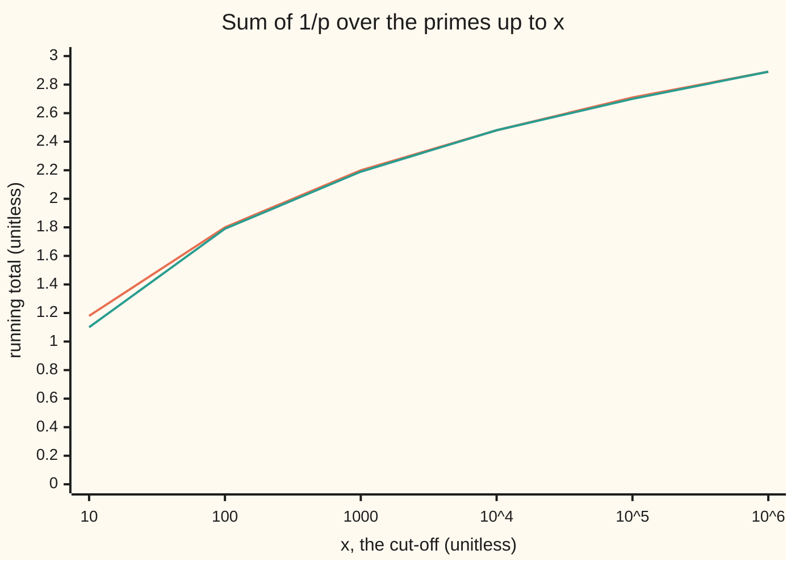

# Mertens' theorems: the reciprocals of the primes add up like log log x

[Syllabus](../../../SYLLABUS.md) → [Algebraic and analytic number theory](../README.md) → [Arithmetic Functions Again](../README.md#s01) → Mertens' theorems

---

## General Overview

There are 78,498 primes below a million. Take one over each and add: 1/2 + 1/3 + 1/5 + 1/7 + … + 1/999,983. A sieve and a computer give **2.887328**. That is about 2.9, from 78,498 terms.

The total never stops growing, but it grows extremely slowly. It first passes 3 at the prime 5,195,977. To reach 4 it needs primes up to about 1.80 × 10^18. Each extra 1 in the total multiplies log x by e.

In 1874 Franz Mertens found the exact rate. The total is $`\log\log x + M`$, where $`\log`$ is the natural logarithm, x is the cut-off and M = 0.261497 is a fixed number. At a million that is 2.625792 + 0.261497 = 2.887289, which misses the true sum by 0.000039.

He proved three estimates in one chain. They size any sum or product taken over the primes up to x, without listing a single prime:

- **Theorem 1:** the primes, each weighted by log p / p, add up to log x, give or take a fixed amount.
- **Theorem 2:** the reciprocals 1/p add up to log log x + M, with an error that shrinks like 1/log x.
- **Theorem 3:** the product of (1 − 1/p) is about $`e^{-\gamma}/\log x`$, with γ = 0.577216 Euler's constant. That product is the long-run share of all whole numbers with no prime factor up to x.

**Counting the primes inside n! fixes the weighted sum of log p / p at log n; dividing out the logs gives the sum of 1/p as log log x plus a constant; and taking logs of the product of 1 − 1/p turns that sum into the share e^−γ / log x.**

**What kind of fact this is:** three theorems, proved on this card in Why it works. Theorem 1 rests on the bound θ(n) < n log 4 from the middle-binomial argument of [Chebyshev's bounds](08-chebyshev-bounds.md), where θ(n), Chebyshev's theta, is the sum of log p over the primes up to n. The constant in Theorem 3 uses ζ near 1 from [The zeta function](../../07-Complex%20analysis/09-Special%20Functions%20and%20the%20Zeta%20Function/05-zeta-function-and-euler-product.md). The counts to 5,200,000 are evidence, not proof.

### The picture: the running total against log log x + M



Orange: the sum of 1/p, counted by a sieve. Green: Mertens' prediction log log x + M. Each step on the axis multiplies x by 10, yet the total climbs by less each time. From 10^4 on, the gap between them is under 0.002.

---

## The formula

Notation first, in words. The letter p always means a prime. $`\sum_{p \le x}`$ means "add over every prime p up to x", and $`\prod_{p \le x}`$ means "multiply over" them. $`O(1)`$ stands for an error bounded by a fixed number, and $`f \sim g`$ means f/g tends to 1, both from [Big O and twiddle](01-asymptotic-notation-and-error-terms.md).

```math
\sum_{p \le x} \frac{\log p}{p} = \log x + O(1), \qquad \sum_{p \le x} \frac{1}{p} = \log\log x + M + O\!\left(\frac{1}{\log x}\right), \qquad \prod_{p \le x}\left(1 - \frac{1}{p}\right) \sim \frac{e^{-\gamma}}{\log x}
```

**Read it aloud:** the log-weighted reciprocals of the primes add up to log x, up to a bounded error; the plain reciprocals add up to log log x plus Mertens' constant; and the product of one minus one over p, over the primes up to x, is about e to the minus gamma, over log x.

| Symbol | Plain meaning | In our example | Push it up and the answer… |
| --- | --- | --- | --- |
| $`p`$, $`\pi(x)`$ | a prime; the number of primes up to x | 2, 3, 5, …, 999,983; π(10^6) = 78,498 | π(x) grows |
| $`x`$, $`z`$ | the cut-off for the primes; z is the cut-off of a sieve | x = 10^6; z = 100 | sums grow, the product shrinks |
| $`\log`$ | the natural logarithm, the ln of earlier wings | log 10^6 = 13.815511 | — |
| $`n`$, $`v_p(n!)`$ | a whole number; the power of p inside n! | v₂(10!) = 8 | — |
| $`\theta(x)`$ | Chebyshev's sum of log p over primes up to x | θ(10^6)/10^6 = 0.998484 | grows like x |
| $`M`$, $`S(t)`$, $`r(t)`$ | Mertens' constant, the offset in Theorem 2; the sum of 1/p up to t; its error, S(t) − log log t − M | M = 0.261497 | — |
| $`\gamma`$, $`\Gamma`$ | Euler's constant, the limit of 1 + 1/2 + … + 1/n − log n; the gamma function | γ = 0.577216 | — |
| $`E`$, $`c`$ | the limiting offset in Theorem 1, and $`c = \sum_p \log p/(p(p-1))`$ | E = −1.332582, c = 0.755366 | — |
| $`H`$; $`a`$, $`B`$ | the sum over all primes of $`-\log(1 - 1/p) - 1/p`$; in Step 6, a fixed number in the factor 1 + a/p, and B, the sum over the primes from 3 of $`\log(1 - 2/p) + 2/p`$ | H = 0.315718; a = −2 | — |
| $`A(t)`$, $`R(t)`$, $`K`$ | Theorem 1's sum at cut-off t; its error, A(t) − log t; a fixed bound on that error | R(10^6) = −1.331925 | — |
| $`\zeta(s)`$, $`\delta`$ | the zeta function; a small positive number with s = 1 + δ | ζ(1 + δ) near 1/δ | — |
| $`t`$, $`u`$ | variables of integration in the proofs | — | — |

The constant M is sometimes called the Meissel–Mertens constant. It is not the Mertens function M(x) of shelf 02, which adds the Möbius function: different object, same letter.

### When it holds

- **Primes, every one of them.** Theorem 1 counts each prime once with its own weight. Skip the primes in one class and the main term changes; that refinement needs Dirichlet's theorem on primes in progressions (shelf 03).
- **x large compared with the error.** The error in Theorem 2 is O(1/log x), which shrinks very slowly. At x = 10 the prediction 1.095530 misses the sum 1.176190 by 0.080661; at 10^6 it misses by 0.000039.
- **A product over all primes up to the cut-off.** Theorem 3 sizes $`\prod_{p \le z}(1 - 1/p)`$ as a number. Read as a share of the integers up to x, it is right when z is small next to x. At z = √x the primes stop acting independently, and the share overshoots by a factor heading to 2e^−γ = 1.1229 (What breaks, below).
- **Theorem 1's constant needs more.** The elementary proof gives an error bounded by a fixed number. That the difference settles to E = −1.332582 follows from the prime number theorem, proved on shelf 02. In one of its forms it says: weight each prime power up to x (p, p², p³, …) by log p divided by that power, and the weights add up to log x − γ, plus an error that tends to 0. The powers from p² up add log p/(p(p − 1)) for each prime, c in all, so the primes alone settle at E = −γ − c.

---

## Why it works

### Step 0: let n! do the counting

The number n! = 1 × 2 × … × n is easy to size: $`\log n!`$ is close to $`n\log n - n`$. It is also a product of primes, each to a power that can be counted exactly. Each prime p up to n divides about n/p of the factors. So $`\log n!`$ is about $`n\sum_{p\le n} \log p/p`$, and Theorem 1 falls out.

The other two theorems are rewrites of the first. Dividing each term by log p turns log p / p into 1/p; partial summation does the bookkeeping. Taking logs turns the product of 1 − 1/p into a sum close to −Σ 1/p.

### Step 1: the primes inside n!

The power of p in n! is Legendre's formula, from Step 1 of [Chebyshev's bounds](08-chebyshev-bounds.md):

```math
v_p(n!) = \left\lfloor \frac{n}{p} \right\rfloor + \left\lfloor \frac{n}{p^2} \right\rfloor + \left\lfloor \frac{n}{p^3} \right\rfloor + \cdots
```

The brackets mean "round down". The first term counts the multiples of p up to n, the second counts the multiples of p² once more, and so on. For n = 10 and p = 2 it gives 5 + 2 + 1 = 8. In full, 10! = 2^8 · 3^4 · 5^2 · 7 = 3,628,800.

Taking logs, $`\log n! = \sum_{p \le n} v_p(n!)\log p`$. At n = 10^6 both sides come to 12,815,518.4: one by adding log 2 + log 3 + … + log 10^6, one by Legendre's formula over the 78,498 primes.

### Step 2: Theorem 1, a sandwich

Compare the sum $`\log n! = \log 2 + \cdots + \log n`$ with the area under log t. That gives

```math
n\log n - n < \log n! \le n\log n
```

**The upper side.** Keep only the first term of Legendre's formula, and use ⌊n/p⌋ > n/p − 1:

```math
n \sum_{p \le n}\frac{\log p}{p} - \theta(n) < \sum_{p\le n} \left\lfloor \frac{n}{p}\right\rfloor \log p \le \log n! \le n \log n
```

Here θ(n) is the sum of log p over the primes up to n. The fold under Step 6 of [Chebyshev's bounds](08-chebyshev-bounds.md) proves that the primes up to n multiply to less than 4^n, which is θ(n) < n log 4. Dividing by n:

```math
\sum_{p\le n} \frac{\log p}{p} < \log n + \frac{\theta(n)}{n} < \log n + \log 4
```

**The lower side.** Drop the rounding, so $`v_p(n!) \le n/p + n/p^2 + \cdots = n/p + n/(p(p-1))`$. Then

```math
n\log n - n < \log n! \le n\sum_{p\le n}\frac{\log p}{p} + n\,c, \qquad c = \sum_{p} \frac{\log p}{p(p-1)} = 0.755366
```

So the sum lies above log n − 1 − c. Both sides hold for every n, and passing from whole n to real x leaves the sum unchanged and moves log x by at most log x − log ⌊x⌋, which is less than log(3/2). That is Theorem 1.

| At n = 10^6 | Value |
| --- | --- |
| lower bound, log n − 1 − c | 12.0601 |
| the sum of log p / p, counted | **12.4836** |
| upper bound, log n + θ(n)/n | 14.8140 |
| upper bound, log n + log 4 | 15.2018 |

Mertens himself proved the difference stays between −2 and 2. Over every x from 2 to 5,200,000 the code finds it between −1.332373 and −0.346574.

### Step 3: Theorem 2, by dividing out the logs

Write Theorem 1 as $`A(t) = \sum_{p \le t}\log p/p = \log t + R(t)`$, with R(t) bounded in size by a fixed number K (Step 2 supplies one). To get 1/p, divide each term of A by log p. [Partial summation](06-abel-and-partial-summation.md) turns that division into an integral against the running total A:

```math
\sum_{p \le x}\frac{1}{p} = \frac{A(x)}{\log x} + \int_2^x \frac{A(t)}{t\,\log^2 t}\,dt
```

Put log t + R(t) in place of A(t). The log t part integrates to log log x − log log 2 exactly, and the boundary term gives 1. What is left is R(t) against the weight $`1/(t\log^2 t)`$. Its total from 2 to infinity is 1/log 2, so the R part converges to a fixed number. That fixed number, plus 1 − log log 2, is M.

The part not yet counted is the tail from x to infinity plus R(x)/log x. Each is at most K/log x in size. That is Theorem 2.

<details>
<summary>Detailed proof: the constant M and the error term</summary>

Substitute $`A(t) = \log t + R(t)`$, with $`\lvert R(t)\rvert \le K`$ for all t ≥ 2, into the partial summation identity:

$`\displaystyle \sum_{p\le x}\frac{1}{p} = 1 + \frac{R(x)}{\log x} + \int_2^x \frac{dt}{t\log t} + \int_2^x \frac{R(t)}{t\log^2 t}\,dt.`$

The first integral is $`\log\log x - \log\log 2`$. Since $`\int_x^\infty dt/(t\log^2 t) = 1/\log x`$, the second integral converges as x grows, and its tail beyond x is at most K/log x in size. Define

$`\displaystyle M = 1 - \log\log 2 + \int_2^\infty \frac{R(t)}{t\log^2 t}\,dt.`$

Then $`\sum_{p\le x} 1/p - \log\log x - M = R(x)/\log x - \int_x^\infty R(t)/(t\log^2 t)\,dt`$, which is at most 2K/log x in size.

</details>

The constant can be read off a count: at 10^6, the sum minus log log x is 0.261536. Step 5 finds M a second way, as γ − H = 0.261497. The two agree to 0.000039.

Rosser and Schoenfeld (1962) made the error explicit: for x ≥ 286 the gap is less than $`1/(2\log^2 x)`$. The code checks every x from 286 to 5,200,000; the gap reaches at most 0.974406 of that bound. At x = 283 the gap is 1.089727 times the bound, which shows why their range starts at 286.

### Step 4: Theorem 3, by taking logs

The product of 1 − 1/p is a sum after taking logs. [Infinite products](../../07-Complex%20analysis/09-Special%20Functions%20and%20the%20Zeta%20Function/01-infinite-products.md) bounds log(1 + a) against a, which is the whole tool needed here:

```math
-\log\left(1 - \frac{1}{p}\right) = \frac{1}{p} + \frac{1}{2p^2} + \frac{1}{3p^3} + \cdots
```

The first term is 1/p, which Theorem 2 sums. The rest are smaller than $`1/(p(p-1))`$ together, so over all primes they add up to a finite number H = 0.315718. Therefore

```math
\log \prod_{p\le x}\left(1 - \frac{1}{p}\right) = -\log\log x - (M + H) + O\!\left(\frac{1}{\log x}\right)
```

Raise e to both sides: the product is $`e^{-(M + H)}/\log x`$, with a relative error that shrinks like 1/log x. Only the constant remains.

### Step 5: why the constant is e^−γ

The number M + H is exactly γ, so the product is $`e^{-\gamma}/\log x`$. The idea is to read the primes through zeta just to the right of s = 1, where both sides are known.

- ζ(1 + δ) is about 1/δ for a small positive δ, because the sum of $`n^{-1-\delta}`$ is close to the integral of $`t^{-1-\delta}`$.
- The Euler product of [The zeta function](../../07-Complex%20analysis/09-Special%20Functions%20and%20the%20Zeta%20Function/05-zeta-function-and-euler-product.md) writes log ζ(1 + δ) as the sum of $`p^{-1-\delta}`$ plus the higher terms, which tend to H.
- Theorem 2, smoothed by the weight $`p^{-\delta}`$, turns log log x into log(1/δ) − γ. The γ arrives through the integral of $`e^{-u}\log u`$, which is −γ: the slope of the gamma function at 1.
- Matching the two sides leaves log(1/δ) = log(1/δ) − γ + M + H in the limit. So M + H = γ.

<details>
<summary>Detailed proof: M + H equals Euler's constant</summary>

Fix a small δ > 0. Comparing the sum with integrals gives $`1/\delta \le \zeta(1+\delta) \le 1 + 1/\delta`$, so $`\log\zeta(1+\delta) = \log(1/\delta) + O(\delta)`$.

From the Euler product,

$`\displaystyle \log\zeta(1+\delta) = \sum_p p^{-1-\delta} + \sum_p\left(-\log\left(1 - p^{-1-\delta}\right) - p^{-1-\delta}\right).`$

Each term of the second sum is at most the matching term of H, and tends to it as δ shrinks, so the second sum tends to H.

For the first sum, let $`S(t) = \sum_{p\le t} 1/p = \log\log t + M + r(t)`$ with r(t) → 0. Integrating by parts against S,

$`\displaystyle \sum_p p^{-1-\delta} = \delta\int_2^\infty S(t)\,t^{-1-\delta}\,dt.`$

Three pieces. The constant M gives $`M\cdot 2^{-\delta}`$, which tends to M. The piece r(t) tends to 0, because the weight $`\delta t^{-1-\delta}`$ puts vanishing mass on any bounded range of t. For the log log t piece, put $`u = \delta\log t`$:

$`\displaystyle \delta\int_2^\infty \frac{\log\log t}{t^{1+\delta}}\,dt = \int_{\delta\log 2}^\infty e^{-u}\log\frac{u}{\delta}\,du = 2^{-\delta}\log\frac{1}{\delta} + \int_{\delta\log 2}^\infty e^{-u}\log u\,du.`$

The last integral tends to $`\int_0^\infty e^{-u}\log u\,du = \Gamma'(1) = -\gamma`$, and $`2^{-\delta}\log(1/\delta) = \log(1/\delta) + o(1)`$, where o(1) is a quantity that tends to 0 as δ shrinks. Putting the pieces together,

$`\displaystyle \log\frac{1}{\delta} + o(1) = \log\frac{1}{\delta} - \gamma + M + H + o(1),`$

so M + H = γ.

</details>

The count agrees. At 10^6, the product times log x is 0.561438, against e^−γ = 0.561459. The sum-based M plus H is 0.577255, against γ = 0.577216.

### Step 6: sizing other products

Any product over primes whose factors are 1 + a/p, for a fixed number a, can now be sized. Take logs. Once p is at least twice the size of a, log(1 + a/p) differs from a/p by at most a²/p², and those leftovers add up to a finite number over all primes. So the log of the product is a times the sum of 1/p, plus a constant, plus an error that tends to 0. Theorem 2 turns that sum into log log x + M, so the product behaves like a fixed constant times $`(\log x)^a`$.

The rule at work, with a = −2. The factor at p = 2 is 0, so start at 3. The sum of 1/p then loses its first term, 1/2, and the leftovers add up to B:

```math
\prod_{3 \le p\le x}\left(1 - \frac{2}{p}\right) \sim \frac{e^{1 - 2M + B}}{\log^2 x}
```

At 10^6 the product is 0.004360935. Times log² x that is 0.832364, against the rule's constant 0.832429.

Some products have a shortcut. For a = 1, $`1 + 1/p = (1 - 1/p^2)/(1 - 1/p)`$. The top multiplies to 1/ζ(2) = 6/π², and the bottom is Theorem 3. So

```math
\prod_{p\le x}\left(1 + \frac{1}{p}\right) \sim \frac{6}{\pi^2}\,e^{\gamma}\log x
```

At 10^6 the product is 14.9595, and the formula gives 14.9589.

---

## Worked numbers, by hand

The example: the reciprocals of the primes below a million.

| Step | Arithmetic | Value |
| --- | --- | --- |
| log x | the natural log of 10^6 | 13.815511 |
| log log x | log 13.815511 | 2.625792 |
| Theorem 2's prediction | 2.625792 + 0.261497 | 2.887289 |
| the sum of 1/p, counted | 78,498 terms added | **2.887328** |
| Theorem 1's prediction | log x + E, with E = −1.332582 | 12.482928, against 12.483585 counted |
| Theorem 3's prediction | 0.561459 / 13.815511 | 0.040640, against 0.040638 counted |

The 78,498 reciprocals add up to about 2.9, and two logarithms and one constant predict that to within 0.000039.

The same share answers a sieving question, while the sieving primes stay small. For the numbers up to a million with no prime factor up to z = 100, the exact product of 25 factors predicts 120,317.3, and a count finds 120,760. Mertens' shortcut, a million times $`e^{-\gamma}/\log 100`$, gives 121,919.4 without multiplying anything. At z = 1,000 the share fails (What breaks, first row).

### What breaks if you drop a piece

| Mistake | Comes out at | What went wrong |
| --- | --- | --- |
| Treat the primes up to √x = 1,000 as independent sieves for the numbers up to 10^6 | 80,965, against 78,331 survivors | The share is right for small z, not for z = √x; the overshoot tends to 2e^−γ = 1.1229 |
| Drop M | log log 10^6 = 2.6258, against 2.8873 | The offset is part of the theorem |
| Take log(1 − 1/p) as −1/p | e^−2.887328 = 0.05572, against 0.04064 | The higher terms add H = 0.315718 |
| Drop e^−γ | 1/log 10^6 = 0.07238, against 0.04064 | The constant is not 1 |

The first row is the hypothesis that fails. The numbers up to 10^6 with no prime factor up to 1,000 are exactly 1 and the primes above 1,000: 78,331 of them. The product predicts 80,965, which is 1.0336 times that count. The prime number theorem says π(x) ~ x/log x, and x/log x is 72,382 here. A million times the product up to √x is about $`x\,e^{-\gamma}/\log\sqrt{x} = 2e^{-\gamma}x/\log x`$, so the ratio to the truth drifts towards 1.1229 as x grows.

The code prints every row.

---

## Code, from first principles, and it actually runs

The code sieves the primes to 5,200,000 and adds 1/p and log p / p, and multiplies 1 − 1/p, at six cut-offs. That count is road one. Road two computes the constants by different series. γ comes from harmonic numbers at two sizes. M comes from γ − H, which is Step 5's identity, and E from −γ − c, as When it holds explains. The product of 1 − 2/p is checked against Step 6's rule. The predictions from road two are checked against the counts from road one. Legendre's formula is checked against a direct sum of logs. Sieve shares at z = 10, 100 and 1,000 are counted number by number and compared with the products.

### Python

```python
# Mertens' theorems -- the check behind the card.  Standard library only.
# A sieve lists the primes to 5,200,000.  Road one adds 1/p, log p / p and
# multiplies 1 - 1/p over them.  Road two finds the constants M and gamma by
# different series and checks the three theorems' predictions against road one.
import math
LIMIT, X = 5_200_000, 10**6
sieve = bytearray([1]) * (LIMIT + 1)
sieve[0] = sieve[1] = 0
for i in range(2, int(LIMIT**0.5) + 1):
    if sieve[i]:
        sieve[i*i::i] = bytearray(len(range(i*i, LIMIT + 1, i)))
primes = [p for p in range(LIMIT + 1) if sieve[p]]
def add(values):                                 # plain left-to-right sum, as in Rust
    t = 0.0
    for v in values:
        t += v
    return t
def euler_gamma(n):                              # gamma = H(n) - log n, refined
    return add(1.0 / k for k in range(n, 0, -1)) - math.log(n) - 1/(2*n) + 1/(12*n*n)
gamma, gamma_half = euler_gamma(X), euler_gamma(X // 2)
c = add(math.log(p) / (p * (p - 1)) for p in primes)         # sum log p/(p(p-1))
H = add(-math.log(1 - 1/p) - 1/p for p in primes)            # higher terms of -log
M = gamma + add(math.log(1 - 1/p) + 1/p for p in primes)     # road two to M
eg = math.exp(-gamma)
print(f"primes up to {LIMIT:,}: {len(primes):,}; gamma from harmonic numbers {gamma:.10f}"
      f" (n = 10^6), {gamma_half:.10f} (n = 500,000)")
print(f"road two: M = gamma - H = {M:.6f}; H = {H:.6f}; c = {c:.6f}; E = -gamma - c = {-gamma - c:.6f}")
print(f"e^-gamma = {eg:.6f}; e^gamma = {1/eg:.6f}")
print("x | pi(x) | sum 1/p | loglog x + M | gap | sum log p/p - log x | product * log x")
S1 = S2 = 0.0; P = 1.0; k = 0; row = {}; lo1, hi1, rs = 0.0, -9.0, 0.0; cross = None
marks = [10**j for j in range(1, 7)]
for i, p in enumerate(primes):
    while k < 6 and p > marks[k]:                # running totals just below a mark
        row[marks[k]] = (i, S1, S2, P); k += 1
    S1 += math.log(p) / p; S2 += 1/p; P *= 1 - 1/p
    nxt = primes[i + 1] if i + 1 < len(primes) else LIMIT
    hi1 = max(hi1, S1 - math.log(p)); lo1 = min(lo1, S1 - math.log(nxt))
    if nxt > 286:                                # Rosser-Schoenfeld range
        a = max(p, 286)
        rs = max(rs, (S2 - math.log(math.log(a)) - M) * 2 * math.log(a)**2,
                 (M + math.log(math.log(nxt)) - S2) * 2 * math.log(nxt)**2)
    if p == 283:                                 # just below the range: bound fails
        r283 = (S2 - math.log(math.log(p)) - M) * 2 * math.log(p)**2
    if cross is None and S2 > 3:
        cross = p
    if p == primes[-1]:
        row[LIMIT] = (i + 1, S1, S2, P)
for x in marks:
    cnt, s1, s2, pr = row[x]
    L = math.log(x)
    print(f"{x:>7} | {cnt:>5} | {s2:.6f} | {math.log(L) + M:.6f} | {s2 - math.log(L) - M:+.6f}"
          f" | {s1 - L:+.6f} | {pr * L:.6f}")
cnt, s1, s2, pr = row[X]; L = math.log(X)
print(f"at 10^6: road one M = sum - loglog x = {s2 - math.log(L):.6f}; gap to road two "
      f"{s2 - math.log(L) - M:+.6f}; bound 1/(2 log^2 x) = {1/(2*L*L):.6f}")
print(f"at 10^6: product * log x / e^-gamma = {pr * L / eg:.6f}; road one M + H = {s2 - math.log(L) + H:.6f},"
      f" gamma {gamma:.6f}")
logfact = add(math.log(m) for m in range(2, X + 1))          # road A to log n!
def vp(m, p):                                                 # Legendre's formula
    t, q = 0, p
    while q <= m:
        t += m // q; q *= p
    return t
leg = add(vp(X, p) * math.log(p) for p in primes if p <= X)  # road B to log n!
theta = add(math.log(p) for p in primes if p <= X)
print(f"10! = 2^{vp(10, 2)} 3^{vp(10, 3)} 5^{vp(10, 5)} 7^{vp(10, 7)}; "
      f"check {2**vp(10, 2) * 3**vp(10, 3) * 5**vp(10, 5) * 7**vp(10, 7)} = {math.factorial(10)}")
print(f"log(10^6 !): sum of logs {logfact:,.1f}; by Legendre {leg:,.1f}; theta(10^6)/10^6 = {theta / X:.6f}")
print(f"step 2 sandwich at 10^6: {L - 1 - c:.4f} <= sum log p/p = {s1:.4f} <= {L + theta / X:.4f} <= {L + math.log(4):.4f}")
print(f"sum log p/p - log x over 2 <= x <= {LIMIT:,}: lowest {lo1:.6f}, highest {hi1:.6f}")
print(f"Rosser-Schoenfeld, 286 <= x <= {LIMIT:,}: largest gap / (1/(2 log^2 x)) = {rs:.6f}; at x = 283 {r283:.6f}")
pred3 = math.exp(math.exp(3 - M))
print(f"sum 1/p first passes 3 at p = {cross:,}; loglog x + M = 3 predicts {pred3:,.0f}")
print(f"sum 1/p reaches 4 near x = {math.exp(math.exp(4 - M)) / 1e18:.2f} x 10^18")
plus = math.prod(1 + 1/p for p in primes if p <= X)
print(f"product of 1 + 1/p to 10^6: {plus:.4f}; (6/pi^2) e^gamma log x = {6 / math.pi**2 / eg * L:.4f}")
two = math.prod(1 - 2/p for p in primes[1:] if p <= X)                     # a = -2, primes 3 to 10^6
rule = math.exp(1 - 2*M + add(math.log(1 - 2/p) + 2/p for p in primes[1:]))  # general rule's constant
print(f"product of 1 - 2/p, 3 <= p <= 10^6: {two:.9f}; times log^2 x {two * L * L:.6f}; rule's constant {rule:.6f}")
for z in (10, 100, 1000):                        # numbers <= 10^6 with no prime factor <= z
    left = bytearray([1]) * (X + 1); left[0] = 0
    for p in primes:
        if p > z:
            break
        left[p::p] = bytearray(len(range(p, X + 1, p)))
    prod_z = math.prod(1 - 1/p for p in primes if p <= z)
    print(f"no prime factor <= {z}: counted {sum(left):,}; 10^6 times product {X * prod_z:,.1f};"
          f" 10^6 e^-gamma / log z {X * eg / math.log(z):,.1f}")
logN = 1024 * math.log(2)
pz = math.prod(1 - 1/p for p in primes if p <= 1000)
print(f"1024-bit search: 1 in {logN:.1f} prime; survivors of division by primes <= 1000: "
      f"share {pz:.4f}, 1 in {logN * pz:.1f} prime")
print(f"mistake 1, sieve to sqrt(10^6) as independent: {X * pz:,.0f} against {sum(left):,} survivors, "
      f"ratio {X * pz / sum(left):.4f}; x / log x = {X / L:,.0f}; 2e^-gamma = {2 * eg:.4f}")
print(f"mistake 2, drop M: loglog 10^6 = {math.log(L):.4f} against {s2:.4f}")
print(f"mistake 3, log(1 - 1/p) taken as -1/p: e^-sum = {math.exp(-s2):.5f} against {pr:.5f}")
print(f"mistake 4, drop e^-gamma: 1/log 10^6 = {1/L:.5f} against {pr:.5f}")
print(f"by hand: log 10^6 = {L:.6f}; loglog 10^6 = {math.log(L):.6f}; plus M = {math.log(L) + M:.6f}")
print(f"by hand: log x + E = {L - gamma - c:.6f} against {s1:.6f}; e^-gamma / log x = {eg / L:.6f}"
      f" against product {pr:.6f}")
omega = sum(X // p for p in primes if p <= X)                 # distinct prime factors, all n
print(f"average count of distinct prime factors, n <= 10^6: {omega / X:.6f}")
print("chart, sum 1/p:", ", ".join(f"{row[x][2]:.2f}" for x in marks))
print("chart, loglog x + M:", ", ".join(f"{math.log(math.log(x)) + M:.2f}" for x in marks))
assert cnt == 78498                                               # pi(10^6), known table
assert abs(logfact - leg) < 1e-6 * logfact                        # Legendre = sum of logs
assert L - 1 - c <= s1 <= L + theta / X                           # step 2 sandwich
assert -2 < lo1 and hi1 < 2                                       # Mertens' own bound
assert abs((s2 - math.log(L)) - M) < 1 / (2 * L * L) and rs < 1 < r283  # theorem 2
assert abs((s1 - L) - (-gamma - c)) < 1e-3                        # theorem 1's constant E
assert abs(gamma - gamma_half) < 1e-11 and abs(pr * L - eg) < 1e-3 and abs(cross / pred3 - 1) < 0.01
assert sum(left) == 1 + cnt - 168                                 # survivors: 1 and primes > 1000
assert abs(two * L * L - rule) < 1e-3                             # step 6 rule, a = -2
print("ALL CHECKS PASS")
```

**Ran 2026-11-15 on macOS, Python 3.14.10, standard library only. All checks passed. Output, pasted from the run:**

```
primes up to 5,200,000: 361,407; gamma from harmonic numbers 0.5772156649 (n = 10^6), 0.5772156649 (n = 500,000)
road two: M = gamma - H = 0.261497; H = 0.315718; c = 0.755366; E = -gamma - c = -1.332582
e^-gamma = 0.561459; e^gamma = 1.781072
x | pi(x) | sum 1/p | loglog x + M | gap | sum log p/p - log x | product * log x
     10 |     4 | 1.176190 | 1.095530 | +0.080661 | -0.989933 | 0.526305
    100 |    25 | 1.802817 | 1.788677 | +0.014140 | -1.235699 | 0.554082
   1000 |   168 | 2.198080 | 2.194142 | +0.003938 | -1.298245 | 0.559288
  10000 |  1229 | 2.483060 | 2.481824 | +0.001236 | -1.319477 | 0.560769
 100000 |  9592 | 2.705272 | 2.704968 | +0.000305 | -1.328631 | 0.561289
1000000 | 78498 | 2.887328 | 2.887289 | +0.000039 | -1.331925 | 0.561438
at 10^6: road one M = sum - loglog x = 0.261536; gap to road two +0.000039; bound 1/(2 log^2 x) = 0.002620
at 10^6: product * log x / e^-gamma = 0.999961; road one M + H = 0.577255, gamma 0.577216
10! = 2^8 3^4 5^2 7^1; check 3628800 = 3628800
log(10^6 !): sum of logs 12,815,518.4; by Legendre 12,815,518.4; theta(10^6)/10^6 = 0.998484
step 2 sandwich at 10^6: 12.0601 <= sum log p/p = 12.4836 <= 14.8140 <= 15.2018
sum log p/p - log x over 2 <= x <= 5,200,000: lowest -1.332373, highest -0.346574
Rosser-Schoenfeld, 286 <= x <= 5,200,000: largest gap / (1/(2 log^2 x)) = 0.974406; at x = 283 1.089727
sum 1/p first passes 3 at p = 5,195,977; loglog x + M = 3 predicts 5,198,159
sum 1/p reaches 4 near x = 1.80 x 10^18
product of 1 + 1/p to 10^6: 14.9595; (6/pi^2) e^gamma log x = 14.9589
product of 1 - 2/p, 3 <= p <= 10^6: 0.004360935; times log^2 x 0.832364; rule's constant 0.832429
no prime factor <= 10: counted 228,571; 10^6 times product 228,571.4; 10^6 e^-gamma / log z 243,838.8
no prime factor <= 100: counted 120,760; 10^6 times product 120,317.3; 10^6 e^-gamma / log z 121,919.4
no prime factor <= 1000: counted 78,331; 10^6 times product 80,965.3; 10^6 e^-gamma / log z 81,279.6
1024-bit search: 1 in 709.8 prime; survivors of division by primes <= 1000: share 0.0810, 1 in 57.5 prime
mistake 1, sieve to sqrt(10^6) as independent: 80,965 against 78,331 survivors, ratio 1.0336; x / log x = 72,382; 2e^-gamma = 1.1229
mistake 2, drop M: loglog 10^6 = 2.6258 against 2.8873
mistake 3, log(1 - 1/p) taken as -1/p: e^-sum = 0.05572 against 0.04064
mistake 4, drop e^-gamma: 1/log 10^6 = 0.07238 against 0.04064
by hand: log 10^6 = 13.815511; loglog 10^6 = 2.625792; plus M = 2.887289
by hand: log x + E = 12.482928 against 12.483585; e^-gamma / log x = 0.040640 against product 0.040638
average count of distinct prime factors, n <= 10^6: 2.853708
chart, sum 1/p: 1.18, 1.80, 2.20, 2.48, 2.71, 2.89
chart, loglog x + M: 1.10, 1.79, 2.19, 2.48, 2.70, 2.89
ALL CHECKS PASS
```

### Rust

Same numbers, same labels, built with `rustc --edition 2021 -O`.

```rust
// Mertens' theorems -- the same check as the Python, in Rust.  No crates.
// A sieve lists the primes to 5,200,000.  Road one adds 1/p, log p / p and
// multiplies 1 - 1/p over them.  Road two finds the constants M and gamma by
// different series and checks the three theorems' predictions against road one.
const LIMIT: usize = 5_200_000;
const X: usize = 1_000_000;

fn com(v: f64, d: usize) -> String {               // thousands commas, d decimals
    let s = format!("{:.*}", d, v);
    let (int, frac) = match s.find('.') { Some(i) => (&s[..i], &s[i..]), None => (&s[..], "") };
    let (sign, digits) = if let Some(r) = int.strip_prefix('-') { ("-", r) } else { ("", int) };
    let mut out = String::new();
    for (i, ch) in digits.chars().enumerate() {
        if i > 0 && (digits.len() - i) % 3 == 0 { out.push(',') }
        out.push(ch);
    }
    format!("{}{}{}", sign, out, frac)
}

fn vp(m: usize, p: usize) -> usize {               // Legendre's formula
    let (mut t, mut q) = (0, p);
    while q <= m { t += m / q; q *= p }
    t
}

fn main() {
    let mut sieve = vec![true; LIMIT + 1];
    sieve[0] = false; sieve[1] = false;
    let mut i = 2;
    while i * i <= LIMIT {
        if sieve[i] { let mut j = i * i; while j <= LIMIT { sieve[j] = false; j += i } }
        i += 1;
    }
    let primes: Vec<usize> = (0..=LIMIT).filter(|&p| sieve[p]).collect();
    let ln = |v: usize| (v as f64).ln();
    let euler_gamma = |nn: usize| {                // gamma = H(n) - log n, refined
        let (mut h, n) = (0.0, nn as f64);
        for k in (1..=nn).rev() { h += 1.0 / k as f64 }
        h - n.ln() - 1.0 / (2.0 * n) + 1.0 / (12.0 * n * n)
    };
    let (gamma, gamma_half, n) = (euler_gamma(X), euler_gamma(X / 2), X as f64);
    let (mut c, mut hh, mut m) = (0.0, 0.0, 0.0);
    for &p in &primes { c += ln(p) / (p * (p - 1)) as f64 }
    for &p in &primes { let q = p as f64; hh += -(1.0 - 1.0 / q).ln() - 1.0 / q }
    for &p in &primes { let q = p as f64; m += (1.0 - 1.0 / q).ln() + 1.0 / q }
    let mm = gamma + m;                            // road two to M
    let eg = (-gamma).exp();
    println!("primes up to {}: {}; gamma from harmonic numbers {:.10} (n = 10^6), {:.10} (n = 500,000)",
             com(LIMIT as f64, 0), com(primes.len() as f64, 0), gamma, gamma_half);
    println!("road two: M = gamma - H = {:.6}; H = {:.6}; c = {:.6}; E = -gamma - c = {:.6}", mm, hh, c, -gamma - c);
    println!("e^-gamma = {:.6}; e^gamma = {:.6}", eg, 1.0 / eg);
    println!("x | pi(x) | sum 1/p | loglog x + M | gap | sum log p/p - log x | product * log x");
    let (mut s1, mut s2, mut pr) = (0.0f64, 0.0f64, 1.0f64);
    let (mut lo1, mut hi1, mut rs, mut r283) = (0.0f64, -9.0f64, 0.0f64, 0.0f64);
    let marks: Vec<usize> = (1..=6).map(|j| 10usize.pow(j)).collect();
    let mut row: Vec<(usize, f64, f64, f64)> = Vec::new();
    let mut cross = 0usize;
    for (i, &p) in primes.iter().enumerate() {
        while row.len() < 6 && p > marks[row.len()] { row.push((i, s1, s2, pr)) }
        let q = p as f64;
        s1 += q.ln() / q; s2 += 1.0 / q; pr *= 1.0 - 1.0 / q;
        let nxt = if i + 1 < primes.len() { primes[i + 1] } else { LIMIT };
        hi1 = hi1.max(s1 - q.ln()); lo1 = lo1.min(s1 - ln(nxt));
        if nxt > 286 {                             // Rosser-Schoenfeld range
            let a = p.max(286);
            rs = rs.max((s2 - ln(a).ln() - mm) * 2.0 * ln(a).powi(2))
                   .max((mm + ln(nxt).ln() - s2) * 2.0 * ln(nxt).powi(2));
        }
        if p == 283 { r283 = (s2 - q.ln().ln() - mm) * 2.0 * q.ln().powi(2) }  // just below the range
        if cross == 0 && s2 > 3.0 { cross = p }
    }
    for (k, &x) in marks.iter().enumerate() {
        let (cnt, a1, a2, ap) = row[k];
        let l = ln(x);
        println!("{:>7} | {:>5} | {:.6} | {:.6} | {:+.6} | {:+.6} | {:.6}", x, cnt, a2, l.ln() + mm, a2 - l.ln() - mm, a1 - l, ap * l);
    }
    let (cnt, a1, a2, ap) = row[5];
    let l = n.ln();
    println!("at 10^6: road one M = sum - loglog x = {:.6}; gap to road two {:+.6}; bound 1/(2 log^2 x) = {:.6}", a2 - l.ln(), a2 - l.ln() - mm, 1.0 / (2.0 * l * l));
    println!("at 10^6: product * log x / e^-gamma = {:.6}; road one M + H = {:.6}, gamma {:.6}", ap * l / eg, a2 - l.ln() + hh, gamma);
    let mut logfact = 0.0;                         // road A to log n!
    for k in 2..=X { logfact += ln(k) }
    let (mut leg, mut theta) = (0.0, 0.0);         // road B to log n!
    for &p in primes.iter().filter(|&&p| p <= X) { leg += vp(X, p) as f64 * ln(p) }
    for &p in primes.iter().filter(|&&p| p <= X) { theta += ln(p) }
    let f10: usize = 2usize.pow(vp(10, 2) as u32) * 3usize.pow(vp(10, 3) as u32) * 5usize.pow(vp(10, 5) as u32) * 7usize.pow(vp(10, 7) as u32);
    println!("10! = 2^{} 3^{} 5^{} 7^{}; check {} = {}", vp(10, 2), vp(10, 3), vp(10, 5), vp(10, 7), f10, (1..=10usize).product::<usize>());
    println!("log(10^6 !): sum of logs {}; by Legendre {}; theta(10^6)/10^6 = {:.6}", com(logfact, 1), com(leg, 1), theta / n);
    println!("step 2 sandwich at 10^6: {:.4} <= sum log p/p = {:.4} <= {:.4} <= {:.4}", l - 1.0 - c, a1, l + theta / n, l + 4f64.ln());
    println!("sum log p/p - log x over 2 <= x <= {}: lowest {:.6}, highest {:.6}", com(LIMIT as f64, 0), lo1, hi1);
    println!("Rosser-Schoenfeld, 286 <= x <= {}: largest gap / (1/(2 log^2 x)) = {:.6}; at x = 283 {:.6}", com(LIMIT as f64, 0), rs, r283);
    let pred3 = (3.0 - mm).exp().exp();
    println!("sum 1/p first passes 3 at p = {}; loglog x + M = 3 predicts {}", com(cross as f64, 0), com(pred3, 0));
    println!("sum 1/p reaches 4 near x = {:.2} x 10^18", (4.0 - mm).exp().exp() / 1e18);
    let mut plus = 1.0;
    for &p in primes.iter().filter(|&&p| p <= X) { plus *= 1.0 + 1.0 / p as f64 }
    let pi = std::f64::consts::PI;
    println!("product of 1 + 1/p to 10^6: {:.4}; (6/pi^2) e^gamma log x = {:.4}", plus, 6.0 / (pi * pi) / eg * l);
    let (mut two, mut kk) = (1.0, 0.0);            // a = -2, primes 3 to 10^6; general rule's constant
    for &p in primes[1..].iter().filter(|&&p| p <= X) { two *= 1.0 - 2.0 / p as f64 }
    for &p in &primes[1..] { let q = p as f64; kk += (1.0 - 2.0 / q).ln() + 2.0 / q }
    let rule = (1.0 - 2.0 * mm + kk).exp();
    println!("product of 1 - 2/p, 3 <= p <= 10^6: {:.9}; times log^2 x {:.6}; rule's constant {:.6}", two, two * l * l, rule);
    let mut survivors = 0usize;
    let mut pz = 1.0;
    for z in [10usize, 100, 1000] {                // numbers <= 10^6 with no prime factor <= z
        let mut left = vec![true; X + 1];
        left[0] = false;
        for &p in primes.iter().take_while(|&&p| p <= z) { let mut j = p; while j <= X { left[j] = false; j += p } }
        let mut prod_z = 1.0;
        for &p in primes.iter().take_while(|&&p| p <= z) { prod_z *= 1.0 - 1.0 / p as f64 }
        survivors = left.iter().filter(|&&b| b).count();
        pz = prod_z;
        println!("no prime factor <= {}: counted {}; 10^6 times product {}; 10^6 e^-gamma / log z {}", z, com(survivors as f64, 0), com(n * prod_z, 1), com(n * eg / ln(z), 1));
    }
    let log_n = 1024.0 * 2f64.ln();
    println!("1024-bit search: 1 in {:.1} prime; survivors of division by primes <= 1000: share {:.4}, 1 in {:.1} prime", log_n, pz, log_n * pz);
    println!("mistake 1, sieve to sqrt(10^6) as independent: {} against {} survivors, ratio {:.4}; x / log x = {}; 2e^-gamma = {:.4}", com(n * pz, 0), com(survivors as f64, 0), n * pz / survivors as f64, com(n / l, 0), 2.0 * eg);
    println!("mistake 2, drop M: loglog 10^6 = {:.4} against {:.4}", l.ln(), a2);
    println!("mistake 3, log(1 - 1/p) taken as -1/p: e^-sum = {:.5} against {:.5}", (-a2).exp(), ap);
    println!("mistake 4, drop e^-gamma: 1/log 10^6 = {:.5} against {:.5}", 1.0 / l, ap);
    println!("by hand: log 10^6 = {:.6}; loglog 10^6 = {:.6}; plus M = {:.6}", l, l.ln(), l.ln() + mm);
    println!("by hand: log x + E = {:.6} against {:.6}; e^-gamma / log x = {:.6} against product {:.6}", l - gamma - c, a1, eg / l, ap);
    let omega: usize = primes.iter().filter(|&&p| p <= X).map(|&p| X / p).sum();  // distinct prime factors, all n
    println!("average count of distinct prime factors, n <= 10^6: {:.6}", omega as f64 / n);
    let c1: Vec<String> = row.iter().map(|r| format!("{:.2}", r.2)).collect();
    let c2: Vec<String> = marks.iter().map(|&x| format!("{:.2}", ln(x).ln() + mm)).collect();
    println!("chart, sum 1/p: {}", c1.join(", "));
    println!("chart, loglog x + M: {}", c2.join(", "));
    assert!(cnt == 78498);                                           // pi(10^6), known table
    assert!((logfact - leg).abs() < 1e-6 * logfact);                 // Legendre = sum of logs
    assert!(l - 1.0 - c <= a1 && a1 <= l + theta / n);               // step 2 sandwich
    assert!(-2.0 < lo1 && hi1 < 2.0);                                // Mertens' own bound
    assert!(((a2 - l.ln()) - mm).abs() < 1.0 / (2.0 * l * l) && rs < 1.0 && 1.0 < r283); // theorem 2
    assert!(((a1 - l) - (-gamma - c)).abs() < 1e-3);                 // theorem 1's constant E
    assert!((gamma - gamma_half).abs() < 1e-11 && (ap * l - eg).abs() < 1e-3 && (cross as f64 / pred3 - 1.0).abs() < 0.01);
    assert!(survivors == 1 + cnt - 168);                             // survivors: 1 and primes > 1000
    assert!((two * l * l - rule).abs() < 1e-3);                      // step 6 rule, a = -2
    println!("ALL CHECKS PASS");
}
```

**Ran 2026-11-15 on macOS, rustc 1.98.1, no crates. All checks passed. Output, pasted from the run:**

```
primes up to 5,200,000: 361,407; gamma from harmonic numbers 0.5772156649 (n = 10^6), 0.5772156649 (n = 500,000)
road two: M = gamma - H = 0.261497; H = 0.315718; c = 0.755366; E = -gamma - c = -1.332582
e^-gamma = 0.561459; e^gamma = 1.781072
x | pi(x) | sum 1/p | loglog x + M | gap | sum log p/p - log x | product * log x
     10 |     4 | 1.176190 | 1.095530 | +0.080661 | -0.989933 | 0.526305
    100 |    25 | 1.802817 | 1.788677 | +0.014140 | -1.235699 | 0.554082
   1000 |   168 | 2.198080 | 2.194142 | +0.003938 | -1.298245 | 0.559288
  10000 |  1229 | 2.483060 | 2.481824 | +0.001236 | -1.319477 | 0.560769
 100000 |  9592 | 2.705272 | 2.704968 | +0.000305 | -1.328631 | 0.561289
1000000 | 78498 | 2.887328 | 2.887289 | +0.000039 | -1.331925 | 0.561438
at 10^6: road one M = sum - loglog x = 0.261536; gap to road two +0.000039; bound 1/(2 log^2 x) = 0.002620
at 10^6: product * log x / e^-gamma = 0.999961; road one M + H = 0.577255, gamma 0.577216
10! = 2^8 3^4 5^2 7^1; check 3628800 = 3628800
log(10^6 !): sum of logs 12,815,518.4; by Legendre 12,815,518.4; theta(10^6)/10^6 = 0.998484
step 2 sandwich at 10^6: 12.0601 <= sum log p/p = 12.4836 <= 14.8140 <= 15.2018
sum log p/p - log x over 2 <= x <= 5,200,000: lowest -1.332373, highest -0.346574
Rosser-Schoenfeld, 286 <= x <= 5,200,000: largest gap / (1/(2 log^2 x)) = 0.974406; at x = 283 1.089727
sum 1/p first passes 3 at p = 5,195,977; loglog x + M = 3 predicts 5,198,159
sum 1/p reaches 4 near x = 1.80 x 10^18
product of 1 + 1/p to 10^6: 14.9595; (6/pi^2) e^gamma log x = 14.9589
product of 1 - 2/p, 3 <= p <= 10^6: 0.004360935; times log^2 x 0.832364; rule's constant 0.832429
no prime factor <= 10: counted 228,571; 10^6 times product 228,571.4; 10^6 e^-gamma / log z 243,838.8
no prime factor <= 100: counted 120,760; 10^6 times product 120,317.3; 10^6 e^-gamma / log z 121,919.4
no prime factor <= 1000: counted 78,331; 10^6 times product 80,965.3; 10^6 e^-gamma / log z 81,279.6
1024-bit search: 1 in 709.8 prime; survivors of division by primes <= 1000: share 0.0810, 1 in 57.5 prime
mistake 1, sieve to sqrt(10^6) as independent: 80,965 against 78,331 survivors, ratio 1.0336; x / log x = 72,382; 2e^-gamma = 1.1229
mistake 2, drop M: loglog 10^6 = 2.6258 against 2.8873
mistake 3, log(1 - 1/p) taken as -1/p: e^-sum = 0.05572 against 0.04064
mistake 4, drop e^-gamma: 1/log 10^6 = 0.07238 against 0.04064
by hand: log 10^6 = 13.815511; loglog 10^6 = 2.625792; plus M = 2.887289
by hand: log x + E = 12.482928 against 12.483585; e^-gamma / log x = 0.040640 against product 0.040638
average count of distinct prime factors, n <= 10^6: 2.853708
chart, sum 1/p: 1.18, 1.80, 2.20, 2.48, 2.71, 2.89
chart, loglog x + M: 1.10, 1.79, 2.19, 2.48, 2.70, 2.89
ALL CHECKS PASS
```

The two outputs match line for line.

### Lean

Lean proves all three theorems for every cut-off x of at least 2, and checks four small exact counts.

- Take any cut-off x of at least 2, with one fixed bound K for all of them. Then the sum of log p / p over the primes up to x lies within K of log x.
- Take any cut-off x of at least 2, with one constant M and one bound K for all of them. Then the sum of 1/p up to x lies within K/log x of log log x + M.
- Take the product of 1 − 1/p over the primes up to x. Then that product times log x tends to e^−γ as x grows.
- Take n = 10 and p = 2. Then Legendre's formula gives 5 + 2 + 1 = 8, and 2^8 is the exact power of 2 in 10!.
- Take 10!. Then 10! = 2^8 · 3^4 · 5^2 · 7 = 3,628,800.
- Count the primes up to 10 and up to 100. Then π(10) = 4 and π(100) = 25.

Every decimal, the sieve shares and the counts up to 5,200,000 are left to the Python and Rust checks.

```lean
-- Mertens' theorems: the sum of log p / p over the primes up to x is log x plus a bounded error, the sum of 1/p is log log x plus a fixed constant M plus an error of size 1/log x, and the product of 1 − 1/p times log x tends to e^−γ.
import Mathlib.NumberTheory.PrimeCounting
import Mathlib.NumberTheory.Harmonic.EulerMascheroni
import Mathlib.Analysis.SpecialFunctions.Log.Basic
import Mathlib.Analysis.SpecialFunctions.Exp
import Mathlib.NumberTheory.Chebyshev
import Mathlib.NumberTheory.AbelSummation
import Mathlib.NumberTheory.Harmonic.ZetaAsymp
import Mathlib.NumberTheory.Harmonic.GammaDeriv
import Mathlib.NumberTheory.EulerProduct.DirichletLSeries
import Mathlib.Analysis.SpecialFunctions.Log.Sum
import Mathlib.NumberTheory.SumPrimeReciprocals
import Mathlib.Data.Nat.Choose.Factorization
import Mathlib.Analysis.Normed.Group.Tannery

open Filter Topology Nat Real
theorem mertens_log_factorial_eq (N : ℕ) :
    Real.log ((N ! : ℕ) : ℝ) = ∑ p ∈ primesLE N, ((N !).factorization p : ℝ) * Real.log p := by
  rw [Real.log_nat_eq_sum_factorization]
  apply Finsupp.sum_of_support_subset
  · intro p hp
    rw [Nat.support_factorization] at hp
    have hpp := Nat.prime_of_mem_primeFactors hp
    have hd := Nat.dvd_of_mem_primeFactors hp
    exact mem_primesLE.mpr ⟨(Nat.Prime.dvd_factorial hpp).mp hd, hpp⟩
  · intro p _; simp

theorem mertens_sum_le (N : ℕ) (hN : 1 ≤ N) :
    ∑ p ∈ primesLE N, Real.log p / p ≤ Real.log N + Real.log 4 := by
  have hNpos : (0:ℝ) < N := by exact_mod_cast hN
  have key : ∀ p ∈ primesLE N, (N:ℝ) * (Real.log p / p) ≤
      ((N !).factorization p : ℝ) * Real.log p + Real.log p := by
    intro p hp
    have hpp := prime_of_mem_primesLE hp
    have hp0 : (0:ℝ) < p := by exact_mod_cast hpp.pos
    have hlog : 0 ≤ Real.log p := Real.log_natCast_nonneg p
    have h1 : (N:ℝ)/p - 1 ≤ ((N / p : ℕ) : ℝ) := by
      rw [← Nat.floor_div_eq_div (K := ℝ)]; exact (Nat.sub_one_lt_floor _).le
    have h2 : N / p ≤ (N !).factorization p := by
      rw [Nat.factorization_factorial hpp (Nat.lt_add_one (Nat.log p N))]
      have : 1 ∈ Finset.Ico 1 (Nat.log p N + 1) := by
        simp only [Finset.mem_Ico, le_refl, true_and, lt_add_iff_pos_left]
        exact Nat.log_pos hpp.one_lt (le_of_mem_primesLE hp)
      calc N / p = N / p ^ 1 := by rw [pow_one]
        _ ≤ _ := Finset.single_le_sum (f := fun i => N / p ^ i) (fun _ _ => Nat.zero_le _) this
    have h3 : ((N / p : ℕ) : ℝ) ≤ ((N !).factorization p : ℝ) := by exact_mod_cast h2
    calc (N:ℝ) * (Real.log p / p) = ((N:ℝ)/p - 1) * Real.log p + Real.log p := by
          field_simp; ring
      _ ≤ ((N !).factorization p : ℝ) * Real.log p + Real.log p := by gcongr; linarith
  have hsum := Finset.sum_le_sum key
  rw [← Finset.mul_sum, Finset.sum_add_distrib, ← mertens_log_factorial_eq,
    ← Chebyshev.theta_eq_sum_primesLE_log] at hsum
  have hfact : Real.log ((N ! : ℕ) : ℝ) ≤ N * Real.log N := by
    have := Real.sum_log_le' (x := (N:ℝ)) (by exact_mod_cast hN)
    rwa [Nat.floor_natCast, Real.sum_log_eq_log_factorial] at this
  have htheta := Chebyshev.theta_le_log4_mul_x (x := (N:ℝ)) hNpos.le
  have : (N:ℝ) * ∑ p ∈ primesLE N, Real.log p / p ≤ N * (Real.log N + Real.log 4) := by
    nlinarith
  exact le_of_mul_le_mul_left this hNpos

theorem mertens_log_div_bound (n : ℕ) (hn : 2 ≤ n) :
    Real.log n / (n * (n - 1)) ≤ 4 * ((n:ℝ) ^ (3/2:ℝ))⁻¹ := by
  have hn' : (2:ℝ) ≤ n := by exact_mod_cast hn
  have hn0 : (0:ℝ) < n := by linarith
  have hsq : (n:ℝ) ^ (3/2:ℝ) = n * √n := by
    rw [show (3/2:ℝ) = 1 + 1/2 by norm_num, Real.rpow_add hn0, Real.rpow_one, Real.sqrt_eq_rpow]
  rw [hsq]
  have hs0 : 0 < √(n:ℝ) := Real.sqrt_pos.mpr hn0
  have hss : √(n:ℝ) * √n = n := Real.mul_self_sqrt hn0.le
  have hlog : Real.log n ≤ 2 * √n := by
    have h := Real.log_le_sub_one_of_pos hs0
    rw [Real.log_sqrt hn0.le] at h
    linarith
  rw [div_le_iff₀ (by nlinarith), ← div_eq_mul_inv, mul_comm, ← mul_div_assoc, le_div_iff₀ (by positivity)]
  have h1 := mul_le_mul_of_nonneg_right hlog (by positivity : (0:ℝ) ≤ n * √n)
  have h2 : 2 * √(n:ℝ) * (n * √n) = 2 * n * n := by rw [mul_comm (n:ℝ), ← mul_assoc, mul_assoc 2, hss]
  nlinarith

theorem mertens_tail_bound : ∃ C : ℝ, 0 ≤ C ∧ ∀ N : ℕ,
    ∑ p ∈ primesLE N, Real.log p / (p * (p - 1)) ≤ C := by
  set G : ℕ → ℝ := fun n => 4 * ((n:ℝ) ^ (3/2:ℝ))⁻¹ with hGdef
  have hG : Summable G := (Real.summable_nat_rpow_inv.mpr (by norm_num)).mul_left 4
  refine ⟨∑' n, G n, tsum_nonneg (fun n => by positivity), fun N => ?_⟩
  calc ∑ p ∈ primesLE N, Real.log p / (p * (p - 1)) ≤ ∑ p ∈ primesLE N, G p := by
        apply Finset.sum_le_sum; intro p hp
        exact mertens_log_div_bound p (two_le_of_mem_primesLE hp)
    _ ≤ ∑' n, G n := hG.sum_le_tsum _ (fun n _ => by positivity)

theorem mertens_sum_ge (C : ℝ) (hC : ∀ N : ℕ, ∑ p ∈ primesLE N, Real.log p / (p * (p - 1)) ≤ C)
    (N : ℕ) (hN : 1 ≤ N) :
    Real.log N - 1 - C ≤ ∑ p ∈ primesLE N, Real.log p / p := by
  have hNpos : (0:ℝ) < N := by exact_mod_cast hN
  have key : ∀ p ∈ primesLE N, ((N !).factorization p : ℝ) * Real.log p ≤
      N * (Real.log p / p + Real.log p / (p * (p - 1))) := by
    intro p hp
    have hpp := prime_of_mem_primesLE hp
    have hp2 : (2:ℝ) ≤ p := by exact_mod_cast hpp.two_le
    have hlog : 0 ≤ Real.log p := Real.log_natCast_nonneg p
    have h1 : ((N !).factorization p : ℝ) ≤ (N:ℝ) / (p - 1) := by
      have h := Nat.factorization_factorial_le_div_pred hpp N
      have h' : ((N !).factorization p : ℝ) ≤ ((N / (p - 1) : ℕ) : ℝ) := by exact_mod_cast h
      refine h'.trans ((Nat.cast_div_le).trans ?_)
      rw [Nat.cast_sub hpp.one_le, Nat.cast_one]
    calc ((N !).factorization p : ℝ) * Real.log p ≤ (N:ℝ) / (p - 1) * Real.log p := by gcongr
      _ = N * (Real.log p / p + Real.log p / (p * (p - 1))) := by
          have : (p:ℝ) - 1 ≠ 0 := by linarith
          have : (p:ℝ) ≠ 0 := by linarith
          field_simp; ring
  have hsum := Finset.sum_le_sum key
  rw [← mertens_log_factorial_eq, ← Finset.mul_sum, Finset.sum_add_distrib] at hsum
  have hfact : (N:ℝ) * Real.log N - N ≤ Real.log ((N ! : ℕ) : ℝ) := by
    have := Real.le_sum_log_nat N
    rwa [Real.sum_log_eq_log_factorial] at this
  have hc := hC N
  have : (N:ℝ) * (Real.log N - 1 - C) ≤ N * ∑ p ∈ primesLE N, Real.log p / p := by nlinarith
  exact le_of_mul_le_mul_left this hNpos

theorem mertens_first_nat : ∃ K : ℝ, 0 ≤ K ∧ ∀ N : ℕ, 1 ≤ N →
    |(∑ p ∈ primesLE N, Real.log p / p) - Real.log N| ≤ K := by
  obtain ⟨C, hC0, hC⟩ := mertens_tail_bound
  refine ⟨max (Real.log 4) (1 + C), by positivity, fun N hN => ?_⟩
  rw [abs_le]
  constructor
  · have := mertens_sum_ge C hC N hN
    have : 1 + C ≤ max (Real.log 4) (1 + C) := le_max_right _ _
    linarith
  · have := mertens_sum_le N hN
    have : Real.log 4 ≤ max (Real.log 4) (1 + C) := le_max_left _ _
    linarith

theorem mertens_first_real : ∃ K : ℝ, 0 ≤ K ∧ ∀ x : ℝ, 2 ≤ x →
    |(∑ p ∈ primesLE ⌊x⌋₊, Real.log p / p) - Real.log x| ≤ K := by
  obtain ⟨K, hK0, hK⟩ := mertens_first_nat
  refine ⟨K + Real.log 2, by positivity, fun x hx => ?_⟩
  have hN1 : 1 ≤ ⌊x⌋₊ := Nat.le_floor (by norm_num; linarith)
  have hN := hK _ hN1
  have hNpos : (0:ℝ) < ⌊x⌋₊ := by exact_mod_cast hN1
  have hfl : (⌊x⌋₊ : ℝ) ≤ x := Nat.floor_le (by linarith)
  have hlt : x < ⌊x⌋₊ + 1 := Nat.lt_floor_add_one x
  have h1 : Real.log ⌊x⌋₊ ≤ Real.log x := Real.log_le_log hNpos hfl
  have h2 : Real.log x ≤ Real.log ⌊x⌋₊ + Real.log 2 := by
    rw [← Real.log_mul hNpos.ne' (by norm_num)]
    apply Real.log_le_log (by linarith)
    have : (1:ℝ) ≤ ⌊x⌋₊ := by exact_mod_cast hN1
    linarith
  rw [abs_le] at hN ⊢
  constructor <;> linarith [hN.1, hN.2]

/-- Discrete summation by parts. -/
theorem mertens_abel_discrete (a f : ℕ → ℝ) (N : ℕ) :
    ∑ n ∈ Finset.range (N + 1), a n * f n =
      (∑ n ∈ Finset.range (N + 1), a n) * f N +
      ∑ n ∈ Finset.range N, (∑ m ∈ Finset.range (n + 1), a m) * (f n - f (n + 1)) := by
  induction N with
  | zero => simp
  | succ N ih =>
    rw [Finset.sum_range_succ (fun n => a n * f n), ih,
      Finset.sum_range_succ (fun n => (∑ m ∈ Finset.range (n + 1), a m) * (f n - f (n + 1))),
      Finset.sum_range_succ a (N + 1)]
    ring

theorem mertens_inv_log_tendsto :
    Tendsto (fun n : ℕ => 1 / Real.log n) atTop (𝓝 0) := by
  have := (tendsto_log_atTop.comp tendsto_natCast_atTop_atTop).inv_tendsto_atTop
  refine this.congr (fun n => ?_)
  simp [one_div]

theorem mertens_inv_log_hasSum (N : ℕ) (hN : 2 ≤ N) :
    HasSum (fun k : ℕ => 1 / Real.log ((k + N : ℕ) : ℝ) - 1 / Real.log ((k + N + 1 : ℕ) : ℝ))
      (1 / Real.log N) := by
  have hnn : ∀ k : ℕ, 0 ≤ 1 / Real.log ((k + N : ℕ) : ℝ) - 1 / Real.log ((k + N + 1 : ℕ) : ℝ) := by
    intro k
    have h2 : (2:ℝ) ≤ ((k + N : ℕ) : ℝ) := by exact_mod_cast (by omega : 2 ≤ k + N)
    have hl : 0 < Real.log ((k + N : ℕ) : ℝ) := Real.log_pos (by linarith)
    have hle : Real.log ((k + N : ℕ) : ℝ) ≤ Real.log ((k + N + 1 : ℕ) : ℝ) :=
      Real.log_le_log (by linarith) (by push_cast; linarith)
    rw [sub_nonneg]
    exact one_div_le_one_div_of_le hl hle
  rw [hasSum_iff_tendsto_nat_of_nonneg hnn]
  have hsum : ∀ m : ℕ, ∑ k ∈ Finset.range m,
      (1 / Real.log ((k + N : ℕ) : ℝ) - 1 / Real.log ((k + N + 1 : ℕ) : ℝ)) =
      1 / Real.log N - 1 / Real.log ((m + N : ℕ) : ℝ) := by
    intro m
    have := Finset.sum_range_sub' (fun k => 1 / Real.log ((k + N : ℕ) : ℝ)) m
    simp only [zero_add] at this
    rw [← this]
    apply Finset.sum_congr rfl
    intro k _
    congr 3
    push_cast; ring
  simp_rw [hsum]
  have := mertens_inv_log_tendsto.comp (tendsto_add_atTop_nat N)
  simpa using (tendsto_const_nhds (x := 1 / Real.log N)).sub this

theorem mertens_loglog_step (n : ℕ) (hn : 2 ≤ n) :
    |Real.log n * (1 / Real.log n - 1 / Real.log ((n + 1 : ℕ) : ℝ)) -
      (Real.log (Real.log ((n + 1 : ℕ) : ℝ)) - Real.log (Real.log n))| ≤
      1 / Real.log n - 1 / Real.log ((n + 1 : ℕ) : ℝ) := by
  have h2 : (2:ℝ) ≤ n := by exact_mod_cast hn
  set L0 := Real.log n with hL0
  set L1 := Real.log ((n + 1 : ℕ) : ℝ) with hL1
  have hL0p : 0 < L0 := Real.log_pos (by linarith)
  have hlt : L0 < L1 := Real.log_lt_log (by linarith) (by push_cast; linarith)
  have hL1p : 0 < L1 := hL0p.trans hlt
  have hd : L1 - L0 ≤ 1 := by
    rw [hL0, hL1, ← Real.log_div (by push_cast; linarith) (by linarith)]
    have := Real.log_le_sub_one_of_pos (x := ((n + 1 : ℕ) : ℝ) / n) (by positivity)
    have h3 : ((n + 1 : ℕ) : ℝ) / n - 1 ≤ 1 := by
      rw [div_sub_one (by linarith), div_le_one (by linarith)]; push_cast; linarith
    linarith
  have hr : 0 < L1 / L0 := div_pos hL1p hL0p
  have hlo := Real.one_sub_inv_le_log_of_pos hr
  have hhi := Real.log_le_sub_one_of_pos hr
  rw [Real.log_div hL1p.ne' hL0p.ne'] at hlo hhi
  have e1 : L0 * (1 / L0 - 1 / L1) = 1 - (L1 / L0)⁻¹ := by field_simp
  have e2 : L1 / L0 - 1 - (1 - (L1 / L0)⁻¹) = (L1 - L0) ^ 2 / (L0 * L1) := by field_simp
  have e3 : 1 / L0 - 1 / L1 = (L1 - L0) / (L0 * L1) := by field_simp
  have hsq : (L1 - L0) ^ 2 / (L0 * L1) ≤ (L1 - L0) / (L0 * L1) := by
    apply div_le_div_of_nonneg_right _ (by positivity)
    nlinarith
  rw [e1, abs_le]
  constructor <;> nlinarith

theorem mertens_second_nat : ∃ M K : ℝ, 0 ≤ K ∧ ∀ N : ℕ, 2 ≤ N →
    |(∑ p ∈ primesLE N, (1 : ℝ) / p) - Real.log (Real.log N) - M| ≤ K / Real.log N := by
  obtain ⟨K, hK0, hK⟩ := mertens_first_nat
  set a : ℕ → ℝ := fun n => if n.Prime then Real.log n / n else 0 with ha
  set f : ℕ → ℝ := fun n => 1 / Real.log n with hf
  set A : ℕ → ℝ := fun n => ∑ m ∈ Finset.range (n + 1), a m with hA
  set L : ℕ → ℝ := fun n => Real.log (Real.log n) with hL
  set c : ℕ → ℝ := fun n => A n * (f n - f (n + 1)) - (L (n + 1) - L n) with hc
  have hAeq : ∀ n, A n = ∑ p ∈ primesLE n, Real.log p / p := by
    intro n
    simp only [hA, ha, primesLE_eq_filter_range, Finset.sum_filter]
  have hSeq : ∀ N, ∑ p ∈ primesLE N, (1 : ℝ) / p = ∑ n ∈ Finset.range (N + 1), a n * f n := by
    intro N
    rw [primesLE_eq_filter_range, Finset.sum_filter]
    apply Finset.sum_congr rfl
    intro n _
    simp only [ha, hf]
    split_ifs with hp
    · have : (1:ℝ) < n := by exact_mod_cast hp.one_lt
      have hl : Real.log n ≠ 0 := (Real.log_pos this).ne'
      field_simp
    · simp
  -- bound on c
  have hcb : ∀ n, 2 ≤ n → |c n| ≤ (K + 1) * (f n - f (n + 1)) := by
    intro n hn
    have hR := hK n (by omega)
    rw [← hAeq] at hR
    have hstep := mertens_loglog_step n hn
    have hg : 0 ≤ f n - f (n + 1) := by
      have := hstep; exact (abs_nonneg _).trans this
    have : c n = (A n - Real.log n) * (f n - f (n + 1)) +
        (Real.log n * (f n - f (n + 1)) - (L (n + 1) - L n)) := by simp only [hc]; ring
    rw [this]
    calc _ ≤ |(A n - Real.log n) * (f n - f (n + 1))| +
          |Real.log n * (f n - f (n + 1)) - (L (n + 1) - L n)| := abs_add_le _ _
      _ ≤ K * (f n - f (n + 1)) + (f n - f (n + 1)) := by
          refine add_le_add ?_ ?_
          · rw [abs_mul, abs_of_nonneg hg]; exact mul_le_mul_of_nonneg_right hR hg
          · simpa [hf, hL] using hstep
      _ = _ := by ring
  have hgsum : ∀ N, 2 ≤ N → HasSum (fun k => f (k + N) - f (k + N + 1)) (f N) := by
    intro N hN
    have := mertens_inv_log_hasSum N hN
    simpa [hf] using this
  have hcsum : Summable c := by
    rw [← summable_nat_add_iff 2]
    refine Summable.of_norm_bounded ((hgsum 2 le_rfl).summable.mul_left (K + 1)) ?_
    intro k
    simpa [Real.norm_eq_abs, add_assoc] using hcb (k + 2) (by omega)
  refine ⟨1 + ∑' n, c n, 2 * K + 1, by positivity, fun N hN => ?_⟩
  have h2 : (2:ℝ) ≤ N := by exact_mod_cast hN
  have hlogN : 0 < Real.log N := Real.log_pos (by linarith)
  have hS : ∑ p ∈ primesLE N, (1 : ℝ) / p = A N * f N + ∑ n ∈ Finset.range N, c n + L N := by
    rw [hSeq, mertens_abel_discrete]
    have htel : ∑ n ∈ Finset.range N, (L (n + 1) - L n) = L N - L 0 := Finset.sum_range_sub L N
    have hL0 : L 0 = 0 := by simp [hL]
    simp only [hc, Finset.sum_sub_distrib] at htel ⊢
    rw [htel, hL0]; ring
  have htail := (hcsum.sum_add_tsum_nat_add N).symm
  have htb : |∑' k, c (k + N)| ≤ (K + 1) * f N := by
    have := tsum_of_norm_bounded (f := fun k => c (k + N)) ((hgsum N hN).mul_left (K + 1))
      (fun k => by simpa [Real.norm_eq_abs] using hcb (k + N) (by omega))
    simpa [Real.norm_eq_abs] using this
  have hR := hK N (by omega)
  rw [← hAeq] at hR
  have hfN : f N = 1 / Real.log N := rfl
  have hAf : A N * f N - 1 = (A N - Real.log N) * f N := by
    rw [hfN]; field_simp
  have hfpos : 0 < f N := by rw [hfN]; positivity
  rw [hS]
  have : A N * f N + ∑ n ∈ Finset.range N, c n + L N - Real.log (Real.log N) -
      (1 + ∑' n, c n) = (A N - Real.log N) * f N - ∑' k, c (k + N) := by
    rw [htail, ← hAf]; simp only [hL]; ring
  rw [this]
  calc _ ≤ |(A N - Real.log N) * f N| + |∑' k, c (k + N)| := abs_sub _ _
    _ ≤ K * f N + (K + 1) * f N := by
        refine add_le_add ?_ htb
        rw [abs_mul, abs_of_pos hfpos]; exact mul_le_mul_of_nonneg_right hR hfpos.le
    _ = (2 * K + 1) / Real.log N := by rw [hfN]; ring

theorem mertens_second_real : ∃ M K : ℝ, 0 ≤ K ∧ ∀ x : ℝ, 2 ≤ x →
    |(∑ p ∈ primesLE ⌊x⌋₊, (1 : ℝ) / p) - Real.log (Real.log x) - M| ≤ K / Real.log x := by
  obtain ⟨M, K, hK0, hK⟩ := mertens_second_nat
  refine ⟨M, 2 * (K + 1), by positivity, fun x hx => ?_⟩
  have hN2 : 2 ≤ ⌊x⌋₊ := Nat.le_floor (by norm_num; linarith)
  have hN := hK _ hN2
  have h2 : (2:ℝ) ≤ ⌊x⌋₊ := by exact_mod_cast hN2
  have hNpos : (0:ℝ) < ⌊x⌋₊ := by linarith
  have hfl : (⌊x⌋₊ : ℝ) ≤ x := Nat.floor_le (by linarith)
  have hlt : x < ⌊x⌋₊ + 1 := Nat.lt_floor_add_one x
  have hlN : 0 < Real.log ⌊x⌋₊ := Real.log_pos (by linarith)
  have h1 : Real.log ⌊x⌋₊ ≤ Real.log x := Real.log_le_log hNpos hfl
  have hlx : 0 < Real.log x := hlN.trans_le h1
  have hl2 : Real.log 2 ≤ Real.log ⌊x⌋₊ := Real.log_le_log (by norm_num) h2
  have hl2' : Real.log 2 ≤ 1 := by
    have := Real.log_two_lt_d9; linarith
  have hup : Real.log x ≤ Real.log ⌊x⌋₊ + Real.log 2 := by
    rw [← Real.log_mul hNpos.ne' (by norm_num)]
    apply Real.log_le_log (by linarith)
    linarith
  have hll1 : Real.log (Real.log ⌊x⌋₊) ≤ Real.log (Real.log x) := Real.log_le_log hlN h1
  have hll2 : Real.log (Real.log x) - Real.log (Real.log ⌊x⌋₊) ≤ 1 / Real.log ⌊x⌋₊ := by
    rw [← Real.log_div hlx.ne' hlN.ne']
    refine (Real.log_le_sub_one_of_pos (div_pos hlx hlN)).trans ?_
    rw [div_sub_one hlN.ne']
    exact div_le_div_of_nonneg_right (by linarith) hlN.le
  have hcmp : 1 / Real.log ⌊x⌋₊ ≤ 2 / Real.log x := by
    rw [div_le_div_iff₀ hlN hlx]; linarith
  have hK1 : K / Real.log ⌊x⌋₊ ≤ 2 * K / Real.log x := by
    rw [div_le_div_iff₀ hlN hlx]; nlinarith
  rw [abs_le] at hN ⊢
  have e : 2 * (K + 1) / Real.log x = 2 * K / Real.log x + 2 / Real.log x := by ring
  rw [e]
  constructor <;> linarith [hN.1, hN.2]

theorem mertens_neg_log_bound (u : ℝ) (_h0 : 0 ≤ u) (h1 : u ≤ 1 / 2) :
    0 ≤ -Real.log (1 - u) - u ∧ -Real.log (1 - u) - u ≤ 2 * u ^ 2 := by
  have hp : 0 < 1 - u := by linarith
  have a := Real.log_le_sub_one_of_pos hp
  have b := Real.one_sub_inv_le_log_of_pos hp
  have e : (1 - u)⁻¹ = 1 + u + u ^ 2 / (1 - u) := by field_simp; ring
  have c : u ^ 2 / (1 - u) ≤ 2 * u ^ 2 := by
    rw [div_le_iff₀ hp]; nlinarith
  constructor <;> linarith

theorem mertens_log_zeta (s : ℝ) (hs : 1 < s) :
    Real.log (riemannZeta (s : ℂ)).re =
      ∑' n : ℕ, if n.Prime then -Real.log (1 - (n : ℝ) ^ (-s)) else 0 := by
  have h := riemannZeta_eulerProduct_exp_log (s := (s : ℂ)) (by simpa using hs)
  have hterm : ∀ p : Nat.Primes, -Complex.log (1 - ((p : ℕ) : ℂ) ^ (-(s : ℂ))) =
      ((-Real.log (1 - ((p : ℕ) : ℝ) ^ (-s)) : ℝ) : ℂ) := by
    intro p
    have hp : (0 : ℝ) < (p : ℕ) := by exact_mod_cast p.prop.pos
    have hu : ((p : ℕ) : ℝ) ^ (-s) < 1 :=
      Real.rpow_lt_one_of_one_lt_of_neg (by exact_mod_cast p.prop.one_lt) (by linarith)
    rw [Complex.ofReal_neg, Complex.ofReal_log (by linarith), Complex.ofReal_sub,
      Complex.ofReal_one, Complex.ofReal_cpow hp.le, Complex.ofReal_neg, Complex.ofReal_natCast]
  simp_rw [hterm] at h
  rw [← Complex.ofReal_tsum, ← Complex.ofReal_exp] at h
  rw [← h, Complex.ofReal_re, Real.log_exp,
    Nat.Primes.tsum_eq_tsum_ite (fun n : ℕ => -Real.log (1 - (n : ℝ) ^ (-s)))]

theorem mertens_rpow_le_inv (n : ℕ) (hn : n.Prime) (s : ℝ) (hs : 1 ≤ s) :
    0 ≤ (n : ℝ) ^ (-s) ∧ (n : ℝ) ^ (-s) ≤ (n : ℝ)⁻¹ ∧ (n : ℝ)⁻¹ ≤ 1 / 2 := by
  have h2 : (2 : ℝ) ≤ n := by exact_mod_cast hn.two_le
  refine ⟨by positivity, ?_, ?_⟩
  · rw [← Real.rpow_neg_one]
    exact Real.rpow_le_rpow_of_exponent_le (by linarith) (by linarith)
  · rw [inv_eq_one_div]; exact one_div_le_one_div_of_le (by norm_num) h2

theorem mertens_ppow_tendsto :
    Tendsto (fun s : ℝ => ∑' n : ℕ,
        if n.Prime then -Real.log (1 - (n : ℝ) ^ (-s)) - (n : ℝ) ^ (-s) else 0)
      (𝓝[>] 1)
      (𝓝 (∑' n : ℕ, if n.Prime then -Real.log (1 - (n : ℝ) ^ (-(1:ℝ))) - (n : ℝ) ^ (-(1:ℝ))
        else 0)) := by
  refine tendsto_tsum_of_dominated_convergence (bound := fun n : ℕ => 2 * ((n : ℝ) ^ 2)⁻¹)
    ((Real.summable_nat_pow_inv.mpr one_lt_two).mul_left 2) ?_ ?_
  · intro n
    by_cases hn : n.Prime
    · simp only [hn, ite_true]
      have hn0 : (0 : ℝ) < n := by exact_mod_cast hn.pos
      have h1 : ContinuousAt (fun s : ℝ => (n : ℝ) ^ (-s)) 1 :=
        ContinuousAt.rpow continuousAt_const continuousAt_id.neg (Or.inl hn0.ne')
      have hne : (1 : ℝ) - (n : ℝ) ^ (-(1:ℝ)) ≠ 0 := by
        have := (mertens_rpow_le_inv n hn 1 le_rfl)
        linarith [this.2.1, this.2.2]
      have h2 : ContinuousAt (fun s : ℝ => -Real.log (1 - (n : ℝ) ^ (-s)) - (n : ℝ) ^ (-s)) 1 :=
        ((continuousAt_const.sub h1).log hne).neg.sub h1
      exact h2.tendsto.mono_left nhdsWithin_le_nhds
    · simp only [hn, ite_false]; exact tendsto_const_nhds
  · filter_upwards [self_mem_nhdsWithin] with s hs n
    have hs : (1 : ℝ) ≤ s := le_of_lt hs
    by_cases hn : n.Prime
    · simp only [hn, ite_true]
      obtain ⟨h0, h1, h2⟩ := mertens_rpow_le_inv n hn s hs
      obtain ⟨b0, b1⟩ := mertens_neg_log_bound _ h0 (h1.trans h2)
      rw [Real.norm_eq_abs, abs_of_nonneg b0]
      refine b1.trans ?_
      rw [← inv_pow]
      gcongr
    · simp [hn]

theorem mertens_measurable_S :
    Measurable (fun t : ℝ => ∑ p ∈ primesLE ⌊t⌋₊, (1 : ℝ) / p) :=
  (measurable_from_nat (f := fun n : ℕ => ∑ p ∈ primesLE n, (1 : ℝ) / p)).comp
    Nat.measurable_floor

theorem mertens_S_eq_zero (t : ℝ) (ht : t < 2) :
    ∑ p ∈ primesLE ⌊t⌋₊, (1 : ℝ) / p = 0 := by
  apply Finset.sum_eq_zero
  intro p hp
  have h1 := le_of_mem_primesLE hp
  have h2 := two_le_of_mem_primesLE hp
  have : ⌊t⌋₊ < 2 := (Nat.floor_lt' (by norm_num)).mpr (by simpa using ht)
  omega

theorem mertens_D_integrable (M K : ℝ) (hK0 : 0 ≤ K)
    (hMK : ∀ x : ℝ, 2 ≤ x →
      |(∑ p ∈ primesLE ⌊x⌋₊, (1 : ℝ) / p) - Real.log (Real.log x) - M| ≤ K / Real.log x)
    (σ : ℝ) (hσ : 1 < σ) :
    MeasureTheory.IntegrableOn (fun t : ℝ =>
      ((∑ p ∈ primesLE ⌊t⌋₊, (1 : ℝ) / p) - Real.log (Real.log t) - M) * t ^ (-σ))
      (Set.Ioi 1) := by
  have hmeas : Measurable (fun t : ℝ =>
      ((∑ p ∈ primesLE ⌊t⌋₊, (1 : ℝ) / p) - Real.log (Real.log t) - M) * t ^ (-σ)) := by
    have := mertens_measurable_S
    fun_prop
  have hpow : MeasureTheory.IntegrableOn (fun t : ℝ => t ^ (-σ)) (Set.Ioi 1) :=
    integrableOn_Ioi_rpow_of_lt (by linarith) one_pos
  rw [← Set.Ioo_union_Ici_eq_Ioi (show (1:ℝ) < 2 by norm_num)]
  refine MeasureTheory.IntegrableOn.union ?_ ?_
  · have h1 : MeasureTheory.IntegrableOn
        (fun t : ℝ => -(Real.log (Real.log t) * t ^ (-σ)) - M * t ^ (-σ)) (Set.Ioo 1 2) :=
      (((Real.integrableOn_log_log_mul_rpow hσ).mono_set Set.Ioo_subset_Ioi_self).neg.sub
        ((hpow.mono_set Set.Ioo_subset_Ioi_self).const_mul M))
    refine h1.congr_fun (fun t ht => ?_) measurableSet_Ioo
    simp only
    rw [mertens_S_eq_zero t ht.2]
    ring
  · have hg : MeasureTheory.IntegrableOn (fun t : ℝ => K / Real.log 2 * t ^ (-σ)) (Set.Ici 2) :=
      (hpow.mono_set (Set.Ici_subset_Ioi.mpr (by norm_num))).const_mul _
    refine MeasureTheory.Integrable.mono' hg hmeas.aestronglyMeasurable ?_
    refine (MeasureTheory.ae_restrict_iff' measurableSet_Ici).mpr (Filter.Eventually.of_forall ?_)
    intro t ht
    have ht2 : (2:ℝ) ≤ t := ht
    have hb := hMK t ht2
    have hl2 : 0 < Real.log 2 := Real.log_pos (by norm_num)
    have hlt : Real.log 2 ≤ Real.log t := Real.log_le_log (by norm_num) ht2
    have hKl : K / Real.log t ≤ K / Real.log 2 := div_le_div_of_nonneg_left hK0 hl2 hlt
    rw [Real.norm_eq_abs, abs_mul, abs_of_nonneg (by positivity : (0:ℝ) ≤ t ^ (-σ))]
    exact mul_le_mul_of_nonneg_right (hb.trans hKl) (by positivity)

theorem mertens_S_icc (n : ℕ) :
    ∑ k ∈ Finset.Icc 0 n, (if k.Prime then (1 : ℝ) / k else 0) = ∑ p ∈ primesLE n, (1 : ℝ) / p := by
  rw [primesLE_eq_filter_Icc_zero, Finset.sum_filter]

theorem mertens_prime_sum_hasSum (M K : ℝ) (hK0 : 0 ≤ K)
    (hMK : ∀ x : ℝ, 2 ≤ x →
      |(∑ p ∈ primesLE ⌊x⌋₊, (1 : ℝ) / p) - Real.log (Real.log x) - M| ≤ K / Real.log x)
    (s : ℝ) (hs : 1 < s) :
    HasSum (fun n : ℕ => if n.Prime then (n : ℝ) ^ (-s) else 0)
      ((s - 1) * ∫ t in Set.Ioi 1, (∑ p ∈ primesLE ⌊t⌋₊, (1 : ℝ) / p) * t ^ (-s)) := by
  set c : ℕ → ℝ := fun k => if k.Prime then (1 : ℝ) / k else 0 with hcdef
  set Sx : ℝ → ℝ := fun t => ∑ p ∈ primesLE ⌊t⌋₊, (1 : ℝ) / p with hSx
  have hSc : ∀ t : ℝ, ∑ k ∈ Finset.Icc 0 ⌊t⌋₊, c k = Sx t := fun t => mertens_S_icc _
  have hderiv : ∀ t : ℝ, deriv (fun t : ℝ => t ^ (1 - s)) t = (1 - s) * t ^ (-s) := by
    intro t
    rw [Real.deriv_rpow_const]; congr 2; ring
  -- integrability of Sx t * t^(-s) on Ioi 1
  have hD := mertens_D_integrable M K hK0 hMK s hs
  have hLL := Real.integrableOn_log_log_mul_rpow hs
  have hpow : MeasureTheory.IntegrableOn (fun t : ℝ => t ^ (-s)) (Set.Ioi 1) :=
    integrableOn_Ioi_rpow_of_lt (by linarith) one_pos
  have hSint : MeasureTheory.IntegrableOn (fun t : ℝ => Sx t * t ^ (-s)) (Set.Ioi 1) := by
    refine ((hD.add hLL).add (hpow.const_mul M)).congr_fun (fun t _ => ?_) measurableSet_Ioi
    simp only [Pi.add_apply, hSx]; ring
  -- summability of the prime sum
  have hsum : Summable (fun n : ℕ => if n.Prime then (n : ℝ) ^ (-s) else 0) := by
    refine Summable.of_nonneg_of_le (fun n => ?_) (fun n => ?_)
      (Real.summable_nat_rpow_inv.mpr hs)
    · split_ifs <;> positivity
    · split_ifs
      · rw [Real.rpow_neg (Nat.cast_nonneg _)]
      · positivity
  -- Abel summation
  have habel := tendsto_sum_mul_atTop_nhds_one_sub_integral₀ (f := fun t : ℝ => t ^ (1 - s)) c
    (by simp [hcdef, Nat.not_prime_zero])
    (fun t ht => by
      have : (0:ℝ) < t := lt_of_lt_of_le one_pos ht
      exact (differentiableAt_id.rpow_const (Or.inl this.ne')))
    (by
      rw [show deriv (fun t : ℝ => t ^ (1 - s)) = fun t => (1 - s) * t ^ (-s) from funext hderiv]
      refine ContinuousOn.locallyIntegrableOn ?_ measurableSet_Ici
      refine ContinuousOn.mul continuousOn_const ?_
      exact ContinuousOn.rpow_const continuousOn_id
        (fun t ht => Or.inl (lt_of_lt_of_le one_pos ht).ne'))
    (l := 0) ?_ (g := fun t => deriv (fun t : ℝ => t ^ (1 - s)) t * ∑ k ∈ Finset.Icc 0 ⌊t⌋₊, c k)
    (Asymptotics.isBigO_refl _ _) ?_
  rotate_left
  · -- h_lim
    show Tendsto (fun n : ℕ => (n:ℝ) ^ (1 - s) * ∑ k ∈ Finset.Icc 0 n, c k) atTop (𝓝 0)
    have hε : 0 < s - 1 := by linarith
    have hC : ∀ n : ℕ, 2 ≤ n → 0 ≤ ∑ k ∈ Finset.Icc 0 n, c k ∧
        ∑ k ∈ Finset.Icc 0 n, c k ≤ Real.log n + (|M| + K / Real.log 2) := by
      intro n hn
      rw [mertens_S_icc n]
      have h2 : (2:ℝ) ≤ n := by exact_mod_cast hn
      have hb := hMK n h2
      rw [Nat.floor_natCast] at hb
      have hl : 0 < Real.log n := Real.log_pos (by linarith)
      have hll : Real.log (Real.log n) ≤ Real.log n :=
        (Real.log_le_sub_one_of_pos hl).trans (by linarith)
      have hl2 : Real.log 2 ≤ Real.log n := Real.log_le_log (by norm_num) h2
      have hKl : K / Real.log n ≤ K / Real.log 2 :=
        div_le_div_of_nonneg_left hK0 (Real.log_pos (by norm_num)) hl2
      refine ⟨Finset.sum_nonneg (fun p _ => by positivity), ?_⟩
      have := (abs_le.mp hb).2
      have := le_abs_self M
      linarith
    have hup : Tendsto (fun x : ℝ => x ^ (1 - s) * (Real.log x + (|M| + K / Real.log 2)))
        atTop (𝓝 0) := by
      have h1 : Tendsto (fun x : ℝ => Real.log x / x ^ (s - 1)) atTop (𝓝 0) :=
        (isLittleO_log_rpow_atTop hε).tendsto_div_nhds_zero
      have h2 : Tendsto (fun x : ℝ => x ^ (1 - s)) atTop (𝓝 0) := by
        have := tendsto_rpow_neg_atTop hε
        simpa [neg_sub] using this
      have h3 := h1.add (h2.mul_const (|M| + K / Real.log 2))
      rw [zero_add, zero_mul] at h3
      refine h3.congr' ?_
      filter_upwards [eventually_gt_atTop 0] with x hx
      rw [show (1 - s) = -(s - 1) by ring, Real.rpow_neg hx.le]
      field_simp
    have hup' := hup.comp tendsto_natCast_atTop_atTop
    refine tendsto_of_tendsto_of_tendsto_of_le_of_le' tendsto_const_nhds hup' ?_ ?_
    · filter_upwards [eventually_ge_atTop 2] with n hn
      exact mul_nonneg (by positivity) (hC n hn).1
    · filter_upwards [eventually_ge_atTop 2] with n hn
      exact mul_le_mul_of_nonneg_left (hC n hn).2 (by positivity)
  · -- integrable at filter
    refine ⟨Set.Ioi 1, Ioi_mem_atTop 1, ?_⟩
    have : MeasureTheory.IntegrableOn (fun t => (1 - s) * (Sx t * t ^ (-s))) (Set.Ioi 1) :=
      hSint.const_mul (1 - s)
    refine this.congr_fun (fun t _ => ?_) measurableSet_Ioi
    simp only [hderiv, hSc]; ring
  have hlim2 := hsum.hasSum.tendsto_sum_nat.comp (tendsto_add_atTop_nat 1)
  have heq : ∀ n : ℕ, ∑ k ∈ Finset.Icc 0 n, (fun t : ℝ => t ^ (1 - s)) k * c k =
      (fun N => ∑ i ∈ Finset.range N, if i.Prime then (i : ℝ) ^ (-s) else 0) (n + 1) := by
    intro n
    simp only
    rw [show Finset.range (n + 1) = Finset.Icc 0 n by ext; simp only [Finset.mem_range, Finset.mem_Icc]; omega]
    apply Finset.sum_congr rfl
    intro k _
    simp only [hcdef]
    split_ifs with hk
    · have hk0 : (0:ℝ) < k := by exact_mod_cast hk.pos
      rw [Real.rpow_sub hk0, Real.rpow_one, Real.rpow_neg hk0.le]
      field_simp
    · simp
  simp_rw [heq] at habel
  have huniq := tendsto_nhds_unique habel hlim2
  suffices hX : (s - 1) * ∫ t in Set.Ioi 1, (∑ p ∈ primesLE ⌊t⌋₊, (1 : ℝ) / p) * t ^ (-s) =
      ∑' n : ℕ, (if n.Prime then (n : ℝ) ^ (-s) else 0) by
    rw [hX]; exact hsum.hasSum
  rw [← huniq]
  simp_rw [hderiv, hSc]
  rw [show (fun t : ℝ => (1 - s) * t ^ (-s) * Sx t) = fun t => (1 - s) * (Sx t * t ^ (-s)) by
    funext t; ring]
  rw [MeasureTheory.integral_const_mul]
  ring

theorem mertens_decay_bound (M K : ℝ) (hK0 : 0 ≤ K)
    (hMK : ∀ x : ℝ, 2 ≤ x →
      |(∑ p ∈ primesLE ⌊x⌋₊, (1 : ℝ) / p) - Real.log (Real.log x) - M| ≤ K / Real.log x)
    (T : ℝ) (hT : 2 ≤ T) (s : ℝ) (hs : 1 < s) :
    |(s - 1) * ∫ t in Set.Ioi 1,
        ((∑ p ∈ primesLE ⌊t⌋₊, (1 : ℝ) / p) - Real.log (Real.log t) - M) * t ^ (-s)| ≤
      (s - 1) * (T ^ 2 * ∫ t in Set.Ioi 1,
        |((∑ p ∈ primesLE ⌊t⌋₊, (1 : ℝ) / p) - Real.log (Real.log t) - M) * t ^ (-(2:ℝ))|) +
      K / Real.log T := by
  set D : ℝ → ℝ := fun t => (∑ p ∈ primesLE ⌊t⌋₊, (1 : ℝ) / p) - Real.log (Real.log t) - M
    with hD
  have hDs := mertens_D_integrable M K hK0 hMK s hs
  have hD2 := mertens_D_integrable M K hK0 hMK 2 one_lt_two
  set C2 := ∫ t in Set.Ioi 1, |D t * t ^ (-(2:ℝ))| with hC2
  have hT0 : (0:ℝ) < T := by linarith
  have hlT : 0 < Real.log T := Real.log_pos (by linarith)
  rw [← Set.Ioc_union_Ioi_eq_Ioi (show (1:ℝ) ≤ T by linarith)]
  rw [MeasureTheory.setIntegral_union Set.Ioc_disjoint_Ioi_same measurableSet_Ioi
    (hDs.mono_set Set.Ioc_subset_Ioi_self)
    (hDs.mono_set (Set.Ioi_subset_Ioi (by linarith)))]
  -- first piece
  have hP1 : |∫ t in Set.Ioc 1 T, D t * t ^ (-s)| ≤ T ^ 2 * C2 := by
    have hg' : MeasureTheory.IntegrableOn (fun t => T ^ 2 * |D t * t ^ (-(2:ℝ))|) (Set.Ioi 1) :=
      hD2.norm.const_mul (T ^ 2)
    have hg : MeasureTheory.IntegrableOn (fun t => T ^ 2 * |D t * t ^ (-(2:ℝ))|) (Set.Ioc 1 T) :=
      hg'.mono_set Set.Ioc_subset_Ioi_self
    have h1 := MeasureTheory.norm_integral_le_of_norm_le hg
      (f := fun t => D t * t ^ (-s)) ?_
    · refine (Real.norm_eq_abs _ ▸ h1).trans ?_
      rw [MeasureTheory.integral_const_mul]
      refine mul_le_mul_of_nonneg_left ?_ (by positivity)
      exact MeasureTheory.setIntegral_mono_set hD2.norm
        (Filter.Eventually.of_forall (fun t => abs_nonneg _))
        Set.Ioc_subset_Ioi_self.eventuallyLE
    · refine (MeasureTheory.ae_restrict_iff' measurableSet_Ioc).mpr
        (Filter.Eventually.of_forall ?_)
      intro t ht
      have ht1 : 1 < t := ht.1
      have htT : t ≤ T := ht.2
      have ht0 : 0 < t := by linarith
      have hts : t ^ (-s) ≤ 1 := Real.rpow_le_one_of_one_le_of_nonpos ht1.le (by linarith)
      have ht2 : 1 ≤ T ^ 2 * t ^ (-(2:ℝ)) := by
        rw [Real.rpow_neg ht0.le, Real.rpow_two, ← div_eq_mul_inv, le_div_iff₀ (by positivity)]
        nlinarith
      rw [Real.norm_eq_abs, abs_mul, abs_mul, abs_of_pos (Real.rpow_pos_of_pos ht0 _),
        abs_of_pos (Real.rpow_pos_of_pos ht0 _)]
      have hDa := abs_nonneg (D t)
      calc |D t| * t ^ (-s) ≤ |D t| * 1 := mul_le_mul_of_nonneg_left hts hDa
        _ ≤ |D t| * (T ^ 2 * t ^ (-(2:ℝ))) := mul_le_mul_of_nonneg_left ht2 hDa
        _ = T ^ 2 * (|D t| * t ^ (-(2:ℝ))) := by ring
  -- second piece
  have hP2 : |∫ t in Set.Ioi T, D t * t ^ (-s)| ≤ K / Real.log T * (T ^ (1 - s) / (s - 1)) := by
    have hpow : MeasureTheory.IntegrableOn (fun t : ℝ => t ^ (-s)) (Set.Ioi T) :=
      integrableOn_Ioi_rpow_of_lt (by linarith) hT0
    have h1 := MeasureTheory.norm_integral_le_of_norm_le (hpow.const_mul (K / Real.log T))
      (f := fun t => D t * t ^ (-s)) ?_
    · refine (Real.norm_eq_abs _ ▸ h1).trans (le_of_eq ?_)
      rw [MeasureTheory.integral_const_mul, integral_Ioi_rpow_of_lt (by linarith) hT0]
      congr 1
      rw [show -s + 1 = 1 - s by ring, neg_div, ← div_neg, neg_sub]
    · refine (MeasureTheory.ae_restrict_iff' measurableSet_Ioi).mpr
        (Filter.Eventually.of_forall ?_)
      intro t ht
      have htT : T < t := ht
      have ht0 : 0 < t := by linarith
      have hb := hMK t (by linarith)
      have hlt : Real.log T ≤ Real.log t := Real.log_le_log hT0 htT.le
      have hKl : K / Real.log t ≤ K / Real.log T := div_le_div_of_nonneg_left hK0 hlT hlt
      rw [Real.norm_eq_abs, abs_mul, abs_of_pos (Real.rpow_pos_of_pos ht0 _)]
      exact mul_le_mul_of_nonneg_right (hb.trans hKl) (Real.rpow_pos_of_pos ht0 _).le
  have hs1 : 0 < s - 1 := by linarith
  have hTs : T ^ (1 - s) ≤ 1 := Real.rpow_le_one_of_one_le_of_nonpos (by linarith) (by linarith)
  have hKT : 0 ≤ K / Real.log T := by positivity
  rw [abs_mul, abs_of_pos hs1]
  calc (s - 1) * |(∫ t in Set.Ioc 1 T, D t * t ^ (-s)) + ∫ t in Set.Ioi T, D t * t ^ (-s)|
      ≤ (s - 1) * (T ^ 2 * C2 + K / Real.log T * (T ^ (1 - s) / (s - 1))) := by
        refine mul_le_mul_of_nonneg_left ((abs_add_le _ _).trans (add_le_add hP1 hP2)) hs1.le
    _ = (s - 1) * (T ^ 2 * C2) + K / Real.log T * T ^ (1 - s) := by
        field_simp
    _ ≤ (s - 1) * (T ^ 2 * C2) + K / Real.log T := by
        gcongr
        calc K / Real.log T * T ^ (1 - s) ≤ K / Real.log T * 1 :=
              mul_le_mul_of_nonneg_left hTs hKT
          _ = K / Real.log T := mul_one _

theorem mertens_decay (M K : ℝ) (hK0 : 0 ≤ K)
    (hMK : ∀ x : ℝ, 2 ≤ x →
      |(∑ p ∈ primesLE ⌊x⌋₊, (1 : ℝ) / p) - Real.log (Real.log x) - M| ≤ K / Real.log x) :
    Tendsto (fun s : ℝ => (s - 1) * ∫ t in Set.Ioi 1,
        ((∑ p ∈ primesLE ⌊t⌋₊, (1 : ℝ) / p) - Real.log (Real.log t) - M) * t ^ (-s))
      (𝓝[>] 1) (𝓝 0) := by
  rw [Metric.tendsto_nhds]
  intro ε hε
  set C2 := ∫ t in Set.Ioi 1,
    |((∑ p ∈ primesLE ⌊t⌋₊, (1 : ℝ) / p) - Real.log (Real.log t) - M) * t ^ (-(2:ℝ))| with hC2
  have hC20 : 0 ≤ C2 := MeasureTheory.integral_nonneg (fun t => abs_nonneg _)
  set T := Real.exp (2 * K / ε + 1) with hTdef
  have hT2 : 2 ≤ T := by
    have h1 : Real.exp 1 ≤ T := Real.exp_le_exp.mpr (by have : 0 ≤ 2 * K / ε := by positivity
                                                        linarith)
    have := Real.exp_one_gt_d9
    linarith
  have hlogT : Real.log T = 2 * K / ε + 1 := Real.log_exp _
  have hKT : K / Real.log T < ε / 2 := by
    rw [hlogT, div_lt_iff₀ (by positivity)]
    have : ε / 2 * (2 * K / ε + 1) = K + ε / 2 := by field_simp
    rw [this]; linarith
  set B := T ^ 2 * C2 with hB
  have hB0 : 0 ≤ B := by positivity
  set δ := min 1 (ε / (2 * (B + 1))) with hδ
  have hδ0 : 0 < δ := lt_min one_pos (by positivity)
  filter_upwards [Ioo_mem_nhdsGT (show (1:ℝ) < 1 + δ by linarith)] with s hs
  have hs1 : 1 < s := hs.1
  have hbound := mertens_decay_bound M K hK0 hMK T hT2 s hs1
  rw [Real.dist_eq, sub_zero]
  have hsδ : s - 1 < ε / (2 * (B + 1)) := by
    have := min_le_right 1 (ε / (2 * (B + 1))); linarith [hs.2]
  have : (s - 1) * B < ε / 2 := by
    calc (s - 1) * B ≤ (s - 1) * (B + 1) := by nlinarith
      _ < ε / (2 * (B + 1)) * (B + 1) := by
          exact mul_lt_mul_of_pos_right hsδ (by linarith)
      _ = ε / 2 := by field_simp
  linarith

theorem mertens_h_bound (s : ℝ) (hs : 1 ≤ s) (n : ℕ) :
    ‖(if n.Prime then -Real.log (1 - (n : ℝ) ^ (-s)) - (n : ℝ) ^ (-s) else 0)‖ ≤
      2 * ((n : ℝ) ^ 2)⁻¹ := by
  by_cases hn : n.Prime
  · simp only [hn, ite_true]
    obtain ⟨h0, h1, h2⟩ := mertens_rpow_le_inv n hn s hs
    obtain ⟨b0, b1⟩ := mertens_neg_log_bound _ h0 (h1.trans h2)
    rw [Real.norm_eq_abs, abs_of_nonneg b0]
    refine b1.trans ?_
    rw [← inv_pow]
    gcongr
  · simp [hn]

theorem mertens_h_summable (s : ℝ) (hs : 1 ≤ s) :
    Summable (fun n : ℕ => if n.Prime then -Real.log (1 - (n : ℝ) ^ (-s)) - (n : ℝ) ^ (-s)
      else 0) :=
  Summable.of_norm_bounded ((Real.summable_nat_pow_inv.mpr one_lt_two).mul_left 2)
    (mertens_h_bound s hs)

theorem mertens_M_add_H (M K : ℝ) (hK0 : 0 ≤ K)
    (hMK : ∀ x : ℝ, 2 ≤ x →
      |(∑ p ∈ primesLE ⌊x⌋₊, (1 : ℝ) / p) - Real.log (Real.log x) - M| ≤ K / Real.log x) :
    M + (∑' n : ℕ, if n.Prime then -Real.log (1 - (n : ℝ) ^ (-(1:ℝ))) - (n : ℝ) ^ (-(1:ℝ))
      else 0) = eulerMascheroniConstant := by
  set H := ∑' n : ℕ, if n.Prime then -Real.log (1 - (n : ℝ) ^ (-(1:ℝ))) - (n : ℝ) ^ (-(1:ℝ))
      else 0 with hH
  set E : ℝ → ℝ := fun s => (s - 1) * ∫ t in Set.Ioi 1,
        ((∑ p ∈ primesLE ⌊t⌋₊, (1 : ℝ) / p) - Real.log (Real.log t) - M) * t ^ (-s) with hE
  set Hs : ℝ → ℝ := fun s => ∑' n : ℕ,
        if n.Prime then -Real.log (1 - (n : ℝ) ^ (-s)) - (n : ℝ) ^ (-s) else 0 with hHs
  -- the key identity for s > 1
  have hid : ∀ s : ℝ, 1 < s → Real.log (riemannZeta (s : ℂ)).re + Real.log (s - 1) =
      E s - eulerMascheroniConstant + M + Hs s := by
    intro s hs
    have hP := mertens_prime_sum_hasSum M K hK0 hMK s hs
    have hHsum := mertens_h_summable s hs.le
    rw [mertens_log_zeta s hs]
    have hsplit : (fun n : ℕ => if n.Prime then -Real.log (1 - (n : ℝ) ^ (-s)) else 0) =
        fun n => (if n.Prime then (n : ℝ) ^ (-s) else 0) +
          (if n.Prime then -Real.log (1 - (n : ℝ) ^ (-s)) - (n : ℝ) ^ (-s) else 0) := by
      funext n; split_ifs <;> ring
    rw [hsplit, hP.summable.tsum_add hHsum, hP.tsum_eq]
    -- integral identities
    have hD := mertens_D_integrable M K hK0 hMK s hs
    have hLL := Real.integrableOn_log_log_mul_rpow hs
    have hpow : MeasureTheory.IntegrableOn (fun t : ℝ => t ^ (-s)) (Set.Ioi 1) :=
      integrableOn_Ioi_rpow_of_lt (by linarith) one_pos
    have hint : ∫ t in Set.Ioi 1, (∑ p ∈ primesLE ⌊t⌋₊, (1 : ℝ) / p) * t ^ (-s) =
        (∫ t in Set.Ioi 1,
          ((∑ p ∈ primesLE ⌊t⌋₊, (1 : ℝ) / p) - Real.log (Real.log t) - M) * t ^ (-s)) +
        (∫ t in Set.Ioi 1, Real.log (Real.log t) * t ^ (-s)) +
        M * ∫ t in Set.Ioi 1, t ^ (-s) := by
      have hDL : MeasureTheory.IntegrableOn (fun t : ℝ =>
          ((∑ p ∈ primesLE ⌊t⌋₊, (1 : ℝ) / p) - Real.log (Real.log t) - M) * t ^ (-s) +
          Real.log (Real.log t) * t ^ (-s)) (Set.Ioi 1) := hD.add hLL
      have hMp : MeasureTheory.IntegrableOn (fun t : ℝ => M * t ^ (-s)) (Set.Ioi 1) :=
        hpow.const_mul M
      have e : ∫ t in Set.Ioi 1, (∑ p ∈ primesLE ⌊t⌋₊, (1 : ℝ) / p) * t ^ (-s) =
          ∫ t in Set.Ioi 1,
            ((((∑ p ∈ primesLE ⌊t⌋₊, (1 : ℝ) / p) - Real.log (Real.log t) - M) * t ^ (-s) +
            Real.log (Real.log t) * t ^ (-s)) + M * t ^ (-s)) :=
        MeasureTheory.setIntegral_congr_fun measurableSet_Ioi (fun t _ => by ring)
      rw [e, MeasureTheory.integral_add hDL hMp, MeasureTheory.integral_add hD hLL,
        MeasureTheory.integral_const_mul]
    have hpowI : ∫ t in Set.Ioi (1:ℝ), t ^ (-s) = 1 / (s - 1) := by
      rw [integral_Ioi_rpow_of_lt (by linarith) one_pos, Real.one_rpow]
      have : -s + 1 = -(s - 1) := by ring
      rw [this, neg_div_neg_eq]
    have hγ := Real.eulerMascheroniConstant_eq_neg_integral_log_log hs
    have hs1 : s - 1 ≠ 0 := by linarith
    rw [hint, hpowI, hγ]
    simp only [hE, hHs]
    field_simp
    ring
  -- limits
  have hL : Tendsto (fun s : ℝ => Real.log (riemannZeta (s : ℂ)).re + Real.log (s - 1))
      (𝓝[>] 1) (𝓝 0) :=
    (Asymptotics.isLittleO_one_iff ℝ).mp log_riemannZeta_add_log_sub_isLittleO_ofReal
  have hR : Tendsto (fun s : ℝ => E s - eulerMascheroniConstant + M + Hs s)
      (𝓝[>] 1) (𝓝 (0 - eulerMascheroniConstant + M + H)) :=
    (((mertens_decay M K hK0 hMK).sub tendsto_const_nhds).add tendsto_const_nhds).add
      mertens_ppow_tendsto
  have hR' : Tendsto (fun s : ℝ => Real.log (riemannZeta (s : ℂ)).re + Real.log (s - 1))
      (𝓝[>] 1) (𝓝 (0 - eulerMascheroniConstant + M + H)) := by
    refine hR.congr' ?_
    filter_upwards [self_mem_nhdsWithin] with s hs
    exact (hid s hs).symm
  have := tendsto_nhds_unique hL hR'
  linarith

theorem mertens_third (M K : ℝ) (hK0 : 0 ≤ K)
    (hMK : ∀ x : ℝ, 2 ≤ x →
      |(∑ p ∈ primesLE ⌊x⌋₊, (1 : ℝ) / p) - Real.log (Real.log x) - M| ≤ K / Real.log x) :
    Tendsto (fun x : ℝ => (∏ p ∈ primesLE ⌊x⌋₊, (1 - (1 : ℝ) / p)) * Real.log x) atTop
      (𝓝 (Real.exp (-eulerMascheroniConstant))) := by
  set h : ℕ → ℝ := fun n => if n.Prime then -Real.log (1 - (n : ℝ) ^ (-(1:ℝ))) -
      (n : ℝ) ^ (-(1:ℝ)) else 0 with hh
  have hMH := mertens_M_add_H M K hK0 hMK
  have hsum : Summable h := mertens_h_summable 1 le_rfl
  set F : ℝ → ℝ := fun x => -((∑ p ∈ primesLE ⌊x⌋₊, (1 : ℝ) / p) - Real.log (Real.log x) - M)
      - M - ∑ n ∈ Finset.range (⌊x⌋₊ + 1), h n with hF
  have hF1 : Tendsto (fun x : ℝ =>
      (∑ p ∈ primesLE ⌊x⌋₊, (1 : ℝ) / p) - Real.log (Real.log x) - M) atTop (𝓝 0) := by
    have hK : Tendsto (fun x : ℝ => K / Real.log x) atTop (𝓝 0) := by
      have := (tendsto_log_atTop.inv_tendsto_atTop).const_mul K
      simpa [div_eq_mul_inv] using this
    rw [tendsto_zero_iff_abs_tendsto_zero]
    refine squeeze_zero' (Filter.Eventually.of_forall (fun x => abs_nonneg _)) ?_ hK
    filter_upwards [eventually_ge_atTop 2] with x hx using hMK x hx
  have hF2 : Tendsto (fun x : ℝ => ∑ n ∈ Finset.range (⌊x⌋₊ + 1), h n) atTop
      (𝓝 (∑' n, h n)) :=
    hsum.hasSum.tendsto_sum_nat.comp ((tendsto_add_atTop_nat 1).comp tendsto_nat_floor_atTop)
  have hFlim : Tendsto F atTop (𝓝 (-eulerMascheroniConstant)) := by
    have := ((hF1.neg).sub_const M).sub hF2
    rw [show -eulerMascheroniConstant = -0 - M - ∑' n, h n by rw [← hMH]; ring]
    exact this
  refine (Real.continuous_exp.tendsto _ |>.comp hFlim).congr' ?_
  filter_upwards [eventually_ge_atTop 2] with x hx
  have hx1 : 1 < x := by linarith
  have hlx : 0 < Real.log x := Real.log_pos hx1
  have hfac : ∀ p ∈ primesLE ⌊x⌋₊, 0 < 1 - (1 : ℝ) / p := by
    intro p hp
    have : (2:ℝ) ≤ p := by exact_mod_cast two_le_of_mem_primesLE hp
    rw [sub_pos, div_lt_one (by linarith)]; linarith
  have hQ : 0 < ∏ p ∈ primesLE ⌊x⌋₊, (1 - (1 : ℝ) / p) := Finset.prod_pos hfac
  have hsumh : ∑ n ∈ Finset.range (⌊x⌋₊ + 1), h n = ∑ p ∈ primesLE ⌊x⌋₊,
      (-Real.log (1 - (p : ℝ) ^ (-(1:ℝ))) - (p : ℝ) ^ (-(1:ℝ))) := by
    rw [primesLE_eq_filter_range, Finset.sum_filter]
  have hlogs : ∑ p ∈ primesLE ⌊x⌋₊, Real.log (1 - (1 : ℝ) / p) =
      -(∑ p ∈ primesLE ⌊x⌋₊, (1 : ℝ) / p) - ∑ p ∈ primesLE ⌊x⌋₊,
        (-Real.log (1 - (p : ℝ) ^ (-(1:ℝ))) - (p : ℝ) ^ (-(1:ℝ))) := by
    rw [← Finset.sum_neg_distrib, ← Finset.sum_sub_distrib]
    apply Finset.sum_congr rfl
    intro p _
    rw [Real.rpow_neg_one, inv_eq_one_div]; ring
  simp only [Function.comp_apply]
  rw [← Real.exp_log (mul_pos hQ hlx)]
  congr 1
  rw [Real.log_mul hQ.ne' hlx.ne', Real.log_prod (fun p hp => (hfac p hp).ne'), hlogs]
  simp only [hF]
  rw [hsumh]
  ring


/-- Mertens' second theorem. There is a fixed number M (Mertens' constant) and a fixed bound K
such that for every cut-off x ≥ 2 the reciprocals of the primes up to x add up to
log log x + M, with an error at most K / log x:
|∑_{p ≤ x} 1/p − log log x − M| ≤ K / log x. -/
theorem sum_inv_prime_eq_loglog_add_const :
    ∃ M K : ℝ, ∀ x : ℝ, 2 ≤ x →
      |(∑ p ∈ primesLE ⌊x⌋₊, (1 : ℝ) / p) - Real.log (Real.log x) - M| ≤ K / Real.log x := by
  obtain ⟨M, K, _, h⟩ := mertens_second_real
  exact ⟨M, K, h⟩

/-- Mertens' first theorem. The primes up to x, each weighted by log p / p, add up to log x
give or take a fixed amount: there is a fixed bound K with
|∑_{p ≤ x} log p / p − log x| ≤ K for every x ≥ 2. -/
theorem sum_log_prime_div_prime_eq_log_add_bounded :
    ∃ K : ℝ, ∀ x : ℝ, 2 ≤ x →
      |(∑ p ∈ primesLE ⌊x⌋₊, Real.log p / p) - Real.log x| ≤ K := by
  obtain ⟨K, _, h⟩ := mertens_first_real
  exact ⟨K, h⟩

/-- Mertens' third theorem. The product of (1 − 1/p) over the primes up to x is about
e^−γ / log x, with γ Euler's constant: the product times log x tends to e^−γ as x grows. -/
theorem prod_one_sub_inv_prime_mul_log_tendsto :
    Tendsto (fun x : ℝ => (∏ p ∈ primesLE ⌊x⌋₊, (1 - (1 : ℝ) / p)) * Real.log x) atTop
      (𝓝 (Real.exp (-eulerMascheroniConstant))) := by
  obtain ⟨M, K, hK0, hMK⟩ := mertens_second_real
  exact mertens_third M K hK0 hMK

-- Legendre's formula for p = 2, n = 10: 5 + 2 + 1 = 8, and 2^8 is the exact power of 2 in 10!.
example : 10 / 2 + 10 / 4 + 10 / 8 = 8 ∧ 2 ^ 8 ∣ 10 ! ∧ ¬ 2 ^ 9 ∣ 10 ! := by decide

-- 10! = 2^8 · 3^4 · 5^2 · 7 = 3,628,800.
example : 10 ! = 2 ^ 8 * 3 ^ 4 * 5 ^ 2 * 7 ∧ 10 ! = 3628800 := by decide

-- The prime counts in the card's table: π(10) = 4 and π(100) = 25.
example : (primesLE 10).card = 4 := by decide
example : (primesLE 100).card = 25 := by decide

#print axioms mertens_log_factorial_eq
#print axioms mertens_sum_le
#print axioms mertens_log_div_bound
#print axioms mertens_tail_bound
#print axioms mertens_sum_ge
#print axioms mertens_first_nat
#print axioms mertens_first_real
#print axioms mertens_abel_discrete
#print axioms mertens_inv_log_tendsto
#print axioms mertens_inv_log_hasSum
#print axioms mertens_loglog_step
#print axioms mertens_second_nat
#print axioms mertens_second_real
#print axioms mertens_neg_log_bound
#print axioms mertens_log_zeta
#print axioms mertens_rpow_le_inv
#print axioms mertens_ppow_tendsto
#print axioms mertens_measurable_S
#print axioms mertens_S_eq_zero
#print axioms mertens_D_integrable
#print axioms mertens_S_icc
#print axioms mertens_prime_sum_hasSum
#print axioms mertens_decay_bound
#print axioms mertens_decay
#print axioms mertens_h_bound
#print axioms mertens_h_summable
#print axioms mertens_M_add_H
#print axioms mertens_third
#print axioms sum_inv_prime_eq_loglog_add_const
#print axioms sum_log_prime_div_prime_eq_log_add_bounded
#print axioms prod_one_sub_inv_prime_mul_log_tendsto
```

**Checked 2026-11-15 on macOS, Lean 4.36.0-rc2, Mathlib v4.36.0-rc2. Every proof is complete and uses only Lean's standard axioms. Output, pasted from the run:**

```
'mertens_log_factorial_eq' depends on axioms: [propext, Classical.choice, Quot.sound]
'mertens_sum_le' depends on axioms: [propext, Classical.choice, Quot.sound]
'mertens_log_div_bound' depends on axioms: [propext, Classical.choice, Quot.sound]
'mertens_tail_bound' depends on axioms: [propext, Classical.choice, Quot.sound]
'mertens_sum_ge' depends on axioms: [propext, Classical.choice, Quot.sound]
'mertens_first_nat' depends on axioms: [propext, Classical.choice, Quot.sound]
'mertens_first_real' depends on axioms: [propext, Classical.choice, Quot.sound]
'mertens_abel_discrete' depends on axioms: [propext, Classical.choice, Quot.sound]
'mertens_inv_log_tendsto' depends on axioms: [propext, Classical.choice, Quot.sound]
'mertens_inv_log_hasSum' depends on axioms: [propext, Classical.choice, Quot.sound]
'mertens_loglog_step' depends on axioms: [propext, Classical.choice, Quot.sound]
'mertens_second_nat' depends on axioms: [propext, Classical.choice, Quot.sound]
'mertens_second_real' depends on axioms: [propext, Classical.choice, Quot.sound]
'mertens_neg_log_bound' depends on axioms: [propext, Classical.choice, Quot.sound]
'mertens_log_zeta' depends on axioms: [propext, Classical.choice, Quot.sound]
'mertens_rpow_le_inv' depends on axioms: [propext, Classical.choice, Quot.sound]
'mertens_ppow_tendsto' depends on axioms: [propext, Classical.choice, Quot.sound]
'mertens_measurable_S' depends on axioms: [propext, Classical.choice, Quot.sound]
'mertens_S_eq_zero' depends on axioms: [propext, Classical.choice, Quot.sound]
'mertens_D_integrable' depends on axioms: [propext, Classical.choice, Quot.sound]
'mertens_S_icc' depends on axioms: [propext, Classical.choice, Quot.sound]
'mertens_prime_sum_hasSum' depends on axioms: [propext, Classical.choice, Quot.sound]
'mertens_decay_bound' depends on axioms: [propext, Classical.choice, Quot.sound]
'mertens_decay' depends on axioms: [propext, Classical.choice, Quot.sound]
'mertens_h_bound' depends on axioms: [propext, Classical.choice, Quot.sound]
'mertens_h_summable' depends on axioms: [propext, Classical.choice, Quot.sound]
'mertens_M_add_H' depends on axioms: [propext, Classical.choice, Quot.sound]
'mertens_third' depends on axioms: [propext, Classical.choice, Quot.sound]
'sum_inv_prime_eq_loglog_add_const' depends on axioms: [propext, Classical.choice, Quot.sound]
'sum_log_prime_div_prime_eq_log_add_bounded' depends on axioms: [propext, Classical.choice, Quot.sound]
'prod_one_sub_inv_prime_mul_log_tendsto' depends on axioms: [propext, Classical.choice, Quot.sound]
```

> [!TIP]
> **Try changing**
> - **Guess first:** where does the sum of 1/p first pass 2.5? Change `S2 > 3` to `S2 > 2.5`, and the 3 in `math.exp(math.exp(3 - M))` to 2.5. It passes at 11,789; the prediction is 11,840, and every assert still holds. The printed label still says 3.
> - **Guess first:** how much does a wheel of the primes up to 29 keep? Change the tuple to `(10, 30, 100, 1000)`. It keeps 157,939 of the first million, against 165,077.0 from $`e^{-\gamma}/\log 30`$: at so small a cut-off the shortcut still runs high.
> - **Guess first:** does the Rosser–Schoenfeld bound hold from 200? Change every `286` to `200`. The largest ratio becomes 1.131172, and an assert stops the run.

---

## The usual mistake

> [!warning]
> **Reading the product as a probability up to √x.** The share of numbers with no prime factor up to z is $`\prod_{p\le z}(1 - 1/p)`$ when z is small next to x. At z = √x the survivors are 1 and the primes above √x, 78,331 of them at 10^6, but the product gives 80,965. As x grows the overshoot tends to 2e^−γ = 1.1229. Divisibility by primes near √x is not independent across the numbers up to x.
>
> - **Dropping M.** log log 10^6 = 2.6258 alone misses the true 2.8873.
> - **Replacing log(1 − 1/p) by −1/p.** That gives 0.05572 for the product, not 0.04064.
> - **Dropping e^−γ.** 1/log 10^6 = 0.07238 is not the product 0.04064.
> - **Trusting the formulas at small cut-offs.** For z = 10 the shortcut gives 243,838.8 numbers up to a million with no prime factor up to 10; the true count is 228,571.

---

## Where you meet it in real life

- **Prime sieving software.** A "wheel" skips every multiple of the small primes before testing. A wheel of 2, 3, 5 and 7 keeps 228,571 of the first million numbers. Theorem 3 shows the returns fade: taking the wheel up to 100 still keeps 120,760.
- **Generating cryptographic keys.** Systems that build a large prime try random candidates, first throwing out any with a small factor. A random 1024-bit number is prime about 1 time in 709.8. After trial division by the primes up to 1,000, the survivors are 0.0810 of the start, and roughly 1 in 57.5 of them is prime. Theorem 3 gives that gain without the 168-factor product.
- **How many prime factors a number has.** The average count of distinct prime factors of the numbers up to a million is 2.853708. That average is close to the sum of 1/p, because each prime p divides about one number in p.

> **Say it back**
> The power of each prime inside n! is known exactly, and log n! is close to n log n. That pins the sum of log p / p at log x, give or take a fixed amount. Dividing out the logs by partial summation gives the sum of 1/p as log log x + M, with M = 0.261497. Taking logs of the product of 1 − 1/p adds a constant H, and comparing with zeta near 1 shows M + H is Euler's γ. So the product is e^−γ / log x, and the reciprocals of the primes below a million add up to 2.887328.

---

## What this builds on

- [Chebyshev's bounds](08-chebyshev-bounds.md): the middle-binomial argument behind θ(n) < n log 4, which caps the upper side of Theorem 1.
- [Infinite series](../../06-Calculus%20and%20analysis/06-Series/01-series-convergence.md): convergence of the series c and H, and of the tail integrals.
- [Infinite products](../../07-Complex%20analysis/09-Special%20Functions%20and%20the%20Zeta%20Function/01-infinite-products.md): turning a product of 1 + a into a sum of logs, with log(1 + a) bounded against a.
- [The zeta function](../../07-Complex%20analysis/09-Special%20Functions%20and%20the%20Zeta%20Function/05-zeta-function-and-euler-product.md): the Euler product, and the floor log log(x + 1) − 1 that already shows the sum of 1/p diverges.

The proof also uses [Partial summation](06-abel-and-partial-summation.md) and the notation of [Big O and twiddle](01-asymptotic-notation-and-error-terms.md). The other cards of the shelf supply the language of sums over primes: [Multiplicative functions](02-multiplicative-functions-and-dirichlet-convolution.md), [The Mobius function](03-mobius-inversion.md), [The von Mangoldt function](04-von-mangoldt-and-the-logarithmic-derivative.md), [Average orders](05-average-orders-and-the-hyperbola-method.md) and [Squarefree numbers](07-squarefree-numbers-and-their-density.md).

## Where this goes next

- [Typical numbers have about log log n distinct prime factors](../08-Additive%20Combinatorics%20and%20Probabilistic%20Number%20Theory/01-hardy-ramanujan-and-typical-prime-factor-counts.md): the sum of 1/p becomes the mean of the count of prime factors, and its spread.

Mertens' error terms shrink like 1/log x. How much faster they really shrink is tied to the zeros of zeta, which is the question this card leaves open.

---

## Sources

Verified 2026-11-15: every link below resolves to the publisher's page.

- Mertens, F. "Ein Beitrag zur analytischen Zahlentheorie." *Journal für die reine und angewandte Mathematik* 78 (1874): 46–62. [DOI 10.1515/crll.1874.78.46](https://doi.org/10.1515/crll.1874.78.46). The three estimates, with the bound of 2 in Theorem 1.
- Rosser, J. Barkley, and Lowell Schoenfeld. "Approximate formulas for some functions of prime numbers." *Illinois Journal of Mathematics* 6 (1962): 64–94. [DOI 10.1215/ijm/1255631807](https://doi.org/10.1215/ijm/1255631807). Explicit error bounds, including the 1/(2 log² x) bound from x = 286.
- Apostol, Tom M. *Introduction to Analytic Number Theory*. Springer, 1976. [DOI 10.1007/978-1-4757-5579-4](https://doi.org/10.1007/978-1-4757-5579-4). Legendre's formula, partial summation and the elementary proofs.
- Montgomery, Hugh L., and Robert C. Vaughan. *Multiplicative Number Theory I: Classical Theory*. Cambridge University Press, 2006. [DOI 10.1017/CBO9780511618314](https://doi.org/10.1017/CBO9780511618314). All three estimates in modern form, including the constant e^−γ in the product.
