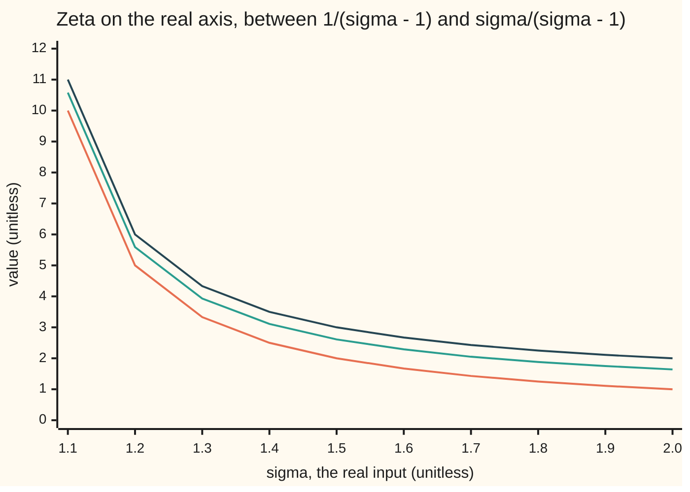

# Zeta of a complex variable: the Euler product, the pole at one, and the log derivative

[Syllabus](../../../SYLLABUS.md) → [Algebraic and analytic number theory](../README.md) → [The Zeta Function and the Prime Number Theorem](../README.md#s02) → Zeta of a complex variable

---

## General Overview

Add one over each whole number squared: 1 + 1/4 + 1/9 + …. After 1,000 terms the total is 1.64393457, and the missing tail lies between 1/1001 and 1/1000. Now multiply a factor 1/(1 − 1/p²) for each prime p instead. The 168 primes up to 1,000 give 1.64472519. All 78,498 primes below a million give 1.64493396. Both roads close in on the same number, π²/6 = 1.64493407.

That agreement is the **Euler product**: a sum over all whole numbers equals a product over the primes. It packs every prime into one function, the **zeta function**. The prime number theorem, which says roughly how many primes lie below a number (78,498 below a million), is proved by studying that function.

The proof needs zeta close to the line where its sum stops converging, at power 1. Move the power from 2 to 1.1. The product gets slow: the primes below a million now capture only 9.39 of the true 10.58. This card proves, with no computer, that the value must lie between 10 and 11. It also bounds zeta's log derivative (its rate of change divided by its value), a total of log p over the prime powers p^k, each divided by p^k raised to that power, which near power 1 sits close to 1/(power − 1).

**For complex s with real part σ above 1, zeta is a product over the primes, so it is never 0 and never larger than ζ(σ); as σ falls to 1, ζ(σ) grows like 1/(σ − 1), trapped between 1/(σ − 1) and σ/(σ − 1), and its log derivative, a sum of log p / p^(kσ) over the prime powers p^k, grows like 1/(σ − 1) as well.**

**What kind of fact this is:** theorems. The Euler product and the series for the log derivative are proved on the wing 07 cards linked in Step 1. The integral formula, the bracket, the size bounds and the size of the log derivative are proved on this card in Why it works. The printed numbers are evidence that the proofs are applied correctly, not proofs themselves.

### The picture: zeta trapped between two curves



Orange: the floor 1/(σ − 1). Green: ζ(σ), computed. Dark: the ceiling σ/(σ − 1). The two bounds stay exactly 1 apart, and zeta sits between them at every point. As σ falls to 1, all three shoot up together: that is the pole.

---

## The formula

Notation first, in words. This card writes a complex input as $`s = \sigma + it`$: $`\sigma`$ ("sigma") is the real part, $`\mathrm{Re}\, s`$, and $`t`$ is the imaginary part, the height. Here σ is a bare letter with no argument, unlike the divisor sum σ(n). The power $`n^{-s}`$ means $`e^{-s \log n}`$, with log the natural logarithm. The fractional part $`\{x\}`$ is $`x - \lfloor x \rfloor`$, what is left after rounding down: $`\{2.7\} = 0.7`$.

The engine of the card is one formula for zeta:

```math
\zeta(s) = \frac{s}{s-1} - s\int_1^{\infty} \frac{\{x\}}{x^{s+1}}\,dx \qquad (\sigma > 0,\ s \ne 1)
```

**Read it aloud:** zeta of s is s over s minus one, minus s times the integral of the fractional part of x over x to the s plus one.

The first piece holds the pole. The integral is small and tame. Every estimate below comes from bounding it.

On the real axis it gives the bracket:

```math
\frac{1}{\sigma - 1} < \zeta(\sigma) < \frac{\sigma}{\sigma - 1} \qquad (\sigma > 1)
```

**Read it aloud:** zeta of sigma lies above one over sigma minus one and below sigma over sigma minus one.

Near the line Re s = 1, zeta's log derivative (its slope divided by its value) is a prime-power sum of size about 1/(σ − 1):

```math
-\frac{\zeta'(\sigma)}{\zeta(\sigma)} = \sum_{n=1}^{\infty} \frac{\Lambda(n)}{n^{\sigma}} = \frac{1}{\sigma - 1} - \gamma + O(\sigma - 1)
```

**Read it aloud:** minus zeta's slope over zeta is the sum of big lambda of n over n to the sigma, which is one over sigma minus one, minus Euler's constant, plus an error no bigger than a fixed multiple of sigma minus one.

| Symbol | Plain meaning | In our example | Push it up and the answer… |
| --- | --- | --- | --- |
| $`s`$, $`i`$ | the complex input $`\sigma + it`$; the square root of −1 | s = 1.1 + 10i | — |
| $`\sigma`$ | real part of s, written Re s | 1.1 | zeta shrinks towards 1 |
| $`t`$ | imaginary part of s, the height | 10 | size bound grows like log t |
| $`n`$, $`N`$ | a whole number; a cut-off for a sum | N = 1,000 | the sum's tail shrinks |
| $`p`$ | a prime, always | 2, 3, 5, … | its factor nears 1 |
| $`\zeta`$, $`\zeta'`$ | zeta; its derivative (slope) in s | ζ(1.1) = 10.584448 | — |
| $`x`$, $`\{x\}`$, $`\lfloor x \rfloor`$ | a real number, the integration variable; its fractional part; x rounded down | {2.7} = 0.7, ⌊2.7⌋ = 2 | — |
| $`\Lambda(n)`$ | log p when n is a power of a prime p, else 0 | Λ(8) = log 2, Λ(6) = 0 | — |
| $`\gamma`$ | Euler's constant, the limit of 1 + 1/2 + … + 1/N − log N | 0.577216 | — |
| $`\pi`$ | the circle constant, in π²/6 | 3.14159… | — |
| $`O(\sigma - 1)`$ | a term at most a fixed multiple of σ − 1 | 0.018252 at σ = 1.1 | — |

### When it holds

- **σ > 1 for the sum and the product.** Left of that line neither is zeta. At s = 1/2 the sum of 1,000 terms is 61.80 and still climbing, while ζ(1/2) = −1.460355.
- **σ > 0 for the integral formula.** The integral of $`\{x\}x^{-\sigma-1}`$ converges only there. Further left needs [The functional equation](02-functional-equation-proved.md).
- **Real σ for the bracket.** For complex s the matching statement is a bound on size: $`|\zeta(s)| \le \zeta(\sigma)`$.
- **Height at least 2 for the size bound on the line.** Near t = 0 the pole takes over and no bound of the form log t can hold.
- **The full sum for the log derivative.** Near σ = 1 a cut-off sum is far off: the prime powers below a million give 6.929049 at σ = 1.1, not 9.441036.

---

## Why it works

### Step 0: compare the sum with an integral, and use that the coefficients are positive

A sum of a falling function sits between two integrals. The integral of $`x^{-s}`$ from 1 on is $`1/(s - 1)`$, which shows the pole openly. What is left over is an integral of the fractional part, which never exceeds 1, so it is easy to bound.

The second idea is positivity. Every coefficient of the sum, the product and the log derivative is positive. So the size of any complex value is at most the real value at the same σ. Bounds proved on the real axis then hold on every vertical line.

### Step 1: what earlier cards already prove

- [The zeta function](../../07-Complex%20analysis/09-Special%20Functions%20and%20the%20Zeta%20Function/05-zeta-function-and-euler-product.md) proves that for σ > 1 the sum converges, zeta is holomorphic (has a complex derivative), equals the product $`\prod_p (1 - p^{-s})^{-1}`$ by unique factorisation, and is never 0. It also proves ζ(2) = π²/6.
- [Continuing zeta](../../07-Complex%20analysis/09-Special%20Functions%20and%20the%20Zeta%20Function/08-continuing-zeta-and-the-functional-equation.md) continues zeta to σ > 0 and finds one pole, at 1, with residue 1 (the coefficient of 1/(s − 1)).
- [Zeta's zeros and the primes](../../07-Complex%20analysis/09-Special%20Functions%20and%20the%20Zeta%20Function/09-zeros-of-zeta-and-the-primes.md) takes the log of the product and differentiates it, giving $`-\zeta'/\zeta(s) = \sum \Lambda(n) n^{-s}`$ for σ > 1. At s = 2 both sides are 0.56996.

This card uses those three facts as inputs and adds the estimates.

### Step 2: the integral formula

Each term is an integral: $`n^{-s} = s\int_n^{\infty} x^{-s-1}\,dx`$ when σ > 0. Add these over n. A point x is counted once for each whole number n up to x, that is $`\lfloor x \rfloor`$ times:

```math
\zeta(s) = s\int_1^{\infty} \frac{\lfloor x \rfloor}{x^{s+1}}\,dx \qquad (\sigma > 1)
```

Write $`\lfloor x \rfloor = x - \{x\}`$. The x part gives $`s\int_1^\infty x^{-s}\,dx = s/(s-1)`$, and the formula follows.

Now look at the right side. Since $`0 \le \{x\} < 1`$, the integral converges for every σ > 0, and it is holomorphic there. By [Analytic continuation](../../07-Complex%20analysis/04-Taylor%20Series%2C%20Zeros%20and%20Rigidity/04-analytic-continuation.md) a holomorphic function extends in only one way, so the right side is zeta on all of σ > 0 except s = 1.

Write $`s/(s-1) = 1 + 1/(s-1)`$. That locates the pole: one simple pole, at s = 1, residue 1, as Continuing zeta found by a different route. Everything else in the formula is finite at 1.

### Step 3: the constant left after the pole is Euler's constant

Remove the pole and set s = 1. What remains is $`1 - \int_1^\infty \{x\}x^{-2}\,dx`$. The fold shows this equals γ = 0.577216.

The check computes $`\zeta(\sigma) - 1/(\sigma - 1)`$ at three points closing on 1: 0.584448 at 1.1, 0.577943 at 1.01, 0.577288 at 1.001. A separate road, 1 + 1/2 + … + 1/N − log N with N = 1,000,000 and its standard end corrections, gives γ = 0.577216.

So near the pole:

```math
\zeta(s) = \frac{1}{s-1} + \gamma + O(s-1)
```

<details>
<summary>Detailed proof: the constant is γ</summary>

Split the integral at a whole number N. On each step from n to n + 1, ⌊x⌋ equals n, and $`n\int_n^{n+1}x^{-2}\,dx = n\left(\tfrac1n - \tfrac1{n+1}\right) = \tfrac{1}{n+1}`$. Adding for n = 1 to N − 1:

$`\displaystyle \int_1^N \frac{\lfloor x \rfloor}{x^2}\,dx = \frac12 + \frac13 + \cdots + \frac1N = H_N - 1,`$

with $`H_N = 1 + 1/2 + \cdots + 1/N`$. Since $`\{x\} = x - \lfloor x \rfloor`$:

$`\displaystyle 1 - \int_1^N \frac{\{x\}}{x^2}\,dx = 1 - \log N + H_N - 1 = H_N - \log N.`$

Let N grow. The left side tends to the constant term, and the right side tends to γ by definition.

</details>

### Step 4: the bracket on the real axis

Take s = σ real and above 1. The integrand $`\{x\}x^{-\sigma-1}`$ is positive except at whole numbers, and below $`x^{-\sigma-1}`$ away from them. So

```math
0 < \sigma\int_1^\infty \frac{\{x\}}{x^{\sigma+1}}\,dx < \sigma\int_1^\infty \frac{dx}{x^{\sigma+1}} = 1
```

Subtract this from σ/(σ − 1). The ceiling is σ/(σ − 1). The floor is σ/(σ − 1) − 1, which is 1/(σ − 1). At σ = 1.1 that pins ζ(1.1) between 10 and 11. Euler–Maclaurin summation (the first terms added directly, the rest replaced by an integral plus small fixed corrections) gives 10.584448, and a 100,000-term sum plus the integral tail gives the same.

Multiply through by σ − 1: $`1 < (\sigma - 1)\zeta(\sigma) < \sigma`$. Both ends tend to 1, which proves the residue 1 again, by squeezing. The check prints 1.058445, 1.005779 and 1.000577 at 1.1, 1.01 and 1.001.

### Step 5: off the real axis, zeta is never far from its real value

Each term has size $`|n^{-s}| = n^{-\sigma}`$, because $`e^{-it\log n}`$ has size 1. Adding sizes gives the ceiling $`|\zeta(\sigma + it)| \le \zeta(\sigma)`$.

The product gives a floor. Each factor obeys $`|1 - p^{-s}| \le 1 + p^{-\sigma}`$. And $`1 + u = (1 - u^2)/(1 - u)`$, so multiplying over primes:

```math
\frac{\zeta(2\sigma)}{\zeta(\sigma)} \le |\zeta(\sigma + it)| \le \zeta(\sigma) \qquad (\sigma > 1)
```

At σ = 1.1 the floor is 0.140824 and the ceiling 10.584448. The check finds |ζ(1.1 + it)| = 1.147468, 1.369112, 1.538334, 0.952126 at heights 1, 10, 100, 1,000: all inside. The floor is a second proof that zeta has no zero for σ > 1, now with a number attached.

### Step 6: on the line σ = 1, zeta grows no faster than log t

Cut the sum at $`N = \lfloor |t| \rfloor`$ and handle the tail with the integral formula. For 1 ≤ σ ≤ 2 and |t| ≥ 2 this gives

```math
|\zeta(\sigma + it)| \le \log|t| + 5.5
```

For σ > 2 the ceiling of Step 5 gives at most ζ(2) < 1.65, so the bound holds for all σ ≥ 1. On the line itself the check finds |ζ(1 + it)| = 1.394615, 1.634254, 0.942023 at t = 10, 100, 1,000, against bounds 7.80, 10.11 and 12.41. The bound is loose; what matters is that it grows only like log t. Perron's formula and the prime number theorem need exactly this.

<details>
<summary>Detailed proof: the log t bound</summary>

For σ > 1 and any whole number N, Step 2's argument applied to the terms past N gives

$`\displaystyle \zeta(s) = \sum_{n \le N} n^{-s} + \frac{N^{1-s}}{s-1} - s\int_N^\infty \frac{\{x\}}{x^{s+1}}\,dx,`$

and the right side continues to σ > 0 by the same reasoning. Take 1 ≤ σ ≤ 2, |t| ≥ 2 and N = ⌊|t|⌋, so N ≥ 2 and N > |t| − 1. Bound the three pieces.

- The sum: each term has size $`n^{-\sigma} \le 1/n`$, and $`1 + 1/2 + \cdots + 1/N \le 1 + \log N \le 1 + \log|t|`$.
- The middle term: $`|N^{1-s}| = N^{1-\sigma} \le 1`$ and $`|s - 1| \ge |t| \ge 2`$, so it is at most 1/2.
- The integral: $`|s|\int_N^\infty x^{-\sigma-1}\,dx = |s|/(\sigma N^\sigma) \le |s|/N`$. With $`|s| \le 2 + |t|`$ and $`N > |t| - 1`$, this is below $`(2 + |t|)/(|t| - 1) \le 4`$.

The total is at most log|t| + 5.5.

</details>

### Step 7: the log derivative near the line

Step 1 gives $`-\zeta'/\zeta(s) = \sum \Lambda(n)n^{-s}`$. Its coefficients Λ(n) are positive or 0, so the same size argument as Step 5 gives

```math
\left|\frac{\zeta'}{\zeta}(\sigma + it)\right| \le -\frac{\zeta'}{\zeta}(\sigma) \qquad (\sigma > 1)
```

Its real size near 1 comes from Step 3. Zeta is $`1/(s-1) + \gamma + O(s-1)`$, so its slope is $`-1/(s-1)^2 + O(1)`$. Dividing, as the fold shows, gives $`-\zeta'/\zeta(s) = 1/(s-1) - \gamma + O(s-1)`$.

| σ | −ζ′/ζ(σ), computed | 1/(σ − 1) − γ |
| --- | --- | --- |
| 2 | 0.56996, by slope and by prime powers to a million | — |
| 1.1 | 9.441036 | 9.422784 |
| 1.01 | 99.424655 | 99.422784 |
| 1.001 | 999.422972 | 999.422784 |

The gap shrinks with σ − 1, as the O term says. At σ = 1.1 the ceiling is 9.441036, and the check finds |ζ′/ζ(1.1 + it)| = 0.923446, 0.180468, 0.554808, 0.453250 at heights 1, 10, 100, 1,000.

Taking the real part instead, $`-\mathrm{Re}\,(\zeta'/\zeta)(\sigma + it) = \sum \Lambda(n) n^{-\sigma}\cos(t \log n)`$. [The zero-free region](03-the-zero-free-region.md) plays this against the pole to show zeta has no zero on σ = 1.

<details>
<summary>Detailed proof: the log derivative is 1/(s − 1) − γ plus a small error</summary>

By Step 2, $`h(s) = \zeta(s) - 1/(s-1)`$ is holomorphic near s = 1 with h(1) = γ. Write u = s − 1. Then

$`\displaystyle \zeta = \frac{1 + \gamma u + O(u^2)}{u}, \qquad \zeta' = -\frac{1}{u^2} + h'(s) = -\frac{1 - O(u^2)}{u^2}.`$

Dividing, $`-\zeta'/\zeta = \frac{1}{u}\cdot\frac{1 + O(u^2)}{1 + \gamma u + O(u^2)} = \frac{1}{u}\left(1 - \gamma u + O(u^2)\right) = \frac1u - \gamma + O(u)`$.

</details>

---

## Worked numbers, by hand

| Step | Arithmetic | Value |
| --- | --- | --- |
| 1,000 terms of 1/n² | add them | 1.64393457 |
| tail between 1/1001 and 1/1000 | add each | 1.64493357 to 1.64493457 |
| product over 168 primes to 1,000 | multiply 1/(1 − 1/p²) | 1.64472519 |
| product over 78,498 primes below 10⁶ | the same, further | 1.64493396 |
| ζ(2) | π²/6 | **1.64493407** |
| bracket at σ = 1.1 | 1/0.1 and 1.1/0.1 | 10 to 11 |
| ζ(1.1) | Euler–Maclaurin, or 100,000 terms plus the integral tail | 10.584448 |
| floor off the axis at σ = 1.1 | ζ(2.2)/ζ(1.1) | 0.140824 |
| prediction for −ζ′/ζ(1.1) | 10 − 0.577216 | 9.422784 |
| −ζ′/ζ(1.1) | slope of zeta over zeta | **9.441036** |

Sum and product agree on ζ(2) to six decimal places. Near the line, ζ(1.1) sits 0.584448 above the proved floor and 0.415552 below the ceiling, and the prediction for the log derivative is off by only 0.018252.

### What breaks if you drop a piece

| Mistake | Comes out at | What went wrong |
| --- | --- | --- |
| Use the sum at s = 1/2 | 61.801009 after 1,000 terms, still climbing; ζ(1/2) = −1.460355 | σ > 1 dropped: the sum is not zeta there |
| Cut the product at primes below 10⁶, σ = 1.1 | 9.392130, not 10.584448 | near the line the primes beyond a million still carry 11.3 percent |
| Cut the prime-power sum at 10⁶, σ = 1.1 | 6.929049, not 9.441036 | the same, made worse by the log p weights |
| Primes only in −ζ′/ζ(2) | 0.49309, not 0.56996 | Λ also weighs p², p³, … |

---

## Code, from first principles, and it actually runs

The script sieves the primes below a million and computes zeta by two roads: Euler–Maclaurin summation (60 terms, the integral of the rest, and six correction terms built from the Bernoulli numbers, with the slope worked out term by term) and a long sum of 100,000 terms plus the integral tail. It checks ζ(2) a third way, as π²/6, and the log derivative a second way, as the prime-power sum. Every bound on the card is asserted at each printed point. Python adds in plain loops so that Rust, which repeats every step, prints identical digits.

### Python

```python
# Zeta of a complex variable: the check behind the card.  Standard library only.
# Zeta is computed two ways: Euler-Maclaurin with Bernoulli terms (cut-off 60),
# and a long sum to 100,000 with the integral tail.  Primes come from a sieve.
import math

def cpow(n, s):  # n^(-s) = e^(-sigma log n) (cos(t log n) - i sin(t log n))
    L = math.log(n); r = math.exp(-s.real * L)
    return complex(r * math.cos(s.imag * L), -r * math.sin(s.imag * L))

BERN = [1/6, -1/30, 1/42, -1/30, 5/66, -691/2730]  # B_2 .. B_12

def zeta_em(s, N=60):  # returns zeta(s) and zeta'(s), Euler-Maclaurin
    s = complex(s); z = complex(0); d = complex(0)
    for n in range(1, N):
        w = cpow(n, s); z += w; d -= math.log(n) * w
    LN = math.log(N); wN = cpow(N, s)
    z += N * wN / (s - 1) + wN / 2
    d += -LN * N * wN / (s - 1) - N * wN / ((s - 1) * (s - 1)) - LN * wN / 2
    for k in range(1, 7):
        P = complex(1); dP = complex(0)
        for j in range(2 * k - 1):
            dP = dP * (s + j) + P; P = P * (s + j)
        c = BERN[k - 1] / math.factorial(2 * k) * N ** (1 - 2 * k)
        z += c * P * wN; d += c * wN * (dP - LN * P)
    return z, d

def zeta_long(s, M=100000):  # sum to M, plus M^(1-s)/(s-1) - M^(-s)/2
    s = complex(s); z = complex(0)
    for n in range(1, M + 1):
        z += cpow(n, s)
    wM = cpow(M, s)
    return z + M * wM / (s - 1) - wM / 2

def f(x, k=6): return f"{x:.{k}f}"
def row(xs, k=2): return ", ".join(f(x, k) for x in xs)

X = 10 ** 6
sieve = bytearray([1]) * (X + 1); sieve[0] = sieve[1] = 0
for p in range(2, 1001):
    if sieve[p]:
        sieve[p * p::p] = bytearray(len(range(p * p, X + 1, p)))
primes = [p for p in range(X + 1) if sieve[p]]
print(f"primes below 10^6 by sieve: {len(primes)}")
assert len(primes) == 78498

def euler(sg, P):
    prod = 1.0
    for p in primes:
        if p > P: break
        prod *= 1 / (1 - p ** -sg)
    return prod

part = 0.0
for n in range(1, 1001): part += 1 / n ** 2
lo, hi = part + 1 / 1001, part + 1 / 1000
z2 = zeta_em(2)[0].real
print(f"zeta(2): 1000 terms {f(part, 8)}; tail bracket [{f(lo, 8)}, {f(hi, 8)}]")
e1000, eX = euler(2, 1000), euler(2, X)
print(f"zeta(2): product, 168 primes {f(e1000, 8)}; 78498 primes {f(eX, 8)}; "
      f"pi^2/6 {f(math.pi ** 2 / 6, 8)}; Euler-Maclaurin {f(z2, 8)}")
assert lo < math.pi ** 2 / 6 < hi and abs(z2 - math.pi ** 2 / 6) < 1e-12
assert e1000 < eX < z2 and z2 - eX < 1.0 / X

z11 = zeta_em(1.1)[0].real; l11 = zeta_long(1.1).real
print(f"zeta(1.1): Euler-Maclaurin {f(z11)}; long sum {f(l11)}; bracket 10 < zeta(1.1) < 11")
assert abs(z11 - l11) < 1e-7 and 10 < z11 < 11

sgs = [1 + k / 10 for k in range(1, 11)]
zs = [zeta_em(sg)[0].real for sg in sgs]
print("chart, sigma = 1.1 .. 2.0, lower 1/(sigma-1): " + row([1 / (sg - 1) for sg in sgs]))
print("chart, zeta(sigma): " + row(zs))
print("chart, upper sigma/(sigma-1): " + row([sg / (sg - 1) for sg in sgs]))
for sg, z in zip(sgs, zs):
    assert 1 / (sg - 1) < z < sg / (sg - 1)

gN = 0.0
for n in range(1, X + 1): gN += 1 / n
gamma = gN - math.log(X) - 1 / (2 * X) + 1 / (12 * X * X)
near = [1.1, 1.01, 1.001]
zn = [zeta_em(sg)[0].real for sg in near]
print("pole: (sigma-1) zeta(sigma) at 1.1, 1.01, 1.001: " + row([(sg - 1) * z for sg, z in zip(near, zn)], 6))
print("zeta(sigma) - 1/(sigma-1) at 1.1, 1.01, 1.001: " + row([z - 1 / (sg - 1) for sg, z in zip(near, zn)], 6))
print(f"Euler's constant gamma from 1 + 1/2 + ... + 1/N - log N, N = 10^6: {f(gamma)}")
assert abs(zn[2] - 1 / 0.001 - gamma) < 1e-4

def vm(sg, prime_powers=True):  # sum of Lambda(n) n^(-sigma) for n <= 10^6
    tot = 0.0
    for p in primes:
        q = p
        while q <= X:
            tot += math.log(p) * q ** -sg
            if not prime_powers: break
            q *= p
    return tot

z, d = zeta_em(2)
ld2, vm2, vp2 = (-d / z).real, vm(2), vm(2, False)
print(f"-zeta'/zeta(2): prime powers to 10^6 {f(vm2, 5)}; slope of zeta {f(ld2, 5)}; primes only {f(vp2, 5)}")
assert 0 < ld2 - vm2 < 2e-6
lds = [(-zeta_em(sg)[1] / zeta_em(sg)[0]).real for sg in near]
print("-zeta'/zeta(sigma) at 1.1, 1.01, 1.001: " + row(lds, 6))
print("1/(sigma-1) - gamma at 1.1, 1.01, 1.001: " + row([1 / (sg - 1) - gamma for sg in near], 6))
assert all(abs(L - (1 / (sg - 1) - gamma)) < 3 * (sg - 1) for L, sg in zip(lds, near))

ts = [1, 10, 100, 1000]
zc = [zeta_em(complex(1.1, t), max(60, t)) for t in ts]
floor = zeta_em(2.2)[0].real / z11
print(f"floor zeta(2.2)/zeta(1.1) {f(floor)}, ceiling zeta(1.1) {f(z11)}")
print("|zeta(1.1 + it)| at t = 1, 10, 100, 1000: " + row([abs(z) for z, d in zc], 6))
print("|zeta'/zeta(1.1 + it)| at t = 1, 10, 100, 1000: " + row([abs(d / z) for z, d in zc], 6))
for z, d in zc:
    assert floor < abs(z) < z11 and abs(d / z) < lds[0]

tl = [10, 100, 1000]
em1 = [abs(zeta_em(complex(1, t), max(60, t))[0]) for t in tl]
lg1 = [abs(zeta_long(complex(1, t))) for t in tl]
print("|zeta(1 + it)| at t = 10, 100, 1000, Euler-Maclaurin: " + row(em1, 6))
print("|zeta(1 + it)| at t = 10, 100, 1000, long sum: " + row(lg1, 6))
print("bound log t + 5.5 at t = 10, 100, 1000: " + row([math.log(t) + 5.5 for t in tl]))
for a, b, t in zip(em1, lg1, tl):
    assert abs(a - b) < 1e-6 and a < math.log(t) + 5.5

eu11, vm11 = euler(1.1, X), vm(1.1)
print(f"mistake, Euler product at 1.1 over primes to 10^6: {f(eu11)}, not {f(z11)}")
print(f"mistake, prime powers to 10^6 at 1.1: {f(vm11)}, not {f(lds[0])}")
h = 0.0
for n in range(1, 1001): h += n ** -0.5
zh = zeta_em(0.5)[0].real
print(f"mistake, the series at s = 1/2, 1000 terms: {f(h)}; zeta(1/2) {f(zh)}, inside [-2, -1]")
assert eu11 < z11 - 1 and vm11 < lds[0] - 1 and -2 < zh < -1
e11 = euler(1.1, 1000)
print(f"try: zeta(1.01) {f(zn[1])}; Euler product at 1.1, primes to 1000: {f(e11)}")
assert 100 < zn[1] < 101 and e11 < eu11
print(f"gaps at 1.1: zeta - floor {f(z11 - 10)}, ceiling - zeta {f(11 - z11)}, -zeta'/zeta - prediction "
      f"{f(lds[0] - 1 / 0.1 + gamma)}; cut product short by {f(100 * (1 - eu11 / z11), 1)} percent; 6/pi^2 {f(6 / math.pi ** 2)}")
print("ALL CHECKS PASS")
```

**Ran 2026-11-15 on macOS, Python 3.14.10, standard library only. All checks passed. Output, pasted from the run:**

```
primes below 10^6 by sieve: 78498
zeta(2): 1000 terms 1.64393457; tail bracket [1.64493357, 1.64493457]
zeta(2): product, 168 primes 1.64472519; 78498 primes 1.64493396; pi^2/6 1.64493407; Euler-Maclaurin 1.64493407
zeta(1.1): Euler-Maclaurin 10.584448; long sum 10.584448; bracket 10 < zeta(1.1) < 11
chart, sigma = 1.1 .. 2.0, lower 1/(sigma-1): 10.00, 5.00, 3.33, 2.50, 2.00, 1.67, 1.43, 1.25, 1.11, 1.00
chart, zeta(sigma): 10.58, 5.59, 3.93, 3.11, 2.61, 2.29, 2.05, 1.88, 1.75, 1.64
chart, upper sigma/(sigma-1): 11.00, 6.00, 4.33, 3.50, 3.00, 2.67, 2.43, 2.25, 2.11, 2.00
pole: (sigma-1) zeta(sigma) at 1.1, 1.01, 1.001: 1.058445, 1.005779, 1.000577
zeta(sigma) - 1/(sigma-1) at 1.1, 1.01, 1.001: 0.584448, 0.577943, 0.577288
Euler's constant gamma from 1 + 1/2 + ... + 1/N - log N, N = 10^6: 0.577216
-zeta'/zeta(2): prime powers to 10^6 0.56996; slope of zeta 0.56996; primes only 0.49309
-zeta'/zeta(sigma) at 1.1, 1.01, 1.001: 9.441036, 99.424655, 999.422972
1/(sigma-1) - gamma at 1.1, 1.01, 1.001: 9.422784, 99.422784, 999.422784
floor zeta(2.2)/zeta(1.1) 0.140824, ceiling zeta(1.1) 10.584448
|zeta(1.1 + it)| at t = 1, 10, 100, 1000: 1.147468, 1.369112, 1.538334, 0.952126
|zeta'/zeta(1.1 + it)| at t = 1, 10, 100, 1000: 0.923446, 0.180468, 0.554808, 0.453250
|zeta(1 + it)| at t = 10, 100, 1000, Euler-Maclaurin: 1.394615, 1.634254, 0.942023
|zeta(1 + it)| at t = 10, 100, 1000, long sum: 1.394615, 1.634254, 0.942023
bound log t + 5.5 at t = 10, 100, 1000: 7.80, 10.11, 12.41
mistake, Euler product at 1.1 over primes to 10^6: 9.392130, not 10.584448
mistake, prime powers to 10^6 at 1.1: 6.929049, not 9.441036
mistake, the series at s = 1/2, 1000 terms: 61.801009; zeta(1/2) -1.460355, inside [-2, -1]
try: zeta(1.01) 100.577943; Euler product at 1.1, primes to 1000: 7.247463
gaps at 1.1: zeta - floor 0.584448, ceiling - zeta 0.415552, -zeta'/zeta - prediction 0.018252; cut product short by 11.3 percent; 6/pi^2 0.607927
ALL CHECKS PASS
```

### Rust

Same numbers, same labels, built with `rustc --edition 2021 -O`.

```rust
// Zeta of a complex variable: the check behind the card.  std only, no crates.
// Zeta is computed two ways: Euler-Maclaurin with Bernoulli terms (cut-off 60),
// and a long sum to 100,000 with the integral tail.  Primes come from a sieve.
#[derive(Clone, Copy)]
struct C { re: f64, im: f64 }
impl C {
    fn r(x: f64) -> C { C { re: x, im: 0.0 } }
    fn add(self, o: C) -> C { C { re: self.re + o.re, im: self.im + o.im } }
    fn sub(self, o: C) -> C { C { re: self.re - o.re, im: self.im - o.im } }
    fn mul(self, o: C) -> C { C { re: self.re * o.re - self.im * o.im, im: self.re * o.im + self.im * o.re } }
    fn sc(self, k: f64) -> C { C { re: k * self.re, im: k * self.im } }
    fn div(self, b: C) -> C { // the same scaled division as CPython
        if b.re.abs() >= b.im.abs() {
            let ra = b.im / b.re; let de = b.re + b.im * ra;
            C { re: (self.re + self.im * ra) / de, im: (self.im - self.re * ra) / de }
        } else {
            let ra = b.re / b.im; let de = b.re * ra + b.im;
            C { re: (self.re * ra + self.im) / de, im: (self.im * ra - self.re) / de }
        }
    }
    fn abs(self) -> f64 { self.re.hypot(self.im) }
}
fn cpow(n: u64, s: C) -> C { // n^(-s)
    let l = (n as f64).ln(); let r = (-s.re * l).exp();
    C { re: r * (s.im * l).cos(), im: -r * (s.im * l).sin() }
}
const BERN: [f64; 6] = [1.0 / 6.0, -1.0 / 30.0, 1.0 / 42.0, -1.0 / 30.0, 5.0 / 66.0, -691.0 / 2730.0];
fn zeta_em(s: C, n_cut: u64) -> (C, C) { // zeta(s) and zeta'(s)
    let (mut z, mut d) = (C::r(0.0), C::r(0.0));
    for n in 1..n_cut { let w = cpow(n, s); z = z.add(w); d = d.sub(w.sc((n as f64).ln())); }
    let nf = n_cut as f64; let ln_n = nf.ln(); let wn = cpow(n_cut, s); let s1 = s.sub(C::r(1.0));
    z = z.add(wn.sc(nf).div(s1)).add(wn.sc(0.5));
    d = d.add(wn.sc(nf).sc(-ln_n).div(s1)).sub(wn.sc(nf).div(s1.mul(s1))).sub(wn.sc(ln_n).sc(0.5));
    let mut fact = 1.0;
    for k in 1..7usize {
        fact *= ((2 * k - 1) * (2 * k)) as f64;
        let (mut p, mut dp) = (C::r(1.0), C::r(0.0));
        for j in 0..(2 * k - 1) { let sj = s.add(C::r(j as f64)); dp = dp.mul(sj).add(p); p = p.mul(sj); }
        let c = BERN[k - 1] / fact * nf.powf(1.0 - 2.0 * k as f64);
        z = z.add(p.sc(c).mul(wn)); d = d.add(wn.sc(c).mul(dp.sub(p.sc(ln_n))));
    }
    (z, d)
}
fn zeta_long(s: C) -> C { // sum to M, plus M^(1-s)/(s-1) - M^(-s)/2
    let m = 100000u64; let mut z = C::r(0.0);
    for n in 1..=m { z = z.add(cpow(n, s)); }
    let wm = cpow(m, s);
    z.add(wm.sc(m as f64).div(s.sub(C::r(1.0)))).sub(wm.sc(0.5))
}
fn row(xs: &[f64], k: usize) -> String { xs.iter().map(|x| format!("{:.*}", k, x)).collect::<Vec<_>>().join(", ") }
fn main() {
    let x: usize = 1_000_000;
    let mut sieve = vec![true; x + 1]; sieve[0] = false; sieve[1] = false;
    for p in 2..=1000 { if sieve[p] { let mut q = p * p; while q <= x { sieve[q] = false; q += p; } } }
    let primes: Vec<u64> = (0..=x).filter(|&p| sieve[p]).map(|p| p as u64).collect();
    println!("primes below 10^6 by sieve: {}", primes.len());
    assert!(primes.len() == 78498);
    let euler = |sg: f64, pmax: u64| { let mut pr = 1.0;
        for &p in &primes { if p > pmax { break; } pr *= 1.0 / (1.0 - (p as f64).powf(-sg)); } pr };
    let mut part = 0.0; for n in 1..=1000u64 { part += 1.0 / ((n * n) as f64); }
    let (lo, hi) = (part + 1.0 / 1001.0, part + 1.0 / 1000.0);
    let z2 = zeta_em(C::r(2.0), 60).0.re; let pi26 = std::f64::consts::PI.powi(2) / 6.0;
    println!("zeta(2): 1000 terms {:.8}; tail bracket [{:.8}, {:.8}]", part, lo, hi);
    let (e1000, ex) = (euler(2.0, 1000), euler(2.0, x as u64));
    println!("zeta(2): product, 168 primes {:.8}; 78498 primes {:.8}; pi^2/6 {:.8}; Euler-Maclaurin {:.8}", e1000, ex, pi26, z2);
    assert!(lo < pi26 && pi26 < hi && (z2 - pi26).abs() < 1e-12);
    assert!(e1000 < ex && ex < z2 && z2 - ex < 1.0 / x as f64);
    let z11 = zeta_em(C::r(1.1), 60).0.re; let l11 = zeta_long(C::r(1.1)).re;
    println!("zeta(1.1): Euler-Maclaurin {:.6}; long sum {:.6}; bracket 10 < zeta(1.1) < 11", z11, l11);
    assert!((z11 - l11).abs() < 1e-7 && 10.0 < z11 && z11 < 11.0);
    let sgs: Vec<f64> = (1..=10).map(|k| 1.0 + k as f64 / 10.0).collect();
    let zs: Vec<f64> = sgs.iter().map(|&sg| zeta_em(C::r(sg), 60).0.re).collect();
    println!("chart, sigma = 1.1 .. 2.0, lower 1/(sigma-1): {}", row(&sgs.iter().map(|sg| 1.0 / (sg - 1.0)).collect::<Vec<_>>(), 2));
    println!("chart, zeta(sigma): {}", row(&zs, 2));
    println!("chart, upper sigma/(sigma-1): {}", row(&sgs.iter().map(|sg| sg / (sg - 1.0)).collect::<Vec<_>>(), 2));
    for (sg, z) in sgs.iter().zip(&zs) { assert!(1.0 / (sg - 1.0) < *z && *z < sg / (sg - 1.0)); }
    let mut gn = 0.0; for n in 1..=x { gn += 1.0 / n as f64; }
    let xf = x as f64; let gamma = gn - xf.ln() - 1.0 / (2.0 * xf) + 1.0 / (12.0 * xf * xf);
    let near = [1.1, 1.01, 1.001];
    let zn: Vec<f64> = near.iter().map(|&sg| zeta_em(C::r(sg), 60).0.re).collect();
    println!("pole: (sigma-1) zeta(sigma) at 1.1, 1.01, 1.001: {}", row(&near.iter().zip(&zn).map(|(sg, z)| (sg - 1.0) * z).collect::<Vec<_>>(), 6));
    println!("zeta(sigma) - 1/(sigma-1) at 1.1, 1.01, 1.001: {}", row(&near.iter().zip(&zn).map(|(sg, z)| z - 1.0 / (sg - 1.0)).collect::<Vec<_>>(), 6));
    println!("Euler's constant gamma from 1 + 1/2 + ... + 1/N - log N, N = 10^6: {:.6}", gamma);
    assert!((zn[2] - 1.0 / 0.001 - gamma).abs() < 1e-4);
    let vm = |sg: f64, powers: bool| { let mut tot = 0.0;
        for &p in &primes { let mut q = p;
            while q <= x as u64 { tot += (p as f64).ln() * (q as f64).powf(-sg); if !powers { break; } q *= p; } }
        tot };
    let (z, d) = zeta_em(C::r(2.0), 60);
    let (ld2, vm2, vp2) = (C::r(0.0).sub(d).div(z).re, vm(2.0, true), vm(2.0, false));
    println!("-zeta'/zeta(2): prime powers to 10^6 {:.5}; slope of zeta {:.5}; primes only {:.5}", vm2, ld2, vp2);
    assert!(0.0 < ld2 - vm2 && ld2 - vm2 < 2e-6);
    let lds: Vec<f64> = near.iter().map(|&sg| { let (z, d) = zeta_em(C::r(sg), 60); C::r(0.0).sub(d).div(z).re }).collect();
    println!("-zeta'/zeta(sigma) at 1.1, 1.01, 1.001: {}", row(&lds, 6));
    println!("1/(sigma-1) - gamma at 1.1, 1.01, 1.001: {}", row(&near.iter().map(|sg| 1.0 / (sg - 1.0) - gamma).collect::<Vec<_>>(), 6));
    for (l, sg) in lds.iter().zip(&near) { assert!((l - (1.0 / (sg - 1.0) - gamma)).abs() < 3.0 * (sg - 1.0)); }
    let ts = [1u64, 10, 100, 1000];
    let zc: Vec<(C, C)> = ts.iter().map(|&t| zeta_em(C { re: 1.1, im: t as f64 }, t.max(60))).collect();
    let floor = zeta_em(C::r(2.2), 60).0.re / z11;
    println!("floor zeta(2.2)/zeta(1.1) {:.6}, ceiling zeta(1.1) {:.6}", floor, z11);
    println!("|zeta(1.1 + it)| at t = 1, 10, 100, 1000: {}", row(&zc.iter().map(|(z, _)| z.abs()).collect::<Vec<_>>(), 6));
    println!("|zeta'/zeta(1.1 + it)| at t = 1, 10, 100, 1000: {}", row(&zc.iter().map(|(z, d)| d.div(*z).abs()).collect::<Vec<_>>(), 6));
    for (z, d) in &zc { assert!(floor < z.abs() && z.abs() < z11 && d.div(*z).abs() < lds[0]); }
    let tl = [10u64, 100, 1000];
    let em1: Vec<f64> = tl.iter().map(|&t| zeta_em(C { re: 1.0, im: t as f64 }, t.max(60)).0.abs()).collect();
    let lg1: Vec<f64> = tl.iter().map(|&t| zeta_long(C { re: 1.0, im: t as f64 }).abs()).collect();
    println!("|zeta(1 + it)| at t = 10, 100, 1000, Euler-Maclaurin: {}", row(&em1, 6));
    println!("|zeta(1 + it)| at t = 10, 100, 1000, long sum: {}", row(&lg1, 6));
    println!("bound log t + 5.5 at t = 10, 100, 1000: {}", row(&tl.iter().map(|&t| (t as f64).ln() + 5.5).collect::<Vec<_>>(), 2));
    for i in 0..3 { assert!((em1[i] - lg1[i]).abs() < 1e-6 && em1[i] < (tl[i] as f64).ln() + 5.5); }
    let (eu11, vm11) = (euler(1.1, x as u64), vm(1.1, true));
    println!("mistake, Euler product at 1.1 over primes to 10^6: {:.6}, not {:.6}", eu11, z11);
    println!("mistake, prime powers to 10^6 at 1.1: {:.6}, not {:.6}", vm11, lds[0]);
    let mut h = 0.0; for n in 1..=1000u64 { h += (n as f64).powf(-0.5); }
    let zh = zeta_em(C::r(0.5), 60).0.re;
    println!("mistake, the series at s = 1/2, 1000 terms: {:.6}; zeta(1/2) {:.6}, inside [-2, -1]", h, zh);
    assert!(eu11 < z11 - 1.0 && vm11 < lds[0] - 1.0 && -2.0 < zh && zh < -1.0);
    let e11 = euler(1.1, 1000);
    println!("try: zeta(1.01) {:.6}; Euler product at 1.1, primes to 1000: {:.6}", zn[1], e11);
    assert!(100.0 < zn[1] && zn[1] < 101.0 && e11 < eu11);
    println!("gaps at 1.1: zeta - floor {:.6}, ceiling - zeta {:.6}, -zeta'/zeta - prediction {:.6}; cut product short by {:.1} percent; 6/pi^2 {:.6}",
        z11 - 10.0, 11.0 - z11, lds[0] - 1.0 / 0.1 + gamma, 100.0 * (1.0 - eu11 / z11), 6.0 / std::f64::consts::PI.powi(2));
    println!("ALL CHECKS PASS");
}
```

**Ran 2026-11-15 on macOS, rustc 1.98.1, no crates. All checks passed. Output, pasted from the run:**

```
primes below 10^6 by sieve: 78498
zeta(2): 1000 terms 1.64393457; tail bracket [1.64493357, 1.64493457]
zeta(2): product, 168 primes 1.64472519; 78498 primes 1.64493396; pi^2/6 1.64493407; Euler-Maclaurin 1.64493407
zeta(1.1): Euler-Maclaurin 10.584448; long sum 10.584448; bracket 10 < zeta(1.1) < 11
chart, sigma = 1.1 .. 2.0, lower 1/(sigma-1): 10.00, 5.00, 3.33, 2.50, 2.00, 1.67, 1.43, 1.25, 1.11, 1.00
chart, zeta(sigma): 10.58, 5.59, 3.93, 3.11, 2.61, 2.29, 2.05, 1.88, 1.75, 1.64
chart, upper sigma/(sigma-1): 11.00, 6.00, 4.33, 3.50, 3.00, 2.67, 2.43, 2.25, 2.11, 2.00
pole: (sigma-1) zeta(sigma) at 1.1, 1.01, 1.001: 1.058445, 1.005779, 1.000577
zeta(sigma) - 1/(sigma-1) at 1.1, 1.01, 1.001: 0.584448, 0.577943, 0.577288
Euler's constant gamma from 1 + 1/2 + ... + 1/N - log N, N = 10^6: 0.577216
-zeta'/zeta(2): prime powers to 10^6 0.56996; slope of zeta 0.56996; primes only 0.49309
-zeta'/zeta(sigma) at 1.1, 1.01, 1.001: 9.441036, 99.424655, 999.422972
1/(sigma-1) - gamma at 1.1, 1.01, 1.001: 9.422784, 99.422784, 999.422784
floor zeta(2.2)/zeta(1.1) 0.140824, ceiling zeta(1.1) 10.584448
|zeta(1.1 + it)| at t = 1, 10, 100, 1000: 1.147468, 1.369112, 1.538334, 0.952126
|zeta'/zeta(1.1 + it)| at t = 1, 10, 100, 1000: 0.923446, 0.180468, 0.554808, 0.453250
|zeta(1 + it)| at t = 10, 100, 1000, Euler-Maclaurin: 1.394615, 1.634254, 0.942023
|zeta(1 + it)| at t = 10, 100, 1000, long sum: 1.394615, 1.634254, 0.942023
bound log t + 5.5 at t = 10, 100, 1000: 7.80, 10.11, 12.41
mistake, Euler product at 1.1 over primes to 10^6: 9.392130, not 10.584448
mistake, prime powers to 10^6 at 1.1: 6.929049, not 9.441036
mistake, the series at s = 1/2, 1000 terms: 61.801009; zeta(1/2) -1.460355, inside [-2, -1]
try: zeta(1.01) 100.577943; Euler product at 1.1, primes to 1000: 7.247463
gaps at 1.1: zeta - floor 0.584448, ceiling - zeta 0.415552, -zeta'/zeta - prediction 0.018252; cut product short by 11.3 percent; 6/pi^2 0.607927
ALL CHECKS PASS
```

The two outputs match line for line.

### Lean

Lean proves the bracket and the size bounds for every σ > 1, and the log derivative near the pole.

- Take any real σ > 1. Then ζ(σ) is a real number strictly between 1/(σ − 1) and σ/(σ − 1).
- Take any complex s with real part σ > 1. Then ζ(2σ)/ζ(σ) ≤ |ζ(s)| ≤ ζ(σ).
- Take complex s near 1, but not 1. Then −ζ′/ζ(s) = 1/(s − 1) − γ + O(s − 1).
- Take σ = 1.1 or σ = 1.01. Then the bracket's ends are 10 and 11, or 100 and 101.
- The floor and the ceiling of the bracket always stay exactly 1 apart.
- There are 168 primes up to 1,000.

Every decimal value, the cut sums and products, and the log t bound are left to the Python and Rust checks.

```lean
-- Zeta of a complex variable: for real σ > 1 the value ζ(σ) is real and lies strictly between 1/(σ − 1) and σ/(σ − 1), for complex s with Re s > 1 the size of ζ(s) lies between ζ(2σ)/ζ(σ) and ζ(σ), and near s = 1 the log derivative −ζ′/ζ(s) equals 1/(s − 1) − γ up to an error of size O(s − 1).
import Mathlib.NumberTheory.LSeries.RiemannZeta
import Mathlib.NumberTheory.Harmonic.ZetaAsymp
import Mathlib.NumberTheory.PrimeCounting
import Mathlib.NumberTheory.EulerProduct.DirichletLSeries

set_option autoImplicit false

open Complex Filter Topology Asymptotics

/-- Mean value step: for real m > 0 and σ > 1 the difference m^(1−σ) − (m+1)^(1−σ) lies strictly
between (σ − 1)(m+1)^(−σ) and (σ − 1) m^(−σ). -/
lemma zeta_mvt_aux (σ : ℝ) (hσ : 1 < σ) (m : ℝ) (hm : 0 < m) :
    (σ - 1) * (m + 1) ^ (-σ) < m ^ (1 - σ) - (m + 1) ^ (1 - σ) ∧
      m ^ (1 - σ) - (m + 1) ^ (1 - σ) < (σ - 1) * m ^ (-σ) := by
  obtain ⟨c, ⟨hc1, hc2⟩, hc⟩ := exists_hasDerivAt_eq_slope (fun x : ℝ => x ^ (1 - σ))
    (fun x : ℝ => (1 - σ) * x ^ (1 - σ - 1)) (by linarith : m < m + 1)
    (ContinuousOn.rpow_const continuousOn_id
      (fun x hx => Or.inl (ne_of_gt (lt_of_lt_of_le hm hx.1))))
    (fun x hx => Real.hasDerivAt_rpow_const (Or.inl (ne_of_gt (lt_trans hm hx.1))))
  have hcpos : 0 < c := lt_trans hm hc1
  have e1 : (1 : ℝ) - σ - 1 = -σ := by ring
  rw [e1, show m + 1 - m = (1 : ℝ) by ring, div_one] at hc
  have key : m ^ (1 - σ) - (m + 1) ^ (1 - σ) = (σ - 1) * c ^ (-σ) := by
    linarith
  have hneg : -σ < 0 := by linarith
  have i1 : c ^ (-σ) < m ^ (-σ) := Real.rpow_lt_rpow_of_neg hm hc1 hneg
  have i2 : (m + 1) ^ (-σ) < c ^ (-σ) := Real.rpow_lt_rpow_of_neg hcpos hc2 hneg
  have hs1 : 0 < σ - 1 := by linarith
  rw [key]
  exact ⟨mul_lt_mul_of_pos_left i2 hs1, mul_lt_mul_of_pos_left i1 hs1⟩

/-- Telescoping: the differences (n+1)^(1−σ) − (n+2)^(1−σ) sum to 1. -/
lemma zeta_telescope_aux (σ : ℝ) (hσ : 1 < σ) :
    HasSum (fun n : ℕ => ((n : ℝ) + 1) ^ (1 - σ) - ((n : ℝ) + 1 + 1) ^ (1 - σ)) 1 := by
  rw [hasSum_iff_tendsto_nat_of_nonneg]
  · have hsum : ∀ N : ℕ, ∑ i ∈ Finset.range N,
        (((i : ℝ) + 1) ^ (1 - σ) - ((i : ℝ) + 1 + 1) ^ (1 - σ)) = 1 - ((N : ℝ) + 1) ^ (1 - σ) := by
      intro N
      induction N with
      | zero => simp
      | succ N ih =>
        rw [Finset.sum_range_succ, ih]
        push_cast
        ring
    simp_rw [hsum]
    have h0 : Tendsto (fun N : ℕ => ((N : ℝ) + 1) ^ (1 - σ)) atTop (𝓝 0) := by
      have := (tendsto_rpow_neg_atTop (by linarith : 0 < σ - 1)).comp
        (tendsto_atTop_add_const_right _ 1 tendsto_natCast_atTop_atTop)
      simpa [Function.comp_def, neg_sub] using this
    simpa using (tendsto_const_nhds (x := (1 : ℝ))).sub h0
  · intro n
    have := (zeta_mvt_aux σ hσ ((n : ℝ) + 1) (by positivity)).1
    have : 0 < (σ - 1) * ((n : ℝ) + 1 + 1) ^ (-σ) := by
      have : 0 < σ - 1 := by linarith
      positivity
    linarith

/-- For a natural number p and real x, p^(−x) taken in ℂ is the real number p^(−x). -/
lemma prime_cpow_neg_ofReal (p : ℕ) (x : ℝ) :
    (p : ℂ) ^ (-(x : ℂ)) = (((p : ℝ) ^ (-x) : ℝ) : ℂ) := by
  rw [Complex.ofReal_cpow (by positivity)]
  push_cast
  rfl

/-- For a prime p and real x > 0, the size of 1 − p^(−x) is 1 − p^(−x). -/
lemma norm_one_sub_prime_cpow_ofReal (p : ℕ) (hp : p.Prime) (x : ℝ) (hx : 0 < x) :
    ‖1 - (p : ℂ) ^ (-(x : ℂ))‖ = 1 - (p : ℝ) ^ (-x) := by
  have h1 : (p : ℝ) ^ (-x) < 1 :=
    Real.rpow_lt_one_of_one_lt_of_neg (by exact_mod_cast hp.one_lt) (by linarith)
  rw [prime_cpow_neg_ofReal, ← Complex.ofReal_one, ← Complex.ofReal_sub, Complex.norm_real,
    Real.norm_of_nonneg (by linarith)]

/-- The size of p^(−s) is p^(−Re s). -/
lemma norm_prime_cpow_neg (p : ℕ) (hp : p.Prime) (s : ℂ) :
    ‖(p : ℂ) ^ (-s)‖ = (p : ℝ) ^ (-s.re) := by
  rw [norm_natCast_cpow_of_pos hp.pos]
  simp

/-- Upper bound for one Euler factor. -/
lemma euler_factor_le (p : ℕ) (hp : p.Prime) (s : ℂ) (hs : 1 < s.re) :
    ‖(1 - (p : ℂ) ^ (-s))⁻¹‖ ≤ ‖(1 - (p : ℂ) ^ (-((s.re : ℝ) : ℂ)))⁻¹‖ := by
  have ha : (p : ℝ) ^ (-s.re) < 1 :=
    Real.rpow_lt_one_of_one_lt_of_neg (by exact_mod_cast hp.one_lt) (by linarith)
  rw [norm_inv, norm_inv, norm_one_sub_prime_cpow_ofReal p hp _ (by linarith)]
  apply inv_anti₀ (by linarith)
  have := norm_sub_norm_le (1 : ℂ) ((p : ℂ) ^ (-s))
  rw [norm_one, norm_prime_cpow_neg p hp] at this
  exact this

/-- Lower bound for one Euler factor. -/
lemma euler_factor_ge (p : ℕ) (hp : p.Prime) (s : ℂ) (hs : 1 < s.re) :
    ‖(1 - (p : ℂ) ^ (-(((2 * s.re : ℝ)) : ℂ)))⁻¹‖ / ‖(1 - (p : ℂ) ^ (-((s.re : ℝ) : ℂ)))⁻¹‖
      ≤ ‖(1 - (p : ℂ) ^ (-s))⁻¹‖ := by
  set a := (p : ℝ) ^ (-s.re) with ha_def
  have ha : a < 1 :=
    Real.rpow_lt_one_of_one_lt_of_neg (by exact_mod_cast hp.one_lt) (by linarith)
  have ha0 : 0 < a := Real.rpow_pos_of_pos (by exact_mod_cast hp.pos) _
  have h2 : (p : ℝ) ^ (-(2 * s.re)) = a ^ 2 := by
    rw [ha_def, ← Real.rpow_natCast, ← Real.rpow_mul (by positivity)]
    congr 1
    push_cast
    ring
  rw [norm_inv, norm_inv, norm_inv, norm_one_sub_prime_cpow_ofReal p hp _ (by linarith),
    norm_one_sub_prime_cpow_ofReal p hp _ (by linarith), h2, ← ha_def]
  have e : (1 - a ^ 2)⁻¹ / (1 - a)⁻¹ = (1 + a)⁻¹ := by
    have h1 : 1 - a ≠ 0 := by linarith
    have h3 : 1 + a ≠ 0 := by linarith
    have h4 : 1 - a ^ 2 = (1 - a) * (1 + a) := by ring
    rw [h4]
    field_simp
  rw [e]
  have hpos : 0 < ‖1 - (p : ℂ) ^ (-s)‖ := by
    have := norm_sub_norm_le (1 : ℂ) ((p : ℂ) ^ (-s))
    rw [norm_one, norm_prime_cpow_neg p hp, ← ha_def] at this
    linarith
  apply inv_anti₀ hpos
  have := norm_sub_le (1 : ℂ) ((p : ℂ) ^ (-s))
  rw [norm_one, norm_prime_cpow_neg p hp, ← ha_def] at this
  exact this

/-- For real x > 1, the size of ζ(x) is its real part. -/
lemma norm_riemannZeta_ofReal (x : ℝ) (hx : 1 < x) :
    ‖riemannZeta (x : ℂ)‖ = (riemannZeta (x : ℂ)).re := by
  have him := riemannZeta_im_eq_zero_of_one_lt hx
  have hre := riemannZeta_re_pos_of_one_lt hx
  have e : riemannZeta (x : ℂ) = (((riemannZeta (x : ℂ)).re : ℝ) : ℂ) :=
    Complex.ext (by simp) (by simp [him])
  rw [e, Complex.norm_real, Real.norm_of_nonneg hre.le, Complex.ofReal_re]

/-- The bracket on the real axis: for every real σ > 1, zeta at σ is a real number that lies
strictly above 1/(σ − 1) and strictly below σ/(σ − 1). -/
theorem zeta_between_inv_sub_one_and_div_sub_one (σ : ℝ) (hσ : 1 < σ) :
    ∃ x : ℝ, riemannZeta (σ : ℂ) = x ∧ 1 / (σ - 1) < x ∧ x < σ / (σ - 1) := by
  have hs1 : 0 < σ - 1 := by linarith
  have hsum : Summable (fun n : ℕ => 1 / ((n : ℝ) + 1) ^ σ) := by
    exact_mod_cast (summable_nat_add_iff 1).mpr (Real.summable_one_div_nat_rpow.mpr hσ)
  have htel := (zeta_telescope_aux σ hσ).div_const (σ - 1)
  have hterm : ∀ m : ℝ, 0 < m → 1 / m ^ σ = m ^ (-σ) := by
    intro m hm; rw [Real.rpow_neg hm.le, one_div]
  have lo : ∀ n : ℕ, (((n : ℝ) + 1) ^ (1 - σ) - ((n : ℝ) + 1 + 1) ^ (1 - σ)) / (σ - 1)
      < 1 / ((n : ℝ) + 1) ^ σ := by
    intro n
    rw [hterm _ (by positivity), div_lt_iff₀ hs1]
    nlinarith [(zeta_mvt_aux σ hσ ((n : ℝ) + 1) (by positivity)).2]
  have hi : ∀ n : ℕ, 1 / (((n + 1 : ℕ) : ℝ) + 1) ^ σ
      < (((n : ℝ) + 1) ^ (1 - σ) - ((n : ℝ) + 1 + 1) ^ (1 - σ)) / (σ - 1) := by
    intro n
    rw [hterm _ (by positivity), lt_div_iff₀ hs1]
    push_cast
    nlinarith [(zeta_mvt_aux σ hσ ((n : ℝ) + 1) (by positivity)).1]
  refine ⟨∑' n : ℕ, 1 / ((n : ℝ) + 1) ^ σ, ?_, ?_, ?_⟩
  · rw [zeta_eq_tsum_one_div_nat_add_one_cpow (by simpa using hσ), Complex.ofReal_tsum]
    congr 1 with n
    rw [Complex.ofReal_div, Complex.ofReal_one, Complex.ofReal_cpow (by positivity)]
    push_cast
    rfl
  · have := hasSum_lt (f := fun n : ℕ =>
        (((n : ℝ) + 1) ^ (1 - σ) - ((n : ℝ) + 1 + 1) ^ (1 - σ)) / (σ - 1))
      (g := fun n : ℕ => 1 / ((n : ℝ) + 1) ^ σ) (i := 0) (fun n => (lo n).le) (lo 0)
      htel hsum.hasSum
    simpa using this
  · rw [hsum.tsum_eq_zero_add]
    have hsum' : Summable (fun n : ℕ => 1 / (((n + 1 : ℕ) : ℝ) + 1) ^ σ) :=
      (summable_nat_add_iff 1).mpr hsum
    have := hasSum_lt (g := fun n : ℕ =>
        (((n : ℝ) + 1) ^ (1 - σ) - ((n : ℝ) + 1 + 1) ^ (1 - σ)) / (σ - 1))
      (f := fun n : ℕ => 1 / (((n + 1 : ℕ) : ℝ) + 1) ^ σ) (i := 0) (fun n => (hi n).le) (hi 0)
      hsum'.hasSum htel
    have e : σ / (σ - 1) = 1 + 1 / (σ - 1) := by field_simp; ring
    rw [e]
    simp only [Nat.cast_zero, zero_add, Real.one_rpow, div_one]
    linarith

/-- Off the real axis zeta is never far from its real value: for complex s with real part
σ > 1, the size of ζ(s) is at least ζ(2σ)/ζ(σ) and at most ζ(σ). The floor is positive, so
ζ(s) is never 0 there. -/
theorem norm_zeta_between_ratio_and_zeta_re (s : ℂ) (hs : 1 < s.re) :
    (riemannZeta (2 * s.re : ℝ)).re / (riemannZeta (s.re : ℝ)).re ≤ ‖riemannZeta s‖ ∧
      ‖riemannZeta s‖ ≤ (riemannZeta (s.re : ℝ)).re := by
  have h1 : 1 < ((s.re : ℝ) : ℂ).re := by simpa using hs
  have h2 : 1 < ((2 * s.re : ℝ) : ℂ).re := by simp; linarith
  have Es := (riemannZeta_eulerProduct hs).norm
  have E1 := (riemannZeta_eulerProduct h1).norm
  have E2 := (riemannZeta_eulerProduct h2).norm
  rw [← norm_riemannZeta_ofReal _ hs, ← norm_riemannZeta_ofReal _ (by linarith)]
  constructor
  · refine le_of_tendsto_of_tendsto' (E2.div E1 (norm_ne_zero_iff.mpr
      (riemannZeta_ne_zero_of_one_lt_re h1))) Es (fun n => ?_)
    simp only [Pi.div_apply]
    rw [norm_prod, norm_prod, norm_prod, ← Finset.prod_div_distrib]
    exact Finset.prod_le_prod₀ (fun _ _ => by positivity)
      (fun p hp => euler_factor_ge p (Nat.prime_of_mem_primesBelow hp) s hs)
  · refine le_of_tendsto_of_tendsto' Es E1 (fun n => ?_)
    rw [norm_prod, norm_prod]
    exact Finset.prod_le_prod₀ (fun _ _ => norm_nonneg _)
      (fun p hp => euler_factor_le p (Nat.prime_of_mem_primesBelow hp) s hs)

/-- The log derivative near the pole: as s tends to 1 (with s ≠ 1),
−ζ′(s)/ζ(s) = 1/(s − 1) − γ + O(s − 1), where γ is Euler's constant. -/
theorem neg_log_deriv_zeta_sub_inv_add_gamma_isBigO :
    (fun s : ℂ => -(deriv riemannZeta s / riemannZeta s)
        - (1 / (s - 1) - (Real.eulerMascheroniConstant : ℂ)))
      =O[𝓝[≠] 1] (fun s : ℂ => s - 1) := by
  refine log_deriv_riemannZeta_add_inv_sub_sub_isBigO.neg_left.congr'
    (Eventually.of_forall fun s => ?_) EventuallyEq.rfl
  simp only [one_div]
  ring

-- The card's bracket at σ = 11/10 (that is, 1.1): ζ(1.1) lies between 10 and 11.
example : (1 : ℚ) / (11 / 10 - 1) = 10 ∧ (11 / 10 : ℚ) / (11 / 10 - 1) = 11 := by norm_num

-- The bracket at σ = 101/100 (that is, 1.01): ζ(1.01) lies between 100 and 101.
example : (1 : ℚ) / (101 / 100 - 1) = 100 ∧ (101 / 100 : ℚ) / (101 / 100 - 1) = 101 := by
  norm_num

-- The floor and ceiling of the bracket stay exactly 1 apart.
example (σ : ℚ) (hσ : 1 < σ) : σ / (σ - 1) - 1 / (σ - 1) = 1 := by
  have h : σ - 1 ≠ 0 := by linarith
  field_simp

-- The 168 primes up to 1,000 used in the card's partial Euler product.
example : Nat.primeCounting 1000 = 168 := by decide +kernel

#print axioms zeta_mvt_aux
#print axioms zeta_telescope_aux
#print axioms prime_cpow_neg_ofReal
#print axioms norm_one_sub_prime_cpow_ofReal
#print axioms norm_prime_cpow_neg
#print axioms euler_factor_le
#print axioms euler_factor_ge
#print axioms norm_riemannZeta_ofReal
#print axioms zeta_between_inv_sub_one_and_div_sub_one
#print axioms norm_zeta_between_ratio_and_zeta_re
#print axioms neg_log_deriv_zeta_sub_inv_add_gamma_isBigO
```

**Checked 2026-11-15 on macOS, Lean 4.36.0-rc2, Mathlib v4.36.0-rc2. Every proof is complete and uses only Lean's standard axioms. Output, pasted from the run:**

```
'zeta_mvt_aux' depends on axioms: [propext, Classical.choice, Quot.sound]
'zeta_telescope_aux' depends on axioms: [propext, Classical.choice, Quot.sound]
'prime_cpow_neg_ofReal' depends on axioms: [propext, Classical.choice, Quot.sound]
'norm_one_sub_prime_cpow_ofReal' depends on axioms: [propext, Classical.choice, Quot.sound]
'norm_prime_cpow_neg' depends on axioms: [propext, Classical.choice, Quot.sound]
'euler_factor_le' depends on axioms: [propext, Classical.choice, Quot.sound]
'euler_factor_ge' depends on axioms: [propext, Classical.choice, Quot.sound]
'norm_riemannZeta_ofReal' depends on axioms: [propext, Classical.choice, Quot.sound]
'zeta_between_inv_sub_one_and_div_sub_one' depends on axioms: [propext, Classical.choice, Quot.sound]
'norm_zeta_between_ratio_and_zeta_re' depends on axioms: [propext, Classical.choice, Quot.sound]
'neg_log_deriv_zeta_sub_inv_add_gamma_isBigO' depends on axioms: [propext, Classical.choice, Quot.sound]
```

> [!TIP]
> **Try changing**
> - Guess first: how big is ζ(1.01)? The bracket says between 100 and 101 before any computing. The `try:` line prints 100.577943.
> - Guess first: does the bracket survive left of 1? Put σ = 1/2 into it: 1/(σ − 1) = −2 and σ/(σ − 1) = −1. The script prints ζ(1/2) = −1.460355, inside. Step 4's argument only needed σ > 0.
> - Guess first: how much does cutting the product cost at σ = 1.1? With primes to 1,000 it gives 7.247463; with primes below a million, 9.392130; the truth is 10.584448.
> - Guess first: does |ζ(1 + it)| grow with t? At t = 10, 100, 1,000 it is 1.394615, 1.634254, 0.942023. It wanders up and down; Step 6 only caps its growth at log t.

---

## The usual mistake

> [!warning]
> **Treating the sum or the product as zeta near or left of the line Re s = 1.** For σ > 1 they equal zeta, but near σ = 1 they converge so slowly that any cut-off is badly wrong, and for σ ≤ 1 they are not zeta at all. At σ = 1.1 the primes below a million give 9.392130 for 10.584448; at s = 1/2 the sum heads to infinity while zeta is −1.460355. Near the line, use the integral formula or Euler–Maclaurin, never the raw sum.
>
> Smaller traps:
> - **Taking ζ(σ) to equal 1/(σ − 1).** At σ = 1.1 that gives 10, not 10.584448. The gap does not vanish at the pole: it tends to γ = 0.577216.
> - **Dropping the prime powers.** The log derivative weighs every power of every prime. Primes only give 0.49309 at s = 2, not 0.56996.
> - **Reading the bracket as complex.** For complex s, only sizes compare: |ζ(1.1 + 1000i)| = 0.952126, nowhere near the bracket from 10 to 11.
> - **Thinking zeta is small near the line because it is small at s = 2.** On the real axis it reaches 10.58 at 1.1 and 100.58 at 1.01.

---

## Where you meet it in real life

- **The prime number theorem.** Every analytic proof of why the primes below x number about x/log x starts from these bounds. [The prime number theorem](05-prime-number-theorem-proved.md) uses the log t bound and the pole together.
- **Computing zeta.** The Euler–Maclaurin sum in the code is the standard method for computing zeta to many digits near the line Re s = 1, where the raw sum is useless.
- **Probability of coprime numbers.** Two random whole numbers share no factor with probability 1/ζ(2) = 6/π² = 0.607927. The product over primes is that statement, one prime at a time ([The zeta function](../../07-Complex%20analysis/09-Special%20Functions%20and%20the%20Zeta%20Function/05-zeta-function-and-euler-product.md)).
- **Explicit prime counts for cryptography.** A key generator picks random numbers of a given size until one is prime, so the expected number of tries depends on how dense the primes are. Proved, explicit forms of that density are built on estimates of zeta and its log derivative like the ones here.
- **Statistical physics.** Zeta is the partition function (the sum of weights over all states) of a toy gas whose states are the whole numbers with energy log n. The pole at 1 is a temperature beyond which the gas cannot be heated.

> **Say it back**
> For σ > 1, zeta is both a sum over whole numbers and a product over primes; at s = 2 both give π²/6. Comparing the sum with an integral gives one formula with the pole at 1 shown openly and a small leftover integral. Bounding that leftover traps ζ(σ) between 1/(σ − 1) and σ/(σ − 1), so ζ(1.1) lies between 10 and 11. Because every coefficient is positive, complex values are no bigger than real ones, and on the line Re s = 1 zeta grows no faster than log t. The log derivative, a sum of log p / p^(kσ) over the prime powers p^k, behaves like 1/(σ − 1) − γ near the pole.

---

## What this builds on

- [The von Mangoldt function](../01-Arithmetic%20Functions%20Again/04-von-mangoldt-and-the-logarithmic-derivative.md): Λ(n), log p on prime powers, and why its Dirichlet series, the sum of Λ(n)/n^s, is minus the log derivative of zeta.
- [The zeta function](../../07-Complex%20analysis/09-Special%20Functions%20and%20the%20Zeta%20Function/05-zeta-function-and-euler-product.md): convergence for σ > 1, the Euler product, no zeros there, and ζ(2) = π²/6.
- [Analytic continuation](../../07-Complex%20analysis/04-Taylor%20Series%2C%20Zeros%20and%20Rigidity/04-analytic-continuation.md): a holomorphic function extends in only one way, so the integral formula is zeta wherever it converges.
- [Continuing zeta](../../07-Complex%20analysis/09-Special%20Functions%20and%20the%20Zeta%20Function/08-continuing-zeta-and-the-functional-equation.md): the pole at 1 with residue 1 and the constant γ, found there by the alternating series.
- [Zeta's zeros and the primes](../../07-Complex%20analysis/09-Special%20Functions%20and%20the%20Zeta%20Function/09-zeros-of-zeta-and-the-primes.md): the series for −ζ′/ζ and the value 0.56996 at s = 2.

## Where this goes next

- [The functional equation](02-functional-equation-proved.md): reflects zeta from s to 1 − s, carrying the bounds proved here to the left half-plane.

The same estimates feed [The zero-free region](03-the-zero-free-region.md), [Perron's formula](04-perrons-formula.md) and [The prime number theorem](05-prime-number-theorem-proved.md).

The question this card leaves open: the bounds hold for σ > 1 and cap zeta's size on σ = 1, but can zeta be 0 somewhere on the line σ = 1 itself?

---

## Sources

Verified 2026-11-15: every link below resolves to the publisher's page.

- Euler, Leonhard. "Variae observationes circa series infinitas." *Commentarii academiae scientiarum Petropolitanae* 9 (1737, printed 1744): 160–188. [Euler Archive, E72](https://scholarlycommons.pacific.edu/euler-works/72/). The original product over primes.
- Apostol, Tom M. *Introduction to Analytic Number Theory*. Springer, 1976. [doi:10.1007/978-1-4757-5579-4](https://doi.org/10.1007/978-1-4757-5579-4). The continuation of zeta to σ > 0 and the bounds near σ = 1 that its analytic proof of the prime number theorem uses (chapters 12 and 13).
- Davenport, Harold. *Multiplicative Number Theory*, 2nd ed., revised by Hugh L. Montgomery. Springer, 1980. [doi:10.1007/978-1-4757-5927-3](https://doi.org/10.1007/978-1-4757-5927-3). The log derivative and its use against the pole in the classical proof of the prime number theorem.
- Montgomery, Hugh L., and Robert C. Vaughan. *Multiplicative Number Theory I: Classical Theory*. Cambridge University Press, 2006. [doi:10.1017/CBO9780511618314](https://doi.org/10.1017/CBO9780511618314). The integral formula with the fractional part and the bracket 1/(σ − 1) < ζ(σ) < σ/(σ − 1), chapter 1.
