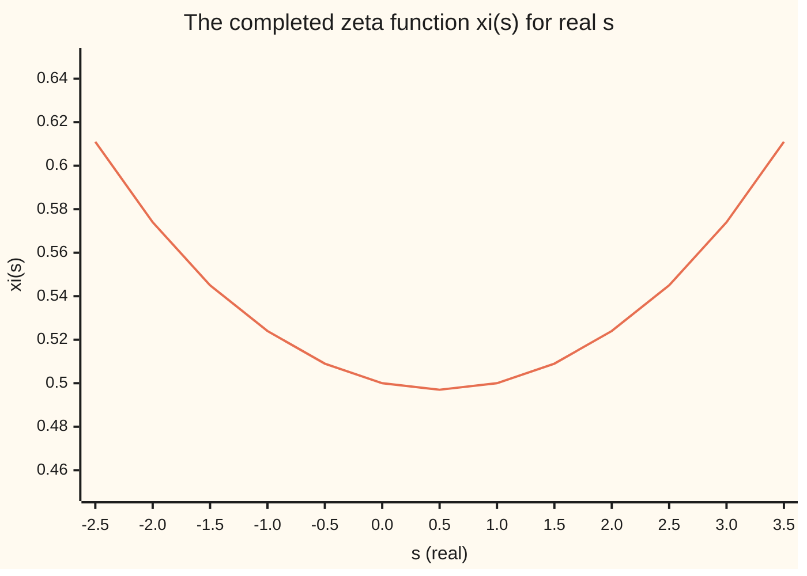
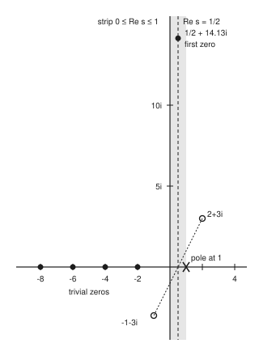

# The functional equation: zeta at s against zeta at one minus s, proved

[Syllabus](../../../SYLLABUS.md) → [Algebraic and analytic number theory](../README.md) → [The Zeta Function and the Prime Number Theorem](../README.md#s02) → The functional equation

---

## General Overview

There are 78,498 primes below a million. In 1859 Riemann wrote down a formula that counts them exactly. It needs the zeta function at every complex number. But the zeta sum, 1 + 1/2^s + 1/3^s + …, only settles when the real part of s is above 1.

The **functional equation** fills the gap. It ties zeta at s to zeta at the mirror point 1 − s. Take s = 2. The sum 1 + 1/4 + 1/9 + … settles at 1.644934, which is π²/6. Its mirror point is −1, where the sum 1 + 2 + 3 + … has no total. Yet the functional equation fixes zeta's value there: −1/12.

The trick is to multiply zeta by known factors. The product, ξ(s), the **completed zeta function**, takes the same value at s and at 1 − s: 0.523599, or π/6, at both 2 and −1. Divide the factors back out at −1 and −1/12 drops out.

The same division places zeta's **trivial zeros**: the points −2, −4, −6, … where zeta is 0. There one factor is infinite while ξ stays finite, so zeta must be 0.

The proof is short. For a positive number x, add up a bell curve, $`e^{-\pi n^2 x}`$, over every whole number n. Poisson summation says this sum at 1/x is √x times the sum at x. A Mellin transform (an integral that weighs a function by a power of x) turns that x-against-1/x symmetry into the s-against-1 − s symmetry.

**Completed by the factor $`\tfrac12 s(s-1)\pi^{-s/2}\Gamma(s/2)`$, zeta becomes a function ξ that is finite at every complex s and takes the same value at s and 1 − s; the proof is Poisson summation applied to a sum of bell curves, and dividing the factor back out forces zeta to vanish at −2, −4, −6, ….**

**What kind of fact this is:** a theorem, Riemann's of 1859, proved on this card in Why it works. The checks test it at sample points, which is evidence, not proof.

### The picture: ξ along the real line, the same on both sides of 1/2



The one line is ξ(s), computed by the theta integral of Step 4. It is a mirror image about s = 1/2, where it is lowest, at 0.497121. Zeta itself has a pole at 1 and no such symmetry.

---

## The formula

Notation, in words first. Write s = σ + it, with σ the real part and t the height, as on [Zeta of a complex variable](01-zeta-and-the-euler-product-revisited.md). The gamma function Γ is the factorial stretched to complex inputs, with Γ(n + 1) = n! ([The gamma function](../../07-Complex%20analysis/09-Special%20Functions%20and%20the%20Zeta%20Function/02-gamma-function.md)). Call $`G(s) = \pi^{-s/2}\,\Gamma(s/2)`$ the **gamma factor**.

```math
\xi(s) = \tfrac12\, s(s-1)\, \pi^{-s/2}\, \Gamma\!\left(\tfrac{s}{2}\right) \zeta(s), \qquad \xi(s) = \xi(1-s)
```

**Read it aloud:** xi of s is one half, times s, times s minus 1, times the gamma factor, times zeta of s; and xi at s equals xi at one minus s.

The proof also gives a formula for ξ that works at every s. It uses a sum of bell curves. This wing keeps θ for Chebyshev's prime sum, so the theta function is written W here:

```math
W(x) = \sum_{n=-\infty}^{\infty} e^{-\pi n^2 x}, \qquad w(x) = \sum_{n=1}^{\infty} e^{-\pi n^2 x} = \frac{W(x) - 1}{2}
```

```math
\xi(s) = \frac12 + \frac{s(s-1)}{2} \int_1^\infty \left( x^{s/2} + x^{(1-s)/2} \right) w(x)\, \frac{dx}{x}
```

**Read it aloud:** xi of s is one half, plus s times s minus 1 over 2, times the area from 1 to infinity under x to the s over 2 plus x to the one minus s over 2, times w of x, over x.

Swap s and 1 − s in that formula. The two powers of x trade places and s(s − 1) does not change. So ξ(s) = ξ(1 − s) can be read straight off it. The work is in proving the formula.

| Symbol | Plain meaning | In our example | Push it up and the answer… |
| --- | --- | --- | --- |
| $`s`$ | the input, a complex number | 2, and its mirror −1 | — |
| $`1-s`$ | the mirror point: s turned half a turn about 1/2 | −1 when s = 2 | — |
| $`\sigma,\ t`$ | real part and height of s | σ = 1/2, t = 14.134725 at the first zero | — |
| $`\zeta(s)`$ | zeta, the sum of $`1/n^s`$, continued | ζ(2) = 1.644934, ζ(−1) = −1/12 | falls toward 1 as real s grows |
| $`\Gamma`$ | the gamma function | Γ(1) = 1, Γ(−1/2) = −2√π | — |
| $`G(s)`$ | the gamma factor $`\pi^{-s/2}\Gamma(s/2)`$ | G(2) = 0.318310, G(−1) = −6.283185 | infinite at 0, −2, −4, … |
| $`\xi(s)`$ | the completed zeta function | ξ(2) = ξ(−1) = 0.523599 | lowest at 1/2 on the real line |
| $`x`$ | a positive real number, the bell curves' variable | x = 2 and 1/x = 0.5 | the bell curves narrow |
| $`n`$ | a whole number, the bell curve's position | all of …, −1, 0, 1, … in W | — |
| $`W(x)`$ | the theta function: bell curves summed over every whole n | W(2) = 1.003735, W(0.5) = 1.419495 | falls toward 1 |
| $`w(x)`$ | the same sum over n ≥ 1 only | (W(x) − 1)/2 | falls like $`e^{-\pi x}`$ |
| $`\eta(s)`$ | the alternating sum $`1 - 2^{-s} + 3^{-s} - \cdots`$, used in What breaks | completed: 0.261799 at 2 | — |

### When it holds

- **The bell curves are summed over every whole number, each with weight 1.** That makes W its own Poisson partner. Put in alternating signs, which turns zeta into the alternating sum η, and the completed values at 2 and −1 split: 0.261799 against −1.570796.
- **The gamma factor is $`\pi^{-s/2}\Gamma(s/2)`$, with s halved.** Drop it, or use Γ(s), and the values at s and 1 − s differ; What breaks gives the numbers.
- **The factor ½ s(s − 1) is there to cancel two poles.** Without it the product is still symmetric, but infinite at 0 and at 1. With it, ξ is finite everywhere, and ξ(0) = ξ(1) = 1/2.
- **Zeta comes back by division only where G(s) is finite.** G has no zeros, and its poles sit at 0, −2, −4, …. At −2, −4, … the division forces zeta to 0. At 0 the factor s cancels the pole, and ζ(0) = −1/2.

---

## Why it works

The complex-analysis wing already continues zeta to every s except 1 and states this equation in zeta's own terms ([Continuing zeta](../../07-Complex%20analysis/09-Special%20Functions%20and%20the%20Zeta%20Function/08-continuing-zeta-and-the-functional-equation.md)): ζ(0) = −1/2, ζ(−1) = −1/12, and zeros at −2, −4, …. This section proves the equation.

### Step 0: find a sum that looks the same after the swap x → 1/x

A Mellin transform weighs a function by a power of x ([The Mellin transform](../../07-Complex%20analysis/09-Special%20Functions%20and%20the%20Zeta%20Function/07-mellin-transform.md)). Replacing x by 1/x turns the power $`x^{s}`$ into $`x^{-s}`$. So a function that keeps its shape under x → 1/x gives a transform that keeps its value under a swap of exponents.

The sum of bell curves W(x) is such a function, up to a factor √x, and its transform is ζ times the gamma factor. Steps 1 to 4 carry out this plan.

### Step 1: Poisson summation flips the bell curves

Poisson summation says that the sum of a function's values at the whole numbers equals the sum of its Fourier transform's values at the whole numbers ([Poisson summation and sampling](../../20-Harmonic%20analysis/02-The%20Fourier%20Transform/08-poisson-summation-and-sampling.md)). The Fourier transform of a bell curve is again a bell curve. The wide bell $`e^{-\pi y^2/x}`$, in a variable y, transforms to the narrow bell $`\sqrt{x}\,e^{-\pi y^2 x}`$. Apply Poisson summation to it:

```math
W\!\left(\tfrac{1}{x}\right) = \sqrt{x}\; W(x), \qquad x > 0
```

**Read it aloud:** the bell-curve sum at one over x equals root x times the sum at x.

At x = 2 both sides are 1.419495488. At x = 10 both are 3.162277660. Without the √x the two sides are W(0.5) = 1.419495 and W(2) = 1.003735.

### Step 2: the Mellin transform turns each bell curve into gamma times $`n^{-s}`$

Rescale the variable by πn² in Euler's integral for gamma. Each bell curve transforms to the gamma factor times $`n^{-s}`$:

```math
\int_0^\infty x^{s/2-1} e^{-\pi n^2 x}\, dx = \pi^{-s/2}\, \Gamma\!\left(\tfrac{s}{2}\right) n^{-s}
```

Add over n = 1, 2, 3, …. The right sides add to G(s)ζ(s), and the left sides to the transform of w:

```math
G(s)\,\zeta(s) = \int_0^\infty x^{s/2-1}\, w(x)\, dx, \qquad \sigma > 1
```

The Mellin card makes the same move with $`1/(e^x - 1)`$ in place of w, and gets Γ(s)ζ(s). The bell curves give Γ(s/2) instead, and the symmetry of Step 1 comes with them.

### Step 3: fold the integral at x = 1

Split the integral at x = 1. On the piece from 0 to 1, replace x by 1/x, so it also runs from 1 to infinity. Step 1, rewritten for w, says $`w(1/x) = \sqrt{x}\,w(x) + \tfrac12(\sqrt{x} - 1)`$. The √x part gives a second power of x; the leftover part integrates to two simple fractions:

```math
G(s)\,\zeta(s) = \frac{1}{s-1} - \frac{1}{s} + \int_1^\infty \left( x^{s/2} + x^{(1-s)/2} \right) w(x)\, \frac{dx}{x}
```

<details>
<summary>Detailed proof: the fold, line by line</summary>

Start from Step 2 for σ > 1, and split the integral into the part from 0 to 1 and the part from 1 to infinity. The second part is already in the final form.

In the first part replace x by 1/x. Then dx becomes −dx/x², and the range 0 to 1 becomes infinity to 1:

$`\displaystyle \int_0^1 x^{s/2-1} w(x)\,dx = \int_1^\infty x^{-s/2-1} w(1/x)\,dx.`$

From Step 1, W(1/x) = √x W(x). Since W = 1 + 2w, this reads 1 + 2w(1/x) = √x (1 + 2w(x)), so

$`\displaystyle w(1/x) = \sqrt{x}\,w(x) + \tfrac12\sqrt{x} - \tfrac12.`$

Put it in. The first term gives the integral of $`x^{(1-s)/2}\,w(x)/x`$ from 1 to infinity. The other two give, for σ > 1,

$`\displaystyle \tfrac12\int_1^\infty \left(x^{-s/2-1/2} - x^{-s/2-1}\right)dx = \tfrac12\left(\frac{2}{s-1} - \frac{2}{s}\right) = \frac{1}{s-1} - \frac{1}{s}.`$

Add the two parts. That is the formula of Step 3.

</details>

### Step 4: read off the continuation and the symmetry

The bell curves in w fall like $`e^{-\pi x}`$, faster than any power of x grows. So the integral from 1 to infinity is finite for every complex s, and it is a holomorphic function of s (it has a complex derivative everywhere).

So the right side of Step 3 gives G(s)ζ(s) at every s except 0 and 1. A holomorphic function extends in only one way, so this is zeta's continuation.

Now swap s and 1 − s:

- the two powers $`x^{s/2}`$ and $`x^{(1-s)/2}`$ trade places;
- 1/(s − 1) becomes −1/s, and −1/s becomes 1/(s − 1).

Nothing changes. Multiply by ½ s(s − 1), which is also unchanged by the swap. Since ½ s(s − 1)(1/(s − 1) − 1/s) = 1/2, out comes the theta formula of The formula section. It is finite everywhere and symmetric, so **ξ(s) = ξ(1 − s)**. At s = 0 and s = 1 the integral term vanishes, so ξ(0) = ξ(1) = 1/2.

### Step 5: the trivial zeros at −2, −4, −6, …

Turn the definition of ξ round:

```math
\zeta(s) = \frac{2\,\xi(s)}{s(s-1)\,G(s)}
```

Three facts settle where zeta is 0 to the left of the line σ = 0.

1. Γ is never 0, and its poles are at 0, −1, −2, …. So $`G(s) = \pi^{-s/2}\Gamma(s/2)`$ is never 0, with poles at s = 0, −2, −4, ….
2. ξ is finite everywhere. At s = −2k it equals ξ(2k + 1), which is positive: at −2 it is ξ(3) = 0.573940.
3. Zeta is never 0 where σ > 1, by the Euler product ([Zeta of a complex variable](01-zeta-and-the-euler-product-revisited.md)). Neither is G there, so ξ is never 0 for σ > 1. By the mirror, ξ is never 0 for σ < 0 either.

So for σ < 0, zeta is 0 exactly where G is infinite: at −2, −4, −6, …. Each zero is simple (zeta crosses 0 there), because ξ is not 0 at those points and each pole of Γ, so of G, is simple. These are the **trivial zeros**.

At s = 0 the pole of G meets the factor s. Near 0, s·G(s) tends to 2, so ζ(0) = 2ξ(0)/((−1) × 2) = −1/2. At s = −1 nothing is infinite, and ζ(−1) is a plain number; Worked numbers computes it.

All other zeros of zeta, the **nontrivial zeros**, lie in the **critical strip** 0 ≤ σ ≤ 1. They are exactly the zeros of ξ.

### The picture: the s-plane

<p align="center"></p>

To scale: 20 units per 1, s = 0 at (210, 330). Shaded: the critical strip. Dashed: σ = 1/2. Dots on the real line: the trivial zeros, at x = 170, 130, 90, 50. Open circles: 2 + 3i at (250, 270) and its mirror −1 − 3i at (190, 390), where the checks find ξ = 0.416271 + 0.088823i at both. Top dot: the first nontrivial zero, at (220.0, 47.3).

### Step 6: what the mirror gives on the line σ = 1/2

Zeta has real coefficients, so ξ at the complex conjugate of s is the conjugate of ξ(s). On the line σ = 1/2 the mirror point 1 − s is that conjugate. So ξ(1/2 + it) equals its own conjugate: it is a real number.

A real function that changes sign must cross 0. The checks bisect for that sign change and find the first nontrivial zero at 1/2 + 14.134725i, and the second at 1/2 + 21.022040i. Every large-scale search for zeros rests on this fact; [Zeros on the line](10-zeros-on-the-critical-line-and-proportion-results.md) takes it further.

---

## Worked numbers, by hand

The example is the mirror pair s = 2 and 1 − s = −1. Compute ξ at 2 from the sum, then use the mirror to find ζ(−1).

| Step | Arithmetic | Value |
| --- | --- | --- |
| ζ(2) | 1 + 1/4 + 1/9 + … | 1.644934 |
| G(2) | $`\pi^{-1}\,\Gamma(1) = 1/\pi`$ | 0.318310 |
| ½ s(s − 1) at s = 2 | ½ × 2 × 1 | 1 |
| ξ(2) | 1 × 0.318310 × 1.644934 | 0.523599 = π/6 |
| ξ(−1) | the mirror: ξ(−1) = ξ(2) | 0.523599 |
| ½ s(s − 1) at s = −1 | ½ × (−1) × (−2) | 1 |
| G(−1) | $`\pi^{1/2}\,\Gamma(-1/2) = \sqrt{\pi}\times(-2\sqrt{\pi}) = -2\pi`$ | −6.283185 |
| ζ(−1) | 0.523599 ÷ (1 × −6.283185) | **−0.083333 = −1/12** |

So zeta's continued value at −1 is −1/12, delivered by the mirror from the convergent sum at 2.

The trivial zero at −2 by the same route: ξ(−2) = ξ(3) = 0.573940 is finite, while G(−2) contains Γ(−1), a pole. So ζ(−2) = 0. Just either side, zeta changes sign: ζ(−1.99) = −0.00030779 and ζ(−2.01) = +0.00030121.

### What breaks if you drop a piece

| Mistake | Comes out at | What went wrong |
| --- | --- | --- |
| Drop the gamma factor: use $`\tfrac12 s(s-1)\pi^{-s/2}\zeta(s)`$ | 0.523599 at 2, −0.147704 at −1 | Γ(s/2) carries the poles that the trivial zeros cancel; without it there is no symmetry |
| Use Γ(s) in place of Γ(s/2) | 0.799441 at 2.5, −0.266480 at −1.5 (true: 0.545094 at both) | each bell curve transforms to Γ(s/2), because the exponent is n², not n |
| Flip the bell curves without √x: W(1/x) = W(x) | W(0.5) = 1.419495, W(2) = 1.003735 | Poisson summation turns a narrow bell into a wide one and scales it by √x |
| Alternating signs: η(s) in place of ζ(s) | 0.261799 at 2, −1.570796 at −1 | the hypothesis fails: the alternating bell-curve sum is not its own Poisson partner |

The code prints all four.

---

## Code, from first principles, and it actually runs

The code reaches ξ by **three independent roads**. Road 1 is the theta integral of Step 4, which is symmetric by construction and works at every s. Road 2 knows nothing of the proof: it computes zeta by the Euler–Maclaurin formula (a sum rewritten as an integral plus correction terms) and gamma by Stirling's series (the large-z expansion of log Γ), both written out, and evaluates ξ at s and at 1 − s separately. Road 3 gives exact values of zeta at 0, −1, −2, … from Bernoulli numbers, as fractions. The script also checks Poisson summation, bisects for zeros on the line and counts the house example's primes by a sieve. `cmath` supplies only exp and log.

### Python

```python
# The functional equation, proved: the check behind the card.  Standard library only.
# Road 1: the theta integral of Step 4, which works for every s.
# Road 2: zeta by Euler-Maclaurin and gamma by Stirling, both written out, used at s and at 1 - s.
# Road 3: exact zeta values at 0, -1, -2, ... from Bernoulli numbers, as fractions.
import cmath, math
from fractions import Fraction

PI = math.pi
B = [Fraction(1)]                       # Bernoulli numbers B_0 .. B_24, with B_1 = -1/2
for n in range(1, 25):
    B.append(-sum(math.comb(n + 1, k) * B[k] for k in range(n)) / (n + 1))

def W(x):                               # the Gaussian sum over every whole number n
    return 1 + 2 * sum(math.exp(-PI * n * n * x) for n in range(1, 60))

def xi_theta(s, T=20.0, steps=8000):    # road 1: xi(s) = 1/2 + s(s-1)/2 * integral, x = e^u
    h, total = math.log(T) / steps, 0
    for k in range(steps + 1):
        u = k * h
        wt = sum(math.exp(-PI * n * n * math.exp(u)) for n in range(1, 8))
        f = (cmath.exp(s / 2 * u) + cmath.exp((1 - s) / 2 * u)) * wt
        total += f * (1 if k in (0, steps) else 4 if k % 2 else 2)
    return 0.5 + s * (s - 1) / 2 * total * h / 3

def gamma(z):                           # shift right to Re z >= 10, then Stirling's series
    z, p = complex(z), 1
    while z.real < 10:
        p, z = p * z, z + 1
    ln = (z - 0.5) * cmath.log(z) - z + 0.5 * math.log(2 * PI)
    for k in range(1, 8):
        ln += float(B[2 * k]) / (2 * k * (2 * k - 1) * z ** (2 * k - 1))
    return cmath.exp(ln) / p

def zeta_em(s, K=12):                   # road 2: Euler-Maclaurin, any s except 1
    s = complex(s)
    N = 15 if s.real > 0 else 6         # fewer plain terms left of 0, where they cancel
    total = sum(n ** -s for n in range(1, N)) + N ** (1 - s) / (s - 1) + N ** -s / 2
    poch = s
    for k in range(1, K + 1):
        total += float(B[2 * k]) / math.factorial(2 * k) * poch * N ** (-s - 2 * k + 1)
        poch *= (s + 2 * k - 1) * (s + 2 * k)
    return total

def G(s):                               # the gamma factor pi^(-s/2) Gamma(s/2)
    return PI ** (-complex(s) / 2) * gamma(complex(s) / 2)

def xi_em(s):
    return s * (s - 1) / 2 * G(s) * zeta_em(s)

def zeta_from_xi(s):                    # zeta read back from road 1 by dividing out the factors
    return 2 * xi_theta(s) / (s * (s - 1) * G(s))

def c(z, real):                         # print a value; near-zeros print as 0 in both languages
    f = lambda x: f"{0.0 if abs(x) < 5e-7 else x:.6f}"
    return f(z.real) if real else f"{f(z.real)}{'+' if z.imag >= 0 else '-'}{f(abs(z.imag))}i"

print("Poisson: W(1/x) against sqrt(x) W(x)")
for x in (2.0, 10.0):
    print(f"  x = {x:4.1f}   W(1/x) = {W(1 / x):.9f}   sqrt(x) W(x) = {math.sqrt(x) * W(x):.9f}")
    assert abs(W(1 / x) - math.sqrt(x) * W(x)) < 1e-12
print(f"  no sqrt: W(0.5) = {W(0.5):.6f} against W(2) = {W(2.0):.6f}")

print("the mirror: xi at s and at 1 - s")
for name, mirror, s in (("2", "-1", 2), ("4", "-3", 4), ("0.25", "0.75", 0.25), ("2+3i", "-1-3i", 2 + 3j)):
    r1, a, b = xi_theta(complex(s)), xi_em(complex(s)), xi_em(1 - complex(s))
    re = name != "2+3i"
    print(f"  s = {name:>4}, 1-s = {mirror:>5}:  road 1 {c(r1, re)}  road 2 at s {c(a, re)}  at 1-s {c(b, re)}")
    assert abs(r1 - a) < 1e-9 and abs(a - b) < 1e-9
assert abs(xi_theta(2) - PI / 6) < 1e-10 and abs(xi_theta(4) - PI ** 2 / 15) < 1e-10
print(f"  pi/6 = {PI / 6:.6f}   pi^2/15 = {PI ** 2 / 15:.6f}")

print("worked numbers: s = 2 and its mirror s = -1")
z2 = zeta_em(2).real
print(f"  zeta(2) = {z2:.6f}   G(2) = {G(2).real:.6f}   xi(2) = {xi_em(2).real:.6f}")
print(f"  G(-1) = {G(-1).real:.6f}   zeta(-1) = xi(-1) / G(-1) = {zeta_from_xi(-1.0).real:.6f}")

print("exact values from Bernoulli numbers, zeta(-n) = (-1)^n B_(n+1) / (n+1)")
for n in range(0, 7):
    exact = (-1) ** n * B[n + 1] / (n + 1)
    road1 = zeta_from_xi(-float(n)).real if n % 2 else None
    tail = f"   road 1 {road1:9.6f}" if road1 is not None else ""
    print(f"  zeta({-n}) = {str(exact):>6}   road 2 {c(zeta_em(-n), 1):>9}{tail}")
    assert abs(zeta_em(-n).real - float(exact)) < 1e-8
    if road1 is not None:
        assert abs(road1 - float(exact)) < 1e-9
print(f"  xi(0) = {xi_theta(0.0).real:.6f}   xi(1) = {xi_theta(1.0).real:.6f}")

print("trivial zeros: xi stays finite, G has a pole, so zeta is 0")
for k in (1, 2, 3, 4):
    s = -2.0 * k
    print(f"  s = {s:4.0f}   xi(s) = xi({1 - s:.0f}) = {xi_theta(s).real:.6f}   "
          f"zeta(s+0.01) = {zeta_from_xi(s + 0.01).real:+.8f}   zeta(s-0.01) = {zeta_from_xi(s - 0.01).real:+.8f}")
    assert zeta_from_xi(s + 0.01).real * zeta_from_xi(s - 0.01).real < 0
    assert abs(zeta_from_xi(s + 0.01) - zeta_em(s + 0.01)) < 1e-8 and xi_theta(s).real > 0.4

print("what breaks")
drop = [s * (s - 1) / 2 * PI ** (-s / 2) * zeta_em(s).real for s in (2.0, -1.0)]
print(f"  no gamma factor:   {drop[0]:.6f} at 2, {drop[1]:.6f} at -1")
wrong = [s * (s - 1) / 2 * PI ** (-s / 2) * gamma(s).real * zeta_em(s).real for s in (2.5, -1.5)]
print(f"  Gamma(s) for Gamma(s/2): {wrong[0]:.6f} at 2.5, {wrong[1]:.6f} at -1.5 (true xi: {xi_theta(2.5).real:.6f})")
eta = [s * (s - 1) / 2 * G(s).real * (1 - 2 ** (1 - s)) * zeta_em(s).real for s in (2.0, -1.0)]
print(f"  alternating sum eta: {eta[0]:.6f} at 2, {eta[1]:.6f} at -1")
assert abs(drop[1] + math.sqrt(PI) / 12) < 1e-9 and abs(eta[0] - PI / 12) < 1e-9 and abs(eta[1] + PI / 2) < 1e-9
assert abs(wrong[0] - xi_theta(2.5).real) > 0.1

def bisect(lo, hi):                     # xi is real on the line Re s = 1/2: a zero is a sign change
    assert xi_theta(complex(0.5, lo)).real * xi_theta(complex(0.5, hi)).real < 0
    for _ in range(30):
        mid = (lo + hi) / 2
        if xi_theta(complex(0.5, lo)).real * xi_theta(complex(0.5, mid)).real <= 0:
            hi = mid
        else:
            lo = mid
    return lo
lo = bisect(14.0, 14.5)
z = xi_em(complex(0.5, lo))
assert abs(z) < 1e-8 and abs(xi_theta(complex(0.5, 14.0)).imag) < 1e-10
print(f"first zero on the line, by bisection: 1/2 + {lo:.6f}i   road 2 there: |xi| < 1e-8")

print(f"try: xi(1/2) = {xi_theta(0.5).real:.6f}   cut at x = 2: xi(2) = {xi_theta(2.0, T=2.0).real:.6f}   "
      f"20 steps: xi(2) = {xi_theta(2.0, steps=20).real:.6f}   zero in [20, 22]: {bisect(20.0, 22.0):.6f}")
sieve = bytearray([1]) * 1000001       # the house example, by a sieve of Eratosthenes
sieve[0] = sieve[1] = 0
for i in range(2, 1001):
    if sieve[i]:
        sieve[i * i::i] = bytes(len(range(i * i, 1000001, i)))
print(f"house example: primes below 1,000,000 = {sum(sieve):,}")
print(f"explicit formula, trivial zeros' term at x = 1,000,000: {-0.5 * math.log1p(-1e-12) * 1e13:.6f} x 10^-13")
pts = [-2.5 + 0.5 * k for k in range(13)]
print("chart, sigma " + " ".join(f"{p:5.1f}" for p in pts))
vals = [xi_theta(p).real for p in pts]
print("chart, xi    " + " ".join(f"{v:5.3f}" for v in vals))
assert all(abs(vals[k] - xi_em(1 - pts[k]).real) < 1e-9 for k in range(5))  # road 2 at the mirror
x0, y0, u = 210, 330, 20
print(f"figure, origin ({x0}, {y0}), {u} px per unit, first zero at ({x0 + u / 2:.1f}, {y0 - u * lo:.1f}), "
      f"trivial zeros at x = {', '.join(str(x0 - u * 2 * k) for k in range(1, 5))}, "
      f"2+3i at ({x0 + 2 * u}, {y0 - 3 * u}), -1-3i at ({x0 - u}, {y0 + 3 * u})")
print("ALL CHECKS PASS")
```

**Ran 2026-11-15 on macOS, Python 3.14.10, standard library only. All checks passed. Output, pasted from the run:**

```
Poisson: W(1/x) against sqrt(x) W(x)
  x =  2.0   W(1/x) = 1.419495488   sqrt(x) W(x) = 1.419495488
  x = 10.0   W(1/x) = 3.162277660   sqrt(x) W(x) = 3.162277660
  no sqrt: W(0.5) = 1.419495 against W(2) = 1.003735
the mirror: xi at s and at 1 - s
  s =    2, 1-s =    -1:  road 1 0.523599  road 2 at s 0.523599  at 1-s 0.523599
  s =    4, 1-s =    -3:  road 1 0.657974  road 2 at s 0.657974  at 1-s 0.657974
  s = 0.25, 1-s =  0.75:  road 1 0.497839  road 2 at s 0.497839  at 1-s 0.497839
  s = 2+3i, 1-s = -1-3i:  road 1 0.416271+0.088823i  road 2 at s 0.416271+0.088823i  at 1-s 0.416271+0.088823i
  pi/6 = 0.523599   pi^2/15 = 0.657974
worked numbers: s = 2 and its mirror s = -1
  zeta(2) = 1.644934   G(2) = 0.318310   xi(2) = 0.523599
  G(-1) = -6.283185   zeta(-1) = xi(-1) / G(-1) = -0.083333
exact values from Bernoulli numbers, zeta(-n) = (-1)^n B_(n+1) / (n+1)
  zeta(0) =   -1/2   road 2 -0.500000
  zeta(-1) =  -1/12   road 2 -0.083333   road 1 -0.083333
  zeta(-2) =      0   road 2  0.000000
  zeta(-3) =  1/120   road 2  0.008333   road 1  0.008333
  zeta(-4) =      0   road 2  0.000000
  zeta(-5) = -1/252   road 2 -0.003968   road 1 -0.003968
  zeta(-6) =      0   road 2  0.000000
  xi(0) = 0.500000   xi(1) = 0.500000
trivial zeros: xi stays finite, G has a pole, so zeta is 0
  s =   -2   xi(s) = xi(3) = 0.573940   zeta(s+0.01) = -0.00030779   zeta(s-0.01) = +0.00030121
  s =   -4   xi(s) = xi(5) = 0.787971   zeta(s+0.01) = +0.00008012   zeta(s-0.01) = -0.00007955
  s =   -6   xi(s) = xi(7) = 1.280507   zeta(s+0.01) = -0.00005898   zeta(s-0.01) = +0.00005901
  s =   -8   xi(s) = xi(9) = 2.430209   zeta(s+0.01) = +0.00008291   zeta(s-0.01) = -0.00008341
what breaks
  no gamma factor:   0.523599 at 2, -0.147704 at -1
  Gamma(s) for Gamma(s/2): 0.799441 at 2.5, -0.266480 at -1.5 (true xi: 0.545094)
  alternating sum eta: 0.261799 at 2, -1.570796 at -1
first zero on the line, by bisection: 1/2 + 14.134725i   road 2 there: |xi| < 1e-8
try: xi(1/2) = 0.497121   cut at x = 2: xi(2) = 0.522831   20 steps: xi(2) = 0.523600   zero in [20, 22]: 21.022040
house example: primes below 1,000,000 = 78,498
explicit formula, trivial zeros' term at x = 1,000,000: 5.000000 x 10^-13
chart, sigma  -2.5  -2.0  -1.5  -1.0  -0.5   0.0   0.5   1.0   1.5   2.0   2.5   3.0   3.5
chart, xi    0.611 0.574 0.545 0.524 0.509 0.500 0.497 0.500 0.509 0.524 0.545 0.574 0.611
figure, origin (210, 330), 20 px per unit, first zero at (220.0, 47.3), trivial zeros at x = 170, 130, 90, 50, 2+3i at (250, 270), -1-3i at (190, 390)
ALL CHECKS PASS
```

Road 2 at 1 − s matches road 2 at s: the theorem, tested by a method that never used it.

### Rust

Same roads, same numbers. Rust has no complex type, so a small one is written out, with a fraction type for the Bernoulli numbers.

```rust
// The functional equation, proved: the same check as functional_equation_proved_check.py, in Rust.
// Standard library only, no crates.  A small complex-number struct and a small fraction struct
// (i128, reduced by gcd at every step) are written out below.
use std::ops::{Add, Div, Mul, Sub};
const PI: f64 = std::f64::consts::PI;
#[derive(Clone, Copy)]
struct C { re: f64, im: f64 }
fn c(re: f64, im: f64) -> C { C { re, im } }
fn r(x: f64) -> C { c(x, 0.0) }
impl Add for C { type Output = C; fn add(self, o: C) -> C { c(self.re + o.re, self.im + o.im) } }
impl Sub for C { type Output = C; fn sub(self, o: C) -> C { c(self.re - o.re, self.im - o.im) } }
impl Mul for C { type Output = C; fn mul(self, o: C) -> C { c(self.re * o.re - self.im * o.im, self.re * o.im + self.im * o.re) } }
impl Div for C { type Output = C; fn div(self, o: C) -> C {
    let d = o.re * o.re + o.im * o.im;
    c((self.re * o.re + self.im * o.im) / d, (self.im * o.re - self.re * o.im) / d) } }
impl C {
    fn exp(self) -> C { let m = self.re.exp(); c(m * self.im.cos(), m * self.im.sin()) }
    fn ln(self) -> C { c(self.re.hypot(self.im).ln(), self.im.atan2(self.re)) }
    fn abs(self) -> f64 { self.re.hypot(self.im) }
}
fn rpow(x: f64, s: C) -> C { (s * r(x.ln())).exp() } // x^s for x > 0
#[derive(Clone, Copy)]
struct Q { n: i128, d: i128 }
fn gcd(a: i128, b: i128) -> i128 { if b == 0 { a.abs() } else { gcd(b, a % b) } }
fn q(n: i128, d: i128) -> Q { let g = gcd(n, d).max(1) * d.signum(); Q { n: n / g, d: d / g } }
fn qadd(a: Q, b: Q) -> Q { q(a.n.checked_mul(b.d).unwrap() + b.n.checked_mul(a.d).unwrap(), a.d.checked_mul(b.d).unwrap()) }
fn qs(a: Q) -> String { if a.d == 1 { format!("{}", a.n) } else { format!("{}/{}", a.n, a.d) } }
fn comb(n: i128, k: i128) -> i128 { (0..k).fold(1, |acc, i| acc * (n - i) / (i + 1)) }
fn w_sum(x: f64) -> f64 { 1.0 + 2.0 * (1..60).map(|n| (-PI * (n * n) as f64 * x).exp()).sum::<f64>() }
fn xi_theta(s: C) -> C { xi_theta_at(s, 20.0, 8000) }
fn xi_theta_at(s: C, tt: f64, steps: usize) -> C { // road 1: xi(s) = 1/2 + s(s-1)/2 * integral, x = e^u
    let h = tt.ln() / steps as f64;
    let mut total = r(0.0);
    for k in 0..=steps {
        let u = k as f64 * h;
        let wt: f64 = (1..8).map(|n| (-PI * (n * n) as f64 * u.exp()).exp()).sum();
        let f = ((s * r(u / 2.0)).exp() + ((r(1.0) - s) * r(u / 2.0)).exp()) * r(wt);
        let wgt = if k == 0 || k == steps { 1.0 } else if k % 2 == 1 { 4.0 } else { 2.0 };
        total = total + f * r(wgt);
    }
    r(0.5) + s * (s - r(1.0)) * r(0.5) * total * r(h / 3.0)
}
fn gamma(z0: C, b: &[f64]) -> C { // shift right to Re z >= 10, then Stirling's series
    let (mut z, mut p) = (z0, r(1.0));
    while z.re < 10.0 { p = p * z; z = z + r(1.0); }
    let mut l = (z - r(0.5)) * z.ln() - z + r(0.5 * (2.0 * PI).ln());
    for k in 1..8 {
        let zk = (r((2 * k - 1) as f64) * z.ln()).exp();
        l = l + r(b[2 * k] / (2 * k * (2 * k - 1)) as f64) / zk;
    }
    l.exp() / p
}
fn zeta_em(s: C, b: &[f64]) -> C { // road 2: Euler-Maclaurin, any s except 1
    let nn = if s.re > 0.0 { 15 } else { 6 };
    let n = nn as f64;
    let mut total = r(0.0);
    for m in 1..nn { total = total + rpow(m as f64, r(0.0) - s); }
    total = total + rpow(n, r(1.0) - s) / (s - r(1.0)) + rpow(n, r(0.0) - s) * r(0.5);
    let (mut poch, mut fact) = (s, 1.0);
    for k in 1..=12usize {
        fact *= ((2 * k - 1) * (2 * k)) as f64;
        total = total + r(b[2 * k] / fact) * poch * rpow(n, r(1.0 - 2.0 * k as f64) - s);
        poch = poch * (s + r((2 * k - 1) as f64)) * (s + r((2 * k) as f64));
    }
    total
}
fn g(s: C, b: &[f64]) -> C { rpow(PI, r(0.0) - s * r(0.5)) * gamma(s * r(0.5), b) }
fn xi_em(s: C, b: &[f64]) -> C { s * (s - r(1.0)) * r(0.5) * g(s, b) * zeta_em(s, b) }
fn zeta_from_xi(s: C, b: &[f64]) -> C { r(2.0) * xi_theta(s) / (s * (s - r(1.0)) * g(s, b)) }
fn bisect(mut lo: f64, mut hi: f64) -> f64 { // xi is real on the line Re s = 1/2: a zero is a sign change
    assert!(xi_theta(c(0.5, lo)).re * xi_theta(c(0.5, hi)).re < 0.0);
    for _ in 0..30 {
        let mid = (lo + hi) / 2.0;
        if xi_theta(c(0.5, lo)).re * xi_theta(c(0.5, mid)).re <= 0.0 { hi = mid; } else { lo = mid; }
    }
    lo
}
fn f6(x: f64) -> String { format!("{:.6}", if x.abs() < 5e-7 { 0.0 } else { x }) }
fn cs(z: C, real: bool) -> String {
    if real { f6(z.re) } else { format!("{}{}{}i", f6(z.re), if z.im >= 0.0 { "+" } else { "-" }, f6(z.im.abs())) }
}

fn main() {
    let mut bq = vec![q(1, 1)]; // Bernoulli numbers B_0 .. B_24, with B_1 = -1/2
    for n in 1..25i128 {
        let mut acc = q(0, 1);
        for k in 0..n { acc = qadd(acc, q(comb(n + 1, k) * bq[k as usize].n, bq[k as usize].d)); }
        bq.push(q(-acc.n, acc.d * (n + 1)));
    }
    let b: Vec<f64> = bq.iter().map(|x| x.n as f64 / x.d as f64).collect();
    println!("Poisson: W(1/x) against sqrt(x) W(x)");
    for x in [2.0f64, 10.0] {
        println!("  x = {:4.1}   W(1/x) = {:.9}   sqrt(x) W(x) = {:.9}", x, w_sum(1.0 / x), x.sqrt() * w_sum(x));
        assert!((w_sum(1.0 / x) - x.sqrt() * w_sum(x)).abs() < 1e-12);
    }
    println!("  no sqrt: W(0.5) = {:.6} against W(2) = {:.6}", w_sum(0.5), w_sum(2.0));

    println!("the mirror: xi at s and at 1 - s");
    for (name, mirror, s) in [("2", "-1", r(2.0)), ("4", "-3", r(4.0)), ("0.25", "0.75", r(0.25)), ("2+3i", "-1-3i", c(2.0, 3.0))] {
        let (r1, a, bb) = (xi_theta(s), xi_em(s, &b), xi_em(r(1.0) - s, &b));
        let re = name != "2+3i";
        println!("  s = {:>4}, 1-s = {:>5}:  road 1 {}  road 2 at s {}  at 1-s {}", name, mirror, cs(r1, re), cs(a, re), cs(bb, re));
        assert!((r1 - a).abs() < 1e-9 && (a - bb).abs() < 1e-9);
    }
    assert!((xi_theta(r(2.0)).re - PI / 6.0).abs() < 1e-10 && (xi_theta(r(4.0)).re - PI * PI / 15.0).abs() < 1e-10);
    println!("  pi/6 = {:.6}   pi^2/15 = {:.6}", PI / 6.0, PI * PI / 15.0);

    println!("worked numbers: s = 2 and its mirror s = -1");
    println!("  zeta(2) = {:.6}   G(2) = {:.6}   xi(2) = {:.6}", zeta_em(r(2.0), &b).re, g(r(2.0), &b).re, xi_em(r(2.0), &b).re);
    println!("  G(-1) = {:.6}   zeta(-1) = xi(-1) / G(-1) = {:.6}", g(r(-1.0), &b).re, zeta_from_xi(r(-1.0), &b).re);

    println!("exact values from Bernoulli numbers, zeta(-n) = (-1)^n B_(n+1) / (n+1)");
    for n in 0..7i128 {
        let e = bq[(n + 1) as usize];
        let exact = q(if n % 2 == 0 { e.n } else { -e.n }, e.d * (n + 1));
        let z2 = zeta_em(r(-(n as f64)), &b).re;
        let mut tail = String::new();
        if n % 2 == 1 {
            let road1 = zeta_from_xi(r(-(n as f64)), &b).re;
            tail = format!("   road 1 {:9.6}", road1);
            assert!((road1 - exact.n as f64 / exact.d as f64).abs() < 1e-9);
        }
        println!("  zeta({}) = {:>6}   road 2 {:>9}{}", -n, qs(exact), f6(z2), tail);
        assert!((z2 - exact.n as f64 / exact.d as f64).abs() < 1e-8);
    }
    println!("  xi(0) = {:.6}   xi(1) = {:.6}", xi_theta(r(0.0)).re, xi_theta(r(1.0)).re);

    println!("trivial zeros: xi stays finite, G has a pole, so zeta is 0");
    for k in 1..=4 {
        let s = -2.0 * k as f64;
        let (up, dn) = (zeta_from_xi(r(s + 0.01), &b), zeta_from_xi(r(s - 0.01), &b));
        println!("  s = {:4.0}   xi(s) = xi({:.0}) = {:.6}   zeta(s+0.01) = {:+.8}   zeta(s-0.01) = {:+.8}",
                 s, 1.0 - s, xi_theta(r(s)).re, up.re, dn.re);
        assert!(up.re * dn.re < 0.0);
        assert!((up - zeta_em(r(s + 0.01), &b)).abs() < 1e-8 && xi_theta(r(s)).re > 0.4);
    }

    println!("what breaks");
    let drop: Vec<f64> = [2.0f64, -1.0].iter().map(|&s| s * (s - 1.0) / 2.0 * PI.powf(-s / 2.0) * zeta_em(r(s), &b).re).collect();
    println!("  no gamma factor:   {:.6} at 2, {:.6} at -1", drop[0], drop[1]);
    let wrong: Vec<f64> = [2.5f64, -1.5].iter().map(|&s| s * (s - 1.0) / 2.0 * PI.powf(-s / 2.0) * gamma(r(s), &b).re * zeta_em(r(s), &b).re).collect();
    println!("  Gamma(s) for Gamma(s/2): {:.6} at 2.5, {:.6} at -1.5 (true xi: {:.6})", wrong[0], wrong[1], xi_theta(r(2.5)).re);
    let eta: Vec<f64> = [2.0f64, -1.0].iter().map(|&s| s * (s - 1.0) / 2.0 * g(r(s), &b).re * (1.0 - 2f64.powf(1.0 - s)) * zeta_em(r(s), &b).re).collect();
    println!("  alternating sum eta: {:.6} at 2, {:.6} at -1", eta[0], eta[1]);
    assert!((drop[1] + PI.sqrt() / 12.0).abs() < 1e-9 && (eta[0] - PI / 12.0).abs() < 1e-9 && (eta[1] + PI / 2.0).abs() < 1e-9);
    assert!((wrong[0] - xi_theta(r(2.5)).re).abs() > 0.1);

    let lo = bisect(14.0, 14.5);
    assert!(xi_em(c(0.5, lo), &b).abs() < 1e-8 && xi_theta(c(0.5, 14.0)).im.abs() < 1e-10);
    println!("first zero on the line, by bisection: 1/2 + {:.6}i   road 2 there: |xi| < 1e-8", lo);

    println!("try: xi(1/2) = {:.6}   cut at x = 2: xi(2) = {:.6}   20 steps: xi(2) = {:.6}   zero in [20, 22]: {:.6}",
             xi_theta(r(0.5)).re, xi_theta_at(r(2.0), 2.0, 8000).re, xi_theta_at(r(2.0), 20.0, 20).re, bisect(20.0, 22.0));
    let (mut comp, mut pc) = (vec![false; 1_000_001], 0); // the house example, by a sieve of Eratosthenes
    for i in 2..=1_000_000usize { if !comp[i] { pc += 1; let mut j = i * i; while j <= 1_000_000 { comp[j] = true; j += i; } } }
    println!("house example: primes below 1,000,000 = {},{:03}", pc / 1000, pc % 1000);
    println!("explicit formula, trivial zeros' term at x = 1,000,000: {:.6} x 10^-13", -0.5 * (-1e-12f64).ln_1p() * 1e13);
    let pts: Vec<f64> = (0..13).map(|k| -2.5 + 0.5 * k as f64).collect();
    let vals: Vec<f64> = pts.iter().map(|&p| xi_theta(r(p)).re).collect();
    println!("chart, sigma {}", pts.iter().map(|p| format!("{:5.1}", p)).collect::<Vec<_>>().join(" "));
    println!("chart, xi    {}", vals.iter().map(|v| format!("{:5.3}", v)).collect::<Vec<_>>().join(" "));
    for k in 0..5 { assert!((vals[k] - xi_em(r(1.0 - pts[k]), &b).re).abs() < 1e-9); } // road 2 at the mirror
    let (x0, y0, u) = (210, 330, 20);
    println!("figure, origin ({}, {}), {} px per unit, first zero at ({:.1}, {:.1}), trivial zeros at x = {}, \
              2+3i at ({}, {}), -1-3i at ({}, {})", x0, y0, u, x0 as f64 + u as f64 / 2.0, y0 as f64 - u as f64 * lo,
             (1..5).map(|k| (x0 - u * 2 * k).to_string()).collect::<Vec<_>>().join(", "),
             x0 + 2 * u, y0 - 3 * u, x0 - u, y0 + 3 * u);
    println!("ALL CHECKS PASS");
}
```

**Ran 2026-11-15 on macOS, rustc 1.98.1, no crates. All checks passed. Output, pasted from the run:**

```
Poisson: W(1/x) against sqrt(x) W(x)
  x =  2.0   W(1/x) = 1.419495488   sqrt(x) W(x) = 1.419495488
  x = 10.0   W(1/x) = 3.162277660   sqrt(x) W(x) = 3.162277660
  no sqrt: W(0.5) = 1.419495 against W(2) = 1.003735
the mirror: xi at s and at 1 - s
  s =    2, 1-s =    -1:  road 1 0.523599  road 2 at s 0.523599  at 1-s 0.523599
  s =    4, 1-s =    -3:  road 1 0.657974  road 2 at s 0.657974  at 1-s 0.657974
  s = 0.25, 1-s =  0.75:  road 1 0.497839  road 2 at s 0.497839  at 1-s 0.497839
  s = 2+3i, 1-s = -1-3i:  road 1 0.416271+0.088823i  road 2 at s 0.416271+0.088823i  at 1-s 0.416271+0.088823i
  pi/6 = 0.523599   pi^2/15 = 0.657974
worked numbers: s = 2 and its mirror s = -1
  zeta(2) = 1.644934   G(2) = 0.318310   xi(2) = 0.523599
  G(-1) = -6.283185   zeta(-1) = xi(-1) / G(-1) = -0.083333
exact values from Bernoulli numbers, zeta(-n) = (-1)^n B_(n+1) / (n+1)
  zeta(0) =   -1/2   road 2 -0.500000
  zeta(-1) =  -1/12   road 2 -0.083333   road 1 -0.083333
  zeta(-2) =      0   road 2  0.000000
  zeta(-3) =  1/120   road 2  0.008333   road 1  0.008333
  zeta(-4) =      0   road 2  0.000000
  zeta(-5) = -1/252   road 2 -0.003968   road 1 -0.003968
  zeta(-6) =      0   road 2  0.000000
  xi(0) = 0.500000   xi(1) = 0.500000
trivial zeros: xi stays finite, G has a pole, so zeta is 0
  s =   -2   xi(s) = xi(3) = 0.573940   zeta(s+0.01) = -0.00030779   zeta(s-0.01) = +0.00030121
  s =   -4   xi(s) = xi(5) = 0.787971   zeta(s+0.01) = +0.00008012   zeta(s-0.01) = -0.00007955
  s =   -6   xi(s) = xi(7) = 1.280507   zeta(s+0.01) = -0.00005898   zeta(s-0.01) = +0.00005901
  s =   -8   xi(s) = xi(9) = 2.430209   zeta(s+0.01) = +0.00008291   zeta(s-0.01) = -0.00008341
what breaks
  no gamma factor:   0.523599 at 2, -0.147704 at -1
  Gamma(s) for Gamma(s/2): 0.799441 at 2.5, -0.266480 at -1.5 (true xi: 0.545094)
  alternating sum eta: 0.261799 at 2, -1.570796 at -1
first zero on the line, by bisection: 1/2 + 14.134725i   road 2 there: |xi| < 1e-8
try: xi(1/2) = 0.497121   cut at x = 2: xi(2) = 0.522831   20 steps: xi(2) = 0.523600   zero in [20, 22]: 21.022040
house example: primes below 1,000,000 = 78,498
explicit formula, trivial zeros' term at x = 1,000,000: 5.000000 x 10^-13
chart, sigma  -2.5  -2.0  -1.5  -1.0  -0.5   0.0   0.5   1.0   1.5   2.0   2.5   3.0   3.5
chart, xi    0.611 0.574 0.545 0.524 0.509 0.500 0.497 0.500 0.509 0.524 0.545 0.574 0.611
figure, origin (210, 330), 20 px per unit, first zero at (220.0, 47.3), trivial zeros at x = 170, 130, 90, 50, 2+3i at (250, 270), -1-3i at (190, 390)
ALL CHECKS PASS
```

The two outputs are identical, line for line.

### Lean

Lean proves the functional equation for every complex s, and the trivial zeros and the values of zeta at 0 and −1.

- Take ξ(s) = ½ s(s − 1) G(s) ζ(s) at every s other than 1, 0, −2, −4, …. Then ξ extends to one function, finite and holomorphic at every complex s.
- Take any complex s. Then that function takes the same value at s and at the mirror point: ξ(1 − s) = ξ(s).
- At s = 0 and at s = 1, ξ equals 1/2.
- Suppose σ < 0. Then ζ(s) = 0 exactly when s is one of −2, −4, −6, ….
- Zeta's continued values are ζ(0) = −1/2 and ζ(−1) = −1/12.
- The factor ½ s(s − 1) is 1 at s = 2 and at its mirror s = −1.

Every decimal value, the theta formula and the first zero at 14.134725 are left to the Python and Rust checks.

```lean
-- The functional equation: the completed zeta function ξ(s) = ½ s(s − 1) π^(−s/2) Γ(s/2) ζ(s) extends to a function that is finite at every complex s and takes the same value at s and 1 − s, and zeta is 0 left of the line σ = 0 exactly at −2, −4, −6, ….
import Mathlib.NumberTheory.LSeries.RiemannZeta
import Mathlib.NumberTheory.LSeries.HurwitzZetaValues
import Mathlib.NumberTheory.LSeries.Dirichlet
import Mathlib.NumberTheory.LSeries.Nonvanishing

open Complex

/-- Riemann's functional equation. There is a function ξ, finite and complex-differentiable at
every complex s, that equals ½ s(s − 1) π^(−s/2) Γ(s/2) ζ(s) wherever the gamma factor
π^(−s/2) Γ(s/2) is finite and zeta has no pole (s not 1 and not 0, −2, −4, …). It takes the same
value at s and at the mirror point 1 − s, and ξ(0) = ξ(1) = 1/2. -/
theorem completed_zeta_functional_equation :
    ∃ ξ : ℂ → ℂ, Differentiable ℂ ξ ∧
      (∀ s : ℂ, s ≠ 1 → (∀ n : ℕ, s ≠ -(2 * (n : ℂ))) →
        ξ s = s * (s - 1) / 2 * ((Real.pi : ℂ) ^ (-s / 2) * Gamma (s / 2)) * riemannZeta s) ∧
      (∀ s : ℂ, ξ (1 - s) = ξ s) ∧
      ξ 0 = 1 / 2 ∧ ξ 1 = 1 / 2 := by
  refine ⟨fun s => s * (s - 1) / 2 * completedRiemannZeta₀ s + 1 / 2, ?_, ?_, ?_, ?_, ?_⟩
  · intro s
    have h := differentiable_completedZeta₀ s
    fun_prop
  · intro s hs1 hs
    have hs0 : s ≠ 0 := by simpa using hs 0
    have hG : Gammaℝ s ≠ 0 := by
      intro h
      obtain ⟨n, hn⟩ := Gammaℝ_eq_zero_iff.mp h
      exact hs n hn
    have hz : riemannZeta s * Gammaℝ s = completedRiemannZeta s := by
      rw [riemannZeta_def_of_ne_zero hs0, div_mul_cancel₀ _ hG]
    rw [← Gammaℝ_def, mul_assoc, mul_comm (Gammaℝ s), hz, completedRiemannZeta_eq]
    have h1 : (1 : ℂ) - s ≠ 0 := sub_ne_zero.mpr (Ne.symm hs1)
    field_simp
    ring
  · intro s
    simp only [completedRiemannZeta₀_one_sub]
    ring
  · simp
  · simp

/-- The trivial zeros. To the left of the line σ = 0, zeta is 0 exactly at the negative even
integers −2, −4, −6, …, where the gamma factor has its poles. -/
theorem zeta_zero_left_of_strip_iff (s : ℂ) (hs : s.re < 0) :
    riemannZeta s = 0 ↔ ∃ n : ℕ, s = -2 * ((n : ℂ) + 1) := by
  exact riemannZeta_eq_zero_iff_of_re_nonpos hs.le

/-- The worked numbers. Dividing the gamma factor back out of ξ gives zeta's continued values
ζ(0) = −1/2 and ζ(−1) = −1/12. -/
theorem zeta_zero_and_zeta_neg_one :
    riemannZeta 0 = -1 / 2 ∧ riemannZeta (-1) = -1 / 12 := by
  refine ⟨riemannZeta_zero, ?_⟩
  have h := riemannZeta_neg_nat_eq_bernoulli 1
  rw [bernoulli_two] at h
  simp only [Nat.cast_one] at h
  rw [h]
  norm_num

-- The factor ½ s(s − 1) is 1 at s = 2 and at its mirror s = −1.
example : (1 / 2 : ℚ) * 2 * (2 - 1) = 1 := by norm_num
example : (1 / 2 : ℚ) * (-1) * (-1 - 1) = 1 := by norm_num
-- The mirror point of 2 is −1, and the trivial zero −2 is mirrored to 3, where ξ(3) is finite.
example : (1 : ℤ) - 2 = -1 := by norm_num
example : (1 : ℤ) - (-2) = 3 := by norm_num

#print axioms completed_zeta_functional_equation
#print axioms zeta_zero_left_of_strip_iff
#print axioms zeta_zero_and_zeta_neg_one
```

**Checked 2026-11-15 on macOS, Lean 4.36.0-rc2, Mathlib v4.36.0-rc2. Every proof is complete and uses only Lean's standard axioms. Output, pasted from the run:**

```
'completed_zeta_functional_equation' depends on axioms: [propext, Classical.choice, Quot.sound]
'zeta_zero_left_of_strip_iff' depends on axioms: [propext, Classical.choice, Quot.sound]
'zeta_zero_and_zeta_neg_one' depends on axioms: [propext, Classical.choice, Quot.sound]
```

> [!TIP]
> **Try changing**
> - Guess first: is ξ lowest at s = 1/2 on the real line, or somewhere else? Print `xi_theta(0.5)`. It is **0.497121**: the mirror forces a turning point at 1/2, and the chart shows it is the bottom.
> - Guess first: how much of the integral lies beyond x = 2? Set `T=2.0` in `xi_theta(2.0)`. It gives **0.522831** instead of 0.523599. Small, since w falls like $`e^{-\pi x}`$, but not zero.
> - Guess first: does Simpson's rule (the code's integration rule) need 8,000 steps? Set `steps=20`. ξ(2) comes out at **0.523600**, one millionth high: the integrand is very smooth.
> - Guess first: where is the second zero? Call `bisect(20.0, 22.0)`. It finds **21.022040**.

---

## The usual mistake

> [!warning]
> **Reading ζ(−1) = −1/12 as the total of 1 + 2 + 3 + ….** That sum has no total: its partial sums grow without limit. −1/12 is the value at −1 of the continued function, and the mirror fixes it from ζ(2) = 1.644934.
>
> Smaller traps:
> - **Putting the trivial zeros at the negative odd numbers.** They sit at the even ones. At the odd ones zeta is not 0: ζ(−1) = −1/12, ζ(−3) = 1/120, ζ(−5) = −1/252.
> - **Expecting ζ(0) = 0 because G has a pole at 0.** The factor s cancels that pole. ζ(0) = −1/2.
> - **Thinking zeta itself is symmetric.** ζ(2) = 1.644934 and ζ(−1) = −0.083333. Only the completed ξ takes equal values, 0.523599 at both.
> - **Summing the bell curves from n = 1 only and expecting the flip.** The sum over n ≥ 1 is w, and w(1/x) = √x w(x) + ½(√x − 1), not √x w(x). That leftover is where 1/(s − 1) − 1/s comes from.

---

## Where you meet it in real life

- **Counting primes.** The explicit formula writes Chebyshev's weighted prime count ψ(x) as a sum over zeta's zeros ([The explicit formula](07-the-explicit-formula.md)). In it the trivial zeros add up to the term $`-\tfrac12\log(1 - 1/x^2)`$. At x = 1,000,000, beside 78,498 primes, it is 5.000000 × 10⁻¹³. All the difficulty is in the nontrivial zeros.
- **Checking the Riemann hypothesis by computer.** Searches for zeros evaluate a real function on the line σ = 1/2 and count its sign changes, as Step 6 does at 14.134725. The mirror is what makes that function real.
- **Heat on a ring.** W(x) describes heat spreading round a ring. Step 1 matches the short-time picture (a narrow bell) with the long-time one (a few slow waves), and engineers use whichever sum converges faster.
- **Physics.** The energy between two close metal plates (the Casimir effect) contains the divergent sum 1³ + 2³ + 3³ + …, and physicists replace it by the continued value ζ(−3) = 1/120, which the checks print in Code.
- **Dirichlet L-functions.** The same proof, with the bell curves twisted by a character (a pattern of signs that repeats with a fixed period), gives a functional equation for each L-function of the next shelf.

> **Say it back**
> Zeta's sum settles only for real part above 1. Multiplied by $`\tfrac12 s(s-1)\pi^{-s/2}\Gamma(s/2)`$, zeta becomes ξ, finite everywhere and equal at s and 1 − s. The proof sums bell curves over every whole number, flips them by Poisson summation, and folds a Mellin integral at x = 1. At 2 and −1, ξ is π/6 = 0.523599, and dividing out the factors gives ζ(−1) = −1/12. Where the gamma factor is infinite, at −2, −4, −6, …, zeta must be 0: those are the trivial zeros.

---

## What this builds on

- [Zeta of a complex variable](01-zeta-and-the-euler-product-revisited.md): s = σ + it, the Euler product, and the fact that zeta is never 0 for σ > 1, used in Step 5.
- [Continuing zeta](../../07-Complex%20analysis/09-Special%20Functions%20and%20the%20Zeta%20Function/08-continuing-zeta-and-the-functional-equation.md): zeta continued past σ = 1, its pole at 1, and the equation stated in zeta's own terms, proved here.
- [The gamma function](../../07-Complex%20analysis/09-Special%20Functions%20and%20the%20Zeta%20Function/02-gamma-function.md): Euler's integral, Γ(−1/2) = −2√π, and the poles at 0, −1, −2, … that place the trivial zeros.
- [The Mellin transform](../../07-Complex%20analysis/09-Special%20Functions%20and%20the%20Zeta%20Function/07-mellin-transform.md): the move of Step 2, a sum of stretched copies transforming to zeta times one integral.
- [Poisson summation and sampling](../../20-Harmonic%20analysis/02-The%20Fourier%20Transform/08-poisson-summation-and-sampling.md): the identity behind Step 1, applied here to the bell curve.

## Where this goes next

- [The zero-free region](03-the-zero-free-region.md): the trivial zeros are placed and the rest lie in the strip; the next card shows none lie on its edge σ = 1.
- [Counting the zeros](08-counting-the-zeros-riemann-von-mangoldt.md): ξ and its mirror count the zeros up to height t.
- [The explicit formula](07-the-explicit-formula.md): the prime count written as a sum over zeros, trivial and nontrivial.
- [Zeros on the line](10-zeros-on-the-critical-line-and-proportion-results.md): the real function of Step 6, used to prove that infinitely many zeros lie on σ = 1/2.
- [The functional equation of L(s, chi)](../03-Characters%20and%20L-functions/09-dirichlet-l-functions-functional-equation.md): a twisted theta function, with the Gauss sum as the sign.
- [The L-function of a modular form](../07-Diophantine%20and%20Modular/12-l-functions-of-modular-forms.md): a Mellin transform that inherits the form's symmetry.

The question this card leaves open: the mirror pairs a zero at σ with one at 1 − σ, so do all nontrivial zeros sit on the line σ = 1/2 itself?

---

## Sources

Verified 2026-11-15: every link below resolves to the publisher's page.

- Riemann, Bernhard. "Ueber die Anzahl der Primzahlen unter einer gegebenen Grösse." *Monatsberichte der Berliner Akademie*, 1859. [Clay Mathematics Institute page](https://www.claymath.org/collections/riemanns-1859-manuscript/). The original: the theta-function proof, ξ, and the explicit formula.
- Edwards, H. M. *Riemann's Zeta Function*. Dover, 2001. [Publisher page](https://store.doverpublications.com/products/9780486417400). Chapter 1 follows Riemann's paper line by line, including the fold of Step 3.
- Davenport, Harold. *Multiplicative Number Theory*, 2nd ed. Springer, 1980. [doi:10.1007/978-1-4757-5927-3](https://doi.org/10.1007/978-1-4757-5927-3). The theta proof as on this card, and its extension to Dirichlet L-functions.
- Apostol, Tom M. *Introduction to Analytic Number Theory*. Springer, 1976. [doi:10.1007/978-1-4757-5579-4](https://doi.org/10.1007/978-1-4757-5579-4). A second proof, through the Hurwitz zeta function, and the values at negative integers by Bernoulli numbers.
