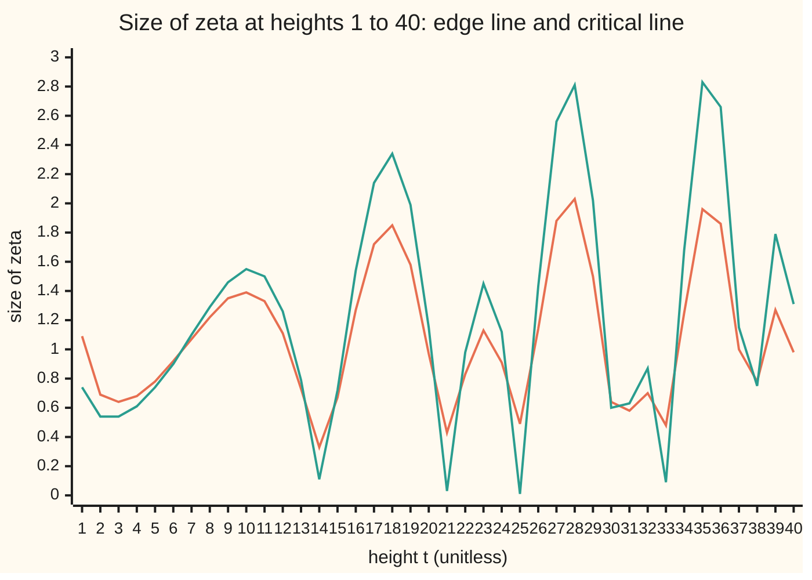
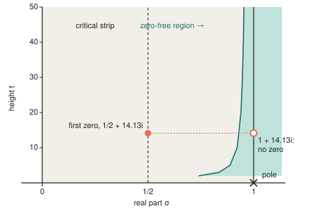

# The zero-free region: why zeta cannot vanish on the edge of the critical strip

[Syllabus](../../../SYLLABUS.md) → [Algebraic and analytic number theory](../README.md) → [The Zeta Function and the Prime Number Theorem](../README.md#s02) → The zero-free region

---

## General Overview

Zeta's first zero sits at 1/2 + 14.134725i, on the critical line ([Zeta's zeros and the primes](../../07-Complex%20analysis/09-Special%20Functions%20and%20the%20Zeta%20Function/09-zeros-of-zeta-and-the-primes.md) located it). Keep the same height and walk right to the edge of the critical strip, the point 1 + 14.134725i. There zeta equals 0.323828 + 0.039379i. Its size is 0.326213: nowhere near zero.

That matters for counting primes. A zero on the edge line, where the real part is 1, would add a wave as large as x itself to the prime count (the zeros card explains why). Then the prime number theorem, the law behind the count of 78,498 primes below a million, would fail. The theorem needs the whole edge line clear, at every height.

No computer can check every height. A scan of the edge from height 1 to 40, in steps of 0.01, finds zeta's smallest size to be 0.326037, at height 14.12. That is evidence, not proof. The proof is a short inequality, the **three-four-one trick**. It plays zeta's pole at 1 against a possible zero, and the zero loses.

**Because 3 + 4 cos θ + cos 2θ is never negative, the product ζ(σ)³ |ζ(σ + it)|⁴ |ζ(σ + 2it)| is at least 1 whenever σ > 1; a zero at 1 + it would drag that product down to 0 as σ falls to 1, so zeta has no zero on the edge line; the same inequality, with sizes put in, widens the clear zone to σ > 1 − c / log t.**

**What kind of fact this is:** a theorem. No zero on the edge line was proved in 1896 by Hadamard and by de la Vallée Poussin; the three-four-one form is Mertens' (1898), proved in full in Why it works. The widened region (de la Vallée Poussin, 1899) is proved in outline in a fold, and an explicit constant for it, 5.558691, is quoted from a 2024 paper.

### The picture: zeta's size on the edge and on the critical line



Orange: the size of ζ(1 + it), on the edge line. Green: the size of ζ(1/2 + it), on the critical line. Both are sampled at whole-number heights. Near zeros of zeta, the green line drops to 0.11, 0.03, 0.01 and 0.09 at heights 14, 21, 25 and 33. The orange line dips at the same heights, but its lowest point, 0.33 at height 14, stays well clear of 0. Whole-number sampling misses the other two zeros below 40, at heights 30.42 and 37.59; the checks chase all six.

---

## The formula

Notation first, in words. The input is $`s = \sigma + it`$: $`\sigma`$ ("sigma") is its real part and $`t`$ its height ([Zeta of a complex variable](01-zeta-and-the-euler-product-revisited.md) set this up). Here log is the natural logarithm. The edge line is $`\sigma = 1`$.

```math
3 + 4\cos\theta + \cos 2\theta = 2\,(1 + \cos\theta)^2 \ \ge\ 0
```

**Read it aloud:** three, plus four times the cosine of an angle, plus the cosine of twice that angle, is twice a square, so it is never negative.

```math
P(\sigma) = \zeta(\sigma)^3\,|\zeta(\sigma + it)|^4\,|\zeta(\sigma + 2it)| \ \ge\ 1 \qquad (\sigma > 1,\ t \text{ real})
```

**Read it aloud:** zeta on the real axis cubed, times the size of zeta at height t to the fourth power, times the size of zeta at height 2t, is at least 1, for every real part above 1.

```math
\zeta(\beta + it) \ne 0 \quad \text{whenever} \quad \beta \ge 1 - \frac{1}{R \log |t|} \ \text{ and } \ |t| \ge 2, \qquad R = 5.558691
```

**Read it aloud:** zeta has no zero whose real part comes within one over R log t of the edge line, at any height from 2 up.

| Symbol | Plain meaning | In our example | Push it up and the answer… |
| --- | --- | --- | --- |
| $`s = \sigma + it`$ | zeta's complex input: real part σ, height t | t = 14.134725 | — |
| $`\zeta(s)`$, $`\zeta'(s)`$ | zeta, and its slope (derivative) | size 0.326213 at 1 + 14.134725i | — |
| $`p`$, $`k`$ | a prime, and a whole-number power of it | the 78,498 primes below a million | — |
| $`\theta`$ | an angle, here $`k t \log p`$; not Chebyshev's prime sum θ(x) | — | — |
| $`P(\sigma)`$ | the three-four-one product of zeta's sizes | 44.35 at σ = 1.1 | σ up: falls toward 1; σ down to 1: grows like 1/(σ − 1)³ |
| $`\rho = \beta + it`$, $`\beta`$ | a zero of zeta ("rho"), and its real part | β = 1/2 for the first zero | β up toward 1: a bigger wave in the prime count |
| $`R`$, $`c`$, $`c'`$ | the region's constant; $`c = 1/R`$; $`c'`$ the separate constant in the error term of Step 7 | R = 5.558691 | R up: a thinner clear zone |
| $`A`$, $`\delta`$ | a fixed constant in the size bounds of Step 5; a small fixed number ("delta") that sets how far right of 1 to look | δ = 1/(10A) in the fold | — |
| $`K`$, $`M`$ | in the first fold: the largest size of ζ′ on the segment from 1 + it to 2 + it, and of ζ on the segment from 1 + 2it to 2 + 2it | — | — |
| $`\Lambda(n)`$ | von Mangoldt's weight: log p if n is a power of p, else 0 | log p at each of the 78,498 primes | — |
| $`x`$, $`\psi(x)`$, $`T`$ | count limit; the sum of Λ(n) up to x, the weighted prime count; the height up to which Perron's formula uses zeros | x = 10^6 | ψ(x) stays close to x |

### When it holds

- **The product inequality needs σ > 1.** There the series for log ζ converges. At σ = 1/2 and height 14.134725 the product is 0.000000, because the first zero sits there.
- **The weights must never be negative.** Weights 1 + 2 cos θ dip to −1.000000, and the matching product ζ(2) |ζ(2 + 14.134725i)|² comes out at 0.785023, below 1.
- **The zero must outweigh the pole.** A zero at 1 + it enters to the fourth power, the pole only to the third. With weights 1 + cos θ the powers tie, and no contradiction follows.
- **The height t is not 0.** At t = 0 the point 1 + it is the pole itself, where zeta is infinite, not zero; and the factor at height 2t needs 1 + 2it away from the pole.
- **The widened region is quoted, not derived.** Its shape is proved in the fold; the constant 5.558691, valid for heights 2 and up, comes from the 2024 source.

---

## Why it works

### Step 0: a pole pushes up three times, a zero would pull down four times

The log of zeta is a sum of waves, one for each prime power, each with a positive weight. Near σ = 1 the pole makes the waves add up to $`+\infty`$ at height 0. A zero at height t would make them add up to $`-\infty`$ there.

Take three copies of height 0, four of height t and one of height 2t. Each wave then enters with weight 3 + 4 cos θ + cos 2θ, which is never negative. So the total cannot go to $`-\infty`$. But a zero at height t, counted four times, beats a pole counted three times. That clash is the proof.

### Step 1: log zeta is a sum of waves with positive weights

For σ > 1, the Euler product writes ζ(s) as a product of $`1/(1 - p^{-s})`$ over the primes ([Zeta of a complex variable](01-zeta-and-the-euler-product-revisited.md)). Taking logs, and expanding each $`-\log(1 - p^{-s})`$ as a power series, gives:

```math
\log \zeta(s) = \sum_{p} \sum_{k \ge 1} \frac{p^{-ks}}{k}
```

Write $`p^{-ks} = p^{-k\sigma}\,(\cos(kt\log p) - i \sin(kt\log p))`$ and keep the real part:

```math
\log |\zeta(\sigma + it)| = \sum_{p} \sum_{k \ge 1} \frac{\cos(kt\log p)}{k\,p^{k\sigma}}
```

Each weight $`1/(k p^{k\sigma})`$ is positive. Only the cosines depend on the height t.

### Step 2: three, four, one is never negative

Use $`\cos 2\theta = 2\cos^2\theta - 1`$. Then $`3 + 4\cos\theta + \cos 2\theta = 2 + 4\cos\theta + 2\cos^2\theta = 2(1 + \cos\theta)^2`$. A square is never negative.

The smallest value is 0, at θ = 180 degrees. The check confirms the identity on 3601 angles and finds the smallest value 0.000000 at 180 degrees.

### Step 3: so the product is at least 1

Add three copies of the Step 1 sum at height 0, four at height t and one at height 2t. Term by term, each prime power picks up the bracket $`3 + 4\cos\theta + \cos 2\theta`$ with $`\theta = kt\log p`$:

```math
\log P(\sigma) = \sum_{p} \sum_{k \ge 1} \frac{3 + 4\cos(kt\log p) + \cos(2kt\log p)}{k\,p^{k\sigma}} \ \ge\ 0
```

Every term is at least 0, so $`P(\sigma) \ge 1`$. At the height of the first zero:

| σ | ζ(σ) | size at height t | size at height 2t | product P(σ) |
| --- | ---: | ---: | ---: | ---: |
| 2 | 1.644934 | 0.690823 | 1.336952 | 1.36 |
| 1.5 | 2.612375 | 0.544404 | 1.554655 | 2.43 |
| 1.1 | 10.584448 | 0.377112 | 1.849382 | 44.35 |
| 1.01 | 100.577943 | 0.331489 | 1.938247 | 23,811.98 |

At σ = 2 the log of the product is 0.304008951 from zeta itself and 0.304008758 from the prime-power sum over the 78,498 primes below a million. The small gap is the primes above a million. Every bracket in that sum is at least 0.000000.

### Step 4: a zero at 1 + it would pull the product down to 0

Suppose ζ(1 + it) = 0 for some height t other than 0. Let σ fall toward 1 and watch the three factors:

1. **The pole.** ζ(σ) is below σ/(σ − 1) ([Zeta of a complex variable](01-zeta-and-the-euler-product-revisited.md)), so the cube is at most about $`1/(\sigma - 1)^3`$.
2. **The zero.** Zeta has a bounded slope near 1 + it, so its size at σ + it is at most a constant times (σ − 1). The fourth power is at most a constant times $`(\sigma - 1)^4`$.
3. **Height 2t.** The point 1 + 2it is not the pole, so the size of ζ(σ + 2it) stays bounded.

Multiply: P(σ) is at most a constant times $`(\sigma - 1)^{-3 + 4} = (\sigma - 1)`$, which goes to 0. That contradicts P(σ) ≥ 1. So ζ(1 + it) ≠ 0 for every real t ≠ 0.

The Euler product already rules out zeros with σ > 1. So zeta has no zero anywhere with real part at least 1.

<details>
<summary>Detailed proof: the three bounds near σ = 1</summary>

Fix t ≠ 0 and suppose ζ(1 + it) = 0. Take 1 < σ ≤ 2.

First, ζ(σ) < σ/(σ − 1), proved on the card Zeta of a complex variable by comparing the sum with an integral.

Second, zeta is differentiable on the segment from 1 + it to 2 + it, which avoids the pole. Let K be the largest size of ζ′ on that segment. Since ζ(1 + it) = 0,

$`\displaystyle |\zeta(\sigma + it)| = \Big|\int_1^{\sigma} \zeta'(u + it)\,du\Big| \le K(\sigma - 1).`$

Third, zeta is continuous on the segment from 1 + 2it to 2 + 2it, which also avoids the pole because 2t ≠ 0. Let M be its largest size there.

Then Step 3 gives

$`\displaystyle 1 \le P(\sigma) \le \Big(\frac{\sigma}{\sigma - 1}\Big)^3 K^4 (\sigma - 1)^4 M = \sigma^3 K^4 M\,(\sigma - 1),`$

and the right side goes to 0 as σ falls to 1. That is impossible, so ζ(1 + it) ≠ 0.

</details>

Two runs show the mechanism with numbers, at t = 14.134725:

- **True zeta.** $`(\sigma - 1)^3 P(\sigma)`$ settles at $`|\zeta(1 + it)|^4\,|\zeta(1 + 2it)| = 0.022068`$; at σ = 1.0001 it reads 0.022085. A positive limit means no zero.
- **A planted zero.** Swap ζ(σ + it) and ζ(σ + 2it) for ζ(σ − 1/2 + it) and ζ(σ − 1/2 + 2it): a stand-in that has a zero at 1 + 14.134725i. The product falls to 0.099952, 0.010583 and 0.001064 at σ = 1.1, 1.01 and 1.001, shrinking like (σ − 1) as Step 4 says.

### Step 5: the same inequality, with sizes put in, widens the region

The argument above says only "no zero on the line". De la Vallée Poussin made it quantitative in 1899. Use the log derivative of zeta, a sum with weight Λ(n), in place of log zeta:

```math
-\frac{\zeta'}{\zeta}(s) = \sum_{n \ge 1} \frac{\Lambda(n)}{n^{s}} \qquad (\sigma > 1)
```

The same three-four-one weighting gives a sum of non-negative terms:

```math
3\Big(-\frac{\zeta'}{\zeta}(\sigma)\Big) + 4\Big(-\mathrm{Re}\,\frac{\zeta'}{\zeta}(\sigma + it)\Big) + \Big(-\mathrm{Re}\,\frac{\zeta'}{\zeta}(\sigma + 2it)\Big) \ \ge\ 0
```

Now bound each piece for heights t ≥ 2, where A is a fixed constant:

1. **The pole:** the first piece is at most $`3/(\sigma - 1) + 3A`$.
2. **A zero at β + it:** the second piece is at most $`4A\log t - 4/(\sigma - \beta)`$. Every zero pulls this piece down; keep only the one at β + it.
3. **Height 2t:** the third piece is at most $`A\log t`$.

Put σ just right of 1, at $`\sigma = 1 + \delta/\log t`$ with a small fixed δ. The inequality then forces β to stay a distance $`c/\log t`$ away from 1.

<details>
<summary>Detailed proof: from the three bounds to 1 − β ≥ c / log t</summary>

Bound 1 holds because the pole of zeta at 1 is simple: −ζ′/ζ(σ) is 1/(σ − 1) plus a part that stays bounded as σ falls to 1. Bounds 2 and 3 come from the partial-fraction formula that Hadamard's product gives for ζ′/ζ: minus the real part of ζ′/ζ(s) equals a term below A log t, minus the sum over zeros ρ of the real part of 1/(s − ρ). For σ > 1 each such real part is positive, so dropping zeros only raises the bound. Davenport proves the formula.

Adding the three bounds, with all A-terms collected into one constant A (and log t ≥ log 2):

$`\displaystyle 0 \le \frac{3}{\sigma - 1} - \frac{4}{\sigma - \beta} + 5A\log t.`$

Put $`\displaystyle \sigma = 1 + \frac{\delta}{\log t}`$. Then

$`\displaystyle \frac{4}{\sigma - \beta} \le \Big(\frac{3}{\delta} + 5A\Big)\log t, \quad\text{so}\quad \sigma - \beta \ge \frac{4\delta}{(3 + 5A\delta)\log t}.`$

Subtract σ − 1 = δ / log t:

$`\displaystyle 1 - \beta \ge \Big(\frac{4}{3 + 5A\delta} - 1\Big)\frac{\delta}{\log t}.`$

The bracket is positive whenever 5Aδ < 1. Taking δ = 1/(10A) gives $`\displaystyle 1 - \beta \ge \frac{1}{70A\,\log t}`$: a positive c. Better trigonometric polynomials than 3 + 4 cos θ + cos 2θ, and sharper bounds, push the constant up; Step 6 quotes an explicit value.

</details>

### Step 6: the region's size, at real heights

An explicit constant, proved in 2024 by Mossinghoff, Trudgian and Yang, is R = 5.558691: no zero with σ ≥ 1 − 1/(R log t), for heights 2 and up. The clear zone is thin, and it narrows as t grows:

| Height t | Width 1/(R log t) |
| ---: | ---: |
| 14.13 | 0.067921, so clear for σ above 0.932079 |
| 1000 | 0.026043 |
| 10^6 | 0.013021 |
| 3 × 10^12 | 0.006262 |

<p align="center"></p>

Scale: 300 units per 1 across, 5 per 1 up, origin (60, 260). Boundary points from height 2 to 50 run from x = 282.1 to 346.2; the edge point is (360.0, 189.3), the first zero (210.0, 189.3).

Every zero below height 3 × 10^12 has been checked to lie on the critical line (Platt and Trudgian, 2021). So the classical region adds information only above that height. A wider shape, due to Vinogradov and Korobov (1958), shrinks like $`(\log t)^{-2/3}(\log\log t)^{-1/3}`$ instead of $`(\log t)^{-1}`$ and beats it at very large heights; the same 2024 paper gives it an explicit constant.

### Step 7: what the region buys for the prime count

A zero ρ = β + it adds a wave of size about $`x^{\beta}/|\rho|`$ to ψ(x) ([Zeta's zeros and the primes](../../07-Complex%20analysis/09-Special%20Functions%20and%20the%20Zeta%20Function/09-zeros-of-zeta-and-the-primes.md)), and the zero β − it, its reflection in the real axis, adds a matching wave, so the pair gives twice that. Measured against x, one zero gives $`x^{\beta - 1}/|\rho|`$.

At x = 10^6, a zero at the region's edge at height 14.13 has growth factor $`x^{\beta - 1}`$ = 0.391267; divided by |ρ| that is 0.027621, and with its pair a wave 0.055242 times x. The true first zero, on the critical line, has growth factor 0.001000, and its pair makes a wave 0.000141 times x. The region alone is weak at small x; its strength is that it holds at every height.

[Perron's formula](04-perrons-formula.md) turns the zeros up to a height T into a prime count. Choosing T near $`\exp(\sqrt{\log x})`$ and using the region for every zero below T gives

```math
\psi(x) = x + O\big(x\,e^{-c'\sqrt{\log x}}\big)
```

with an effective positive constant c′: one that can be computed. [The prime number theorem](05-prime-number-theorem-proved.md) carries this out. With only "no zero on the edge", the same route gives ψ(x) ~ x with no rate at all.

---

## Worked numbers, by hand

At the first zero's height, t = 14.134725, and σ = 1.1:

| Step | Arithmetic | Value |
| --- | --- | --- |
| 1. zeta on the real axis | ζ(1.1) | 10.584448 |
| 2. size at height t | \|ζ(1.1 + 14.134725i)\| | 0.377112 |
| 3. size at height 2t | \|ζ(1.1 + 28.269450i)\| | 1.849382 |
| 4. the product | 10.584448³ × 0.377112⁴ × 1.849382 | 44.35 |
| 5. at least 1? | 44.35 ≥ 1 | yes |
| 6. take out the pole | 0.1³ × 44.35 | 0.044352 |
| 7. closer to the edge | 0.0001³ × P(1.0001) | 0.022085 |
| 8. the limit | 0.326213⁴ × 1.948757 | 0.022068 |
| 9. zeta on the edge | \|ζ(1 + 14.134725i)\| | **0.326213** |

The limit in step 8 is positive, and it could only be 0 if zeta vanished at 1 + 14.134725i; it does not, and the proof says it cannot at any height.

### What breaks if you drop a piece

| Mistake | Comes out at | What went wrong |
| --- | --- | --- |
| Weights 1 + cos θ: the pair ζ(σ) ζ(σ + it) | planted-zero product levels off at 0.793297 instead of falling to 0 | the zero's power 1 only cancels the pole's power 1; the limit is whatever the slope happens to be |
| Weights 1 + 2 cos θ | ζ(2) \|ζ(2 + 14.134725i)\|² = 0.785023, below 1 | the weights dip to −1.000000, so the sum can be negative |
| The product at σ = 1/2 | 0.000000 at 1/2 + 14.134725i | the series for log ζ does not converge absolutely for σ ≤ 1, so the positivity argument has nothing to stand on |
| The region read as reaching the critical line | width 0.067921 at height 14.13: clear only for σ above 0.932079 | the region is a thin band; the first zero at 1/2 lies far outside it |

The code prints all four.

---

## Code, from first principles, and it actually runs

The scripts compute zeta two independent ways: an Euler–Maclaurin sum (a head sum plus a tail integral plus end corrections) and Borwein's weighted alternating series. They take four pairs of roads. Zeta on the edge comes from both methods. The log of the product comes from zeta and from the prime-power sum over the 78,498 primes below a million. "No zero near 1 + 14.13i" comes from the value and from a winding count round a box. The limit as σ falls to 1 comes from the product and from the edge values.

### Python

```python
# The zero-free region -- the check behind the card.  Standard library only.  Zeta by
# Euler-Maclaurin and by Borwein's alternating series; the 3-4-1 product by zeta and by its
# series over prime powers; a box around 1 + 14.13i; the widened region of the card, quoted.
import math
def npow(n, s):                       # n^(-s) for a whole number n and a complex s
    m, a = math.exp(-s.real * math.log(n)), s.imag * math.log(n)
    return complex(m * math.cos(a), -m * math.sin(a))
def zeta(s):                          # road 1: head sum + tail integral + end corrections
    N = 60 + int(abs(s.imag)); r = lambda m: math.prod(s + j for j in range(m)) * npow(N, s + m)
    return (sum(npow(n, s) for n in range(1, N)) + N * npow(N, s) / (s - 1) + npow(N, s) / 2
            + r(1) / 12 - r(3) / 720 + r(5) / 30240)
def zeta_b(s, n=50):                  # road 2: Borwein's weighted alternating series
    d, term, acc = [], 1 / n, 0.0
    for i in range(n + 1):
        acc += term; d.append(n * acc); term *= 4 * (n + i) * (n - i) / ((2 * i + 1) * (2 * i + 2))
    tot = sum((-1) ** k * (d[k] - d[n]) * npow(k + 1, s) for k in range(n))
    return -tot / (d[n] * (1 - 2 * npow(2, s)))
X = 10**6                             # the 78,498 primes below a million, by a sieve
flag = bytearray([1]) * (X + 1); flag[0] = flag[1] = 0
for p in range(2, 1001):
    if flag[p]: flag[p * p::p] = bytearray(len(range(p * p, X + 1, p)))
primes = [p for p in range(X + 1) if flag[p]]
def series(sig, t, a):                # sum over p^k of (a0 + a1 cos(k t ln p) + a2 cos(2k t ln p)) / (k p^(k sig))
    tot, low = 0.0, 9.0
    for p in primes:
        k = 1
        while k * sig * math.log(p) < 40:
            th = k * t * math.log(p); b = a[0] + a[1] * math.cos(th) + a[2] * math.cos(2 * th)
            tot += b * math.exp(-k * sig * math.log(p)) / k; low = min(low, b); k += 1
    return tot, low
def secant(a, b):                     # chase a zero of zeta through the complex plane
    for _ in range(60):
        if abs(zeta(b)) > 1e-13: a, b = b, b - zeta(b) * (b - a) / (zeta(b) - zeta(a))
    return b
def turns(c, hw, ht, M=200):          # times zeta winds round 0 along a box edge, anticlockwise
    cs = [c - hw - ht * 1j, c + hw - ht * 1j, c + hw + ht * 1j, c - hw + ht * 1j, c - hw - ht * 1j]
    pts = [a + (b - a) * k / M for a, b in zip(cs, cs[1:]) for k in range(M)] + [cs[0]]
    zs = [zeta(w) for w in pts]
    return sum(math.atan2((w / v).imag, (w / v).real) for v, w in zip(zs, zs[1:])) / (2 * math.pi)
prod341 = lambda sig, t, f=zeta: abs(f(sig)) ** 3 * abs(f(sig + 1j * t)) ** 4 * abs(f(sig + 2j * t))
z1 = secant(0.5 + 14j, 0.5 + 14.3j); t1 = z1.imag; e1, e2 = zeta(1 + 1j * t1), zeta(1 + 2j * t1)
print(f"first zero, chased on the critical line: {z1.real:.6f} + {t1:.6f}i")
cs = lambda z: f"{z.real:.6f} {'-' if z.imag < 0 else '+'} {abs(z.imag):.6f}i"
print(f"zeta(1 + {t1:.6f}i) = {cs(e1)}; size {abs(e1):.6f}, Borwein {abs(zeta_b(1 + 1j * t1)):.6f}")
print(f"zeta(1 + {2 * t1:.6f}i) = {cs(e2)}; size {abs(e2):.6f}, Borwein {abs(zeta_b(1 + 2j * t1)):.6f}")
w_edge, w_line = turns(1 + 1j * t1, 0.25, 0.5), turns(0.5 + 1j * t1, 0.25, 0.5)
print(f"box 0.5 wide, 1 tall: centred on 1 + {t1:.2f}i, turns {round(w_edge)}; centred on 0.5 + {t1:.2f}i, turns {round(w_line)}")
grid = [(abs(zeta(1 + 1j * k / 100)), k / 100) for k in range(100, 4001)]
print(f"smallest |zeta(1 + it)| for t = 1 to 40 in steps of 0.01: {min(grid)[0]:.6f}, at t = {min(grid)[1]:.2f}")
ang = [math.pi * k / 1800 for k in range(3601)]
gap = max(abs(3 + 4 * math.cos(a) + math.cos(2 * a) - 2 * (1 + math.cos(a)) ** 2) for a in ang)
low = min((3 + 4 * math.cos(a) + math.cos(2 * a), k / 10) for k, a in enumerate(ang))
print(f"3 + 4cos + cos2 against 2(1 + cos)^2 on 3601 angles: largest gap below 1e-12; smallest value {abs(low[0]):.6f} at {low[1]:.0f} degrees")
rows = [(sig, prod341(sig, t1)) for sig in (2, 1.5, 1.1, 1.01, 1.001, 1.0001)]
for sig, v in rows:
    print(f"sigma {sig}: zeta(sigma) {zeta(sig).real:.6f}; |zeta(sigma + it)| {abs(zeta(sig + 1j * t1)):.6f}; "
          f"|zeta(sigma + 2it)| {abs(zeta(sig + 2j * t1)):.6f}; product {v:.2f}; (sigma - 1)^3 x product {(sig - 1) ** 3 * v:.6f}")
lim = abs(e1) ** 4 * abs(e2)
print(f"limit |zeta(1 + it)|^4 |zeta(1 + 2it)| = {lim:.6f}")
s341, b341 = series(2, t1, (3, 4, 1))
print(f"sigma 2, log of product: from zeta {math.log(rows[0][1]):.9f}; from 78498 primes {s341:.9f}; smallest bracket {abs(b341):.6f}")
fake = lambda s: zeta(s - 0.5) if abs(s.imag) > 1 else zeta(s)    # zeta slid right: a zero planted at 1 + 14.13i
fz = [(sig, prod341(sig, t1, fake), abs(zeta(sig)) * abs(fake(sig + 1j * t1))) for sig in (1.1, 1.01, 1.001)]
print("planted zero, 3-4-1 product: " + "; ".join(f"sigma {s} {v:.6f}" for s, v, _ in fz))
print("planted zero, 1-1 pair: " + "; ".join(f"sigma {s} {u:.6f}" for s, _, u in fz))
v12, (s12, b12) = zeta(2).real * abs(zeta(2 + 1j * t1)) ** 2, series(2, t1, (1, 2, 0))
print(f"1 + 2cos dips to {min(1 + 2 * math.cos(a) for a in ang):.6f}; zeta(2)|zeta(2 + it)|^2 = {v12:.6f}; "
      f"from 78498 primes {math.exp(s12):.6f}, smallest bracket {b12:.6f}")
print(f"sigma 0.5, off the series: product {prod341(0.5, t1):.6f}")
R = 5.558691                          # quoted: no zero with sigma >= 1 - 1/(R ln|t|), |t| >= 2
wid = lambda t: 1 / (R * math.log(t))
print("region width 1/(R ln t): " + "; ".join(f"t = {n} {wid(t):.6f}" for n, t in
      ((f"{t1:.2f}", t1), ("1000", 1e3), ("10^6", 1e6), ("3x10^12", 3e12))) + f"; edge at t1 {1 - wid(t1):.6f}")
g_e, g_1, r_e, r_1 = X ** -wid(t1), X ** -0.5, abs(complex(1 - wid(t1), t1)), abs(z1)   # x^(beta - 1), and |rho|
print(f"wave over x at x = 10^6, x^(beta - 1)/|rho|, one zero and its pair: region's edge {g_e / r_e:.6f}, {2 * g_e / r_e:.6f}; "
      f"first zero {g_1 / r_1:.6f}, {2 * g_1 / r_1:.6f}; x^(beta - 1) alone {g_e:.6f}, {g_1:.6f}")
ts = range(1, 41)
print("chart |zeta(1 + it)|, t = 1..40: " + ", ".join(f"{abs(zeta(1 + 1j * t)):.2f}" for t in ts))
print("chart |zeta(1/2 + it)|, t = 1..40: " + ", ".join(f"{abs(zeta(0.5 + 1j * t)):.2f}" for t in ts))
fig = [2, 3, 5, 10, 20, 30, 40, 50]
print("figure, x = 60 + 300 sigma, y = 260 - 5 t: boundary " + " ".join(f"({60 + 300 * (1 - wid(t)):.1f},{260 - 5 * t:.1f})"
      for t in fig) + f"; edge point (360.0,{260 - 5 * t1:.1f}); first zero (210.0,{260 - 5 * t1:.1f})")
zs40 = [secant(0.5 + 1j * a, 0.5 + 1j * (a + 0.2)).imag for a in (14, 20.9, 24.9, 30.3, 32.8, 37.5)]
print("zeros below 40, chased on the critical line: " + ", ".join(f"{t:.2f}" for t in zs40))
fake4 = lambda s: zeta(s - 0.4) if abs(s.imag) > 1 else zeta(s)   # try: the zero planted at 0.9 + 14.13i instead
w15 = 1 / (5.573412 * math.log(t1))                                # try: the 2015 constant
print(f"try: zero planted at 0.9 + {t1:.2f}i, product at sigma 1.001 {prod341(1.001, t1, fake4):.6f}; "
      f"R = 5.573412: width at t1 {w15:.6f}, clear above {1 - w15:.6f}")
assert abs(z1 - (0.5 + 14.134725142j)) < 1e-8 and abs(zeta_b(z1)) < 1e-8          # chase vs table vs road 2
assert abs(abs(zeta_b(1 + 1j * t1)) - abs(e1)) < 1e-9 and abs(e1) > 0.3          # no zero at 1 + 14.13i, two roads
assert abs(w_edge) < 1e-6 and abs(w_line - 1) < 1e-6                             # box: none at the edge, one inside
assert gap < 1e-12 and abs(math.log(rows[0][1]) - s341) < 1e-6 and b341 > -1e-12   # identity; zeta vs prime series
assert all(v >= 1 for _, v in rows) and abs((1e-4) ** 3 * rows[-1][1] - lim) < 1e-3 * lim   # >= 1; the limit
assert fz[-1][1] < 0.01 and v12 < 1 and abs(math.exp(s12) - v12) < 1e-6  # planted zero; 1 + 2cos fails
print("ALL CHECKS PASS")
```

**Ran 2026-11-15 on macOS, Python 3.14.10, standard library only. All checks passed. Output, pasted from the run:**

```
first zero, chased on the critical line: 0.500000 + 14.134725i
zeta(1 + 14.134725i) = 0.323828 + 0.039379i; size 0.326213, Borwein 0.326213
zeta(1 + 28.269450i) = 1.836735 - 0.651198i; size 1.948757, Borwein 1.948757
box 0.5 wide, 1 tall: centred on 1 + 14.13i, turns 0; centred on 0.5 + 14.13i, turns 1
smallest |zeta(1 + it)| for t = 1 to 40 in steps of 0.01: 0.326037, at t = 14.12
3 + 4cos + cos2 against 2(1 + cos)^2 on 3601 angles: largest gap below 1e-12; smallest value 0.000000 at 180 degrees
sigma 2: zeta(sigma) 1.644934; |zeta(sigma + it)| 0.690823; |zeta(sigma + 2it)| 1.336952; product 1.36; (sigma - 1)^3 x product 1.355281
sigma 1.5: zeta(sigma) 2.612375; |zeta(sigma + it)| 0.544404; |zeta(sigma + 2it)| 1.554655; product 2.43; (sigma - 1)^3 x product 0.304324
sigma 1.1: zeta(sigma) 10.584448; |zeta(sigma + it)| 0.377112; |zeta(sigma + 2it)| 1.849382; product 44.35; (sigma - 1)^3 x product 0.044352
sigma 1.01: zeta(sigma) 100.577943; |zeta(sigma + it)| 0.331489; |zeta(sigma + 2it)| 1.938247; product 23811.98; (sigma - 1)^3 x product 0.023812
sigma 1.001: zeta(sigma) 1000.577288; |zeta(sigma + it)| 0.326743; |zeta(sigma + 2it)| 1.947700; product 22238151.43; (sigma - 1)^3 x product 0.022238
sigma 1.0001: zeta(sigma) 10000.577223; |zeta(sigma + it)| 0.326266; |zeta(sigma + 2it)| 1.948652; product 22085061125.58; (sigma - 1)^3 x product 0.022085
limit |zeta(1 + it)|^4 |zeta(1 + 2it)| = 0.022068
sigma 2, log of product: from zeta 0.304008951; from 78498 primes 0.304008758; smallest bracket 0.000000
planted zero, 3-4-1 product: sigma 1.1 0.099952; sigma 1.01 0.010583; sigma 1.001 0.001064
planted zero, 1-1 pair: sigma 1.1 0.806411; sigma 1.01 0.794520; sigma 1.001 0.793297
1 + 2cos dips to -1.000000; zeta(2)|zeta(2 + it)|^2 = 0.785023; from 78498 primes 0.785023, smallest bracket -1.000000
sigma 0.5, off the series: product 0.000000
region width 1/(R ln t): t = 14.13 0.067921; t = 1000 0.026043; t = 10^6 0.013021; t = 3x10^12 0.006262; edge at t1 0.932079
wave over x at x = 10^6, x^(beta - 1)/|rho|, one zero and its pair: region's edge 0.027621, 0.055242; first zero 0.000071, 0.000141; x^(beta - 1) alone 0.391267, 0.001000
chart |zeta(1 + it)|, t = 1..40: 1.09, 0.69, 0.64, 0.68, 0.78, 0.92, 1.07, 1.22, 1.35, 1.39, 1.33, 1.11, 0.73, 0.33, 0.67, 1.27, 1.72, 1.85, 1.58, 0.97, 0.43, 0.83, 1.13, 0.91, 0.49, 1.14, 1.88, 2.03, 1.50, 0.64, 0.58, 0.70, 0.48, 1.25, 1.96, 1.86, 1.00, 0.78, 1.27, 0.98
chart |zeta(1/2 + it)|, t = 1..40: 0.74, 0.54, 0.54, 0.61, 0.74, 0.90, 1.10, 1.29, 1.46, 1.55, 1.50, 1.26, 0.79, 0.11, 0.72, 1.54, 2.14, 2.34, 1.99, 1.15, 0.03, 0.98, 1.45, 1.12, 0.01, 1.43, 2.56, 2.81, 2.02, 0.60, 0.63, 0.87, 0.09, 1.68, 2.83, 2.66, 1.15, 0.75, 1.79, 1.31
figure, x = 60 + 300 sigma, y = 260 - 5 t: boundary (282.1,250.0) (310.9,245.0) (326.5,235.0) (336.6,210.0) (342.0,160.0) (344.1,110.0) (345.4,60.0) (346.2,10.0); edge point (360.0,189.3); first zero (210.0,189.3)
zeros below 40, chased on the critical line: 14.13, 21.02, 25.01, 30.42, 32.94, 37.59
try: zero planted at 0.9 + 14.13i, product at sigma 1.001 87664.198115; R = 5.573412: width at t1 0.067742, clear above 0.932258
ALL CHECKS PASS
```

### Rust

Same numbers, same labels, built with `rustc --edition 2021 -O`.

```rust
// The zero-free region -- the same check as the Python, in Rust.  No crates.  Zeta by
// Euler-Maclaurin and by Borwein's alternating series; the 3-4-1 product by zeta and by its
// series over prime powers; a box around 1 + 14.13i; the widened region of the card, quoted.
use std::f64::consts::PI;
use std::ops::{Add, Div, Mul, Sub};
#[derive(Clone, Copy)]
struct C { re: f64, im: f64 }
fn c(re: f64, im: f64) -> C { C { re, im } }
impl Add for C { type Output = C; fn add(self, b: C) -> C { c(self.re + b.re, self.im + b.im) } }
impl Sub for C { type Output = C; fn sub(self, b: C) -> C { c(self.re - b.re, self.im - b.im) } }
impl Mul for C { type Output = C; fn mul(self, b: C) -> C { c(self.re * b.re - self.im * b.im, self.re * b.im + self.im * b.re) } }
impl Div for C {                      // Smith's division, as Python does it
    type Output = C;
    fn div(self, b: C) -> C {
        if b.re.abs() >= b.im.abs() {
            let (r, d) = (b.im / b.re, b.re + b.im * (b.im / b.re));
            c((self.re + self.im * r) / d, (self.im - self.re * r) / d)
        } else {
            let (r, d) = (b.re / b.im, b.re * (b.re / b.im) + b.im);
            c((self.re * r + self.im) / d, (self.im * r - self.re) / d)
        }
    }
}
impl C { fn abs(self) -> f64 { self.re.hypot(self.im) } fn sc(self, k: f64) -> C { c(self.re * k, self.im * k) } }
fn npow(n: f64, s: C) -> C {          // n^(-s) for a whole number n and a complex s
    let (m, a) = ((-s.re * n.ln()).exp(), s.im * n.ln());
    c(m * a.cos(), -m * a.sin())
}
fn zeta(s: C) -> C {                  // road 1: head sum + tail integral + end corrections
    let nn = 60 + s.im.abs() as usize;
    let n = nn as f64;
    let r = |m: usize| { let mut p = c(1.0, 0.0); for j in 0..m { p = p * (s + c(j as f64, 0.0)); } p * npow(n, s + c(m as f64, 0.0)) };
    let mut head = c(0.0, 0.0);
    for k in 1..nn { head = head + npow(k as f64, s); }
    head + npow(n, s).sc(n) / (s - c(1.0, 0.0)) + npow(n, s).sc(0.5) + r(1) / c(12.0, 0.0) - r(3) / c(720.0, 0.0) + r(5) / c(30240.0, 0.0)
}
fn zeta_b(s: C) -> C {                // road 2: Borwein's weighted alternating series
    let n = 50usize;
    let (mut d, mut term, mut acc) = (vec![], 1.0 / n as f64, 0.0);
    for i in 0..=n {
        acc += term; d.push(n as f64 * acc);
        term *= (4 * (n + i) * (n - i)) as f64 / ((2 * i + 1) * (2 * i + 2)) as f64;
    }
    let mut tot = c(0.0, 0.0);
    for k in 0..n { let sg = if k % 2 == 0 { 1.0 } else { -1.0 }; tot = tot + npow((k + 1) as f64, s).sc(sg * (d[k] - d[n])); }
    c(-tot.re, -tot.im) / (c(1.0, 0.0) - npow(2.0, s).sc(2.0)).sc(d[n])
}
fn series(primes: &[u64], sig: f64, t: f64, a: [f64; 3]) -> (f64, f64) {
    let (mut tot, mut low) = (0.0f64, 9.0f64);
    for &p in primes {
        let lp = (p as f64).ln();
        let mut k = 1.0f64;
        while k * sig * lp < 40.0 {
            let th = k * t * lp;
            let b = a[0] + a[1] * th.cos() + a[2] * (2.0 * th).cos();
            tot += b * (-k * sig * lp).exp() / k; low = low.min(b); k += 1.0;
        }
    }
    (tot, low)
}
fn secant(mut a: C, mut b: C) -> C {  // chase a zero of zeta through the complex plane
    for _ in 0..60 {
        if zeta(b).abs() > 1e-13 { let nb = b - zeta(b) * (b - a) / (zeta(b) - zeta(a)); a = b; b = nb; }
    }
    b
}
fn turns(ctr: C, hw: f64, ht: f64) -> f64 {  // times zeta winds round 0 along a box edge, anticlockwise
    let m = 200;
    let cs = [ctr + c(-hw, -ht), ctr + c(hw, -ht), ctr + c(hw, ht), ctr + c(-hw, ht), ctr + c(-hw, -ht)];
    let mut pts = vec![];
    for i in 0..4 { for k in 0..m { pts.push(cs[i] + (cs[i + 1] - cs[i]).sc(k as f64) / c(m as f64, 0.0)); } }
    pts.push(cs[0]);
    let zs: Vec<C> = pts.iter().map(|&w| zeta(w)).collect();
    zs.windows(2).map(|w| { let q = w[1] / w[0]; q.im.atan2(q.re) }).sum::<f64>() / (2.0 * PI)
}
fn prod341(sig: f64, t: f64, f: &dyn Fn(C) -> C) -> f64 {
    f(c(sig, 0.0)).abs().powf(3.0) * f(c(sig, t)).abs().powf(4.0) * f(c(sig, 2.0 * t)).abs()
}
fn cs(z: C) -> String { format!("{:.6} {} {:.6}i", z.re, if z.im < 0.0 { "-" } else { "+" }, z.im.abs()) }
fn main() {
    let x = 1_000_000usize;           // the 78,498 primes below a million, by a sieve
    let mut flag = vec![true; x + 1]; flag[0] = false; flag[1] = false;
    for p in 2..1001 { if flag[p] { let mut q = p * p; while q <= x { flag[q] = false; q += p; } } }
    let primes: Vec<u64> = (0..=x).filter(|&p| flag[p]).map(|p| p as u64).collect();
    let z1 = secant(c(0.5, 14.0), c(0.5, 14.3));
    let t1 = z1.im;
    let (e1, e2) = (zeta(c(1.0, t1)), zeta(c(1.0, 2.0 * t1)));
    println!("first zero, chased on the critical line: {:.6} + {:.6}i", z1.re, t1);
    println!("zeta(1 + {:.6}i) = {}; size {:.6}, Borwein {:.6}", t1, cs(e1), e1.abs(), zeta_b(c(1.0, t1)).abs());
    println!("zeta(1 + {:.6}i) = {}; size {:.6}, Borwein {:.6}", 2.0 * t1, cs(e2), e2.abs(), zeta_b(c(1.0, 2.0 * t1)).abs());
    let (w_edge, w_line) = (turns(c(1.0, t1), 0.25, 0.5), turns(c(0.5, t1), 0.25, 0.5));
    println!("box 0.5 wide, 1 tall: centred on 1 + {:.2}i, turns {}; centred on 0.5 + {:.2}i, turns {}", t1, w_edge.round() as i64, t1, w_line.round() as i64);
    let (mut gmin, mut gt) = (f64::MAX, 0.0);
    for k in 100..=4000 { let v = zeta(c(1.0, k as f64 / 100.0)).abs(); if v < gmin { gmin = v; gt = k as f64 / 100.0; } }
    println!("smallest |zeta(1 + it)| for t = 1 to 40 in steps of 0.01: {:.6}, at t = {:.2}", gmin, gt);
    let ang: Vec<f64> = (0..=3600).map(|k| PI * k as f64 / 1800.0).collect();
    let gap = ang.iter().map(|&a| (3.0 + 4.0 * a.cos() + (2.0 * a).cos() - 2.0 * (1.0 + a.cos()).powf(2.0)).abs()).fold(0.0, f64::max);
    let (mut low, mut lowk) = (f64::MAX, 0.0);
    for (k, &a) in ang.iter().enumerate() { let v = 3.0 + 4.0 * a.cos() + (2.0 * a).cos(); if v < low { low = v; lowk = k as f64 / 10.0; } }
    println!("3 + 4cos + cos2 against 2(1 + cos)^2 on 3601 angles: largest gap below 1e-12; smallest value {:.6} at {:.0} degrees", low.abs(), lowk);
    let sigs = [(2.0, "2"), (1.5, "1.5"), (1.1, "1.1"), (1.01, "1.01"), (1.001, "1.001"), (1.0001, "1.0001")];
    let mut rows = vec![];
    for &(sig, lab) in sigs.iter() {
        let v = prod341(sig, t1, &zeta);
        rows.push(v);
        println!("sigma {}: zeta(sigma) {:.6}; |zeta(sigma + it)| {:.6}; |zeta(sigma + 2it)| {:.6}; product {:.2}; (sigma - 1)^3 x product {:.6}",
            lab, zeta(c(sig, 0.0)).re, zeta(c(sig, t1)).abs(), zeta(c(sig, 2.0 * t1)).abs(), v, (sig - 1.0).powf(3.0) * v);
    }
    let lim = e1.abs().powf(4.0) * e2.abs();
    println!("limit |zeta(1 + it)|^4 |zeta(1 + 2it)| = {:.6}", lim);
    let (s341, b341) = series(&primes, 2.0, t1, [3.0, 4.0, 1.0]);
    println!("sigma 2, log of product: from zeta {:.9}; from {} primes {:.9}; smallest bracket {:.6}", rows[0].ln(), primes.len(), s341, b341.abs());
    let fake = |s: C| if s.im.abs() > 1.0 { zeta(s - c(0.5, 0.0)) } else { zeta(s) };  // zeta slid right: a zero planted at 1 + 14.13i
    let fz: Vec<(&str, f64, f64)> = [(1.1, "1.1"), (1.01, "1.01"), (1.001, "1.001")].iter()
        .map(|&(sig, lab)| (lab, prod341(sig, t1, &fake), zeta(c(sig, 0.0)).abs() * fake(c(sig, t1)).abs())).collect();
    println!("planted zero, 3-4-1 product: {}", fz.iter().map(|r| format!("sigma {} {:.6}", r.0, r.1)).collect::<Vec<_>>().join("; "));
    println!("planted zero, 1-1 pair: {}", fz.iter().map(|r| format!("sigma {} {:.6}", r.0, r.2)).collect::<Vec<_>>().join("; "));
    let sv = zeta(c(2.0, 0.0)).re * zeta(c(2.0, t1)).abs().powf(2.0);
    let (s12, b12) = series(&primes, 2.0, t1, [1.0, 2.0, 0.0]);
    let dip = ang.iter().map(|&a| 1.0 + 2.0 * a.cos()).fold(f64::MAX, f64::min);
    println!("1 + 2cos dips to {:.6}; zeta(2)|zeta(2 + it)|^2 = {:.6}; from {} primes {:.6}, smallest bracket {:.6}",
        dip, sv, primes.len(), s12.exp(), b12);
    println!("sigma 0.5, off the series: product {:.6}", prod341(0.5, t1, &zeta));
    let rr = 5.558691;                // quoted: no zero with sigma >= 1 - 1/(R ln|t|), |t| >= 2
    let wid = |t: f64| 1.0 / (rr * t.ln());
    let t1s = format!("{:.2}", t1);
    let ws: Vec<String> = [(t1s.as_str(), t1), ("1000", 1e3), ("10^6", 1e6), ("3x10^12", 3e12)].iter().map(|&(n, t)| format!("t = {} {:.6}", n, wid(t))).collect();
    println!("region width 1/(R ln t): {}; edge at t1 {:.6}", ws.join("; "), 1.0 - wid(t1));
    let (g_e, g_1, r_e, r_1) = ((x as f64).powf(-wid(t1)), (x as f64).powf(-0.5), c(1.0 - wid(t1), t1).abs(), z1.abs());  // x^(beta - 1), and |rho|
    println!("wave over x at x = 10^6, x^(beta - 1)/|rho|, one zero and its pair: region's edge {:.6}, {:.6}; first zero {:.6}, {:.6}; x^(beta - 1) alone {:.6}, {:.6}",
        g_e / r_e, 2.0 * g_e / r_e, g_1 / r_1, 2.0 * g_1 / r_1, g_e, g_1);
    let ch = |sg: f64| (1..=40).map(|t| format!("{:.2}", zeta(c(sg, t as f64)).abs())).collect::<Vec<_>>().join(", ");
    println!("chart |zeta(1 + it)|, t = 1..40: {}", ch(1.0));
    println!("chart |zeta(1/2 + it)|, t = 1..40: {}", ch(0.5));
    let fig: Vec<String> = [2.0, 3.0, 5.0, 10.0, 20.0, 30.0, 40.0, 50.0].iter().map(|&t| format!("({:.1},{:.1})", 60.0 + 300.0 * (1.0 - wid(t)), 260.0 - 5.0 * t)).collect();
    println!("figure, x = 60 + 300 sigma, y = 260 - 5 t: boundary {}; edge point (360.0,{:.1}); first zero (210.0,{:.1})", fig.join(" "), 260.0 - 5.0 * t1, 260.0 - 5.0 * t1);
    let zs40: Vec<String> = [14.0, 20.9, 24.9, 30.3, 32.8, 37.5].iter().map(|&a| format!("{:.2}", secant(c(0.5, a), c(0.5, a + 0.2)).im)).collect();
    println!("zeros below 40, chased on the critical line: {}", zs40.join(", "));
    let fake4 = |s: C| if s.im.abs() > 1.0 { zeta(s - c(0.4, 0.0)) } else { zeta(s) };  // try: the zero planted at 0.9 + 14.13i instead
    let w15 = 1.0 / (5.573412 * t1.ln());                                                 // try: the 2015 constant
    println!("try: zero planted at 0.9 + {:.2}i, product at sigma 1.001 {:.6}; R = 5.573412: width at t1 {:.6}, clear above {:.6}",
        t1, prod341(1.001, t1, &fake4), w15, 1.0 - w15);
    assert!((z1 - c(0.5, 14.134725142)).abs() < 1e-8 && zeta_b(z1).abs() < 1e-8);        // chase vs table vs road 2
    assert!((zeta_b(c(1.0, t1)).abs() - e1.abs()).abs() < 1e-9 && e1.abs() > 0.3);        // no zero at 1 + 14.13i
    assert!(w_edge.abs() < 1e-6 && (w_line - 1.0).abs() < 1e-6);                           // box: none at the edge, one inside
    assert!(gap < 1e-12 && (rows[0].ln() - s341).abs() < 1e-6 && b341 > -1e-12);           // identity; zeta vs prime series
    assert!(rows.iter().all(|&v| v >= 1.0) && (1e-4f64.powf(3.0) * rows[5] - lim).abs() < 1e-3 * lim);  // >= 1; the limit
    assert!(fz[2].1 < 0.01 && sv < 1.0 && (s12.exp() - sv).abs() < 1e-6);                 // planted zero; 1 + 2cos fails
    println!("ALL CHECKS PASS");
}
```

**Ran 2026-11-15 on macOS, rustc 1.98.1, no crates. All checks passed. Output, pasted from the run:**

```
first zero, chased on the critical line: 0.500000 + 14.134725i
zeta(1 + 14.134725i) = 0.323828 + 0.039379i; size 0.326213, Borwein 0.326213
zeta(1 + 28.269450i) = 1.836735 - 0.651198i; size 1.948757, Borwein 1.948757
box 0.5 wide, 1 tall: centred on 1 + 14.13i, turns 0; centred on 0.5 + 14.13i, turns 1
smallest |zeta(1 + it)| for t = 1 to 40 in steps of 0.01: 0.326037, at t = 14.12
3 + 4cos + cos2 against 2(1 + cos)^2 on 3601 angles: largest gap below 1e-12; smallest value 0.000000 at 180 degrees
sigma 2: zeta(sigma) 1.644934; |zeta(sigma + it)| 0.690823; |zeta(sigma + 2it)| 1.336952; product 1.36; (sigma - 1)^3 x product 1.355281
sigma 1.5: zeta(sigma) 2.612375; |zeta(sigma + it)| 0.544404; |zeta(sigma + 2it)| 1.554655; product 2.43; (sigma - 1)^3 x product 0.304324
sigma 1.1: zeta(sigma) 10.584448; |zeta(sigma + it)| 0.377112; |zeta(sigma + 2it)| 1.849382; product 44.35; (sigma - 1)^3 x product 0.044352
sigma 1.01: zeta(sigma) 100.577943; |zeta(sigma + it)| 0.331489; |zeta(sigma + 2it)| 1.938247; product 23811.98; (sigma - 1)^3 x product 0.023812
sigma 1.001: zeta(sigma) 1000.577288; |zeta(sigma + it)| 0.326743; |zeta(sigma + 2it)| 1.947700; product 22238151.43; (sigma - 1)^3 x product 0.022238
sigma 1.0001: zeta(sigma) 10000.577223; |zeta(sigma + it)| 0.326266; |zeta(sigma + 2it)| 1.948652; product 22085061125.58; (sigma - 1)^3 x product 0.022085
limit |zeta(1 + it)|^4 |zeta(1 + 2it)| = 0.022068
sigma 2, log of product: from zeta 0.304008951; from 78498 primes 0.304008758; smallest bracket 0.000000
planted zero, 3-4-1 product: sigma 1.1 0.099952; sigma 1.01 0.010583; sigma 1.001 0.001064
planted zero, 1-1 pair: sigma 1.1 0.806411; sigma 1.01 0.794520; sigma 1.001 0.793297
1 + 2cos dips to -1.000000; zeta(2)|zeta(2 + it)|^2 = 0.785023; from 78498 primes 0.785023, smallest bracket -1.000000
sigma 0.5, off the series: product 0.000000
region width 1/(R ln t): t = 14.13 0.067921; t = 1000 0.026043; t = 10^6 0.013021; t = 3x10^12 0.006262; edge at t1 0.932079
wave over x at x = 10^6, x^(beta - 1)/|rho|, one zero and its pair: region's edge 0.027621, 0.055242; first zero 0.000071, 0.000141; x^(beta - 1) alone 0.391267, 0.001000
chart |zeta(1 + it)|, t = 1..40: 1.09, 0.69, 0.64, 0.68, 0.78, 0.92, 1.07, 1.22, 1.35, 1.39, 1.33, 1.11, 0.73, 0.33, 0.67, 1.27, 1.72, 1.85, 1.58, 0.97, 0.43, 0.83, 1.13, 0.91, 0.49, 1.14, 1.88, 2.03, 1.50, 0.64, 0.58, 0.70, 0.48, 1.25, 1.96, 1.86, 1.00, 0.78, 1.27, 0.98
chart |zeta(1/2 + it)|, t = 1..40: 0.74, 0.54, 0.54, 0.61, 0.74, 0.90, 1.10, 1.29, 1.46, 1.55, 1.50, 1.26, 0.79, 0.11, 0.72, 1.54, 2.14, 2.34, 1.99, 1.15, 0.03, 0.98, 1.45, 1.12, 0.01, 1.43, 2.56, 2.81, 2.02, 0.60, 0.63, 0.87, 0.09, 1.68, 2.83, 2.66, 1.15, 0.75, 1.79, 1.31
figure, x = 60 + 300 sigma, y = 260 - 5 t: boundary (282.1,250.0) (310.9,245.0) (326.5,235.0) (336.6,210.0) (342.0,160.0) (344.1,110.0) (345.4,60.0) (346.2,10.0); edge point (360.0,189.3); first zero (210.0,189.3)
zeros below 40, chased on the critical line: 14.13, 21.02, 25.01, 30.42, 32.94, 37.59
try: zero planted at 0.9 + 14.13i, product at sigma 1.001 87664.198115; R = 5.573412: width at t1 0.067742, clear above 0.932258
ALL CHECKS PASS
```

The two outputs match line for line.

### Lean

Lean proves three facts at every height and angle: no zero on the edge line, the product inequality, and the three-four-one identity.

- Take any height t other than 0. Then ζ(1 + it) ≠ 0, so zeta has no zero on the edge line.
- Suppose σ > 1, and take any height t. Then ζ(σ)³ |ζ(σ + it)|⁴ |ζ(σ + 2it)| ≥ 1.
- Take any angle θ. Then 3 + 4 cos θ + cos 2θ = 2(1 + cos θ)², so it is never negative.
- At θ = 180 degrees, the three-four-one weights equal 0 and the weights 1 + 2 cos θ equal −1.
- The zero's power 4 beats the pole's power 3, since −3 + 4 = 1; with weights 1 + cos θ the powers tie.

Every decimal value, the edge scan and the zero chase are left to the Python and Rust checks; the widened region stays quoted.

```lean
-- The zero-free region: zeta has no zero on the edge line σ = 1 away from the pole, because 3 + 4 cos θ + cos 2θ = 2(1 + cos θ)² is never negative and so ζ(σ)³ |ζ(σ + it)|⁴ |ζ(σ + 2it)| ≥ 1 for every σ > 1.
import Mathlib.NumberTheory.LSeries.Nonvanishing
import Mathlib.Analysis.SpecialFunctions.Trigonometric.Basic

open Complex

/-- No zero on the edge line. For every real height t other than 0, zeta does not vanish at the
point 1 + it on the edge of the critical strip. -/
theorem riemannZeta_ne_zero_on_edge_line (t : ℝ) (ht : t ≠ 0) :
    riemannZeta (1 + t * I) ≠ 0 := by
  clear ht
  have h : (1 : ℝ) ≤ (1 + t * I : ℂ).re := by simp
  exact riemannZeta_ne_zero_of_one_le_re h

/-- The three-four-one product inequality. For every real part σ > 1 and every real height t,
ζ(σ)³ |ζ(σ + it)|⁴ |ζ(σ + 2it)| is at least 1. -/
theorem three_four_one_product_ge_one (σ : ℝ) (hσ : 1 < σ) (t : ℝ) :
    1 ≤ ‖riemannZeta σ‖ ^ 3 * ‖riemannZeta (σ + t * I)‖ ^ 4 *
      ‖riemannZeta (σ + 2 * t * I)‖ := by
  have hx : 0 < σ - 1 := by linarith
  have H := DirichletCharacter.norm_LFunction_product_ge_one (N := 1)
    (1 : DirichletCharacter ℂ 1) hx t
  have e0 : ((1 : ℂ) + ((σ - 1 : ℝ) : ℂ)) = (σ : ℂ) := by push_cast; ring
  have e1' : (σ : ℂ) + I * t = (σ : ℂ) + t * I := by ring
  have e2' : (σ : ℂ) + 2 * I * t = (σ : ℂ) + 2 * t * I := by ring
  rw [e0, e1', e2', one_pow, DirichletCharacter.LFunctionTrivChar,
    DirichletCharacter.LFunction_modOne_eq] at H
  simpa [norm_mul, norm_pow] using H

/-- The three-four-one weights are never negative. For every angle θ,
3 + 4 cos θ + cos 2θ equals 2(1 + cos θ)², and so is at least 0. -/
theorem three_four_one_weight_eq_two_mul_sq_nonneg (θ : ℝ) :
    3 + 4 * Real.cos θ + Real.cos (2 * θ) = 2 * (1 + Real.cos θ) ^ 2 ∧
      0 ≤ 3 + 4 * Real.cos θ + Real.cos (2 * θ) := by
  have h : 3 + 4 * Real.cos θ + Real.cos (2 * θ) = 2 * (1 + Real.cos θ) ^ 2 := by
    rw [Real.cos_two_mul]; ring
  exact ⟨h, by rw [h]; positivity⟩

-- The weights' smallest value, 0, comes at θ = 180 degrees.
example : 3 + 4 * Real.cos Real.pi + Real.cos (2 * Real.pi) = 0 := by norm_num
-- The weights 1 + 2 cos θ dip to −1 at θ = 180 degrees.
example : 1 + 2 * Real.cos Real.pi = -1 := by norm_num
-- The zero's power 4 beats the pole's power 3: the product shrinks like (σ − 1)^(−3 + 4) = (σ − 1)^1.
example : (-3 : ℤ) + 4 = 1 := by norm_num
-- With weights 1 + cos θ the powers tie: −1 + 1 = 0, and no contradiction follows.
example : (-1 : ℤ) + 1 = 0 := by norm_num

#print axioms riemannZeta_ne_zero_on_edge_line
#print axioms three_four_one_product_ge_one
#print axioms three_four_one_weight_eq_two_mul_sq_nonneg
```

**Checked 2026-11-15 on macOS, Lean 4.36.0-rc2, Mathlib v4.36.0-rc2. Every proof is complete and uses only Lean's standard axioms. Output, pasted from the run:**

```
'riemannZeta_ne_zero_on_edge_line' depends on axioms: [propext, Classical.choice, Quot.sound]
'three_four_one_product_ge_one' depends on axioms: [propext, Classical.choice, Quot.sound]
'three_four_one_weight_eq_two_mul_sq_nonneg' depends on axioms: [propext, Classical.choice, Quot.sound]
```

> [!TIP]
> **Try changing**
> Guess first, then run it.
> - **Plant the zero inside the strip: `zeta(s - 0.4)` in `fake`.** The stand-in's zero moves to 0.9 + 14.13i, off the edge. The product now grows, to 87664.198115 at σ = 1.001; the last assert stops it.
> - **Set `R = 5.573412`, the 2015 record.** The width at height 14.13 shrinks to 0.067742, clear for σ above 0.932258.
> - **Start the chase at `1 + 14j` and `1 + 14.3j`, on the edge.** It still lands at 0.500000 + 14.134725i: the nearest zero is on the critical line.
> - **Make the edge box 1.2 wide: `0.6` for `0.25` in the first `turns` call.** It reaches the critical line and counts 1 turn; the third assert stops it.

---

## The usual mistake

> [!warning]
> **Taking the zero-free region for the Riemann hypothesis, or for a step close to it.** The region clears a band 0.067921 wide at height 14.13 and 0.006262 wide at 3 × 10^12. The Riemann hypothesis says no zero lies right of 1/2. Until its formal proof was certified on 2026-11-21, no proof cleared even a band of fixed width.
>
> - **A scan as proof.** The smallest size 0.326037 on the edge up to height 40 is evidence; only Step 4 covers every height.
> - **An edge zero taken as harmless.** At a million its pair would make a wave 0.055242 times x, against 0.000141 from the true first pair.
> - **The product used left of σ = 1.** At 1/2 + 14.134725i it is 0.000000; the proof needs the prime series to converge absolutely, which it does only for σ > 1.
> - **Any weights that "look positive".** 1 + 2 cos θ has a positive average yet gives 0.785023 below 1.

---

## Where you meet it in real life

- **Proofs of the prime number theorem.** Every analytic proof, including the short Tauberian one, needs no zero on the edge line; the error term needs the widened region.
- **Explicit prime bounds.** Bounds on π(x) and ψ(x) with every constant written out, valid for all x past a stated size, combine the zeros verified below 3 × 10^12 with the region's constant above that height.
- **Primes in arithmetic progressions.** The same trick works for Dirichlet L-functions, with one notorious gap near the real axis; [Siegel-Walfisz](../03-Characters%20and%20L-functions/05-siegel-walfisz-in-outline.md) is about that gap.
- **Designing trigonometric polynomials.** Searches for non-negative cosine sums better than 3 + 4 cos θ + cos 2θ are how the constant R has been pushed down.

> **Say it back**
> Zeta has size 0.326213 at 1 + 14.134725i, right of its first zero, and the scan of the edge never comes near 0. The proof is the three-four-one trick: 3 + 4 cos θ + cos 2θ = 2(1 + cos θ)² is never negative, so ζ(σ)³ |ζ(σ + it)|⁴ |ζ(σ + 2it)| is at least 1 for σ > 1. A zero at 1 + it would enter four times against the pole's three and drive the product to 0. So zeta has no zero on the edge line, which is what the prime number theorem needs. Putting sizes into the same inequality widens the clear zone to σ > 1 − 1/(5.558691 log t): thin, but valid at every height.

---

## What this builds on

- [The functional equation](02-functional-equation-proved.md): zeta on the whole plane, and the mirror that confines the zeros to the critical strip.
- [Zeta's zeros and the primes](../../07-Complex%20analysis/09-Special%20Functions%20and%20the%20Zeta%20Function/09-zeros-of-zeta-and-the-primes.md): why a zero on the edge line would add a wave as large as x, and the first zero at 1/2 + 14.134725i.
- [Zeta of a complex variable](01-zeta-and-the-euler-product-revisited.md): the Euler product, the log derivative and the bounds on ζ(σ) used in Step 4.

## Where this goes next

- [Perron's formula](04-perrons-formula.md): turns the zeros below a height into a prime count, where the region controls every term.
- [Siegel-Walfisz](../03-Characters%20and%20L-functions/05-siegel-walfisz-in-outline.md): the same region for L-functions of characters, and the one zero it cannot rule out.
- [The Riemann hypothesis](09-riemann-hypothesis-statement-and-equivalents.md): the statement, proved in 2026, that the clear zone reaches all the way to σ = 1/2.

The question this card leaves open: can the clear zone be widened to a band of fixed width at every height: every σ above some fixed number below 1?

---

## Sources

Verified 2026-11-15: every link below resolves to the publisher's page.

- Hadamard, Jacques. "Sur la distribution des zéros de la fonction ζ(s) et ses conséquences arithmétiques." *Bulletin de la Société Mathématique de France* 24 (1896), 199–220. [DOI](https://doi.org/10.24033/bsmf.545). No zero on the edge line, and with it the prime number theorem.
- Davenport, Harold. *Multiplicative Number Theory*, 2nd edition. Springer, Graduate Texts in Mathematics 74, 1980. [DOI](https://doi.org/10.1007/978-1-4757-5927-3). The three-four-one proof, the partial-fraction formula for ζ′/ζ and the classical region.
- Mossinghoff, Michael J., and Timothy S. Trudgian. "Nonnegative trigonometric polynomials and a zero-free region for the Riemann zeta-function." *Journal of Number Theory* 157 (2015), 329–349. [DOI](https://doi.org/10.1016/j.jnt.2015.05.010). Better cosine sums than 3, 4, 1, and the constant 5.573412.
- Mossinghoff, Michael J., Timothy S. Trudgian and Andrew Yang. "Explicit zero-free regions for the Riemann zeta-function." *Research in Number Theory* 10 (2024), article 11. [DOI](https://doi.org/10.1007/s40993-023-00498-y). The constant 5.558691 for heights 2 and up, and an explicit Vinogradov–Korobov region.
- Platt, David, and Timothy Trudgian. "The Riemann hypothesis is true up to 3·10^12." *Bulletin of the London Mathematical Society* 53 (2021), 792–797. [DOI](https://doi.org/10.1112/blms.12460). Every zero below height 3 × 10^12 lies on the critical line.
