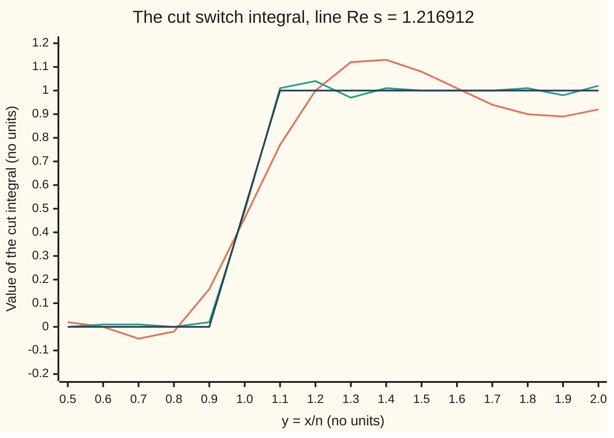
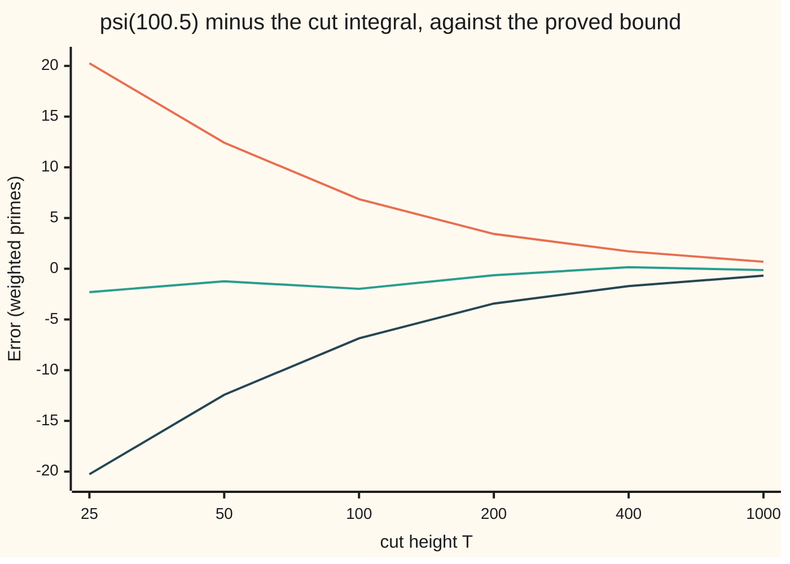

# Perron's formula: a running total recovered from its series by a contour integral

[Syllabus](../../../SYLLABUS.md) → [Algebraic and analytic number theory](../README.md) → [The Zeta Function and the Prime Number Theorem](../README.md#s02) → Perron's formula

---

## General Overview

Count the primes up to 100.5, but weight each one by its logarithm, and add one more log p for every prime power p^2, p^3, … as well. The 25 primes give 83.728390. The prime powers 4, 8, 9, 16, 25, 27, 32, 49, 64 and 81 add 10.316921. The total is 94.045311. This weighted count is ψ(x), "psi of x", and it is the count the proofs about primes really use.

Zeta's logarithmic derivative, −ζ′/ζ(s) (its derivative divided by itself), packs every one of those weights into a single function of a complex number s. It is a **Dirichlet series**: a sum of terms a_n n^(−s), here with a_n the weight of n. Perron's formula unpacks it. Integrate −ζ′/ζ(s) times x^s/s up a vertical line in the complex plane, and out comes the running total ψ(x). The next card moves the line and reaches the house example, the 78,498 primes below a million.

In practice nobody can integrate up an infinitely long line. The line is cut at a height T. Cut at T = 100, the integral gives 96.027399, not 94.045311: off by 1.982087. This card proves how far off a cut can be, in advance and with explicit constants. At T = 100 the proved ceiling is 6.861245.

**Perron's formula recovers the running total of any Dirichlet series that converges absolutely on the line by integrating the series times x^s/s up a vertical line; the integral of y^s/s is a switch that is on for y > 1 and off for y < 1, and cutting the line at height T leaves an error that is bounded term by term by y^c min(1, 1/(πT |log y|)).**

**What kind of fact this is:** a theorem, proved on this card in Why it works: the switch with its error, and the cut formula with its explicit bound. The numbers at x = 100.5 test the arithmetic; they are not extra evidence for the theorem.

### The picture: the switch, cut at two heights

The integral of y^s/s up the line, divided by 2πi, is meant to be a switch: 0 for y below 1, 1 for y above 1, and 1/2 exactly at 1. Cut at height T, it is a smoothed switch that rings near the jump.



Orange: cut at T = 10. Green: cut at T = 50. Dark blue: the perfect switch. The higher the cut, the sharper the step, but near y = 1 every cut is poor. That weak spot, a term n close to x, is what the bound has to handle.

---

## The formula

Notation first, in words. A **Dirichlet series** is $`F(s) = \sum a_n n^{-s}`$, with numbers $`a_n`$ attached to n = 1, 2, 3, … ([Dirichlet series](../../07-Complex%20analysis/09-Special%20Functions%20and%20the%20Zeta%20Function/06-dirichlet-series-and-mobius-inversion.md)). Its running total A(x) adds $`a_n`$ for n up to x, as on [Partial summation](../01-Arithmetic%20Functions%20Again/06-abel-and-partial-summation.md).

This card introduces $`A_0(x)`$ and $`\psi_0(x)`$: the same running totals, except that when x is a whole number the last term counts half. As before, s = σ + it, with σ the real part and t the height. The line of integration has real part c.

```math
A_0(x) = \frac{1}{2\pi i}\int_{c-iT}^{c+iT} F(s)\,\frac{x^{s}}{s}\,ds \;+\; R(x,T), \qquad |R(x,T)| \le \sum_{n \ne x} |a_n| \left(\frac{x}{n}\right)^{c} \min\!\left(1,\ \frac{1}{\pi T\,|\log(x/n)|}\right) + \frac{c\,|a_x|}{\pi T}
```

**Read it aloud:** the running total equals the integral of the series times x^s/s up the line from c − iT to c + iT, over 2πi, plus an error. Each term n adds at most its size, times (x/n)^c, times the smaller of 1 and one over πT |log(x/n)|. The last piece appears only when x is itself a whole number.

The engine is one integral, the **switch**. For y > 0 write I(y, T) for the cut integral of y^s/s, and δ(y) for the perfect switch: 1 if y > 1, 1/2 if y = 1, 0 if y < 1.

```math
I(y,T) = \frac{1}{2\pi i}\int_{c-iT}^{c+iT} \frac{y^{s}}{s}\,ds, \qquad |I(y,T) - \delta(y)| \le y^{c}\min\!\left(1,\ \frac{1}{\pi T\,|\log y|}\right) \ (y \ne 1), \qquad |I(1,T) - \tfrac12| \le \frac{c}{\pi T}
```

**Read it aloud:** the cut switch misses the perfect switch by at most y^c times the smaller of 1 and one over πT |log y|; at y = 1 it misses by at most c over πT.

The worked example takes $`a_n = \Lambda(n)`$, so F is −ζ′/ζ and the running total is ψ. Here Λ(n) is log p when n is a power of a prime p, else 0.

```math
\psi_0(x) = \frac{1}{2\pi i}\int_{c-iT}^{c+iT} \left(-\frac{\zeta'(s)}{\zeta(s)}\right)\frac{x^{s}}{s}\,ds + R(x,T), \qquad c = 1 + \frac{1}{\log x}
```

**Read it aloud:** the weighted prime count is the integral of minus zeta's log derivative times x^s/s, plus an error, with the line just right of 1.

| Symbol | Plain meaning | In our example | Push it up and the answer… |
| --- | --- | --- | --- |
| $`s = \sigma + it`$ | a complex point: real part σ, height t | points on the line, σ = c | — |
| $`c`$ | real part of the line; the series must converge there | 1 + 1/log x = 1.216912 | the bound grows, through the terms with n below x |
| $`T`$ | the height where the line is cut | 10 to 1000 | the error bound falls like 1/T |
| $`x`$ | where the running total stops | 100.5 | more terms, larger bound |
| $`a_n`$, $`F(s)`$ | the coefficients and their Dirichlet series | Λ(n); −ζ′/ζ(s) | — |
| $`A(x)`$, $`A_0(x)`$ | running total of $`a_n`$; the same with the last term halved at a whole number | ψ₀(100.5) = 94.045311 | — |
| $`\Lambda(n)`$, $`\psi(x)`$, $`\psi_0(x)`$, $`\theta(x)`$ | log p at powers of a prime p, else 0; running total of Λ; the same with the last term halved; the same over primes only | Λ(101) = 4.6151; θ(100) = 83.728390 | — |
| $`y`$ | the ratio x/n that each term feeds the switch | 100.5/101 = 0.995050 | — |
| $`I(y,T)`$, $`\delta(y)`$ | the cut switch integral; the perfect switch | I(1, 100) = 0.496127 | — |
| $`J(T)`$, $`R(x,T)`$, $`B(T)`$ | the cut integral; its error ψ₀ − J; the proved bound on \|R\| | 96.027399; −1.982087; 6.861245 at T = 100 | B falls like 1/T |
| $`\log`$, $`\zeta`$, $`\zeta'`$ | natural logarithm; Riemann's zeta and its derivative | ζ(2) = 1.644934066848 | — |
| $`U`$, $`r`$, $`L`$, $`d`$ | in the proof: far side of the rectangle, arc radius, log y; distance from x to the nearest prime power | d from 100.5 to 101 | — |

### When it holds

- **The series converges absolutely on the line.** That is what lets the sum and the integral swap. For −ζ′/ζ this needs c > 1. On Re s = 1/2 the series diverges and the formula means nothing until zeta is continued.
- **c > 0, so the pole of x^s/s at 0 lies left of the line.** The residue 1 at s = 0 is what makes the switch turn on.
- **A whole-number x takes the midpoint.** At x = 101 the integral settles on ψ₀(101) = 96.3529, halfway up the step of log 101, not on ψ(101) = 98.6604.
- **T > 0 is any height.** The bound holds for every T, not only for large T. It is weak when some n is close to x, because log(x/n) is then tiny and the min falls back on 1.

---

## Why it works

### Step 0: one integral sorts every term at once

A Dirichlet series is a sum of terms $`a_n n^{-s}`$. Multiply it by x^s/s and each term becomes $`a_n (x/n)^s/s`$. So the whole integral is a sum of copies of one integral, the switch, fed with y = x/n.

If the switch returns 1 for y > 1 and 0 for y < 1, it keeps exactly the terms with n < x. The integral then is the running total. Everything rests on the switch and on how fast it settles.

### Step 1: why the closing argument for Laplace transforms is not enough

[Inverting a Laplace transform](../../07-Complex%20analysis/08-Transforms%20in%20Outline/07-inverse-laplace-by-residues.md) integrates up a vertical line, closes it far to the left, and collects residues. The switch uses the same mechanism: y^s/s has one pole, at s = 0, with residue 1 ([Residues](../../07-Complex%20analysis/05-Laurent%20Series%2C%20Singularities%20and%20Residues/04-residues.md)).

That card lets the closing arc grow without limit, so its share falls to 0. For a function that falls only like 1/|s|, as y^s/s does, it calls on [Jordan's lemma](../../07-Complex%20analysis/06-Real%20Integrals%20and%20Counting%20Zeros/03-oscillatory-integrals-and-jordans-lemma.md). That lemma gives the limit, but no size for the miss at a finite height. Perron's formula needs that size.

On the line, |y^s/s| is about y^c/|t|, and the area under 1/|t| up to height T grows like log T. So the line integral does not converge absolutely (the sum of the sizes is infinite); it settles only through cancellation. At y = 1 even the limit needs care, because y^s no longer shrinks on either side. At any finite T the closing pieces are still there. They are the error. The job is to bound them.

### Step 2: y > 1, close to the left

Take the rectangle with right side the cut line, from c − iT up to c + iT, top and bottom sides running left at heights ±T, and a far left side at real part −U. It encloses the pole at 0, so by the residue theorem the four sides add to 2πi.

- **Far left side.** There |y^s| = y^(−U), tiny, and |s| ≥ U, so this side tends to 0 as U grows.
- **Top and bottom.** There |s| ≥ T and |y^s| = y^σ. Each side, divided by 2π, is at most the area under y^σ/T from σ = −∞ to c, which is y^c/(2πT log y).

So the cut line, over 2πi, is 1 minus the two horizontal sides, and it misses 1 by at most y^c/(πT log y). At y = 2 and T = 100 the bound is 0.010675. The miss is 0.010465, computed both straight up the line and as 1 minus the two sides: both roads give 0.989535.

### Step 3: y < 1, close to the right

Now y^σ shrinks as σ grows, so close the rectangle to the right instead. No pole is inside, so the cut line equals minus the three other sides. The same estimate gives a miss of at most y^c/(πT |log y|) from 0. At y = 0.5 and T = 100 the miss is 0.001945, under the bound 0.001976.

### Step 4: the "1" in the min, for y close to 1

When y is near 1, log y is near 0 and the bound of Steps 2 and 3 blows up. Replace the rectangle with an arc of the circle through c ± iT, centred at 0, of radius r = √(c² + T²). On the arc |s| = r and |y^s| ≤ y^c, and the arc is at most 2πr long. Divided by 2π, the arc contributes at most y^c. So the miss is never more than y^c, whatever T.

### Step 5: y = 1 exactly, the midpoint

At y = 1 the integrand is 1/s and the integral has a closed form: the cut line over 2πi equals arctan(T/c)/π. That is 1/2 minus arctan(c/T)/π, so it misses 1/2 by less than c/(πT). At T = 100: 0.496127 by quadrature, 0.496127 by the arctan, a miss of 0.003873 under the bound 0.003874.

<details>
<summary>Detailed proof: the switch, and the cut formula</summary>

Fix c > 0, T > 0 and y > 0, and write L = log y.

**Case y > 1.** Let U > 0. The rectangle with corners c − iT, c + iT, −U + iT, −U − iT, run anticlockwise, encloses only the pole s = 0 of y^s/s, whose residue is 1. On the left side |y^s/s| ≤ y^(−U)/U, so that side is at most 2T y^(−U)/U, which tends to 0. On the top and bottom sides |y^s/s| ≤ y^σ/T, so each is at most

$`\displaystyle \frac{1}{2\pi}\int_{-\infty}^{c} \frac{y^{\sigma}}{T}\,d\sigma = \frac{y^{c}}{2\pi T L}.`$

So |I(y, T) − 1| ≤ y^c/(πTL). For the arc bound, the part of the circle |s| = r = √(c² + T²) left of the line, joined to the line, encloses the same pole. On it Re s ≤ c, so |y^s/s| ≤ y^c/r, and its length is below 2πr. So |I(y, T) − 1| ≤ y^c.

**Case y < 1.** Close to the right with sides at heights ±T and a far side at real part U. No pole is enclosed. The far side is at most 2T y^U/c, which tends to 0. The horizontal sides give at most y^c/(πT|L|) together, by the same integral from c to ∞. The arc to the right of the line, with radius r, gives at most y^c.

**Case y = 1.** With s = c + it,

$`\displaystyle \frac{1}{2\pi i}\int_{c-iT}^{c+iT}\frac{ds}{s} = \frac{1}{2\pi}\int_{-T}^{T}\frac{c - it}{c^2 + t^2}\,dt = \frac{1}{\pi}\arctan\frac{T}{c} = \frac12 - \frac{1}{\pi}\arctan\frac{c}{T},`$

and arctan(c/T) < c/T.

**The cut formula.** On the segment, |a_n n^(−s) x^s/s| ≤ |a_n| n^(−c) x^c/c, and these add to a finite total because the series converges absolutely at c. So the sum converges uniformly on the segment and may be integrated term by term:

$`\displaystyle \frac{1}{2\pi i}\int_{c-iT}^{c+iT} F(s)\frac{x^{s}}{s}\,ds = \sum_{n} a_n\, I(x/n, T).`$

Subtract $`A_0(x) = \sum_n a_n\,\delta(x/n)`$ and apply the switch bound to each term. $`\blacksquare`$

</details>

### Step 6: add up the terms

Each term n of the series feeds the switch with y = x/n. The total error is the sum of each term's miss, times $`a_n`$. Applying the switch bound term by term gives the bound on R in the formula. The proof needs absolute convergence on the line only to swap the sum and the integral.

### Step 7: the weighted prime count

[Zeta's zeros and the primes](../../07-Complex%20analysis/09-Special%20Functions%20and%20the%20Zeta%20Function/09-zeros-of-zeta-and-the-primes.md) already wrote ψ(x) as this line integral and quoted the error at height T without proof. With $`a_n = \Lambda(n)`$ the bound above is that proof.

The choice c = 1 + 1/log x keeps the line close to 1, where the series still converges, while making x^c exactly e times x: 273.1873 at x = 100.5. Pushing c further right buys nothing. It raises the factor (x/n)^c on every term with n below x; the terms above x shrink, but by less.

| T | cut integral J(T) | error ψ − J | proved bound B(T) | error from n = 101 alone |
| ---: | ---: | ---: | ---: | ---: |
| 10 | 98.875366 | −4.830054 | 42.447925 | −2.056990 |
| 25 | 96.348787 | −2.303475 | 20.263177 | −2.054550 |
| 50 | 95.285074 | −1.239763 | 12.425255 | −1.909625 |
| 100 | 96.027399 | −1.982087 | 6.861245 | −1.572686 |
| 200 | 94.681438 | −0.636126 | 3.430622 | −0.922046 |
| 400 | 93.893798 | 0.151513 | 1.715311 | 0.039054 |
| 1000 | 94.177577 | −0.132265 | 0.686124 | −0.019633 |

Every error sits inside its bound. From T = 25 to T = 200, the term n = 101 alone contributes an error about the size of the whole error. The prime 101 sits only 0.5 above x. Its switch, fed y = 0.995050, has barely begun to turn off.

Summed over all n, the bound for ψ takes a standard simplified shape: an error of order x (log x)²/T, plus log x times min(1, x/(T d)), where d is the distance from x to the nearest prime power other than x itself. It is stated here without proof (Davenport, chapter 17). The first part is the cost of the cut; the second is the prime 101's effect.

### The picture: the error inside its proved band



Orange and dark blue: the proved band, plus and minus B(T). Green: the true error. From T = 100 on, the band halves each time T doubles. The error wanders inside it, a few times smaller.

---

## Worked numbers, by hand

At x = 100.5 and T = 100, with c = 1 + 1/log x.

| Step | Arithmetic | Value |
| --- | --- | --- |
| log sum over the 25 primes | θ(100), by machine | 83.728390 |
| prime powers | 5 log 2 + 3 log 3 + log 5 + log 7 | 10.316921 |
| the running total | 83.728390 + 10.316921 | ψ(100.5) = 94.045311 |
| the line | 1 + 1/log 100.5 | c = 1.216912 |
| the size factor | 100.5^c = e × 100.5 | 273.1873 |
| switch at y = 1 | arctan(100/c)/π | 0.496127 |
| its bound | c/(100π) | 0.003874 |
| term n = 101: y and log y | 100.5/101; log of that | 0.995050; −0.004963 |
| its min | πT\|log y\| = 1.5591, so 1/1.5591 | 0.6414 |
| its bound piece | log 101 × y^c × min = 4.6151 × 0.99398 × 0.6414 | 2.9423 |
| term n = 97 | 4.5747 × 1.04408 × 0.0898 | 0.4289 |
| all terms, by machine | sum over prime powers to 10^6, plus the proved tail | B(100) = 6.861245 |
| the cut integral, by machine | integral up the line to height 100 | 96.027399 |
| the error | 94.045311 − 96.027399 | **−1.982087, inside ±6.861245** |

The cut at height 100 overcounts the weighted primes by about 2, and the proof promised no more than about 7. Two terms, 101 and 97, carry nearly half the bound: 2.9423 and 0.4289 of 6.861245.

### What breaks if you drop a piece

| Mistake | Comes out at | What went wrong |
| --- | --- | --- |
| x = 101 read as ψ(101) | cut integral 96.4632 at T = 1000, not 98.6604 | at a jump the switch gives 1/2; the target is ψ₀(101) = 96.3529 |
| The min dropped from the bound | 68.6124 at T = 10, not 42.447925 | near y = 1 the term 1/(πT\|log y\|) explodes; at x = 101 it is infinite |
| The line pushed out to c = 2 | bound 11.8357 at T = 100, not 6.861245 | the terms with n below x carry (x/n)^c, which grows with c; the true error is −2.787930, no better |
| Treating the cut as exact | 96.027399 for ψ(100.5) = 94.045311 | the cut leaves the horizontal sides behind |

---

## Code, from first principles, and it actually runs

Both programs sieve the prime powers up to a million and compute ψ(100.5) exactly. They compute zeta and its derivative anywhere in the plane by the Euler–Maclaurin formula (a sum of the first terms, plus an integral for the rest, plus eight correction terms), checked against ζ(2) = π²/6. They then take three roads. (1) The sieve gives the true total. (2) The cut integral up the line, by Simpson's rule, must land within the proved bound at every T; the bound's tail beyond a million is bounded using −ζ′/ζ(c) itself. (3) The switch integral is computed two independent ways, straight up the line and by the residue plus the two horizontal sides, and at y = 1 against the arctan.

### Python

```python
# Perron's formula: psi(x), the weighted prime count, recovered from -zeta'/zeta by a line integral cut at height T.
# Roads: (1) psi(x) by a sieve; (2) the cut line integral, zeta by Euler-Maclaurin, must sit within the proved bound;
# (3) the switch integral of y^s/s two ways: straight up the line, and by residues plus the two horizontal sides.
import cmath
from math import log, pi, cos, sin, atan, exp

BERN = [1 / 6, -1 / 30, 1 / 42, -1 / 30, 5 / 66, -691 / 2730, 7 / 6, -3617 / 510]   # B_2 .. B_16

def zeta_pair(s, N):
    """zeta(s) and zeta'(s) by Euler-Maclaurin: N - 1 terms, the tail integral, eight Bernoulli corrections."""
    z, d = 0j, 0j
    for n in range(1, N):
        t = cmath.exp(-s * log(n))
        z += t
        d -= log(n) * t
    LN = log(N)
    a = cmath.exp(-s * LN)
    z += N * a / (s - 1) + a / 2
    d += -LN * N * a / (s - 1) - N * a / (s - 1) ** 2 - LN * a / 2
    P, dP, pw, fac = s, 1, a / N, 2.0           # P = s(s+1)...(s+2k-2), pw = N^(-s-2k+1), fac = (2k)!
    for k in range(1, 9):
        z += BERN[k - 1] / fac * P * pw
        d += BERN[k - 1] / fac * (dP - LN * P) * pw
        for j in (2 * k - 1, 2 * k):
            dP, P = dP * (s + j) + P, P * (s + j)
        pw /= N * N
        fac *= (2 * k + 1) * (2 * k + 2)
    return z, d

def simpson(g, a, b, m):
    h = (b - a) / m
    tot = g(a) + g(b)
    for i in range(1, m):
        tot += (4 if i % 2 else 2) * g(a + i * h)
    return tot * h / 3

def switch_line(y, T, c, m=20000):
    """(1/2 pi i) * integral of y^s/s from c-iT to c+iT; the imaginary parts cancel in pairs t, -t."""
    L = log(y)
    return y ** c / pi * simpson(lambda t: (c * cos(L * t) + t * sin(L * t)) / (c * c + t * t), 0.0, T, m)

def switch_residue(y, T, c, m=20000):
    """Same number by the rectangle: residue 1 at s = 0 if y > 1, then the top and bottom sides, far side -> 0."""
    L = log(y)
    side = lambda u: exp(L * u) * (u * sin(T * L) - T * cos(T * L)) / (u * u + T * T)
    if y > 1:
        return 1 + simpson(side, c - 50 / L, c, m) / pi
    return -simpson(side, c, c - 50 / L, m) / pi

NMAX = 1_000_000
sieve = bytearray([1]) * (NMAX + 1); sieve[0] = sieve[1] = 0
for i in range(2, int(NMAX ** 0.5) + 1):
    if sieve[i]:
        sieve[i * i :: i] = bytearray(len(range(i * i, NMAX + 1, i)))
LAM = {}                                         # n -> Lambda(n) = log p for n = p^k
for p in range(2, NMAX + 1):
    if sieve[p]:
        q = p
        while q <= NMAX:
            LAM[q] = log(p)
            q *= p
PP = sorted(LAM)

def psi(x):
    return sum(LAM[n] for n in PP if n <= x)

def perron_cut(x, c, Ts, h=0.02):
    """(1/pi) * integral from 0 to T of Re(-zeta'/zeta(s) x^s/s), s = c + it, for each T in Ts (one pass)."""
    L, out, total, t0 = log(x), [], 0.0, 0.0
    def f(t):
        s = complex(c, t)
        z, d = zeta_pair(s, 30 + int(t / 3))
        return (-d / z * cmath.exp(s * L) / s).real
    for T in Ts:
        m = 2 * int(round((T - t0) / (2 * h)))
        total += simpson(f, t0, T, m)
        out.append(total / pi)
        t0 = T
    return out

def bound(x, T, c, capped=True):
    """sum of Lambda(n) (x/n)^c min(1, 1/(pi T |log(x/n)|)) to NMAX, plus a proved upper bound for the rest."""
    main = part = 0.0
    for n in PP:
        y = x / n
        w = 1 / (pi * T * abs(log(y)))
        main += LAM[n] * y ** c * (min(1.0, w) if capped else w)
        part += LAM[n] * n ** -c
    z, d = zeta_pair(complex(c, 0), 60)
    return main + x ** c / (pi * T * log(NMAX / x)) * ((-d / z).real - part)

X = 100.5
C = 1 + 1 / log(X)
TS = [10, 25, 50, 100, 200, 400, 1000]
z2, d2 = zeta_pair(complex(2, 0), 60)
print(f"engine zeta(2) {z2.real:.12f}  pi^2/6 {pi * pi / 6:.12f}")
lam2 = sum(LAM[n] / n ** 2 for n in PP)
print(f"engine -zeta'/zeta(2) {(-d2 / z2).real:.6f}  sum Lambda(n)/n^2 to 10^6 {lam2:.6f}")
assert abs(z2.real - pi * pi / 6) < 1e-12, "zeta engine off at 2"
assert 0 < (-d2 / z2).real - lam2 < 2e-6, "log derivative off: the tail past 10^6 is about 1e-6"
P = psi(X)
small = sum(LAM[n] for n in PP if n <= X and not sieve[n])   # 4, 8, 9, 16, 25, ...
print(f"x {X}  c = 1 + 1/log x {C:.6f}  x^c {X ** C:.4f}  e*x {exp(1) * X:.4f}")
print(f"psi(x) by sieve {P:.6f}  theta(100) {P - small:.6f}  prime powers {small:.6f}  primes {sum(sieve[:101])}, to 10^6 {sum(sieve)}")
print("switch    y     T    up the line   by residues  |I - step|      bound")
for y in (2.0, 1.0, 0.5):
    for T in (10, 100):
        a = switch_line(y, T, C)
        b = switch_residue(y, T, C) if y != 1 else atan(T / C) / pi
        step = 1.0 if y > 1 else (0.5 if y == 1 else 0.0)
        bd = C / (pi * T) if y == 1 else y ** C * min(1, 1 / (pi * T * abs(log(y))))
        print(f"switch {y:5.1f} {T:5d}  {a:12.6f}  {b:12.6f}  {abs(a - step):10.6f} {bd:10.6f}")
        assert abs(a - b) < 1e-7, "line and residue roads disagree"
        assert abs(a - step) <= bd, "switch error above its bound"
J = perron_cut(X, C, TS)
print("   T     J(T) cut integral   psi - J      bound B(T)   from n = 101")
for T, j in zip(TS, J):
    B = bound(X, T, C)
    n101 = -LAM[101] * switch_line(X / 101, T, C)
    print(f"{T:5d}  {j:16.6f}  {P - j:10.6f}  {B:12.6f}  {n101:10.6f}")
    assert abs(P - j) <= B, "Perron error above the proved bound"
y97, y101 = X / 97, X / 101
for n, y in ((97, y97), (101, y101)):
    w = pi * 100 * abs(log(y))
    print(f"bound piece n={n}: Lambda {LAM[n]:.4f} y {y:.6f} log y {log(y):.6f} pi T|log y| {w:.4f}"
          f" min {min(1, 1 / w):.4f} y^c {y ** C:.5f} piece {LAM[n] * y ** C * min(1, 1 / w):.4f}")
print(f"switch at y = 1, T = 100: arctan(T/c)/pi {atan(100 / C) / pi:.6f}  c/(pi T) {C / (pi * 100):.6f}")
J101 = perron_cut(101.0, 1 + 1 / log(101.0), [1000])[0]
print(f"wrong: x = 101, T = 1000 gives {J101:.4f}; psi(101) {psi(101):.4f}; midpoint {psi(101) - LAM[101] / 2:.4f}")
print(f"wrong: no min, T = 10: bound {bound(X, 10, C, False):.4f}  T = 25: {bound(X, 25, C, False):.4f}")
J2 = perron_cut(X, 2.0, [100])[0]
print(f"wrong: c = 2, T = 100: bound {bound(X, 100, 2.0):.4f}  error {P - J2:.6f}")
assert abs(J101 - (psi(101) - LAM[101] / 2)) < abs(J101 - psi(101)), "a jump gives the midpoint"
X9, C9 = 100.9, 1 + 1 / log(100.9)                    # try: x nearer the prime 101
print(f"try: x = 100.9, T = 100: error {psi(X9) - perron_cut(X9, C9, [100])[0]:.6f}  bound {bound(X9, 100, C9):.6f}")
print("chart y      " + " ".join(f"{0.5 + 0.1 * i:5.1f}" for i in range(16)))
for T in (10, 50):
    vals = [f"{switch_line(0.5 + 0.1 * i, T, C, 4000):5.2f}".replace("-0.00", " 0.00") for i in range(16)]
    print(f"chart T={T:<4d} " + " ".join(vals))
print("ALL CHECKS PASS")
```

**Ran 2026-11-15 on macOS, Python 3.14.10, standard library only. All checks passed. Output, pasted from the run:**

```
engine zeta(2) 1.644934066848  pi^2/6 1.644934066848
engine -zeta'/zeta(2) 0.569961  sum Lambda(n)/n^2 to 10^6 0.569960
x 100.5  c = 1 + 1/log x 1.216912  x^c 273.1873  e*x 273.1873
psi(x) by sieve 94.045311  theta(100) 83.728390  prime powers 10.316921  primes 25, to 10^6 78498
switch    y     T    up the line   by residues  |I - step|      bound
switch   2.0    10      0.915366      0.915366    0.084634   0.106746
switch   2.0   100      0.989535      0.989535    0.010465   0.010675
switch   1.0    10      0.461454      0.461454    0.038546   0.038736
switch   1.0   100      0.496127      0.496127    0.003873   0.003874
switch   0.5    10      0.017363      0.017363    0.017363   0.019756
switch   0.5   100      0.001945      0.001945    0.001945   0.001976
   T     J(T) cut integral   psi - J      bound B(T)   from n = 101
   10         98.875366   -4.830054     42.447925   -2.056990
   25         96.348787   -2.303475     20.263177   -2.054550
   50         95.285074   -1.239763     12.425255   -1.909625
  100         96.027399   -1.982087      6.861245   -1.572686
  200         94.681438   -0.636126      3.430622   -0.922046
  400         93.893798    0.151513      1.715311    0.039054
 1000         94.177577   -0.132265      0.686124   -0.019633
bound piece n=97: Lambda 4.5747 y 1.036082 log y 0.035447 pi T|log y| 11.1359 min 0.0898 y^c 1.04408 piece 0.4289
bound piece n=101: Lambda 4.6151 y 0.995050 log y -0.004963 pi T|log y| 1.5591 min 0.6414 y^c 0.99398 piece 2.9423
switch at y = 1, T = 100: arctan(T/c)/pi 0.496127  c/(pi T) 0.003874
wrong: x = 101, T = 1000 gives 96.4632; psi(101) 98.6604; midpoint 96.3529
wrong: no min, T = 10: bound 68.6124  T = 25: 27.4450
wrong: c = 2, T = 100: bound 11.8357  error -2.787930
try: x = 100.9, T = 100: error -2.718768  bound 8.637544
chart y        0.5   0.6   0.7   0.8   0.9   1.0   1.1   1.2   1.3   1.4   1.5   1.6   1.7   1.8   1.9   2.0
chart T=10    0.02  0.00 -0.05 -0.02  0.16  0.46  0.77  1.00  1.12  1.13  1.08  1.01  0.94  0.90  0.89  0.92
chart T=50    0.00  0.01  0.01  0.00  0.02  0.49  1.01  1.04  0.97  1.01  1.00  1.00  1.00  1.01  0.98  1.02
ALL CHECKS PASS
```

### Rust

```rust
// Perron's formula: psi(x), the weighted prime count, recovered from -zeta'/zeta by a line integral cut at height T.
// Roads: (1) psi(x) by a sieve; (2) the cut line integral, zeta by Euler-Maclaurin, must sit within the proved bound;
// (3) the switch integral of y^s/s two ways: straight up the line, and by residues plus the two horizontal sides.
use std::f64::consts::PI;
use std::ops::{Add, Div, Mul, Neg, Sub};

#[derive(Clone, Copy)]
struct Cx { re: f64, im: f64 }
fn cx(re: f64, im: f64) -> Cx { Cx { re, im } }
impl Add for Cx { type Output = Cx; fn add(self, o: Cx) -> Cx { cx(self.re + o.re, self.im + o.im) } }
impl Sub for Cx { type Output = Cx; fn sub(self, o: Cx) -> Cx { cx(self.re - o.re, self.im - o.im) } }
impl Neg for Cx { type Output = Cx; fn neg(self) -> Cx { cx(-self.re, -self.im) } }
impl Mul for Cx { type Output = Cx; fn mul(self, o: Cx) -> Cx { cx(self.re * o.re - self.im * o.im, self.re * o.im + self.im * o.re) } }
impl Div for Cx {
    type Output = Cx;
    fn div(self, o: Cx) -> Cx { let d = o.re * o.re + o.im * o.im; cx((self.re * o.re + self.im * o.im) / d, (self.im * o.re - self.re * o.im) / d) }
}
fn sc(a: f64, z: Cx) -> Cx { cx(a * z.re, a * z.im) }
fn cexp(z: Cx) -> Cx { let m = z.re.exp(); cx(m * z.im.cos(), m * z.im.sin()) }

const BERN: [f64; 8] = [1.0 / 6.0, -1.0 / 30.0, 1.0 / 42.0, -1.0 / 30.0, 5.0 / 66.0, -691.0 / 2730.0, 7.0 / 6.0, -3617.0 / 510.0];

fn zeta_pair(s: Cx, n_terms: usize) -> (Cx, Cx) {
    let (mut z, mut d) = (cx(0.0, 0.0), cx(0.0, 0.0));
    for n in 1..n_terms {
        let ln = (n as f64).ln();
        let t = cexp(sc(-ln, s));
        z = z + t;
        d = d - sc(ln, t);
    }
    let (nf, ln) = (n_terms as f64, (n_terms as f64).ln());
    let a = cexp(sc(-ln, s));
    let s1 = s - cx(1.0, 0.0);
    z = z + sc(nf, a) / s1 + sc(0.5, a);
    d = d + sc(-ln * nf, a) / s1 - sc(nf, a) / (s1 * s1) - sc(0.5 * ln, a);
    let (mut p, mut dp, mut pw, mut fac) = (s, cx(1.0, 0.0), sc(1.0 / nf, a), 2.0);
    for k in 1..9 {
        z = z + sc(BERN[k - 1] / fac, p * pw);
        d = d + sc(BERN[k - 1] / fac, (dp - sc(ln, p)) * pw);
        for j in [2 * k - 1, 2 * k] {
            let sj = s + cx(j as f64, 0.0);
            (dp, p) = (dp * sj + p, p * sj);
        }
        pw = sc(1.0 / (nf * nf), pw);
        fac *= ((2 * k + 1) * (2 * k + 2)) as f64;
    }
    (z, d)
}

fn simpson<F: Fn(f64) -> f64>(g: F, a: f64, b: f64, m: usize) -> f64 {
    let h = (b - a) / m as f64;
    let mut tot = g(a) + g(b);
    for i in 1..m { tot += (if i % 2 == 1 { 4.0 } else { 2.0 }) * g(a + i as f64 * h); }
    tot * h / 3.0
}

fn switch_line(y: f64, t_max: f64, c: f64, m: usize) -> f64 {
    let l = y.ln();
    y.powf(c) / PI * simpson(|t| (c * (l * t).cos() + t * (l * t).sin()) / (c * c + t * t), 0.0, t_max, m)
}

fn switch_residue(y: f64, t_max: f64, c: f64, m: usize) -> f64 {
    let l = y.ln();
    let side = |u: f64| (l * u).exp() * (u * (t_max * l).sin() - t_max * (t_max * l).cos()) / (u * u + t_max * t_max);
    if y > 1.0 { 1.0 + simpson(side, c - 50.0 / l, c, m) / PI } else { -simpson(side, c, c - 50.0 / l, m) / PI }
}

fn nsum<I: Iterator<Item = f64>>(it: I) -> f64 {   // compensated sum, as Python's sum() does
    let (mut s, mut comp) = (0.0f64, 0.0f64);
    for x in it { let t = s + x; if s.abs() >= x.abs() { comp += (s - t) + x } else { comp += (x - t) + s } s = t; }
    s + comp
}

const NMAX: usize = 1_000_000;

fn perron_cut(x: f64, c: f64, ts: &[f64], h: f64) -> Vec<f64> {
    let l = x.ln();
    let f = |t: f64| {
        let s = cx(c, t);
        let (z, d) = zeta_pair(s, 30 + (t / 3.0) as usize);
        ((-d / z) * cexp(sc(l, s)) / s).re
    };
    let (mut out, mut total, mut t0) = (Vec::new(), 0.0, 0.0);
    for &t in ts {
        let m = 2 * ((t - t0) / (2.0 * h)).round() as usize;
        total += simpson(&f, t0, t, m);
        out.push(total / PI);
        t0 = t;
    }
    out
}

fn bound(pp: &[(usize, f64)], x: f64, t: f64, c: f64, capped: bool) -> f64 {
    let (mut main, mut part) = (0.0, 0.0);
    for &(n, lam) in pp {
        let y = x / n as f64;
        let w = 1.0 / (PI * t * y.ln().abs());
        main += lam * y.powf(c) * (if capped { w.min(1.0) } else { w });
        part += lam * (n as f64).powf(-c);
    }
    let (z, d) = zeta_pair(cx(c, 0.0), 60);
    main + x.powf(c) / (PI * t * (NMAX as f64 / x).ln()) * ((-d / z).re - part)
}

fn main() {
    let mut sieve = vec![true; NMAX + 1]; sieve[0] = false; sieve[1] = false;
    let mut i = 2;
    while i * i <= NMAX { if sieve[i] { let mut j = i * i; while j <= NMAX { sieve[j] = false; j += i; } } i += 1; }
    let mut pp: Vec<(usize, f64)> = Vec::new();   // (n, Lambda(n)) for n = p^k
    for p in 2..=NMAX { if sieve[p] { let mut q = p; while q <= NMAX { pp.push((q, (p as f64).ln())); q *= p; } } }
    pp.sort_by_key(|e| e.0);
    let lam = |n: usize| pp.iter().find(|e| e.0 == n).unwrap().1;
    let psi = |x: f64| nsum(pp.iter().filter(|e| e.0 as f64 <= x).map(|e| e.1));
    let x: f64 = 100.5;
    let c = 1.0 + 1.0 / x.ln();
    let ts = [10.0, 25.0, 50.0, 100.0, 200.0, 400.0, 1000.0];
    let (z2, d2) = zeta_pair(cx(2.0, 0.0), 60);
    println!("engine zeta(2) {:.12}  pi^2/6 {:.12}", z2.re, PI * PI / 6.0);
    let lam2 = nsum(pp.iter().map(|e| e.1 / (e.0 as f64).powi(2)));
    println!("engine -zeta'/zeta(2) {:.6}  sum Lambda(n)/n^2 to 10^6 {:.6}", (-d2 / z2).re, lam2);
    assert!((z2.re - PI * PI / 6.0).abs() < 1e-12, "zeta engine off at 2");
    let gap = (-d2 / z2).re - lam2;
    assert!(0.0 < gap && gap < 2e-6, "log derivative off: the tail past 10^6 is about 1e-6");
    let p = psi(x);
    let small = nsum(pp.iter().filter(|e| e.0 as f64 <= x && !sieve[e.0]).map(|e| e.1));
    println!("x {}  c = 1 + 1/log x {:.6}  x^c {:.4}  e*x {:.4}", x, c, x.powf(c), 1f64.exp() * x);
    println!("psi(x) by sieve {:.6}  theta(100) {:.6}  prime powers {:.6}  primes {}, to 10^6 {}", p, p - small, small,
             sieve[..101].iter().filter(|&&b| b).count(), sieve.iter().filter(|&&b| b).count());
    println!("switch    y     T    up the line   by residues  |I - step|      bound");
    for y in [2.0f64, 1.0, 0.5] {
        for t in [10.0f64, 100.0] {
            let a = switch_line(y, t, c, 20000);
            let b = if y != 1.0 { switch_residue(y, t, c, 20000) } else { (t / c).atan() / PI };
            let step = if y > 1.0 { 1.0 } else if y == 1.0 { 0.5 } else { 0.0 };
            let bd = if y == 1.0 { c / (PI * t) } else { y.powf(c) * (1.0 / (PI * t * y.ln().abs())).min(1.0) };
            println!("switch {:5.1} {:5}  {:12.6}  {:12.6}  {:10.6} {:10.6}", y, t as i64, a, b, (a - step).abs(), bd);
            assert!((a - b).abs() < 1e-7, "line and residue roads disagree");
            assert!((a - step).abs() <= bd, "switch error above its bound");
        }
    }
    let jv = perron_cut(x, c, &ts, 0.02);
    println!("   T     J(T) cut integral   psi - J      bound B(T)   from n = 101");
    for (k, &t) in ts.iter().enumerate() {
        let b = bound(&pp, x, t, c, true);
        let n101 = -lam(101) * switch_line(x / 101.0, t, c, 20000);
        println!("{:5}  {:16.6}  {:10.6}  {:12.6}  {:10.6}", t as i64, jv[k], p - jv[k], b, n101);
        assert!((p - jv[k]).abs() <= b, "Perron error above the proved bound");
    }
    for n in [97usize, 101] {
        let y = x / n as f64;
        let w = PI * 100.0 * y.ln().abs();
        println!("bound piece n={}: Lambda {:.4} y {:.6} log y {:.6} pi T|log y| {:.4} min {:.4} y^c {:.5} piece {:.4}",
                 n, lam(n), y, y.ln(), w, (1.0 / w).min(1.0), y.powf(c), lam(n) * y.powf(c) * (1.0 / w).min(1.0));
    }
    println!("switch at y = 1, T = 100: arctan(T/c)/pi {:.6}  c/(pi T) {:.6}", (100.0 / c).atan() / PI, c / (PI * 100.0));
    let j101 = perron_cut(101.0, 1.0 + 1.0 / 101f64.ln(), &[1000.0], 0.02)[0];
    println!("wrong: x = 101, T = 1000 gives {:.4}; psi(101) {:.4}; midpoint {:.4}", j101, psi(101.0), psi(101.0) - lam(101) / 2.0);
    println!("wrong: no min, T = 10: bound {:.4}  T = 25: {:.4}", bound(&pp, x, 10.0, c, false), bound(&pp, x, 25.0, c, false));
    let j2 = perron_cut(x, 2.0, &[100.0], 0.02)[0];
    println!("wrong: c = 2, T = 100: bound {:.4}  error {:.6}", bound(&pp, x, 100.0, 2.0, true), p - j2);
    assert!((j101 - (psi(101.0) - lam(101) / 2.0)).abs() < (j101 - psi(101.0)).abs(), "a jump gives the midpoint");
    let (x9, c9) = (100.9f64, 1.0 + 1.0 / 100.9f64.ln());   // try: x nearer the prime 101
    println!("try: x = 100.9, T = 100: error {:.6}  bound {:.6}", psi(x9) - perron_cut(x9, c9, &[100.0], 0.02)[0], bound(&pp, x9, 100.0, c9, true));
    println!("chart y      {}", (0..16).map(|i| format!("{:5.1}", 0.5 + 0.1 * i as f64)).collect::<Vec<_>>().join(" "));
    for t in [10usize, 50] {
        let vals: Vec<String> = (0..16).map(|i| format!("{:5.2}", switch_line(0.5 + 0.1 * i as f64, t as f64, c, 4000)).replace("-0.00", " 0.00")).collect();
        println!("chart T={:<4} {}", t, vals.join(" "));
    }
    println!("ALL CHECKS PASS");
}
```

**Ran 2026-11-15 on macOS, rustc 1.98.1, no crates. All checks passed. Output, pasted from the run:**

```
engine zeta(2) 1.644934066848  pi^2/6 1.644934066848
engine -zeta'/zeta(2) 0.569961  sum Lambda(n)/n^2 to 10^6 0.569960
x 100.5  c = 1 + 1/log x 1.216912  x^c 273.1873  e*x 273.1873
psi(x) by sieve 94.045311  theta(100) 83.728390  prime powers 10.316921  primes 25, to 10^6 78498
switch    y     T    up the line   by residues  |I - step|      bound
switch   2.0    10      0.915366      0.915366    0.084634   0.106746
switch   2.0   100      0.989535      0.989535    0.010465   0.010675
switch   1.0    10      0.461454      0.461454    0.038546   0.038736
switch   1.0   100      0.496127      0.496127    0.003873   0.003874
switch   0.5    10      0.017363      0.017363    0.017363   0.019756
switch   0.5   100      0.001945      0.001945    0.001945   0.001976
   T     J(T) cut integral   psi - J      bound B(T)   from n = 101
   10         98.875366   -4.830054     42.447925   -2.056990
   25         96.348787   -2.303475     20.263177   -2.054550
   50         95.285074   -1.239763     12.425255   -1.909625
  100         96.027399   -1.982087      6.861245   -1.572686
  200         94.681438   -0.636126      3.430622   -0.922046
  400         93.893798    0.151513      1.715311    0.039054
 1000         94.177577   -0.132265      0.686124   -0.019633
bound piece n=97: Lambda 4.5747 y 1.036082 log y 0.035447 pi T|log y| 11.1359 min 0.0898 y^c 1.04408 piece 0.4289
bound piece n=101: Lambda 4.6151 y 0.995050 log y -0.004963 pi T|log y| 1.5591 min 0.6414 y^c 0.99398 piece 2.9423
switch at y = 1, T = 100: arctan(T/c)/pi 0.496127  c/(pi T) 0.003874
wrong: x = 101, T = 1000 gives 96.4632; psi(101) 98.6604; midpoint 96.3529
wrong: no min, T = 10: bound 68.6124  T = 25: 27.4450
wrong: c = 2, T = 100: bound 11.8357  error -2.787930
try: x = 100.9, T = 100: error -2.718768  bound 8.637544
chart y        0.5   0.6   0.7   0.8   0.9   1.0   1.1   1.2   1.3   1.4   1.5   1.6   1.7   1.8   1.9   2.0
chart T=10    0.02  0.00 -0.05 -0.02  0.16  0.46  0.77  1.00  1.12  1.13  1.08  1.01  0.94  0.90  0.89  0.92
chart T=50    0.00  0.01  0.01  0.00  0.02  0.49  1.01  1.04  0.97  1.01  1.00  1.00  1.00  1.01  0.98  1.02
ALL CHECKS PASS
```

### Lean

Lean proves the switch bounds and Perron's formula with its explicit bound, for every Dirichlet series and every height T.

- Take $`c > 0`$, $`T > 0`$ and $`y > 0`$ with $`y \ne 1`$. Then $`|I(y,T) - \delta(y)| \le y^{c}\min(1, 1/(\pi T\,|\log y|))`$.
- Take $`c > 0`$ and $`T > 0`$. Then $`I(1,T) = \arctan(T/c)/\pi`$, so it misses 1/2 by at most $`c/(\pi T)`$.
- Suppose the series converges absolutely on the line $`\mathrm{Re}\, s = c`$, with $`c > 0`$, $`x > 0`$ and $`T > 0`$. Then $`A_0(x)`$ differs from the cut integral by at most the bound on $`R(x,T)`$ in the formula.
- Lean also checks three facts behind the worked numbers: 25 primes up to 100, the ten prime powers up to 100, and 97 and 101 being prime.

That −ζ′/ζ is the series of Λ(n), every value of ψ and ζ, and every decimal are left to the Python and Rust checks.

```lean
-- Perron's formula: the half-at-a-jump running total of a Dirichlet series that converges absolutely on the line Re s = c equals its line integral against x^s/s cut at height T, up to an error bounded term by term by (x/n)^c min(1, 1/(πT |log(x/n)|)).
import Mathlib.NumberTheory.LSeries.Basic
import Mathlib.MeasureTheory.Integral.IntervalIntegral.Basic
import Mathlib.Analysis.SpecialFunctions.Pow.Complex
import Mathlib.Analysis.SpecialFunctions.Trigonometric.Arctan
import Mathlib.Order.Interval.Finset.Nat
import Mathlib.Tactic.NormNum.Prime
import Mathlib.Analysis.Complex.HasPrimitives
import Mathlib.Analysis.Complex.RemovableSingularity
import Mathlib.Analysis.SpecialFunctions.Complex.LogDeriv
import Mathlib.Analysis.SpecialFunctions.Trigonometric.Bounds
import Mathlib.MeasureTheory.Integral.IntervalIntegral.FundThmCalculus
import Mathlib.MeasureTheory.Integral.DominatedConvergence

open Complex
open scoped Real

/-- The perfect switch δ(y): 1 if y > 1, 1/2 if y = 1, 0 if y < 1. -/
noncomputable def perronStep (y : ℝ) : ℝ :=
  if 1 < y then 1 else if y = 1 then 1 / 2 else 0

/-- The cut switch integral I(y, T) = (1/2πi) ∫ y^s/s ds up the line from c − iT to c + iT,
parametrised by s = c + it, so ds = i dt. -/
noncomputable def switchIntegral (c T y : ℝ) : ℂ :=
  1 / (2 * π * I) * ∫ t in (-T)..T, (y : ℂ) ^ ((c : ℂ) + t * I) / ((c : ℂ) + t * I) * I

/-- A₀(x): the running total of a(1), a(2), … up to x, with the last term counted half
when x is a whole number. -/
noncomputable def runningTotalHalf (a : ℕ → ℂ) (x : ℝ) : ℂ :=
  (∑ n ∈ Finset.Icc 1 ⌊x⌋₊, a n) - (if (⌊x⌋₊ : ℝ) = x then a ⌊x⌋₊ / 2 else 0)

/-- J(T): the cut Perron integral (1/2πi) ∫ F(s) x^s/s ds up the line from c − iT to c + iT,
where F = Σ a(n) n^(−s) is Mathlib's `LSeries a`. -/
noncomputable def perronCut (a : ℕ → ℂ) (c T x : ℝ) : ℂ :=
  1 / (2 * π * I) *
    ∫ t in (-T)..T, LSeries a ((c : ℂ) + t * I) * (x : ℂ) ^ ((c : ℂ) + t * I) / ((c : ℂ) + t * I) * I

/-- The card's error bound: the sum over n ≥ 1 with n ≠ x of |a(n)| (x/n)^c min(1, 1/(πT |log(x/n)|)),
plus c |a(x)|/(πT) when x is the whole number n. -/
noncomputable def perronErrorBound (a : ℕ → ℂ) (c T x : ℝ) : ℝ :=
  ∑' n : ℕ,
    if n = 0 then 0
    else if (n : ℝ) = x then c * ‖a n‖ / (π * T)
    else ‖a n‖ * (x / n) ^ c * min 1 (1 / (π * T * |Real.log (x / n)|))

/-- FTC along a path: a primitive turns a path integral into a difference of end values. -/
theorem perron_path_ftc {H F : ℂ → ℂ} {U : Set ℂ} (hH : ∀ z ∈ U, HasDerivAt H (F z) z)
    (hF : ContinuousOn F U) {γ γ' : ℝ → ℂ} {a b : ℝ}
    (hγ : ∀ t ∈ Set.uIcc a b, HasDerivAt γ (γ' t) t) (hγ' : ContinuousOn γ' (Set.uIcc a b))
    (hU : ∀ t ∈ Set.uIcc a b, γ t ∈ U) :
    ∫ t in a..b, F (γ t) * γ' t = H (γ b) - H (γ a) := by
  apply intervalIntegral.integral_eq_sub_of_hasDerivAt
  · intro t ht
    exact (hH _ (hU t ht)).comp t (hγ t ht)
  · apply ContinuousOn.intervalIntegrable
    apply ContinuousOn.mul _ hγ'
    exact hF.comp (fun t ht => (hγ t ht).continuousAt.continuousWithinAt) (fun t ht => hU t ht)

theorem perron_hasDerivAt_line (p d : ℂ) (t : ℝ) :
    HasDerivAt (fun t : ℝ => p + (t : ℂ) * d) d t := by
  have h := ((hasDerivAt_id t).ofReal_comp.mul_const d).const_add p
  simpa using h

/-- FTC along a straight segment. -/
theorem perron_segment_ftc {H F : ℂ → ℂ} {U : Set ℂ} (hH : ∀ z ∈ U, HasDerivAt H (F z) z)
    (hF : ContinuousOn F U) (p d : ℂ) {a b : ℝ}
    (hU : ∀ t ∈ Set.uIcc a b, p + (t : ℂ) * d ∈ U) :
    ∫ t in a..b, F (p + (t : ℂ) * d) * d = H (p + (b : ℂ) * d) - H (p + (a : ℂ) * d) :=
  perron_path_ftc (γ := fun t : ℝ => p + (t : ℂ) * d) (γ' := fun _ => d) hH hF
    (fun t _ => perron_hasDerivAt_line p d t) continuousOn_const hU

/-- The integrand e^{Ls}/s. -/
noncomputable def perronE (L : ℝ) (s : ℂ) : ℂ := Complex.exp (L * s) / s

theorem perronE_continuousOn (L : ℝ) : ContinuousOn (perronE L) {z | z ≠ 0} := by
  unfold perronE
  apply ContinuousOn.div
  · fun_prop
  · exact continuousOn_id
  · intro z hz; exact hz

/-- An entire primitive for the removable part (e^{Ls} - 1)/s. -/
theorem perron_entire_part (L : ℝ) :
    ∃ G : ℂ → ℂ, ∀ z : ℂ, z ≠ 0 → HasDerivAt G (perronE L z - z⁻¹) z := by
  set g := dslope (fun s : ℂ => Complex.exp (L * s)) 0
  have hd : Differentiable ℂ g := by
    have : DifferentiableOn ℂ g Set.univ :=
      (differentiableOn_dslope Filter.univ_mem).2 (by fun_prop)
    exact fun z => (this z (Set.mem_univ z)).differentiableAt Filter.univ_mem
  obtain ⟨G, hG⟩ := hd.isExactOn_univ
  refine ⟨G, fun z hz => ?_⟩
  have : g z = perronE L z - z⁻¹ := by
    simp only [g, dslope_of_ne _ hz, slope_def_field, perronE]
    field_simp
    simp
  rw [← this]
  exact hG z (Set.mem_univ z)


theorem perron_prims (L : ℝ) : ∃ H1 H2 : ℂ → ℂ,
    (∀ z ∈ slitPlane, HasDerivAt H1 (perronE L z) z) ∧
    (∀ z, -z ∈ slitPlane → HasDerivAt H2 (perronE L z) z) ∧
    ∀ z w, H1 z - H1 w - (H2 z - H2 w) =
      Complex.log z - Complex.log w - (Complex.log (-z) - Complex.log (-w)) := by
  obtain ⟨G, hG⟩ := perron_entire_part L
  refine ⟨fun z => G z + Complex.log z, fun z => G z + Complex.log (-z), ?_, ?_, ?_⟩
  · intro z hz
    have hz0 : z ≠ 0 := slitPlane_ne_zero hz
    have h := (hG z hz0).add (hasDerivAt_log hz)
    convert h using 1
    ring
  · intro z hz
    have hz0 : z ≠ 0 := by
      intro h; rw [h, neg_zero] at hz; exact slitPlane_ne_zero hz rfl
    have h2 : HasDerivAt (fun w => Complex.log (-w)) ((-z)⁻¹ * -1) z :=
      (hasDerivAt_log hz).comp z (hasDerivAt_neg z)
    have h := (hG z hz0).add h2
    convert h using 1
    rw [inv_neg]; ring
  · intro z w; ring

theorem perron_log_identity {c T : ℝ} (hT : 0 < T) :
    Complex.log ((c:ℂ) + (T:ℂ) * I) - Complex.log ((c:ℂ) + ((-T:ℝ):ℂ) * I) -
      (Complex.log (-((c:ℂ) + (T:ℂ) * I)) - Complex.log (-((c:ℂ) + ((-T:ℝ):ℂ) * I))) =
      2 * π * I := by
  set z : ℂ := (c:ℂ) + (T:ℂ) * I with hz
  have hzc : (c:ℂ) + ((-T:ℝ):ℂ) * I = (starRingEnd ℂ) z := by
    apply Complex.ext <;> simp [hz]
  have him : 0 < z.im := by simp [hz, hT]
  have harg : arg ((starRingEnd ℂ) z) = - arg z := by
    rw [arg_conj]
    split_ifs with h
    · rw [arg_eq_pi_iff] at h; linarith [h.2]
    · rfl
  have h1 : arg (-z) = arg z - π := arg_neg_eq_arg_sub_pi_of_im_pos him
  have h2 : arg (-(starRingEnd ℂ) z) = arg ((starRingEnd ℂ) z) + π :=
    arg_neg_eq_arg_add_pi_of_im_neg (by simp; linarith)
  rw [hzc]
  apply Complex.ext
  · simp [log_re, norm_neg]
  · simp only [sub_im, log_im, h1, h2, harg]
    simp
    ring

theorem perronE_norm (L : ℝ) (z : ℂ) : ‖perronE L z‖ = Real.exp (L * z.re) / ‖z‖ := by
  simp [perronE, norm_exp]

/-- The segment integral S = ∫_{-T}^{T} e^{L(c+it)}/(c+it) · i dt. -/
noncomputable def perronS (c T L : ℝ) : ℂ :=
  ∫ t in (-T)..T, perronE L ((c:ℂ) + (t:ℂ) * I) * I

theorem perron_horiz_norm (L σ T t : ℝ) (hT : 0 < T) (hσ : |σ| = T) :
    ‖perronE L ((σ:ℂ) * I + (t:ℂ) * 1) * 1‖ ≤ Real.exp (L * t) / T := by
  rw [mul_one, perronE_norm]
  have hre : ((σ:ℂ) * I + (t:ℂ) * 1).re = t := by simp
  have him : |((σ:ℂ) * I + (t:ℂ) * 1).im| = T := by simp [hσ]
  rw [hre]
  apply div_le_div_of_nonneg_left (Real.exp_pos _).le hT
  rw [← him]; exact abs_im_le_norm _

theorem perron_vert_norm (L X t : ℝ) (hX : 0 < |X|) :
    ‖perronE L ((X:ℂ) + (t:ℂ) * I) * I‖ ≤ Real.exp (L * X) / |X| := by
  rw [norm_mul, norm_I, mul_one, perronE_norm]
  have hre : ((X:ℂ) + (t:ℂ) * I).re = X := by simp
  rw [hre]
  apply div_le_div_of_nonneg_left (Real.exp_pos _).le hX
  have : |((X:ℂ) + (t:ℂ) * I).re| ≤ ‖(X:ℂ) + (t:ℂ) * I‖ := abs_re_le_norm _
  rwa [hre] at this

theorem perron_exp_integral (L T a b : ℝ) (hL : L ≠ 0) (hT : T ≠ 0) :
    ∫ t in a..b, Real.exp (L * t) / T = (Real.exp (L * b) - Real.exp (L * a)) / (L * T) := by
  have hd : ∀ t ∈ Set.uIcc a b,
      HasDerivAt (fun t => Real.exp (L * t) / (L * T)) (Real.exp (L * t) / T) t := by
    intro t _
    have h : HasDerivAt (fun t => Real.exp (L * t) / (L * T)) (Real.exp (L * t) * L / (L * T)) t :=
      by simpa using (((hasDerivAt_id t).const_mul L).exp).div_const (L * T)
    rw [show Real.exp (L * t) / T = Real.exp (L * t) * L / (L * T) by field_simp]
    exact h
  rw [intervalIntegral.integral_eq_sub_of_hasDerivAt hd
    (by apply Continuous.intervalIntegrable; fun_prop)]
  ring

theorem perron_horiz_int (L σ T a b : ℝ) (hT : 0 < T) (hσ : |σ| = T) (hab : a ≤ b)
    (hL : L ≠ 0) :
    ‖∫ t in a..b, perronE L ((σ:ℂ) * I + (t:ℂ) * 1) * 1‖ ≤
      (Real.exp (L * b) - Real.exp (L * a)) / (L * T) := by
  rw [← perron_exp_integral L T a b hL hT.ne']
  apply intervalIntegral.norm_integral_le_of_norm_le hab
  · exact Filter.Eventually.of_forall (fun t _ => perron_horiz_norm L σ T t hT hσ)
  · apply Continuous.intervalIntegrable; fun_prop

theorem perron_limit {q B K c : ℝ} (h : ∀ X, c < X → q ≤ B + K / X) :
    q ≤ B := by
  apply le_of_forall_pos_le_add
  intro ε hε
  set X := max (c + 1) (max 1 (K / ε)) + 1 with hXdef
  have h1 : c + 1 ≤ max (c + 1) (max 1 (K / ε)) := le_max_left _ _
  have h2 : 1 ≤ max (c + 1) (max 1 (K / ε)) := (le_max_left _ _).trans (le_max_right _ _)
  have h3 : K / ε ≤ max (c + 1) (max 1 (K / ε)) := (le_max_right _ _).trans (le_max_right _ _)
  have hX : c < X := by linarith
  have hXpos : 0 < X := by linarith
  have hq := h X hX
  have hKX : K / X ≤ ε := by
    rw [div_le_iff₀ hXpos]
    have : K / ε ≤ X := by linarith
    rw [div_le_iff₀ hε] at this
    linarith
  linarith

theorem perron_S_right {L c T X : ℝ} (hc : 0 < c) (hT : 0 < T) (hX : c < X) :
    perronS c T L = (∫ t in c..X, perronE L (((-T:ℝ):ℂ) * I + (t:ℂ) * 1) * 1)
      + (∫ t in (-T)..T, perronE L ((X:ℂ) + (t:ℂ) * I) * I)
      - (∫ t in c..X, perronE L ((T:ℂ) * I + (t:ℂ) * 1) * 1) := by
  obtain ⟨H1, -, hH1, -, -⟩ := perron_prims L
  have hF : ContinuousOn (perronE L) slitPlane :=
    (perronE_continuousOn L).mono (fun z hz => slitPlane_ne_zero hz)
  have e1 := perron_segment_ftc hH1 hF (c:ℂ) I (a := -T) (b := T)
    (by intro t _; rw [mem_slitPlane_iff]; left; simp [hc])
  have e2 := perron_segment_ftc hH1 hF (((-T:ℝ):ℂ) * I) 1 (a := c) (b := X)
    (by intro t _; rw [mem_slitPlane_iff]; right; simp; exact hT.ne')
  have e3 := perron_segment_ftc hH1 hF (X:ℂ) I (a := -T) (b := T)
    (by intro t _; rw [mem_slitPlane_iff]; left; simp; linarith)
  have e4 := perron_segment_ftc hH1 hF ((T:ℂ) * I) 1 (a := c) (b := X)
    (by intro t _; rw [mem_slitPlane_iff]; right; simp; exact hT.ne')
  unfold perronS
  rw [e1, e2, e3, e4]
  rw [show ((-T:ℝ):ℂ) * I + (c:ℂ) * 1 = (c:ℂ) + ((-T:ℝ):ℂ) * I by ring,
    show ((-T:ℝ):ℂ) * I + (X:ℂ) * 1 = (X:ℂ) + ((-T:ℝ):ℂ) * I by ring,
    show (T:ℂ) * I + (X:ℂ) * 1 = (X:ℂ) + (T:ℂ) * I by ring,
    show (T:ℂ) * I + (c:ℂ) * 1 = (c:ℂ) + (T:ℂ) * I by ring]
  ring

theorem perron_S_lt_small {L c T : ℝ} (hc : 0 < c) (hT : 0 < T) (hL : L < 0) :
    ‖perronS c T L‖ ≤ 4 * Real.exp (L * c) := by
  rw [perron_S_right (X := c + T) hc hT (by linarith)]
  set e := Real.exp (L * c)
  have hhor : ∀ σ : ℝ, |σ| = T →
      ‖∫ t in c..(c + T), perronE L ((σ:ℂ) * I + (t:ℂ) * 1) * 1‖ ≤ e := by
    intro σ hσ
    have := intervalIntegral.norm_integral_le_of_norm_le_const (a := c) (b := c + T)
      (C := e / T) (f := fun t => perronE L ((σ:ℂ) * I + (t:ℂ) * 1) * 1) (by
        intro t ht
        rw [Set.uIoc_of_le (by linarith)] at ht
        refine (perron_horiz_norm L σ T t hT hσ).trans ?_
        apply div_le_div_of_nonneg_right _ hT.le
        apply Real.exp_le_exp.2
        nlinarith [ht.1])
    rw [show c + T - c = T by ring, abs_of_pos hT, div_mul_cancel₀ _ hT.ne'] at this
    exact this
  have hb := hhor (-T) (by simp [abs_of_pos hT])
  have ht := hhor T (abs_of_pos hT)
  have hv : ‖∫ t in (-T)..T, perronE L (((c + T : ℝ) : ℂ) + (t:ℂ) * I) * I‖ ≤ 2 * e := by
    have := intervalIntegral.norm_integral_le_of_norm_le_const (a := -T) (b := T)
      (C := Real.exp (L * (c + T)) / |c + T|)
      (f := fun t => perronE L (((c + T : ℝ) : ℂ) + (t:ℂ) * I) * I)
      (fun t _ => perron_vert_norm L (c + T) t (by rw [abs_of_pos (by linarith)]; linarith))
    refine this.trans ?_
    rw [abs_of_pos (show (0:ℝ) < c + T by linarith), show T - -T = 2 * T by ring,
      abs_of_pos (show (0:ℝ) < 2 * T by linarith)]
    have h1 : Real.exp (L * (c + T)) ≤ e := Real.exp_le_exp.2 (by nlinarith)
    have h2 : 0 < e := Real.exp_pos _
    rw [div_mul_eq_mul_div, div_le_iff₀ (by linarith)]
    nlinarith
  have := norm_add_le (∫ t in c..(c + T), perronE L (((-T:ℝ):ℂ) * I + (t:ℂ) * 1) * 1)
    (∫ t in (-T)..T, perronE L (((c + T : ℝ) : ℂ) + (t:ℂ) * I) * I)
  have := norm_sub_le ((∫ t in c..(c + T), perronE L (((-T:ℝ):ℂ) * I + (t:ℂ) * 1) * 1)
    + (∫ t in (-T)..T, perronE L (((c + T : ℝ) : ℂ) + (t:ℂ) * I) * I))
    (∫ t in c..(c + T), perronE L ((T:ℂ) * I + (t:ℂ) * 1) * 1)
  linarith

theorem perron_S_lt_large {L c T : ℝ} (hc : 0 < c) (hT : 0 < T) (hL : L < 0) :
    ‖perronS c T L‖ ≤ 2 * Real.exp (L * c) / (T * (-L)) := by
  set e := Real.exp (L * c)
  have hB : 2 * e / (T * (-L)) = e / (T * (-L)) + e / (T * (-L)) := by ring
  apply perron_limit (K := 2 * T) (c := c)
  intro X hX
  rw [perron_S_right hc hT hX]
  have hhor : ∀ σ : ℝ, |σ| = T →
      ‖∫ t in c..X, perronE L ((σ:ℂ) * I + (t:ℂ) * 1) * 1‖ ≤ e / (T * (-L)) := by
    intro σ hσ
    refine (perron_horiz_int L σ T c X hT hσ hX.le hL.ne).trans ?_
    rw [show (Real.exp (L * X) - e) / (L * T) = (e - Real.exp (L * X)) / (T * (-L)) by
      field_simp; ring]
    apply div_le_div_of_nonneg_right _ (by nlinarith)
    linarith [Real.exp_pos (L * X)]
  have hb := hhor (-T) (by simp [abs_of_pos hT])
  have ht := hhor T (abs_of_pos hT)
  have hXpos : 0 < X := by linarith
  have hv : ‖∫ t in (-T)..T, perronE L ((X : ℂ) + (t:ℂ) * I) * I‖ ≤ 2 * T / X := by
    have := intervalIntegral.norm_integral_le_of_norm_le_const (a := -T) (b := T)
      (C := Real.exp (L * X) / |X|)
      (f := fun t => perronE L ((X : ℂ) + (t:ℂ) * I) * I)
      (fun t _ => perron_vert_norm L X t (by rw [abs_of_pos hXpos]; exact hXpos))
    refine this.trans ?_
    rw [abs_of_pos hXpos, show T - -T = 2 * T by ring,
      abs_of_pos (show (0:ℝ) < 2 * T by linarith)]
    have h1 : Real.exp (L * X) ≤ 1 := Real.exp_le_one_iff.2 (by nlinarith)
    rw [div_mul_eq_mul_div]
    apply div_le_div_of_nonneg_right _ hXpos.le
    nlinarith
  have := norm_add_le (∫ t in c..X, perronE L (((-T:ℝ):ℂ) * I + (t:ℂ) * 1) * 1)
    (∫ t in (-T)..T, perronE L ((X:ℂ) + (t:ℂ) * I) * I)
  have := norm_sub_le ((∫ t in c..X, perronE L (((-T:ℝ):ℂ) * I + (t:ℂ) * 1) * 1)
    + (∫ t in (-T)..T, perronE L ((X:ℂ) + (t:ℂ) * I) * I))
    (∫ t in c..X, perronE L ((T:ℂ) * I + (t:ℂ) * 1) * 1)
  linarith

theorem perron_S_left {L c T X : ℝ} (hc : 0 < c) (hT : 0 < T) (hX : 0 < X) :
    perronS c T L - 2 * π * I =
      -(∫ t in (-X)..c, perronE L (((-T:ℝ):ℂ) * I + (t:ℂ) * 1) * 1)
      + (∫ t in (-T)..T, perronE L (((-X:ℝ):ℂ) + (t:ℂ) * I) * I)
      + (∫ t in (-X)..c, perronE L ((T:ℂ) * I + (t:ℂ) * 1) * 1) := by
  obtain ⟨H1, H2, hH1, hH2, hdiff⟩ := perron_prims L
  have hF : ContinuousOn (perronE L) slitPlane :=
    (perronE_continuousOn L).mono (fun z hz => slitPlane_ne_zero hz)
  have hH2' : ∀ z ∈ {z : ℂ | -z ∈ slitPlane}, HasDerivAt H2 (perronE L z) z :=
    fun z hz => hH2 z hz
  have hF2 : ContinuousOn (perronE L) {z : ℂ | -z ∈ slitPlane} :=
    (perronE_continuousOn L).mono (fun z hz h0 => by
      simp only [Set.mem_ofPred_eq, h0, neg_zero] at hz; exact slitPlane_ne_zero hz rfl)
  have e1 := perron_segment_ftc hH1 hF (c:ℂ) I (a := -T) (b := T)
    (by intro t _; rw [mem_slitPlane_iff]; left; simp [hc])
  have e2 := perron_segment_ftc hH2' hF2 (((-T:ℝ):ℂ) * I) 1 (a := -X) (b := c)
    (by intro t _; show _ ∈ slitPlane; rw [mem_slitPlane_iff]; right; simp; exact hT.ne')
  have e3 := perron_segment_ftc hH2' hF2 ((-X:ℝ):ℂ) I (a := -T) (b := T)
    (by intro t _; show _ ∈ slitPlane; rw [mem_slitPlane_iff]; left; simp; linarith)
  have e4 := perron_segment_ftc hH2' hF2 ((T:ℂ) * I) 1 (a := -X) (b := c)
    (by intro t _; show _ ∈ slitPlane; rw [mem_slitPlane_iff]; right; simp; exact hT.ne')
  unfold perronS
  rw [e1, e2, e3, e4]
  rw [show ((-T:ℝ):ℂ) * I + (c:ℂ) * 1 = (c:ℂ) + ((-T:ℝ):ℂ) * I by ring,
    show ((-T:ℝ):ℂ) * I + ((-X:ℝ):ℂ) * 1 = ((-X:ℝ):ℂ) + ((-T:ℝ):ℂ) * I by ring,
    show (T:ℂ) * I + ((-X:ℝ):ℂ) * 1 = ((-X:ℝ):ℂ) + (T:ℂ) * I by ring,
    show (T:ℂ) * I + (c:ℂ) * 1 = (c:ℂ) + (T:ℂ) * I by ring]
  linear_combination (hdiff ((c:ℂ) + (T:ℂ) * I) ((c:ℂ) + ((-T:ℝ):ℂ) * I)) +
    perron_log_identity hT

theorem perron_S_gt_large {L c T : ℝ} (hc : 0 < c) (hT : 0 < T) (hL : 0 < L) :
    ‖perronS c T L - 2 * π * I‖ ≤ 2 * Real.exp (L * c) / (T * L) := by
  set e := Real.exp (L * c)
  have hB : 2 * e / (T * L) = e / (T * L) + e / (T * L) := by ring
  apply perron_limit (K := 2 * T) (c := 0)
  intro X hX
  rw [perron_S_left hc hT hX]
  have hhor : ∀ σ : ℝ, |σ| = T →
      ‖∫ t in (-X)..c, perronE L ((σ:ℂ) * I + (t:ℂ) * 1) * 1‖ ≤ e / (T * L) := by
    intro σ hσ
    refine (perron_horiz_int L σ T (-X) c hT hσ (by linarith) hL.ne').trans ?_
    rw [show L * T = T * L by ring]
    apply div_le_div_of_nonneg_right _ (by positivity)
    linarith [Real.exp_pos (L * -X)]
  have hb := hhor (-T) (by simp [abs_of_pos hT])
  have ht := hhor T (abs_of_pos hT)
  have hv : ‖∫ t in (-T)..T, perronE L (((-X:ℝ) : ℂ) + (t:ℂ) * I) * I‖ ≤ 2 * T / X := by
    have := intervalIntegral.norm_integral_le_of_norm_le_const (a := -T) (b := T)
      (C := Real.exp (L * (-X)) / |(-X)|)
      (f := fun t => perronE L (((-X:ℝ) : ℂ) + (t:ℂ) * I) * I)
      (fun t _ => perron_vert_norm L (-X) t (by rw [abs_neg, abs_of_pos hX]; exact hX))
    refine this.trans ?_
    rw [abs_neg, abs_of_pos hX, show T - -T = 2 * T by ring,
      abs_of_pos (show (0:ℝ) < 2 * T by linarith)]
    have h1 : Real.exp (L * (-X)) ≤ 1 := Real.exp_le_one_iff.2 (by nlinarith)
    rw [div_mul_eq_mul_div]
    apply div_le_div_of_nonneg_right _ hX.le
    nlinarith
  have h1 := norm_add_le (-(∫ t in (-X)..c, perronE L (((-T:ℝ):ℂ) * I + (t:ℂ) * 1) * 1))
    (∫ t in (-T)..T, perronE L (((-X:ℝ):ℂ) + (t:ℂ) * I) * I)
  have h2 := norm_add_le (-(∫ t in (-X)..c, perronE L (((-T:ℝ):ℂ) * I + (t:ℂ) * 1) * 1)
    + (∫ t in (-T)..T, perronE L (((-X:ℝ):ℂ) + (t:ℂ) * I) * I))
    (∫ t in (-X)..c, perronE L ((T:ℂ) * I + (t:ℂ) * 1) * 1)
  rw [norm_neg] at h1
  linarith

theorem perron_S_gt_small {L c T : ℝ} (hc : 0 < c) (hT : 0 < T) (hL : 0 < L) :
    ‖perronS c T L - 2 * π * I‖ ≤ 2 * π * Real.exp (L * c) := by
  obtain ⟨H1, H2, hH1, hH2, hdiff⟩ := perron_prims L
  have hF : ContinuousOn (perronE L) slitPlane :=
    (perronE_continuousOn L).mono (fun z hz => slitPlane_ne_zero hz)
  have hF2 : ContinuousOn (perronE L) {z : ℂ | -z ∈ slitPlane} :=
    (perronE_continuousOn L).mono (fun z hz h0 => by
      simp only [Set.mem_ofPred_eq, h0, neg_zero] at hz; exact slitPlane_ne_zero hz rfl)
  set z0 : ℂ := (c:ℂ) + (T:ℂ) * I with hz0def
  set z1 : ℂ := (c:ℂ) + ((-T:ℝ):ℂ) * I with hz1def
  have hz0 : z0 ≠ 0 := by
    intro h; have := congrArg Complex.re h; simp [hz0def] at this; linarith
  set R := ‖z0‖ with hRdef
  have hR : 0 < R := norm_pos_iff.2 hz0
  set θ0 := arg z0 with hθ0def
  have hθpos : 0 < θ0 := by
    rcases (arg_nonneg_iff.2 (by simp [hz0def]; linarith : 0 ≤ z0.im)).lt_or_eq with h | h
    · exact h
    · exfalso
      have := (arg_eq_zero_iff.1 h.symm).2
      simp [hz0def] at this; linarith
  have hθlt : θ0 < π / 2 := by
    have := abs_arg_lt_pi_div_two_iff.2 (Or.inl (by simp [hz0def]; exact hc) : 0 < z0.re ∨ z0 = 0)
    exact (abs_lt.1 this).2
  have hcos0 : Real.cos θ0 = c / R := by rw [hθ0def, cos_arg hz0]; congr 1; simp [hz0def]
  have hsin0 : Real.sin θ0 = T / R := by rw [hθ0def, sin_arg]; congr 1; simp [hz0def]
  set γ : ℝ → ℂ := fun θ => (R:ℂ) * Complex.exp ((θ:ℂ) * I) with hγdef
  set γ' : ℝ → ℂ := fun θ => (R:ℂ) * Complex.exp ((θ:ℂ) * I) * I with hγ'def
  have hγ : ∀ θ : ℝ, HasDerivAt γ (γ' θ) θ := by
    intro θ
    have := (((hasDerivAt_id θ).ofReal_comp.mul_const I).cexp).const_mul (R:ℂ)
    convert this using 1
    · rfl
    · simp only [hγ'def, id, Complex.ofReal_one, one_mul, mul_assoc]
  have hγre : ∀ θ : ℝ, (γ θ).re = R * Real.cos θ := by
    intro θ; simp [hγdef, exp_ofReal_mul_I_re]
  have hγim : ∀ θ : ℝ, (γ θ).im = R * Real.sin θ := by
    intro θ; simp [hγdef, exp_ofReal_mul_I_im]
  have hγ0 : γ θ0 = z0 := norm_mul_exp_arg_mul_I z0
  have hγ1 : γ (2 * π - θ0) = z1 := by
    apply Complex.ext
    · rw [hγre, Real.cos_two_pi_sub, hcos0]; simp [hz1def]; field_simp
    · rw [hγim, Real.sin_two_pi_sub, hsin0]; simp [hz1def]; field_simp
  have hle : θ0 ≤ 2 * π - θ0 := by linarith [Real.pi_pos]
  have hmem : ∀ θ ∈ Set.uIcc θ0 (2 * π - θ0), γ θ ∈ {z : ℂ | -z ∈ slitPlane} := by
    intro θ hθ
    rw [Set.uIcc_of_le hle] at hθ
    show -(γ θ) ∈ slitPlane
    rw [mem_slitPlane_iff, neg_re, neg_im, hγre, hγim]
    rcases lt_trichotomy θ π with h | h | h
    · right
      have := Real.sin_pos_of_pos_of_lt_pi (by linarith [hθ.1]) h
      have : 0 < R * Real.sin θ := mul_pos hR this
      linarith
    · left; rw [h, Real.cos_pi]; linarith
    · right
      have := Real.sin_neg_of_neg_of_neg_pi_lt (x := θ - 2 * π) (by linarith [hθ.2])
        (by linarith)
      rw [Real.sin_sub_two_pi] at this
      have : R * Real.sin θ < 0 := mul_neg_of_pos_of_neg hR this
      linarith
  have e1 := perron_segment_ftc hH1 hF (c:ℂ) I (a := -T) (b := T)
    (by intro t _; rw [mem_slitPlane_iff]; left; simp [hc])
  have e2 := perron_path_ftc (U := {z : ℂ | -z ∈ slitPlane}) (fun z hz => hH2 z hz) hF2
    (γ := γ) (γ' := γ') (a := θ0) (b := 2 * π - θ0) (fun θ _ => hγ θ)
    (by rw [hγ'def]; fun_prop) hmem
  rw [hγ0, hγ1] at e2
  have hS : perronS c T L - 2 * π * I =
      -(∫ θ in θ0..(2 * π - θ0), perronE L (γ θ) * γ' θ) := by
    unfold perronS
    rw [e1, e2]
    linear_combination (hdiff z0 z1) + perron_log_identity hT
  rw [hS, norm_neg]
  have hbound := intervalIntegral.norm_integral_le_of_norm_le_const (a := θ0) (b := 2 * π - θ0)
    (C := Real.exp (L * c)) (f := fun θ => perronE L (γ θ) * γ' θ) (by
      intro θ hθ
      rw [Set.uIoc_of_le hle] at hθ
      have hnγ : ‖γ θ‖ = R := by
        simp [hγdef, norm_exp_ofReal_mul_I, abs_of_pos hR]
      have hnγ' : ‖γ' θ‖ = R := by
        simp [hγ'def, norm_exp_ofReal_mul_I, abs_of_pos hR]
      rw [norm_mul, perronE_norm, hnγ, hnγ', hγre, div_mul_cancel₀ _ hR.ne']
      apply Real.exp_le_exp.2
      have hcos : Real.cos θ ≤ Real.cos θ0 := by
        rcases le_or_gt θ π with h | h
        · exact Real.cos_le_cos_of_nonneg_of_le_pi hθpos.le h hθ.1.le
        · rw [← Real.cos_two_pi_sub θ]
          exact Real.cos_le_cos_of_nonneg_of_le_pi hθpos.le (by linarith) (by linarith [hθ.2])
      have : R * Real.cos θ ≤ c := by
        calc R * Real.cos θ ≤ R * Real.cos θ0 := mul_le_mul_of_nonneg_left hcos hR.le
          _ = c := by rw [hcos0]; field_simp
      nlinarith)
  refine hbound.trans ?_
  rw [abs_of_nonneg (by linarith)]
  have := Real.exp_pos (L * c)
  nlinarith

theorem perron_switch_eq {c T y : ℝ} (hy : 0 < y) :
    switchIntegral c T y = 1 / (2 * π * I) * perronS c T (Real.log y) := by
  unfold switchIntegral perronS
  congr 1
  apply intervalIntegral.integral_congr
  intro t _
  simp only [perronE]
  rw [cpow_def_of_ne_zero (ofReal_ne_zero.2 hy.ne'), ← ofReal_log hy.le]

theorem perron_finish {N e T L : ℝ} (hT : 0 < T) (hL : 0 < |L|) (he : 0 ≤ e)
    (h1 : N ≤ 2 * π * e) (h2 : N ≤ 2 * e / (T * |L|)) :
    N / (2 * π) ≤ e * min 1 (1 / (π * T * |L|)) := by
  rw [mul_min_of_nonneg _ _ he]
  apply le_min
  · rw [div_le_iff₀ (by positivity)]; linarith
  · calc N / (2 * π) ≤ (2 * e / (T * |L|)) / (2 * π) := by gcongr
      _ = e * (1 / (π * T * |L|)) := by field_simp

theorem perron_switch_bound {c T y : ℝ} (hc : 0 < c) (hT : 0 < T) (hy : 0 < y)
    (hy1 : y ≠ 1) :
    ‖switchIntegral c T y - (perronStep y : ℂ)‖ ≤ y ^ c * min 1 (1 / (π * T * |Real.log y|)) := by
  have h2pi : (2 * π * I : ℂ) ≠ 0 := by simp [Real.pi_ne_zero]
  have hn2pi : ‖(2 * π * I : ℂ)‖ = 2 * π := by simp [abs_of_pos Real.pi_pos]
  rw [Real.rpow_def_of_pos hy, perron_switch_eq hy]
  set L := Real.log y with hLdef
  rw [show L * c = c * L by ring] at *
  rcases lt_or_gt_of_ne hy1 with h | h
  · have hL : L < 0 := Real.log_neg hy h
    have hstep : perronStep y = 0 := by
      simp [perronStep, not_lt.2 h.le, h.ne]
    rw [hstep]
    have heq : 1 / (2 * π * I) * perronS c T L - ((0:ℝ):ℂ) = perronS c T L / (2 * π * I) := by
      rw [ofReal_zero, sub_zero, one_div, div_eq_inv_mul]
    rw [heq, norm_div, hn2pi]
    have habs : |L| = -L := abs_of_neg hL
    apply perron_finish hT (by rw [habs]; linarith) (Real.exp_pos _).le
    · have := perron_S_lt_small hc hT hL
      rw [show L * c = c * L by ring] at this
      nlinarith [Real.two_le_pi, Real.exp_pos (c * L)]
    · have := perron_S_lt_large hc hT hL
      rw [show L * c = c * L by ring] at this
      rwa [habs]
  · have hL : 0 < L := Real.log_pos h
    have hstep : perronStep y = 1 := by simp [perronStep, h]
    rw [hstep]
    have heq : 1 / (2 * π * I) * perronS c T L - ((1:ℝ):ℂ) =
        (perronS c T L - 2 * π * I) / (2 * π * I) := by
      field_simp
      simp
    rw [heq, norm_div, hn2pi]
    have habs : |L| = L := abs_of_pos hL
    apply perron_finish hT (by rw [habs]; linarith) (Real.exp_pos _).le
    · have := perron_S_gt_small hc hT hL
      rwa [show L * c = c * L by ring] at this
    · have := perron_S_gt_large hc hT hL
      rw [show L * c = c * L by ring] at this
      rwa [habs]

theorem perron_switch_one {c T : ℝ} (hc : 0 < c) (hT : 0 < T) :
    switchIntegral c T 1 = (Real.arctan (T / c) / π : ℝ) ∧
      ‖switchIntegral c T 1 - 1 / 2‖ ≤ c / (π * T) := by
  set z0 : ℂ := (c:ℂ) + (T:ℂ) * I with hz0def
  have hS : perronS c T 0 = Complex.log z0 - Complex.log ((c:ℂ) + ((-T:ℝ):ℂ) * I) := by
    have hH : ∀ z ∈ slitPlane, HasDerivAt Complex.log (perronE 0 z) z := by
      intro z hz
      rw [show perronE 0 z = z⁻¹ by simp [perronE]]
      exact hasDerivAt_log hz
    have hF : ContinuousOn (perronE 0) slitPlane :=
      (perronE_continuousOn 0).mono (fun z hz => slitPlane_ne_zero hz)
    exact perron_segment_ftc hH hF (c:ℂ) I (a := -T) (b := T)
      (by intro t _; rw [mem_slitPlane_iff]; left; simp [hc])
  have hzc : (c:ℂ) + ((-T:ℝ):ℂ) * I = (starRingEnd ℂ) z0 := by
    apply Complex.ext <;> simp [hz0def]
  have harg_ne : arg z0 ≠ π := by
    rw [Ne, arg_eq_pi_iff]; intro h; simp [hz0def] at h; linarith [h.1]
  have hlog : Complex.log z0 - Complex.log ((starRingEnd ℂ) z0) = 2 * (arg z0 : ℂ) * I := by
    rw [log_conj z0 harg_ne]
    apply Complex.ext <;> simp [log_re, log_im]
    ring
  have harctan : Real.arctan (T / c) = arg z0 := by
    have htan : Real.tan (arg z0) = T / c := by rw [tan_arg]; simp [hz0def]
    have hlt := abs_arg_lt_pi_div_two_iff.2 (Or.inl (by simp [hz0def]; exact hc) :
      0 < z0.re ∨ z0 = 0)
    rw [← htan, Real.arctan_tan (abs_lt.1 hlt).1 (abs_lt.1 hlt).2]
  have hval : switchIntegral c T 1 = (Real.arctan (T / c) / π : ℝ) := by
    rw [perron_switch_eq one_pos, Real.log_one, hS, hzc, hlog, harctan]
    have : (π : ℂ) ≠ 0 := ofReal_ne_zero.2 Real.pi_ne_zero
    push_cast
    field_simp
  refine ⟨hval, ?_⟩
  rw [hval]
  have hinv : Real.arctan (c / T) = π / 2 - Real.arctan (T / c) := by
    rw [← Real.arctan_inv_of_pos (div_pos hT hc), inv_div]
  have h1 : (((Real.arctan (T / c) / π : ℝ) : ℂ) - 1 / 2) =
      ((-(Real.arctan (c / T) / π) : ℝ) : ℂ) := by
    rw [hinv]; push_cast; field_simp; ring
  rw [h1, norm_real, Real.norm_eq_abs, abs_neg,
    abs_of_nonneg (div_nonneg (Real.arctan_nonneg.2 (div_pos hc hT).le) Real.pi_pos.le)]
  rw [show c / (π * T) = (c / T) / π by field_simp]
  gcongr
  exact Real.arctan_le_self (div_pos hc hT).le

theorem perron_step_zero (a : ℕ → ℂ) {x : ℝ} (hx : 0 < x) (n : ℕ)
    (hn : n ∉ Finset.Icc 1 ⌊x⌋₊) :
    (if n = 0 then 0 else a n * (perronStep (x / n) : ℂ)) = 0 := by
  rcases Nat.eq_zero_or_pos n with h0 | hpos
  · simp [h0]
  · have hn' : ⌊x⌋₊ < n := by
      simp only [Finset.mem_Icc, not_and, not_le] at hn
      exact hn hpos
    have hxn : x < n := (Nat.floor_lt hx.le).1 hn'
    have hnpos : (0:ℝ) < n := by exact_mod_cast hpos
    have hlt : x / n < 1 := (div_lt_one hnpos).2 hxn
    have : perronStep (x / n) = 0 := by
      simp [perronStep, not_lt.2 hlt.le, hlt.ne]
    simp [hpos.ne', this]

theorem perron_running_hasSum (a : ℕ → ℂ) {x : ℝ} (hx : 0 < x) :
    HasSum (fun n : ℕ => if n = 0 then 0 else a n * (perronStep (x / n) : ℂ))
      (runningTotalHalf a x) := by
  have hs : HasSum (fun n : ℕ => if n = 0 then 0 else a n * (perronStep (x / n) : ℂ))
      (∑ n ∈ Finset.Icc 1 ⌊x⌋₊, if n = 0 then 0 else a n * (perronStep (x / n) : ℂ)) :=
    hasSum_sum_of_ne_finset_zero (fun n hn => perron_step_zero a hx n hn)
  convert hs using 1
  unfold runningTotalHalf
  have hterm : ∀ n ∈ Finset.Icc 1 ⌊x⌋₊,
      (if n = 0 then 0 else a n * (perronStep (x / n) : ℂ)) =
      a n - (if (n:ℝ) = x then a n / 2 else 0) := by
    intro n hn
    rw [Finset.mem_Icc] at hn
    have hn0 : n ≠ 0 := by omega
    have hnpos : (0:ℝ) < n := by exact_mod_cast Nat.pos_of_ne_zero hn0
    have hnx : (n:ℝ) ≤ x := (Nat.le_floor_iff hx.le).1 hn.2
    rw [if_neg hn0]
    by_cases he : (n:ℝ) = x
    · have : x / n = 1 := by rw [← he, div_self hnpos.ne']
      rw [if_pos he, this]
      simp [perronStep] <;> ring
    · have hlt : 1 < x / n := (one_lt_div hnpos).2 (lt_of_le_of_ne hnx he)
      rw [if_neg he]; simp [perronStep, hlt]
  rw [Finset.sum_congr rfl hterm, Finset.sum_sub_distrib]
  congr 1
  split_ifs with hfl
  · rw [Finset.sum_eq_single ⌊x⌋₊]
    · rw [if_pos hfl]
    · intro b _ hb
      rw [if_neg]
      intro hbx
      apply hb
      rw [← hfl] at hbx
      exact_mod_cast hbx
    · intro hnot
      exfalso; apply hnot
      rw [Finset.mem_Icc]
      refine ⟨?_, le_refl _⟩
      by_contra h0
      push_neg at h0
      have h00 : ⌊x⌋₊ = 0 := by omega
      rw [h00] at hfl; simp at hfl; linarith
  · symm
    apply Finset.sum_eq_zero
    intro n _
    rw [if_neg]
    intro hnx
    apply hfl
    rw [← hnx, Nat.floor_natCast]

theorem perron_line_continuous (L c : ℝ) (hc : 0 < c) :
    Continuous fun t : ℝ => perronE L ((c:ℂ) + (t:ℂ) * I) * I := by
  apply Continuous.mul _ continuous_const
  apply (perronE_continuousOn L).comp_continuous (by fun_prop)
  intro t
  show _ ≠ 0
  intro h
  have := congrArg Complex.re h
  simp at this; linarith

theorem perron_cut_hasSum (a : ℕ → ℂ) {c T x : ℝ} (hc : 0 < c) (hT : 0 < T)
    (hx : 0 < x) (habs : Summable fun n : ℕ => ‖LSeries.term a c n‖) :
    HasSum (fun n : ℕ => if n = 0 then 0 else a n * switchIntegral c T (x / n))
      (perronCut a c T x) := by
  set μ := MeasureTheory.volume.restrict (Set.Ioc (-T) T) with hμ
  set F : ℕ → ℝ → ℂ := fun n t =>
    if n = 0 then 0 else a n * (perronE (Real.log (x / n)) ((c:ℂ) + (t:ℂ) * I) * I) with hF
  have hpt : ∀ t : ℝ, LSeries a ((c:ℂ) + (t:ℂ) * I) * (x:ℂ) ^ ((c:ℂ) + (t:ℂ) * I) /
      ((c:ℂ) + (t:ℂ) * I) * I = ∑' n, F n t := by
    intro t
    set s : ℂ := (c:ℂ) + (t:ℂ) * I
    have hterm : ∀ n, LSeries.term a s n * ((x:ℂ) ^ s / s * I) = F n t := by
      intro n
      rcases eq_or_ne n 0 with h0 | h0
      · simp [hF, h0]
      · have hnpos : (0:ℝ) < n := by exact_mod_cast Nat.pos_of_ne_zero h0
        simp only [hF, if_neg h0, LSeries.term_of_ne_zero h0, perronE]
        rw [show ((n:ℂ)) = ((n:ℝ):ℂ) by push_cast; rfl]
        rw [cpow_def_of_ne_zero (ofReal_ne_zero.2 hnpos.ne'),
          cpow_def_of_ne_zero (ofReal_ne_zero.2 hx.ne'), ← ofReal_log hnpos.le,
          ← ofReal_log hx.le, Real.log_div hx.ne' hnpos.ne']
        push_cast
        rw [sub_mul, Complex.exp_sub]
        ring
    rw [show LSeries a s * (x:ℂ) ^ s / s * I = LSeries a s * ((x:ℂ) ^ s / s * I) by ring]
    unfold LSeries
    rw [← tsum_mul_right]
    exact tsum_congr hterm
  have hle : -T ≤ T := by linarith
  have hcont : ∀ n, Continuous (F n) := by
    intro n
    rcases eq_or_ne n 0 with h0 | h0
    · simp only [hF, h0, if_true]; exact continuous_const
    · simp only [hF, if_neg h0]
      exact continuous_const.mul (perron_line_continuous _ c hc)
  have hint : ∀ n, MeasureTheory.Integrable (F n) μ := fun n => (hcont n).integrableOn_Ioc
  have hbound : ∀ n t, ‖F n t‖ ≤ x ^ c / c * ‖LSeries.term a c n‖ := by
    intro n t
    rcases eq_or_ne n 0 with h0 | h0
    · simp [hF, h0]
    · have hnpos : (0:ℝ) < n := by exact_mod_cast Nat.pos_of_ne_zero h0
      simp only [hF, if_neg h0]
      have hre : ((c:ℂ) + (t:ℂ) * I).re = c := by simp
      rw [norm_mul, norm_mul, norm_I, mul_one, perronE_norm, LSeries.norm_term_eq, if_neg h0,
        ofReal_re, hre]
      have hnorm : c ≤ ‖(c:ℂ) + (t:ℂ) * I‖ := by
        have := abs_re_le_norm ((c:ℂ) + (t:ℂ) * I)
        rwa [hre, abs_of_pos hc] at this
      rw [← Real.rpow_def_of_pos (div_pos hx hnpos), Real.div_rpow hx.le hnpos.le]
      have hxc : 0 < x ^ c := Real.rpow_pos_of_pos hx c
      have hnc : 0 < (n:ℝ) ^ c := Real.rpow_pos_of_pos hnpos c
      calc ‖a n‖ * (x ^ c / (n:ℝ) ^ c / ‖(c:ℂ) + (t:ℂ) * I‖)
          ≤ ‖a n‖ * (x ^ c / (n:ℝ) ^ c / c) := by gcongr
        _ = x ^ c / c * (‖a n‖ / (n:ℝ) ^ c) := by ring
  have hsum : Summable fun n => ∫ t, ‖F n t‖ ∂μ := by
    refine Summable.of_nonneg_of_le
      (fun n => MeasureTheory.integral_nonneg (fun t => norm_nonneg _)) (fun n => ?_)
      ((habs.mul_left (x ^ c / c)).mul_right (μ.real Set.univ))
    have := MeasureTheory.norm_integral_le_of_norm_le_const (μ := μ) (f := fun t => ‖F n t‖)
      (C := x ^ c / c * ‖LSeries.term a c n‖) (Filter.Eventually.of_forall (fun t => by
        rw [norm_norm]; exact hbound n t))
    exact (Real.le_norm_self _).trans this
  have hHS := MeasureTheory.hasSum_integral_of_summable_integral_norm hint hsum
  have hval : ∀ n, ∫ t, F n t ∂μ =
      if n = 0 then 0 else a n * perronS c T (Real.log (x / n)) := by
    intro n
    rcases eq_or_ne n 0 with h0 | h0
    · simp [hF, h0]
    · simp only [hF, if_neg h0]
      rw [MeasureTheory.integral_const_mul, perronS, intervalIntegral.integral_of_le hle]
  have hcut : perronCut a c T x = 1 / (2 * π * I) * ∫ t, (∑' n, F n t) ∂μ := by
    unfold perronCut
    rw [intervalIntegral.integral_of_le hle]
    congr 1
    apply MeasureTheory.integral_congr_ae
    exact Filter.Eventually.of_forall (fun t => hpt t)
  rw [hcut]
  have := hHS.mul_left (1 / (2 * π * I))
  convert this using 1
  funext n
  rw [hval n]
  rcases eq_or_ne n 0 with h0 | h0
  · simp [h0]
  · have hnpos : (0:ℝ) < n := by exact_mod_cast Nat.pos_of_ne_zero h0
    rw [if_neg h0, if_neg h0, perron_switch_eq (div_pos hx hnpos)]
    ring

theorem perron_main (a : ℕ → ℂ) {c T x : ℝ} (hc : 0 < c) (hT : 0 < T)
    (hx : 0 < x) (habs : Summable fun n : ℕ => ‖LSeries.term a c n‖) :
    ‖runningTotalHalf a x - perronCut a c T x‖ ≤ perronErrorBound a c T x := by
  have hB := perron_running_hasSum a hx
  have hP := perron_cut_hasSum a hc hT hx habs
  set bnd : ℕ → ℝ := fun n => if n = 0 then 0
    else if (n : ℝ) = x then c * ‖a n‖ / (π * T)
    else ‖a n‖ * (x / n) ^ c * min 1 (1 / (π * T * |Real.log (x / n)|)) with hbnd
  set K := x ^ c * (1 + c / (π * T)) with hK
  have hxc : 0 < x ^ c := Real.rpow_pos_of_pos hx c
  have hbnd_le : ∀ n, bnd n ≤ K * ‖LSeries.term a c n‖ := by
    intro n
    rcases eq_or_ne n 0 with h0 | h0
    · simp [hbnd, h0]
    · have hnpos : (0:ℝ) < n := by exact_mod_cast Nat.pos_of_ne_zero h0
      rw [LSeries.norm_term_eq, if_neg h0, ofReal_re]
      simp only [hbnd, if_neg h0]
      have hnc : 0 < (n:ℝ) ^ c := Real.rpow_pos_of_pos hnpos c
      have hcpt : 0 ≤ c / (π * T) := by positivity
      have hK1 : x ^ c ≤ K := by rw [hK]; nlinarith
      split_ifs with he
      · rw [he]
        have : K * (‖a n‖ / x ^ c) = ‖a n‖ + c * ‖a n‖ / (π * T) := by
          rw [hK]; field_simp
        rw [this]; linarith [norm_nonneg (a n)]
      · calc ‖a n‖ * (x / n) ^ c * min 1 (1 / (π * T * |Real.log (x / n)|))
            ≤ ‖a n‖ * (x / n) ^ c * 1 := by gcongr; exact min_le_left _ _
          _ = x ^ c * (‖a n‖ / (n:ℝ) ^ c) := by rw [Real.div_rpow hx.le hnpos.le]; ring
          _ ≤ K * (‖a n‖ / (n:ℝ) ^ c) := by gcongr
  have hbnd_nonneg : ∀ n, 0 ≤ bnd n := by
    intro n; simp only [hbnd]; split_ifs <;> positivity
  have hbsum : Summable bnd := Summable.of_nonneg_of_le hbnd_nonneg hbnd_le (habs.mul_left K)
  have hpt : ∀ n, ‖(if n = 0 then 0 else a n * (perronStep (x / n) : ℂ)) -
      (if n = 0 then 0 else a n * switchIntegral c T (x / n))‖ ≤ bnd n := by
    intro n
    rcases eq_or_ne n 0 with h0 | h0
    · simp [hbnd, h0]
    · have hnpos : (0:ℝ) < n := by exact_mod_cast Nat.pos_of_ne_zero h0
      simp only [hbnd, if_neg h0]
      rw [← mul_sub, norm_mul, norm_sub_rev]
      split_ifs with he
      · have h1 : x / n = 1 := by rw [← he, div_self hnpos.ne']
        rw [h1]
        have h3 := (perron_switch_one hc hT).2
        have hs1 : ((perronStep 1 : ℝ) : ℂ) = 1 / 2 := by simp [perronStep]
        rw [hs1]
        calc ‖a n‖ * ‖switchIntegral c T 1 - 1 / 2‖ ≤ ‖a n‖ * (c / (π * T)) := by gcongr
          _ = c * ‖a n‖ / (π * T) := by ring
      · have hne : x / n ≠ 1 := by
          intro h; exact he ((div_eq_one_iff_eq hnpos.ne').1 h).symm
        have h3 := perron_switch_bound hc hT (div_pos hx hnpos) hne
        calc ‖a n‖ * ‖switchIntegral c T (x / n) - (perronStep (x / n) : ℂ)‖
            ≤ ‖a n‖ * ((x / n) ^ c * min 1 (1 / (π * T * |Real.log (x / n)|))) := by gcongr
          _ = _ := by ring
  exact (hB.sub hP).norm_le_of_bounded hbsum.hasSum hpt

/-- Perron's formula with its truncation bound. If the Dirichlet series Σ a(n) n^(−s) converges
absolutely on the line Re s = c, with c > 0, then for every x > 0 and every height T > 0 the
running total A₀(x) (last term halved when x is a whole number) differs from the line integral
of the series times x^s/s, cut at height T and divided by 2πi, by at most
Σ_{n ≠ x} |a(n)| (x/n)^c min(1, 1/(πT |log(x/n)|)) + c |a(x)|/(πT). -/
theorem perron_formula_truncation_bound (a : ℕ → ℂ) {c T x : ℝ} (hc : 0 < c) (hT : 0 < T)
    (hx : 0 < x) (habs : Summable fun n : ℕ => ‖LSeries.term a c n‖) :
    ‖runningTotalHalf a x - perronCut a c T x‖ ≤ perronErrorBound a c T x := by
  exact perron_main a hc hT hx habs

/-- The switch, away from the jump: for c > 0, T > 0 and y > 0 with y ≠ 1, the cut integral of
y^s/s up the line Re s = c misses the perfect switch (1 for y > 1, 0 for y < 1) by at most
y^c min(1, 1/(πT |log y|)). -/
theorem switch_integral_error_bound {c T y : ℝ} (hc : 0 < c) (hT : 0 < T) (hy : 0 < y)
    (hy1 : y ≠ 1) :
    ‖switchIntegral c T y - (perronStep y : ℂ)‖ ≤ y ^ c * min 1 (1 / (π * T * |Real.log y|)) := by
  exact perron_switch_bound hc hT hy hy1

/-- The switch at the jump y = 1: the cut integral of 1/s up the line Re s = c equals
arctan(T/c)/π, and so misses the midpoint 1/2 by at most c/(πT). -/
theorem switch_integral_at_one {c T : ℝ} (hc : 0 < c) (hT : 0 < T) :
    switchIntegral c T 1 = (Real.arctan (T / c) / π : ℝ) ∧
      ‖switchIntegral c T 1 - 1 / 2‖ ≤ c / (π * T) := by
  exact perron_switch_one hc hT

/-- The 25 primes up to 100 that make θ(100). -/
example : ((Finset.range 101).filter Nat.Prime).card = 25 := by decide

/-- The prime powers p^k with k ≥ 2 up to 100: 2^2 … 2^6 (five), 3^2 … 3^4 (three), 5^2 and 7^2,
and none for 11 or larger, giving 5 log 2 + 3 log 3 + log 5 + log 7. -/
example : 2 ^ 6 ≤ 100 ∧ 100 < 2 ^ 7 ∧ 3 ^ 4 ≤ 100 ∧ 100 < 3 ^ 5 ∧ 5 ^ 2 ≤ 100 ∧ 100 < 5 ^ 3 ∧
    7 ^ 2 ≤ 100 ∧ 100 < 7 ^ 3 ∧ 100 < 11 ^ 2 := by norm_num

/-- The two terms that carry most of the bound at x = 100.5: 97 and 101 are prime. -/
example : Nat.Prime 97 ∧ Nat.Prime 101 := by norm_num

#print axioms perron_formula_truncation_bound
#print axioms switch_integral_error_bound
#print axioms switch_integral_at_one
#print axioms perron_path_ftc
#print axioms perron_hasDerivAt_line
#print axioms perron_segment_ftc
#print axioms perronE_continuousOn
#print axioms perron_entire_part
#print axioms perron_prims
#print axioms perron_log_identity
#print axioms perronE_norm
#print axioms perron_horiz_norm
#print axioms perron_vert_norm
#print axioms perron_exp_integral
#print axioms perron_horiz_int
#print axioms perron_limit
#print axioms perron_S_right
#print axioms perron_S_lt_small
#print axioms perron_S_lt_large
#print axioms perron_S_left
#print axioms perron_S_gt_large
#print axioms perron_S_gt_small
#print axioms perron_switch_eq
#print axioms perron_finish
#print axioms perron_switch_bound
#print axioms perron_switch_one
#print axioms perron_step_zero
#print axioms perron_running_hasSum
#print axioms perron_line_continuous
#print axioms perron_cut_hasSum
#print axioms perron_main
```

**Checked 2026-11-15 on macOS, Lean 4.36.0-rc2, Mathlib v4.36.0-rc2. Every proof is complete and uses only Lean's standard axioms. Output, pasted from the run:**

```
'perron_formula_truncation_bound' depends on axioms: [propext, Classical.choice, Quot.sound]
'switch_integral_error_bound' depends on axioms: [propext, Classical.choice, Quot.sound]
'switch_integral_at_one' depends on axioms: [propext, Classical.choice, Quot.sound]
'perron_path_ftc' depends on axioms: [propext, Classical.choice, Quot.sound]
'perron_hasDerivAt_line' depends on axioms: [propext, Classical.choice, Quot.sound]
'perron_segment_ftc' depends on axioms: [propext, Classical.choice, Quot.sound]
'perronE_continuousOn' depends on axioms: [propext, Classical.choice, Quot.sound]
'perron_entire_part' depends on axioms: [propext, Classical.choice, Quot.sound]
'perron_prims' depends on axioms: [propext, Classical.choice, Quot.sound]
'perron_log_identity' depends on axioms: [propext, Classical.choice, Quot.sound]
'perronE_norm' depends on axioms: [propext, Classical.choice, Quot.sound]
'perron_horiz_norm' depends on axioms: [propext, Classical.choice, Quot.sound]
'perron_vert_norm' depends on axioms: [propext, Classical.choice, Quot.sound]
'perron_exp_integral' depends on axioms: [propext, Classical.choice, Quot.sound]
'perron_horiz_int' depends on axioms: [propext, Classical.choice, Quot.sound]
'perron_limit' depends on axioms: [propext, Classical.choice, Quot.sound]
'perron_S_right' depends on axioms: [propext, Classical.choice, Quot.sound]
'perron_S_lt_small' depends on axioms: [propext, Classical.choice, Quot.sound]
'perron_S_lt_large' depends on axioms: [propext, Classical.choice, Quot.sound]
'perron_S_left' depends on axioms: [propext, Classical.choice, Quot.sound]
'perron_S_gt_large' depends on axioms: [propext, Classical.choice, Quot.sound]
'perron_S_gt_small' depends on axioms: [propext, Classical.choice, Quot.sound]
'perron_switch_eq' depends on axioms: [propext, Classical.choice, Quot.sound]
'perron_finish' depends on axioms: [propext, Classical.choice, Quot.sound]
'perron_switch_bound' depends on axioms: [propext, Classical.choice, Quot.sound]
'perron_switch_one' depends on axioms: [propext, Classical.choice, Quot.sound]
'perron_step_zero' depends on axioms: [propext, Classical.choice, Quot.sound]
'perron_running_hasSum' depends on axioms: [propext, Classical.choice, Quot.sound]
'perron_line_continuous' depends on axioms: [propext, Classical.choice, Quot.sound]
'perron_cut_hasSum' depends on axioms: [propext, Classical.choice, Quot.sound]
'perron_main' depends on axioms: [propext, Classical.choice, Quot.sound]
```

> [!TIP]
> **Try changing**
> - Guess first: move x from 100.5 to 100.9, nearer the prime 101. At T = 100, do the error and the bound grow or shrink? Run the cut and the bound at x = 100.9. The `try:` line prints an error of −2.718768 and a bound of 8.637544, both larger: the term n = 101 now sits so close that its min is 1.
> - Guess first: at x = 101, a prime, which total does the integral approach? Set `perron_cut(101.0, ...)`. At T = 1000 it gives 96.4632, near the midpoint 96.3529, far from ψ(101) = 98.6604.
> - Guess first: does moving the line to c = 2 shrink the error? Set `c = 2.0` at T = 100. The bound grows to 11.8357 and the true error is −2.787930, worse than −1.982087.

---

## The usual mistake

> [!warning]
> **Treating the cut integral as the answer.** Perron's formula is exact only for the whole infinite line. Every cut leaves the horizontal sides of Step 2 behind. At T = 100 that is an error of −1.982087, and the error does not shrink steadily: it was −1.239763 at T = 50.
>
> - **Forgetting the midpoint.** At x = 101 the integral settles on ψ₀(101) = 96.3529, not ψ(101) = 98.6604. Half of log 101 is missing, by design.
> - **Dropping the min.** The simple bound y^c/(πT |log y|) gives 68.6124 at T = 10 instead of 42.447925, and infinity when x is a prime power.
> - **Pushing the line right for safety.** At c = 2 the bound is 11.8357 at T = 100, against 6.861245 at c = 1.216912. Convergence was never the problem; size is.

---

## Where you meet it in real life

- **Proofs of the prime number theorem.** Every analytic proof starts here: write ψ(x) as this cut integral, then move the line left past Re s = 1. The bound on this card is the error budget the proof must stay within.
- **Primes in progressions and prime ideals.** The same formula, applied to L-functions and to the zeta functions of number fields, counts primes ending in 1, 3, 7 or 9, and prime ideals. Only the series changes.
- **Computing π(x) analytically.** Prime-counting programs that work through zeta's zeros use a smoothed Perron integral, which settles much faster than the sharp cut on this card.
- **Divisor and lattice-point problems.** With ζ(s)² as the series, the running total is the number of pairs (a, b) with ab ≤ x. Perron's formula is one route to its error term.
- **Signal processing.** The cut switch is a low-pass filter applied to a step. The ringing near y = 1 in the first chart is the same overshoot seen when a Fourier series is cut short at a jump.

> **Say it back**
> Perron's formula turns a Dirichlet series back into its running total by integrating the series times x^s/s up a vertical line.
> It works because the integral of y^s/s is a switch: the residue at 0 turns it on for y > 1, and it stays off for y < 1.
> The integrand falls only like 1/|s|, so a line cut at height T leaves the horizontal sides behind; each term's miss is at most y^c min(1, 1/(πT |log y|)).
> For ψ(100.5) = 94.045311 the cut at T = 100 gives 96.027399, inside the proved bound 6.861245.
> The bound is weak when x sits near a prime power, here 101.

---

## What this builds on

- [The zero-free region](03-the-zero-free-region.md): no zeros of zeta on or near Re s = 1, which is what the next card needs to move this card's line left.
- [Contour integrals](../../07-Complex%20analysis/03-Contour%20Integrals%20and%20Cauchy%27s%20Theorem/01-contour-integrals.md): integrals along paths, and the bound by largest value times length used on every side of the rectangle.
- [Residues](../../07-Complex%20analysis/05-Laurent%20Series%2C%20Singularities%20and%20Residues/04-residues.md): the residue 1 of y^s/s at 0 that turns the switch on.
- [Zeta's zeros and the primes](../../07-Complex%20analysis/09-Special%20Functions%20and%20the%20Zeta%20Function/09-zeros-of-zeta-and-the-primes.md): −ζ′/ζ as the series of Λ(n), and the line integral for ψ, whose cut error this card proves.
- [Inverting a Laplace transform](../../07-Complex%20analysis/08-Transforms%20in%20Outline/07-inverse-laplace-by-residues.md): the same line-and-close mechanism, for functions that fall fast enough to close cleanly.

## Where this goes next

- [The prime number theorem](05-prime-number-theorem-proved.md): moves the cut line left into the zero-free region, collects x from the pole at s = 1, and balances T against x to prove ψ(x) ~ x with an error term.
- [The explicit formula](07-the-explicit-formula.md): moves the line all the way left and keeps every zero, turning this card's integral into a sum over the zeros of zeta.

This card leaves open how large −ζ′/ζ is once the line moves left of Re s = 1, which is exactly what the zeros of zeta decide.

---

## Sources

Verified 2026-11-15: every link below resolves to the publisher's page.

- O. Perron, [Zur Theorie der Dirichletschen Reihen](https://doi.org/10.1515/crll.1908.134.95), Journal für die reine und angewandte Mathematik 134 (1908): the original paper, giving the integral formula for the running total of a Dirichlet series.
- H. Davenport, [Multiplicative Number Theory](https://doi.org/10.1007/978-1-4757-5927-3), Springer, Graduate Texts in Mathematics 74: chapter 17 proves the switch lemma with its y^c min(1, 1/(T |log y|)) bound and the simplified error shape for ψ(x).
- H. L. Montgomery and R. C. Vaughan, [Multiplicative Number Theory I: Classical Theory](https://doi.org/10.1017/CBO9780511618314), Cambridge University Press (2006): chapter 5, Dirichlet series II, gives Perron's formula with explicit error terms, split into terms near x and terms far from x.
- T. M. Apostol, [Introduction to Analytic Number Theory](https://doi.org/10.1007/978-1-4757-5579-4), Springer (1976): chapter 11 states and proves Perron's formula for a general Dirichlet series at an introductory level.
