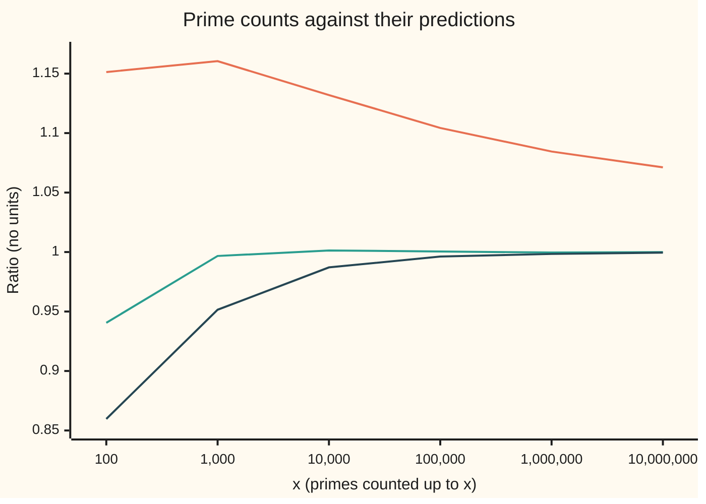
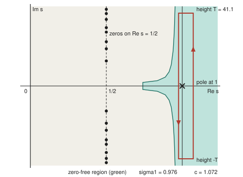

# The prime number theorem: the full proof, from zeta's zeros to the count x over log x

[Syllabus](../../../SYLLABUS.md) → [Algebraic and analytic number theory](../README.md) → [The Zeta Function and the Prime Number Theorem](../README.md#s02) → The prime number theorem

---

## General Overview

A sieve finds 78,498 primes below a million. The rule x/log x predicts 72,382. [How primes thin out](../../02-Number%20theory/07-For%20the%20Curious/03-how-primes-thin-out.md) states the rule and calls it a theorem from 1896. This card proves it, and proves how far off it can be.

The proof does not count primes directly. It counts a weighted version, ψ(x), "psi of x". Each prime power p, p², p³, … up to x adds log p, the natural logarithm of its prime. The weights undo the thinning of the primes, so ψ(x) should be close to x itself. At a million it is 999,586.597, only 413.403 short.

The proof gets ψ(x) out of zeta. Zeta's logarithmic derivative (its slope divided by its value) is a series with exactly those weights. A contour integral (an integral along a path in the complex plane) turns the series into ψ(x). Zeta's pole at 1 contributes x; each zero contributes an error wave. The zero-free region keeps every zero away from the line Re s = 1, so the waves stay much smaller than x.

Partial summation turns ψ(x) back into the prime count. The sharp main term is the logarithmic integral Li(x) = 78,626.504, which the count misses by only 128.504. The rule x/log x is 6,115.586 low because it drops the higher-order terms of Li(x), led by x/log² x.

**The prime count up to x equals Li(x), and so x/log x to first order, with an error at most a constant times x divided by e to a constant times the square root of log x; the proof gets ψ(x) from a contour integral of zeta's log derivative and pushes the contour into the zero-free region.**

**What kind of fact this is:** a theorem, proved here in Why it works, with the estimates in folded Detailed proofs. It uses results proved on other cards of this shelf: Perron's formula, the zero-free region and a count of zeros. Hadamard and de la Vallée Poussin proved π(x) ~ x/log x in 1896; de la Vallée Poussin added the error term in 1899. The checks to ten million are evidence and arithmetic tests, never proof.

### The picture: three ratios that the theorem sends to 1



Orange: π(x) divided by x/log x, which peaks at 1.1605 at 1,000, then falls slowly to 1.0712. Green: ψ(x)/x, within 0.0006 of 1 from 100,000 on. Dark: π(x)/Li(x), 0.9984 at a million. The proof explains all three: ψ and Li are the sharp forms, and x/log x closes in on the count only at the rate 1/log x.

---

## The formula

Notation first, in words.

- s = σ + it is a complex number with real part σ and height t, as on [Zeta of a complex variable](01-zeta-and-the-euler-product-revisited.md).
- Λ(n), von Mangoldt's function, is log p when n is a power of the prime p, and 0 otherwise. ψ(x) adds Λ(n) for n up to x; θ(x) adds log p over primes only ([The von Mangoldt function](../01-Arithmetic%20Functions%20Again/04-von-mangoldt-and-the-logarithmic-derivative.md)).
- Li(x) is the offset logarithmic integral: the area under 1/log t from 2 to x ([The logarithmic integral](06-the-logarithmic-integral-and-the-error-term.md)).
- A zero of zeta is $`\rho = \beta + it_\rho`$: real part β, height $`t_\rho`$.
- f = O(g) means |f| is at most a constant times g; f ≪ g says the same ([Big O and twiddle](../01-Arithmetic%20Functions%20Again/01-asymptotic-notation-and-error-terms.md)); f ~ g means f/g tends to 1.

```math
\psi(x) = x + O\!\left(x\,e^{-\kappa\sqrt{\log x}}\right), \qquad \pi(x) = \mathrm{Li}(x) + O\!\left(x\,e^{-\kappa'\sqrt{\log x}}\right), \qquad \pi(x) \sim \frac{x}{\log x}
```

**Read it aloud:** the weighted prime count is x plus an error smaller than x times e to minus kappa root log x; the prime count is Li(x) plus an error of the same shape; and so the prime count divided by x over log x tends to 1.

| Symbol | Plain meaning | In our example | Push it up and the answer… |
| --- | --- | --- | --- |
| $`x`$, $`\pi(x)`$ | how far up the primes are counted; the number of primes up to x | 1,000,000; 78,498 | every count grows |
| $`\psi(x)`$, $`\theta(x)`$, $`\Lambda(n)`$ | sum of log p over prime powers up to x; over primes only; log p at each power of p | ψ(x) = 999,586.597; θ(x) − x = −1,515.825 | — |
| $`\mathrm{Li}(x)`$ | area under 1/log t from 2 to x | 78,626.504 | — |
| $`\log`$ | natural logarithm | log x = 13.8155 | — |
| $`s = \sigma + it`$, $`\rho = \beta + it_\rho`$ | complex variable: real part σ, height t; a zero of zeta | first zero 0.5 + 14.134725i | — |
| $`\zeta'/\zeta`$ | zeta's slope divided by zeta | largest sampled size on the left side, 2 ≤ t ≤ T: 1.7263; at t = 0, next to the pole: 41.90 | — |
| $`c`$ | the starting vertical line Re s = 1 + 1/log x | 1.072382 | — |
| $`T`$ | cut-off height of the contour, $`e^{\sqrt{\log x}}`$ | 41.1376 | Perron error falls, zeros come closer |
| $`R`$ | zero-free constant: no zero has σ > 1 − 1/(R log t) | 5.558691 | the region narrows |
| $`\sigma_1`$ | the shifted line, 1 − 1/(2R log T) | 0.975800 | saving shrinks |
| $`\kappa`$, $`\kappa'`$ | constants in the error term; any κ below 1/(2R) works | below 0.089949 | error bound shrinks |
| $`O`$, $`\ll`$, $`\sim`$ | at most a constant times; the same; ratio tends to 1 | ψ(x) ~ x | — |

### When it holds

- **No zero of zeta near the line Re s = 1.** This is the zero-free region. If zeros sat at 1 ± 14.134725i, they would add a wave of size 141,142.714 to ψ at a million, against a true error of 413.403. The wave would grow in step with x, and ψ(x)/x would never settle at 1.
- **The region has a rate: width 1/(R log t) at height t.** "No zeros on Re s = 1", with no width, still gives π(x) ~ x/log x, but by a different proof and with no rate for the error.
- **The cut-off height grows with x, like $`e^{\sqrt{\log x}}`$.** Keep T at 100, or take T = √x, and one of the two error pieces stops shrinking. At x = 10^100 the bound then reads 530.2 or 206,500 times x, against 0.01452 times x for the balanced choice.
- **The main term is Li(x).** The error term belongs to Li(x). Measured against x/log x, the count is off by 6,115.586 at a million and 44,158.312 at ten million, and the gap keeps growing.
- **The count of weighted prime powers, not primes.** Zeta's log derivative counts prime powers, so the contour gives ψ(x). Read it as θ(x) and the bookkeeping is off by 1,102.422 at a million.

---

## Why it works

### Step 0: the primes are the coefficients of a function whose only big singularity is at 1

Zeta's log derivative is a series with weight log p on each prime power. A contour integral reads off the running total of those weights, ψ(x). Every pole of the integrand contributes a term: the pole of zeta at 1 gives x, and each zero ρ of zeta gives a wave of size about $`x^{\mathrm{Re}\,\rho}`$. The whole proof is the statement that no zero lets its wave grow as fast as x, made precise.

### Step 1: ψ(x) is a contour integral, cut off at height T

[Zeta of a complex variable](01-zeta-and-the-euler-product-revisited.md) gives, for Re s > 1,

```math
-\frac{\zeta'(s)}{\zeta(s)} = \sum_{n=1}^{\infty} \frac{\Lambda(n)}{n^{s}}
```

Its coefficients are Λ(n), so its running total is ψ(x).

[Perron's formula](04-perrons-formula.md) turns a series into its running total. Integrate the series times $`x^s/s`$ up the vertical line Re s = c, where c = 1 + 1/log x, and stop at heights ±T. For 2 ≤ T ≤ x:

```math
\psi(x) = \frac{1}{2\pi i}\int_{c-iT}^{c+iT} \left(-\frac{\zeta'(s)}{\zeta(s)}\right)\frac{x^{s}}{s}\,ds \;+\; O\!\left(\frac{x\log^{2} x}{T}\right)
```

The choice c = 1 + 1/log x keeps $`|x^s| = x^c = e\,x`$, so the series stays under control at the line. The error term is the cost of stopping at height T.

### Step 2: the zero-free region keeps zeros away from Re s = 1

[The zero-free region](03-the-zero-free-region.md) proves that ζ(σ + it) has no zero with

```math
\sigma \ge 1 - \frac{1}{R\log |t|}, \qquad |t| \ge 2, \qquad R = 5.558691
```

The shape is proved there. The constant R = 5.558691 is the best known, quoted there from a 2024 paper; any fixed R would do for this proof. Below height 2 there are no zeros in the strip at all. The region gets thinner as t grows, but only like 1/log t. That rate is what sets the shape of the final error.

### Step 3: zeta's log derivative stays small just inside the region

Put the new line at σ₁ = 1 − 1/(2R log T): half-way between Re s = 1 and the edge of the region at height T. On this line, and on the two short horizontal sides, every zero is at least 1/(4R log T) away. The fold shows that this gives

```math
\left|\frac{\zeta'(s)}{\zeta(s)}\right| \ll \log^{2} T \quad \text{on the contour}
```

At x = a million, T = 41.1376 and σ₁ = 0.975800. The check samples |ζ′/ζ| up the left side from height 2 to T: its largest sampled value is 1.7263, at height 14.14, next to the first zero, against (log T)² = 13.8155. Near t = 0 the pole takes over: there |ζ′/ζ| is 41.90, close to the 2R log T = 41.32 that the fold allows for that stretch. The sign ≪ hides a constant: the bound says how the size grows with T, not that it stays below (log T)² itself.

<details>
<summary>Detailed proof: the bound on zeta's log derivative</summary>

The Hadamard product for zeta (zeta written as a product over its zeros), built on [The functional equation](02-functional-equation-proved.md), gives the partial-fraction formula: for −1 ≤ σ ≤ 2 and |t| ≥ 2,

$`\displaystyle \frac{\zeta'(s)}{\zeta(s)} = \sum_{|t_\rho - t| < 1} \frac{1}{s-\rho} + O(\log |t|)`$

The sum runs over zeros $`\rho = \beta + it_\rho`$ whose height $`t_\rho`$ is within 1 of t. [Counting the zeros](08-counting-the-zeros-riemann-von-mangoldt.md) shows there are O(log |t|) of them.

Take s on the contour, so σ ≥ σ₁ and 2 ≤ |t| ≤ T, with T ≥ 3. Each zero in the sum has $`|t_\rho| \le T + 1`$, so by Step 2, β ≤ 1 − 1/(R log(T + 1)). Then

$`\displaystyle \sigma - \beta \ge \frac{1}{R\log(T+1)} - \frac{1}{2R\log T} \ge \frac{1}{4R\log T}`$

The last step uses T⁴ ≥ (T + 1)³, true for T ≥ 3. So each term is at most 4R log T, there are O(log T) terms, and the sum is O(log² T).

For |t| < 2 there are no zeros nearby, and ζ′/ζ is −1/(s − 1) plus a function bounded near 1. On the contour |s − 1| ≥ 1/(2R log T), so this part is at most 2R log T + O(1). $`\blacksquare`$

</details>

### Step 4: shift the contour; only the pole at 1 is inside

Close the line from c − iT to c + iT into a rectangle with the line Re s = σ₁ on the left. Inside, the integrand has one pole: s = 1, where zeta's pole makes −ζ′/ζ behave like 1/(s − 1). Its residue (the coefficient of 1/(s − 1)) is $`x^1/1 = x`$. There is no zero inside, by Step 2, and s = 0 is outside. The residue theorem gives

```math
\frac{1}{2\pi i}\int_{c-iT}^{c+iT} = x + \frac{1}{2\pi i}\left(\int_{\text{top}} + \int_{\text{left}} + \int_{\text{bottom}}\right)
```

<p align="center"></p>

To scale, for x = a million: X = 60 + 300 Re s, Y = 170 − 3.5 Im s. The rectangle runs from X = 352.7 to 381.7 and from Y = 26.0 to 314.0. The green region is the zero-free region of Step 2, drawn from |t| = 2. The dots are the eight zeros up to height 45 and their mirror images; only the pair at ±43.327073 lies above T.

The check confirms the count inside. Walking the rectangle once anticlockwise, zeta's value turns −1.000000 times round 0: zero zeros minus one pole, by [The argument principle](../../07-Complex%20analysis/06-Real%20Integrals%20and%20Counting%20Zeros/06-the-argument-principle.md).

On the left side $`|x^s| = x^{\sigma_1}`$, smaller than x by the factor $`e^{-\log x/(2R\log T)}`$. This saving is the whole error term. The fold bounds the three sides:

<details>
<summary>Detailed proof: the three sides and the total error</summary>

Use Step 3, |ζ′/ζ| ≪ log² T, on every side.

Left side, s = σ₁ + it with |t| ≤ T. Here $`|x^s| = x^{\sigma_1}`$, and the integral of 1/|s| over the side is O(log T). So

$`\displaystyle \int_{\text{left}} \ll x^{\sigma_1}\log^{3} T = x\,\log^{3} T\; \exp\!\Bigl(-\frac{\log x}{2R\log T}\Bigr)`$

Top and bottom, s = σ ± iT with σ₁ ≤ σ ≤ c. Here |s| ≥ T and $`|x^s| \le x^c = e\,x`$, and the sides have length less than 1. So each is O(x log² T / T).

Adding Step 1's cut-off error, for 3 ≤ T ≤ x:

$`\displaystyle \psi(x) - x \ll \frac{x\log^{2} x}{T} + x\,\log^{3} T\;\exp\!\Bigl(-\frac{\log x}{2R\log T}\Bigr)`$

With log T = √(log x), both terms are at most a constant times $`x\,e^{-\kappa\sqrt{\log x}}`$ for any κ < 1/(2R), since any power of log x grows more slowly than e raised to any positive multiple of √(log x). $`\blacksquare`$

</details>

This route, which never sums over zeros, is the one in Montgomery and Vaughan (chapter 6). Davenport (chapter 18) takes the other route to the same error term: move the line all the way left, as on [The explicit formula](07-the-explicit-formula.md), then cap the wave of each zero below T with the zero-free region.

### Step 5: choose T to balance the two errors

Two errors pull against each other. A taller contour (larger T) cuts the Perron error x log²x / T. But it also reaches heights where the zero-free region is thinner, so the saving $`e^{-\log x/(2R\log T)}`$ shrinks.

Ignore the constant 2R for now. Then the two errors are x times $`e^{-\log T}`$ and x times $`e^{-\log x/\log T}`$. Set the exponents equal: log T = log x / log T. That gives log T = √(log x), so T = $`e^{\sqrt{\log x}}`$. Both errors become x times $`e^{-\kappa\sqrt{\log x}}`$, up to powers of log x. Any κ below 1/(2R) = 0.089949 works.

Keep 2R in the balance and the best height is log T = √(log x / (2R)). That improves the constant to any κ below 1/√(2R) = 0.299915. The shape of the error does not change, so this card keeps the simpler T.

The table shows the relative error bound with every constant set to 1. It is a picture of the shape only: the true constants are larger.

| x | T = 100 | T = $`e^{\sqrt{\log x}}`$ | T = √x |
| --- | --- | --- | --- |
| a million | 6.771 | 5.888 | 44.80 |
| 10^20 | 21.21 | 2.748 | 1,652 |
| 10^100 | 530.2 | 0.01452 | 206,500 |

Only the balanced choice drives the bound below 1, and only for huge x. The proof says what happens eventually. It says nothing useful at a million, where the true error is 413.403.

### Step 6: from ψ(x) back to the prime count

Three conversions finish the proof. All three are exact identities or simple bounds.

1. **Drop the prime powers.** ψ(x) − θ(x) adds log p over p², p³, … up to x. There are fewer than 2√x log x such powers, each adding at most log x, so θ(x) = ψ(x) + O(√x log² x), far inside the error term.
2. **Partial summation.** [Partial summation](../01-Arithmetic%20Functions%20Again/06-abel-and-partial-summation.md) gives π(x) = θ(x)/log x + ∫₂ˣ θ(t)/(t log²t) dt. Integrating 1/log t by parts gives the same shape for Li(x). Subtract:

```math
\pi(x) - \mathrm{Li}(x) = \frac{\theta(x) - x}{\log x} + \int_2^x \frac{\theta(t) - t}{t\log^{2} t}\,dt + \frac{2}{\log 2}
```

3. **Bound the integral.** Split it at √x. Below, the integrand is small and the piece is O(√x). Above, log t ≥ (log x)/2, so θ(t) − t ≪ t·exp(−κ√(log x)/√2). The piece is O(x exp(−κ′√log x)) with κ′ = κ/√2. This proves the formula for π(x).

Finally, Li(x) = x/log x + ∫₂ˣ dt/log²t − 2/log 2, and that integral is O(x/log² x). So Li(x)/(x/log x) tends to 1, and π(x) ~ x/log x. The rule x/log x is right to first order, and wrong by about x/log²x, which is 5,239.214 at a million; the higher-order terms of Li(x) and the error term make up the rest of the 6,115.586.

---

## Worked numbers, by hand

Take x = 1,000,000. The count splits into the main term, Li(x)'s known higher-order terms and the error term, and the error term splits as in Step 6.

| Step | Arithmetic | Value |
| --- | --- | --- |
| log x | natural log of 1,000,000 | 13.8155 |
| first-order term | 1,000,000 / 13.8155 | 72,382.414 |
| higher-order terms | Li(x) − x/log x = 78,626.504 − 72,382.414, led by x/log² x = 5,239.214 | 6,244.090 |
| ψ(x) − x | 999,586.597 − 1,000,000 | −413.403 |
| prime powers | ψ(x) − θ(x) | 1,102.422 |
| θ(x) − x | −413.403 − 1,102.422 | −1,515.825 |
| first error piece | (θ(x) − x)/log x = −1,515.825 / 13.8155 | −109.719 |
| second error piece | ∫ (θ(t) − t)/(t log²t), staircase minus Simpson | −21.670 |
| constant | 2 / log 2 | 2.885 |
| π(x) − Li(x) | −109.719 − 21.670 + 2.885 | −128.504 |
| π(x) | 72,382.414 + 6,244.090 − 128.504 | **78,498** |

The sieve count comes back exactly. Of the 6,115.586 by which x/log x falls short, 6,244.090 is the sum of Li(x)'s higher-order terms, which the theorem predicts; only −128.504 is the error term.

### What breaks if you drop a piece

| Mistake | Comes out at | What went wrong |
| --- | --- | --- |
| Zeros allowed on Re s = 1, at 1 ± 14.134725i | wave of size 141,142.714; −76,204.338 at a million | the pair adds a wave that grows in step with x; the zero-free region forbids it |
| x/log x taken as the main term | gap 6,115.586 at a million, 44,158.312 at ten million | Li(x)'s higher-order terms, led by x/log²x, are left inside the "error" |
| θ(x) read for the contour integral | θ(x) − x = −1,515.825, not −413.403 | the prime powers, 1,102.422, are dropped |
| T kept at 100, or T = √x, at x = 10^100 | bound 530.2 or 206,500 times x, not 0.01452 | one error piece stops shrinking; Step 5's balance is lost |

---

## Code, from first principles, and it actually runs

Both programs sieve the primes up to ten million and count π(x), θ(x) and ψ(x) at six sizes. They reach each key number by two independent roads:

1. Li(x) by Simpson's rule (a numerical integration rule) and by its power series in log x.
2. ψ(10^6) by summing over primes, and by a table of Λ(n) that also passes Chebyshev's identity, the sum of ψ(x/n) for n up to x equals log x!.
3. π(10^6) by the sieve, and from θ by partial summation; π − Li by subtraction, and as Step 6's three pieces.
4. The contour: zeta by Borwein's alternating-series method, its zeros on the line by sign changes of Hardy's Z function (zeta on Re s = 1/2, turned so that it is real), and the rectangle's contents by the winding number (how many times zeta's value circles 0).

### Python

```python
# Prime number theorem with an error term: psi(x) - x and pi(x) - Li(x) by exact counts,
# the contour of the proof checked on zeta itself, and the choice of the cut-off height T.
import math
from itertools import compress
N, M = 10**7, 10**6
sv = bytearray([1]) * (N + 1); sv[0] = sv[1] = 0
for p in range(2, math.isqrt(N) + 1):
    if sv[p]: sv[p*p::p] = bytes(len(range(p*p, N + 1, p)))
primes = list(compress(range(N + 1), sv))
print(f"sieve to 10^7: {len(primes)} primes")
def ksum(vals):                       # Kahan summation, the same in both languages
    s = c = 0.0
    for v in vals:
        y = v - c; t = s + y; c = (t - s) - y; s = t
    return s
def npow(p, x):                       # how many powers p, p^2, ... are <= x
    k, q = 1, p
    while q * p <= x: q *= p; k += 1
    return k
def simpson(f, a, b, n=20000):
    h = (b - a) / n
    return h / 3 * (f(a) + f(b) + sum((4 if i % 2 else 2) * f(a + i * h) for i in range(1, n)))
def Li(x):                            # offset log integral, t = e^u: area under e^u/u
    return simpson(lambda u: math.exp(u) / u, math.log(2), math.log(x))
def Li_series(x):                     # li(x) - li(2) by its power series in log x; gamma cancels
    L, l2 = math.log(x), math.log(2)
    s, a, b = math.log(L) - math.log(l2), 1.0, 1.0
    for n in range(1, 120):
        a *= L / n; b *= l2 / n; s += (a - b) / n
    return s
XS = [10**k for k in range(2, 8)]
rows = {}
print("       x    pi(x)    x/log x        Li(x)          psi(x)    psi - x   theta - x")
for x in XS:
    ps = [p for p in primes if p <= x]
    th, psi, li = ksum(math.log(p) for p in ps), ksum(math.log(p) * npow(p, x) for p in ps), Li(x)
    rows[x] = (len(ps), th, psi, li)
    print(f"{x:8d} {len(ps):8d} {x / math.log(x):10.3f} {li:12.3f} {psi:15.3f} {psi - x:10.3f} {th - x:11.3f}")
    assert abs(li - Li_series(x)) < 1e-6 * li            # road 2 for Li
    if x >= 10**5: assert abs(psi / x - 1) < 1e-3          # evidence, not proof
print("chart psi/x:", ", ".join(f"{rows[x][2] / x:.4f}" for x in XS))
print("chart pi/(x/log x):", ", ".join(f"{rows[x][0] * math.log(x) / x:.4f}" for x in XS))
print("chart pi/Li:", ", ".join(f"{rows[x][0] / rows[x][3]:.4f}" for x in XS))
pi6, th6, psi6, li6 = rows[M]
L6 = math.log(M); y6 = M / L6
ps6 = [p for p in primes if p <= M]
thc, I1 = 0.0, 0.0                    # integral of theta(t)/(t log^2 t), exact on the staircase
for i, p in enumerate(ps6):
    thc += math.log(p); q = ps6[i + 1] if i + 1 < len(ps6) else M
    I1 += thc * (1 / math.log(p) - 1 / math.log(q))
J = simpson(lambda u: math.exp(u) / u**2, math.log(2), L6)   # integral of 1/log^2 t
pi_abel = th6 / L6 + I1
print(f"worked, log x = {L6:.4f}, sqrt(log x) = {math.sqrt(L6):.4f}, x/log^2 x = {y6 / L6:.3f}")
print(f"worked, pi = x/log x + (Li - x/log x) + (pi - Li) = {y6:.3f} + {li6 - y6:.3f} + {pi6 - li6:.3f}")
print(f"worked, theta - x = (psi - x) - (psi - theta) = {psi6 - M:.3f} - {psi6 - th6:.3f} = {th6 - M:.3f}")
rhs = (th6 - M) / L6 + (I1 - J) + 2 / math.log(2)
print(f"worked, pi - Li = {(th6 - M) / L6:.3f} + {I1 - J:.3f} + {2 / math.log(2):.3f} = {rhs:.3f}")
print(f"worked, pi by partial summation from theta = {pi_abel:.3f}")
assert abs(pi_abel - pi6) < 1e-6 and abs(rhs - (pi6 - li6)) < 1e-6
lam = [0.0] * (M + 1)                 # Chebyshev's identity: sum of psi(x/n) = log of x factorial
for p in ps6:
    q = p
    while q <= M: lam[q] = math.log(p); q *= p
cum = [0.0] * (M + 1)
for m in range(1, M + 1): cum[m] = cum[m - 1] + lam[m]
lhs = sum(cum[M // n] for n in range(1, M + 1)); logfact = sum(math.log(m) for m in range(2, M + 1))
print(f"Chebyshev identity at 10^6: sum psi(x/n) = {lhs:.3f}, log(x!) = {logfact:.3f}")
assert abs(lhs - logfact) < 1e-3 and abs(cum[M] - psi6) < 1e-6
NB = 60; d, term, acc = [], 1.0 / NB, 0.0   # Borwein's algorithm for zeta(s), Re s > 0
for i in range(NB + 1):
    if i: term *= 4 * (NB + i - 1) * (NB - i + 1) / ((2 * i) * (2 * i - 1))
    acc += term; d.append(NB * acc)
def cpow(b, s):                       # b^(-s) for real b > 0
    lb = math.log(b); m = math.exp(-s.real * lb)
    return complex(m * math.cos(-s.imag * lb), m * math.sin(-s.imag * lb))
def zeta(s):
    acc = complex(0, 0)
    for k in range(NB): acc += ((-1)**k * (d[k] - d[NB])) * cpow(k + 1, s)
    w = (1 - 2 * cpow(2, s)) * d[NB]; w2 = w.real**2 + w.imag**2
    return -acc * complex(w.real / w2, -w.imag / w2)
c = 1 + 1 / L6; T = math.exp(math.sqrt(L6)); s1 = 1 - 1 / (2 * 5.558691 * math.log(T))
print(f"contour at 10^6: c = {c:.6f}, T = exp(sqrt(log x)) = {T:.4f}, sigma1 = {s1:.6f}; 1/(2R) = {1 / (2 * 5.558691):.6f}, 1/sqrt(2R) = {1 / math.sqrt(2 * 5.558691):.6f}")
def Z(t):                             # Hardy's Z: real on the critical line
    th = t / 2 * math.log(t / (2 * math.pi)) - t / 2 - math.pi / 8 + 1 / (48 * t) + 7 / (5760 * t**3)
    z = zeta(complex(0.5, t)); return z.real * math.cos(th) - z.imag * math.sin(th)
zeros, t = [], 10.0
while t + 0.1 <= 45:                  # up to the top of the figure
    if Z(t) * Z(t + 0.1) < 0:
        a, b = t, t + 0.1
        for _ in range(45): m = (a + b) / 2; a, b = (a, m) if Z(a) * Z(m) < 0 else (m, b)
        zeros.append((a + b) / 2)
    t += 0.1
print("zeros on Re s = 1/2 up to height 45, heights:", " ".join(f"{z:.6f}" for z in zeros))
assert len(zeros) == 8 and zeros[6] < T < zeros[7] and abs(zeros[0] - 14.134725) < 1e-5
path = [complex(c, -T + 2 * T * i / 8000) for i in range(8001)] + [complex(c - (c - s1) * i / 40, T) for i in range(1, 41)]
path += [complex(s1, T - 2 * T * i / 8000) for i in range(1, 8001)] + [complex(s1 + (c - s1) * i / 40, -T) for i in range(1, 41)]
vals = [zeta(s) for s in path]
turn = sum(math.atan2((w * v.conjugate()).imag, (w * v.conjugate()).real) for v, w in zip(vals, vals[1:])) / (2 * math.pi)
print(f"winding of zeta round the rectangle: {turn:.6f} turns (zeros inside minus poles inside)")
assert abs(turn + 1) < 1e-6
h, best = 1e-4, (0.0, 0.0)
for i in range(781):
    s = complex(s1, 2 + (T - 2) * i / 780)
    r = abs((zeta(s + h) - zeta(s - h)) / (2 * h) / zeta(s))
    if r > best[0]: best = (r, s.imag)
print(f"max |zeta'/zeta| on the left side, 2 <= t <= T: {best[0]:.4f} at t = {best[1]:.2f}; (log T)^2 = {math.log(T)**2:.4f}")
assert best[0] < math.log(T)**2
r0 = abs((zeta(complex(s1 + h, 0)) - zeta(complex(s1 - h, 0))) / (2 * h) / zeta(complex(s1, 0)))
print(f"|zeta'/zeta| on the left side at t = 0, next to the pole: {r0:.2f}; 2R log T = {2 * 5.558691 * math.log(T):.2f}")
def sci(v):
    e = math.floor(math.log10(v)); m = v / 10**e
    if round(m, 3) >= 10: m /= 10; e += 1
    return f"{m:.3f}e{e}"
for k in (6, 20, 100):                # relative error bound of the proof, every constant set to 1
    L = k * math.log(10); out = []
    for lt in (math.log(100), math.sqrt(L), L / 2):
        out.append(L * L / math.exp(lt) + lt**3 * math.exp(-L / lt))
    print(f"shape, x = 10^{k}: T = 100 {sci(out[0])}, T = exp(sqrt(log x)) {sci(out[1])}, T = sqrt(x) {sci(out[2])}")
assert out[1] < 1 < min(out[0], out[2])
amp = 2 * M / abs(complex(1, zeros[0])); wave = -2 * (cpow(M, complex(-1, -zeros[0])) / complex(1, zeros[0])).real
print(f"broken: zeros at 1 +- {zeros[0]:.6f}i, wave amplitude at 10^6 {amp:.3f}, wave now {wave:.3f}")
print("broken: pi - x/log x at 10^5, 10^6, 10^7:", " ".join(f"{rows[x][0] - x / math.log(x):.3f}" for x in XS[3:]))
print("broken: pi - Li at 10^5, 10^6, 10^7:", " ".join(f"{rows[x][0] - rows[x][3]:.3f}" for x in XS[3:]))
print(f"try: share of primes near 2^1024 1/{1024 * math.log(2):.2f}, among odd numbers 1/{512 * math.log(2):.2f}")
fx = lambda sg: 60 + 300 * sg; fy = lambda tt: 170 - 3.5 * tt
bd = " ".join(f"{fx(1 - 1 / (5.558691 * math.log(tt))):.1f}" for tt in (2, 3, 5, 8, 12, 20, 30, 45))
print(f"figure, X = 60 + 300 Re s, Y = 170 - 3.5 Im s: c {fx(c):.1f}, sigma1 {fx(s1):.1f}, top {fy(T):.1f}, bottom {fy(-T):.1f}")
print("figure, zeros y " + " ".join(f"{fy(z):.1f}" for z in zeros) + "; boundary x at t = 2 3 5 8 12 20 30 45: " + bd)
print("ALL CHECKS PASS")
```

**Ran 2026-11-15 on macOS, Python 3.14.10, standard library only. All checks passed. Output, pasted from the run:**

```
sieve to 10^7: 664579 primes
       x    pi(x)    x/log x        Li(x)          psi(x)    psi - x   theta - x
     100       25     21.715       29.081          94.045     -5.955     -16.272
    1000      168    144.765      176.564         996.681     -3.319     -43.755
   10000     1229   1085.736     1245.092       10013.397     13.397    -104.009
  100000     9592   8685.890     9628.764      100051.564     51.564    -314.611
 1000000    78498  72382.414    78626.504      999586.597   -413.403   -1515.825
10000000   664579 620420.688   664917.360     9998539.403  -1460.597   -4820.682
chart psi/x: 0.9405, 0.9967, 1.0013, 1.0005, 0.9996, 0.9999
chart pi/(x/log x): 1.1513, 1.1605, 1.1320, 1.1043, 1.0845, 1.0712
chart pi/Li: 0.8597, 0.9515, 0.9871, 0.9962, 0.9984, 0.9995
worked, log x = 13.8155, sqrt(log x) = 3.7169, x/log^2 x = 5239.214
worked, pi = x/log x + (Li - x/log x) + (pi - Li) = 72382.414 + 6244.090 + -128.504
worked, theta - x = (psi - x) - (psi - theta) = -413.403 - 1102.422 = -1515.825
worked, pi - Li = -109.719 + -21.670 + 2.885 = -128.504
worked, pi by partial summation from theta = 78498.000
Chebyshev identity at 10^6: sum psi(x/n) = 12815518.385, log(x!) = 12815518.385
contour at 10^6: c = 1.072382, T = exp(sqrt(log x)) = 41.1376, sigma1 = 0.975800; 1/(2R) = 0.089949, 1/sqrt(2R) = 0.299915
zeros on Re s = 1/2 up to height 45, heights: 14.134725 21.022040 25.010858 30.424876 32.935062 37.586178 40.918719 43.327073
winding of zeta round the rectangle: -1.000000 turns (zeros inside minus poles inside)
max |zeta'/zeta| on the left side, 2 <= t <= T: 1.7263 at t = 14.14; (log T)^2 = 13.8155
|zeta'/zeta| on the left side at t = 0, next to the pole: 41.90; 2R log T = 41.32
shape, x = 10^6: T = 100 6.771e0, T = exp(sqrt(log x)) 5.888e0, T = sqrt(x) 4.480e1
shape, x = 10^20: T = 100 2.121e1, T = exp(sqrt(log x)) 2.748e0, T = sqrt(x) 1.652e3
shape, x = 10^100: T = 100 5.302e2, T = exp(sqrt(log x)) 1.452e-2, T = sqrt(x) 2.065e5
broken: zeros at 1 +- 14.134725i, wave amplitude at 10^6 141142.714, wave now -76204.338
broken: pi - x/log x at 10^5, 10^6, 10^7: 906.110 6115.586 44158.312
broken: pi - Li at 10^5, 10^6, 10^7: -36.764 -128.504 -338.360
try: share of primes near 2^1024 1/709.78, among odd numbers 1/354.89
figure, X = 60 + 300 Re s, Y = 170 - 3.5 Im s: c 381.7, sigma1 352.7, top 26.0, bottom 314.0
figure, zeros y 120.5 96.4 82.5 63.5 54.7 38.4 26.8 18.4; boundary x at t = 2 3 5 8 12 20 30 45: 282.1 310.9 326.5 334.0 338.3 342.0 344.1 345.8
ALL CHECKS PASS
```

### Rust

```rust
// Prime number theorem with an error term: psi(x) - x and pi(x) - Li(x) by exact counts,
// the contour of the proof checked on zeta itself, and the choice of the cut-off height T.
use std::f64::consts::PI;
#[derive(Clone, Copy)]
struct C { re: f64, im: f64 }
impl C {
    fn add(self, o: C) -> C { C { re: self.re + o.re, im: self.im + o.im } }
    fn sub(self, o: C) -> C { C { re: self.re - o.re, im: self.im - o.im } }
    fn mul(self, o: C) -> C { C { re: self.re * o.re - self.im * o.im, im: self.re * o.im + self.im * o.re } }
    fn sc(self, f: f64) -> C { C { re: f * self.re, im: f * self.im } }
    fn div(self, o: C) -> C { let w = o.re * o.re + o.im * o.im; self.mul(C { re: o.re / w, im: -o.im / w }) }
    fn abs(self) -> f64 { self.re.hypot(self.im) }
}
fn ksum(v: impl Iterator<Item = f64>) -> f64 { // Kahan summation, the same in both languages
    let (mut s, mut c) = (0.0f64, 0.0f64);
    for x in v { let y = x - c; let t = s + y; c = (t - s) - y; s = t; }
    s
}
fn npow(p: u64, x: u64) -> f64 { let (mut k, mut q) = (1.0, p); while q * p <= x { q *= p; k += 1.0; } k }
fn simpson(f: &dyn Fn(f64) -> f64, a: f64, b: f64) -> f64 {
    let n = 20000; let h = (b - a) / n as f64;
    let mut s = 0.0;
    for i in 1..n { s += (if i % 2 == 1 { 4.0 } else { 2.0 }) * f(a + i as f64 * h); }
    h / 3.0 * (f(a) + f(b) + s)
}
fn li(x: f64) -> f64 { simpson(&|u: f64| u.exp() / u, 2f64.ln(), x.ln()) }
fn li_series(x: f64) -> f64 {
    let (l, l2) = (x.ln(), 2f64.ln());
    let (mut s, mut a, mut b) = (l.ln() - l2.ln(), 1.0, 1.0);
    for n in 1..120 { a *= l / n as f64; b *= l2 / n as f64; s += (a - b) / n as f64; }
    s
}
const NB: usize = 60;
fn cpow(b: f64, s: C) -> C { let lb = b.ln(); let m = (-s.re * lb).exp(); C { re: m * (-s.im * lb).cos(), im: m * (-s.im * lb).sin() } }
fn zeta(s: C, d: &[f64]) -> C {
    let mut acc = C { re: 0.0, im: 0.0 };
    for k in 0..NB { let sg = if k % 2 == 0 { 1.0 } else { -1.0 }; acc = acc.add(cpow((k + 1) as f64, s).sc(sg * (d[k] - d[NB]))); }
    let w = C { re: 1.0, im: 0.0 }.sub(cpow(2.0, s).sc(2.0)).sc(d[NB]); let w2 = w.re * w.re + w.im * w.im;
    acc.sc(-1.0).mul(C { re: w.re / w2, im: -w.im / w2 })
}
fn hz(t: f64, d: &[f64]) -> f64 { // Hardy's Z: real on the critical line
    let th = t / 2.0 * (t / (2.0 * PI)).ln() - t / 2.0 - PI / 8.0 + 1.0 / (48.0 * t) + 7.0 / (5760.0 * t.powf(3.0));
    let z = zeta(C { re: 0.5, im: t }, d); z.re * th.cos() - z.im * th.sin()
}
fn sci(v: f64) -> String {
    let mut e = v.log10().floor(); let mut m = v / 10f64.powf(e);
    if (m * 1000.0).round() / 1000.0 >= 10.0 { m /= 10.0; e += 1.0; }
    format!("{:.3}e{}", m, e as i64)
}
fn join(v: &[f64], p: usize, sep: &str) -> String { v.iter().map(|x| format!("{:.*}", p, x)).collect::<Vec<_>>().join(sep) }
fn main() {
    let (n, m) = (10_000_000usize, 1_000_000usize);
    let mut sv = vec![true; n + 1]; sv[0] = false; sv[1] = false;
    let mut p = 2; while p * p <= n { if sv[p] { let mut q = p * p; while q <= n { sv[q] = false; q += p; } } p += 1; }
    let primes: Vec<u64> = (0..=n).filter(|&i| sv[i]).map(|i| i as u64).collect();
    println!("sieve to 10^7: {} primes", primes.len());
    let xs: Vec<u64> = (2..8).map(|k| 10u64.pow(k)).collect();
    let mut rows = vec![];
    println!("       x    pi(x)    x/log x        Li(x)          psi(x)    psi - x   theta - x");
    for &x in &xs {
        let ps: Vec<u64> = primes.iter().cloned().filter(|&p| p <= x).collect();
        let th = ksum(ps.iter().map(|&p| (p as f64).ln()));
        let psi = ksum(ps.iter().map(|&p| (p as f64).ln() * npow(p, x)));
        let xf = x as f64; let l = li(xf);
        rows.push((ps.len() as f64, th, psi, l));
        println!("{:8} {:8} {:10.3} {:12.3} {:15.3} {:10.3} {:11.3}", x, ps.len(), xf / xf.ln(), l, psi, psi - xf, th - xf);
        assert!((l - li_series(xf)).abs() < 1e-6 * l);
        if x >= 100_000 { assert!((psi / xf - 1.0).abs() < 1e-3); }
    }
    let ch: Vec<Vec<f64>> = (0..3).map(|j| xs.iter().enumerate().map(|(i, &x)| { let (a, _, c, d) = rows[i]; let xf = x as f64; [c / xf, a * xf.ln() / xf, a / d][j] }).collect()).collect();
    println!("chart psi/x: {}", join(&ch[0], 4, ", "));
    println!("chart pi/(x/log x): {}", join(&ch[1], 4, ", "));
    println!("chart pi/Li: {}", join(&ch[2], 4, ", "));
    let (pi6, th6, psi6, li6) = rows[4]; let mf = m as f64;
    let l6 = mf.ln(); let y6 = mf / l6;
    let ps6: Vec<u64> = primes.iter().cloned().filter(|&p| p <= m as u64).collect();
    let (mut thc, mut i1) = (0.0, 0.0);
    for i in 0..ps6.len() {
        thc += (ps6[i] as f64).ln(); let q = if i + 1 < ps6.len() { ps6[i + 1] as f64 } else { mf };
        i1 += thc * (1.0 / (ps6[i] as f64).ln() - 1.0 / q.ln());
    }
    let jj = simpson(&|u: f64| u.exp() / u.powf(2.0), 2f64.ln(), l6);
    let pi_abel = th6 / l6 + i1;
    println!("worked, log x = {:.4}, sqrt(log x) = {:.4}, x/log^2 x = {:.3}", l6, l6.sqrt(), y6 / l6);
    println!("worked, pi = x/log x + (Li - x/log x) + (pi - Li) = {:.3} + {:.3} + {:.3}", y6, li6 - y6, pi6 - li6);
    println!("worked, theta - x = (psi - x) - (psi - theta) = {:.3} - {:.3} = {:.3}", psi6 - mf, psi6 - th6, th6 - mf);
    let rhs = (th6 - mf) / l6 + (i1 - jj) + 2.0 / 2f64.ln();
    println!("worked, pi - Li = {:.3} + {:.3} + {:.3} = {:.3}", (th6 - mf) / l6, i1 - jj, 2.0 / 2f64.ln(), rhs);
    println!("worked, pi by partial summation from theta = {:.3}", pi_abel);
    assert!((pi_abel - pi6).abs() < 1e-6 && (rhs - (pi6 - li6)).abs() < 1e-6);
    let mut lam = vec![0.0f64; m + 1]; // Chebyshev's identity: sum of psi(x/n) = log of x factorial
    for &p in &ps6 { let mut q = p as usize; while q <= m { lam[q] = (p as f64).ln(); q *= p as usize; } }
    let mut cum = vec![0.0f64; m + 1];
    for k in 1..=m { cum[k] = cum[k - 1] + lam[k]; }
    let mut lhs = 0.0; for k in 1..=m { lhs += cum[m / k]; }
    let mut logfact = 0.0; for k in 2..=m { logfact += (k as f64).ln(); }
    println!("Chebyshev identity at 10^6: sum psi(x/n) = {:.3}, log(x!) = {:.3}", lhs, logfact);
    assert!((lhs - logfact).abs() < 1e-3 && (cum[m] - psi6).abs() < 1e-6);
    let (mut d, mut term, mut acc) = (vec![], 1.0 / NB as f64, 0.0); // Borwein's algorithm for zeta(s), Re s > 0
    for i in 0..=NB {
        if i > 0 { term *= (4 * (NB + i - 1) * (NB - i + 1)) as f64 / ((2 * i) * (2 * i - 1)) as f64; }
        acc += term; d.push(NB as f64 * acc);
    }
    let c = 1.0 + 1.0 / l6; let tt = l6.sqrt().exp(); let s1 = 1.0 - 1.0 / (2.0 * 5.558691 * tt.ln());
    println!("contour at 10^6: c = {:.6}, T = exp(sqrt(log x)) = {:.4}, sigma1 = {:.6}; 1/(2R) = {:.6}, 1/sqrt(2R) = {:.6}", c, tt, s1, 1.0 / (2.0 * 5.558691), 1.0 / (2.0 * 5.558691f64).sqrt());
    let (mut zeros, mut t) = (vec![], 10.0f64);
    while t + 0.1 <= 45.0 { // up to the top of the figure
        if hz(t, &d) * hz(t + 0.1, &d) < 0.0 {
            let (mut a, mut b) = (t, t + 0.1);
            for _ in 0..45 { let mm = (a + b) / 2.0; if hz(a, &d) * hz(mm, &d) < 0.0 { b = mm } else { a = mm } }
            zeros.push((a + b) / 2.0);
        }
        t += 0.1;
    }
    println!("zeros on Re s = 1/2 up to height 45, heights: {}", join(&zeros, 6, " "));
    assert!(zeros.len() == 8 && zeros[6] < tt && tt < zeros[7] && (zeros[0] - 14.134725).abs() < 1e-5);
    let mut path: Vec<C> = (0..=8000).map(|i| C { re: c, im: -tt + 2.0 * tt * i as f64 / 8000.0 }).collect();
    path.extend((1..=40).map(|i| C { re: c - (c - s1) * i as f64 / 40.0, im: tt }));
    path.extend((1..=8000).map(|i| C { re: s1, im: tt - 2.0 * tt * i as f64 / 8000.0 }));
    path.extend((1..=40).map(|i| C { re: s1 + (c - s1) * i as f64 / 40.0, im: -tt }));
    let vals: Vec<C> = path.iter().map(|&s| zeta(s, &d)).collect();
    let turn = vals.windows(2).map(|w| { let q = w[1].mul(C { re: w[0].re, im: -w[0].im }); q.im.atan2(q.re) }).sum::<f64>() / (2.0 * PI);
    println!("winding of zeta round the rectangle: {:.6} turns (zeros inside minus poles inside)", turn);
    assert!((turn + 1.0).abs() < 1e-6);
    let (h, mut best) = (1e-4, (0.0f64, 0.0f64));
    for i in 0..781 {
        let s = C { re: s1, im: 2.0 + (tt - 2.0) * i as f64 / 780.0 };
        let dz = zeta(C { re: s.re + h, im: s.im }, &d).sub(zeta(C { re: s.re - h, im: s.im }, &d)).sc(1.0 / (2.0 * h));
        let rr = dz.div(zeta(s, &d)).abs();
        if rr > best.0 { best = (rr, s.im); }
    }
    println!("max |zeta'/zeta| on the left side, 2 <= t <= T: {:.4} at t = {:.2}; (log T)^2 = {:.4}", best.0, best.1, tt.ln().powf(2.0));
    assert!(best.0 < tt.ln().powf(2.0));
    let r0 = zeta(C { re: s1 + h, im: 0.0 }, &d).sub(zeta(C { re: s1 - h, im: 0.0 }, &d)).sc(1.0 / (2.0 * h)).div(zeta(C { re: s1, im: 0.0 }, &d)).abs();
    println!("|zeta'/zeta| on the left side at t = 0, next to the pole: {:.2}; 2R log T = {:.2}", r0, 2.0 * 5.558691 * tt.ln());
    let mut out = vec![];
    for k in [6.0, 20.0, 100.0f64] { // relative error bound of the proof, every constant set to 1
        let l = k * 10f64.ln();
        out = [100f64.ln(), l.sqrt(), l / 2.0].iter().map(|&lt| l * l / lt.exp() + lt.powf(3.0) * (-l / lt).exp()).collect();
        println!("shape, x = 10^{}: T = 100 {}, T = exp(sqrt(log x)) {}, T = sqrt(x) {}", k, sci(out[0]), sci(out[1]), sci(out[2]));
    }
    assert!(out[1] < 1.0 && 1.0 < out[0].min(out[2]));
    let rho = C { re: 1.0, im: zeros[0] };
    let amp = 2.0 * mf / rho.abs(); let wave = -2.0 * cpow(mf, C { re: -1.0, im: -zeros[0] }).div(rho).re;
    println!("broken: zeros at 1 +- {:.6}i, wave amplitude at 10^6 {:.3}, wave now {:.3}", zeros[0], amp, wave);
    let g1: Vec<f64> = (3..6).map(|i| rows[i].0 - xs[i] as f64 / (xs[i] as f64).ln()).collect();
    let g2: Vec<f64> = (3..6).map(|i| rows[i].0 - rows[i].3).collect();
    println!("broken: pi - x/log x at 10^5, 10^6, 10^7: {}", join(&g1, 3, " "));
    println!("broken: pi - Li at 10^5, 10^6, 10^7: {}", join(&g2, 3, " "));
    println!("try: share of primes near 2^1024 1/{:.2}, among odd numbers 1/{:.2}", 1024.0 * 2f64.ln(), 512.0 * 2f64.ln());
    let fx = |sg: f64| 60.0 + 300.0 * sg; let fy = |t: f64| 170.0 - 3.5 * t;
    let bd: Vec<f64> = [2.0, 3.0, 5.0, 8.0, 12.0, 20.0, 30.0, 45.0f64].iter().map(|&t| fx(1.0 - 1.0 / (5.558691 * t.ln()))).collect();
    println!("figure, X = 60 + 300 Re s, Y = 170 - 3.5 Im s: c {:.1}, sigma1 {:.1}, top {:.1}, bottom {:.1}", fx(c), fx(s1), fy(tt), fy(-tt));
    let zy: Vec<f64> = zeros.iter().map(|&z| fy(z)).collect();
    println!("figure, zeros y {}; boundary x at t = 2 3 5 8 12 20 30 45: {}", join(&zy, 1, " "), join(&bd, 1, " "));
    println!("ALL CHECKS PASS");
}
```

**Ran 2026-11-15 on macOS, rustc 1.98.1, no crates. All checks passed. Output, pasted from the run:**

```
sieve to 10^7: 664579 primes
       x    pi(x)    x/log x        Li(x)          psi(x)    psi - x   theta - x
     100       25     21.715       29.081          94.045     -5.955     -16.272
    1000      168    144.765      176.564         996.681     -3.319     -43.755
   10000     1229   1085.736     1245.092       10013.397     13.397    -104.009
  100000     9592   8685.890     9628.764      100051.564     51.564    -314.611
 1000000    78498  72382.414    78626.504      999586.597   -413.403   -1515.825
10000000   664579 620420.688   664917.360     9998539.403  -1460.597   -4820.682
chart psi/x: 0.9405, 0.9967, 1.0013, 1.0005, 0.9996, 0.9999
chart pi/(x/log x): 1.1513, 1.1605, 1.1320, 1.1043, 1.0845, 1.0712
chart pi/Li: 0.8597, 0.9515, 0.9871, 0.9962, 0.9984, 0.9995
worked, log x = 13.8155, sqrt(log x) = 3.7169, x/log^2 x = 5239.214
worked, pi = x/log x + (Li - x/log x) + (pi - Li) = 72382.414 + 6244.090 + -128.504
worked, theta - x = (psi - x) - (psi - theta) = -413.403 - 1102.422 = -1515.825
worked, pi - Li = -109.719 + -21.670 + 2.885 = -128.504
worked, pi by partial summation from theta = 78498.000
Chebyshev identity at 10^6: sum psi(x/n) = 12815518.385, log(x!) = 12815518.385
contour at 10^6: c = 1.072382, T = exp(sqrt(log x)) = 41.1376, sigma1 = 0.975800; 1/(2R) = 0.089949, 1/sqrt(2R) = 0.299915
zeros on Re s = 1/2 up to height 45, heights: 14.134725 21.022040 25.010858 30.424876 32.935062 37.586178 40.918719 43.327073
winding of zeta round the rectangle: -1.000000 turns (zeros inside minus poles inside)
max |zeta'/zeta| on the left side, 2 <= t <= T: 1.7263 at t = 14.14; (log T)^2 = 13.8155
|zeta'/zeta| on the left side at t = 0, next to the pole: 41.90; 2R log T = 41.32
shape, x = 10^6: T = 100 6.771e0, T = exp(sqrt(log x)) 5.888e0, T = sqrt(x) 4.480e1
shape, x = 10^20: T = 100 2.121e1, T = exp(sqrt(log x)) 2.748e0, T = sqrt(x) 1.652e3
shape, x = 10^100: T = 100 5.302e2, T = exp(sqrt(log x)) 1.452e-2, T = sqrt(x) 2.065e5
broken: zeros at 1 +- 14.134725i, wave amplitude at 10^6 141142.714, wave now -76204.338
broken: pi - x/log x at 10^5, 10^6, 10^7: 906.110 6115.586 44158.312
broken: pi - Li at 10^5, 10^6, 10^7: -36.764 -128.504 -338.360
try: share of primes near 2^1024 1/709.78, among odd numbers 1/354.89
figure, X = 60 + 300 Re s, Y = 170 - 3.5 Im s: c 381.7, sigma1 352.7, top 26.0, bottom 314.0
figure, zeros y 120.5 96.4 82.5 63.5 54.7 38.4 26.8 18.4; boundary x at t = 2 3 5 8 12 20 30 45: 282.1 310.9 326.5 334.0 338.3 342.0 344.1 345.8
ALL CHECKS PASS
```

> [!TIP]
> **Try changing**
> - Guess first: does a weaker zero-free region still leave only the pole inside? Change every `5.558691` to `9.645908801`, an older and weaker constant R. σ₁ moves right to 0.986054, the winding stays −1.000000, and the error constant drops to κ below 0.051835.
> - Guess first: how many turns if the left side crosses the critical line? Set `s1 = 0.4` on the contour line. The winding reads 13.000000: fourteen zeros now inside, minus the pole. The winding assert stops the run.
> - Guess first: does ψ(x)/x stay within 0.0005 of 1 from 100,000 on? Change `1e-3` to `5e-4` in the ψ assert. No: the run stops on the 100,000 row, where ψ(x) − x = 51.564.

---

## The usual mistake

> [!warning]
> **Treating x/log x as the main term, with the theorem's error term attached.** The error term x·e^(−κ√log x) belongs to Li(x). Against x/log x the error is about x/log²x, far larger: 6,115.586 at a million against 128.504 for Li(x), and 44,158.312 against 338.360 at ten million.
>
> Smaller traps:
> - **Confusing ψ with θ.** The contour integral counts prime powers. θ(x) − x is −1,515.825 at a million; ψ(x) − x is −413.403.
> - **Reading the proved bound as a number.** With constants set to 1, the bound is 5.888 times x at a million, larger than x itself. The theorem is about large x; at a million the true error is 413.403.
> - **Thinking the error constant is unknown.** κ is effective (it can be computed): every step can be made explicit, and Platt and Trudgian give explicit constants. Only the classical proof leaves them uncomputed.
> - **Taking checks for proof.** ψ(x)/x within 0.0006 of 1 from 100,000 to ten million is evidence. The proof is Steps 1 to 6.

---

## Where you meet it in real life

- **Generating keys for public-key cryptography.** An RSA key needs random primes of about 1,024 bits. The theorem says about one odd number in 354.89 of that size is prime, so a key generator expects a few hundred trials, each a fast primality test.
- **Explicit prime bounds in computation.** Algorithms often need a guaranteed prime in an interval, or a sure bound on π(x). Explicit versions of this card's error term supply them; Platt and Trudgian used theirs to prove an inequality for π(x) studied by Ramanujan, for every x past an explicit point.
- **Every other prime counting theorem.** The same contour argument, with a different series, counts primes in a progression (Dirichlet's theorem, shelf 03), prime ideals in a number field (the prime ideal theorem), and primes by how they split in a number field (Chebotarev, shelf 06).

> **Say it back**
> The weighted prime count ψ(x) is a contour integral of zeta's log derivative. Moving the contour left of Re s = 1 picks up x from the pole at 1 and nothing else, because the zero-free region keeps the zeros away. On the moved line the integrand is smaller than x, and the cut-off height T = e^√(log x) balances that saving against the cost of cutting. The result is ψ(x) = x plus an error x·e^(−κ√log x), and partial summation turns it into π(x) = Li(x) plus an error of the same shape. At a million there are 78,498 primes against Li(x) = 78,626.504, and x/log x = 72,382.414 is right only to first order.

---

## What this builds on

- [Perron's formula](04-perrons-formula.md): recovers a running total from its series by a contour integral, with the cut-off error used in Step 1.
- [Partial summation](../01-Arithmetic%20Functions%20Again/06-abel-and-partial-summation.md): converts θ(x) into π(x) exactly, which is Step 6.
- [Zeta's zeros and the primes](../../07-Complex%20analysis/09-Special%20Functions%20and%20the%20Zeta%20Function/09-zeros-of-zeta-and-the-primes.md): the outline of this proof, with the explicit formula; this card makes each step rigorous.
- [The argument principle](../../07-Complex%20analysis/06-Real%20Integrals%20and%20Counting%20Zeros/06-the-argument-principle.md): residues of ζ′/ζ at the pole and the zeros, and the winding count the check uses.
- [How primes thin out](../../02-Number%20theory/07-For%20the%20Curious/03-how-primes-thin-out.md): the statement, 78,498 against 72,382, that this card proves.

The proof also uses three cards on this shelf: [The zero-free region](03-the-zero-free-region.md) for Step 2, and [The functional equation](02-functional-equation-proved.md) with [Counting the zeros](08-counting-the-zeros-riemann-von-mangoldt.md) for the bound in Step 3.

## Where this goes next

- [The logarithmic integral](06-the-logarithmic-integral-and-the-error-term.md): the next card. It studies Li(x) itself, why it fits so much better than x/log x, and where its error changes sign.
- [The explicit formula](07-the-explicit-formula.md): drops the cut-off and writes ψ(x) exactly as x minus one wave per zero.
- [The Riemann hypothesis](09-riemann-hypothesis-statement-and-equivalents.md): what the error term becomes if every zero has real part 1/2.

The question this card leaves open: the error x·e^(−κ√log x) comes from a zero-free region of width 1/log t, so how much smaller is the true error, and how far could a wider region push it?

---

## Sources

Verified 2026-11-15: every link below resolves to the publisher's page.

- Hadamard, Jacques. "Sur la distribution des zéros de la fonction ζ(s) et ses conséquences arithmétiques." *Bulletin de la Société Mathématique de France* 24 (1896): 199–220. [doi:10.24033/bsmf.545](https://doi.org/10.24033/bsmf.545). One of the two 1896 proofs that zeta has no zero on Re s = 1, and hence of the prime number theorem.
- Davenport, Harold. *Multiplicative Number Theory*, 2nd ed. Springer, 1980. [doi:10.1007/978-1-4757-5927-3](https://doi.org/10.1007/978-1-4757-5927-3). Chapters 15 and 17 give the partial-fraction formula for ζ′/ζ and the truncated Perron formula; chapter 18 proves ψ(x) = x + O(x e^(−κ√log x)) by the other route of Step 4, bounding the explicit formula's sum over zeros.
- Montgomery, Hugh L., and Robert C. Vaughan. *Multiplicative Number Theory I: Classical Theory*. Cambridge University Press, 2006. [doi:10.1017/CBO9780511618314](https://doi.org/10.1017/CBO9780511618314). Chapter 6 proves the prime number theorem with the classical error term by the contour shift used here, moving the line only into the zero-free region.
- Platt, David J., and Timothy S. Trudgian. "The error term in the prime number theorem." *Mathematics of Computation* 90 (2021): 871–881. [doi:10.1090/mcom/3583](https://doi.org/10.1090/mcom/3583). Shows how a zero-free region of width 1/(R log t) gives an error with exp(−C√(log x / R)), the improved shape of Step 5, and makes the constants explicit.
