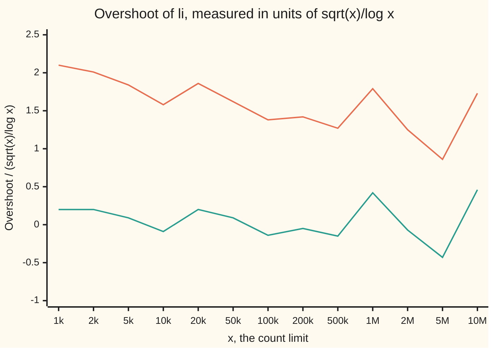

# The logarithmic integral: a far closer fit than x over log x, and where it too fails

[Syllabus](../../../SYLLABUS.md) → [Algebraic and analytic number theory](../README.md) → [The Zeta Function and the Prime Number Theorem](../README.md#s02) → The logarithmic integral

---

## General Overview

There are 664,579 primes below ten million. A sieve finds them in a fraction of a second, so this count is exact.

Two smooth formulas try to predict it. The first is x over log x: ten million divided by its natural log, 16.118, gives 620,420.69. That is 44,158 too low, 6.64 percent short. The second is the **logarithmic integral** li(x), the area under the curve 1/log t from 0 to x. It gives 664,918.41: only 339 too high, 0.051 percent over.

So li is 130.1 times closer. At a million the story is the same, 78,628 against 78,498 ([Zeta's zeros and the primes](../../07-Complex%20analysis/09-Special%20Functions%20and%20the%20Zeta%20Function/09-zeros-of-zeta-and-the-primes.md) showed why li wins there). This card asks the next questions. How close does li stay, and what has been proved about the gap? And does li always run ahead of the true count, as it does at every size anyone has checked?

The answers are sharp. The gap is proved to be smaller than x divided by any power of log x, eventually. Nobody can prove it is as small as a power of x below 1. And the gap changes sign infinitely often. The first change lies above 10^14, the reach of the check quoted on this card, and below 1.4 × 10^316.

**The logarithmic integral beats x over log x because x over log x misses by about x over (log x)², while the proved error of li is smaller than x divided by any power of log x; but that error term says nothing about sign, and Littlewood proved li falls behind the prime count infinitely often, first somewhere below 1.4 × 10^316.**

**What kind of fact this is:** the expansion of li and the size of the miss of x over log x are theorems, proved on this card in Why it works. The classical error term is a theorem, stated here and proved on [The prime number theorem](05-prime-number-theorem-proved.md). Littlewood's sign changes are a theorem, stated with its proof idea and a source. The counts to ten million are evidence, never proof.

### The picture: li runs ahead by a steady margin, plus a wobble



Orange: li(x) minus the prime count π(x), divided by √x/log x. It stays between 0.86 and 2.10 and never goes below 0. Green: li(x) minus Riemann's weighted count Π(x), defined below, in the same unit. It wobbles around 0, between −0.43 and 0.46. The difference between the two lines, falling from 1.90 to 1.27 and drifting toward 1, is a steady bias from prime squares (Step 5). Both checks print every point.

---

## The formula

Notation first, in words. Here log is the natural logarithm, written ln on earlier wings. π(x), "pi of x", counts the primes up to x. The logarithmic integral is taken in two forms. li(x) is wing 07's integral from 0, which steps over the spike at t = 1 by cancelling the two sides ([Improper integrals](../../06-Calculus%20and%20analysis/04-Integrals/07-improper-integrals.md) covers integrals past a spike). Li(x), the **offset logarithmic integral**, starts at 2 and avoids the spike:

```math
\mathrm{Li}(x) = \int_2^x \frac{dt}{\log t} = \mathrm{li}(x) - \mathrm{li}(2), \qquad \mathrm{li}(2) = 1.04516
```

**Read it aloud:** Li of x is the area under one over log t from 2 to x, which is li of x minus a fixed 1.05.

So Li(10^6) = 78,626.50 and li(10^6) = 78,627.55. The difference never matters for size questions; this card uses li for numbers and Li where proofs start at 2.

The card's three claims:

```math
\mathrm{Li}(x) = \frac{x}{\log x} + \frac{x}{\log^2 x} + \frac{2!\,x}{\log^3 x} + \cdots + \frac{(K-1)!\,x}{\log^K x} + O\!\left(\frac{x}{\log^{K+1} x}\right)
```

**Read it aloud:** Li of x is x over log x, plus x over log squared x, plus two x over log cubed x, and so on, with an error smaller than the next power of log x would give.

```math
\pi(x) = \mathrm{Li}(x) + O\!\left(x\, e^{-\kappa\sqrt{\log x}}\right) \qquad \text{for some fixed } \kappa > 0
```

**Read it aloud:** the prime count equals Li of x, up to an error at most a fixed multiple of x times e to the minus kappa root log x.

```math
\pi(x) - \mathrm{li}(x) > c'\,\frac{\sqrt{x}\,\log\log\log x}{\log x} \text{ for arbitrarily large } x, \quad \text{and} \quad < -c'\,\frac{\sqrt{x}\,\log\log\log x}{\log x} \text{ for others}
```

**Read it aloud:** the prime count gets ahead of li, and also falls behind it, by more than a fixed multiple of root x times log log log x over log x, again and again without end.

The middle line is the **classical error term**, proved by de la Vallée Poussin in 1899. The last is **Littlewood's theorem** (1914). O means "at most a fixed multiple of", as on [Big O and twiddle](../01-Arithmetic%20Functions%20Again/01-asymptotic-notation-and-error-terms.md).

| Symbol | Plain meaning | In our example | Push it up and the answer… |
| --- | --- | --- | --- |
| $`x`$ | the count limit | 10^7 | every count grows |
| $`\pi(x)`$ | number of primes up to x | 664,579 | — |
| $`\log x`$, $`L`$ | natural log of x; one number in about log x near x is prime | 16.118 | primes thin out |
| $`\mathrm{li}(x)`$, $`\mathrm{Li}(x)`$ | area under 1/log t from 0, and from 2, to x | 664,918.41 and 664,917.36 | outgrows x/log x |
| $`K`$, $`k`$ | terms kept in the expansion; the term's index | 4 terms: 664,578.13 | closer, until K reaches about log x |
| $`\kappa`$, $`c'`$, $`R`$ | fixed constants: in the error term, in Littlewood's theorem, and in the zero-free width 1/(R log t) | $`\kappa = 1/\sqrt{6.455}`$ in Trudgian's form | larger κ: smaller error |
| $`A`$, $`\delta`$ | a fixed power of log x; a fixed power saving | A = 2 for the miss of x/log x | — |
| $`\Pi(x)`$ | Riemann's weighted count: each prime power p^k counts 1/k | 664,827.30 | — |
| $`\sqrt{x}/\log x`$ | the natural unit for the gap | 196.19 | — |
| $`\rho = \beta + it`$ | a zero of zeta in the critical strip: real part β, height t | first: 1/2 + 14.134725i | larger β, larger waves |
| $`\psi(x)`$, $`\theta(x)`$, $`E`$ | log p summed over prime powers, over primes only; θ(t) − t | — | close to x |
| $`T`$, $`\lambda`$ | the height where the contour is cut; λ = log T | λ = √(log x) | smaller cut-off error, thinner zero-free region |

### When it holds

- **The expansion is asymptotic, not convergent.** Its terms k! x/log^(k+1) x shrink only until k reaches about log x, 16 here, then grow without bound. Summed to infinity it is nonsense.
- **The classical error term needs a zero-free region.** It rests on zeta having no zero with real part above 1 − 1/(R log t) ([The zero-free region](03-the-zero-free-region.md)). A zero with real part 0.9 would allow errors near x^0.9, which is 1,995,262 at 10^7.
- **O hides a constant.** Trudgian's explicit form (2016, below) allows an error of 71,553 at ten million. The theorem is about large x, not about any x you can count to.
- **O says nothing about sign.** It bounds the size of π(x) − li(x). Littlewood's theorem is needed to know the sign flips.
- **Counts to ten million, or to 10^14, are evidence.** li(x) > π(x) holds at every x ever checked, and it is false.

---

## Why it works

### Step 0: li follows the density; the zeros set the error

Near t, about one number in log t is prime ([The prime number theorem](05-prime-number-theorem-proved.md)). Adding that density up from 2 to x gives Li(x): each stretch is charged its own density. x over log x charges every stretch the thinnest density, the one at x, so it falls short.

What is left over, π(x) − Li(x), is built from zeta's zeros: each zero ρ = β + it adds a wave of size about x^β ([Zeta's zeros and the primes](../../07-Complex%20analysis/09-Special%20Functions%20and%20the%20Zeta%20Function/09-zeros-of-zeta-and-the-primes.md)). How close the zeros come to real part 1 sets the size of the error. Where they sit cannot, by itself, fix its sign.

### Step 1: integration by parts expands Li

Integrate 1/log t by parts, with 1 as the part to integrate and 1/log t as the part to differentiate. The derivative of 1/log t is −1/(t log² t), so

```math
\int_2^x \frac{dt}{\log t} = \frac{x}{\log x} - \frac{2}{\log 2} + \int_2^x \frac{dt}{\log^2 t}
```

Do it again on the new integral, and again. Each round adds the next term k! x/log^(k+1) x and leaves (k+1)! times the integral of dt/log^(k+2) t. That leftover is at most a fixed multiple of x/log^(k+2) x: split it at √x, where the first part is at most √x and the second part has log t at least half of log x. This proves the expansion.

At ten million the partial sums are 620,420.69, then 658,912.87, 663,689.14, 664,578.13 and 664,798.75 with five terms. They climb toward li(x) = 664,918.41.

### Step 2: so x over log x misses by about x over log² x

Put the classical error term (Step 3) into the expansion with K = 2:

```math
\pi(x) - \frac{x}{\log x} = \frac{x}{\log^2 x} + O\!\left(\frac{x}{\log^3 x}\right)
```

The miss of x over log x grows without bound, like x/log² x. It is a proved error, not bad luck. At ten million, x/log² x is 38,492.18; adding the next two terms gives 44,157.44; the true miss is 44,158.31.

The table shows the miss of x/log x growing 6.17 to 7.22 times for each factor of 10, while li's miss stays small:

| x | π(x) | x/log x misses by | li misses by |
| ---: | ---: | ---: | ---: |
| 10^3 | 168 | 23.24 | 9.61 |
| 10^4 | 1,229 | 143.26 | 17.14 |
| 10^5 | 9,592 | 906.11 | 37.81 |
| 10^6 | 78,498 | 6,115.59 | 129.55 |
| 10^7 | 664,579 | 44,158.31 | 339.41 |

The ratio π(x)/(x/log x) is 1.07117 at ten million. It does tend to 1, but slowly, about like 1 + 1/log x.

### Step 3: the classical error term, from the zero-free region

The proof runs in three moves, proved in full on [The prime number theorem](05-prime-number-theorem-proved.md).

1. **A contour integral.** The weighted count ψ(x), which adds log p for every prime power p^k up to x, equals an integral of −ζ′/ζ times x^s/s up a vertical line just right of 1, cut off at height T, plus an error of about x log² x/T ([Perron's formula](04-perrons-formula.md)).
2. **Move the line into the zero-free region.** No zero has real part above 1 − 1/(R log t) ([The zero-free region](03-the-zero-free-region.md)). Move the line left to real part 1 − 1/(2R log T), half-way to that edge at height T. Zeta's pole at 1 leaves x, and no zero is crossed. On the new line |x^s| is x e^(−log x/(2R log T)), and |ζ′/ζ| is at most a fixed multiple of log² T.
3. **Balance the two errors.** Choose log T = √(log x). Both errors become x e^(−√(log x)/(2R)) up to powers of log x, which a slightly smaller κ absorbs: any κ below 1/(2R) works. Then [Partial summation](../01-Arithmetic%20Functions%20Again/06-abel-and-partial-summation.md) carries the bound from ψ(x) to π(x), turning x into Li(x).

<details>
<summary>Detailed proof sketch: why log T = √(log x) is the right cut-off</summary>

Write L = log x and λ = log T. Moving the line to real part 1 − 1/(2Rλ) gives

$`\displaystyle |\psi(x) - x| \ll x\, e^{-L/(2R\lambda)}\, \lambda^3 + \frac{x L^2}{T} = x\, e^{-L/(2R\lambda)}\, \lambda^3 + x L^2 e^{-\lambda}.`$

The first term comes from the moved line: |x^s| there, times log² T for ζ′/ζ, times log T from integrating 1/|s| along the line. The second is the cut-off error. The first term falls as λ falls; the second rises. Up to the constant 2R, they balance when L/λ = λ, that is λ = √L. Both terms are then at most x e^(−√L/(2R)) times a power of L. Any power of L is smaller than e^(ε√L) for large x, so it is absorbed by shrinking the constant: ψ(x) − x ≪ x e^(−κ₁√L) for any κ₁ below 1/(2R).

Partial summation: π(x) = θ(x)/log x + ∫ θ(t)/(t log² t) dt from 2 to x, where θ(x) adds log p over primes only and differs from ψ(x) by at most a multiple of √x log x. Put θ(t) = t + E(t) with |E(t)| ≪ t e^(−κ₁√log t). The main terms give exactly Li(x) plus the constant 2/log 2, by Step 1's integration by parts read backwards. The E terms give O(x e^(−κ√L)) with a smaller κ. Full details: Montgomery and Vaughan, chapter 6.

</details>

### Step 4: what the classical error term allows, and what it does not

**It allows** these, all eventually, for large enough x:

- **li beats every truncation of the expansion.** Any truncation misses by about K! x/log^(K+1) x, a power of log. The error x e^(−κ√log x) divided by x/log^A x is log^A x · e^(−κ√log x), which tends to 0 for every fixed A. So li beats x/log x, and beats x/log x + x/log² x, and so on.
- **The relative error vanishes fast.** π(x)/Li(x) = 1 + O(e^(−κ√log x)).
- **Primes in short stretches.** The stretch from x to x + x/log^A x holds about (x/log^A x)/log x primes, for any fixed A, because the error is smaller than that main term.

**It does not allow** these:

- **A power saving.** Nobody can prove an error of x^(1−δ) for any fixed δ > 0. That would need a strip with no zeros, real part above 1 − δ, which is open. The best known form, Vinogradov and Korobov's (1958), replaces √(log x) by (log x)^(3/5) divided by (log log x)^(1/5), still far from a power.
- **Good numbers at sizes you can count to.** Trudgian (2016) made the constant explicit: for x ≥ 229,

```math
|\pi(x) - \mathrm{li}(x)| \le 0.2795\, \frac{x}{(\log x)^{3/4}}\, e^{-\sqrt{\log x / 6.455}}
```

At ten million this allows 71,553.29, against a true gap of 339.41: 210.8 times too generous. It even allows more than the 44,158 miss of x/log x. Searching upward from ten million, this explicit bound first proves li closer than the size x/log² x of that miss once log x passes 172, that is x beyond about 10^74.7.
- **The sign.** O bounds |π(x) − li(x)| only. It cannot say whether li stays ahead.

If the Riemann hypothesis holds (every zero has β = 1/2), Schoenfeld's bound gives √x log x/(8π) for x ≥ 2657: 2,028.03 at ten million. That was conditional until a formal proof of the hypothesis was certified on 2026-11-21 ([The Riemann hypothesis](09-riemann-hypothesis-statement-and-equivalents.md)).

### Step 5: why li runs ahead at every size checked

The explicit formula is cleanest not for π(x) but for **Riemann's weighted count** Π(x): every prime counts 1, every prime square counts 1/2, every cube 1/3, and so on.

```math
\Pi(x) = \pi(x) + \tfrac12\,\pi(\sqrt{x}) + \tfrac13\,\pi(x^{1/3}) + \cdots
```

**Read it aloud:** the weighted count is the prime count, plus half the primes up to root x, plus a third of the primes up to the cube root of x, and so on.

li(x) − Π(x) is a sum of waves, one per pair of zeros, with no built-in sign. Each pair adds a wave of size about 2√x/(|ρ| log x), where |ρ| is the zero's distance from 0. That is why √x/log x is the natural unit for the gap.

π(x) is smaller than Π(x) by about half of π(√x), which is about √x/log x: one unit. So li(x) − π(x) sits about one unit above a sign-free wobble.

At ten million, with the unit 196.19:

| Quantity | Value | In units |
| --- | ---: | ---: |
| li(x) − Π(x), the wobble | 91.11 | 0.46 |
| Π(x) − π(x), the prime-power bias | 248.30 | 1.27 |
| half of π(√x), its main part | 223.0 | 1.14 |
| li(x) − π(x), the total | 339.41 | 1.73 |

The chart above shows the same thing at 13 sizes: the green wobble crosses 0, the orange total never does.

### Step 6: Littlewood's theorem, and Skewes's number

For li to fall behind, the waves must line up and push the wobble below −1 unit. Each wave alone is small: the first zero, at height 14.13, gives a wave of at most 2/14.13 = 0.14 units. But the sizes 2/|ρ| add up without bound, because the zeros pack closer as they climb ([Counting the zeros](08-counting-the-zeros-riemann-von-mangoldt.md)). So if enough waves dip together, they win.

Littlewood proved in 1914 that this happens infinitely often. Indeed the gap reaches a fixed multiple of √x log log log x/log x in both directions. The factor log log log x grows very slowly: it is 1.89 at 1.4 × 10^316.

<details>
<summary>Proof idea: two cases, both of which give sign changes</summary>

Case 1: the Riemann hypothesis is false. Then some zero has β > 1/2, and its wave, of size x^β, swamps the bias of size √x/log x. Landau's theorem (a series of terms a_n/n^s whose coefficients a_n all have one sign must break down at a real point s, the edge where it stops converging) shows π(x) − li(x) cannot keep one sign.

Case 2: the Riemann hypothesis is true. Then every wave has size at most 2√x/(|ρ| log x). Write y = log x; the wobble is a sum of terms cos(t y − arg ρ)·2/|ρ|. Dirichlet's approximation theorem (any finite list of real numbers has a common whole-number multiple that lands each one close to a whole number) finds y where the first N phases t y are all close to a whole number of turns. The angle arg ρ is just under a quarter turn, so each wave is close to sin(t y)·2/t, and at that y every one of the N waves sits near 0, rising. Step a small distance u to the left, to y − u, and all N waves fall together, each by about 2 sin(t u)/t. Their total drop grows like log(1/u): slowly, but without bound, so for small enough u it beats the bias of 1 unit. The price is the size of x. Lining up the N zeros below height T can need y as large as T to the power N, and N grows like T log T, so the gain, about log T, is only about log log y = log log log x. Making it precise needs a smoothed version of the sum. Full details: Montgomery and Vaughan, chapter 15.

Neither case gives a size for x: case 1 has no zero to name, and case 2 needs an astronomically long wait for alignment.

</details>

How far out? Littlewood gave no number. Skewes (1933) showed, assuming the Riemann hypothesis, that a sign change comes before e^(e^(e^79)), about 10^(10^(10^34)). Without that hypothesis (1955) he needed about 10^(10^(10^964)).

Modern computation uses known zeros to find where the waves align. Bays and Hudson (2000) proved that π(x) > li(x) for at least 10^153 whole numbers near 1.39822 × 10^316. Their computation puts the logarithmic share of x where li stays ahead (the share measured with weight 1/x) at about 0.99999973 over the range they computed: a measurement, not a proved limit. Meanwhile π(x) < li(x) has been checked for every x from 2 up to 10^14, a computation quoted in Trudgian's paper.

---

## Worked numbers, by hand

| Step | Arithmetic | Value |
| --- | --- | --- |
| count the primes | sieve to 10^7, crossing off multiples of the 446 primes up to 3,162 | 664,579 |
| natural log | log 10^7 = 7 × 2.302585 | 16.118 |
| first guess | 10^7 ÷ 16.118 | 620,420.69 |
| its miss | 664,579 − 620,420.69 | 44,158.31 |
| predicted miss | x/log² x + 2x/log³ x + 6x/log⁴ x | 44,157.44 |
| logarithmic integral | area under 1/log t, 0 to 10^7 | 664,918.41 |
| offset form | li(10^7) − li(2) = 664,918.41 − 1.05 | 664,917.36 |
| li's miss | 664,918.41 − 664,579 | **339.41 too high** |
| natural unit | √10^7 ÷ 16.118 = 3,162.28 ÷ 16.118 | 196.19 |
| miss in units | 339.41 ÷ 196.19 | 1.73 |

li overshoots by 339 primes in 664,579, about 1.7 units of √x/log x, of which about 1.3 units are the prime-power bias.

### What breaks if you drop a piece

| Mistake | Comes out at | What went wrong |
| --- | --- | --- |
| x/log x as the estimate | 620,420.69, low by 44,158.31 | charges every stretch the thinnest density; misses by about x/log² x |
| Legendre's fitted x/(log x − 1.08366) | 665,139.70, high by 560.70 | a constant fitted to small tables; the best constant for large x is 1, which gives 661,458.97, low by 3,120.03 here |
| Trudgian's O bound read as a size at 10^7 | allows 71,553.29; true gap 339.41 | the hypothesis "x large" fails: the bound only beats x/log² x beyond about 10^74.7 |
| log base 10 instead of natural log | 1,428,571.43 | the density is one in natural log x |

The code prints all four.

---

## Code, from first principles, and it actually runs

The script sieves to ten million and counts primes two ways: by the sieve and by Legendre's inclusion–exclusion formula. It computes li two ways: by its power series in log x and by Simpson's rule on the integral, offset by li(2). It checks the miss of x/log x against the expansion, Trudgian's bound against the true gap at 13 sizes, and the weighted count Π(x) against the prime count. Four pairs of roads in all, plus the expansion as a third road to the miss.

### Python

```python
# The logarithmic integral and the error term -- the check behind the card.  Standard library only.
# Primes by a sieve and by Legendre's count; li by its series and by an integral; the error of
# x/ln x against the expansion of li; Trudgian's explicit classical bound; the prime-square bias.
import math, functools

X = 10**7
flag = bytearray([1]) * (X + 1); flag[0] = flag[1] = 0
for p in range(2, 3163):                         # sieve of Eratosthenes up to 10^7
    if flag[p]:
        flag[p * p::p] = bytearray(len(range(p * p, X + 1, p)))
pi = lambda x: flag[:x + 1].count(1)             # pi(x): primes up to x, counted on the sieve
small = [p for p in range(3163) if flag[p]]      # the 446 primes up to sqrt(10^7)

@functools.lru_cache(None)
def phi(x, a):                                   # numbers up to x free of the first a primes
    if a == 0:
        return x
    if x < small[a - 1]:
        return 1 if x >= 1 else 0
    return phi(x, a - 1) - phi(x // small[a - 1], a - 1)

def legendre(x):                                 # Legendre: pi(x) = phi(x, a) + a - 1, a = pi(sqrt x)
    a = sum(1 for p in small if p * p <= x)
    return phi(x, a) + a - 1

gam = sum(1 / k for k in range(1, 1001)) - math.log(1000) - 1 / 2000 + 1 / 12e6 - 1 / 120e12  # Euler's constant

def li(x):                                       # li(x) = gamma + ln ln x + sum (ln x)^k / (k k!)
    L, term, s = math.log(x), 1.0, 0.0
    for k in range(1, 200):
        term *= L / k
        s += term / k
    return gam + math.log(L) + s

def Li_integral(x, n=20000):                     # Li(x) = integral of e^u / u, u from ln 2 to ln x (Simpson)
    a, b = math.log(2), math.log(x)
    h, f = (b - a) / n, lambda u: math.exp(u) / u
    return h / 3 * (f(a) + f(b) + sum((4 if k % 2 else 2) * f(a + k * h) for k in range(1, n)))

def iroot(x, k):                                 # largest r with r^k <= x, exactly
    r = int(round(x ** (1 / k)))
    while r ** k > x: r -= 1
    while (r + 1) ** k <= x: r += 1
    return r

def Pi(x):                                       # Riemann's weighted count: prime powers p^k weigh 1/k
    return sum(pi(iroot(x, k)) / k for k in range(1, x.bit_length()))

trud = lambda x: 0.2795 * x / math.log(x) ** 0.75 * math.exp(-math.sqrt(math.log(x) / 6.455))  # x >= 229
li2 = li(2)
print(f"li(2) = {li2:.5f}; li(10^6) = {li(10**6):.2f}, Li(10^6) = {li(10**6) - li2:.2f}; pi(10^6) = {pi(10**6)}")
print("x | pi sieve | pi Legendre | x/ln x | li series | Li integral + li(2) | li - pi | pi - x/ln x")
for e in range(3, 8):
    x = 10**e
    print(f"10^{e} | {pi(x)} | {legendre(x)} | {x / math.log(x):.2f} | {li(x):.2f} | "
          f"{Li_integral(x) + li2:.2f} | {li(x) - pi(x):.2f} | {pi(x) - x / math.log(x):.2f}")
L, P = math.log(X), pi(X)
print(f"at 10^7: ratio pi/(x/ln x) {P / (X / L):.5f}; x/ln x low by {100 * (1 - X / L / P):.2f} percent; "
      f"li high by {100 * (li(X) / P - 1):.3f} percent; Li(10^7) = {li(X) - li2:.2f}")
part, terms = 0.0, []
for k in range(5):
    part += math.factorial(k) * X / L ** (k + 1); terms.append(part)
print("expansion x/L (1 + 1/L + 2!/L^2 + 3!/L^3 + 4!/L^4), partial sums: " + ", ".join(f"{t:.2f}" for t in terms))
print(f"pi - x/ln x = {P - X / L:.2f}; x/L^2 = {X / L**2:.2f}; x/L^2 + 2x/L^3 + 6x/L^4 = {terms[3] - terms[0]:.2f}")
print(f"Legendre x/(L - 1.08366): {X / (L - 1.08366):.2f}, off {X / (L - 1.08366) - P:.2f}; "
      f"x/(L - 1): {X / (L - 1):.2f}, off {X / (L - 1) - P:.2f}; ln base 10: {X / math.log10(X):.2f}")
print(f"Trudgian's bound at 10^7: {trud(X):.2f}; true |pi - li| {li(X) - P:.2f}; RH bound sqrt(x) ln x/(8 pi) {math.sqrt(X) * L / (8 * math.pi):.2f}")
print("bound / (x/L^2) at L = " + ", ".join(f"{l}: {0.2795 * l ** 1.25 * math.exp(-math.sqrt(l / 6.455)):.3f}" for l in (16, 50, 100, 200, 400, 1000)))
first = next(l for l in range(16, 2000) if 0.2795 * l ** 1.25 * math.exp(-math.sqrt(l / 6.455)) < 1)
print(f"bound / (x/L^2), with L = ln x, first below 1 at L = {first}, x about 10^{first / math.log(10):.1f}")
u = math.sqrt(X) / L                             # the natural unit for the error: sqrt(x)/ln x
print(f"at 10^7: unit sqrt(x)/ln x {u:.2f}; Pi(x) {Pi(X):.2f}; li - Pi {li(X) - Pi(X):.2f}; "
      f"half pi(sqrt x) {pi(iroot(X, 2)) / 2:.1f}; Pi - pi {Pi(X) - P:.2f}")
miss = [pi(10**e) - 10**e / math.log(10**e) for e in range(3, 8)]
print(f"log 10 = {math.log(10):.6f}; log 10^7 = {L:.3f}; sqrt(10^7) = {math.sqrt(X):.2f}; primes up to it: {len(small)}; "
      f"x^0.9 at 10^7 = {X ** 0.9:.2f}")
print("x/ln x miss grows per factor 10: " + ", ".join(f"{b / a:.2f}" for a, b in zip(miss, miss[1:]))
      + f"; x/ln x miss / li miss {(P - X / L) / (li(X) - P):.1f}; Trudgian / true gap {trud(X) / (li(X) - P):.1f}")
print(f"in units at 10^7: Pi - pi {(Pi(X) - P) / u:.2f}; half pi(sqrt x) {pi(iroot(X, 2)) / 2 / u:.2f}; first wave 2/14.134725 = "
      f"{2 / 14.134725:.2f}; log log log(1.4 x 10^316) = {math.log(math.log(316 * math.log(10) + math.log(1.4))):.2f}")
pts = [10**3, 2 * 10**3, 5 * 10**3, 10**4, 2 * 10**4, 5 * 10**4, 10**5, 2 * 10**5, 5 * 10**5, 10**6, 2 * 10**6, 5 * 10**6, 10**7]
g1 = [(li(x) - pi(x)) / (math.sqrt(x) / math.log(x)) for x in pts]
g2 = [(li(x) - Pi(x)) / (math.sqrt(x) / math.log(x)) for x in pts]
print("chart (li - pi)/unit: " + ", ".join(f"{v:.2f}" for v in g1))
print("chart (li - Pi)/unit: " + ", ".join(f"{v:.2f}" for v in g2))
print("chart gap between the lines: " + ", ".join(f"{a - b:.2f}" for a, b in zip(g1, g2)))
assert P == legendre(X) == 664579 and pi(10**6) == 78498              # two counts and the table value
assert abs(li(X) - (Li_integral(X) + li2)) < 1e-4 and abs(li(10**6) - 78627.55) < 0.01  # series vs integral
assert abs((P - X / L) - (terms[3] - terms[0])) < X / L**4             # x/ln x misses by the expansion's terms
assert all(abs(li(x) - pi(x)) <= trud(x) for x in pts)                 # Trudgian's bound holds at every point
assert all(v > 0 for v in g1) and abs(g2[-1]) < 0.5 and g1[-1] > 1.5   # li overshoots; Pi carries no bias
print("ALL CHECKS PASS")
```

**Ran 2026-11-15 on macOS, Python 3.14.10, standard library only. All checks passed. Output, pasted from the run:**

```
li(2) = 1.04516; li(10^6) = 78627.55, Li(10^6) = 78626.50; pi(10^6) = 78498
x | pi sieve | pi Legendre | x/ln x | li series | Li integral + li(2) | li - pi | pi - x/ln x
10^3 | 168 | 168 | 144.76 | 177.61 | 177.61 | 9.61 | 23.24
10^4 | 1229 | 1229 | 1085.74 | 1246.14 | 1246.14 | 17.14 | 143.26
10^5 | 9592 | 9592 | 8685.89 | 9629.81 | 9629.81 | 37.81 | 906.11
10^6 | 78498 | 78498 | 72382.41 | 78627.55 | 78627.55 | 129.55 | 6115.59
10^7 | 664579 | 664579 | 620420.69 | 664918.41 | 664918.41 | 339.41 | 44158.31
at 10^7: ratio pi/(x/ln x) 1.07117; x/ln x low by 6.64 percent; li high by 0.051 percent; Li(10^7) = 664917.36
expansion x/L (1 + 1/L + 2!/L^2 + 3!/L^3 + 4!/L^4), partial sums: 620420.69, 658912.87, 663689.14, 664578.13, 664798.75
pi - x/ln x = 44158.31; x/L^2 = 38492.18; x/L^2 + 2x/L^3 + 6x/L^4 = 44157.44
Legendre x/(L - 1.08366): 665139.70, off 560.70; x/(L - 1): 661458.97, off -3120.03; ln base 10: 1428571.43
Trudgian's bound at 10^7: 71553.29; true |pi - li| 339.41; RH bound sqrt(x) ln x/(8 pi) 2028.03
bound / (x/L^2) at L = 16: 1.853, 50: 2.298, 100: 1.726, 200: 0.804, 400: 0.191, 1000: 0.006
bound / (x/L^2), with L = ln x, first below 1 at L = 172, x about 10^74.7
at 10^7: unit sqrt(x)/ln x 196.19; Pi(x) 664827.30; li - Pi 91.11; half pi(sqrt x) 223.0; Pi - pi 248.30
log 10 = 2.302585; log 10^7 = 16.118; sqrt(10^7) = 3162.28; primes up to it: 446; x^0.9 at 10^7 = 1995262.31
x/ln x miss grows per factor 10: 6.17, 6.32, 6.75, 7.22; x/ln x miss / li miss 130.1; Trudgian / true gap 210.8
in units at 10^7: Pi - pi 1.27; half pi(sqrt x) 1.14; first wave 2/14.134725 = 0.14; log log log(1.4 x 10^316) = 1.89
chart (li - pi)/unit: 2.10, 2.01, 1.84, 1.58, 1.86, 1.62, 1.38, 1.42, 1.27, 1.79, 1.25, 0.86, 1.73
chart (li - Pi)/unit: 0.20, 0.20, 0.09, -0.09, 0.20, 0.09, -0.14, -0.05, -0.15, 0.42, -0.07, -0.43, 0.46
chart gap between the lines: 1.90, 1.81, 1.75, 1.67, 1.66, 1.53, 1.52, 1.47, 1.42, 1.37, 1.32, 1.29, 1.27
ALL CHECKS PASS
```

### Rust

Same numbers, same labels, built with `rustc --edition 2021 -O`.

```rust
// The logarithmic integral and the error term -- the same check as the Python, in Rust.  No crates.
// Primes by a sieve and by Legendre's count; li by its series and by an integral; the error of
// x/ln x against the expansion of li; Trudgian's explicit classical bound; the prime-square bias.
use std::collections::HashMap;

struct Primes { count: Vec<u32>, small: Vec<u64>, memo: HashMap<(u64, usize), u64> }

impl Primes {
    fn pi(&self, x: u64) -> u64 { self.count[x as usize] as u64 } // pi(x), read off the sieve
    fn phi(&mut self, x: u64, a: usize) -> u64 { // numbers up to x free of the first a primes
        if a == 0 { return x; }
        if x < self.small[a - 1] { return if x >= 1 { 1 } else { 0 }; }
        if let Some(&v) = self.memo.get(&(x, a)) { return v; }
        let v = self.phi(x, a - 1) - self.phi(x / self.small[a - 1], a - 1);
        self.memo.insert((x, a), v);
        v
    }
    fn legendre(&mut self, x: u64) -> u64 { // Legendre: pi(x) = phi(x, a) + a - 1, a = pi(sqrt x)
        let a = self.small.iter().filter(|&&p| p * p <= x).count();
        self.phi(x, a) + a as u64 - 1
    }
    fn big_pi(&self, x: u64) -> f64 { // Riemann's weighted count: prime powers p^k weigh 1/k
        let bits = 64 - x.leading_zeros() as u64;
        (1..bits).map(|k| self.pi(iroot(x, k as u32)) as f64 / k as f64).sum()
    }
}

fn iroot(x: u64, k: u32) -> u64 { // largest r with r^k <= x, exactly
    let mut r = (x as f64).powf(1.0 / k as f64).round() as u64;
    while r.checked_pow(k).map_or(true, |v| v > x) { r -= 1; }
    while (r + 1).checked_pow(k).map_or(false, |v| v <= x) { r += 1; }
    r
}

fn li(x: f64, gam: f64) -> f64 { // li(x) = gamma + ln ln x + sum (ln x)^k / (k k!)
    let (l, mut term, mut s) = (x.ln(), 1.0f64, 0.0f64);
    for k in 1..200 { term *= l / k as f64; s += term / k as f64; }
    gam + l.ln() + s
}

fn li_integral(x: f64) -> f64 { // Li(x) = integral of e^u / u, u from ln 2 to ln x (Simpson)
    let (a, b, n) = (2f64.ln(), x.ln(), 20000);
    let h = (b - a) / n as f64;
    let f = |u: f64| u.exp() / u;
    let inner: f64 = (1..n).map(|k| (if k % 2 == 1 { 4.0 } else { 2.0 }) * f(a + k as f64 * h)).sum();
    h / 3.0 * (f(a) + f(b) + inner)
}

fn trud(x: f64) -> f64 { 0.2795 * x / x.ln().powf(0.75) * (-(x.ln() / 6.455).sqrt()).exp() } // x >= 229
fn ratio(l: f64) -> f64 { 0.2795 * l.powf(1.25) * (-(l / 6.455).sqrt()).exp() }      // bound / (x/L^2)
fn join(v: &[f64]) -> String { v.iter().map(|t| format!("{:.2}", t)).collect::<Vec<_>>().join(", ") }

fn main() {
    const X: u64 = 10_000_000;
    let mut flag = vec![true; X as usize + 1];
    flag[0] = false; flag[1] = false;
    for p in 2..3163usize { // sieve of Eratosthenes up to 10^7
        if flag[p] { let mut m = p * p; while m <= X as usize { flag[m] = false; m += p; } }
    }
    let mut count = vec![0u32; X as usize + 1];
    let mut run = 0u32;
    for n in 0..=X as usize { if flag[n] { run += 1; } count[n] = run; }
    let small: Vec<u64> = (2..3163u64).filter(|&p| flag[p as usize]).collect(); // the 446 primes up to sqrt(10^7)
    let mut pr = Primes { count, small, memo: HashMap::new() };
    let gam = (1..=1000).map(|k| 1.0 / k as f64).sum::<f64>() - 1000f64.ln() - 1.0 / 2000.0 + 1.0 / 12e6 - 1.0 / 120e12;
    let lix = |x: f64| li(x, gam);
    let li2 = lix(2.0);
    println!("li(2) = {:.5}; li(10^6) = {:.2}, Li(10^6) = {:.2}; pi(10^6) = {}", li2, lix(1e6), lix(1e6) - li2, pr.pi(1_000_000));
    println!("x | pi sieve | pi Legendre | x/ln x | li series | Li integral + li(2) | li - pi | pi - x/ln x");
    for e in 3..8u32 {
        let x = 10u64.pow(e); let xf = x as f64; let p = pr.pi(x) as f64;
        println!("10^{} | {} | {} | {:.2} | {:.2} | {:.2} | {:.2} | {:.2}", e, pr.pi(x), pr.legendre(x), xf / xf.ln(),
            lix(xf), li_integral(xf) + li2, lix(xf) - p, p - xf / xf.ln());
    }
    let (xf, l, p) = (X as f64, (X as f64).ln(), pr.pi(X) as f64);
    println!("at 10^7: ratio pi/(x/ln x) {:.5}; x/ln x low by {:.2} percent; li high by {:.3} percent; Li(10^7) = {:.2}",
        p / (xf / l), 100.0 * (1.0 - xf / l / p), 100.0 * (lix(xf) / p - 1.0), lix(xf) - li2);
    let (mut part, mut terms, mut fact) = (0.0f64, Vec::new(), 1.0f64);
    for k in 0..5 { if k > 0 { fact *= k as f64; } part += fact * xf / l.powi(k + 1); terms.push(part); }
    println!("expansion x/L (1 + 1/L + 2!/L^2 + 3!/L^3 + 4!/L^4), partial sums: {}", join(&terms));
    println!("pi - x/ln x = {:.2}; x/L^2 = {:.2}; x/L^2 + 2x/L^3 + 6x/L^4 = {:.2}", p - xf / l, xf / l.powi(2), terms[3] - terms[0]);
    let leg = xf / (l - 1.08366);
    println!("Legendre x/(L - 1.08366): {:.2}, off {:.2}; x/(L - 1): {:.2}, off {:.2}; ln base 10: {:.2}",
        leg, leg - p, xf / (l - 1.0), xf / (l - 1.0) - p, xf / xf.log10());
    println!("Trudgian's bound at 10^7: {:.2}; true |pi - li| {:.2}; RH bound sqrt(x) ln x/(8 pi) {:.2}",
        trud(xf), lix(xf) - p, xf.sqrt() * l / (8.0 * std::f64::consts::PI));
    let ls = [16, 50, 100, 200, 400, 1000];
    let parts: Vec<String> = ls.iter().map(|&q| format!("{}: {:.3}", q, ratio(q as f64))).collect();
    println!("bound / (x/L^2) at L = {}", parts.join(", "));
    let first = (16..2000).find(|&q| ratio(q as f64) < 1.0).unwrap();
    println!("bound / (x/L^2), with L = ln x, first below 1 at L = {}, x about 10^{:.1}", first, first as f64 / 10f64.ln());
    let u = xf.sqrt() / l; // the natural unit for the error: sqrt(x)/ln x
    println!("at 10^7: unit sqrt(x)/ln x {:.2}; Pi(x) {:.2}; li - Pi {:.2}; half pi(sqrt x) {:.1}; Pi - pi {:.2}",
        u, pr.big_pi(X), lix(xf) - pr.big_pi(X), pr.pi(iroot(X, 2)) as f64 / 2.0, pr.big_pi(X) - p);
    let miss: Vec<f64> = (3..8u32).map(|e| { let x = 10f64.powi(e as i32); pr.pi(10u64.pow(e)) as f64 - x / x.ln() }).collect();
    println!("log 10 = {:.6}; log 10^7 = {:.3}; sqrt(10^7) = {:.2}; primes up to it: {}; x^0.9 at 10^7 = {:.2}",
        10f64.ln(), l, xf.sqrt(), pr.small.len(), xf.powf(0.9));
    let grow: Vec<String> = miss.windows(2).map(|w| format!("{:.2}", w[1] / w[0])).collect();
    println!("x/ln x miss grows per factor 10: {}; x/ln x miss / li miss {:.1}; Trudgian / true gap {:.1}",
        grow.join(", "), (p - xf / l) / (lix(xf) - p), trud(xf) / (lix(xf) - p));
    println!("in units at 10^7: Pi - pi {:.2}; half pi(sqrt x) {:.2}; first wave 2/14.134725 = {:.2}; log log log(1.4 x 10^316) = {:.2}",
        (pr.big_pi(X) - p) / u, pr.pi(iroot(X, 2)) as f64 / 2.0 / u, 2.0 / 14.134725, (316.0 * 10f64.ln() + 1.4f64.ln()).ln().ln());
    let pts: [u64; 13] = [1000, 2000, 5000, 10000, 20000, 50000, 100000, 200000, 500000, 1000000, 2000000, 5000000, 10000000];
    let unit = |x: f64| x.sqrt() / x.ln();
    let g1: Vec<f64> = pts.iter().map(|&x| (lix(x as f64) - pr.pi(x) as f64) / unit(x as f64)).collect();
    let g2: Vec<f64> = pts.iter().map(|&x| (lix(x as f64) - pr.big_pi(x)) / unit(x as f64)).collect();
    println!("chart (li - pi)/unit: {}", join(&g1));
    println!("chart (li - Pi)/unit: {}", join(&g2));
    let gap: Vec<f64> = g1.iter().zip(&g2).map(|(a, b)| a - b).collect();
    println!("chart gap between the lines: {}", join(&gap));
    assert!(pr.pi(X) == pr.legendre(X) && pr.pi(X) == 664579 && pr.pi(1_000_000) == 78498); // two counts, table value
    assert!((lix(xf) - (li_integral(xf) + li2)).abs() < 1e-4 && (lix(1e6) - 78627.55).abs() < 0.01); // series vs integral
    assert!(((p - xf / l) - (terms[3] - terms[0])).abs() < xf / l.powi(4)); // x/ln x misses by the expansion's terms
    assert!(pts.iter().all(|&x| (lix(x as f64) - pr.pi(x) as f64).abs() <= trud(x as f64))); // Trudgian's bound holds
    assert!(g1.iter().all(|&v| v > 0.0) && g2[12].abs() < 0.5 && g1[12] > 1.5); // li overshoots; Pi carries no bias
    println!("ALL CHECKS PASS");
}
```

**Ran 2026-11-15 on macOS, rustc 1.98.1, no crates. All checks passed. Output, pasted from the run:**

```
li(2) = 1.04516; li(10^6) = 78627.55, Li(10^6) = 78626.50; pi(10^6) = 78498
x | pi sieve | pi Legendre | x/ln x | li series | Li integral + li(2) | li - pi | pi - x/ln x
10^3 | 168 | 168 | 144.76 | 177.61 | 177.61 | 9.61 | 23.24
10^4 | 1229 | 1229 | 1085.74 | 1246.14 | 1246.14 | 17.14 | 143.26
10^5 | 9592 | 9592 | 8685.89 | 9629.81 | 9629.81 | 37.81 | 906.11
10^6 | 78498 | 78498 | 72382.41 | 78627.55 | 78627.55 | 129.55 | 6115.59
10^7 | 664579 | 664579 | 620420.69 | 664918.41 | 664918.41 | 339.41 | 44158.31
at 10^7: ratio pi/(x/ln x) 1.07117; x/ln x low by 6.64 percent; li high by 0.051 percent; Li(10^7) = 664917.36
expansion x/L (1 + 1/L + 2!/L^2 + 3!/L^3 + 4!/L^4), partial sums: 620420.69, 658912.87, 663689.14, 664578.13, 664798.75
pi - x/ln x = 44158.31; x/L^2 = 38492.18; x/L^2 + 2x/L^3 + 6x/L^4 = 44157.44
Legendre x/(L - 1.08366): 665139.70, off 560.70; x/(L - 1): 661458.97, off -3120.03; ln base 10: 1428571.43
Trudgian's bound at 10^7: 71553.29; true |pi - li| 339.41; RH bound sqrt(x) ln x/(8 pi) 2028.03
bound / (x/L^2) at L = 16: 1.853, 50: 2.298, 100: 1.726, 200: 0.804, 400: 0.191, 1000: 0.006
bound / (x/L^2), with L = ln x, first below 1 at L = 172, x about 10^74.7
at 10^7: unit sqrt(x)/ln x 196.19; Pi(x) 664827.30; li - Pi 91.11; half pi(sqrt x) 223.0; Pi - pi 248.30
log 10 = 2.302585; log 10^7 = 16.118; sqrt(10^7) = 3162.28; primes up to it: 446; x^0.9 at 10^7 = 1995262.31
x/ln x miss grows per factor 10: 6.17, 6.32, 6.75, 7.22; x/ln x miss / li miss 130.1; Trudgian / true gap 210.8
in units at 10^7: Pi - pi 1.27; half pi(sqrt x) 1.14; first wave 2/14.134725 = 0.14; log log log(1.4 x 10^316) = 1.89
chart (li - pi)/unit: 2.10, 2.01, 1.84, 1.58, 1.86, 1.62, 1.38, 1.42, 1.27, 1.79, 1.25, 0.86, 1.73
chart (li - Pi)/unit: 0.20, 0.20, 0.09, -0.09, 0.20, 0.09, -0.14, -0.05, -0.15, 0.42, -0.07, -0.43, 0.46
chart gap between the lines: 1.90, 1.81, 1.75, 1.67, 1.66, 1.53, 1.52, 1.47, 1.42, 1.37, 1.32, 1.29, 1.27
ALL CHECKS PASS
```

### Lean

Lean proves the expansion of Li, its integration by parts and its divergence, for every K and x, and checks three worked numbers.

- Take any number of terms K. Then Li(x) minus the first K terms of the expansion is O(x/log^(K+1) x).
- Take x ≥ 2 and any power of log. Then one round of integration by parts holds exactly; with k = 0 it is Step 1's formula.
- Take any x > 1. Then the full series of terms k! x/log^(k+1) x does not converge.
- π(1,000) = 168, the first row of the Step 2 table.
- The sieve to ten million needs primes only up to 3,162, since 3,162² ≤ 10^7 < 3,163².
- The expansion's coefficients 0!, 1!, 2!, 3! and 4! are 1, 1, 2, 6 and 24.

The prime counts to ten million, the values of li and Trudgian's bound are left to the Python and Rust checks.

```lean
-- The logarithmic integral: the offset logarithmic integral Li(x), the area under 1/log t from 2 to x, equals x/log x + x/log² x + 2! x/log³ x + ⋯ + (K−1)! x/log^K x up to an error at most a fixed multiple of x/log^(K+1) x, each term comes from one round of integration by parts, and the full series diverges at every x > 1.
import Mathlib.Analysis.SpecialFunctions.Log.Deriv
import Mathlib.Analysis.SpecialFunctions.Integrals.Basic
import Mathlib.Analysis.Asymptotics.Defs
import Mathlib.Analysis.SpecificLimits.Basic
import Mathlib.NumberTheory.PrimeCounting
import Mathlib.Tactic.NormNum
import Mathlib.Topology.Algebra.Order.Floor

open Asymptotics Filter

lemma li_aux_intervalIntegrable (n : ℕ) {a b : ℝ} (ha : 1 < a) (hb : 1 < b) :
    IntervalIntegrable (fun t : ℝ => 1 / Real.log t ^ n) MeasureTheory.volume a b := by
  apply ContinuousOn.intervalIntegrable
  intro t ht
  have h1 : 1 < t := by
    rcases Set.mem_uIcc.mp ht with h | h <;> linarith [h.1]
  have hL : Real.log t ≠ 0 := (Real.log_pos h1).ne'
  apply ContinuousAt.continuousWithinAt
  exact continuousAt_const.div ((Real.continuousAt_log (by linarith)).pow n) (pow_ne_zero _ hL)

lemma li_aux_hasDerivAt (n : ℕ) {t : ℝ} (ht : 1 < t) :
    HasDerivAt (fun t : ℝ => t / Real.log t ^ (n + 1))
      (1 / Real.log t ^ (n + 1) - (n + 1 : ℝ) * (1 / Real.log t ^ (n + 2))) t := by
  have hL : Real.log t ≠ 0 := (Real.log_pos ht).ne'
  have ht0 : t ≠ 0 := by linarith
  have h1 := (Real.hasDerivAt_log ht0).fun_pow (n + 1)
  have h2 := (hasDerivAt_id' t).fun_div h1 (pow_ne_zero _ hL)
  convert h2 using 1
  rw [Nat.add_sub_cancel]
  field_simp
  push_cast
  ring

lemma li_aux_by_parts (n : ℕ) {a b : ℝ} (ha : 1 < a) (hb : 1 < b) :
    ∫ t in a..b, (1 / Real.log t ^ (n + 1) - (n + 1 : ℝ) * (1 / Real.log t ^ (n + 2))) =
      b / Real.log b ^ (n + 1) - a / Real.log a ^ (n + 1) := by
  apply intervalIntegral.integral_eq_sub_of_hasDerivAt
  · intro t ht
    have h1 : 1 < t := by
      rcases Set.mem_uIcc.mp ht with h | h <;> linarith [h.1]
    exact li_aux_hasDerivAt n h1
  · exact (li_aux_intervalIntegrable _ ha hb).sub
      ((li_aux_intervalIntegrable _ ha hb).const_mul _)

lemma li_aux_eventually_one_le (n : ℕ) :
    ∀ᶠ x : ℝ in atTop, 1 ≤ x / Real.log x ^ n := by
  have h := (Real.isLittleO_pow_log_id_atTop (n := n)).bound one_pos
  filter_upwards [h, eventually_ge_atTop (3 : ℝ)] with x hx hx3
  have hlog : 0 < Real.log x := Real.log_pos (by linarith)
  have hp : 0 < Real.log x ^ n := pow_pos hlog n
  rw [Real.norm_of_nonneg hp.le, id, Real.norm_of_nonneg (by linarith), one_mul] at hx
  rw [le_div_iff₀ hp, one_mul]
  exact hx

lemma li_aux_integral_isBigO (n : ℕ) :
    (fun x : ℝ => ∫ t in (2 : ℝ)..x, 1 / Real.log t ^ (n + 1))
      =O[atTop] (fun x : ℝ => x / Real.log x ^ (n + 1)) := by
  set x0 : ℝ := Real.exp (2 * (n + 1)) with hx0
  have hx0ge : 3 ≤ x0 := by
    have := Real.add_one_le_exp (2 * (n + 1 : ℝ))
    have : (0 : ℝ) ≤ n := Nat.cast_nonneg n
    linarith
  set C : ℝ := ∫ t in (2 : ℝ)..x0, 1 / Real.log t ^ (n + 1) with hC
  apply IsBigO.of_bound (|C| + 2)
  filter_upwards [eventually_ge_atTop x0, li_aux_eventually_one_le (n + 1)] with x hx hG
  have hx1 : 1 < x := by linarith
  have hlogx0 : Real.log x0 = 2 * (n + 1) := by rw [hx0, Real.log_exp]
  -- nonnegativity
  have hI0 : 0 ≤ ∫ t in (2 : ℝ)..x, 1 / Real.log t ^ (n + 1) := by
    apply intervalIntegral.integral_nonneg (by linarith)
    intro t ht
    have : 0 < Real.log t := Real.log_pos (by linarith [ht.1])
    positivity
  -- split
  have hsplit := intervalIntegral.integral_add_adjacent_intervals
    (li_aux_intervalIntegrable (n + 1) (a := 2) (b := x0) (by norm_num) (by linarith))
    (li_aux_intervalIntegrable (n + 1) (a := x0) (b := x) (by linarith) hx1)
  -- comparison on [x0, x]
  have hmono : (∫ t in x0..x, 1 / Real.log t ^ (n + 1)) ≤
      ∫ t in x0..x, 2 * (1 / Real.log t ^ (n + 1) - (n + 1 : ℝ) * (1 / Real.log t ^ (n + 2))) := by
    apply intervalIntegral.integral_mono_on hx
      (li_aux_intervalIntegrable (n + 1) (by linarith) hx1)
      (((li_aux_intervalIntegrable _ (by linarith) hx1).sub
        ((li_aux_intervalIntegrable _ (by linarith) hx1).const_mul _)).const_mul _)
    intro t ht
    have hlt : 2 * (n + 1 : ℝ) ≤ Real.log t := by
      rw [← hlogx0]
      exact Real.log_le_log (by linarith) ht.1
    have hL : 0 < Real.log t := by
      have : (0 : ℝ) ≤ n := Nat.cast_nonneg n
      linarith
    have hp : 0 < Real.log t ^ (n + 1) := pow_pos hL _
    have e : Real.log t ^ (n + 2) = Real.log t ^ (n + 1) * Real.log t := by ring
    rw [e]
    have key : (n + 1 : ℝ) * (1 / (Real.log t ^ (n + 1) * Real.log t)) ≤
        (1 / 2) * (1 / Real.log t ^ (n + 1)) := by
      rw [mul_one_div, one_div_mul_one_div, div_le_div_iff₀ (by positivity) (by positivity)]
      nlinarith [mul_le_mul_of_nonneg_right hlt hp.le]
    linarith
  rw [intervalIntegral.integral_const_mul, li_aux_by_parts n (by linarith) hx1] at hmono
  have hGx0 : 0 ≤ x0 / Real.log x0 ^ (n + 1) := by
    rw [hlogx0]; positivity
  have hGpos : 0 < x / Real.log x ^ (n + 1) := by linarith
  rw [Real.norm_of_nonneg hI0, Real.norm_of_nonneg hGpos.le]
  have hCabs : C ≤ |C| * (x / Real.log x ^ (n + 1)) := by
    calc C ≤ |C| := le_abs_self C
      _ = |C| * 1 := (mul_one _).symm
      _ ≤ |C| * (x / Real.log x ^ (n + 1)) := mul_le_mul_of_nonneg_left hG (abs_nonneg C)
  rw [← hsplit]
  linarith


lemma li_aux_step (k : ℕ) (x : ℝ) (hx : 2 ≤ x) :
    ∫ t in (2 : ℝ)..x, 1 / Real.log t ^ (k + 1) =
      x / Real.log x ^ (k + 1) - 2 / Real.log 2 ^ (k + 1) +
        (k + 1 : ℝ) * ∫ t in (2 : ℝ)..x, 1 / Real.log t ^ (k + 2) := by
  have h2 : (1 : ℝ) < 2 := by norm_num
  have hx1 : (1 : ℝ) < x := by linarith
  have key := li_aux_by_parts k h2 hx1
  rw [intervalIntegral.integral_sub (li_aux_intervalIntegrable _ h2 hx1)
    ((li_aux_intervalIntegrable _ h2 hx1).const_mul _), intervalIntegral.integral_const_mul] at key
  linarith

lemma li_aux_expansion (K : ℕ) (x : ℝ) (hx : 2 ≤ x) :
    ∫ t in (2 : ℝ)..x, 1 / Real.log t ^ (0 + 1) =
      ∑ k ∈ Finset.range K, (k.factorial : ℝ) * x / Real.log x ^ (k + 1) -
        ∑ k ∈ Finset.range K, (k.factorial : ℝ) * (2 / Real.log 2 ^ (k + 1)) +
        (K.factorial : ℝ) * ∫ t in (2 : ℝ)..x, 1 / Real.log t ^ (K + 1) := by
  induction K with
  | zero => simp
  | succ K ih =>
    rw [ih, li_aux_step K x hx, Finset.sum_range_succ, Finset.sum_range_succ,
      Nat.factorial_succ]
    push_cast
    ring

#print axioms li_aux_intervalIntegrable
#print axioms li_aux_hasDerivAt
#print axioms li_aux_by_parts
#print axioms li_aux_eventually_one_le
#print axioms li_aux_integral_isBigO
#print axioms li_aux_step
#print axioms li_aux_expansion

/-- The expansion of Li. For every fixed number of terms K, the offset logarithmic integral
Li(x) = ∫₂ˣ dt/log t equals x/log x + x/log² x + 2! x/log³ x + ⋯ + (K−1)! x/log^K x, with an
error at most a fixed multiple of x/log^(K+1) x as x → ∞. -/
theorem offset_li_asymptotic_expansion (K : ℕ) :
    (fun x : ℝ => (∫ t in (2 : ℝ)..x, 1 / Real.log t) -
        ∑ k ∈ Finset.range K, (k.factorial : ℝ) * x / Real.log x ^ (k + 1))
      =O[atTop] (fun x : ℝ => x / Real.log x ^ (K + 1)) := by
  have hE : (fun x : ℝ => (∫ t in (2 : ℝ)..x, 1 / Real.log t) -
        ∑ k ∈ Finset.range K, (k.factorial : ℝ) * x / Real.log x ^ (k + 1)) =ᶠ[atTop]
      (fun x : ℝ => (-∑ k ∈ Finset.range K, (k.factorial : ℝ) * (2 / Real.log 2 ^ (k + 1))) +
        (K.factorial : ℝ) * ∫ t in (2 : ℝ)..x, 1 / Real.log t ^ (K + 1)) := by
    filter_upwards [eventually_ge_atTop (2 : ℝ)] with x hx
    have h := li_aux_expansion K x hx
    simp only [zero_add, pow_one] at h
    rw [h]
    ring
  refine IsBigO.congr' ?_ hE.symm EventuallyEq.rfl
  refine IsBigO.add ?_ ((li_aux_integral_isBigO K).const_mul_left _)
  apply IsBigO.of_bound |(-∑ k ∈ Finset.range K, (k.factorial : ℝ) * (2 / Real.log 2 ^ (k + 1)))|
  filter_upwards [li_aux_eventually_one_le (K + 1)] with x hG
  rw [Real.norm_eq_abs, Real.norm_of_nonneg (by linarith)]
  exact le_mul_of_one_le_right (abs_nonneg _) hG

/-- One round of integration by parts. For x ≥ 2 and every k, the area under 1/log^(k+1) t
from 2 to x is x/log^(k+1) x − 2/log^(k+1) 2 plus (k+1) times the area under 1/log^(k+2) t.
With k = 0 this is Step 1: Li(x) = x/log x − 2/log 2 + ∫₂ˣ dt/log² t. -/
theorem integral_inv_log_pow_by_parts (k : ℕ) (x : ℝ) (hx : 2 ≤ x) :
    ∫ t in (2 : ℝ)..x, 1 / Real.log t ^ (k + 1) =
      x / Real.log x ^ (k + 1) - 2 / Real.log 2 ^ (k + 1) +
        (k + 1 : ℝ) * ∫ t in (2 : ℝ)..x, 1 / Real.log t ^ (k + 2) := by
  exact li_aux_step k x hx

/-- The expansion is asymptotic, not convergent. At every x > 1 the full series
x/log x + x/log² x + 2! x/log³ x + ⋯, with terms k! x/log^(k+1) x, does not converge. -/
theorem li_expansion_series_not_summable (x : ℝ) (hx : 1 < x) :
    ¬ Summable (fun k : ℕ => (k.factorial : ℝ) * x / Real.log x ^ (k + 1)) := by
  intro hs
  have hL : 0 < Real.log x := Real.log_pos hx
  have h1 := hs.tendsto_atTop_zero
  have h2 : Tendsto (fun k : ℕ => Real.log x * (Real.log x ^ k / (k.factorial : ℝ)))
      atTop (nhds (Real.log x * 0)) :=
    (FloorSemiring.tendsto_pow_div_factorial_atTop (Real.log x)).const_mul _
  have h3 := h1.mul h2
  rw [mul_zero, mul_zero] at h3
  have h4 : (fun k : ℕ => (k.factorial : ℝ) * x / Real.log x ^ (k + 1) *
      (Real.log x * (Real.log x ^ k / (k.factorial : ℝ)))) = fun _ => x := by
    funext k
    have hf : (k.factorial : ℝ) ≠ 0 := Nat.cast_ne_zero.mpr (Nat.factorial_ne_zero k)
    have hp : Real.log x ^ k ≠ 0 := pow_ne_zero _ hL.ne'
    field_simp
    ring
  rw [h4] at h3
  have := tendsto_nhds_unique tendsto_const_nhds h3
  linarith

-- The prime count at a thousand, from the card's table: π(1000) = 168.
example : Nat.primeCounting 1000 = 168 := by
  rw [Nat.primeCounting, Nat.primeCounting', Nat.count_eq_card_filter_range]
  decide +kernel
-- The sieve to ten million only needs primes up to 3,162, since 3,162² ≤ 10^7 < 3,163².
example : 3162 ^ 2 ≤ 10 ^ 7 ∧ 10 ^ 7 < 3163 ^ 2 := by norm_num
-- The expansion's coefficients 1, 1, 2!, 3!, 4!: the 2x/log³ x and 6x/log⁴ x of the predicted miss.
example : Nat.factorial 0 = 1 ∧ Nat.factorial 1 = 1 ∧ Nat.factorial 2 = 2 ∧
    Nat.factorial 3 = 6 ∧ Nat.factorial 4 = 24 := by decide

#print axioms offset_li_asymptotic_expansion
#print axioms integral_inv_log_pow_by_parts
#print axioms li_expansion_series_not_summable
```

**Checked 2026-11-15 on macOS, Lean 4.36.0-rc2, Mathlib v4.36.0-rc2. Every proof is complete and uses only Lean's standard axioms. Output, pasted from the run:**

```
'li_aux_intervalIntegrable' depends on axioms: [propext, Classical.choice, Quot.sound]
'li_aux_hasDerivAt' depends on axioms: [propext, Classical.choice, Quot.sound]
'li_aux_by_parts' depends on axioms: [propext, Classical.choice, Quot.sound]
'li_aux_eventually_one_le' depends on axioms: [propext, Classical.choice, Quot.sound]
'li_aux_integral_isBigO' depends on axioms: [propext, Classical.choice, Quot.sound]
'li_aux_step' depends on axioms: [propext, Classical.choice, Quot.sound]
'li_aux_expansion' depends on axioms: [propext, Classical.choice, Quot.sound]
'offset_li_asymptotic_expansion' depends on axioms: [propext, Classical.choice, Quot.sound]
'integral_inv_log_pow_by_parts' depends on axioms: [propext, Classical.choice, Quot.sound]
'li_expansion_series_not_summable' depends on axioms: [propext, Classical.choice, Quot.sound]
```

> [!TIP]
> **Try changing**
> Guess first, then run it.
> - **`range(8)` for `range(5)` in the expansion loop.** Guess: do the partial sums pass li? No. They read 664,867.19, 664,892.66 and 664,903.73, still below 664,918.41; the terms stop shrinking only near k = 16.
> - **`9.6459` for `6.455`, everywhere.** A weaker constant in the exponent. Guess: how much weaker is the bound? The bound at ten million rises to 95,389.35, and beats x/log² x only from log x = 355, about 10^154.2.
> - **`range(1, 2)` for `range(1, x.bit_length())` in `Pi`.** Π becomes π, the bias moves into the wobble, which reads 1.73 at ten million; the last assert stops it.
> - **`range(2, 1000)` in the sieve loop.** Composites with all factors above 1,000 survive; the first assert stops it.

---

## The usual mistake

> [!warning]
> **Reading li(x) > π(x) at every checked x as a law.** It holds at all 13 sizes here and at every x up to 10^14, the range Trudgian's paper quotes. Littlewood proved it fails infinitely often, first somewhere below 1.4 × 10^316. The bias that keeps li ahead is only about one unit of √x/log x; the waves from the zeros eventually beat it.
>
> - **Thinking x/log x is "close enough, just slow".** Its miss is proved to grow like x/log² x: 44,158 at ten million and climbing. li's proved error is smaller than every power of log.
> - **Confusing li and Li.** They differ by the fixed li(2) at every x. Mixing them changes no size claim, but it moves a printed count, such as 78,627.55 against 78,626.50 at a million.
> - **Reading O as a number.** The classical error term with Trudgian's constant allows 71,553.29 at ten million, 210.8 times the true gap of 339.41.
> - **Expecting the Riemann hypothesis to fix the sign.** Even on the hypothesis, the gap changes sign; Skewes's first bound assumed it.

---

## Where you meet it in real life

- **Checking a prime count.** At every size anyone can reach, an exact count of primes sits a few units of √x/log x below li(x). A computed count far outside that range points to a bug before any deeper check is run.
- **Cryptographic key generation.** A generator picking 1024-bit primes tests random odd candidates. The density 1/log x near x says how many tests it needs on average; li(x), its running total, says how many such primes exist.
- **Explicit bounds in proofs.** Results that hold "for all x" are often proved by an explicit form like Trudgian's for large x plus a computer check for small x. The Trudgian bound itself was finished that way, with the check π(x) < li(x) up to 10^14 covering the small range.

> **Say it back**
> There are 664,579 primes below ten million; x/log x gives 620,421, and li gives 664,918. Integration by parts expands li as x/log x + x/log² x + …, so x/log x is proved to miss by about x/log² x. The zero-free region proves li's error is smaller than x divided by any power of log x, but no proof yet brings it down to a power of x below 1, and it says nothing about sign. li runs ahead because prime squares give a steady bias of about √x/log x. Littlewood proved the waves from zeta's zeros beat that bias infinitely often, first below 1.4 × 10^316.

---

## What this builds on

- [The prime number theorem](05-prime-number-theorem-proved.md): proves π(x) ~ x/log x with the classical error term that this card states and reads.
- [Improper integrals](../../06-Calculus%20and%20analysis/04-Integrals/07-improper-integrals.md): integrals past a spike, which define li(x) across t = 1.
- [Zeta's zeros and the primes](../../07-Complex%20analysis/09-Special%20Functions%20and%20the%20Zeta%20Function/09-zeros-of-zeta-and-the-primes.md): li(10^6) = 78,627.55 against 78,498, why li beats x/log x, and the waves from the zeros.

## Where this goes next

- [The explicit formula](07-the-explicit-formula.md): ψ(x) written exactly as x minus one wave per zero; Steps 5 and 6 used the same waves, in Riemann's form for Π(x), in words.
- [Counting the zeros](08-counting-the-zeros-riemann-von-mangoldt.md): how densely the zeros pack, which makes the wave sizes add up without bound.
- [The Riemann hypothesis](09-riemann-hypothesis-statement-and-equivalents.md): every zero on the line, proved in 2026, which cuts the error to about √x log x, the bound printed above.

The question this card leaves open: the 2026 proof of the Riemann hypothesis gives an error near √x; can any error of size x^(1−δ), for a fixed δ > 0, be proved without it?

---

## Sources

Verified 2026-11-15: every link below resolves to the publisher's page.

- Montgomery, Hugh L., and Robert C. Vaughan. *Multiplicative Number Theory I: Classical Theory*. Cambridge University Press, 2006. [DOI](https://doi.org/10.1017/CBO9780511618314). The classical error term (chapter 6) and Littlewood's oscillation theorem (chapter 15).
- Trudgian, Tim. "Updating the error term in the prime number theorem." *The Ramanujan Journal* 39 (2016), 225–234. [DOI](https://doi.org/10.1007/s11139-014-9656-6). The explicit bound with 0.2795 and 6.455, and the check π(x) < li(x) to 10^14 it quotes.
- Skewes, S. "On the difference π(x) − li(x) (I)." *Journal of the London Mathematical Society* s1-8 (1933), 277–283. [DOI](https://doi.org/10.1112/jlms/s1-8.4.277). The first bound for a sign change, assuming the Riemann hypothesis.
- Skewes, S. "On the difference π(x) − li x (II)." *Proceedings of the London Mathematical Society* s3-5 (1955), 48–70. [DOI](https://doi.org/10.1112/plms/s3-5.1.48). The bound without the hypothesis.
- Bays, Carter, and Richard H. Hudson. "A new bound for the smallest x with π(x) > li(x)." *Mathematics of Computation* 69 (2000), 1285–1296. [DOI](https://doi.org/10.1090/S0025-5718-99-01104-7). Sign changes near 1.39822 × 10^316, and the share 0.99999973.
