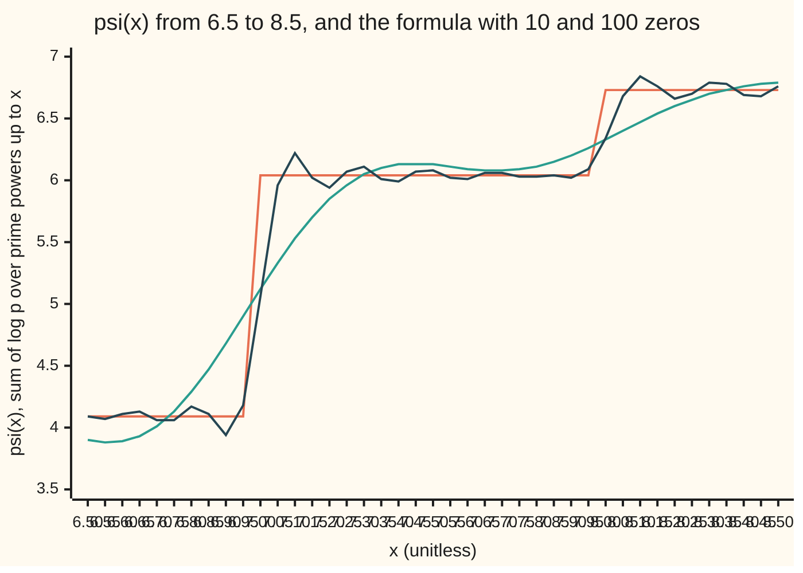

# The explicit formula: the prime count written exactly, one wave per zero of zeta

[Syllabus](../../../SYLLABUS.md) → [Algebraic and analytic number theory](../README.md) → [The Zeta Function and the Prime Number Theorem](../README.md#s02) → The explicit formula

---

## General Overview

Stand at x = 7.5 and weigh the prime powers up to there: log 2 for each of 2 and 4, log 3, log 5 and log 7. The total is log 420 = 6.040255. This weighted count is the staircase ψ(x), read "psi of x". It climbs by log p at every power of a prime p, so it climbs fastest where primes are dense. Here log is the natural logarithm.

Von Mangoldt proved in 1895 that this staircase can be written exactly. It is a smooth curve, x minus two small corrections, plus one wave for each zero of the zeta function (each complex number where zeta equals 0). The smooth curve alone gives 5.671092 at 7.5, short by 0.369163. Add the waves of the first 10 zeros and the miss is +0.085177. With 100 zeros it is +0.036793. With 1,000 zeros it is +0.002298.

[Zeta's zeros and the primes](../../07-Complex%20analysis/09-Special%20Functions%20and%20the%20Zeta%20Function/09-zeros-of-zeta-and-the-primes.md) already states the formula and collects its terms by residues. This card does the part that card deferred: the estimates that make the proof honest. It shows why the sum over zeros converges at all, why it converges slowly, and why near a step it keeps ringing however many zeros are added.

**Cut the zero sum at a height T chosen away from every zero, and the prime staircase equals x, minus the waves of the zeros below T, minus log 2π and a trivial-zero term, with an error that shrinks like x log²(xT)/T; so the full sum over zeros converges to the staircase, but only when taken in order of height, and with a fixed overshoot beside every step.**

**What kind of fact this is:** a theorem (von Mangoldt, 1895), proved on this card in Why it works. Two inputs are stated with their source: the zero count per unit height, proved on [Counting the zeros](08-counting-the-zeros-riemann-von-mangoldt.md), and the partial-fraction formula for ζ′/ζ, proved in Davenport's book (see Sources). The 1,000 zeros are computed by the code, and four of them are matched to the LMFDB table; they are evidence, not proof.

### The picture: the staircase near the step at 7, rebuilt from 10 and 100 zeros



Orange: the staircase ψ(x), with steps at 7 (height log 7) and 8 (height log 2). Green: the formula with 10 zero pairs, a smooth ramp. Dark: 100 pairs, which already climbs the step at 7 and wobbles round the flat part.

---

## The formula

Notation first, in words. ψ(x) adds Λ(n) for n up to x, where Λ(n), von Mangoldt's function, is log p when n is a power of a prime p and 0 otherwise. At a prime power ψ jumps; $`\psi_0(x)`$ is ψ with its value at a jump replaced by the midpoint of the step. A zero of zeta in the critical strip (the complex numbers $`s = \sigma + it`$ with real part σ between 0 and 1) is ρ, "rho", written $`\rho = \beta + i t_\rho`$ with height $`t_\rho`$. On this card γ is Euler's constant, so a zero's height is written $`t_\rho`$, never γ.

The sum over zeros is cut at a height T:

```math
\psi_0(x) = x - \sum_{|t_\rho| < T} \frac{x^{\rho}}{\rho} - \log 2\pi - \tfrac12 \log\left(1 - x^{-2}\right) + R(x, T)
```

**Read it aloud:** the weighted prime count is x, minus one term for every zero below height T, minus log 2π, minus half the log of one minus one over x squared, plus a remainder.

The remainder obeys, for x at least 2 and T at least 2,

```math
|R(x, T)| \ll \frac{x \log^2(xT)}{T} + \log x \cdot \min\left(1, \frac{x}{T \langle x \rangle}\right)
```

**Read it aloud:** the remainder is at most a constant times x log²(xT) over T, plus log x times the smaller of 1 and x divided by the product of T and the distance from x to the nearest other prime power.

Here $`f \ll g`$ means $`|f| \le C g`$ for some constant C; this card does not compute C, so the bound shows the shape of the error, not its size. As T grows with x fixed, R(x, T) tends to 0, so the formula holds with the full sum over zeros, taken in order of height.

A zero on the critical line, $`\rho = \tfrac12 + i t_\rho`$, pairs with its mirror $`\tfrac12 - i t_\rho`$. Together they give one real wave:

```math
\frac{x^{\rho}}{\rho} + \frac{x^{\bar\rho}}{\bar\rho} = \frac{2\sqrt{x}\left(\tfrac12 \cos(t_\rho \log x) + t_\rho \sin(t_\rho \log x)\right)}{\tfrac14 + t_\rho^2}
```

**Read it aloud:** each mirror pair adds a wave in log x with frequency $`t_\rho`$ and size about $`2\sqrt{x}/t_\rho`$.

| Symbol | Plain meaning | In our example | Push it up and the answer… |
| --- | --- | --- | --- |
| $`x`$ | where the staircase is read | 7.5 | bigger waves, of size about √x |
| $`\psi_0(x)`$, $`\Lambda(n)`$, $`\theta(x)`$ | the staircase, log p at each prime power, midpoint at a jump; its step sizes; Chebyshev's count over primes only | log 420 = 6.040255; θ(7.5) = log 210 | — |
| $`\rho`$, $`\beta`$, $`t_\rho`$; $`-2n`$ | a zero of zeta in the strip; its real part; its height; the trivial zeros −2, −4, −6, …, outside the strip | first zero 0.5 + 14.134725i | higher zeros: faster, smaller waves |
| $`T`$, $`T_0`$ | the height where the zero sum is cut, in the gap above the last zero used; the start of the unit window where Step 4 places T | just above the 10th, 100th and 1,000th zeros, which sit at 49.774, 236.524, 1419.422 | remainder shrinks like 1/T |
| $`U`$ | the left edge of the rectangle sits at real part −U, an odd whole number | grows without bound | left edge shrinks like $`x^{-U}`$ |
| $`s = \sigma + it`$, $`s_1`$ | zeta's complex input; real part σ, height t; s₁ = 2 + it, the comparison point in Step 3's proof | the cut runs along height T | — |
| $`c`$ | the real part of the starting line, just right of 1 | 1 + 1/log x | — |
| $`\langle x \rangle`$ | distance from x to the nearest prime power other than x | 0.5, from 7.5 to 7 and to 8 | smaller remainder |
| $`R(x, T)`$ | the error from cutting at T | miss +0.002298 with 1,000 zeros | — |
| $`N(T)`$ | the number of zeros with height between 0 and T | 1,000 below 1420 | grows like (T/2π) log(T/2π) |
| $`\gamma`$, $`b`$ | Euler's constant; a fixed constant in Hadamard's product for ζ′/ζ (Step 3's proof) | γ = 0.577216 | — |
| $`\mathrm{Si}(\pi)`$ | the area under sin u / u from 0 to π | 1.851937 | — |

### When it holds

- **x above 1.** The term $`\log(1 - x^{-2})`$ needs x > 1. At a prime power the formula gives the midpoint $`\psi_0`$, not ψ: at x = 7 it aims at 5.067300, halfway up the step of log 7.
- **The zeros summed in order of height.** The sum of the sizes $`1/|\rho|`$ diverges, so the sum converges only by cancellation. Reorder it and it can settle anywhere, or nowhere.
- **The cut height T kept away from zeros.** The proof bounds ζ′/ζ along height T. Put T within 0.001 of a zero and that bound breaks: |ζ′/ζ| reaches 1000.1 instead of about 5.
- **Mirror pairs kept together.** A zero without its mirror leaves an imaginary part, and the real part is only half the wave: a miss of −0.1834 at 7.5.
- **No hypothesis about where the zeros are.** The formula is unconditional. The Riemann hypothesis would only say that every wave has size √x, not $`x^\beta`$ with β above 1/2.

---

## Why it works

### Step 0: write the staircase as an integral, then move the line left

The idea in words. A contour integral (an integral along a path in the complex plane) of $`-\zeta'/\zeta`$ against $`x^s/s`$ up a vertical line right of 1 equals the staircase. Push the line far left. Every pole crossed leaves its residue (the coefficient of 1/(s − a) at a pole a). Zeta's pole leaves x; each zero leaves a wave.

The work is in the edges. The line must be cut at a height T and closed into a rectangle. The formula is only as good as the bound on the top and bottom edges. That bound needs two facts: zeros are not too crowded, and T can be placed in a gap between them.

### Step 1: the cut line already gives the staircase

[Perron's formula](04-perrons-formula.md) gives, with $`c = 1 + 1/\log x`$:

```math
\psi_0(x) = \frac{1}{2\pi i} \int_{c - iT}^{c + iT} \left(-\frac{\zeta'(s)}{\zeta(s)}\right) \frac{x^s}{s}\, ds + O\left(\frac{x \log^2 x}{T} + \log x \cdot \min\left(1, \frac{x}{T\langle x\rangle}\right)\right)
```

**Read it aloud:** the staircase equals the integral up the cut line, plus an error of the same shape as R(x, T).

The second error term is why the fit is worse near a step. At x = 7.5 the nearest prime powers are 7 and 8, half a unit away.

### Step 2: zeros are not crowded

The count of zeros up to height T is about $`(T/2\pi)\log(T/2\pi) - T/2\pi + 7/8`$. At T = 1420 the check's smooth count is 999.916, and it finds 1,000 zeros. A unit window holds few of them:

```math
N(T + 1) - N(T) \ll \log T
```

**Read it aloud:** the number of zeros with height between T and T + 1 is at most a constant times log T.

The proof is on [Counting the zeros](08-counting-the-zeros-riemann-von-mangoldt.md). The check counts every window [a, a + 1) with a a whole number up to 1420: the most it finds is 2, while log 1420 = 7.258.

### Step 3: near height T, ζ′/ζ is a short sum over nearby zeros

For σ between −1 and 2 and |t| at least 2:

```math
\frac{\zeta'(s)}{\zeta(s)} = \sum_{|t - t_\rho| < 1} \frac{1}{s - \rho} + O(\log |t|)
```

**Read it aloud:** zeta's log derivative is one term for each zero within one unit of height, plus something no bigger than a constant times log t.

Far zeros pull in all directions and nearly cancel. Only the near ones can make ζ′/ζ large, and Step 2 says there are at most a constant times log t of them.

<details>
<summary>Detailed proof: the partial-fraction formula for ζ′/ζ</summary>

[Hadamard's product](../../07-Complex%20analysis/10-Entire%20and%20Meromorphic%20Functions/03-hadamard-factorization-theorem.md) for the completed zeta function ξ (zeta times a Gamma factor, with its pole and trivial zeros removed) gives, for every s that is not a zero or pole,

$`\displaystyle \frac{\zeta'(s)}{\zeta(s)} = b - \frac{1}{s-1} + \tfrac12 \log \pi - \tfrac12 \frac{\Gamma'(s/2 + 1)}{\Gamma(s/2 + 1)} + \sum_{\rho} \left(\frac{1}{s - \rho} + \frac{1}{\rho}\right)`$

with b a constant. By Stirling's formula the Gamma term is $`O(\log |t|)`$ in the strip.

Write the same identity at $`s_1 = 2 + it`$ and subtract. There $`|\zeta'/\zeta(s_1)|`$ is at most the convergent sum of $`\Lambda(n)/n^2`$, a constant, so

$`\displaystyle \frac{\zeta'(s)}{\zeta(s)} = \sum_{\rho} \left(\frac{1}{s - \rho} - \frac{1}{s_1 - \rho}\right) + O(\log |t|).`$

For a zero with $`|t - t_\rho| \ge 1`$, the bracket is at most $`3/|t - t_\rho|^2`$. Group those zeros by windows of unit height; window j holds $`O(\log(|t| + j))`$ zeros by Step 2, and the sum of $`\log(|t|+j)/j^2`$ is $`O(\log |t|)`$. For a zero with $`|t - t_\rho| < 1`$, the term $`1/(s_1 - \rho)`$ is at most 1 in size, and there are $`O(\log |t|)`$ such zeros. What is left is the near sum. The full proof is in Davenport's book.

</details>

### Step 4: choose T in a gap, so ζ′/ζ is at most log² T on the whole top edge

Take any unit window $`[T_0, T_0 + 1]`$. By Step 2 its zeros, at most a constant times $`\log T_0`$ of them, cut it into pieces. One piece has length at least about $`1/\log T_0`$. Put T at its middle. Every zero is then at least about $`1/(2\log T)`$ away in height.

Now apply Step 3 on the line of height T. Each near term $`1/(s - \rho)`$ has size at most about $`2\log T`$, and there are about $`\log T`$ of them. So

```math
\left|\frac{\zeta'(\sigma + iT)}{\zeta(\sigma + iT)}\right| \ll \log^2 T \qquad (-1 \le \sigma \le 2)
```

**Read it aloud:** along the whole segment at height T from real part −1 to 2, the size of ζ′/ζ is at most a constant times log T squared.

The check does this choice at three heights and measures the largest |ζ′/ζ| on the segment:

| Window starts at | Chosen T | Nearest zero | Largest abs(ζ′/ζ) | log² T |
| --- | --- | --- | --- | --- |
| 100 | 100.500 | 0.818 away | 2.67 | 21.25 |
| 500 | 500.655 | 0.345 away | 4.53 | 38.64 |
| 1000 | 1000.500 | 0.708 away | 5.04 | 47.72 |
| (bad choice) | first zero + 0.001 | 0.001 away | 1000.1 | — |

The bad choice shows why the gap matters: a zero 0.001 below the edge makes a term of size 1/0.001.

### Step 5: the left edge vanishes, and the residues give the formula

Close the rectangle with a left edge at real part −U, where U is an odd whole number, so the edge misses the trivial zeros at −2, −4, −6, …. Left of −1, the functional equation ([The functional equation](02-functional-equation-proved.md)) turns ζ′/ζ(s) into ζ′/ζ(1 − s), which is bounded, plus Gamma and cotangent terms of size $`O(\log|s|)`$. The same bound covers the top and bottom edges left of −1.

On the left edge $`|x^s| = x^{-U}`$, so that edge contributes at most a constant times $`T \log(UT)\, x^{-U}`$. As U grows this tends to 0.

By [The residue theorem](../../07-Complex%20analysis/05-Laurent%20Series%2C%20Singularities%20and%20Residues/05-the-residue-theorem.md), the integral round the rectangle is the sum of residues inside it:

- at s = 1, zeta's pole: x;
- at each zero ρ with $`|t_\rho| < T`$: $`-x^\rho/\rho`$;
- at s = 0, where 1/s has a pole: $`-\zeta'(0)/\zeta(0) = -\log 2\pi`$;
- at each trivial zero −2n: $`x^{-2n}/(2n)`$, and these add to $`-\tfrac12\log(1 - x^{-2})`$.

### Step 6: add up the edges

On the top and bottom edges, Step 4 bounds ζ′/ζ by log² T, and $`|x^s/s| \le x^\sigma / T`$. Integrating $`x^\sigma`$ from σ = −1 to c gives at most $`e\,x/\log x`$. So each edge contributes at most a constant times $`x \log^2 T / (T \log x)`$.

Add Step 1's error $`x \log^2 x / T`$ to the edges. Since $`\log^2 x + \log^2 T`$ is at most $`\log^2(xT)`$, the remainder R(x, T) has the shape in The formula. A general T, not in a gap, moves the cut by at most a constant times log T zeros, each of size at most $`x/T`$. That adds $`x \log T / T`$, which the same bound already covers.

### Step 7: the sum over zeros converges, but slowly and not uniformly

Hold x fixed and let T grow: R(x, T) tends to 0, so the full sum, taken in order of height, converges to the staircase. That is all the formula promises.

It does not converge absolutely. Since zeros near height t come about $`\log(t/2\pi)/2\pi`$ per unit, the sum of $`2/|\rho|`$ over pairs grows like $`\log^2(T/2\pi)/2\pi`$:

| Pairs used | Sum of 2/abs(ρ) | Sum of 2/abs(ρ)² |
| --- | --- | --- |
| 10 | 0.673 | 0.027070 |
| 100 | 2.062 | 0.039970 |
| 1,000 | 4.642 | 0.044752 |

At T = 1419 the growth law predicts 4.676 for the first column; it never settles. The second column does settle. Over all zeros, the sum of $`1/(\rho(1-\rho))`$ is exactly $`2 + \gamma - \log 4\pi = 0.046191`$, and for a zero on the critical line $`\rho(1-\rho) = |\rho|^2`$. The 1,000 pairs give 0.044752; the expected tail above 1419, $`(\log(T/2\pi) + 1)/(\pi T) = 0.001440`$, brings it to 0.046192.

Convergence is also not uniform near a step. A step is a jump, and a jump rebuilt from frequencies up to T always overshoots by a fixed fraction: the Gibbs phenomenon (the overshoot seen in any Fourier series cut short at a jump). The fraction is $`\mathrm{Si}(\pi)/\pi - \tfrac12 = 0.0895`$ of the jump, with Si(π) = 1.851937. In log x the first peak sits π/T past the step, so at 7 it sits near $`7 + 7\pi/T`$. How the fit moves shows it happen.

---

## Worked numbers, by hand

The fit at x = 7.5, with the zero heights from the check:

| Step | Arithmetic | Value |
| --- | --- | --- |
| the staircase | log 2 + log 2 + log 3 + log 5 + log 7 = log 420 | 6.040255 |
| the smooth part | 7.5 − log 2π − ½ log(1 − 1/56.25) = 7.5 − 1.837877 + 0.008969 | 5.671092 |
| miss with no zeros | 5.671092 − 6.040255 | −0.369163 |
| 10 zero pairs | smooth part minus 10 waves | 6.125432 |
| 100 zero pairs | smooth part minus 100 waves | 6.077048 |
| 1,000 zero pairs | smooth part minus 1,000 waves | **6.042552** |

With 1,000 zeros the formula misses the true staircase by 0.002298: the weighted prime count is rebuilt to within 0.0023 from zeta's zeros alone.

The same formula at the house example's scale, x = 1,000,000.5, where ψ(10^6) = 999,586.597: the smooth part is 412.06 too high, and 10, 100 and 1,000 zero pairs cut the gap to 261.40, 51.65 and 36.69. A million is far from the zeros' reach: the remainder bound grows like x/T.

### What breaks if you drop a piece

| Mistake | Comes out at | What went wrong |
| --- | --- | --- |
| Cut height T placed 0.001 above the first zero | largest abs(ζ′/ζ) on the edge 1000.1, against 2.67 at T = 100.5 | Step 4 needs T in a gap; the edge bound fails |
| Drop the −log 2π term, 1,000 zeros at 7.5 | miss +1.8402 | the residue at s = 0 is part of the count |
| Use one zero of each mirror pair | miss −0.1834 | half of each wave is missing, and the sum is not real |
| Compare with primes only, Chebyshev's θ(7.5) = log 210 = 5.3471 | miss +0.6954 | the formula counts prime powers: 4 adds log 2 = 0.6931 |

The code prints all four.

---

## How the fit moves as zeros are added

At 7.5 the fit sharpens steadily. Right of the step at 7, it rings. The check scans x from 7.0005 to 7.5 and records the highest point of the formula:

| Pairs | Last zero used; T just above it | Peak | At x | Overshoot above 6.040255 | Predicted spot 7 + 7π/T |
| --- | --- | --- | --- | --- | --- |
| 10 | 49.774 | 6.1332 | 7.4440 | 0.0930 | 7.4418 |
| 100 | 236.524 | 6.2249 | 7.0940 | 0.1846 | 7.0930 |
| 1,000 | 1419.422 | 6.2142 | 7.0155 | 0.1739 | 7.0155 |

The overshoot does not shrink. It settles near the Gibbs value $`0.0895 \times \log 7 = 0.1741`$, and it moves toward the step as T grows. On the step itself the formula aims at the midpoint, 5.067300, and gives 5.117713, 5.056437 and 5.067506 with 10, 100 and 1,000 pairs.

The fit at one x has two parts:

```
             miss at x = 7.5                   overshoot just right of 7
no zeros     ████████████████████  0.369163    —
10 pairs     █████                 0.085177    █████       0.0930
100 pairs    ██                    0.036793    ██████████  0.1846
1000 pairs                         0.002298    █████████   0.1739
```

A finite sum of smooth waves cannot jump. The ringing is the price of building a step out of waves. The chart in the General Overview is the combined picture: from 6.5 to 8.5, the 100-pair curve both climbs the step at 7 and rings beside it, where the 10-pair curve is still a smooth ramp.

---

## Code, from first principles, and it actually runs

The code builds zeta from scratch and takes three independent roads to the card's numbers:

- **Zeros from zeta.** The Euler–Maclaurin sum (zeta's series with its tail replaced by an integral and correction terms) gives zeta at any s ≠ 1. The code turns zeta into the real function Z(t) on the critical line, scans heights 10 to 1420 in steps of 0.05 for sign changes, and pins each zero by the Illinois method (a root finder that keeps the root bracketed).
- **Zeros checked.** Four are matched to the LMFDB table. The count at 1420 is matched to the smooth count 999.916, built from the Riemann–Siegel angle (called `theta` in the code; Chebyshev's θ(x) appears only in the primes-only line). The sum of 1/|ρ|² must approach a constant built from Euler's constant.
- **The staircase counted directly.** A sieve finds every prime up to a million, and ψ is summed and compared with the formula. Each wave is also checked against $`2\,\mathrm{Re}(x^\rho/\rho)`$ in complex arithmetic. The Gibbs constant comes from Simpson's rule (a weighted sum of samples that approximates an area), independent of the zeros.

### Python

```python
# The explicit formula -- the check behind the card.  Standard library only.
# Zeta by Euler-Maclaurin; 1,000 zeros from sign changes of Z(t), checked, then
# fed into von Mangoldt's formula at x = 7.5 and nearby.
import math, cmath
B = [1/6, -1/30, 1/42, -1/30, 5/66, -691/2730, 7/6, -3617/510, 43867/798, -174611/330]

def zeta(s):                                  # Euler-Maclaurin, valid for any s != 1
    n_cut = int(abs(s.imag) / 2) + 10
    tot = sum(cmath.exp(-s * math.log(n)) for n in range(1, n_cut))
    big = cmath.exp(-s * math.log(n_cut))
    tot += n_cut * big / (s - 1) + big / 2
    term = s * big / n_cut
    for k in range(1, 11):
        tot += B[k - 1] / math.factorial(2 * k) * term
        term *= (s + 2 * k - 1) * (s + 2 * k) / (n_cut * n_cut)
    return tot

def theta(t):                                 # Riemann-Siegel angle, Stirling series
    return (t / 2 * math.log(t / (2 * math.pi)) - t / 2 - math.pi / 8
            + 1 / (48 * t) + 7 / (5760 * t ** 3) + 31 / (80640 * t ** 5))

def z_real(t):                                # Z(t): zeta on the line, turned real
    return (cmath.exp(1j * theta(t)) * zeta(complex(0.5, t))).real

def find_zeros(count, step=0.05):             # scan for sign changes, then Illinois
    out, t, zp = [], 10.0, z_real(10.0)
    while len(out) < count:
        a, t = t, t + step
        zc = z_real(t)
        if zp * zc < 0:
            lo, hi, flo, fhi = a, t, zp, zc
            for _ in range(80):
                m = hi - fhi * (hi - lo) / (fhi - flo)
                fm = z_real(m)
                lo, flo = (hi, fhi) if fm * fhi < 0 else (lo, flo / 2)
                hi, fhi = m, fm
                if abs(hi - lo) < 1e-12:
                    break
            out.append(hi)
        zp = zc
    return out

def sieve(n):                                 # Eratosthenes: every prime up to n
    ok = bytearray([0, 0]) + bytearray([1]) * (n - 1)
    for i in (i for i in range(2, int(n ** 0.5) + 1) if ok[i]):
        ok[i * i::i] = bytearray(len(ok[i * i::i]))
    return [i for i in range(n + 1) if ok[i]]

def psi(x, primes):                           # the staircase: log p at every p^k <= x
    tot = 0.0
    for p in (p for p in primes if p <= x):
        pk = p
        while pk <= x:
            tot, pk = tot + math.log(p), pk * p
    return tot

def wave(x, t):                               # one mirror pair: 2 Re(x^rho / rho)
    lx = math.log(x)
    return 2 * math.sqrt(x) * (0.5 * math.cos(t * lx) + t * math.sin(t * lx)) / (0.25 + t * t)

def formula(x, zs, k, pairs=2.0, log2pi=True):
    smooth = x - (math.log(2 * math.pi) if log2pi else 0.0) - 0.5 * math.log(1 - x ** -2)
    return smooth - pairs / 2 * sum(wave(x, t) for t in zs[:k])

def logderiv_max(height):                     # max |zeta'/zeta| on -1 <= sigma <= 2
    best = 0.0
    for j in range(61):
        s = complex(-1 + 0.05 * j, height)
        d = (zeta(s + 1e-5) - zeta(s - 1e-5)) / 2e-5
        best = max(best, abs(d / zeta(s)))
    return best

zs, primes = find_zeros(1000), sieve(10 ** 6)
lmfdb = {1: 14.1347251417, 10: 49.7738324777, 100: 236.5242296658, 1000: 1419.4224809460}
gap = min(range(999), key=lambda i: zs[i + 1] - zs[i])
smooth_count = theta(1420.0) / math.pi + 1
window = max(sum(1 for g in zs if a <= g < a + 1) for a in range(10, 1420))
print(f"zeros found: {len(zs)}, heights {zs[0]:.6f} to {zs[-1]:.6f}")
print(f"smallest gap {zs[gap + 1] - zs[gap]:.6f}, between zeros {gap + 1} and {gap + 2}")
print("LMFDB table, zeros 1, 10, 100, 1000:", [f"{zs[n - 1]:.6f}" for n in lmfdb])
print(f"zeros below 1420: {sum(1 for g in zs if g < 1420)}; smooth count RS angle/pi + 1 = {smooth_count:.3f}")
print(f"most zeros in one window [a, a+1) up to 1420: {window}; log 1420 = {math.log(1420):.3f}")
edges = []
for a in (100, 500, 1000):
    cuts = [0.0] + [g - a for g in zs if a < g < a + 1] + [1.0]
    i = max(range(len(cuts) - 1), key=lambda i: cuts[i + 1] - cuts[i])
    T = a + (cuts[i] + cuts[i + 1]) / 2
    near = min(abs(T - g) for g in zs)
    edges.append((logderiv_max(T), math.log(T) ** 2))
    print(f"T = {T:.3f}: nearest zero {near:.3f} away, max |zeta'/zeta| {edges[-1][0]:.2f}, log^2 T {edges[-1][1]:.2f}")
bad = logderiv_max(zs[0] + 0.001)
print(f"T = first zero + 0.001: max |zeta'/zeta| {bad:.1f}")
x, exact = 7.5, psi(7.5, primes)
errs = [formula(x, zs, k) - exact for k in (0, 10, 100, 1000)]
print(f"psi(7.5) = {exact:.6f} = log 420 = {math.log(420):.6f}")
for k, e in zip((0, 10, 100, 1000), errs):
    print(f"{k:>4} zeros at 7.5: {exact + e:.6f}, miss {e:+.6f}")
mid = psi(7, primes) - math.log(7) / 2
print(f"at the jump x = 7, midpoint {mid:.6f}; 10, 100, 1000 zeros:",
      " ".join(f"{formula(7.0, zs, k):.6f}" for k in (10, 100, 1000)))
si = sum((1 if j in (0, 1000) else 4 if j % 2 else 2) * (math.sin(u) / u if u else 1.0)
         for j in range(1001) for u in [j * math.pi / 1000]) * math.pi / 3000
gibbs = (si / math.pi - 0.5) * math.log(7)
rings = []
for k in (10, 100, 1000):
    top, at = max((formula(7 + i * 0.0005, zs, k), 7 + i * 0.0005) for i in range(1, 1001))
    rings.append((top - exact, at - 7, 7 * math.pi / zs[k - 1]))
    print(f"{k:>4} zeros, T = {zs[k - 1]:.3f}: peak {top:.4f} at x = {at:.4f}, "
          f"overshoot {top - exact:.4f}, Gibbs spot 7 + {7 * math.pi / zs[k - 1]:.4f}")
print(f"Gibbs overshoot (Si(pi)/pi - 1/2) x log 7 = {gibbs:.4f}")
big = psi(10 ** 6, primes)
print(f"primes below a million {len(primes)}; psi(10^6) = {big:.3f}; formula minus psi at 10^6 + 0.5:",
      " ".join(f"{formula(10 ** 6 + 0.5, zs, k) - big:.2f}" for k in (0, 10, 100, 1000)))
euler = sum(1 / n for n in range(1, 10001)) - math.log(10000) - 1 / 20000 + 1 / (12 * 10 ** 8)
target = 2 + euler - math.log(4 * math.pi)
sq = [sum(2 / (0.25 + t * t) for t in zs[:k]) for k in (10, 100, 1000)]
tail = (math.log(zs[-1] / (2 * math.pi)) + 1) / (math.pi * zs[-1])
print("sum 2/|rho|^2 over 10, 100, 1000 pairs:", " ".join(f"{v:.6f}" for v in sq),
      f"+ tail {tail:.6f} = {sq[-1] + tail:.6f}; 2 + gamma - log 4pi = {target:.6f}")
ab = [sum(2 / math.sqrt(0.25 + t * t) for t in zs[:k]) for k in (10, 100, 1000)]
print("sum 2/|rho| over 10, 100, 1000 pairs:", " ".join(f"{v:.3f}" for v in ab),
      f"; log^2(T/2pi)/2pi at T = {zs[-1]:.0f}: {math.log(zs[-1] / (2 * math.pi)) ** 2 / (2 * math.pi):.3f}")
print(f"break: no -log 2pi, 1000 zeros at 7.5: miss {formula(x, zs, 1000, log2pi=False) - exact:+.4f}")
print(f"break: one zero of each pair, 1000 zeros at 7.5: miss {formula(x, zs, 1000, pairs=1.0) - exact:+.4f}")
print(f"break: primes only, theta(7.5) = log 210 = {math.log(210):.4f}: miss {formula(x, zs, 1000) - math.log(210):+.4f}")
print(f"constants: log 2pi {math.log(2 * math.pi):.6f}, trivial term {-0.5 * math.log(1 - x ** -2):.6f}, "
      f"Si(pi) {si:.6f}, gamma {euler:.6f}, Gibbs fraction {si / math.pi - 0.5:.4f}, log 2 {math.log(2):.4f}, "
      f"x log^2(xT)/T at 10^6 {1e6 * math.log(1e6 * zs[-1]) ** 2 / zs[-1]:.0f}")
grid = [6.5 + 0.05 * i for i in range(41)]
for name, f in [("staircase", lambda v: psi(v, primes)), ("10 zeros", lambda v: formula(v, zs, 10)),
                ("100 zeros", lambda v: formula(v, zs, 100))]:
    print(f"chart {name}:", ", ".join(f"{f(v):.2f}" for v in grid))
assert all(abs(zs[n - 1] - v) < 1e-8 for n, v in lmfdb.items())          # a named table
assert sum(1 for g in zs if g < 1420) == 1000 and abs(1000 - smooth_count) < 1
assert abs(exact - math.log(420)) < 1e-12 and abs(errs[3]) < abs(errs[2]) < abs(errs[1]) < abs(errs[0])
assert all(m < l2 for m, l2 in edges) and bad > 100
assert abs(rings[2][0] - gibbs) < 0.01 and abs(rings[2][1] / rings[2][2] - 1) < 0.1
assert len(primes) == 78498 and abs(sq[-1] + tail - target) < 1e-4
assert all(abs(wave(x, t) - 2 * (cmath.exp(complex(0.5, t) * math.log(x)) / complex(0.5, t)).real) < 1e-12 for t in zs)
print("ALL CHECKS PASS")
```

**Ran 2026-11-15 on macOS, Python 3.14.10, standard library only. All checks passed. Output, pasted from the run:**

```
zeros found: 1000, heights 14.134725 to 1419.422481
smallest gap 0.161501, between zeros 922 and 923
LMFDB table, zeros 1, 10, 100, 1000: ['14.134725', '49.773832', '236.524230', '1419.422481']
zeros below 1420: 1000; smooth count RS angle/pi + 1 = 999.916
most zeros in one window [a, a+1) up to 1420: 2; log 1420 = 7.258
T = 100.500: nearest zero 0.818 away, max |zeta'/zeta| 2.67, log^2 T 21.25
T = 500.655: nearest zero 0.345 away, max |zeta'/zeta| 4.53, log^2 T 38.64
T = 1000.500: nearest zero 0.708 away, max |zeta'/zeta| 5.04, log^2 T 47.72
T = first zero + 0.001: max |zeta'/zeta| 1000.1
psi(7.5) = 6.040255 = log 420 = 6.040255
   0 zeros at 7.5: 5.671092, miss -0.369163
  10 zeros at 7.5: 6.125432, miss +0.085177
 100 zeros at 7.5: 6.077048, miss +0.036793
1000 zeros at 7.5: 6.042552, miss +0.002298
at the jump x = 7, midpoint 5.067300; 10, 100, 1000 zeros: 5.117713 5.056437 5.067506
  10 zeros, T = 49.774: peak 6.1332 at x = 7.4440, overshoot 0.0930, Gibbs spot 7 + 0.4418
 100 zeros, T = 236.524: peak 6.2249 at x = 7.0940, overshoot 0.1846, Gibbs spot 7 + 0.0930
1000 zeros, T = 1419.422: peak 6.2142 at x = 7.0155, overshoot 0.1739, Gibbs spot 7 + 0.0155
Gibbs overshoot (Si(pi)/pi - 1/2) x log 7 = 0.1741
primes below a million 78498; psi(10^6) = 999586.597; formula minus psi at 10^6 + 0.5: 412.06 261.40 51.65 36.69
sum 2/|rho|^2 over 10, 100, 1000 pairs: 0.027070 0.039970 0.044752 + tail 0.001440 = 0.046192; 2 + gamma - log 4pi = 0.046191
sum 2/|rho| over 10, 100, 1000 pairs: 0.673 2.062 4.642 ; log^2(T/2pi)/2pi at T = 1419: 4.676
break: no -log 2pi, 1000 zeros at 7.5: miss +1.8402
break: one zero of each pair, 1000 zeros at 7.5: miss -0.1834
break: primes only, theta(7.5) = log 210 = 5.3471: miss +0.6954
constants: log 2pi 1.837877, trivial term 0.008969, Si(pi) 1.851937, gamma 0.577216, Gibbs fraction 0.0895, log 2 0.6931, x log^2(xT)/T at 10^6 312869
chart staircase: 4.09, 4.09, 4.09, 4.09, 4.09, 4.09, 4.09, 4.09, 4.09, 4.09, 6.04, 6.04, 6.04, 6.04, 6.04, 6.04, 6.04, 6.04, 6.04, 6.04, 6.04, 6.04, 6.04, 6.04, 6.04, 6.04, 6.04, 6.04, 6.04, 6.04, 6.73, 6.73, 6.73, 6.73, 6.73, 6.73, 6.73, 6.73, 6.73, 6.73, 6.73
chart 10 zeros: 3.90, 3.88, 3.89, 3.93, 4.01, 4.13, 4.29, 4.47, 4.68, 4.90, 5.12, 5.33, 5.53, 5.70, 5.85, 5.96, 6.05, 6.10, 6.13, 6.13, 6.13, 6.11, 6.09, 6.08, 6.08, 6.09, 6.11, 6.15, 6.20, 6.26, 6.33, 6.40, 6.47, 6.54, 6.60, 6.65, 6.70, 6.73, 6.76, 6.78, 6.79
chart 100 zeros: 4.09, 4.07, 4.11, 4.13, 4.06, 4.06, 4.17, 4.11, 3.94, 4.18, 5.06, 5.96, 6.22, 6.02, 5.94, 6.07, 6.11, 6.01, 5.99, 6.07, 6.08, 6.02, 6.01, 6.06, 6.06, 6.03, 6.03, 6.04, 6.02, 6.09, 6.34, 6.68, 6.84, 6.76, 6.66, 6.70, 6.79, 6.78, 6.69, 6.68, 6.76
ALL CHECKS PASS
```

### Rust

Same numbers, same labels, built with `rustc --edition 2021 -O`. Complex division copies CPython's method, so the last digits agree.

```rust
// The explicit formula -- the same check as the Python, in Rust.  No crates.
// Zeta by Euler-Maclaurin; 1,000 zeros from sign changes of Z(t), checked, then
// fed into von Mangoldt's formula at x = 7.5 and nearby.
use std::f64::consts::PI;
#[derive(Clone, Copy)]
struct C { re: f64, im: f64 }
impl C {
    fn add(self, o: C) -> C { C { re: self.re + o.re, im: self.im + o.im } }
    fn sub(self, o: C) -> C { C { re: self.re - o.re, im: self.im - o.im } }
    fn mul(self, o: C) -> C { C { re: self.re * o.re - self.im * o.im, im: self.re * o.im + self.im * o.re } }
    fn sc(self, k: f64) -> C { C { re: self.re * k, im: self.im * k } }
    fn dv(self, k: f64) -> C { C { re: self.re / k, im: self.im / k } }
    fn div(self, b: C) -> C {                      // Smith's division, as CPython does it
        if b.re.abs() >= b.im.abs() { let r = b.im / b.re; let d = b.re + b.im * r;
            C { re: (self.re + self.im * r) / d, im: (self.im - self.re * r) / d }
        } else { let r = b.re / b.im; let d = b.re * r + b.im;
            C { re: (self.re * r + self.im) / d, im: (self.im * r - self.re) / d } }
    }
    fn exp(self) -> C { let l = self.re.exp(); C { re: l * self.im.cos(), im: l * self.im.sin() } }
}
const B: [f64; 10] = [1.0 / 6.0, -1.0 / 30.0, 1.0 / 42.0, -1.0 / 30.0, 5.0 / 66.0, -691.0 / 2730.0,
                      7.0 / 6.0, -3617.0 / 510.0, 43867.0 / 798.0, -174611.0 / 330.0];

fn zeta(s: C) -> C {                               // Euler-Maclaurin, valid for any s != 1
    let n_cut = (s.im.abs() / 2.0) as usize + 10;
    let ns = C { re: -s.re, im: -s.im };
    let (mut tot, nf) = (C { re: 0.0, im: 0.0 }, n_cut as f64);
    for n in 1..n_cut { tot = tot.add(ns.sc((n as f64).ln()).exp()) }
    let big = ns.sc(nf.ln()).exp(); tot = tot.add(big.sc(nf).div(C { re: s.re - 1.0, im: s.im })).add(big.dv(2.0));
    let (mut term, mut fact) = (s.mul(big).dv(nf), 1.0);
    for k in 1..=10 {
        fact *= ((2 * k - 1) * (2 * k)) as f64;
        tot = tot.add(term.sc(B[k - 1] / fact));
        let kk = (2 * k) as f64;
        term = term.mul(C { re: s.re + kk - 1.0, im: s.im }.mul(C { re: s.re + kk, im: s.im }).dv(nf * nf));
    }
    tot
}

fn theta(t: f64) -> f64 {                          // Riemann-Siegel angle, Stirling series
    t / 2.0 * (t / (2.0 * PI)).ln() - t / 2.0 - PI / 8.0
        + 1.0 / (48.0 * t) + 7.0 / (5760.0 * t.powf(3.0)) + 31.0 / (80640.0 * t.powf(5.0))
}

fn z_real(t: f64) -> f64 {                         // Z(t): zeta on the line, turned real
    C { re: 0.0, im: theta(t) }.exp().mul(zeta(C { re: 0.5, im: t })).re
}

fn find_zeros(count: usize, step: f64) -> Vec<f64> { // scan for sign changes, then Illinois
    let (mut out, mut t, mut zp) = (Vec::new(), 10.0, z_real(10.0));
    while out.len() < count {
        let (a, zc) = (t, z_real(t + step)); t += step;
        if zp * zc < 0.0 {
            let (mut lo, mut hi, mut flo, mut fhi) = (a, t, zp, zc);
            for _ in 0..80 {
                let m = hi - fhi * (hi - lo) / (fhi - flo); let fm = z_real(m);
                if fm * fhi < 0.0 { lo = hi; flo = fhi } else { flo /= 2.0 }
                hi = m; fhi = fm;
                if (hi - lo).abs() < 1e-12 { break }
            }
            out.push(hi);
        } zp = zc;
    }
    out
}

fn sieve(n: usize) -> Vec<usize> {                 // Eratosthenes: every prime up to n
    let (mut ok, mut i) = (vec![true; n + 1], 2); ok[0] = false; ok[1] = false;
    while i * i <= n { if ok[i] { let mut j = i * i; while j <= n { ok[j] = false; j += i } } i += 1 }
    (0..=n).filter(|&i| ok[i]).collect()
}

fn psi(x: f64, primes: &[usize]) -> f64 {          // the staircase: log p at every p^k <= x
    let mut tot = 0.0; for &p in primes.iter().filter(|&&p| p as f64 <= x) {
        let mut pk = p as f64; while pk <= x { tot += (p as f64).ln(); pk *= p as f64 }
    }
    tot
}

fn wave(x: f64, t: f64) -> f64 {                   // one mirror pair: 2 Re(x^rho / rho)
    let lx = x.ln(); 2.0 * x.sqrt() * (0.5 * (t * lx).cos() + t * (t * lx).sin()) / (0.25 + t * t)
}

fn formula(x: f64, zs: &[f64], k: usize, pairs: f64, log2pi: bool) -> f64 {
    let smooth = x - if log2pi { (2.0 * PI).ln() } else { 0.0 } - 0.5 * (1.0 - x.powf(-2.0)).ln();
    smooth - pairs / 2.0 * zs[..k].iter().map(|&t| wave(x, t)).sum::<f64>()
}
fn f(x: f64, zs: &[f64], k: usize) -> f64 { formula(x, zs, k, 2.0, true) }

fn logderiv_max(h: f64) -> f64 {                   // max |zeta'/zeta| on -1 <= sigma <= 2
    let mut best: f64 = 0.0;
    for j in 0..61 { let s = C { re: -1.0 + 0.05 * j as f64, im: h };
        let d = zeta(C { re: s.re + 1e-5, im: s.im }).sub(zeta(C { re: s.re - 1e-5, im: s.im })).dv(2e-5);
        let q = d.div(zeta(s)); best = best.max(q.re.hypot(q.im));
    }
    best
}

fn main() {
    let (zs, primes) = (find_zeros(1000, 0.05), sieve(1_000_000));
    let lmfdb = [(1, 14.1347251417), (10, 49.7738324777), (100, 236.5242296658), (1000, 1419.4224809460)];
    let mut gap = 0; for i in 0..999 { if zs[i + 1] - zs[i] < zs[gap + 1] - zs[gap] { gap = i } }
    let (smooth_count, below) = (theta(1420.0) / PI + 1.0, zs.iter().filter(|&&g| g < 1420.0).count());
    let window = (10..1420).map(|a| zs.iter().filter(|&&g| a as f64 <= g && g < a as f64 + 1.0).count()).max().unwrap();
    println!("zeros found: {}, heights {:.6} to {:.6}", zs.len(), zs[0], zs[999]);
    println!("smallest gap {:.6}, between zeros {} and {}", zs[gap + 1] - zs[gap], gap + 1, gap + 2);
    let tab: Vec<String> = lmfdb.iter().map(|&(n, _)| format!("'{:.6}'", zs[n - 1])).collect();
    println!("LMFDB table, zeros 1, 10, 100, 1000: [{}]", tab.join(", "));
    println!("zeros below 1420: {}; smooth count RS angle/pi + 1 = {:.3}", below, smooth_count);
    println!("most zeros in one window [a, a+1) up to 1420: {}; log 1420 = {:.3}", window, 1420f64.ln());
    let mut edges = Vec::new();
    for a in [100.0, 500.0, 1000.0] {
        let mut cuts = vec![0.0];
        cuts.extend(zs.iter().filter(|&&g| a < g && g < a + 1.0).map(|&g| g - a)); cuts.push(1.0);
        let mut i = 0;
        for j in 0..cuts.len() - 1 { if cuts[j + 1] - cuts[j] > cuts[i + 1] - cuts[i] { i = j } }
        let t = a + (cuts[i] + cuts[i + 1]) / 2.0;
        let near = zs.iter().map(|&g| (t - g).abs()).fold(f64::INFINITY, f64::min);
        let (m, l2) = (logderiv_max(t), t.ln().powf(2.0)); edges.push((m, l2));
        println!("T = {:.3}: nearest zero {:.3} away, max |zeta'/zeta| {:.2}, log^2 T {:.2}", t, near, m, l2);
    }
    let bad = logderiv_max(zs[0] + 0.001); println!("T = first zero + 0.001: max |zeta'/zeta| {:.1}", bad);
    let (x, exact, ks) = (7.5, psi(7.5, &primes), [0, 10, 100, 1000]);
    let errs: Vec<f64> = ks.iter().map(|&k| f(x, &zs, k) - exact).collect();
    println!("psi(7.5) = {:.6} = log 420 = {:.6}", exact, 420f64.ln());
    for (k, e) in ks.iter().zip(&errs) { println!("{:>4} zeros at 7.5: {:.6}, miss {:+.6}", k, exact + e, e) }
    println!("at the jump x = 7, midpoint {:.6}; 10, 100, 1000 zeros: {:.6} {:.6} {:.6}",
             psi(7.0, &primes) - 7f64.ln() / 2.0, f(7.0, &zs, 10), f(7.0, &zs, 100), f(7.0, &zs, 1000));
    let mut si = 0.0;
    for j in 0..=1000 { let (u, w) = (j as f64 * PI / 1000.0, if j == 0 || j == 1000 { 1.0 } else if j % 2 == 1 { 4.0 } else { 2.0 });
        si += w * if u != 0.0 { u.sin() / u } else { 1.0 } }
    let (gibbs, mut rings) = ((si * PI / 3000.0 / PI - 0.5) * 7f64.ln(), Vec::new());
    for k in [10, 100, 1000] {
        let (mut top, mut at) = (f64::NEG_INFINITY, 0.0);
        for i in 1..=1000 { let v = 7.0 + i as f64 * 0.0005; let y = f(v, &zs, k); if y > top { top = y; at = v } }
        let spot = 7.0 * PI / zs[k - 1]; rings.push((top - exact, at - 7.0, spot));
        println!("{:>4} zeros, T = {:.3}: peak {:.4} at x = {:.4}, overshoot {:.4}, Gibbs spot 7 + {:.4}",
                 k, zs[k - 1], top, at, top - exact, spot);
    }
    println!("Gibbs overshoot (Si(pi)/pi - 1/2) x log 7 = {:.4}", gibbs);
    let big = psi(1e6, &primes); let m: Vec<String> = ks.iter().map(|&k| format!("{:.2}", f(1e6 + 0.5, &zs, k) - big)).collect();
    println!("primes below a million {}; psi(10^6) = {:.3}; formula minus psi at 10^6 + 0.5: {}", primes.len(), big, m.join(" "));
    let euler = (1..=10000).map(|n| 1.0 / n as f64).sum::<f64>() - 10000f64.ln() - 1.0 / 20000.0 + 1.0 / (12.0 * 1e8);
    let target = 2.0 + euler - (4.0 * PI).ln();
    let sq: Vec<f64> = [10, 100, 1000].iter().map(|&k| zs[..k].iter().map(|&t| 2.0 / (0.25 + t * t)).sum()).collect();
    let tail = ((zs[999] / (2.0 * PI)).ln() + 1.0) / (PI * zs[999]);
    println!("sum 2/|rho|^2 over 10, 100, 1000 pairs: {:.6} {:.6} {:.6} + tail {:.6} = {:.6}; 2 + gamma - log 4pi = {:.6}",
             sq[0], sq[1], sq[2], tail, sq[2] + tail, target);
    let ab: Vec<f64> = [10, 100, 1000].iter().map(|&k| zs[..k].iter().map(|&t| 2.0 / (0.25 + t * t).sqrt()).sum()).collect();
    println!("sum 2/|rho| over 10, 100, 1000 pairs: {:.3} {:.3} {:.3} ; log^2(T/2pi)/2pi at T = {:.0}: {:.3}",
             ab[0], ab[1], ab[2], zs[999], (zs[999] / (2.0 * PI)).ln().powf(2.0) / (2.0 * PI));
    println!("break: no -log 2pi, 1000 zeros at 7.5: miss {:+.4}", formula(x, &zs, 1000, 2.0, false) - exact);
    println!("break: one zero of each pair, 1000 zeros at 7.5: miss {:+.4}", formula(x, &zs, 1000, 1.0, true) - exact);
    println!("break: primes only, theta(7.5) = log 210 = {:.4}: miss {:+.4}", 210f64.ln(), f(x, &zs, 1000) - 210f64.ln());
    println!("constants: log 2pi {:.6}, trivial term {:.6}, Si(pi) {:.6}, gamma {:.6}, Gibbs fraction {:.4}, log 2 {:.4}, x log^2(xT)/T at 10^6 {:.0}",
             (2.0 * PI).ln(), -0.5 * (1.0 - x.powf(-2.0)).ln(), si * PI / 3000.0, euler, si * PI / 3000.0 / PI - 0.5, 2f64.ln(), 1e6 * (1e6 * zs[999]).ln().powf(2.0) / zs[999]);
    let grid: Vec<f64> = (0..41).map(|i| 6.5 + 0.05 * i as f64).collect();
    for (name, k) in [("staircase", 0), ("10 zeros", 10), ("100 zeros", 100)] {
        let v: Vec<String> = grid.iter().map(|&g| format!("{:.2}", if k == 0 { psi(g, &primes) } else { f(g, &zs, k) })).collect();
        println!("chart {}: {}", name, v.join(", "));
    }
    assert!(lmfdb.iter().all(|&(n, v)| (zs[n - 1] - v).abs() < 1e-8));        // a named table
    assert!(below == 1000 && (1000.0 - smooth_count).abs() < 1.0);
    assert!((exact - 420f64.ln()).abs() < 1e-12 && errs[3].abs() < errs[2].abs() && errs[2].abs() < errs[1].abs() && errs[1].abs() < errs[0].abs());
    assert!(edges.iter().all(|&(m, l2)| m < l2) && bad > 100.0);
    assert!((rings[2].0 - gibbs).abs() < 0.01 && (rings[2].1 / rings[2].2 - 1.0).abs() < 0.1);
    assert!(primes.len() == 78498 && (sq[2] + tail - target).abs() < 1e-4);
    assert!(zs.iter().all(|&t| { let r = C { re: 0.5, im: t }; (wave(x, t) - 2.0 * r.sc(x.ln()).exp().div(r).re).abs() < 1e-12 }));
    println!("ALL CHECKS PASS");
}
```

**Ran 2026-11-15 on macOS, rustc 1.98.1, no crates. All checks passed. Output, pasted from the run:**

```
zeros found: 1000, heights 14.134725 to 1419.422481
smallest gap 0.161501, between zeros 922 and 923
LMFDB table, zeros 1, 10, 100, 1000: ['14.134725', '49.773832', '236.524230', '1419.422481']
zeros below 1420: 1000; smooth count RS angle/pi + 1 = 999.916
most zeros in one window [a, a+1) up to 1420: 2; log 1420 = 7.258
T = 100.500: nearest zero 0.818 away, max |zeta'/zeta| 2.67, log^2 T 21.25
T = 500.655: nearest zero 0.345 away, max |zeta'/zeta| 4.53, log^2 T 38.64
T = 1000.500: nearest zero 0.708 away, max |zeta'/zeta| 5.04, log^2 T 47.72
T = first zero + 0.001: max |zeta'/zeta| 1000.1
psi(7.5) = 6.040255 = log 420 = 6.040255
   0 zeros at 7.5: 5.671092, miss -0.369163
  10 zeros at 7.5: 6.125432, miss +0.085177
 100 zeros at 7.5: 6.077048, miss +0.036793
1000 zeros at 7.5: 6.042552, miss +0.002298
at the jump x = 7, midpoint 5.067300; 10, 100, 1000 zeros: 5.117713 5.056437 5.067506
  10 zeros, T = 49.774: peak 6.1332 at x = 7.4440, overshoot 0.0930, Gibbs spot 7 + 0.4418
 100 zeros, T = 236.524: peak 6.2249 at x = 7.0940, overshoot 0.1846, Gibbs spot 7 + 0.0930
1000 zeros, T = 1419.422: peak 6.2142 at x = 7.0155, overshoot 0.1739, Gibbs spot 7 + 0.0155
Gibbs overshoot (Si(pi)/pi - 1/2) x log 7 = 0.1741
primes below a million 78498; psi(10^6) = 999586.597; formula minus psi at 10^6 + 0.5: 412.06 261.40 51.65 36.69
sum 2/|rho|^2 over 10, 100, 1000 pairs: 0.027070 0.039970 0.044752 + tail 0.001440 = 0.046192; 2 + gamma - log 4pi = 0.046191
sum 2/|rho| over 10, 100, 1000 pairs: 0.673 2.062 4.642 ; log^2(T/2pi)/2pi at T = 1419: 4.676
break: no -log 2pi, 1000 zeros at 7.5: miss +1.8402
break: one zero of each pair, 1000 zeros at 7.5: miss -0.1834
break: primes only, theta(7.5) = log 210 = 5.3471: miss +0.6954
constants: log 2pi 1.837877, trivial term 0.008969, Si(pi) 1.851937, gamma 0.577216, Gibbs fraction 0.0895, log 2 0.6931, x log^2(xT)/T at 10^6 312869
chart staircase: 4.09, 4.09, 4.09, 4.09, 4.09, 4.09, 4.09, 4.09, 4.09, 4.09, 6.04, 6.04, 6.04, 6.04, 6.04, 6.04, 6.04, 6.04, 6.04, 6.04, 6.04, 6.04, 6.04, 6.04, 6.04, 6.04, 6.04, 6.04, 6.04, 6.04, 6.73, 6.73, 6.73, 6.73, 6.73, 6.73, 6.73, 6.73, 6.73, 6.73, 6.73
chart 10 zeros: 3.90, 3.88, 3.89, 3.93, 4.01, 4.13, 4.29, 4.47, 4.68, 4.90, 5.12, 5.33, 5.53, 5.70, 5.85, 5.96, 6.05, 6.10, 6.13, 6.13, 6.13, 6.11, 6.09, 6.08, 6.08, 6.09, 6.11, 6.15, 6.20, 6.26, 6.33, 6.40, 6.47, 6.54, 6.60, 6.65, 6.70, 6.73, 6.76, 6.78, 6.79
chart 100 zeros: 4.09, 4.07, 4.11, 4.13, 4.06, 4.06, 4.17, 4.11, 3.94, 4.18, 5.06, 5.96, 6.22, 6.02, 5.94, 6.07, 6.11, 6.01, 5.99, 6.07, 6.08, 6.02, 6.01, 6.06, 6.06, 6.03, 6.03, 6.04, 6.02, 6.09, 6.34, 6.68, 6.84, 6.76, 6.66, 6.70, 6.79, 6.78, 6.69, 6.68, 6.76
ALL CHECKS PASS
```

The two outputs match line for line.

> [!TIP]
> **Try changing**
> Guess first, then run it.
> - **Move the point toward the next step.** Set `x, exact = 7.9, psi(7.9, primes)`. The misses read +0.0299, +0.1591, −0.0191 and +0.0089: closer to the step at 8, the fit is less steady, and 1,000 zeros do worse than at 7.5. The third assert stops it.
> - **Coarsen the scan.** Call `find_zeros(1000, step=0.5)`. Close pairs of zeros fall inside one step and cancel: only 986 zeros come out below 1420, and the 1000th lands at 1435.693. The first assert stops it.
> - **Cut nearer the first zero.** Use `zs[0] + 0.01` in the bad-choice line. The largest abs(ζ′/ζ) falls to 100.1, still twenty times the good choices.

---

## The usual mistake

> [!warning]
> **Expecting more zeros to fix the fit everywhere.** At 7.5 they do: the miss falls from 0.085 to 0.002. Beside a step they do not: the peak right of 7 stays 0.1846 above the staircase with 100 pairs and 0.1739 with 1,000. Each zero sharpens the step but cannot remove the Gibbs overshoot. The formula is exact only in the limit, and the limit is not uniform.
>
> - **Summing the zeros in any order.** The sizes $`2/|\rho|`$ add to 4.642 after 1,000 pairs and keep growing, so the sum depends on order. Take zeros by height, in mirror pairs.
> - **Cutting at any height.** A cut 0.001 above a zero makes |ζ′/ζ| reach 1000.1 on the edge, and the proof's bound fails.
> - **Reading ψ as π(x).** The formula counts prime powers, weighted by log p. Comparing with the primes alone at 7.5 misses by 0.6954.
> - **Treating the bound as a number.** The constant in R(x, T) is not computed here. At a million the true miss with 1,000 zeros is 36.69, far below x log²(xT)/T, which is 312,869 before the constant.

---

## Where you meet it in real life

- **Computing π(x) for huge x.** The analytic method counts primes by summing a smoothed explicit formula over many zeros, instead of sieving every number. Platt's 2015 paper computes π(x) this way and matches values found by combinatorial methods.
- **Proved bounds on primes.** Explicit inequalities for ψ(x) − x, which guarantee primes in short intervals, come from this formula with the zeros below a verified height plugged in.
- **Signal processing.** The ringing beside each step is the same Gibbs overshoot that appears when an audio or image filter cuts off high frequencies near a sharp edge.
- **Zeros and primes as a pair.** Generalised explicit formulas, by Weil and others, are the standard tool for testing statistics of zeros, such as their spacings, against prime data.

> **Say it back**
> The prime staircase ψ(x) is exactly x, minus one wave per zero of zeta, minus log 2π and a trivial-zero term. The proof cuts Perron's integral at a height T chosen in a gap between zeros, where ζ′/ζ is at most log² T, and moves the line left past every pole. The remainder shrinks like x log²(xT)/T, so the zero sum converges, but only in order of height. At 7.5 the miss falls from 0.369 to 0.002 as 0 to 1,000 zeros are used. Beside the step at 7, the fit overshoots by a fixed 0.174 that only moves closer.

---

## What this builds on

- [The prime number theorem](05-prime-number-theorem-proved.md): the same contour moved only to the zero-free region, giving ψ(x) ~ x; this card moves it all the way.
- [Zeta's zeros and the primes](../../07-Complex%20analysis/09-Special%20Functions%20and%20the%20Zeta%20Function/09-zeros-of-zeta-and-the-primes.md): the explicit formula stated, its residues collected, and the 29 zeros below height 100 rebuilding the staircase.
- [The residue theorem](../../07-Complex%20analysis/05-Laurent%20Series%2C%20Singularities%20and%20Residues/05-the-residue-theorem.md): the integral round a closed path is the sum of residues inside.

## Where this goes next

- [Counting the zeros](08-counting-the-zeros-riemann-von-mangoldt.md): proves the zero count N(T) and the log T bound per unit window that Steps 2 to 4 used.
- [The Riemann hypothesis](09-riemann-hypothesis-statement-and-equivalents.md): reads this formula backwards, so that every wave of size √x is the same as an error of size √x log² x.

The question this card leaves open: every wave has size $`x^\beta`$ for its zero's real part β, so do all the zeros have β = 1/2?

---

## Sources

Verified 2026-11-15: every link below resolves to the publisher's page.

- von Mangoldt, Hans. "Zu Riemanns Abhandlung 'Ueber die Anzahl der Primzahlen unter einer gegebenen Grösse'." *Journal für die reine und angewandte Mathematik* 114 (1895): 255–305. [doi:10.1515/crll.1895.114.255](https://doi.org/10.1515/crll.1895.114.255). The first proof of the explicit formula.
- Davenport, Harold. *Multiplicative Number Theory*, 2nd ed. Springer, 1980. Graduate Texts in Mathematics 74. [doi:10.1007/978-1-4757-5927-3](https://doi.org/10.1007/978-1-4757-5927-3). Chapters 15 to 17 prove the zero bound per unit height, the partial-fraction formula for ζ′/ζ and the truncated formula with this remainder.
- Montgomery, Hugh L., and Robert C. Vaughan. *Multiplicative Number Theory I: Classical Theory*. Cambridge University Press, 2006. [doi:10.1017/CBO9780511618314](https://doi.org/10.1017/CBO9780511618314). Chapter 12: the explicit formula, choosing T, and convergence of the zero sum.
- The LMFDB Collaboration. "Zeros of ζ(s)." *The L-functions and Modular Forms Database*. [Zeros of zeta](https://www.lmfdb.org/zeros/zeta/). The table that four of the 1,000 computed zeros (numbers 1, 10, 100 and 1,000) were matched against.
- Platt, David J. "Computing π(x) analytically." *Mathematics of Computation* 84 (2015): 1521–1535. [doi:10.1090/S0025-5718-2014-02884-6](https://doi.org/10.1090/S0025-5718-2014-02884-6). The explicit formula used to count primes.
