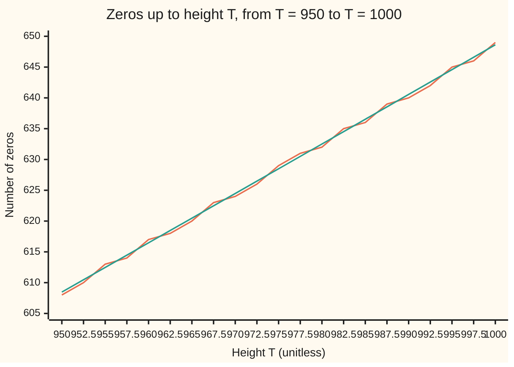

# Counting the zeros: how many lie below a given height, and how tightly they pack

[Syllabus](../../../SYLLABUS.md) → [Algebraic and analytic number theory](../README.md) → [The Zeta Function and the Prime Number Theorem](../README.md#s02) → Counting the zeros

---

## General Overview

The 78,498 primes below a million are tracked by the zeros of the zeta function. [The explicit formula](07-the-explicit-formula.md) turns the prime count into a sum with one wave per zero. So a practical question comes first: how many zeros are there, and how many waves does a sum up to a given height need?

Zeta's nontrivial zeros (all its zeros except the trivial ones at −2, −4, −6, …) sit in the **critical strip**, the band of complex numbers with real part between 0 and 1. Each zero has a **height**: its imaginary part. Below height 1,000 there are exactly **649** zeros. The first sits at height 14.134725. Number 649 sits at 999.791572, just under the line.

No one has to find all 649 to know the count. One formula, stated by Riemann in 1859 and proved by von Mangoldt in 1905, gives the count below any height T: a smooth curve that anyone can evaluate with a calculator, plus a small wobble. At T = 1,000 the smooth curve gives 648.62 and the wobble gives 0.38. They add to 649.

The same formula says how tightly the zeros pack. Near height 1,000 there are 0.806896 zeros per unit of height, so the average gap is 1.239317. Near height 100 the average gap is 2.2705. Higher up, the zeros crowd closer, slowly: the mean gap shrinks like 1 over the logarithm of the height.

**The number of zeta zeros up to height T is the smooth curve (T/2π) log(T/2π) − T/2π + 7/8 plus a wobble S(T) that grows no faster than log T, so near height T the zeros sit on average 2π/log(T/2π) apart.**

**What kind of fact this is:** a theorem, the Riemann–von Mangoldt formula, proved on this card in Why it works; the bound on the wobble is proved in outline in a fold, with explicit constants in the sources. The count of 649 and the gap sizes are computations by the checks: strong evidence, done in floating point, not a proof.

### The picture: the true count against the smooth curve



Orange: the true count, found by the checks. Green: the smooth part of the formula. The true count is a staircase, one step per zero. The smooth part runs through it and never strays by a whole step on this stretch. The vertical distance between the two lines is the wobble S(T).

---

## The formula

Notation first, in words. A complex input is $`s = \sigma + it`$: real part $`\sigma`$, height $`t`$ ([Zeta of a complex variable](01-zeta-and-the-euler-product-revisited.md)). A zero of zeta in the critical strip is written $`\rho`$. This card introduces two symbols:

- $`N(T)`$ is the number of zeros $`\rho`$ with real part strictly between 0 and 1 and height between 0 and T, each counted as often as its multiplicity (a double zero counts twice).
- $`S(T)`$ is the wobble: $`\tfrac{1}{\pi}\arg \zeta(\tfrac12 + iT)`$, the angle of zeta at the point $`\tfrac12 + iT`$, divided by $`\pi`$. The angle is followed continuously from the point 2 up to $`2 + iT`$ and then left to $`\tfrac12 + iT`$, starting from angle 0 at $`\zeta(2)`$.

The exact formula, for any height T that is not the height of a zero:

```math
N(T) = 1 + \frac{\vartheta(T)}{\pi} + S(T), \qquad \vartheta(T) = \arg \Gamma\!\left(\tfrac14 + \tfrac{iT}{2}\right) - \frac{T}{2}\log \pi
```

**Read it aloud:** the count up to height T is one, plus theta of T over pi, plus the wobble; theta is the angle of gamma at one quarter plus iT over two, minus T over two times log pi.

$`\vartheta`$ (a curly theta) is the **Riemann–Siegel theta function**. It is not Chebyshev's θ(x), the sum of log p over primes. $`\Gamma`$ is the gamma function, the factorial stretched to complex inputs ([The gamma function](../../07-Complex%20analysis/09-Special%20Functions%20and%20the%20Zeta%20Function/02-gamma-function.md)). Its angle is the imaginary part of log Γ, taking the branch of log Γ (the one choice among values that differ by multiples of 2πi) that is real on the positive real axis.

Stirling's series for the gamma function turns this into the form everyone quotes, the **Riemann–von Mangoldt formula**:

```math
N(T) = \frac{T}{2\pi}\log\frac{T}{2\pi} - \frac{T}{2\pi} + \frac{7}{8} + S(T) + O\!\left(\frac{1}{T}\right), \qquad S(T) = O(\log T)
```

**Read it aloud:** the count is T over two pi times log of T over two pi, minus T over two pi, plus seven eighths, plus the wobble, plus an error shrinking like one over T; the wobble is at most a constant times log T.

Differentiate the smooth part to get the packing. The **density** of zeros near height T, zeros per unit of height, and the **mean gap**, its reciprocal, are:

```math
\frac{dN}{dT} \approx \frac{1}{2\pi}\log\frac{T}{2\pi}, \qquad \text{mean gap} \approx \frac{2\pi}{\log(T/2\pi)}
```

**Read it aloud:** near height T there are about log of T over two pi, over two pi, zeros per unit height, so neighbours sit about the reciprocal apart.

| Symbol | Plain meaning | In our example | Push it up and the answer… |
| --- | --- | --- | --- |
| $`T`$ | the height up to which zeros are counted | 1,000 | more zeros, packed closer |
| $`N(T)`$ | zeros in the strip with height from 0 to T | 649 | — |
| $`\rho`$ | one zero of zeta in the critical strip | the first at height 14.134725 | — |
| $`s = \sigma + it`$ | a complex input: real part $`\sigma`$, height $`t`$ | $`\tfrac12 + 1000i`$ | — |
| $`\zeta`$, $`\xi(s)`$, $`\Gamma`$ | zeta; completed zeta, zero exactly at the $`\rho`$; the gamma function | ζ is taken at $`\tfrac12 + 1000i`$; ξ has 649 zeros up to height 1,000; Γ at $`\tfrac14 + 500i`$ | — |
| $`\vartheta(T)`$ | the Riemann–Siegel theta function: the angle from the gamma and pi factors | 2034.5464 | count grows by 1 per extra π |
| $`S(T)`$ | the wobble: zeta's own angle at $`\tfrac12 + iT`$, over π | 0.383758 | count grows with it |
| $`\arg`$, $`\Delta_L \arg`$ | angle of a complex number; its total change along the path L, from 2 up to 2 + iT, then left to 1/2 + iT | $`\Delta_L \arg \xi = 649\pi`$ | — |
| $`\log`$, $`O(\cdot)`$ | the natural logarithm; at most a constant times the quantity in brackets | log 159.154943 = 5.069878; $`S(T) = O(\log T)`$ | — |
| $`Z(t)`$ | Hardy's Z function, previewed here: zeta on the line real part 1/2, turned to be real | Z(1000) = 0.997794 | — |
| $`z`$ | the input to Stirling's series, $`\tfrac14 + \tfrac{iT}{2}`$ | $`\tfrac14 + 500i`$ | — |
| $`g`$, $`w`$, $`r`$, $`R`$, $`n`$ | in Backlund's proof: a helper function, its input, two radii, a zero count | r = 3/2, R = 7/4 | — |

### When it holds

- **T is not the height of a zero.** At a zero's height, zeta is 0 at some point of the path, its angle is undefined, and S(T) jumps by the zero's multiplicity. The usual convention takes the midpoint of the jump.
- **Zeta is replaced by ξ, which has no poles and is symmetric.** The symmetry ξ(s) = ξ(1 − s) lets the proof watch half a rectangle. Without it, the left edge, where zeta is large, must be tracked too.
- **The Stirling form needs T not tiny.** The exact form holds for every T above 0. The Stirling form drops terms of size 1/(48πT): 0.000007 at T = 1,000, but large near T = 0.
- **S(T) is bounded by a multiple of log T, not by a fixed number.** So the count is not "the smooth part, rounded". At whole-number heights up to 1,000, the wobble is largest at T = 479: 0.9702.
- **A sign-change count sees only zeros on the line of real part 1/2.** Hardy's Z changes sign at each zero on that line of odd multiplicity. Its count is a lower bound for N(T). When the two agree, every zero up to T is on the line and simple.

---

## Why it works

### Step 0: count zeros by watching an angle turn

[The argument principle](../../07-Complex%20analysis/06-Real%20Integrals%20and%20Counting%20Zeros/06-the-argument-principle.md) says: walk once round a closed loop and follow the angle of a function with no poles inside; its total turn, divided by 2π, is the number of zeros inside.

So draw a rectangle round the strip up to height T. Zeta itself is a poor choice: it has a pole at 1 and extra zeros at −2, −4, −6. Use its completed form.

### Step 1: use ξ, whose zeros are exactly the ρ

The completed zeta, from [The functional equation](02-functional-equation-proved.md), is

```math
\xi(s) = \tfrac12 s(s-1)\,\pi^{-s/2}\,\Gamma(s/2)\,\zeta(s)
```

**Read it aloud:** xi of s is one half times s times s minus one, times pi to the minus s over two, times gamma of s over two, times zeta of s.

The factor s − 1 cancels zeta's pole. The gamma factor has poles at 0, −2, −4, …, which cancel the zeros of zeta at −2, −4, … and the factor s at 0. What remains has no poles anywhere, and its zeros are exactly the nontrivial zeros ρ. Two symmetries matter:

- ξ(1 − s) = ξ(s): the picture is mirrored about the line real part 1/2.
- ξ is real on the real axis: the picture is mirrored about the real axis.

### Step 2: the rectangle, and why half of it is enough

Take the rectangle with corners −1, 2, 2 + iT and −1 + iT. By the argument principle, ξ's angle turns by 2π N(T) round it.

- **The bottom edge**, from −1 to 2 on the real axis, adds nothing. There ξ is real and never 0: zeta has no zeros between −1 and 2, and ξ(0) = ξ(1) = 1/2. So it keeps one sign.
- **The right half and the left half turn by the same amount.** The symmetry ξ(1 − s) = ξ(s), combined with the real-axis mirror, carries the right part of the loop (from 2 up to 2 + iT, then left to 1/2 + iT) onto the left part (from 1/2 + iT left to −1 + iT, then down to −1), with the same change of angle.

So the turn along the path L, from 2 up to 2 + iT and then left to 1/2 + iT, is half the total:

```math
\pi\,N(T) = \Delta_L \arg \xi
```

**Read it aloud:** pi times the count equals the change in the angle of xi along the path L.

### Step 3: split the angle into its four factors

The angle of a product is the sum of the angles. Follow each factor of ξ along L.

| Factor | Value at the end, 1/2 + iT | Change of angle along L |
| --- | --- | --- |
| $`\tfrac12 s(s-1)`$ | $`-\tfrac12(\tfrac14 + T^2)`$, a negative number | π: it starts at 1 (positive) and its imaginary part stays positive on the way |
| $`\pi^{-s/2} = e^{-(s/2)\log \pi}`$ | angle $`-\tfrac{T}{2}\log\pi`$ | $`-\tfrac{T}{2}\log\pi`$ |
| $`\Gamma(s/2)`$ | $`\Gamma(\tfrac14 + \tfrac{iT}{2})`$ | $`\arg\Gamma(\tfrac14 + \tfrac{iT}{2})`$ |
| $`\zeta(s)`$ | $`\zeta(\tfrac12 + iT)`$ | π S(T), by the definition of S |

The middle two rows together are ϑ(T). Adding all four:

```math
\pi\,N(T) = \pi + \vartheta(T) + \pi\,S(T)
```

Divide by π and the exact formula appears. Nothing was approximated.

### Step 4: Stirling turns ϑ into logs

Stirling's series ([Stirling's formula](../../07-Complex%20analysis/09-Special%20Functions%20and%20the%20Zeta%20Function/04-stirlings-formula.md)) gives log Γ(z) for large z. Take its imaginary part at z = 1/4 + iT/2:

```math
\vartheta(T) = \frac{T}{2}\log\frac{T}{2\pi} - \frac{T}{2} - \frac{\pi}{8} + \frac{1}{48T} + \frac{7}{5760\,T^3} + \cdots
```

Divide by π and add the 1 from Step 3. The constant is 1 − 1/8 = 7/8: the 1 comes from the factor s(s − 1), the −1/8 from Stirling. The rest is the smooth part of the Riemann–von Mangoldt formula.

<details>
<summary>Detailed derivation: the imaginary part of Stirling's series</summary>

Stirling's series is

$`\displaystyle \log\Gamma(z) = \left(z - \tfrac12\right)\log z - z + \tfrac12\log 2\pi + \frac{1}{12z} - \frac{1}{360z^3} + \cdots`$

Put z = 1/4 + iT/2 and write log z = log|z| + i arg z. For large T, |z| = (T/2)(1 + 1/(8T²) + …) and arg z = π/2 − 1/(2T) + ….

The imaginary part of (z − 1/2) log z is (T/2) log|z| − (1/4) arg z. Here log|z| = log(T/2) + 1/(8T²) + …, so the first piece is (T/2) log(T/2) + 1/(16T). The second piece is −π/8 + 1/(8T).

The imaginary part of −z is −T/2. The imaginary part of 1/(12z) is −1/(6T), up to terms of size 1/T³. The constant (1/2) log 2π is real.

Collect the 1/T terms: 1/16 + 1/8 − 1/6 = 1/48. So arg Γ(1/4 + iT/2) = (T/2) log(T/2) − T/2 − π/8 + 1/(48T) + … . Subtract (T/2) log π, and use log(T/2) − log π = log(T/2π). That is the series for ϑ(T). The checks compare this series with the angle of Γ itself, computed by ten steps of Γ(z + 1) = zΓ(z) and then Stirling's series far from 0: they agree to better than 10⁻⁹ at T = 50 and T = 1,000.

</details>

### Step 5: the wobble S(T) is at most a multiple of log T

S(T) is zeta's angle at 1/2 + iT, followed from ζ(2), over π. The path has two legs.

- **Up the line real part 2.** There ζ(2 + it) = 1 + 1/2^(2+it) + …, so it differs from 1 by at most ζ(2) − 1 = 0.644934. The angle stays within arcsin 0.644934 of 0, which is 0.2231 π to four places. This leg adds at most that much to S.
- **Left from 2 + iT to 1/2 + iT.** Between two points where the real part of zeta is 0, the angle can change by at most π. So S(T) is at most a fixed amount plus the number of such points. Jensen's formula (it bounds how many zeros a function has in a disc by how large the function gets on a bigger disc) limits that number to a multiple of log T.

<details>
<summary>Detailed proof: Backlund's count of the sign changes</summary>

Let g(w) = (ζ(w + iT) + ζ(w − iT))/2 for complex w. On the real segment from 1/2 to 2, g(σ) is the real part of ζ(σ + iT), because ζ of the conjugate is the conjugate of ζ. So every point on the left leg where the real part of zeta is 0 is a zero of g.

[Jensen's formula](../../07-Complex%20analysis/10-Entire%20and%20Meromorphic%20Functions/02-jensens-formula-and-order-of-growth.md): if g(2) ≠ 0 and g has n zeros in the disc of radius r about 2, then for a larger radius R,

$`\displaystyle n \log\frac{R}{r} \le \max_{|w-2|=R} \log|g(w)| - \log|g(2)|`$

Take r = 3/2 and R = 7/4. Then g(2), the real part of ζ(2 + iT), is at least 1 − 0.644934. On the bigger disc, |ζ(σ + it)| is at most a constant times a fixed power of |t|. So the right side, and with it n and S(T), is at most a constant times log T.

Backlund (1916) made the constants explicit; Trudgian (2014) improved them. The checks do not test this bound.

</details>

### Step 6: the packing

The smooth part has slope (1/2π) log(T/2π). Over a stretch of heights much shorter than T but long enough to hold many zeros, the count rises by about that slope times the length. So the mean gap is its reciprocal, 2π/log(T/2π).

The wobble does not spoil this over long stretches: S(T) stays below a multiple of log T, while the count grows with the stretch. Between 900 and 1,000 the smooth part predicts 79.8659 zeros and the checks find 80.

---

## Worked numbers, by hand

T = 1,000, the card's example.

| Step | Arithmetic | Value |
| --- | --- | --- |
| Scale the height | T/2π = 1000/6.283185 | 159.154943 |
| Its logarithm | log 159.154943 | 5.069878 |
| First term | 159.154943 × 5.069878 | 806.8962 |
| Subtract T/2π | 806.8962 − 159.154943 | 647.7412 |
| Add 7/8 | 647.7412 + 0.875 | 648.616235 |
| Exact smooth part | 1 + ϑ(1000)/π = 1 + 2034.5464/π | 648.616242 |
| Add the wobble | 648.616242 + S(1000) = 648.616242 + 0.383758 | **649.000000** |

There are **649** zeros up to height 1,000. The smooth part alone gives 648.62, which rounds correctly here; the wobble supplies the missing 0.38.

The packing near T = 1,000:

| Step | Arithmetic | Value |
| --- | --- | --- |
| Density | 5.069878 / 6.283185 | 0.806896 per unit height |
| Mean gap | 6.283185 / 5.069878 | **1.239317** |
| Zeros between 900 and 1,000 | counted by the checks | 80 (smooth part predicts 79.8659) |
| Their average gap | from the first to the last of the 80 | 1.252428 |
| Gaps there | smallest and largest | 0.3133 and 2.5326 |

The mean gap is a good guide to the average, but single gaps vary eightfold. The tightest pair below 1,000 starts at height 750.6560, only 0.3104 apart.

### What breaks if you drop a piece

| Mistake | Comes out at | What went wrong |
| --- | --- | --- |
| log T instead of log(T/2π) | 941.12, not 649 | the factor 1/2π is inside the logarithm too |
| Drop the 7/8 | 647.74, which rounds to 648 | the constant comes from s(s − 1) and Stirling's −π/8 |
| Round the smooth part, ignoring S(T) | wrong at 202 of 986 whole-number heights; at 955 it gives 612, not 613 | the wobble is often bigger than 1/2 |
| Count sign changes of Z in steps of 1.0, or 0.5 | 565, or 645, not 649 | the step is larger than some gaps (the smallest is 0.3104), so pairs of zeros are stepped over |

---

## Code, from first principles, and it actually runs

The checks reach 649 by three roads.

- **Road 1** is the formula: ϑ(T) from Stirling's series after ten steps of Γ(z + 1) = zΓ(z), and S(T) by following zeta's angle in 300 small steps. Zeta comes from **Euler–Maclaurin summation**: a finite sum of 1/n^s plus Bernoulli-number corrections.
- **Roads 2a and 2b** count sign changes of **Hardy's Z function**, Z(t) = e^(iϑ(t)) ζ(1/2 + it), real for real t. This is a preview: [Zeros on the line](10-zeros-on-the-critical-line-and-proportion-results.md) develops it. Road 2a evaluates Z by Euler–Maclaurin, in steps of 0.05. Road 2b uses the **Riemann–Siegel formula**, about √(t/2π) cosines plus one correction, in steps of 0.02.

The asserts demand that the three roads agree at heights 100, 200, 500 and 1,000, that the two ways to compute ϑ and the two evaluators of Z agree, and that each mistake changes the answer. Bisection then locates every zero, for the gaps.

### Python

```python
# Counting the zeros -- the check behind the card.  Standard library only.
# Road 1: the Riemann-von Mangoldt count N(T) = 1 + theta(T)/pi + S(T): theta
# from Stirling's series for log Gamma, S(T) = arg zeta(1/2 + iT)/pi followed
# step by step along a line.  Road 2: count the sign changes of Hardy's Z(t),
# which is real on the critical line, with two independent evaluators.
import math, cmath
PI = math.pi
B = [1/6, -1/30, 1/42, -1/30, 5/66, -691/2730, 7/6, -3617/510, 43867/798, -174611/330]

def zeta(s):                     # Euler-Maclaurin summation, n0 > |Im s|/4
    n0 = int(abs(s.imag) / 4) + 20
    tot = sum(n ** -s for n in range(1, n0)) + n0 ** (1 - s) / (s - 1) + n0 ** -s / 2
    term, fact = s * n0 ** (-s - 1), 2.0
    for k in range(1, 11):       # Bernoulli corrections B_2k/(2k)! s(s+1)..(s+2k-2)
        tot += B[k - 1] / fact * term
        term *= (s + 2 * k - 1) * (s + 2 * k) / n0 ** 2
        fact *= (2 * k + 1) * (2 * k + 2)
    return tot

def theta(t):                    # arg Gamma(1/4 + it/2) - (t/2) log pi, exactly
    z, shift = complex(0.25, t / 2), 0.0
    for _ in range(10):          # Gamma(z) = Gamma(z + 10) / (z (z+1) ... (z+9))
        shift += cmath.phase(z); z += 1
    lg = (z - 0.5) * cmath.log(z) - z + 1 / (12 * z) - 1 / (360 * z ** 3) + 1 / (1260 * z ** 5)
    return lg.imag - shift - t / 2 * math.log(PI)

def theta_series(t):             # the same angle from the asymptotic series
    return t / 2 * math.log(t / (2 * PI)) - t / 2 - PI / 8 + 1 / (48 * t) + 7 / (5760 * t ** 3)

def z_em(t):                     # Hardy's Z(t) = e^{i theta(t)} zeta(1/2 + it)
    return (cmath.exp(1j * theta(t)) * zeta(complex(0.5, t))).real

def z_rs(t):                     # Riemann-Siegel: about sqrt(t/2pi) cosines
    a = math.sqrt(t / (2 * PI)); m = int(a); p = a - m
    tot = sum(math.cos(theta_series(t) - t * math.log(n)) / math.sqrt(n) for n in range(1, m + 1))
    if abs(math.cos(2 * PI * p)) < 1e-9: p += 1e-7      # removable 0/0
    c0 = math.cos(2 * PI * (p * p - p - 1 / 16)) / math.cos(2 * PI * p)
    return 2 * tot + (-1) ** (m - 1) * c0 / math.sqrt(a)

def S(T, steps=300):             # arg zeta along 2 + iT -> 1/2 + iT, from Re > 0
    w = zeta(complex(2, T)); ang = cmath.phase(w)
    for i in range(1, steps + 1):
        w2 = zeta(complex(2 - 1.5 * i / steps, T)); ang += cmath.phase(w2 / w); w = w2
    return ang / PI

def scan(fn, h, hi=1000.0, lo=10.0):   # sign changes of fn on lo, lo+h, ..., hi
    n = round((hi - lo) / h); prev, count, at = fn(lo), 0, [0]
    for i in range(1, n + 1):
        v = fn(lo + i * h); count += (v > 0) != (prev > 0); prev = v; at.append(count)
    return count, at

def smooth(T): return 1 + theta(T) / PI
def main(T): return T / (2 * PI) * math.log(T / (2 * PI)) - T / (2 * PI) + 7 / 8
T = 1000.0
n_em, at_em = scan(z_em, 0.05)
n_rs, at_rs = scan(z_rs, 0.02)
road1 = smooth(T) + S(T)
print("height T = 1000")
print(f"smooth part 1 + theta(T)/pi = {smooth(T):.6f}")
print(f"main term (T/2pi)log(T/2pi) - T/2pi + 7/8 = {main(T):.6f}; dropped Stirling term 1/(48 pi T) = {1 / (48 * PI * T):.6f}")
u = T / (2 * PI); z2 = zeta(complex(2, 0)).real - 1
print(f"by hand: T/2pi = {u:.6f}, log = {math.log(u):.6f}, product = {u * math.log(u):.4f}, minus T/2pi = {u * math.log(u) - u:.4f}")
print(f"theta(1000) = {theta(T):.4f}; on Re s = 2, |zeta - 1| <= {z2:.6f}, so |arg|/pi < {math.asin(z2) / PI:.4f}")
print(f"S(T) = arg zeta(1/2 + iT)/pi = {S(T):.6f}")
print(f"road 1: N(T) = smooth part + S(T) = {road1:.6f}")
print(f"road 1 at T = 10: {round(smooth(10) + S(10))}")
print(f"road 2a: sign changes of Z, Euler-Maclaurin, step 0.05 = {n_em}")
print(f"road 2b: sign changes of Z, Riemann-Siegel, step 0.02 = {n_rs}")
print(f"Z(1000): Euler-Maclaurin {z_em(T):.6f}, Riemann-Siegel {z_rs(T):.6f}")
assert abs(theta(T) - theta_series(T)) < 1e-9 and abs(theta(50) - theta_series(50)) < 1e-9
assert abs(road1 - round(road1)) < 1e-6 and round(road1) == n_em == n_rs
assert abs(z_em(T) - z_rs(T)) < 1e-2 and abs(smooth(10) + S(10)) < 1e-6
print("T, smooth part, S(T), road 1, road 2a, road 2b")
for T2 in (100, 200, 500, 1000):
    r1 = smooth(T2) + S(T2); e, r = at_em[round((T2 - 10) / 0.05)], at_rs[round((T2 - 10) / 0.02)]
    print(f"{T2}, {smooth(T2):.4f}, {S(T2):.4f}, {r1:.4f}, {e}, {r}")
    assert abs(r1 - e) < 1e-6 and e == r

zeros = []                       # bisect every bracket found by road 2b
for i in range(1, len(at_rs)):
    if at_rs[i] > at_rs[i - 1]:
        a, b = 10 + (i - 1) * 0.02, 10 + i * 0.02
        for _ in range(40):
            m = (a + b) / 2
            if (z_em(m) > 0) == (z_em(a) > 0): a = m
            else: b = m
        zeros.append((a + b) / 2)
gaps = [zeros[k + 1] - zeros[k] for k in range(len(zeros) - 1)]
print(f"first zero {zeros[0]:.6f}; zero number 649 at {zeros[-1]:.6f}")
print(f"last three zeros below 1000: {zeros[-3]:.4f}, {zeros[-2]:.4f}, {zeros[-1]:.4f}")
print(f"density near 1000: log(T/2pi)/2pi = {math.log(T / (2 * PI)) / (2 * PI):.6f} zeros per unit height")
print(f"mean gap near 1000: 2pi/log(T/2pi) = {2 * PI / math.log(T / (2 * PI)):.6f}")
k9 = at_em[round(890 / 0.05)]
print(f"zeros between 900 and 1000: {n_em - k9}, smooth part predicts {smooth(1000) - smooth(900):.4f}")
print(f"their average gap = {(zeros[-1] - zeros[k9]) / (n_em - k9 - 1):.6f}")
lo, near = min(gaps), gaps[k9:]
print(f"smallest gap below 1000 = {lo:.4f}, from the zero at {zeros[gaps.index(lo)]:.4f}")
print(f"gaps between 900 and 1000: smallest {min(near):.4f}, largest {max(near):.4f}")
assert abs((n_em - k9) - (smooth(1000) - smooth(900))) < 2 and len(zeros) == 649
for T2 in (100, 10 ** 4, 10 ** 6, 10 ** 9):
    print(f"predicted at T = {T2}: main term {main(T2):.1f}, mean gap {2 * PI / math.log(T2 / (2 * PI)):.4f}")
r4 = smooth(1e4) + S(1e4)        # road 1 at T = 10^4, where rounding the main term fails
print(f"road 1 at T = 10000: smooth part {smooth(1e4):.4f} + S(T) {S(1e4):.4f} = {r4:.4f}")

print("chart, T from 950 to 1000 in steps of 2.5: count, smooth part")
print("count:", ", ".join(str(at_em[round((950 + 2.5 * j - 10) / 0.05)]) for j in range(21)))
print("smooth:", ", ".join(f"{smooth(950 + 2.5 * j):.2f}" for j in range(21)))
sv = [(at_em[round((t - 10) / 0.05)] - smooth(t), t) for t in range(15, 1001)]
worst = max(sv, key=lambda x: abs(x[0]))
wrong = sum(1 for s, t in sv if round(smooth(t)) != at_em[round((t - 10) / 0.05)])
print(f"S(T) at whole T from 15 to 1000: largest |S| = {abs(worst[0]):.4f} at T = {worst[1]}")
print(f"mistake, round the smooth part and drop S(T): wrong at {wrong} of {len(sv)} heights")
wl = T / (2 * PI) * math.log(T) - T / (2 * PI) + 7 / 8
print(f"mistake, log T for log(T/2pi): {wl:.2f}")
print(f"mistake, drop the 7/8: {main(T) - 7 / 8:.2f}")
c1, c5 = scan(z_rs, 1.0)[0], scan(z_rs, 0.5)[0]
print(f"mistake, scan Z in steps of 1.0: {c1}; steps of 0.5: {c5}")
assert c1 < n_rs and c5 < n_rs and wrong > 0 and abs(wl - n_em) > 100
assert abs(r4 - round(r4)) < 1e-4 and round(r4) == 10142 != round(main(1e4))   # the known count N(10^4)
print("ALL CHECKS PASS")
```

**Ran 2026-11-15 on macOS, Python 3.14.10, standard library only. All checks passed. Output, pasted from the run:**

```
height T = 1000
smooth part 1 + theta(T)/pi = 648.616242
main term (T/2pi)log(T/2pi) - T/2pi + 7/8 = 648.616235; dropped Stirling term 1/(48 pi T) = 0.000007
by hand: T/2pi = 159.154943, log = 5.069878, product = 806.8962, minus T/2pi = 647.7412
theta(1000) = 2034.5464; on Re s = 2, |zeta - 1| <= 0.644934, so |arg|/pi < 0.2231
S(T) = arg zeta(1/2 + iT)/pi = 0.383758
road 1: N(T) = smooth part + S(T) = 649.000000
road 1 at T = 10: 0
road 2a: sign changes of Z, Euler-Maclaurin, step 0.05 = 649
road 2b: sign changes of Z, Riemann-Siegel, step 0.02 = 649
Z(1000): Euler-Maclaurin 0.997794, Riemann-Siegel 0.997670
T, smooth part, S(T), road 1, road 2a, road 2b
100, 29.0024, -0.0024, 29.0000, 29, 29
200, 79.1933, -0.1933, 79.0000, 79, 79
500, 269.5867, -0.5867, 269.0000, 269, 269
1000, 648.6162, 0.3838, 649.0000, 649, 649
first zero 14.134725; zero number 649 at 999.791572
last three zeros below 1000: 997.5119, 998.8275, 999.7916
density near 1000: log(T/2pi)/2pi = 0.806896 zeros per unit height
mean gap near 1000: 2pi/log(T/2pi) = 1.239317
zeros between 900 and 1000: 80, smooth part predicts 79.8659
their average gap = 1.252428
smallest gap below 1000 = 0.3104, from the zero at 750.6560
gaps between 900 and 1000: smallest 0.3133, largest 2.5326
predicted at T = 100: main term 29.0, mean gap 2.2705
predicted at T = 10000: main term 10143.0, mean gap 0.8523
predicted at T = 1000000: main term 1747145.5, mean gap 0.5246
predicted at T = 1000000000: main term 2846548032.8, mean gap 0.3327
road 1 at T = 10000: smooth part 10142.9653 + S(T) -0.9653 = 10142.0000
chart, T from 950 to 1000 in steps of 2.5: count, smooth part
count: 608, 610, 613, 614, 617, 618, 620, 623, 624, 626, 629, 631, 632, 635, 636, 639, 640, 642, 645, 646, 649
smooth: 608.47, 610.47, 612.47, 614.47, 616.47, 618.47, 620.47, 622.48, 624.48, 626.49, 628.49, 630.50, 632.51, 634.52, 636.53, 638.54, 640.56, 642.57, 644.58, 646.60, 648.62
S(T) at whole T from 15 to 1000: largest |S| = 0.9702 at T = 479
mistake, round the smooth part and drop S(T): wrong at 202 of 986 heights
mistake, log T for log(T/2pi): 941.12
mistake, drop the 7/8: 647.74
mistake, scan Z in steps of 1.0: 565; steps of 0.5: 645
ALL CHECKS PASS
```

### Rust

```rust
// Counting the zeros -- the check behind the card.  Rust std only.
// Road 1: the Riemann-von Mangoldt count N(T) = 1 + theta(T)/pi + S(T): theta
// from Stirling's series for log Gamma, S(T) = arg zeta(1/2 + iT)/pi followed
// step by step along a line.  Road 2: count the sign changes of Hardy's Z(t),
// which is real on the critical line, with two independent evaluators.
use std::f64::consts::PI;
use std::ops::{Add, Div, Mul, Sub};

#[derive(Clone, Copy)]
struct C { re: f64, im: f64 }
fn c(re: f64, im: f64) -> C { C { re, im } }
impl Add for C { type Output = C; fn add(self, o: C) -> C { c(self.re + o.re, self.im + o.im) } }
impl Sub for C { type Output = C; fn sub(self, o: C) -> C { c(self.re - o.re, self.im - o.im) } }
impl Mul for C { type Output = C; fn mul(self, o: C) -> C { c(self.re * o.re - self.im * o.im, self.re * o.im + self.im * o.re) } }
impl Div for C { type Output = C; fn div(self, o: C) -> C { let d = o.re * o.re + o.im * o.im; c((self.re * o.re + self.im * o.im) / d, (self.im * o.re - self.re * o.im) / d) } }
impl C {
    fn sc(self, k: f64) -> C { c(self.re * k, self.im * k) }
    fn arg(self) -> f64 { self.im.atan2(self.re) }
    fn ln(self) -> C { c(self.re.hypot(self.im).ln(), self.arg()) }
    fn exp(self) -> C { let r = self.re.exp(); c(r * self.im.cos(), r * self.im.sin()) }
}
fn npow(n: f64, s: C) -> C { s.sc(n.ln()).exp() } // n^s
const B: [f64; 10] = [1.0 / 6.0, -1.0 / 30.0, 1.0 / 42.0, -1.0 / 30.0, 5.0 / 66.0, -691.0 / 2730.0, 7.0 / 6.0, -3617.0 / 510.0, 43867.0 / 798.0, -174611.0 / 330.0];

fn zeta(s: C) -> C { // Euler-Maclaurin summation, n0 > |Im s|/4
    let n0 = (s.im.abs() / 4.0) as usize + 20;
    let nf = n0 as f64;
    let mut tot = c(0.0, 0.0);
    for n in 1..n0 { tot = tot + npow(n as f64, s.sc(-1.0)); }
    let one = c(1.0, 0.0);
    tot = tot + npow(nf, one - s) / (s - one) + npow(nf, s.sc(-1.0)).sc(0.5);
    let (mut term, mut fact) = (s * npow(nf, s.sc(-1.0) - one), 2.0);
    for k in 1..=10 { // Bernoulli corrections B_2k/(2k)! s(s+1)..(s+2k-2)
        let kf = k as f64;
        tot = tot + term.sc(B[k - 1] / fact);
        term = term * (s + c(2.0 * kf - 1.0, 0.0)) * (s + c(2.0 * kf, 0.0)).sc(1.0 / (nf * nf));
        fact *= (2.0 * kf + 1.0) * (2.0 * kf + 2.0);
    }
    tot
}
fn theta(t: f64) -> f64 { // arg Gamma(1/4 + it/2) - (t/2) log pi, exactly
    let (mut z, mut shift) = (c(0.25, t / 2.0), 0.0);
    for _ in 0..10 { shift += z.arg(); z = z + c(1.0, 0.0); }
    let one = c(1.0, 0.0);
    let z3 = z * z * z;
    let lg = (z - c(0.5, 0.0)) * z.ln() - z + one / z.sc(12.0) - one / z3.sc(360.0) + one / (z3 * z * z).sc(1260.0);
    lg.im - shift - t / 2.0 * PI.ln()
}
fn theta_series(t: f64) -> f64 {
    t / 2.0 * (t / (2.0 * PI)).ln() - t / 2.0 - PI / 8.0 + 1.0 / (48.0 * t) + 7.0 / (5760.0 * t.powi(3))
}
fn z_em(t: f64) -> f64 { (c(0.0, theta(t)).exp() * zeta(c(0.5, t))).re }
fn z_rs(t: f64) -> f64 { // Riemann-Siegel: about sqrt(t/2pi) cosines
    let a = (t / (2.0 * PI)).sqrt();
    let m = a as usize;
    let mut p = a - m as f64;
    let mut tot = 0.0;
    for n in 1..=m { let nf = n as f64; tot += (theta_series(t) - t * nf.ln()).cos() / nf.sqrt(); }
    if (2.0 * PI * p).cos().abs() < 1e-9 { p += 1e-7; } // removable 0/0
    let c0 = (2.0 * PI * (p * p - p - 1.0 / 16.0)).cos() / (2.0 * PI * p).cos();
    let sign = if m % 2 == 1 { 1.0 } else { -1.0 };
    2.0 * tot + sign * c0 / a.sqrt()
}
fn s_of(t: f64) -> f64 { // arg zeta along 2 + iT -> 1/2 + iT, from Re > 0
    let steps = 300;
    let mut w = zeta(c(2.0, t));
    let mut ang = w.arg();
    for i in 1..=steps {
        let w2 = zeta(c(2.0 - 1.5 * i as f64 / steps as f64, t));
        ang += (w2 / w).arg();
        w = w2;
    }
    ang / PI
}
fn scan(f: fn(f64) -> f64, h: f64) -> (usize, Vec<usize>) { // sign changes, 10 to 1000
    let n = ((1000.0 - 10.0) / h).round() as usize;
    let (mut prev, mut count, mut at) = (f(10.0), 0, vec![0]);
    for i in 1..=n {
        let v = f(10.0 + i as f64 * h);
        if (v > 0.0) != (prev > 0.0) { count += 1; }
        prev = v;
        at.push(count);
    }
    (count, at)
}
fn smooth(t: f64) -> f64 { 1.0 + theta(t) / PI }
fn main_term(t: f64) -> f64 { let u = t / (2.0 * PI); u * u.ln() - u + 7.0 / 8.0 }
fn idx(t: f64, h: f64) -> usize { ((t - 10.0) / h).round() as usize }

fn main() {
    let t = 1000.0;
    let (n_em, at_em) = scan(z_em, 0.05);
    let (n_rs, at_rs) = scan(z_rs, 0.02);
    let road1 = smooth(t) + s_of(t);
    println!("height T = 1000");
    println!("smooth part 1 + theta(T)/pi = {:.6}", smooth(t));
    println!("main term (T/2pi)log(T/2pi) - T/2pi + 7/8 = {:.6}; dropped Stirling term 1/(48 pi T) = {:.6}", main_term(t), 1.0 / (48.0 * PI * t));
    let (u, z2) = (t / (2.0 * PI), zeta(c(2.0, 0.0)).re - 1.0);
    println!("by hand: T/2pi = {:.6}, log = {:.6}, product = {:.4}, minus T/2pi = {:.4}", u, u.ln(), u * u.ln(), u * u.ln() - u);
    println!("theta(1000) = {:.4}; on Re s = 2, |zeta - 1| <= {:.6}, so |arg|/pi < {:.4}", theta(t), z2, z2.asin() / PI);
    println!("S(T) = arg zeta(1/2 + iT)/pi = {:.6}", s_of(t));
    println!("road 1: N(T) = smooth part + S(T) = {:.6}", road1);
    println!("road 1 at T = 10: {}", (smooth(10.0) + s_of(10.0)).round() as i64);
    println!("road 2a: sign changes of Z, Euler-Maclaurin, step 0.05 = {}", n_em);
    println!("road 2b: sign changes of Z, Riemann-Siegel, step 0.02 = {}", n_rs);
    println!("Z(1000): Euler-Maclaurin {:.6}, Riemann-Siegel {:.6}", z_em(t), z_rs(t));
    assert!((theta(t) - theta_series(t)).abs() < 1e-9 && (theta(50.0) - theta_series(50.0)).abs() < 1e-9);
    assert!((road1 - road1.round()).abs() < 1e-6 && road1.round() as usize == n_em && n_em == n_rs);
    assert!((z_em(t) - z_rs(t)).abs() < 1e-2 && (smooth(10.0) + s_of(10.0)).abs() < 1e-6);
    println!("T, smooth part, S(T), road 1, road 2a, road 2b");
    for t2 in [100.0, 200.0, 500.0, 1000.0] {
        let r1 = smooth(t2) + s_of(t2);
        let (e, r) = (at_em[idx(t2, 0.05)], at_rs[idx(t2, 0.02)]);
        println!("{}, {:.4}, {:.4}, {:.4}, {}, {}", t2, smooth(t2), s_of(t2), r1, e, r);
        assert!((r1 - e as f64).abs() < 1e-6 && e == r);
    }
    let mut zeros: Vec<f64> = Vec::new(); // bisect every bracket found by road 2b
    for i in 1..at_rs.len() {
        if at_rs[i] > at_rs[i - 1] {
            let (mut a, mut b) = (10.0 + (i - 1) as f64 * 0.02, 10.0 + i as f64 * 0.02);
            for _ in 0..40 {
                let m = (a + b) / 2.0;
                if (z_em(m) > 0.0) == (z_em(a) > 0.0) { a = m; } else { b = m; }
            }
            zeros.push((a + b) / 2.0);
        }
    }
    let (gaps, nz): (Vec<f64>, usize) = (zeros.windows(2).map(|w| w[1] - w[0]).collect(), zeros.len());
    println!("first zero {:.6}; zero number 649 at {:.6}", zeros[0], zeros[nz - 1]);
    println!("last three zeros below 1000: {:.4}, {:.4}, {:.4}", zeros[nz - 3], zeros[nz - 2], zeros[nz - 1]);
    let l = (t / (2.0 * PI)).ln();
    println!("density near 1000: log(T/2pi)/2pi = {:.6} zeros per unit height", l / (2.0 * PI));
    println!("mean gap near 1000: 2pi/log(T/2pi) = {:.6}", 2.0 * PI / l);
    let k9 = at_em[idx(900.0, 0.05)];
    println!("zeros between 900 and 1000: {}, smooth part predicts {:.4}", n_em - k9, smooth(1000.0) - smooth(900.0));
    println!("their average gap = {:.6}", (zeros[nz - 1] - zeros[k9]) / (n_em - k9 - 1) as f64);
    let lo = gaps.iter().cloned().fold(f64::MAX, f64::min);
    let at_lo = gaps.iter().position(|&g| g == lo).unwrap();
    let near = &gaps[k9..];
    println!("smallest gap below 1000 = {:.4}, from the zero at {:.4}", lo, zeros[at_lo]);
    println!("gaps between 900 and 1000: smallest {:.4}, largest {:.4}", near.iter().cloned().fold(f64::MAX, f64::min), near.iter().cloned().fold(0.0, f64::max));
    assert!(((n_em - k9) as f64 - (smooth(1000.0) - smooth(900.0))).abs() < 2.0 && nz == 649);
    for t2 in [100.0, 1e4, 1e6, 1e9] {
        println!("predicted at T = {}: main term {:.1}, mean gap {:.4}", t2, main_term(t2), 2.0 * PI / (t2 / (2.0 * PI)).ln());
    }
    let r4 = smooth(1e4) + s_of(1e4); // road 1 at T = 10^4, where rounding the main term fails
    println!("road 1 at T = 10000: smooth part {:.4} + S(T) {:.4} = {:.4}", smooth(1e4), s_of(1e4), r4);
    println!("chart, T from 950 to 1000 in steps of 2.5: count, smooth part");
    let cs: Vec<String> = (0..21).map(|j| at_em[idx(950.0 + 2.5 * j as f64, 0.05)].to_string()).collect();
    println!("count: {}", cs.join(", "));
    let ss: Vec<String> = (0..21).map(|j| format!("{:.2}", smooth(950.0 + 2.5 * j as f64))).collect();
    println!("smooth: {}", ss.join(", "));
    let (mut worst, mut worst_t, mut wrong) = (0.0f64, 0, 0);
    for tt in 15..=1000 {
        let cnt = at_em[idx(tt as f64, 0.05)];
        let sv = cnt as f64 - smooth(tt as f64);
        if sv.abs() > worst.abs() { worst = sv; worst_t = tt; }
        if smooth(tt as f64).round() as usize != cnt { wrong += 1; }
    }
    println!("S(T) at whole T from 15 to 1000: largest |S| = {:.4} at T = {}", worst.abs(), worst_t);
    println!("mistake, round the smooth part and drop S(T): wrong at {} of 986 heights", wrong);
    let wl = t / (2.0 * PI) * t.ln() - t / (2.0 * PI) + 7.0 / 8.0;
    println!("mistake, log T for log(T/2pi): {:.2}", wl);
    println!("mistake, drop the 7/8: {:.2}", main_term(t) - 7.0 / 8.0);
    let (c1, c5) = (scan(z_rs, 1.0).0, scan(z_rs, 0.5).0);
    println!("mistake, scan Z in steps of 1.0: {}; steps of 0.5: {}", c1, c5);
    assert!(c1 < n_rs && c5 < n_rs && wrong > 0 && (wl - n_em as f64).abs() > 100.0);
    assert!((r4 - r4.round()).abs() < 1e-4 && r4.round() == 10142.0 && main_term(1e4).round() != 10142.0); // the known count N(10^4)
    println!("ALL CHECKS PASS");
}
```

**Ran 2026-11-15 on macOS, rustc 1.98.1, no crates. All checks passed. Output, pasted from the run:**

```
height T = 1000
smooth part 1 + theta(T)/pi = 648.616242
main term (T/2pi)log(T/2pi) - T/2pi + 7/8 = 648.616235; dropped Stirling term 1/(48 pi T) = 0.000007
by hand: T/2pi = 159.154943, log = 5.069878, product = 806.8962, minus T/2pi = 647.7412
theta(1000) = 2034.5464; on Re s = 2, |zeta - 1| <= 0.644934, so |arg|/pi < 0.2231
S(T) = arg zeta(1/2 + iT)/pi = 0.383758
road 1: N(T) = smooth part + S(T) = 649.000000
road 1 at T = 10: 0
road 2a: sign changes of Z, Euler-Maclaurin, step 0.05 = 649
road 2b: sign changes of Z, Riemann-Siegel, step 0.02 = 649
Z(1000): Euler-Maclaurin 0.997794, Riemann-Siegel 0.997670
T, smooth part, S(T), road 1, road 2a, road 2b
100, 29.0024, -0.0024, 29.0000, 29, 29
200, 79.1933, -0.1933, 79.0000, 79, 79
500, 269.5867, -0.5867, 269.0000, 269, 269
1000, 648.6162, 0.3838, 649.0000, 649, 649
first zero 14.134725; zero number 649 at 999.791572
last three zeros below 1000: 997.5119, 998.8275, 999.7916
density near 1000: log(T/2pi)/2pi = 0.806896 zeros per unit height
mean gap near 1000: 2pi/log(T/2pi) = 1.239317
zeros between 900 and 1000: 80, smooth part predicts 79.8659
their average gap = 1.252428
smallest gap below 1000 = 0.3104, from the zero at 750.6560
gaps between 900 and 1000: smallest 0.3133, largest 2.5326
predicted at T = 100: main term 29.0, mean gap 2.2705
predicted at T = 10000: main term 10143.0, mean gap 0.8523
predicted at T = 1000000: main term 1747145.5, mean gap 0.5246
predicted at T = 1000000000: main term 2846548032.8, mean gap 0.3327
road 1 at T = 10000: smooth part 10142.9653 + S(T) -0.9653 = 10142.0000
chart, T from 950 to 1000 in steps of 2.5: count, smooth part
count: 608, 610, 613, 614, 617, 618, 620, 623, 624, 626, 629, 631, 632, 635, 636, 639, 640, 642, 645, 646, 649
smooth: 608.47, 610.47, 612.47, 614.47, 616.47, 618.47, 620.47, 622.48, 624.48, 626.49, 628.49, 630.50, 632.51, 634.52, 636.53, 638.54, 640.56, 642.57, 644.58, 646.60, 648.62
S(T) at whole T from 15 to 1000: largest |S| = 0.9702 at T = 479
mistake, round the smooth part and drop S(T): wrong at 202 of 986 heights
mistake, log T for log(T/2pi): 941.12
mistake, drop the 7/8: 647.74
mistake, scan Z in steps of 1.0: 565; steps of 0.5: 645
ALL CHECKS PASS
```

> [!TIP]
> **Try changing**
> - Guess first: how many zeros lie below height 100? Call `smooth(100) + S(100)`. Road 1 gives 29.0000, both scans give 29, and S(100) is only −0.0024.
> - Guess first: if road 2b steps by 0.5 instead of 0.02, how many zeros does it miss? Change `scan(z_rs, 0.02)` to `scan(z_rs, 0.5)`. It finds 645: four zeros hide in pairs closer than one step. The script then stops at the next assert, as it should.
> - Guess first: how many zeros below height 10,000? The prediction loop already runs `10 ** 4`: the main term gives 10143.0, and the mean gap shrinks to 0.8523. The true count is 10,142: road 1 finds S(T) = −0.9653 there, so rounding the main term fails here too.
> - Guess first: is S(500) positive or negative? Call `S(500)`. It is −0.5867, so the smooth part 269.5867 would round up to 270, one too many; the true count is 269.

---

## The usual mistake

> [!warning]
> **Treating the smooth part as the count.** The smooth part is not a whole number, and rounding it fails at 202 of 986 whole-number heights up to 1,000. The exact count needs the wobble S(T), which is only known to be at most a multiple of log T. Computing it means following zeta's angle.
>
> Smaller traps:
> - **log T for log(T/2π).** The 2π sits inside the logarithm. Leaving it out gives 941.12 at T = 1,000.
> - **Losing the 7/8.** Without it the count at 1,000 is 647.74, which rounds to 648.
> - **Reading the mean gap as the gap.** Near 1,000 the mean is 1.239317, but real gaps there run from 0.3133 to 2.5326.

---

## Where you meet it in real life

- **Checking the Riemann hypothesis by computer.** A program finds sign changes of Z up to some height, and this formula says how many zeros exist there. When the counts agree, every zero up to that height is on the critical line. Turing's 1953 method makes the comparison rigorous.
- **Summing the explicit formula.** The explicit formula for primes is cut off at a height T. This formula says how many waves the sum keeps: 649 for T = 1,000.
- **Explicit prime counts.** Proved bounds on the prime count with actual numbers in them, not just O, need an explicit bound on N(T), such as Backlund's or Trudgian's.
- **Comparing gap statistics.** Before gaps at different heights are compared, each is divided by the local mean gap 2π/log(T/2π). This rescaling, called unfolding, makes the mean gap 1 everywhere.

> **Say it back**
> The argument principle counts zeros by the turn of an angle round a loop. Applied to completed zeta on a rectangle, symmetry halves the work, and the angle splits into four parts: π from s(s − 1), the gamma and pi factors, and zeta's own angle. Stirling turns the gamma part into (T/2π) log(T/2π) − T/2π + 7/8. Zeta's angle, the wobble S(T), is at most a multiple of log T. Up to height 1,000 the formula gives 649 zeros, with an average gap near 1.24 that shrinks like 1/log T.

---

## What this builds on

- [The explicit formula](07-the-explicit-formula.md): writes the prime count as a sum over the zeros ρ, which raises the question this card answers: how many zeros are there up to a height.
- [The argument principle](../../07-Complex%20analysis/06-Real%20Integrals%20and%20Counting%20Zeros/06-the-argument-principle.md): the turn of a function's angle round a loop, divided by 2π, is its number of zeros inside minus its poles. Step 0 of this card.

## Where this goes next

- [The Riemann hypothesis](09-riemann-hypothesis-statement-and-equivalents.md): the conjecture that all the zeros counted here lie on the line of real part 1/2. This card's count is the tool that tests it up to a given height.
- [Zero-density estimates](11-zero-density-estimates-and-primes-in-short-intervals.md): counting the zeros that might sit off the line, and what that buys for primes in short intervals.

The question this card leaves open: N(T) counts the zeros in the whole strip, so how many of them actually sit on the line of real part 1/2?

---

## Sources

Verified 2026-11-15: every link below resolves to the publisher's page.

- von Mangoldt, Hans. "Zur Verteilung der Nullstellen der Riemannschen Funktion ξ(t)." *Mathematische Annalen* 60 (1905): 1–19. [doi:10.1007/BF01447494](https://doi.org/10.1007/BF01447494). The first proof of the formula, which Riemann had stated without proof in 1859.
- Backlund, R. J. "Über die Nullstellen der Riemannschen Zetafunktion." *Acta Mathematica* 41 (1916): 345–375. [doi:10.1007/BF02422950](https://doi.org/10.1007/BF02422950). The counting argument for S(T) in Step 5, with explicit constants.
- Turing, A. M. "Some Calculations of the Riemann Zeta-Function." *Proceedings of the London Mathematical Society* s3-3 (1953): 99–117. [doi:10.1112/plms/s3-3.1.99](https://doi.org/10.1112/plms/s3-3.1.99). Turns the formula into a test that a computed list of zeros is complete, the idea behind roads 1 and 2 agreeing.
- Trudgian, Timothy S. "An improved upper bound for the argument of the Riemann zeta-function on the critical line II." *Journal of Number Theory* 134 (2014): 280–292. [doi:10.1016/j.jnt.2013.07.017](https://doi.org/10.1016/j.jnt.2013.07.017). Sharper explicit constants in the bound on S(T).
