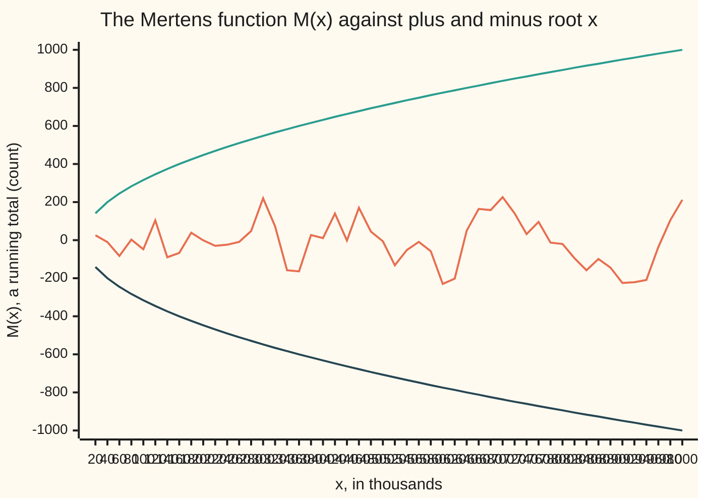

# The Riemann hypothesis: the exact statement, and three equivalents worth knowing

[Syllabus](../../../SYLLABUS.md) → [Algebraic and analytic number theory](../README.md) → [The Zeta Function and the Prime Number Theorem](../README.md#s02) → The Riemann hypothesis

---

## General Overview

There are 78,498 primes below a million. The offset logarithmic integral Li(x), the area under 1/log t from 2 to x, predicts 78,626.50. The miss is only 128.50.

Why is the miss so small, and how large can it get further out? Each zero of the zeta function adds one wave to the prime count ([The explicit formula](07-the-explicit-formula.md)). A zero with real part β makes a wave of size about x^β. So the error depends on how far right the zeros reach.

The **Riemann hypothesis** (RH from here on) says they all sit on one line, real part exactly 1/2. Then every wave has size about √x, and the prime count misses Li(x) by at most a constant times √x log x. At a million, √x log x is 13,815.51. With the explicit constant 1/(8π) the bound is 549.70. That constant is proved for the miss against li(x), the same area started at 0, where the true miss is 129.55: well inside the bound.

This card states RH exactly and proves that it says the same thing as two counting facts:

- the prime-count error is never much bigger than √x log x;
- the **Mertens function** M(x), the running total up to x of the Möbius values μ(n), each +1, −1 or 0 (defined under The formula), never outgrows x^(1/2 + ε) for any small ε. At a million, M(x) = 212.

A third equivalent, about sums of divisors, is stated with its source and checked to a million. Each equivalent turns a question about complex zeros into a question about counting. Prove any one, or break any one, and RH is settled.

**RH says every zero of zeta in the critical strip has real part exactly 1/2; this is the same statement as "the prime count misses Li(x) by at most about √x log x" and as "M(x) grows no faster than x^(1/2 + ε)", because the growth of a counting function decides how far left its Dirichlet series converges, and that decides where zeta can be zero.**

**What kind of fact this is:** RH is a conjecture by kind. It was unproved until 2026-11-21, when others certified a formal proof released the day before; its dated status is on [The Riemann hypothesis](../../25-Frontier/02-The%20Millennium%20Problems/01-riemann-hypothesis.md). Every zero up to height 3 × 10^12 is on the line (Platt and Trudgian, 2021). The equivalences are theorems. The Mertens equivalence and the prime-count equivalence are proved on this card in Why it works, with one quoted bound on 1/ζ named there. Robin's divisor-sum equivalent is stated with its source. The checks to a million are evidence, not proof.

### The picture: M(x) inside the band ±√x



Orange: M(x) every 20,000 up to a million, ending at 212. Green and dark: √x and −√x. M(x) wanders but stays well inside the band. RH needs only the wider band x^(1/2 + ε); the narrow band ±√x is the Mertens conjecture, which is false (The usual mistake).

---

## The formula

Notation first, in words. A zero of zeta in the **critical strip**, the band of complex numbers with real part from 0 to 1, is written $`\rho = \beta + it`$: β ("beta") is its real part and t its height. These are the **nontrivial zeros**. The **trivial zeros** at −2, −4, −6, … lie outside the strip and play no part ([The functional equation](02-functional-equation-proved.md)).

The **Möbius function** μ(n) is +1 or −1 when n is a product of distinct primes (an even or odd number of them), and 0 when a square divides n: μ(6) = 1, μ(30) = −1, μ(12) = 0 ([The Mobius function](../01-Arithmetic%20Functions%20Again/03-mobius-inversion.md)). The **Mertens function** M(x) is the running total of μ(n) for n up to x. This card introduces M(x) and the abbreviation RH.

```math
\mathrm{RH}:\quad \zeta(\beta + it) = 0 \ \text{ with } \ 0 < \beta < 1 \quad \Longrightarrow \quad \beta = \tfrac12
```

**Read it aloud:** if zeta is zero at a point of the critical strip, that point's real part is one half.

The three equivalents, each true exactly when RH is true:

```math
\begin{aligned} \text{(A)}\quad & \pi(x) = \mathrm{Li}(x) + O\!\left(\sqrt{x}\,\log x\right), \ \text{ equivalently } \ \psi(x) = x + O\!\left(\sqrt{x}\,\log^2 x\right) \\ \text{(B)}\quad & M(x) = O\!\left(x^{1/2 + \varepsilon}\right) \ \text{ for every } \varepsilon > 0 \\ \text{(C)}\quad & \sigma(n) < e^{\gamma}\, n \log\log n \ \text{ for every } n > 5040 \end{aligned}
```

**Read it aloud:** RH holds exactly when the prime count is Li of x plus an error at most a constant times root x log x; exactly when the Mertens function stays below a constant times x to the one half plus epsilon, for every positive epsilon; and exactly when every divisor sum past 5040 stays below e to the gamma times n log log n.

| Symbol | Plain meaning | In our example | Push it up and the answer… |
| --- | --- | --- | --- |
| $`\rho`$, $`\beta`$, $`t`$ | a zero in the strip; its real part; its height | first zero: β = 1/2, t = 14.134725, computed on [Counting the zeros](08-counting-the-zeros-riemann-von-mangoldt.md) | β above 1/2: a wave of size x^β |
| $`\zeta(s)`$, $`s`$, $`c`$ | zeta at the complex input s; the real part of Perron's starting line | 1/ζ(0.75) = −0.290589 | — |
| $`x`$, $`y`$, $`n`$, $`p`$ | count limits; a whole number; a prime | x = 10^6 | errors grow like √x |
| $`\pi(x)`$, $`\mathrm{Li}(x)`$, $`\mathrm{li}(x)`$ | primes up to x; area under 1/log t from 2 to x; the same area from 0 | 78,498; 78,626.50; li is li(2) = 1.0452 more | the gap grows, but slowly |
| $`\psi(x)`$, $`\Lambda(n)`$, $`\theta(y)`$ | running total of Λ(n); log p when n is a power of p, else 0; Chebyshev's sum of log p over primes up to y | ψ(10^6) = 999,586.60 | stays near x |
| $`\mu(n)`$, $`M(x)`$ | Möbius function; its running total | M(10^6) = 212 | M wanders both ways |
| $`\varepsilon`$ | any small positive number, fixed in advance | 0.1, so x^0.6 = 3,981.1 | weaker bound, easier to prove |
| $`O(f)`$, $`\ll`$, $`C`$, $`C_{\varepsilon}`$ | at most a constant C times f, for large x; a constant that depends on ε | √x log x | — |
| $`\sigma(n)`$ | the sum of the divisors of n | σ(5040) = 19,344 | — |
| $`\gamma`$ | Euler's constant | 0.5772156649, so e^γ = 1.781072 | — |
| $`T`$, $`N(T)`$ | a cut-off height; zeros with height from 0 to T | T = 1,000; main term of N(T) 648.62 | more waves kept |
| $`A(x)`$, $`a(n)`$, $`\alpha`$, $`F(s)`$ | any running total of numbers a(n); a power that bounds its growth; the function the M-integral defines in Step 2 | A = M, a = μ; F = 1/ζ | larger α: convergence only further right |

Here σ(n) is the divisor sum, not a real part; this card writes Re s for the real part of s.

### When it holds

- **Every ε, not ε = 0.** The bound $`\lvert M(x)\rvert < \sqrt{x}`$ holds at every x from 2 to a million, yet it is false: it is the Mertens conjecture, disproved in 1985. RH asks only for $`x^{1/2+\varepsilon}`$.
- **Nontrivial zeros only.** Zeta is 0 at −2, where the real part is −2. "Every zero has real part 1/2" taken literally is false on day one.
- **n above 5040 in (C).** From 3 to 5040 the inequality fails 26 times, last at 5040 itself, where σ(n)/(n log log n) is 1.790973, above e^γ = 1.781072.
- **The O constants.** The statements in (A) and (B) say nothing about the constant. An explicit one exists for (A) (the 1/(8π) above, for x at least 2,657, Schoenfeld 1976). The proof of (B) here gives a constant that depends on ε and is not made explicit.

---

## Why it works

### Step 0: growth controls convergence, and convergence controls zeros

Take any counting function, a running total A(x) of numbers a(n). Its **Dirichlet series** is the sum of a(n)/n^s. Summation by parts rewrites that sum as an integral of A(x) against $`x^{-s-1}`$.

If A(x) grows no faster than $`x^{\alpha}`$, the integral converges for every s with Re s above α. So the series stands for an analytic function (one with no poles or breaks) on that whole half-plane.

Now pick A to match zeta. The Möbius sum gives 1/ζ(s), and ψ gives −ζ′/ζ(s). Both have a pole (a point where the function blows up to infinity) at every zero of zeta. So if M(x) or ψ(x) − x grows no faster than $`x^{1/2+\varepsilon}`$, zeta has no zero right of 1/2 + ε.

The converse runs the machine backwards. [Perron's formula](04-perrons-formula.md) recovers A(x) as an integral of the series up a vertical line. If the series has no poles right of 1/2, the line can move to 1/2 + ε, and $`\lvert x^s\rvert`$ there is $`x^{1/2+\varepsilon}`$.

### Step 1: Abel's identity turns the Möbius sum into an integral of M(x)

Abel's identity ([Partial summation](../01-Arithmetic%20Functions%20Again/06-abel-and-partial-summation.md)) says, for any s and any cut-off N:

```math
\sum_{n \le N} \frac{\mu(n)}{n^{s}} = \frac{M(N)}{N^{s}} + s\int_1^{N} \frac{M(x)}{x^{s+1}}\,dx
```

**Read it aloud:** the Möbius sum up to N equals the last running total over N to the s, plus s times the integral of M(x) over x to the s plus one.

For Re s above 1 the left side tends to 1/ζ(s), since 1/ζ(s) is the sum of μ(n)/n^s ([Dirichlet series](../../07-Complex%20analysis/09-Special%20Functions%20and%20the%20Zeta%20Function/06-dirichlet-series-and-mobius-inversion.md)). The boundary term vanishes, so 1/ζ becomes an integral of M(x) against a power of x (a Mellin transform, the name the code uses):

```math
\frac{1}{\zeta(s)} = s\int_1^{\infty} \frac{M(x)}{x^{s+1}}\,dx \qquad (\mathrm{Re}\, s > 1)
```

The check computes both sides of the finite identity at s = 0.75 and N = 10^6: both give −0.284137. At s = 2 both give 0.607927, which is 6/π².

### Step 2: a small M(x) forces every zero onto the line

Suppose $`\lvert M(x)\rvert \le C x^{1/2+\varepsilon}`$ for all x at least 1. Then the integrand above is at most $`C x^{1/2+\varepsilon-\mathrm{Re}\,s-1}`$, which is integrable from 1 to ∞ whenever Re s exceeds 1/2 + ε.

So the integral defines an analytic function F(s) on the half-plane Re s > 1/2 + ε. F agrees with 1/ζ for Re s > 1. Zeta is analytic there apart from its pole at 1, and an analytic function is fixed by its values on any open region ([Analytic continuation](../../07-Complex%20analysis/04-Taylor%20Series%2C%20Zeros%20and%20Rigidity/04-analytic-continuation.md)). So ζ(s)F(s) = 1 on the whole half-plane.

At a zero of zeta that product would be 0, not 1. So zeta has no zero with real part above 1/2 + ε. This holds for every ε, so no zero has β > 1/2.

The functional equation pairs each zero ρ with the zero 1 − ρ ([The functional equation](02-functional-equation-proved.md)). A zero with β < 1/2 would give one with real part above 1/2. None exists, so every zero in the strip has β = 1/2. That is RH.

The check shows the integral at work at s = 0.75, where RH would make it converge. Its partial values −0.311479, −0.299141 and −0.284137 at 10^4, 10^5 and 10^6 close in, slowly, on 1/ζ(0.75) = −0.290589.

### Step 3: RH forces M(x) to stay small

Now assume RH. Perron's formula reads M(x) off the series 1/ζ(s) with an integral up the line Re s = c, a little right of 1, cut at height T:

```math
M(x) = \frac{1}{2\pi i}\int_{c - iT}^{c + iT} \frac{x^{s}}{s\,\zeta(s)}\,ds + O\!\left(\frac{x \log x}{T}\right)
```

**Read it aloud:** the Mertens function is the integral of x to the s over s times zeta, up a vertical line, plus an error at most a constant times x log x over T.

Slide the line left to Re s = 1/2 + ε. Under RH nothing between the lines is a pole: zeta has no zeros there, and at s = 1 the factor 1/ζ is 0.

One input is quoted, not proved here. Under RH, for Re s at least 1/2 + ε and height at least 1, $`\lvert 1/\zeta(s)\rvert \le C_{\varepsilon} \lvert t\rvert^{\varepsilon}`$ (Littlewood; Montgomery and Vaughan, chapter 13). With it, the new line contributes at most a constant times $`x^{1/2+\varepsilon}T^{\varepsilon}`$. Choosing T = x makes every piece at most a constant times $`x^{1/2+2\varepsilon}`$. Since ε was any small number, that is (B).

<details>
<summary>Detailed proof: the three pieces of the moved contour</summary>

Take c = 1 + 1/log x. The truncated Perron formula has error at most a constant times $`x\log x / T`$ when x is half an odd integer; for other x, M changes by at most 1.

The rectangle with corners c ± iT and 1/2 + ε ± iT contains no pole of $`x^s/(s\zeta(s))`$ under RH, so the integral up the right side equals the integral up the left side plus the two horizontal sides.

Left side, height at least 1: the integrand is at most $`x^{1/2+\varepsilon} C_{\varepsilon} \lvert t\rvert^{\varepsilon} / \lvert t\rvert`$, and the integral of $`\lvert t\rvert^{\varepsilon - 1}`$ up to T is at most $`2T^{\varepsilon}/\varepsilon`$. Below height 1, 1/ζ is bounded on that short segment, since zeta has no zero near it.

Horizontal sides at height ±T: the integrand is at most $`x^{\mathrm{Re}\,s} C_{\varepsilon} T^{\varepsilon - 1}`$, and its integral across is at most a constant times $`x\,T^{\varepsilon-1}`$.

With T = x the three terms are at most constants times $`x^{1/2+\varepsilon}x^{\varepsilon}`$, $`x^{\varepsilon}`$ and $`\log x`$. So $`M(x) \ll x^{1/2+2\varepsilon}`$; rename 2ε as ε.

</details>

### Step 4: the same two directions for the primes

The prime version swaps μ for Λ. Summation by parts gives, for Re s > 1:

```math
-\frac{\zeta'(s)}{\zeta(s)} - \frac{s}{s-1} = s\int_1^{\infty} \frac{\psi(x) - x}{x^{s+1}}\,dx
```

**Read it aloud:** minus zeta's log derivative, minus s over s minus one, equals s times the integral of the prime error ψ(x) − x over x to the s plus one.

The left side has a pole at every zero of zeta, with residue (the coefficient of 1/(s − ρ) near the zero) equal to minus the zero's multiplicity. So, as in Step 2, if $`\lvert\psi(x) - x\rvert \le C x^{1/2+\varepsilon}`$, there is no zero right of 1/2 + ε, and RH follows.

The other direction uses the truncated explicit formula ([The explicit formula](07-the-explicit-formula.md)). For T between 2 and x:

```math
\psi(x) = x - \sum_{\lvert t\rvert \le T} \frac{x^{\rho}}{\rho} + O\!\left(\frac{x \log^2 (xT)}{T}\right)
```

Under RH each $`\lvert x^{\rho}\rvert`$ is exactly √x. [Counting the zeros](08-counting-the-zeros-riemann-von-mangoldt.md) gives about $`(t/2\pi)\log(t/2\pi e)`$ zeros up to height t, so the sum of 1/|ρ| up to T is about $`\log^2(T/2\pi)/(2\pi)`$.

Take T = √x. At x = 10^6, T = 1,000. The main term of the count gives 648.62 zeros above the axis, with as many mirror images below. Over all of them the sum of 1/|ρ| is about 4.0909. The waves total at most about 4,090.9, and the end error has the same order, √x log² x. So ψ(x) = x + O(√x log² x).

The true ψ(10^6) − 10^6 is −413.40. Schoenfeld's explicit RH bound, √x log² x/(8π) for x at least 73.2, is 7,594.41.

### Step 5: from ψ(x) to π(x)

Partial summation carries an error in ψ(x) over to π(x), dividing by log x on the way ([The logarithmic integral](06-the-logarithmic-integral-and-the-error-term.md)). The prime powers in ψ add only about √x. So RH gives

```math
\pi(x) = \mathrm{Li}(x) + O\!\left(\sqrt{x}\,\log x\right)
```

That bound and its converse, von Koch's 1901 theorem, are stated on [Zeta's zeros and the primes](../../07-Complex%20analysis/09-Special%20Functions%20and%20the%20Zeta%20Function/09-zeros-of-zeta-and-the-primes.md). The converse runs the same path backwards: an error $`x^{1/2+\varepsilon}`$ in π(x) gives one of size $`x^{1/2+\varepsilon}\log x`$ in ψ(x), and Step 4 turns that into RH.

### Step 6: Robin's divisor-sum criterion, stated

For a product n of small primes, σ(n)/n is a product of factors near p/(p − 1). Mertens' third theorem ([Mertens' theorems](../01-Arithmetic%20Functions%20Again/09-mertens-theorems.md)) says the product of p/(p − 1) over primes up to y grows like $`e^{\gamma}\log y`$. That gives the curve $`e^{\gamma}\log\log n`$.

Whether σ(n)/n crosses that curve depends on the error θ(y) − y in the prime count, where θ(y) is the sum of log p over primes up to y. Robin proved in 1984 that the inequality (C) holds for every n above 5040 exactly when RH is true. The proof is in Robin's own 1984 paper; Lagarias (2002) states the criterion, points to that paper for the proof, and builds a version with no exceptions on it.

The check computes σ(n) for every n up to a million. The inequality fails for 26 numbers, from 3 to 5040, and for none after. Above 5040 the closest call is n = 10,080, at 1.755814 against e^γ = 1.781072.

---

## Worked numbers, by hand

All at x = 10^6, the example: the error RH allows in the prime count.

| Step | Arithmetic | Value |
| --- | --- | --- |
| primes below a million | sieve, and Legendre's count | 78,498 |
| offset integral | area under 1/log t from 2 to 10^6 | 78,626.50 |
| the miss | 78,498 − 78,626.50 | −128.50 |
| the miss against li | li is li(2) = 1.0452 larger: −128.50 − 1.0452 | −129.55 |
| RH size | √(10^6) × log 10^6 = 1000 × log 10^6 | 13,815.51 |
| explicit RH bound | 13,815.51 ÷ 8π | **549.70** |
| prime error, weighted | ψ(10^6) − 10^6 | −413.40 |
| its RH bound | 1000 × (log 10^6)² ÷ 8π | 7,594.41 |
| Mertens function | sum of μ(n), n up to 10^6 | 212 |
| against √x and x^0.6 | 212 ÷ 1000; x^0.6 | 0.2120; 3,981.1 |

The miss against li, 129.55, sits well inside the 549.70 that RH would allow, so the primes up to a million behave as RH predicts.

### What breaks if you drop a piece

| Mistake | Comes out at | What went wrong |
| --- | --- | --- |
| Demand $`\lvert M(x)\rvert < \sqrt{x}`$ (ε = 0) | holds from 2 to 10^6, worst ratio 0.8944 at x = 5, yet false | that is the Mertens conjecture, stronger than RH |
| Use x/log x in place of Li(x) | 72,382.41: gap 6,115.59, ratio 1.0845 | the gap is far beyond the RH bound 549.70 and keeps growing |
| One zero at real part 0.6, height 14.134725 | wave 562.8 at 10^6, against 141.4 on the line | a wave of size x^0.6 outgrows √x log x |
| Drop "n > 5040" from Robin | 26 failures, the last at 5040 (1.790973) | small n beat the curve; the theorem starts at 5041 |

The check prints every row.

---

## Code, from first principles, and it actually runs

The code takes two roads to every count and one more road to each identity behind the proofs. Primes: a sieve and Legendre's inclusion–exclusion count. Li(x): a series and Simpson's rule. M(x): the Möbius sieve and the recursion "M(x/1) + M(x/2) + … + M(x/x) = 1", which never uses μ. ψ(x): checked against Chebyshev's identity, the sum of ψ(x/n) equals log x!. σ(n): a divisor sieve and the prime-factor formula. Euler's constant: 1,000 terms with corrections, and a million terms.

### Python

```python
# The Riemann hypothesis and three equivalents -- the check behind the card.  Standard library only.
# Primes by a sieve and by Legendre's count; Li by series and by Simpson's rule; M(x) by the Mobius
# sieve and by the recursion sum M(x/n) = 1; psi checked by Chebyshev's identity sum psi(x/n) = log x!.
import math, functools
X, SIZES = 10**6, (10**4, 10**5, 10**6)
flag = bytearray([1]) * (X + 1); flag[0] = flag[1] = 0
mu, sig = [1] * (X + 1), [0] * (X + 1)
for p in range(2, X + 1):                      # sieve: primes, and mu(n) one prime at a time
    if flag[p]:
        flag[p * p::p] = bytearray(len(range(p * p, X + 1, p)))
        for m in range(p, X + 1, p): mu[m] = -mu[m]
        for m in range(p * p, X + 1, p * p): mu[m] = 0
primes = [p for p in range(2, X + 1) if flag[p]]
for d in range(1, X + 1):                      # sigma(n), the sum of the divisors of n
    for m in range(d, X + 1, d): sig[m] += d
Mc, psic, M, ps = [0] * (X + 1), [0.0] * (X + 1), 0, 0.0
lam = [0.0] * (X + 1)
for p in primes:
    q = p
    while q <= X: lam[q] = math.log(p); q *= p
for n in range(1, X + 1):                      # running totals M(n) and psi(n)
    M += mu[n]; ps += lam[n]; Mc[n], psic[n] = M, ps
@functools.lru_cache(None)
def phi(x, a):                                 # numbers up to x free of the first a primes (Legendre)
    return x if a == 0 or x == 0 else phi(x, a - 1) - phi(x // primes[a - 1], a - 1)
@functools.lru_cache(None)
def mert(x):                                   # M(x) from sum_{n<=x} M(x/n) = 1 alone, no Mobius values
    total, n = 1, 2
    while n <= x:
        v = x // n; n2 = x // v; total -= (n2 - n + 1) * mert(v); n = n2 + 1
    return total
gam = sum(1 / k for k in range(1, 1001)) - math.log(1000) - 1 / 2000 + 1 / 12e6   # Euler's constant
li = lambda y: gam + math.log(y) + sum(y ** k / (k * math.factorial(k)) for k in range(1, 150))  # y = log x
def simpson(f, a, b, n=20000):
    h = (b - a) / n
    return h / 3 * (f(a) + f(b) + sum((4 if k % 2 else 2) * f(a + k * h) for k in range(1, n)))
Li_ser = lambda x: li(math.log(x)) - li(math.log(2))
Li_int = lambda x: simpson(lambda u: math.exp(u) / u, math.log(2), math.log(x))  # t = e^u
def zeta(s, N=50):                             # Euler-Maclaurin, valid for real s > -5, s != 1
    r = lambda m: math.prod(s + j for j in range(m)) * N ** (-s - m)
    return (sum(n ** -s for n in range(1, N)) + N ** (1 - s) / (s - 1) + N ** -s / 2
            + r(1) / 12 - r(3) / 720 + r(5) / 30240)
print("1. The prime count against Li(x), and the RH-sized error")
for x in SIZES:
    pi, a = sum(1 for p in primes if p <= x), sum(1 for p in primes if p * p <= x)
    b = math.sqrt(x) * math.log(x)
    print(f"x = {x}: pi sieve {pi}, Legendre {phi(x, a) + a - 1}; Li series {Li_ser(x):.2f}, Simpson {Li_int(x):.2f}; "
          f"pi - Li {pi - Li_ser(x):.2f}; sqrt(x) log x {b:.2f}; /(8 pi) {b / (8 * math.pi):.2f}")
print(f"li(2) = {li(math.log(2)):.4f}; pi - li at 10^6 {78498 - li(math.log(X)):.2f}; x/log x at 10^6 {X / math.log(X):.2f}, "
      f"gap {78498 - X / math.log(X):.2f}, ratio {78498 / (X / math.log(X)):.4f}")
print("2. Chebyshev's psi(x) against x")
for x in SIZES:
    print(f"x = {x}: psi {psic[x]:.2f}; psi - x {psic[x] - x:.2f}; sqrt(x) log^2 x / (8 pi) {math.sqrt(x) * math.log(x) ** 2 / (8 * math.pi):.2f}")
lhs, rhs = sum(psic[X // n] for n in range(1, X + 1)), sum(math.log(k) for k in range(2, X + 1))
print(f"Chebyshev at 10^6: sum psi(x/n) {lhs:.2f}; log x! {rhs:.2f}")
print(f"3. The Mertens function M(x); mu(6), mu(30), mu(12): {mu[6]} {mu[30]} {mu[12]}")
worst = max((abs(Mc[n]) / math.sqrt(n), n) for n in range(2, X + 1))
late = max((abs(Mc[n]) / math.sqrt(n), n) for n in range(1000, X + 1))
for x in SIZES:
    print(f"x = {x}: M sieve {Mc[x]}, recursion {mert(x)}; |M|/sqrt(x) {abs(Mc[x]) / math.sqrt(x):.4f}; "
          f"x^0.6 {x ** 0.6:.1f}")
print(f"largest |M(x)|/sqrt(x), 2 <= x <= 10^6: {worst[0]:.4f} at x = {worst[1]} (M = {Mc[worst[1]]}); "
      f"from 1000 on: {late[0]:.4f} at x = {late[1]} (M = {Mc[late[1]]})")
print("4. The Mellin step: sum mu(n)/n^s against 1/zeta(s)")
for s in (2.0, 0.75, 0.6):
    part = [0.0]; acc = 0.0
    for n in range(1, X + 1):
        if mu[n]: acc += mu[n] * n ** -s
        if n in SIZES: part.append(acc)
    abel = Mc[X] * X ** -s + sum(Mc[n] * (n ** -s - (n + 1) ** -s) for n in range(1, X))
    print(f"s = {s}: 1/zeta {1 / zeta(s):.6f}; partial sums to 10^4, 10^5, 10^6: "
          + ", ".join(f"{v:.6f}" for v in part[1:]) + f"; M-integral form at 10^6 {abel:.6f}")
    if s == 0.75: miss75, abel75, acc75 = abs(part[3] - 1 / zeta(s)), abel, acc
print(f"zeta(0.75) {zeta(0.75):.6f}; 6/pi^2 {6 / math.pi ** 2:.6f}")
print("5. Robin's inequality sigma(n) < e^gamma n log log n")
eg, ratio = math.exp(gam), lambda n: sig[n] / (n * math.log(math.log(n)))
gam2 = sum(1 / k for k in range(1, X + 1)) - math.log(X) - 1 / (2 * X)           # second road, 10^6 terms
print(f"Euler's constant: 1000 terms + corrections {gam:.10f}; 10^6 terms {gam2:.10f}")
bad = [n for n in range(3, X + 1) if ratio(n) >= eg]
top = max((ratio(n), n) for n in range(5041, X + 1))
print(f"e^gamma {eg:.6f}; failures for 3 <= n <= 10^6: {len(bad)}, largest {bad[-1]}; sigma(5040) {sig[5040]}, "
      f"ratio {ratio(5040):.6f}")
print("failures: " + " ".join(map(str, bad)))
print(f"largest ratio for 5040 < n <= 10^6: {top[0]:.6f} at n = {top[1]}, sigma {sig[top[1]]}")
print("6. The zeros' waves, and one zero off the line at height 14.134725")
T = 1000.0                                     # cut-off height for the zeros, T = sqrt(10^6)
print(f"T = 1000: zeros N(T) by the main term (T/2pi) log(T/(2pi e)) + 7/8 = "
      f"{T / (2 * math.pi) * math.log(T / (2 * math.pi * math.e)) + 7 / 8:.2f}; sum of 1/|rho| about "
      f"log^2(T/2pi) / (2pi) = {math.log(T / (2 * math.pi)) ** 2 / (2 * math.pi):.4f}; times sqrt(x) {1000 * math.log(T / (2 * math.pi)) ** 2 / (2 * math.pi):.1f}")
for beta in (0.5, 0.6):
    print(f"real part {beta}: wave size 2 x^beta / |rho| at 10^6 = {2 * X ** beta / abs(complex(beta, 14.134725)):.1f}")
print("chart x = 20000k: M " + ", ".join(str(Mc[20000 * k]) for k in range(1, 51)))
print("chart sqrt(x): " + ", ".join(f"{math.sqrt(20000 * k):.0f}" for k in range(1, 51)))
print("chart -sqrt(x): " + ", ".join(f"{-math.sqrt(20000 * k):.0f}" for k in range(1, 51)))
def sigma_by_factors(n):                       # product of (p^(k+1) - 1)/(p - 1), by trial division
    out, p = 1, 2
    while n > 1:
        k = 0
        while n % p == 0: n //= p; k += 1
        out *= (p ** (k + 1) - 1) // (p - 1); p += 1
    return out
assert sum(1 for p in primes if p <= X) == phi(X, 168) + 167 == 78498        # two prime counts
assert all(abs(Li_ser(x) - Li_int(x)) < 1e-4 for x in SIZES)                  # two roads to Li
assert all(Mc[x] == mert(x) for x in SIZES) and Mc[X] == 212                  # two roads to M
assert abs(lhs - rhs) < 1e-6 * rhs                                            # Chebyshev's identity
assert abs(abel75 - acc75) < 1e-9 and miss75 < 0.01                           # Abel step; Mellin evidence
assert sig[5040] == sigma_by_factors(5040) and sig[top[1]] == sigma_by_factors(top[1]) and bad[-1] == 5040
assert abs(gam - gam2) < 1e-10 and len(bad) == 26                             # two roads to gamma; Robin's list
assert all(abs(psic[x] - x) < math.sqrt(x) * math.log(x) ** 2 / (8 * math.pi) for x in SIZES)
print("ALL CHECKS PASS")
```

**Ran 2026-11-15 on macOS, Python 3.14.10, standard library only. All checks passed. Output, pasted from the run:**

```
1. The prime count against Li(x), and the RH-sized error
x = 10000: pi sieve 1229, Legendre 1229; Li series 1245.09, Simpson 1245.09; pi - Li -16.09; sqrt(x) log x 921.03; /(8 pi) 36.65
x = 100000: pi sieve 9592, Legendre 9592; Li series 9628.76, Simpson 9628.76; pi - Li -36.76; sqrt(x) log x 3640.71; /(8 pi) 144.86
x = 1000000: pi sieve 78498, Legendre 78498; Li series 78626.50, Simpson 78626.50; pi - Li -128.50; sqrt(x) log x 13815.51; /(8 pi) 549.70
li(2) = 1.0452; pi - li at 10^6 -129.55; x/log x at 10^6 72382.41, gap 6115.59, ratio 1.0845
2. Chebyshev's psi(x) against x
x = 10000: psi 10013.40; psi - x 13.40; sqrt(x) log^2 x / (8 pi) 337.53
x = 100000: psi 100051.56; psi - x 51.56; sqrt(x) log^2 x / (8 pi) 1667.75
x = 1000000: psi 999586.60; psi - x -413.40; sqrt(x) log^2 x / (8 pi) 7594.41
Chebyshev at 10^6: sum psi(x/n) 12815518.38; log x! 12815518.38
3. The Mertens function M(x); mu(6), mu(30), mu(12): 1 -1 0
x = 10000: M sieve -23, recursion -23; |M|/sqrt(x) 0.2300; x^0.6 251.2
x = 100000: M sieve -48, recursion -48; |M|/sqrt(x) 0.1518; x^0.6 1000.0
x = 1000000: M sieve 212, recursion 212; |M|/sqrt(x) 0.2120; x^0.6 3981.1
largest |M(x)|/sqrt(x), 2 <= x <= 10^6: 0.8944 at x = 5 (M = -2); from 1000 on: 0.4722 at x = 2803 (M = -25)
4. The Mellin step: sum mu(n)/n^s against 1/zeta(s)
s = 2.0: 1/zeta 0.607927; partial sums to 10^4, 10^5, 10^6: 0.607927, 0.607927, 0.607927; M-integral form at 10^6 0.607927
s = 0.75: 1/zeta -0.290589; partial sums to 10^4, 10^5, 10^6: -0.311479, -0.299141, -0.284137; M-integral form at 10^6 -0.284137
s = 0.6: 1/zeta -0.512122; partial sums to 10^4, 10^5, 10^6: -0.595411, -0.559814, -0.460357; M-integral form at 10^6 -0.460357
zeta(0.75) -3.441285; 6/pi^2 0.607927
5. Robin's inequality sigma(n) < e^gamma n log log n
Euler's constant: 1000 terms + corrections 0.5772156649; 10^6 terms 0.5772156649
e^gamma 1.781072; failures for 3 <= n <= 10^6: 26, largest 5040; sigma(5040) 19344, ratio 1.790973
failures: 3 4 5 6 8 9 10 12 16 18 20 24 30 36 48 60 72 84 120 180 240 360 720 840 2520 5040
largest ratio for 5040 < n <= 10^6: 1.755814 at n = 10080, sigma 39312
6. The zeros' waves, and one zero off the line at height 14.134725
T = 1000: zeros N(T) by the main term (T/2pi) log(T/(2pi e)) + 7/8 = 648.62; sum of 1/|rho| about log^2(T/2pi) / (2pi) = 4.0909; times sqrt(x) 4090.9
real part 0.5: wave size 2 x^beta / |rho| at 10^6 = 141.4
real part 0.6: wave size 2 x^beta / |rho| at 10^6 = 562.8
chart x = 20000k: M 26, -10, -83, 3, -48, 104, -90, -67, 39, -1, -30, -24, -9, 48, 220, 73, -158, -164, 27, 11, 140, -2, 170, 45, -6, -132, -52, -9, -58, -230, -202, 50, 164, 158, 226, 141, 32, 96, -13, -20, -95, -158, -99, -144, -225, -221, -209, -36, 105, 212
chart sqrt(x): 141, 200, 245, 283, 316, 346, 374, 400, 424, 447, 469, 490, 510, 529, 548, 566, 583, 600, 616, 632, 648, 663, 678, 693, 707, 721, 735, 748, 762, 775, 787, 800, 812, 825, 837, 849, 860, 872, 883, 894, 906, 917, 927, 938, 949, 959, 970, 980, 990, 1000
chart -sqrt(x): -141, -200, -245, -283, -316, -346, -374, -400, -424, -447, -469, -490, -510, -529, -548, -566, -583, -600, -616, -632, -648, -663, -678, -693, -707, -721, -735, -748, -762, -775, -787, -800, -812, -825, -837, -849, -860, -872, -883, -894, -906, -917, -927, -938, -949, -959, -970, -980, -990, -1000
ALL CHECKS PASS
```

### Rust

Same numbers, same labels, built with `rustc --edition 2021 -O`.

```rust
// The Riemann hypothesis and three equivalents -- the same check as the Python, in Rust.  No crates.
// Primes by a sieve and by Legendre's count; Li by series and by Simpson's rule; M(x) by the Mobius
// sieve and by the recursion sum M(x/n) = 1; psi checked by Chebyshev's identity sum psi(x/n) = log x!.
use std::collections::HashMap;
use std::f64::consts::{E, PI};
fn phi(x: u64, a: usize, pr: &[u64], memo: &mut HashMap<(u64, usize), i64>) -> i64 { // Legendre
    if a == 0 || x == 0 { return x as i64 }
    if let Some(&v) = memo.get(&(x, a)) { return v }
    let v = phi(x, a - 1, pr, memo) - phi(x / pr[a - 1], a - 1, pr, memo);
    memo.insert((x, a), v); v
}
fn mert(x: u64, memo: &mut HashMap<u64, i64>) -> i64 { // M(x) from sum_{n<=x} M(x/n) = 1 alone
    if let Some(&v) = memo.get(&x) { return v }
    let (mut total, mut n) = (1i64, 2u64);
    while n <= x { let v = x / n; let n2 = x / v; total -= (n2 - n + 1) as i64 * mert(v, memo); n = n2 + 1; }
    memo.insert(x, total); total
}
fn simpson(f: &dyn Fn(f64) -> f64, a: f64, b: f64) -> f64 {
    let n = 20000; let h = (b - a) / n as f64;
    let mut s = 0.0; for k in 1..n { s += (if k % 2 == 1 { 4.0 } else { 2.0 }) * f(a + k as f64 * h); }
    h / 3.0 * (f(a) + f(b) + s)
}
fn zeta(s: f64) -> f64 { // Euler-Maclaurin, valid for real s > -5, s != 1
    let nn = 50.0f64;
    let r = |m: usize| (0..m).fold(1.0, |p, j| p * (s + j as f64)) * nn.powf(-s - m as f64);
    let head: f64 = (1..50).map(|n| (n as f64).powf(-s)).sum();
    head + nn.powf(1.0 - s) / (s - 1.0) + nn.powf(-s) / 2.0 + r(1) / 12.0 - r(3) / 720.0 + r(5) / 30240.0
}
fn sigma_by_factors(mut n: u64) -> u64 { // product of (p^(k+1) - 1)/(p - 1), by trial division
    let (mut out, mut p) = (1u64, 2u64);
    while n > 1 { let mut pk = 1u64; while n % p == 0 { n /= p; pk *= p; } out *= (pk * p - 1) / (p - 1); p += 1; }
    out
}
fn join<T: ToString>(v: impl Iterator<Item = T>) -> String { v.map(|u| u.to_string()).collect::<Vec<_>>().join(", ") }
fn main() {
    const X: usize = 1_000_000; let sizes = [10_000usize, 100_000, 1_000_000];
    let mut flag = vec![true; X + 1]; flag[0] = false; flag[1] = false;
    let (mut mu, mut sig) = (vec![1i64; X + 1], vec![0u64; X + 1]);
    for p in 2..=X { // sieve: primes, and mu(n) one prime at a time
        if !flag[p] { continue }
        let mut m = p * p; while m <= X { flag[m] = false; m += p }
        let mut m = p; while m <= X { mu[m] = -mu[m]; m += p }
        let mut m = p * p; while m <= X { mu[m] = 0; m += p * p }
    }
    let primes: Vec<u64> = (2..=X).filter(|&p| flag[p]).map(|p| p as u64).collect();
    for d in 1..=X { let mut m = d; while m <= X { sig[m] += d as u64; m += d } } // sigma(n)
    let mut lam = vec![0.0f64; X + 1];
    for &p in &primes { let mut q = p as usize; while q <= X { lam[q] = (p as f64).ln(); q *= p as usize } }
    let (mut mc, mut psic) = (vec![0i64; X + 1], vec![0.0f64; X + 1]); let (mut m, mut ps) = (0i64, 0.0f64);
    for n in 1..=X { m += mu[n]; ps += lam[n]; mc[n] = m; psic[n] = ps } // running M(n), psi(n)
    let (mut pmemo, mut mmemo) = (HashMap::new(), HashMap::new());
    let gam = (1..1001).map(|k| 1.0 / k as f64).sum::<f64>() - 1000f64.ln() - 1.0 / 2000.0 + 1.0 / 12e6;
    let li = |y: f64| { let (mut t, mut s) = (1.0f64, 0.0); for k in 1..150 { t *= y / k as f64; s += t / k as f64 } gam + y.ln() + s };
    let li_ser = |x: f64| li(x.ln()) - li(2f64.ln());
    let li_int = |x: f64| simpson(&|u: f64| u.exp() / u, 2f64.ln(), x.ln());
    println!("1. The prime count against Li(x), and the RH-sized error");
    for &x in &sizes {
        let pi = primes.iter().filter(|&&p| p as usize <= x).count();
        let a = primes.iter().filter(|&&p| (p * p) as usize <= x).count();
        let (xf, b) = (x as f64, (x as f64).sqrt() * (x as f64).ln());
        println!("x = {}: pi sieve {}, Legendre {}; Li series {:.2}, Simpson {:.2}; pi - Li {:.2}; sqrt(x) log x {:.2}; /(8 pi) {:.2}",
            x, pi, phi(x as u64, a, &primes, &mut pmemo) + a as i64 - 1, li_ser(xf), li_int(xf), pi as f64 - li_ser(xf), b, b / (8.0 * PI));
    }
    let xf = X as f64; let xl = xf / xf.ln();
    println!("li(2) = {:.4}; pi - li at 10^6 {:.2}; x/log x at 10^6 {:.2}, gap {:.2}, ratio {:.4}",
        li(2f64.ln()), 78498.0 - li(xf.ln()), xl, 78498.0 - xl, 78498.0 / xl);
    println!("2. Chebyshev's psi(x) against x");
    for &x in &sizes {
        let f = x as f64;
        println!("x = {}: psi {:.2}; psi - x {:.2}; sqrt(x) log^2 x / (8 pi) {:.2}", x, psic[x], psic[x] - f, f.sqrt() * f.ln().powi(2) / (8.0 * PI));
    }
    let lhs: f64 = (1..=X).map(|n| psic[X / n]).sum(); let rhs: f64 = (2..=X).map(|k| (k as f64).ln()).sum();
    println!("Chebyshev at 10^6: sum psi(x/n) {:.2}; log x! {:.2}", lhs, rhs);
    println!("3. The Mertens function M(x); mu(6), mu(30), mu(12): {} {} {}", mu[6], mu[30], mu[12]);
    let best = |lo: usize| { let mut w = (0.0f64, 0usize); for n in lo..=X { let r = mc[n].abs() as f64 / (n as f64).sqrt(); if r >= w.0 { w = (r, n) } } w };
    let (worst, late) = (best(2), best(1000));
    for &x in &sizes {
        let f = x as f64;
        println!("x = {}: M sieve {}, recursion {}; |M|/sqrt(x) {:.4}; x^0.6 {:.1}", x, mc[x], mert(x as u64, &mut mmemo), mc[x].abs() as f64 / f.sqrt(), f.powf(0.6));
    }
    println!("largest |M(x)|/sqrt(x), 2 <= x <= 10^6: {:.4} at x = {} (M = {}); from 1000 on: {:.4} at x = {} (M = {})",
        worst.0, worst.1, mc[worst.1], late.0, late.1, mc[late.1]);
    println!("4. The Mellin step: sum mu(n)/n^s against 1/zeta(s)");
    let (mut miss75, mut abel75, mut acc75) = (0.0, 0.0, 0.0);
    for (s, lab) in [(2.0f64, "2.0"), (0.75, "0.75"), (0.6, "0.6")] {
        let (mut part, mut acc) = (Vec::new(), 0.0f64);
        for n in 1..=X { if mu[n] != 0 { acc += mu[n] as f64 * (n as f64).powf(-s) } if sizes.contains(&n) { part.push(acc) } }
        let mut abel = mc[X] as f64 * xf.powf(-s);
        for n in 1..X { abel += mc[n] as f64 * ((n as f64).powf(-s) - ((n + 1) as f64).powf(-s)) }
        println!("s = {}: 1/zeta {:.6}; partial sums to 10^4, 10^5, 10^6: {}; M-integral form at 10^6 {:.6}",
            lab, 1.0 / zeta(s), join(part.iter().map(|v| format!("{:.6}", v))), abel);
        if s == 0.75 { miss75 = (part[2] - 1.0 / zeta(s)).abs(); abel75 = abel; acc75 = acc }
    }
    println!("zeta(0.75) {:.6}; 6/pi^2 {:.6}", zeta(0.75), 6.0 / (PI * PI));
    println!("5. Robin's inequality sigma(n) < e^gamma n log log n");
    let gam2 = (1..=X).map(|k| 1.0 / k as f64).sum::<f64>() - xf.ln() - 1.0 / (2.0 * xf); // second road, 10^6 terms
    println!("Euler's constant: 1000 terms + corrections {:.10}; 10^6 terms {:.10}", gam, gam2);
    let eg = gam.exp(); let ratio = |n: usize| sig[n] as f64 / (n as f64 * (n as f64).ln().ln());
    let bad: Vec<usize> = (3..=X).filter(|&n| ratio(n) >= eg).collect();
    let mut top = (0.0f64, 0usize); for n in 5041..=X { if ratio(n) >= top.0 { top = (ratio(n), n) } }
    println!("e^gamma {:.6}; failures for 3 <= n <= 10^6: {}, largest {}; sigma(5040) {}, ratio {:.6}",
        eg, bad.len(), bad[bad.len() - 1], sig[5040], ratio(5040));
    println!("failures: {}", bad.iter().map(|n| n.to_string()).collect::<Vec<_>>().join(" "));
    println!("largest ratio for 5040 < n <= 10^6: {:.6} at n = {}, sigma {}", top.0, top.1, sig[top.1]);
    println!("6. The zeros' waves, and one zero off the line at height 14.134725");
    let t = 1000.0f64; let lg = (t / (2.0 * PI)).ln().powi(2) / (2.0 * PI);
    println!("T = 1000: zeros N(T) by the main term (T/2pi) log(T/(2pi e)) + 7/8 = {:.2}; sum of 1/|rho| about log^2(T/2pi) / (2pi) = {:.4}; times sqrt(x) {:.1}",
        t / (2.0 * PI) * (t / (2.0 * PI * E)).ln() + 7.0 / 8.0, lg, 1000.0 * lg);
    for (beta, lab) in [(0.5f64, "0.5"), (0.6, "0.6")] {
        println!("real part {}: wave size 2 x^beta / |rho| at 10^6 = {:.1}", lab, 2.0 * xf.powf(beta) / beta.hypot(14.134725));
    }
    println!("chart x = 20000k: M {}", join((1..51).map(|k| mc[20000 * k])));
    println!("chart sqrt(x): {}", join((1..51).map(|k| format!("{:.0}", ((20000 * k) as f64).sqrt()))));
    println!("chart -sqrt(x): {}", join((1..51).map(|k| format!("{:.0}", -((20000 * k) as f64).sqrt()))));
    assert!(primes.len() == 78498 && phi(X as u64, 168, &primes, &mut pmemo) + 167 == 78498); // two prime counts
    assert!(sizes.iter().all(|&x| (li_ser(x as f64) - li_int(x as f64)).abs() < 1e-4));     // two roads to Li
    assert!(sizes.iter().all(|&x| mc[x] == mert(x as u64, &mut mmemo)) && mc[X] == 212);     // two roads to M
    assert!((lhs - rhs).abs() < 1e-6 * rhs);                                                  // Chebyshev's identity
    assert!((abel75 - acc75).abs() < 1e-9 && miss75 < 0.01);                                  // Abel step; Mellin evidence
    assert!(sig[5040] == sigma_by_factors(5040) && sig[top.1] == sigma_by_factors(top.1 as u64) && bad[bad.len() - 1] == 5040);
    assert!((gam - gam2).abs() < 1e-10 && bad.len() == 26);                                    // two roads to gamma; Robin's list
    assert!(sizes.iter().all(|&x| (psic[x] - x as f64).abs() < (x as f64).sqrt() * (x as f64).ln().powi(2) / (8.0 * PI)));
    println!("ALL CHECKS PASS");
}
```

**Ran 2026-11-15 on macOS, rustc 1.98.1, no crates. All checks passed. Output, pasted from the run:**

```
1. The prime count against Li(x), and the RH-sized error
x = 10000: pi sieve 1229, Legendre 1229; Li series 1245.09, Simpson 1245.09; pi - Li -16.09; sqrt(x) log x 921.03; /(8 pi) 36.65
x = 100000: pi sieve 9592, Legendre 9592; Li series 9628.76, Simpson 9628.76; pi - Li -36.76; sqrt(x) log x 3640.71; /(8 pi) 144.86
x = 1000000: pi sieve 78498, Legendre 78498; Li series 78626.50, Simpson 78626.50; pi - Li -128.50; sqrt(x) log x 13815.51; /(8 pi) 549.70
li(2) = 1.0452; pi - li at 10^6 -129.55; x/log x at 10^6 72382.41, gap 6115.59, ratio 1.0845
2. Chebyshev's psi(x) against x
x = 10000: psi 10013.40; psi - x 13.40; sqrt(x) log^2 x / (8 pi) 337.53
x = 100000: psi 100051.56; psi - x 51.56; sqrt(x) log^2 x / (8 pi) 1667.75
x = 1000000: psi 999586.60; psi - x -413.40; sqrt(x) log^2 x / (8 pi) 7594.41
Chebyshev at 10^6: sum psi(x/n) 12815518.38; log x! 12815518.38
3. The Mertens function M(x); mu(6), mu(30), mu(12): 1 -1 0
x = 10000: M sieve -23, recursion -23; |M|/sqrt(x) 0.2300; x^0.6 251.2
x = 100000: M sieve -48, recursion -48; |M|/sqrt(x) 0.1518; x^0.6 1000.0
x = 1000000: M sieve 212, recursion 212; |M|/sqrt(x) 0.2120; x^0.6 3981.1
largest |M(x)|/sqrt(x), 2 <= x <= 10^6: 0.8944 at x = 5 (M = -2); from 1000 on: 0.4722 at x = 2803 (M = -25)
4. The Mellin step: sum mu(n)/n^s against 1/zeta(s)
s = 2.0: 1/zeta 0.607927; partial sums to 10^4, 10^5, 10^6: 0.607927, 0.607927, 0.607927; M-integral form at 10^6 0.607927
s = 0.75: 1/zeta -0.290589; partial sums to 10^4, 10^5, 10^6: -0.311479, -0.299141, -0.284137; M-integral form at 10^6 -0.284137
s = 0.6: 1/zeta -0.512122; partial sums to 10^4, 10^5, 10^6: -0.595411, -0.559814, -0.460357; M-integral form at 10^6 -0.460357
zeta(0.75) -3.441285; 6/pi^2 0.607927
5. Robin's inequality sigma(n) < e^gamma n log log n
Euler's constant: 1000 terms + corrections 0.5772156649; 10^6 terms 0.5772156649
e^gamma 1.781072; failures for 3 <= n <= 10^6: 26, largest 5040; sigma(5040) 19344, ratio 1.790973
failures: 3 4 5 6 8 9 10 12 16 18 20 24 30 36 48 60 72 84 120 180 240 360 720 840 2520 5040
largest ratio for 5040 < n <= 10^6: 1.755814 at n = 10080, sigma 39312
6. The zeros' waves, and one zero off the line at height 14.134725
T = 1000: zeros N(T) by the main term (T/2pi) log(T/(2pi e)) + 7/8 = 648.62; sum of 1/|rho| about log^2(T/2pi) / (2pi) = 4.0909; times sqrt(x) 4090.9
real part 0.5: wave size 2 x^beta / |rho| at 10^6 = 141.4
real part 0.6: wave size 2 x^beta / |rho| at 10^6 = 562.8
chart x = 20000k: M 26, -10, -83, 3, -48, 104, -90, -67, 39, -1, -30, -24, -9, 48, 220, 73, -158, -164, 27, 11, 140, -2, 170, 45, -6, -132, -52, -9, -58, -230, -202, 50, 164, 158, 226, 141, 32, 96, -13, -20, -95, -158, -99, -144, -225, -221, -209, -36, 105, 212
chart sqrt(x): 141, 200, 245, 283, 316, 346, 374, 400, 424, 447, 469, 490, 510, 529, 548, 566, 583, 600, 616, 632, 648, 663, 678, 693, 707, 721, 735, 748, 762, 775, 787, 800, 812, 825, 837, 849, 860, 872, 883, 894, 906, 917, 927, 938, 949, 959, 970, 980, 990, 1000
chart -sqrt(x): -141, -200, -245, -283, -316, -346, -374, -400, -424, -447, -469, -490, -510, -529, -548, -566, -583, -600, -616, -632, -648, -663, -678, -693, -707, -721, -735, -748, -762, -775, -787, -800, -812, -825, -837, -849, -860, -872, -883, -894, -906, -917, -927, -938, -949, -959, -970, -980, -990, -1000
ALL CHECKS PASS
```

> [!TIP]
> **Try changing**
> - Guess first: move the Step 2 test from s = 0.75 to s = 0.6, nearer the line. Do the partial sums settle faster or slower? Slower: −0.595411, −0.559814, −0.460357 against 1/ζ(0.6) = −0.512122. At 1/2 + ε the integral converges only just.
> - Guess first: start the search for the worst |M(x)|/√x at 1,000, not at 2. Does 0.8944 survive? No: the worst is 0.4722, at x = 2,803, where M = −25.
> - Guess first: move the off-line zero from real part 0.5 to 0.6. How much bigger is its wave at a million? 562.8 against 141.4: the wave grows like x^0.6, not like √x.
> - Guess first: how many n from 3 to a million break Robin's inequality? 26, and the last is 5040. The theorem needs n > 5040 for this reason.

---

## The usual mistake

> [!warning]
> **Reading RH as "|M(x)| < √x".** That is the Mertens conjecture, and it is false. Odlyzko and te Riele proved in 1985 that M(x)/√x exceeds 1.06 and falls below −1.009 infinitely often, though no single x where this happens is known. The check finds |M(x)| < √x at every x from 2 to a million, worst 0.8944 at x = 5. A check to a million is evidence, never proof. RH needs only $`x^{1/2+\varepsilon}`$ for every ε, and that weaker claim is still open.
>
> Smaller traps:
> - **Forgetting the trivial zeros.** "All zeros of zeta have real part 1/2" is false at −2, −4, −6, …. RH speaks of the strip only.
> - **Mixing li and Li.** li(x) starts at 0 and Li(x) at 2; they differ by li(2) = 1.0452. At a million the miss is −129.55 against li and −128.50 against Li. Schoenfeld's bound uses li.
> - **Reading O as a fixed number.** "O(√x log x)" allows any constant. The useful number 549.70 comes from the explicit constant 1/(8π), valid from x = 2,657 and only under RH.
> - **Using x/log x as the main term.** Its gap at a million is 6,115.59, ratio 1.0845. RH is a statement about the error against Li(x).

---

## Where you meet it in real life

- **Prime tables without counting.** Explicit bounds such as Schoenfeld's give guaranteed ranges for π(x) and for gaps between primes. They assumed RH, so they hold outright since its 2026 proof; versions proved without RH are much weaker.
- **Primality testing.** Miller's 1976 deterministic version of the Miller–Rabin test is proved correct only under the generalized Riemann hypothesis, the same statement for Dirichlet L-functions.
- **Conditional theorems.** Many papers prove results "assuming RH"; since the 2026 proof they hold outright. Each equivalent on this card is a route into those results, and each gave a way to test RH with a computer.
- **A prize problem.** RH has been one of the seven Millennium Prize problems, with a million-dollar prize, since 2000.

> **Say it back**
> RH says every zero of zeta in the critical strip has real part exactly 1/2. The size of a counting function decides how far left its Dirichlet series converges, and that decides where zeta can be zero. So RH is the same as the prime count missing Li(x) by at most about √x log x, and the same as M(x) growing no faster than x^(1/2 + ε). At a million the prime count misses li(x) by 129.55 against an allowed 549.70, and M(x) is 212. The stronger bound |M(x)| < √x holds from 2 to a million but is false, which is why the ε matters.

---

## What this builds on

- [The explicit formula](07-the-explicit-formula.md): ψ(x) as x minus one wave per zero, with the truncated error used in Step 4.
- [Counting the zeros](08-counting-the-zeros-riemann-von-mangoldt.md): about (T/2π) log(T/2πe) zeros up to height T, which bounds the sum of 1/|ρ| in Step 4.
- [Zeta's zeros and the primes](../../07-Complex%20analysis/09-Special%20Functions%20and%20the%20Zeta%20Function/09-zeros-of-zeta-and-the-primes.md): the first statement of RH, Schoenfeld's √x log x/(8π) bound and von Koch's converse.

## Where this goes next

- [Zeros on the line](10-zeros-on-the-critical-line-and-proportion-results.md): what is proved instead of RH. Infinitely many zeros lie on the line (Hardy), and a positive share of them do (Selberg, Levinson, Conrey).
- [The Riemann hypothesis](../../25-Frontier/02-The%20Millennium%20Problems/01-riemann-hypothesis.md): the frontier card on the current state of the problem.
- [Zero-density estimates](11-zero-density-estimates-and-primes-in-short-intervals.md): counting the zeros that might sit off the line, and what that buys for primes in short intervals.

The question this card leaves open: the 2026 proof is a formal library of about 17 million lines, so is there a proof a person can read, through one of the counting statements here?

---

## Sources

Verified 2026-11-15: every link below resolves to the publisher's page.

- Montgomery, Hugh L., and Robert C. Vaughan. *Multiplicative Number Theory I: Classical Theory*. Cambridge University Press, 2006. [doi:10.1017/CBO9780511618314](https://doi.org/10.1017/CBO9780511618314). Chapter 13, "Conditional estimates": the prime-count error and the bounds on 1/ζ under RH used in Step 3.
- Schoenfeld, Lowell. "Sharper Bounds for the Chebyshev Functions θ(x) and ψ(x). II." *Mathematics of Computation* 30, no. 134 (1976): 337–360. [doi:10.1090/S0025-5718-1976-0457374-X](https://doi.org/10.1090/S0025-5718-1976-0457374-X). The explicit RH bounds √x log x/(8π) for π(x) and √x log² x/(8π) for ψ(x).
- Odlyzko, Andrew M., and Herman J. J. te Riele. "Disproof of the Mertens Conjecture." *Journal für die reine und angewandte Mathematik* 357 (1985): 138–160. [doi:10.1515/crll.1985.357.138](https://doi.org/10.1515/crll.1985.357.138). Why |M(x)| < √x fails, though it holds from 2 to a million.
- Lagarias, Jeffrey C. "An Elementary Problem Equivalent to the Riemann Hypothesis." *American Mathematical Monthly* 109, no. 6 (2002): 534–543. [doi:10.1080/00029890.2002.11919883](https://doi.org/10.1080/00029890.2002.11919883). Robin's 1984 criterion (C) and a variant that needs no exceptions.
- Platt, David, and Timothy Trudgian. "The Riemann Hypothesis Is True up to 3·10^12." *Bulletin of the London Mathematical Society* 53, no. 3 (2021): 792–797. [doi:10.1112/blms.12460](https://doi.org/10.1112/blms.12460). The verified height quoted in the overview.
