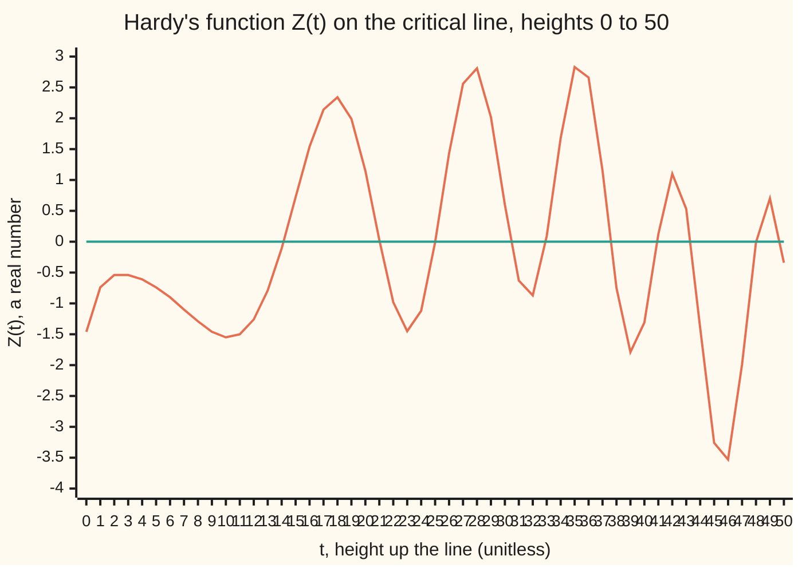

# Zeros on the line: what is proved, from Hardy to a positive proportion

[Syllabus](../../../SYLLABUS.md) → [Algebraic and analytic number theory](../README.md) → [The Zeta Function and the Prime Number Theorem](../README.md#s02) → Zeros on the line

---

## General Overview

Zeta has infinitely many zeros in the critical strip, the band of complex numbers with real part between 0 and 1. The Riemann hypothesis says every one of them has real part exactly 1/2: it sits on the **critical line**. [The Riemann hypothesis](09-riemann-hypothesis-statement-and-equivalents.md) states it and its equivalent forms.

In 2004 Xavier Gourdon reported the first ten trillion zeros all on the line, in a computation not published in a journal. The smooth part of the count formula reaches ten trillion at height 2,445,999,556,030. In 2021 Platt and Trudgian proved, with rigorous error bounds, that every zero up to height 3,000,175,332,800 is on the line: exactly 12,363,153,437,138 zeros. Below the round height 3 × 10^12 the smooth part puts about 12,362,403,019,661 zeros, and none is off the line.

A check to a height is evidence about all heights, never proof. What is proved for **all** heights is weaker: infinitely many zeros on the line (Hardy, 1914), then a fixed positive share (Selberg, 1942), then more than a third (Levinson, 1974) and more than two fifths (Conrey, 1989), since raised slightly. One trick runs through all of it: on the line, zeta turns into a real function, so a zero there shows up as a change of sign.

**On the critical line, zeta turned by a known angle is a real function Z(t), so each sign change proves a zero on the line; matched against an exact count of all zeros, this has placed every zero below height 3 × 10^12, about 12,362,403,019,661 of them, on the line, while proofs for all heights reach only a share above two fifths.**

**What kind of fact this is:** theorems and one computation. Hardy's theorem is proved here in outline, with a folded sketch; Selberg's, Levinson's and Conrey's are stated with their key idea and sources. The verified range proves the hypothesis up to height 3 × 10^12 and says nothing above it. The full Riemann hypothesis was open until 2026-11-21, when a formal proof was certified ([The Riemann hypothesis](../../25-Frontier/02-The%20Millennium%20Problems/01-riemann-hypothesis.md)).

### The picture: Hardy's function crossing zero



Orange: Z(t), computed at whole-number heights. Green: the level 0. Each crossing of the green line is a zero of zeta on the critical line. The first sits between 14 and 15 (bisection puts it at 14.134725), the tenth between 49 and 50.

---

## The formula

Notation first, in words. A complex input is $`s = \sigma + it`$: real part $`\sigma`$, height $`t`$ ([Zeta of a complex variable](01-zeta-and-the-euler-product-revisited.md)). The **critical line** is $`\sigma = \tfrac12`$. $`\Gamma`$ is the gamma function of wing 07, and $`\arg`$ is the angle of a complex number. Log is the natural logarithm.

This card develops **Hardy's function** $`Z(t)`$, "zed of t", which [Counting the zeros](08-counting-the-zeros-riemann-von-mangoldt.md) used as a counting tool. It is built from the angle $`\vartheta(t)`$, the Riemann–Siegel theta function of that card: a curly theta, not Chebyshev's θ(x).

```math
Z(t) = e^{i\vartheta(t)}\,\zeta\!\left(\tfrac12 + it\right), \qquad \vartheta(t) = \arg \Gamma\!\left(\tfrac14 + \tfrac{it}{2}\right) - \frac{t}{2}\log \pi .
```

**Read it aloud:** Z of t is zeta on the critical line, turned by the angle theta of t so that it comes out a real number.

$`N(T)`$ counts the zeros in the strip with height from 0 to $`T`$ ([Counting the zeros](08-counting-the-zeros-riemann-von-mangoldt.md)). This card adds $`N_0(T)`$, "N nought of T": how many of those lie on the line. The Riemann hypothesis says $`N_0(T) = N(T)`$ for every $`T`$. What is proved:

```math
\underbrace{N_0(T) \to \infty}_{\text{Hardy 1914}}, \quad \underbrace{N_0(T) \ge cT}_{\text{Hardy, Littlewood 1921}}, \quad \underbrace{N_0(T) \ge \kappa\, N(T)}_{\text{Selberg 1942}}, \quad \kappa > 0.3474 \ \text{(Levinson 1974)}, \quad \kappa > 0.4088 \ \text{(Conrey 1989)}
```

**Read it aloud:** the zeros on the line are infinitely many; then at least a fixed number per unit of height; then at least a fixed share kappa of all zeros; and that share is above 0.3474, then above 0.4088. Each holds for all large $`T`$, with $`c`$ and $`\kappa`$ fixed.

The total count is the Riemann–von Mangoldt formula:

```math
N(T) = \frac{\vartheta(T)}{\pi} + 1 + S(T) \approx \frac{T}{2\pi}\log\frac{T}{2\pi e} + \frac78
```

**Read it aloud:** the number of zeros up to height T is theta over pi plus one, plus a small wobble S of T.

| Symbol | Plain meaning | In our example | Push it up and the answer… |
| --- | --- | --- | --- |
| $`s`$, $`\sigma`$, $`t`$ | complex input; its real part; its height | $`\sigma = \tfrac12`$, $`t = 14.134725`$ | higher $`t`$: zeros crowd closer |
| $`\zeta`$, $`\xi`$ | zeta; completed zeta, with $`\xi(s) = \xi(1-s)`$ | $`\zeta(\tfrac12) = -1.460355`$ | — |
| $`\Gamma`$ | the gamma function (wing 07) | inside $`\vartheta`$ | — |
| $`\vartheta(t)`$ | the angle that makes zeta real on the line | $`\vartheta(100) = 87.972165`$ | grows like $`\tfrac{t}{2}\log\tfrac{t}{2\pi}`$ |
| $`Z(t)`$ | Hardy's function: real, same size as zeta on the line | $`Z(0) = -1.460355`$ | each sign change is a zero |
| $`T`$, $`T_0`$ | the height we count up to; a fixed starting height | 100; any fixed height | more zeros |
| $`N(T)`$ | zeros in the strip up to height $`T`$ | 29 at 100 | about $`\tfrac{T}{2\pi}\log\tfrac{T}{2\pi}`$ |
| $`N_0(T)`$ | those zeros lying on the line | 29 at 100 | RH: equals $`N(T)`$ |
| $`S(T)`$ | the wobble of $`N(T)`$ about its smooth part | $`29 - 29.0024`$ at 100 | stays small, grows like $`\log T`$ at most |
| $`c`$, $`\kappa`$ | a fixed count per unit height; a fixed share | $`\kappa > 0.4088`$ (Conrey) | a stronger theorem |
| $`M`$, $`b_n`$, $`H`$ | mollifier length and weights; window length | $`M = T^{4/7}`$ (Conrey) | longer $`M`$: a larger share |
| $`g_n`$ | Gram point: height where $`\vartheta(g_n) = n\pi`$ | $`g_0 = 17.8456`$ | one per expected zero |

### When it holds

- **Z is real only on the critical line.** A zero off the line never shows as a sign change, so sign changes alone cannot rule one out.
- **A sign change proves a zero; no sign change proves nothing.** Two zeros inside one sampling step cancel. Sampling every 2 units up to 100 finds 25 of the 29.
- **The share theorems are about large heights.** They say nothing about the first ten trillion zeros, or about any one zero.
- **The count of all zeros must be exact.** The smooth part of $`N(100)`$ is 29.0024; only an exact count (argument principle, or Turing's method) shows it is 29.
- **None of this is the Riemann hypothesis.** More than two fifths on the line leaves the rest unproved by these methods; the hypothesis was proved in 2026 by a formal proof.

---

## Why it works

### Step 0: make zeta real on the line, then count sign changes

A real function that is positive at one point and negative at another crosses zero between them: the intermediate value theorem. Zeta is complex, but on the critical line it is a real number turned by a known angle. Undo the turn, and every sign change is a zero exactly on the line.

### Step 1: why Z(t) is real

[The functional equation](02-functional-equation-proved.md) gives the completed zeta $`\xi(s) = \tfrac12 s(s-1)\pi^{-s/2}\Gamma(s/2)\zeta(s)`$ with $`\xi(s) = \xi(1-s)`$. Also $`\xi`$ is real on the real axis, so $`\xi(\bar s) = \overline{\xi(s)}`$, where the bar is the complex conjugate (flip the sign of the imaginary part).

On the line, $`1 - s`$ equals $`\bar s`$. So $`\xi(\tfrac12 + it) = \overline{\xi(\tfrac12 + it)}`$: it is real. Write out each factor at $`s = \tfrac12 + it`$:

```math
\xi\!\left(\tfrac12 + it\right) = -\tfrac12\left(t^2 + \tfrac14\right)\pi^{-1/4}\left|\Gamma\!\left(\tfrac14 + \tfrac{it}{2}\right)\right| Z(t).
```

Everything in front of $`Z(t)`$ is real and negative. So $`Z(t)`$ is real, and $`|Z(t)| = |\zeta(\tfrac12 + it)|`$. Computed from zeta, its imaginary part stays below $`10^{-6}`$ from 0 to 300, and $`Z(0) = \zeta(\tfrac12) = -1.460355`$.

### Step 2: count the zeros on the line up to height 100

Sample $`Z`$ every 0.05 from height 10 to 100 and count sign changes. Two independent ways of computing $`Z`$ both give **29**:

- **Euler–Maclaurin:** zeta as a head sum plus a tail integral plus end corrections, then turned by $`\vartheta`$.
- **Riemann–Siegel:** a short sum of cosines, $`2\sum n^{-1/2}\cos(\vartheta(t) - t\log n)`$ over $`n \le \sqrt{t/2\pi}`$, plus one correction term.

Between 10 and 300 the two methods never differ by more than 0.0104. Riemann–Siegel is the one used at great heights: at $`T = 3 \times 10^{12}`$ it needs only 690,988 cosines.

### Step 3: count all the zeros, and compare

Walk once round the box with real part −0.5 to 1.5 and height 1 to 100. The number of times zeta turns round 0 is the number of zeros inside ([The argument principle](../../07-Complex%20analysis/06-Real%20Integrals%20and%20Counting%20Zeros/06-the-argument-principle.md)). The code gets 29. Round a closed loop the angle steps always add up to whole turns, so the steps only need to be short enough that none skips a turn. [Zeta's zeros and the primes](../../07-Complex%20analysis/09-Special%20Functions%20and%20the%20Zeta%20Function/09-zeros-of-zeta-and-the-primes.md) found the same 29 by chasing dips of $`|\zeta|`$ on the line.

So the strip holds 29 zeros below height 100, and the 29 sign changes put all of them on the line. That is a proof for this range, not a sample.

Large-scale checks work the same way. Turing's method replaces the box: sign changes just above the top edge, plus a proved bound on the average of $`S(t)`$, fix the exact count. The search starts at **Gram points** $`g_n`$, the heights where $`\vartheta(g_n) = n\pi`$. There $`Z(g_n) = (-1)^n\,\mathrm{Re}\,\zeta`$, and usually $`(-1)^n Z(g_n) > 0`$: **Gram's law**.

Gram's law is a habit, not a law. The code finds its first failure at $`n = 126`$, height 282.4547, where $`Z = -0.0276`$ has the wrong sign. No zero is lost: the next Gram interval holds two sign changes instead of one.

### Step 4: Hardy's theorem, infinitely many on the line

Suppose $`Z`$ kept one sign above some height $`T_0`$. Then the integrals of $`Z`$ and of $`|Z|`$ from $`T_0`$ to $`T`$ would be equal in size. A later, shorter form of Hardy's argument shows they are not.

- **The integral of $`|Z|`$ grows at least as fast as $`T`$.** It equals the integral of $`|\zeta|`$, which is at least the size of the integral of $`\zeta`$. In that integral the first term of zeta, 1, contributes $`T`$, and every other term only oscillates.
- **The integral of $`Z`$ grows more slowly than $`T`$.** $`Z`$ is a sum of cosines whose phases turn ever faster, so their areas cancel.

So $`Z`$ changes sign above every height. The code shows the gap, with midpoint-rule estimates in steps of 0.05. The rule cuts the corners of $`\lvert Z \rvert`$ at each zero, so that column can come out a little low in its last digit:

| $`T`$ | integral of $`Z`$ | integral of $`\lvert Z \rvert`$ | integral of $`\mathrm{Re}\,\zeta(\tfrac12 + it)`$ |
| ---: | ---: | ---: | ---: |
| 100 | −6.18 | 139.73 | 97.03 |
| 200 | −16.61 | 299.61 | 198.49 |
| 300 | −3.50 | 462.15 | 297.31 |

The last column tracks $`T`$, as the first term predicts; the first column stays small.

<details>
<summary>Detailed proof: Hardy's theorem, the shape of the estimates</summary>

Assume, for a contradiction, that $`Z(t)`$ has one sign for all $`t \ge T_0`$. Then for $`T > T_0`$

$`\displaystyle \left|\int_{T_0}^{T} Z(t)\,dt\right| = \int_{T_0}^{T} |Z(t)|\,dt = \int_{T_0}^{T} \left|\zeta\!\left(\tfrac12 + it\right)\right| dt \ge \left|\int_{T_0}^{T} \zeta\!\left(\tfrac12 + it\right) dt\right|.`$

Lower bound. For $`t`$ up to $`T`$, zeta on the line is the sum of $`n^{-1/2 - it}`$ over $`n \le T`$ plus a correction whose integral is at most a constant times $`\sqrt{T}\log T`$. Integrating, $`n = 1`$ gives $`T - T_0`$. Each $`n \ge 2`$ gives at most $`2/(\sqrt{n}\log n)`$ in size, and those terms sum to at most a constant times $`\sqrt{T}`$. So the right side is at least $`T - O(\sqrt{T}\log T)`$.

Upper bound. By the Riemann–Siegel formula, $`Z(t)`$ is $`2\sum_{n \le \sqrt{t/2\pi}} n^{-1/2}\cos(\vartheta(t) - t\log n)`$ plus a small error. The phase of the $`n`$-th cosine changes at rate $`\vartheta'(t) - \log n \approx \log\big(\sqrt{t/2\pi}/n\big)`$. That rate is zero only near $`t = 2\pi n^2`$, where the term starts. A stationary-phase estimate (a bound for integrals of fast-turning waves) bounds each term's integral, and the total is $`o(T)`$: it divided by $`T`$ tends to 0.

The two bounds contradict each other for large $`T`$. So $`Z`$ changes sign above every height. Full details: Edwards, chapter 11.

</details>

### Step 5: from infinitely many to a positive share

Hardy and Littlewood (1921) fixed a window length $`H`$ and showed that most windows $`[t, t + H]`$ between $`T`$ and $`2T`$ hold a sign change. Not every window is proved to: most is enough. That gives at least $`cT`$ zeros on the line up to height $`T`$.

But the total grows faster. $`N(T)/T`$ is 0.29 at height 100, 1.75 at $`10^6`$ and 4.12 at $`3 \times 10^{12}`$. A fixed number per unit height is a share that shrinks toward 0.

Selberg (1942) closed that gap with a **mollifier**: a short sum $`\sum_{n \le M} b_n n^{-s}`$ chosen to cancel zeta's wild swings in size. With it, sign changes appear in a fixed share of windows of length about $`1/\log T`$, the spacing of the zeros themselves. So a fixed share $`\kappa`$ of all zeros lies on the line; Selberg's $`\kappa`$ is very small.

### Step 6: Levinson's third and Conrey's two fifths

Levinson (1974) stopped hunting sign changes. He bounds how many zeros of a related function lie to the **left** of the line, by averaging the logarithm of its size along a vertical line (Littlewood's lemma). Every zero of zeta not counted there must be on the line. With a mollifier of length $`M = T^{1/2}`$ the share came out above 0.3474.

Conrey (1989) lengthened the mollifier to $`M = T^{4/7}`$, using deep bounds on Kloosterman sums (exponential sums with modular inverses). A longer mollifier cancels more of zeta's swings, and the share rose above 0.4088. Refinements of the mollifier have since raised the share slightly (Bui, Conrey and Young in 2011; Pratt, Robles, Zaharescu and Zeindler in 2020), still far short of 1.

```
bars, Levinson 1974    ##############                           0.3474
bars, Conrey 1989      ################                         0.4088
bars, checked to 3e12  ######################################## 1.0000
```

The bottom bar is a different kind of fact: a complete check up to one height. The top two hold at every large height.

---

## Worked numbers, by hand

| Step | Arithmetic | Value |
| --- | --- | --- |
| angle at height 100 | $`\arg\Gamma(\tfrac14 + 50i) - 50\log\pi`$ | 87.972165 |
| smooth count | $`87.972165/\pi + 1`$ | 29.0024 |
| exact count in the strip | turns of zeta round the box to height 100 | 29 |
| zeros on the line | sign changes of $`Z`$, step 0.05 | 29 |
| share on the line, to 100 | 29 of 29 | 1 |
| smooth count to $`3 \times 10^{12}`$ | $`\vartheta(T)/\pi + 1`$, the wobble $`S(T)`$ left out | about 12,362,403,019,661 |
| exact count to 3,000,175,332,800 | proved by Platt and Trudgian; the smooth part gives 12,363,153,437,137 | 12,363,153,437,138 |
| height where the smooth count reaches $`10^{13}`$ | solve $`\vartheta(T)/\pi + 1 = 10^{13}`$ | 2,445,999,556,030 |
| proved share, large heights | Conrey 1989, since raised slightly | **more than 0.4088** |

Below height 100 all 29 zeros are on the line, and below $`3 \times 10^{12}`$ all of about 12,362,403,019,661 are; above any checked height, proof guarantees only more than two fifths.

### What breaks if you drop a piece

| Mistake | Comes out at | What went wrong |
| --- | --- | --- |
| Sample $`Z`$ every 2 units, not every 0.05 | 25 zeros, not 29; every 3 units: 21 | two zeros inside one step cancel their signs |
| Trust Gram's law | at $`n = 126`$, $`Z(g_{126}) = -0.0276`$: wrong sign | the zero moved into the next Gram interval, which has 2 sign changes |
| Drop $`-T/2\pi`$ from the count | 12,839,867,848,936, not 12,362,403,019,661 | the formula is $`\tfrac{T}{2\pi}\log\tfrac{T}{2\pi e}`$, and the $`e`$ matters |

The code prints all three.

---

## Code, from first principles, and it actually runs

The script takes paired independent roads. Hardy's function: Euler–Maclaurin zeta turned by $`\vartheta`$, against the Riemann–Siegel cosine sum. Zeros on the line, by sign changes, against all zeros, by the argument principle. The angle $`\vartheta`$: Stirling's series for gamma, against its large-height expansion. The count to $`3 \times 10^{12}`$: the log-gamma angle against the simple formula, and the smooth count at Platt and Trudgian's height against their proved exact count. It also finds the height where the smooth count reaches $`10^{13}`$, which fits the 2.44… × 10^12 that Platt and Trudgian quote for Gourdon's check, the first Gram failure and Hardy's three integrals.

### Python

```python
# Zeros on the line -- the check behind the card.  Standard library only.  Hardy's function Z(t) two
# ways (Euler-Maclaurin zeta and Riemann-Siegel); sign changes of Z against an argument-principle count;
# Gram's law and its first failure; Hardy's integrals; the zero count N(T) at the verified height.
import math, cmath
BERN = [1 / 6, -1 / 30, 1 / 42, -1 / 30, 5 / 66]          # Bernoulli numbers B2, B4, ..., B10
def zeta(s):                     # head sum + tail integral + end corrections (Euler-Maclaurin)
    N = max(20, int(abs(s.imag) / 2) + 10)
    z = sum(n ** -s for n in range(1, N)) + N ** (1 - s) / (s - 1) + N ** -s / 2
    r, f = s * N ** (-s - 1), 2.0
    for k, b in enumerate(BERN):
        z += b / f * r
        r *= (s + 2 * k + 1) * (s + 2 * k + 2) / N ** 2; f *= (2 * k + 3) * (2 * k + 4)
    return z
def theta(t):                    # arg of Gamma(1/4 + it/2) - (t/2) log pi, Stirling after 10 shifts
    w = 10.25 + 0.5j * t
    lg = (w - 0.5) * cmath.log(w) - w + 1 / (12 * w) - 1 / (360 * w ** 3) + 1 / (1260 * w ** 5)
    return lg.imag - sum(math.atan2(t / 2, 0.25 + k) for k in range(10)) - t / 2 * math.log(math.pi)
def theta_st(t):                 # the same angle from its large-t series
    return t / 2 * math.log(t / (2 * math.pi)) - t / 2 - math.pi / 8 + 1 / (48 * t) + 7 / (5760 * t ** 3)
def Z_em(t):                     # Z(t) = e^(i theta) zeta(1/2 + it), a complex number that should be real
    return cmath.exp(1j * theta(t)) * zeta(0.5 + 1j * t)
def Z_rs(t):                     # Riemann-Siegel: a short cosine sum plus its first correction
    a = math.sqrt(t / (2 * math.pi)); m = int(a); p = a - m; th = theta_st(t)
    main = 2 * sum(math.cos(th - t * math.log(n)) / math.sqrt(n) for n in range(1, m + 1))
    return main + (-1) ** (m - 1) * a ** -0.5 * math.cos(2 * math.pi * (p * p - p - 1 / 16)) / math.cos(2 * math.pi * p)
def changes(v): return sum(1 for a, b in zip(v, v[1:]) if a * b < 0)
def grid(f, a, b, h): return [f(a + k * h) for k in range(round((b - a) / h) + 1)]
def gram(n):                     # the height g_n where theta(g_n) = n pi, by bisection
    lo, hi = 10.0, 1e4
    for _ in range(100):
        mid = (lo + hi) / 2; lo, hi = (mid, hi) if theta(mid) < n * math.pi else (lo, mid)
    return lo
def box(T, h=0.02):              # argument principle: turns of zeta round -0.5..1.5 x 1..T
    c = [complex(-0.5, 1), complex(1.5, 1), complex(1.5, T), complex(-0.5, T), complex(-0.5, 1)]
    pts = [a + (b - a) * k / n for a, b in zip(c, c[1:]) for n in [round(abs(b - a) / h)] for k in range(n)] + [c[0]]
    v = [zeta(s) for s in pts]
    return sum(cmath.phase(w / u) for u, w in zip(v, v[1:])) / (2 * math.pi)
N0 = lambda T: theta(T) / math.pi + 1                       # smooth zero count, log-gamma road
N1 = lambda T: T / (2 * math.pi) * math.log(T / (2 * math.pi * math.e)) + 7 / 8   # simple formula
def height(n):                   # invert the smooth count: the height of zero number n
    lo, hi = 10.0, 1e14
    for _ in range(200):
        mid = (lo + hi) / 2; lo, hi = (mid, hi) if N0(mid) < n else (lo, mid)
    return lo
z_rs, z_em = grid(Z_rs, 10, 100, 0.05), [z.real for z in grid(Z_em, 10, 100, 0.05)]
coarse = [changes(grid(Z_rs, 10, 100, h)) for h in (1, 2, 3)]
inside, above = box(100), box(101.5)
ts = [10 + k * 0.37 for k in range(785)]
gap = max(abs(Z_em(t).real - Z_rs(t)) for t in ts)
imag = max(abs(Z_em(t).imag) for t in [k * 0.37 for k in range(812)])
print(f"theta(100): log-gamma road {theta(100):.6f}, Stirling road {theta_st(100):.6f}; theta/pi + 1 = {N0(100):.4f}")
print(f"Z(0) = zeta(1/2) = {Z_em(0).real:.6f}; Z real on 0..300: largest imaginary part below 1e-6: {imag < 1e-6}")
lo, hi = 14.0, 15.0                                         # first zero: bisection on the sign of Z
for _ in range(50):
    mid = (lo + hi) / 2; lo, hi = (mid, hi) if Z_em(mid).real * Z_em(lo).real > 0 else (lo, mid)
print(f"first zero, by bisection on the sign of Z between 14 and 15: {lo:.6f}")
print(f"sign changes of Z on 10..100, step 0.05: Riemann-Siegel {changes(z_rs)}, Euler-Maclaurin {changes(z_em)}")
print(f"sign changes on 10..100 at steps 1, 2, 3: {coarse[0]}, {coarse[1]}, {coarse[2]}")
print(f"argument principle, box -0.5..1.5 x 1..100: {inside:.0f} zeros in the strip; to height 101.5: {above:.0f}")
print(f"Riemann-Siegel against Euler-Maclaurin on 10..300: largest gap {gap:.4f}")
print("chart t = 0, 1, ..., 50, Z(t): " + ", ".join(f"{Z_em(t).real:.2f}" for t in range(51)))
bad = next(n for n in range(200) if (-1) ** n * Z_em(gram(n)).real < 0)
g = [gram(n) for n in (0, 1, bad - 1, bad, bad + 1)]
sc = [changes([Z_em(a + (b - a) * k / 400).real for k in range(401)]) for a, b in ((g[2], g[3]), (g[3], g[4]))]
print(f"Gram points g_0 = {g[0]:.4f}, g_1 = {g[1]:.4f}; Z(g_0) = {Z_em(g[0]).real:.4f}, Z(g_1) = {Z_em(g[1]).real:.4f}")
print(f"first failure of Gram's law: n = {bad}, g = {g[3]:.4f}, Z(g) = {Z_em(g[3]).real:.4f}; "
      f"sign changes g_{bad - 1}..g_{bad}: {sc[0]}, g_{bad}..g_{bad + 1}: {sc[1]}")
hardy = []
for T in (100, 200, 300):        # midpoint rule, step 0.05
    pts = [(k + 0.5) * 0.05 for k in range(20 * T)]
    zs = [Z_em(t) for t in pts]
    I, J, K = (0.05 * sum(v) for v in ([z.real for z in zs], [abs(z) for z in zs], [zeta(0.5 + 1j * t).real for t in pts]))
    hardy.append((T, I, J, K))
    print(f"T = {T}: integral of Z {I:.2f}; of |Z| {J:.2f}; of Re zeta(1/2 + it) {K:.2f}")
T = 3e12
print(f"N(T) at T = 3e12: theta road {N0(T):,.0f}; simple formula {N1(T):,.0f}; "
      f"without the -T/2pi term {T / (2 * math.pi) * math.log(T / (2 * math.pi)):,.0f}")
h13 = height(1e13)
print(f"Riemann-Siegel terms at T = 3e12: {int(math.sqrt(T / (2 * math.pi))):,}")
print(f"height where the smooth count reaches 10^13: {h13:,.0f}")
H, NH = 3000175332800, 12363153437138                       # verified height; its proved exact count
print(f"verified height {H:,}: smooth count {N0(H):,.0f}; proved exact count {NH:,}")
print("zeros per unit height N(T)/T: " + ", ".join(f"T = {u}: {N0(v) / v:.2f}" for u, v in (("100", 100), ("10^6", 1e6), ("3e12", 3e12))))
for name, x in (("Levinson 1974", 0.3474), ("Conrey 1989", 0.4088), ("checked to 3e12", 1.0)):
    print(f"bars, {name:16s} {'#' * round(40 * x):40s} {x:.4f}")
assert changes(z_rs) == changes(z_em) == round(inside) == round(N0(100)) == 29
assert abs(theta(100) - theta_st(100)) < 1e-9 and gap < 0.02 and imag < 1e-6     # two roads to theta, to Z
assert bad == 126 and sc == [0, 2] and abs(g[0] - 17.8456) < 1e-4 and abs(lo - 14.134725142) < 1e-8                # published Gram data
assert all(abs(K - T) < 0.05 * T and abs(I) < 0.1 * J for T, I, J, K in hardy)    # Hardy's comparison
assert abs(N0(T) - N1(T)) < 0.05 and abs(N0(100) - N1(100)) < 1e-3 and coarse[1] < 29   # log-gamma against simple formula
assert abs(N0(H) - NH) < 2 and 2.44e12 < h13 < 2.45e12      # published: exact count; Gourdon's height 2.44... x 10^12
print("ALL CHECKS PASS")
```

**Ran 2026-11-15 on macOS, Python 3.14.10, standard library only. All checks passed. Output, pasted from the run:**

```
theta(100): log-gamma road 87.972165, Stirling road 87.972165; theta/pi + 1 = 29.0024
Z(0) = zeta(1/2) = -1.460355; Z real on 0..300: largest imaginary part below 1e-6: True
first zero, by bisection on the sign of Z between 14 and 15: 14.134725
sign changes of Z on 10..100, step 0.05: Riemann-Siegel 29, Euler-Maclaurin 29
sign changes on 10..100 at steps 1, 2, 3: 29, 25, 21
argument principle, box -0.5..1.5 x 1..100: 29 zeros in the strip; to height 101.5: 30
Riemann-Siegel against Euler-Maclaurin on 10..300: largest gap 0.0104
chart t = 0, 1, ..., 50, Z(t): -1.46, -0.74, -0.54, -0.54, -0.61, -0.74, -0.90, -1.10, -1.29, -1.46, -1.55, -1.50, -1.26, -0.79, -0.11, 0.72, 1.54, 2.14, 2.34, 1.99, 1.15, 0.03, -0.98, -1.45, -1.12, -0.01, 1.43, 2.56, 2.81, 2.02, 0.60, -0.63, -0.87, 0.09, 1.68, 2.83, 2.66, 1.15, -0.75, -1.79, -1.31, 0.12, 1.10, 0.53, -1.40, -3.26, -3.53, -1.99, -0.01, 0.70, -0.34
Gram points g_0 = 17.8456, g_1 = 23.1703; Z(g_0) = 2.3402, Z(g_1) = -1.4574
first failure of Gram's law: n = 126, g = 282.4547, Z(g) = -0.0276; sign changes g_125..g_126: 0, g_126..g_127: 2
T = 100: integral of Z -6.18; of |Z| 139.73; of Re zeta(1/2 + it) 97.03
T = 200: integral of Z -16.61; of |Z| 299.61; of Re zeta(1/2 + it) 198.49
T = 300: integral of Z -3.50; of |Z| 462.15; of Re zeta(1/2 + it) 297.31
N(T) at T = 3e12: theta road 12,362,403,019,661; simple formula 12,362,403,019,661; without the -T/2pi term 12,839,867,848,936
Riemann-Siegel terms at T = 3e12: 690,988
height where the smooth count reaches 10^13: 2,445,999,556,030
verified height 3,000,175,332,800: smooth count 12,363,153,437,137; proved exact count 12,363,153,437,138
zeros per unit height N(T)/T: T = 100: 0.29, T = 10^6: 1.75, T = 3e12: 4.12
bars, Levinson 1974    ##############                           0.3474
bars, Conrey 1989      ################                         0.4088
bars, checked to 3e12  ######################################## 1.0000
ALL CHECKS PASS
```

### Rust

Same numbers, same labels, built with `rustc --edition 2021 -O`.

```rust
// Zeros on the line -- the same check as the Python, in Rust.  No crates.  Hardy's function Z(t) two
// ways (Euler-Maclaurin zeta and Riemann-Siegel); sign changes of Z against an argument-principle count;
// Gram's law and its first failure; Hardy's integrals; the zero count N(T) at the verified height.
use std::f64::consts::PI;
#[derive(Clone, Copy)]
struct C { re: f64, im: f64 }
fn c(re: f64, im: f64) -> C { C { re, im } }
fn add(a: C, b: C) -> C { c(a.re + b.re, a.im + b.im) }
fn sub(a: C, b: C) -> C { c(a.re - b.re, a.im - b.im) }
fn mul(a: C, b: C) -> C { c(a.re * b.re - a.im * b.im, a.re * b.im + a.im * b.re) }
fn div(a: C, b: C) -> C { let d = b.re * b.re + b.im * b.im; c((a.re * b.re + a.im * b.im) / d, (a.im * b.re - a.re * b.im) / d) }
fn sc(k: f64, a: C) -> C { c(k * a.re, k * a.im) }
fn md(a: C) -> f64 { a.re.hypot(a.im) }
fn ph(a: C) -> f64 { a.im.atan2(a.re) }
fn ln(a: C) -> C { c(md(a).ln(), ph(a)) }
fn ex(a: C) -> C { let m = a.re.exp(); c(m * a.im.cos(), m * a.im.sin()) }
fn pw(x: f64, s: C) -> C { ex(sc(x.ln(), s)) } // x^s for real x > 0
const BERN: [f64; 5] = [1.0 / 6.0, -1.0 / 30.0, 1.0 / 42.0, -1.0 / 30.0, 5.0 / 66.0]; // B2, B4, ..., B10
fn zeta(s: C) -> C { // head sum + tail integral + end corrections (Euler-Maclaurin)
    let nn = 20usize.max((s.im.abs() / 2.0) as usize + 10); let n = nn as f64;
    let mut z = (1..nn).fold(c(0.0, 0.0), |z, k| add(z, pw(k as f64, sc(-1.0, s))));
    z = add(add(z, div(pw(n, sub(c(1.0, 0.0), s)), sub(s, c(1.0, 0.0)))), sc(0.5, pw(n, sc(-1.0, s))));
    let (mut r, mut f) = (mul(s, pw(n, sub(c(-1.0, 0.0), s))), 2.0);
    for (k, b) in BERN.iter().enumerate() {
        z = add(z, sc(b / f, r)); let k = k as f64;
        r = sc(1.0 / (n * n), mul(r, mul(add(s, c(2.0 * k + 1.0, 0.0)), add(s, c(2.0 * k + 2.0, 0.0))))); f *= (2.0 * k + 3.0) * (2.0 * k + 4.0);
    }
    z
}
fn theta(t: f64) -> f64 { // arg of Gamma(1/4 + it/2) - (t/2) log pi, Stirling after 10 shifts
    let w = c(10.25, 0.5 * t); let w3 = mul(w, mul(w, w)); let w5 = mul(w3, mul(w, w));
    let lg = add(sub(sub(mul(sub(w, c(0.5, 0.0)), ln(w)), w), div(c(1.0 / 360.0, 0.0), w3)), add(div(c(1.0 / 12.0, 0.0), w), div(c(1.0 / 1260.0, 0.0), w5)));
    lg.im - (0..10).map(|k| (t / 2.0).atan2(0.25 + k as f64)).sum::<f64>() - t / 2.0 * PI.ln()
}
fn theta_st(t: f64) -> f64 { t / 2.0 * (t / (2.0 * PI)).ln() - t / 2.0 - PI / 8.0 + 1.0 / (48.0 * t) + 7.0 / (5760.0 * t.powi(3)) }
fn z_em(t: f64) -> C { mul(ex(c(0.0, theta(t))), zeta(c(0.5, t))) } // should be real
fn z_rs(t: f64) -> f64 { // Riemann-Siegel: a short cosine sum plus its first correction
    let a = (t / (2.0 * PI)).sqrt(); let m = a as usize; let p = a - m as f64; let th = theta_st(t);
    let main = 2.0 * (1..=m).map(|n| (th - t * (n as f64).ln()).cos() / (n as f64).sqrt()).sum::<f64>();
    let sign = if m % 2 == 1 { 1.0 } else { -1.0 };
    main + sign * a.powf(-0.5) * (2.0 * PI * (p * p - p - 1.0 / 16.0)).cos() / (2.0 * PI * p).cos()
}
fn changes(v: &[f64]) -> usize { v.windows(2).filter(|w| w[0] * w[1] < 0.0).count() }
fn grid(f: &dyn Fn(f64) -> f64, a: f64, b: f64, h: f64) -> Vec<f64> { (0..=((b - a) / h).round() as usize).map(|k| f(a + k as f64 * h)).collect() }
fn gram(n: i32) -> f64 { // the height g_n where theta(g_n) = n pi, by bisection
    let (mut lo, mut hi) = (10.0, 1e4);
    for _ in 0..100 { let mid = (lo + hi) / 2.0; if theta(mid) < n as f64 * PI { lo = mid } else { hi = mid } }
    lo
}
fn boxc(t: f64) -> f64 { // argument principle: turns of zeta round -0.5..1.5 x 1..T
    let cs = [c(-0.5, 1.0), c(1.5, 1.0), c(1.5, t), c(-0.5, t), c(-0.5, 1.0)];
    let mut pts = Vec::new();
    for w in cs.windows(2) { let n = (md(sub(w[1], w[0])) / 0.02).round() as usize; for k in 0..n { pts.push(add(w[0], sc(k as f64 / n as f64, sub(w[1], w[0])))) } }
    pts.push(cs[0]);
    let v: Vec<C> = pts.iter().map(|&s| zeta(s)).collect();
    v.windows(2).map(|w| ph(div(w[1], w[0]))).sum::<f64>() / (2.0 * PI)
}
fn n0(t: f64) -> f64 { theta(t) / PI + 1.0 } // smooth zero count, log-gamma road
fn n1(t: f64) -> f64 { t / (2.0 * PI) * (t / (2.0 * PI * std::f64::consts::E)).ln() + 7.0 / 8.0 }
fn height(n: f64) -> f64 { // invert the smooth count: the height of zero number n
    let (mut lo, mut hi) = (10.0, 1e14);
    for _ in 0..200 { let mid = (lo + hi) / 2.0; if n0(mid) < n { lo = mid } else { hi = mid } }
    lo
}
fn commas(x: f64) -> String { // 12362403019661.1 -> "12,362,403,019,661"
    let s = format!("{:.0}", x); let b = s.as_bytes(); let mut o = String::new();
    for (i, ch) in b.iter().enumerate() { if i > 0 && (b.len() - i) % 3 == 0 { o.push(',') } o.push(*ch as char) }
    o
}
fn main() {
    let zr = grid(&z_rs, 10.0, 100.0, 0.05); let ze = grid(&|t| z_em(t).re, 10.0, 100.0, 0.05);
    let coarse: Vec<usize> = [1.0, 2.0, 3.0].iter().map(|&h| changes(&grid(&z_rs, 10.0, 100.0, h))).collect();
    let (inside, above) = (boxc(100.0), boxc(101.5));
    let gap = (0..785).map(|k| { let t = 10.0 + k as f64 * 0.37; (z_em(t).re - z_rs(t)).abs() }).fold(0.0, f64::max);
    let imag = (0..812).map(|k| z_em(k as f64 * 0.37).im.abs()).fold(0.0, f64::max);
    println!("theta(100): log-gamma road {:.6}, Stirling road {:.6}; theta/pi + 1 = {:.4}", theta(100.0), theta_st(100.0), n0(100.0));
    println!("Z(0) = zeta(1/2) = {:.6}; Z real on 0..300: largest imaginary part below 1e-6: {}", z_em(0.0).re, if imag < 1e-6 { "True" } else { "False" });
    let (mut lo, mut hi) = (14.0, 15.0); // first zero: bisection on the sign of Z
    for _ in 0..50 { let mid = (lo + hi) / 2.0; if z_em(mid).re * z_em(lo).re > 0.0 { lo = mid } else { hi = mid } }
    println!("first zero, by bisection on the sign of Z between 14 and 15: {:.6}", lo);
    println!("sign changes of Z on 10..100, step 0.05: Riemann-Siegel {}, Euler-Maclaurin {}", changes(&zr), changes(&ze));
    println!("sign changes on 10..100 at steps 1, 2, 3: {}, {}, {}", coarse[0], coarse[1], coarse[2]);
    println!("argument principle, box -0.5..1.5 x 1..100: {:.0} zeros in the strip; to height 101.5: {:.0}", inside, above);
    println!("Riemann-Siegel against Euler-Maclaurin on 10..300: largest gap {:.4}", gap);
    println!("chart t = 0, 1, ..., 50, Z(t): {}", (0..51).map(|t| format!("{:.2}", z_em(t as f64).re)).collect::<Vec<_>>().join(", "));
    let bad = (0..200).find(|&n| (if n % 2 == 0 { 1.0 } else { -1.0 }) * z_em(gram(n)).re < 0.0).unwrap();
    let g: Vec<f64> = [0, 1, bad - 1, bad, bad + 1].iter().map(|&n| gram(n)).collect();
    let sc2: Vec<usize> = [(g[2], g[3]), (g[3], g[4])].iter().map(|&(a, b)| changes(&(0..401).map(|k| z_em(a + (b - a) * k as f64 / 400.0).re).collect::<Vec<_>>())).collect();
    println!("Gram points g_0 = {:.4}, g_1 = {:.4}; Z(g_0) = {:.4}, Z(g_1) = {:.4}", g[0], g[1], z_em(g[0]).re, z_em(g[1]).re);
    println!("first failure of Gram's law: n = {}, g = {:.4}, Z(g) = {:.4}; sign changes g_{}..g_{}: {}, g_{}..g_{}: {}",
        bad, g[3], z_em(g[3]).re, bad - 1, bad, sc2[0], bad, bad + 1, sc2[1]);
    let mut hardy = Vec::new();
    for tt in [100usize, 200, 300] { // midpoint rule, step 0.05
        let pts: Vec<f64> = (0..20 * tt).map(|k| (k as f64 + 0.5) * 0.05).collect();
        let zs: Vec<C> = pts.iter().map(|&t| z_em(t)).collect();
        let i = 0.05 * zs.iter().map(|z| z.re).sum::<f64>(); let j = 0.05 * zs.iter().map(|&z| md(z)).sum::<f64>();
        let k = 0.05 * pts.iter().map(|&t| zeta(c(0.5, t)).re).sum::<f64>();
        hardy.push((tt as f64, i, j, k));
        println!("T = {}: integral of Z {:.2}; of |Z| {:.2}; of Re zeta(1/2 + it) {:.2}", tt, i, j, k);
    }
    let t = 3e12;
    println!("N(T) at T = 3e12: theta road {}; simple formula {}; without the -T/2pi term {}", commas(n0(t)), commas(n1(t)), commas(t / (2.0 * PI) * (t / (2.0 * PI)).ln()));
    let h13 = height(1e13);
    println!("Riemann-Siegel terms at T = 3e12: {}", commas((t / (2.0 * PI)).sqrt().floor()));
    println!("height where the smooth count reaches 10^13: {}", commas(h13));
    let (hh, nh) = (3000175332800.0, 12363153437138.0); // verified height; its proved exact count
    println!("verified height {}: smooth count {}; proved exact count {}", commas(hh), commas(n0(hh)), commas(nh));
    println!("zeros per unit height N(T)/T: T = 100: {:.2}, T = 10^6: {:.2}, T = 3e12: {:.2}", n0(100.0) / 100.0, n0(1e6) / 1e6, n0(t) / t);
    for (name, x) in [("Levinson 1974", 0.3474), ("Conrey 1989", 0.4088), ("checked to 3e12", 1.0)] {
        println!("bars, {:16} {:40} {:.4}", name, "#".repeat((40.0 * x as f64).round() as usize), x);
    }
    assert!(changes(&zr) == 29 && changes(&ze) == 29 && inside.round() == 29.0 && n0(100.0).round() == 29.0);
    assert!((theta(100.0) - theta_st(100.0)).abs() < 1e-9 && gap < 0.02 && imag < 1e-6); // two roads to theta, to Z
    assert!(bad == 126 && sc2 == vec![0, 2] && (g[0] - 17.8456).abs() < 1e-4 && (lo - 14.134725142).abs() < 1e-8); // published Gram data
    assert!(hardy.iter().all(|&(tt, i, j, k)| (k - tt).abs() < 0.05 * tt && i.abs() < 0.1 * j)); // Hardy's comparison
    assert!((n0(t) - n1(t)).abs() < 0.05 && (n0(100.0) - n1(100.0)).abs() < 1e-3 && coarse[1] < 29); // log-gamma against simple formula
    assert!((n0(hh) - nh).abs() < 2.0 && 2.44e12 < h13 && h13 < 2.45e12); // published: exact count; Gourdon's height 2.44... x 10^12
    println!("ALL CHECKS PASS");
}
```

**Ran 2026-11-15 on macOS, rustc 1.98.1, no crates. All checks passed. Output, pasted from the run:**

```
theta(100): log-gamma road 87.972165, Stirling road 87.972165; theta/pi + 1 = 29.0024
Z(0) = zeta(1/2) = -1.460355; Z real on 0..300: largest imaginary part below 1e-6: True
first zero, by bisection on the sign of Z between 14 and 15: 14.134725
sign changes of Z on 10..100, step 0.05: Riemann-Siegel 29, Euler-Maclaurin 29
sign changes on 10..100 at steps 1, 2, 3: 29, 25, 21
argument principle, box -0.5..1.5 x 1..100: 29 zeros in the strip; to height 101.5: 30
Riemann-Siegel against Euler-Maclaurin on 10..300: largest gap 0.0104
chart t = 0, 1, ..., 50, Z(t): -1.46, -0.74, -0.54, -0.54, -0.61, -0.74, -0.90, -1.10, -1.29, -1.46, -1.55, -1.50, -1.26, -0.79, -0.11, 0.72, 1.54, 2.14, 2.34, 1.99, 1.15, 0.03, -0.98, -1.45, -1.12, -0.01, 1.43, 2.56, 2.81, 2.02, 0.60, -0.63, -0.87, 0.09, 1.68, 2.83, 2.66, 1.15, -0.75, -1.79, -1.31, 0.12, 1.10, 0.53, -1.40, -3.26, -3.53, -1.99, -0.01, 0.70, -0.34
Gram points g_0 = 17.8456, g_1 = 23.1703; Z(g_0) = 2.3402, Z(g_1) = -1.4574
first failure of Gram's law: n = 126, g = 282.4547, Z(g) = -0.0276; sign changes g_125..g_126: 0, g_126..g_127: 2
T = 100: integral of Z -6.18; of |Z| 139.73; of Re zeta(1/2 + it) 97.03
T = 200: integral of Z -16.61; of |Z| 299.61; of Re zeta(1/2 + it) 198.49
T = 300: integral of Z -3.50; of |Z| 462.15; of Re zeta(1/2 + it) 297.31
N(T) at T = 3e12: theta road 12,362,403,019,661; simple formula 12,362,403,019,661; without the -T/2pi term 12,839,867,848,936
Riemann-Siegel terms at T = 3e12: 690,988
height where the smooth count reaches 10^13: 2,445,999,556,030
verified height 3,000,175,332,800: smooth count 12,363,153,437,137; proved exact count 12,363,153,437,138
zeros per unit height N(T)/T: T = 100: 0.29, T = 10^6: 1.75, T = 3e12: 4.12
bars, Levinson 1974    ##############                           0.3474
bars, Conrey 1989      ################                         0.4088
bars, checked to 3e12  ######################################## 1.0000
ALL CHECKS PASS
```

The two outputs match line for line.

### Lean

Lean proves Hardy's theorem and the two facts behind counting sign changes, for every height, but not the share theorems.

- Take any height $`T`$. Then zeta has a zero on the critical line above height $`T`$.
- Take any height $`t`$. Then $`Z(t)`$ is a real number, and $`|Z(t)| = |\zeta(\tfrac12 + it)|`$.
- Suppose $`Z(a)`$ and $`Z(b)`$ have opposite signs, with $`a < b`$. Then zeta has a zero $`\tfrac12 + it`$ on the line, with $`a < t < b`$.

Every count, such as the 29 zeros below height 100, is left to the Python and Rust checks.

```lean
-- Zeros on the line: zeta turned by the angle theta is a real function Z(t) on the critical line, each sign change of Z is a zero of zeta on the line, and (Hardy 1914) such zeros occur above every height.
import Mathlib.NumberTheory.LSeries.RiemannZeta
import Mathlib.Analysis.SpecialFunctions.Gamma.Basic
import Mathlib.Analysis.SpecialFunctions.Complex.Arg
import Mathlib.Analysis.SpecialFunctions.Log.Basic
import Mathlib.NumberTheory.Harmonic.ZetaAsymp
import Mathlib.Analysis.Complex.CauchyIntegral
import Mathlib.Analysis.Fourier.Inversion
import Mathlib.Analysis.SpecialFunctions.ImproperIntegrals
import Mathlib.Analysis.MellinTransform
import Mathlib.MeasureTheory.Integral.IntegralEqImproper
import Mathlib.Analysis.SpecialFunctions.Trigonometric.Bounds
import Mathlib.NumberTheory.ModularForms.JacobiTheta.OneVariable
import Mathlib.NumberTheory.ModularForms.JacobiTheta.TwoVariable
import Mathlib.Analysis.Real.Pi.Bounds

open Complex

/-- Hardy's function `Z(t) = e^{iϑ(t)} ζ(1/2 + it)`, with
`ϑ(t) = arg Γ(1/4 + it/2) - (t/2) log π`. The card's `ϑ` uses the continuous branch of the
argument; it differs from the principal `arg` used here by a multiple of `2π`, so `e^{iϑ(t)}`
and hence `Z(t)` are the same. -/
noncomputable def hardyZ (t : ℝ) : ℂ :=
  exp (I * ((arg (Gamma (1 / 4 + (t / 2 : ℝ) * I)) : ℂ) - ((t / 2 * Real.log Real.pi : ℝ) : ℂ))) *
    riemannZeta (1 / 2 + t * I)

lemma hz_half_ne_zero (t : ℝ) : (1 : ℂ) / 2 + t * I ≠ 0 := by
  intro h
  have := congrArg Complex.re h
  norm_num at this

lemma hz_half_ne_one (t : ℝ) : (1 : ℂ) / 2 + t * I ≠ 1 := by
  intro h
  have := congrArg Complex.re h
  norm_num at this

lemma hz_completed_im (t : ℝ) : (completedRiemannZeta (1 / 2 + t * I)).im = 0 := by
  apply conj_eq_iff_im.mp
  calc (starRingEnd ℂ) (completedRiemannZeta (1 / 2 + t * I))
      = completedRiemannZeta ((starRingEnd ℂ) (1 / 2 + t * I)) := by rw [completedRiemannZeta_conj]
    _ = completedRiemannZeta (1 - (1 / 2 + t * I)) := by
        congr 1; apply Complex.ext <;> simp; norm_num
    _ = _ := by rw [completedRiemannZeta_one_sub]

lemma hz_Gammaℝ_eq (t : ℝ) :
    Gammaℝ (1 / 2 + t * I) =
      ((Real.exp (-(1 / 4) * Real.log Real.pi) * ‖Gamma (1 / 4 + (t / 2 : ℝ) * I)‖ : ℝ) : ℂ) *
      exp (I * ((arg (Gamma (1 / 4 + (t / 2 : ℝ) * I)) : ℂ) -
        ((t / 2 * Real.log Real.pi : ℝ) : ℂ))) := by
  have hs : (1 / 2 + t * I) / 2 = 1 / 4 + ((t / 2 : ℝ) : ℂ) * I := by push_cast; ring
  rw [Gammaℝ_def, hs, cpow_def_of_ne_zero (by exact_mod_cast Real.pi_pos.ne'),
    ← ofReal_log Real.pi_pos.le]
  set G := Gamma (1 / 4 + ((t / 2 : ℝ) : ℂ) * I)
  conv_lhs => rw [← norm_mul_exp_arg_mul_I G]
  push_cast
  rw [mul_comm (Real.log Real.pi : ℂ) _]
  calc exp (-(1 / 2 + ↑t * I) / 2 * ↑(Real.log Real.pi)) * (↑‖G‖ * exp (↑(arg G) * I))
      = ↑‖G‖ * (exp (-(1 / 2 + ↑t * I) / 2 * ↑(Real.log Real.pi)) * exp (↑(arg G) * I)) := by
        ring
    _ = ↑‖G‖ * (exp (-(1 / 4) * ↑(Real.log Real.pi)) *
          exp (I * (↑(arg G) - ↑t / 2 * ↑(Real.log Real.pi)))) := by
        rw [← exp_add, ← exp_add]; congr 2; ring
    _ = _ := by ring

lemma hz_eq (t : ℝ) :
    hardyZ t = completedRiemannZeta (1 / 2 + t * I) / ((‖Gammaℝ (1 / 2 + t * I)‖ : ℝ) : ℂ) := by
  have hG := hz_Gammaℝ_eq t
  set r : ℝ := Real.exp (-(1 / 4) * Real.log Real.pi) * ‖Gamma (1 / 4 + (t / 2 : ℝ) * I)‖
  set u := exp (I * ((arg (Gamma (1 / 4 + (t / 2 : ℝ) * I)) : ℂ) -
        ((t / 2 * Real.log Real.pi : ℝ) : ℂ)))
  have hu : ‖u‖ = 1 := by
    have : I * ((arg (Gamma (1 / 4 + (t / 2 : ℝ) * I)) : ℂ) -
        ((t / 2 * Real.log Real.pi : ℝ) : ℂ)) =
        ((arg (Gamma (1 / 4 + (t / 2 : ℝ) * I)) - t / 2 * Real.log Real.pi : ℝ) : ℂ) * I := by
      push_cast; ring
    simp only [u, this, norm_exp_ofReal_mul_I]
  have hgne : Gammaℝ (1 / 2 + t * I) ≠ 0 := Gammaℝ_ne_zero_of_re_pos (by simp)
  have hr : 0 < r := by
    have : 0 ≤ r := mul_nonneg (Real.exp_pos _).le (norm_nonneg _)
    rcases this.lt_or_eq with h | h
    · exact h
    · exfalso; apply hgne; rw [hG, ← h]; simp
  have hnorm : ‖Gammaℝ (1 / 2 + t * I)‖ = r := by
    rw [hG, norm_mul, hu, mul_one, norm_real, Real.norm_of_nonneg hr.le]
  rw [hnorm]
  have hL : completedRiemannZeta (1 / 2 + t * I) =
      riemannZeta (1 / 2 + t * I) * Gammaℝ (1 / 2 + t * I) := by
    rw [riemannZeta_def_of_ne_zero (hz_half_ne_zero t), div_mul_cancel₀ _ hgne]
  rw [hL, hG]
  have : (r : ℂ) ≠ 0 := by exact_mod_cast hr.ne'
  show u * riemannZeta (1 / 2 + t * I) = riemannZeta (1 / 2 + t * I) * ((r : ℂ) * u) / (r : ℂ)
  field_simp

lemma hz_continuous_re : Continuous fun t : ℝ ↦ (hardyZ t).re := by
  have hnum : Continuous fun t : ℝ ↦ (completedRiemannZeta (1 / 2 + t * I)).re :=
    Complex.continuous_re.comp (continuous_iff_continuousAt.mpr fun t ↦
      ContinuousAt.comp (g := completedRiemannZeta) (f := fun t : ℝ ↦ (1 : ℂ) / 2 + t * I)
        (x := t) (differentiableAt_completedZeta (hz_half_ne_zero t)
          (hz_half_ne_one t)).continuousAt (by fun_prop))
  have hden : Continuous fun t : ℝ ↦ ‖Gammaℝ (1 / 2 + t * I)‖ := by
    refine continuous_norm.comp (continuous_iff_continuousAt.mpr fun t ↦ ?_)
    have hne : ∀ m : ℕ, ((1 : ℂ) / 2 + t * I) / 2 ≠ -m := by
      intro m hm
      have hre := congrArg Complex.re hm
      simp at hre
      have : (0 : ℝ) ≤ m := Nat.cast_nonneg m
      norm_num at hre
      linarith
    have hG : ContinuousAt Gammaℝ (1 / 2 + t * I) := by
      rw [funext Gammaℝ_def]
      apply ((continuousAt_const_cpow (by simp)).comp (by fun_prop)).mul
      exact .comp (continuousAt_Gamma _ hne) (by fun_prop)
    exact hG.comp (f := fun t : ℝ ↦ _ + t * I) (by fun_prop)
  have h : (fun t : ℝ ↦ (hardyZ t).re) =
      fun t : ℝ ↦ (completedRiemannZeta (1 / 2 + t * I)).re / ‖Gammaℝ (1 / 2 + t * I)‖ := by
    funext t; rw [hz_eq, div_ofReal_re]
  rw [h]
  exact hnum.div hden fun t ↦
    norm_ne_zero_iff.mpr (Gammaℝ_ne_zero_of_re_pos (by simp))

#print axioms hz_half_ne_zero
#print axioms hz_half_ne_one
#print axioms hz_completed_im
#print axioms hz_Gammaℝ_eq
#print axioms hz_eq
#print axioms hz_continuous_re

section HardyAux
open scoped Real
open MeasureTheory Filter Topology Set HurwitzZeta

noncomputable def hdG (z : ℂ) : ℂ :=
  cexp (z / 2) * (jacobiTheta (I * cexp (2 * z)) - 1) - cexp (-z / 2)

lemma hd_theta_fe (z : ℂ) (hz : |z.im| < π / 2) :
    jacobiTheta (I * cexp (2 * z)) = cexp (-z) * jacobiTheta (I * cexp (-(2 * z))) := by
  rw [jacobiTheta_eq_jacobiTheta₂, jacobiTheta_eq_jacobiTheta₂,
    jacobiTheta₂_functional_equation 0 (I * cexp (2 * z))]
  have h1 : -I * (I * cexp (2 * z)) = cexp (2 * z) := by
    rw [← mul_assoc, neg_mul, I_mul_I]; ring
  have h2 : (cexp (2 * z)) ^ (1 / 2 : ℂ) = cexp z := by
    rw [cpow_def_of_ne_zero (Complex.exp_ne_zero _), Complex.log_exp]
    · ring_nf
    · have := (abs_lt.mp hz).1
      simp; linarith
    · have := (abs_lt.mp hz).2
      simp; linarith
  have h3 : -1 / (I * cexp (2 * z)) = I * cexp (-(2 * z)) := by
    rw [Complex.exp_neg]; field_simp; rw [sq, I_mul_I]
  rw [h1, h2, h3, Complex.exp_neg]
  simp [Complex.exp_neg]

lemma hdG_even (z : ℂ) (hz : |z.im| < π / 2) : hdG (-z) = hdG z := by
  unfold hdG
  have h := hd_theta_fe z hz
  have e1 : 2 * -z = -(2 * z) := by ring
  rw [e1, neg_neg, h]
  have e2 : cexp (z / 2) * cexp (-z) = cexp (-z / 2) := by
    rw [← Complex.exp_add]; ring_nf
  linear_combination (-jacobiTheta (I * cexp (-(2 * z)))) * e2


lemma hd_im_tau (z : ℂ) :
    (I * cexp (2 * z)).im = Real.exp (2 * z.re) * Real.cos (2 * z.im) := by
  simp [Complex.exp_re, mul_im]

lemma hd_cos_ge {β y : ℝ} (hβ : β < π / 4) (hy : |y| ≤ β) :
    Real.cos (2 * β) ≤ Real.cos (2 * y) := by
  rw [← Real.cos_abs (2 * y)]
  apply Real.cos_le_cos_of_nonneg_of_le_pi (abs_nonneg _) (by linarith [Real.pi_pos])
  rw [abs_mul, abs_two]; linarith

lemma hdG_differentiableAt {z : ℂ} (hz : |z.im| < π / 4) : DifferentiableAt ℂ hdG z := by
  have hpos : 0 < (I * cexp (2 * z)).im := by
    rw [hd_im_tau]
    apply mul_pos (Real.exp_pos _)
    apply Real.cos_pos_of_mem_Ioo
    constructor <;> linarith [(abs_lt.mp hz).1, (abs_lt.mp hz).2]
  have hθ : DifferentiableAt ℂ (fun w => jacobiTheta (I * cexp (2 * w))) z :=
    DifferentiableAt.comp (g := jacobiTheta) z (differentiableAt_jacobiTheta hpos)
      (by fun_prop : DifferentiableAt ℂ (fun w : ℂ => I * cexp (2 * w)) z)
  show DifferentiableAt ℂ
    (fun w => cexp (w / 2) * (jacobiTheta (I * cexp (2 * w)) - 1) - cexp (-w / 2)) z
  exact ((by fun_prop : DifferentiableAt ℂ (fun w : ℂ => cexp (w / 2)) z).mul
    (hθ.sub_const 1)).sub (by fun_prop : DifferentiableAt ℂ (fun w : ℂ => cexp (-w / 2)) z)

/-- The constant in the bound for `hdG` on a horizontal strip. -/
noncomputable def hdC (β : ℝ) : ℝ :=
  2 / ((1 - Real.exp (-π * Real.cos (2 * β))) * (π * Real.cos (2 * β))) + 1

lemma hdG_bound_of_nonneg {β : ℝ} (hβ : β < π / 4) {z : ℂ} (hz : |z.im| ≤ β)
    (ha : 0 ≤ z.re) : ‖hdG z‖ ≤ hdC β * Real.exp (-z.re / 2) := by
  set c := Real.cos (2 * β) with hcdef
  have hβ0 : 0 ≤ β := (abs_nonneg _).trans hz
  have hc : 0 < c := Real.cos_pos_of_mem_Ioo ⟨by linarith [Real.pi_pos], by linarith⟩
  have hcy := hd_cos_ge hβ hz
  set m := (I * cexp (2 * z)).im with hm
  have hm' : m = Real.exp (2 * z.re) * Real.cos (2 * z.im) := hd_im_tau z
  have he : 1 ≤ Real.exp (2 * z.re) := Real.one_le_exp (by linarith)
  have hmc : c * Real.exp (2 * z.re) ≤ m := by
    rw [hm']; nlinarith [Real.exp_pos (2 * z.re)]
  have hcm : c ≤ m := by nlinarith
  have hm0 : 0 < m := hc.trans_le hcm
  have hθ := norm_jacobiTheta_sub_one_le hm0
  have hq : Real.exp (-π * m) ≤ Real.exp (-π * c) :=
    Real.exp_le_exp.mpr (by nlinarith [Real.pi_pos])
  have hq1 : Real.exp (-π * c) < 1 := Real.exp_lt_one_iff.mpr (by nlinarith [Real.pi_pos])
  have hden : 0 < 1 - Real.exp (-π * c) := by linarith
  have h1 : 2 / (1 - Real.exp (-π * m)) ≤ 2 / (1 - Real.exp (-π * c)) :=
    div_le_div_of_nonneg_left (by norm_num) hden (by linarith)
  have h2 : Real.exp (-π * m) ≤ 1 / (π * c * Real.exp (2 * z.re)) := by
    have := Real.add_one_le_exp (π * m)
    rw [neg_mul, Real.exp_neg, ← one_div]
    apply one_div_le_one_div_of_le (by positivity)
    nlinarith [Real.pi_pos]
  have h3 : Real.exp (z.re / 2) ≤ Real.exp (-z.re / 2) * Real.exp (2 * z.re) := by
    rw [← Real.exp_add]; apply Real.exp_le_exp.mpr; linarith
  have hθ' : ‖jacobiTheta (I * cexp (2 * z)) - 1‖ ≤
      2 / (1 - Real.exp (-π * c)) * (1 / (π * c * Real.exp (2 * z.re))) := by
    refine hθ.trans ?_
    gcongr
  calc ‖hdG z‖ ≤ ‖cexp (z / 2)‖ * ‖jacobiTheta (I * cexp (2 * z)) - 1‖ + ‖cexp (-z / 2)‖ := by
        unfold hdG; exact (norm_sub_le _ _).trans (by rw [norm_mul])
    _ ≤ Real.exp (z.re / 2) * (2 / (1 - Real.exp (-π * c)) *
          (1 / (π * c * Real.exp (2 * z.re)))) + Real.exp (-z.re / 2) := by
        rw [Complex.norm_exp, Complex.norm_exp]
        gcongr
        · simp
        · simp [neg_div]
    _ = 2 / ((1 - Real.exp (-π * c)) * (π * c)) * (Real.exp (z.re / 2) / Real.exp (2 * z.re))
          + Real.exp (-z.re / 2) := by
        field_simp
    _ ≤ 2 / ((1 - Real.exp (-π * c)) * (π * c)) * Real.exp (-z.re / 2)
          + Real.exp (-z.re / 2) := by
        gcongr
        rw [div_le_iff₀ (Real.exp_pos _)]; exact h3
    _ = hdC β * Real.exp (-z.re / 2) := by rw [hdC]; ring

lemma hdG_bound {β : ℝ} (hβ : β < π / 4) {z : ℂ} (hz : |z.im| ≤ β) :
    ‖hdG z‖ ≤ hdC β * Real.exp (-|z.re| / 2) := by
  have hpi : β < π / 2 := by linarith [Real.pi_pos]
  rcases le_or_gt 0 z.re with ha | ha
  · rw [abs_of_nonneg ha]; exact hdG_bound_of_nonneg hβ hz ha
  · have hz' : |(-z).im| ≤ β := by simpa using hz
    have h := hdG_bound_of_nonneg hβ hz' (by simp; linarith)
    have hev := hdG_even (-z) (by linarith)
    rw [neg_neg] at hev
    rw [hev, abs_of_neg ha]
    simpa using h


lemma hd_exp_abs_le (x : ℝ) : Real.exp (-|x| / 2) ≤ 8 * (1 + x ^ 2)⁻¹ := by
  have h := Real.quadratic_le_exp_of_nonneg (show 0 ≤ |x| / 2 by positivity)
  have hsq : x ^ 2 = |x| ^ 2 := (sq_abs x).symm
  rw [neg_div, Real.exp_neg]
  rw [inv_le_comm₀ (Real.exp_pos _) (by positivity), mul_inv, inv_inv]
  nlinarith [abs_nonneg x]

lemma hd_integrable_exp_abs : Integrable (fun x : ℝ => Real.exp (-|x| / 2)) := by
  refine (integrable_inv_one_add_sq.const_mul 8).mono' (by fun_prop) (ae_of_all _ fun x => ?_)
  rw [Real.norm_eq_abs, abs_of_pos (Real.exp_pos _)]
  exact hd_exp_abs_le x

lemma hdG_line_continuous {c : ℝ} (hc : |c| < π / 4) :
    Continuous (fun x : ℝ => hdG (x + c * I)) := by
  refine continuous_iff_continuousAt.mpr fun x => ?_
  have h : |(↑x + ↑c * I).im| < π / 4 := by simpa using hc
  exact ContinuousAt.comp (g := hdG) (hdG_differentiableAt h).continuousAt (by fun_prop)

lemma hd_line_bound {β c : ℝ} (hβ : β < π / 4) (hc : |c| ≤ β) (t x : ℝ) :
    ‖hdG (x + c * I) * cexp (t * (x + c * I) * I)‖ ≤
      hdC β * Real.exp (|t| * β) * Real.exp (-|x| / 2) := by
  rw [norm_mul, Complex.norm_exp]
  have h1 := hdG_bound hβ (z := x + c * I) (by simpa using hc)
  have h2 : (↑t * (↑x + ↑c * I) * I).re ≤ |t| * β := by
    simp
    have := abs_le.mp (abs_mul t c ▸ (mul_le_mul (le_refl |t|) hc (abs_nonneg _) (abs_nonneg _) :
      |t| * |c| ≤ |t| * β))
    nlinarith [neg_abs_le (t * c), abs_mul t c]
  simp only [add_re, ofReal_re, mul_re, I_re, ofReal_im, I_im, mul_zero, zero_mul, sub_zero,
    add_zero] at h1
  calc ‖hdG (↑x + ↑c * I)‖ * Real.exp (↑t * (↑x + ↑c * I) * I).re
      ≤ (hdC β * Real.exp (-|x| / 2)) * Real.exp (|t| * β) := by
        gcongr
        exact (norm_nonneg _).trans h1
    _ = _ := by ring

lemma hd_line_integrable {c : ℝ} (hc : |c| < π / 4) (t : ℝ) :
    Integrable (fun x : ℝ => hdG (x + c * I) * cexp (t * (x + c * I) * I)) := by
  refine (hd_integrable_exp_abs.const_mul (hdC |c| * Real.exp (|t| * |c|))).mono' ?_
    (ae_of_all _ fun x => hd_line_bound hc le_rfl t x)
  exact ((hdG_line_continuous hc).mul (by fun_prop)).aestronglyMeasurable


lemma hd_shift {γ : ℝ} (hγ0 : 0 ≤ γ) (hγ : γ < π / 4) (t : ℝ) :
    ∫ x : ℝ, hdG x * cexp (t * x * I) =
      ∫ x : ℝ, hdG (x + γ * I) * cexp (t * (x + γ * I) * I) := by
  set f : ℂ → ℂ := fun z => hdG z * cexp (t * z * I) with hf
  have hrect : ∀ R : ℝ, (∫ x in (-R)..R, f (x + (0:ℝ) * I)) - (∫ x in (-R)..R, f (x + γ * I))
      + I • (∫ y in (0:ℝ)..γ, f (R + y * I)) - I • (∫ y in (0:ℝ)..γ, f (-R + y * I)) = 0 := by
    intro R
    have := integral_boundary_rect_eq_zero_of_differentiableOn f ((-R : ℝ) : ℂ) (R + γ * I) ?_
    · simpa using this
    · intro z hz
      refine DifferentiableAt.differentiableWithinAt ?_
      have him : z.im ∈ Set.uIcc (0:ℝ) γ := by simpa using hz.2
      rw [uIcc_of_le hγ0] at him
      have : |z.im| < π / 4 := by rw [abs_of_nonneg him.1]; linarith [him.2]
      exact (hdG_differentiableAt this).mul (by fun_prop)
  have hA := intervalIntegral_tendsto_integral (hd_line_integrable (c := 0) (by simp; positivity) t)
    tendsto_neg_atTop_atBot tendsto_id
  have hB := intervalIntegral_tendsto_integral
    (hd_line_integrable (c := γ) (by rw [abs_of_nonneg hγ0]; exact hγ) t)
    tendsto_neg_atTop_atBot tendsto_id
  have hvert : ∀ x : ℝ, ‖∫ y in (0:ℝ)..γ, f (x + y * I)‖ ≤
      hdC γ * Real.exp (|t| * γ) * Real.exp (-|x| / 2) * |γ - 0| := by
    intro x
    apply intervalIntegral.norm_integral_le_of_norm_le_const
    intro y hy
    rw [uIoc_of_le hγ0] at hy
    have hy' : |y| ≤ γ := by rw [abs_of_pos hy.1]; exact hy.2
    exact hd_line_bound hγ hy' t x
  have hdec : Tendsto (fun R : ℝ => hdC γ * Real.exp (|t| * γ) * Real.exp (-|R| / 2) * |γ - 0|)
      atTop (𝓝 0) := by
    have h1 : Tendsto (fun R : ℝ => -|R| / 2) atTop atBot :=
      (tendsto_neg_atTop_atBot.comp tendsto_abs_atTop_atTop).atBot_div_const two_pos
    have h2 := (Real.tendsto_exp_atBot.comp h1).const_mul (hdC γ * Real.exp (|t| * γ))
    have h3 := h2.mul_const |γ - 0|
    simpa [mul_assoc] using h3
  have hV1 : Tendsto (fun R : ℝ => ∫ y in (0:ℝ)..γ, f (R + y * I)) atTop (𝓝 0) :=
    squeeze_zero_norm hvert hdec
  have hV2 : Tendsto (fun R : ℝ => ∫ y in (0:ℝ)..γ, f (-R + y * I)) atTop (𝓝 0) := by
    refine squeeze_zero_norm (fun R => ?_) hdec
    have := hvert (-R)
    rw [abs_neg] at this
    simpa using this
  have hlim := ((hA.sub hB).add (hV1.const_smul I)).sub (hV2.const_smul I)
  have hzero : (fun R : ℝ => (∫ x in (-R)..R, f (x + (0:ℝ) * I)) - (∫ x in (-R)..R, f (x + γ * I))
      + I • (∫ y in (0:ℝ)..γ, f (R + y * I)) - I • (∫ y in (0:ℝ)..γ, f (-R + y * I))) =
      fun _ => 0 := funext hrect
  simp only [id] at hlim
  rw [hzero] at hlim
  have := tendsto_nhds_unique hlim tendsto_const_nhds
  simp only [smul_zero, add_zero, sub_zero] at this
  have e : ∫ x : ℝ, hdG x * cexp (t * x * I) = ∫ x : ℝ, f (x + (0:ℝ) * I) := by
    simp [hf]
  rw [e]
  exact sub_eq_zero.mp this


lemma hd_P_f₀ : (hurwitzEvenFEPair 0).f₀ = 1 := by simp [hurwitzEvenFEPair]
lemma hd_P_g₀ : (hurwitzEvenFEPair 0).g₀ = 1 := by simp [hurwitzEvenFEPair]
lemma hd_P_ε : (hurwitzEvenFEPair 0).ε = 1 := by simp [hurwitzEvenFEPair]
lemma hd_P_k : (hurwitzEvenFEPair 0).k = 1 / 2 := by simp [hurwitzEvenFEPair]
lemma hd_P_f (x : ℝ) : (hurwitzEvenFEPair 0).f x = (evenKernel 0 x : ℂ) := by
  simp [hurwitzEvenFEPair]

lemma hd_Ioi_mellin {s : ℂ} (hs : s.re < 1 / 2) :
    IntegrableOn (fun x : ℝ => (x : ℂ) ^ (s - 1) • (Ioi 1).indicator
      (fun x : ℝ => (x : ℂ) ^ (-1 / 2 : ℂ)) x) (Ioi 0) ∧
    ∫ x in Ioi (0 : ℝ), (x : ℂ) ^ (s - 1) • (Ioi 1).indicator
      (fun x : ℝ => (x : ℂ) ^ (-1 / 2 : ℂ)) x = 1 / (1 / 2 - s) := by
  have hre : (s - 3 / 2).re < -1 := by simp; linarith
  have heq : EqOn (fun x : ℝ => (x : ℂ) ^ (s - 1) • (Ioi 1).indicator
      (fun x : ℝ => (x : ℂ) ^ (-1 / 2 : ℂ)) x)
      ((Ioi 1).indicator (fun x : ℝ => (x : ℂ) ^ (s - 3 / 2))) (Ioi 0) := by
    intro x hx
    by_cases h1 : x ∈ Ioi 1
    · simp only [indicator_of_mem h1, smul_eq_mul]
      rw [← cpow_add _ _ (ofReal_ne_zero.mpr (ne_of_gt hx))]
      ring_nf
    · simp [indicator_of_notMem h1]
  have hint : IntegrableOn ((Ioi 1).indicator (fun x : ℝ => (x : ℂ) ^ (s - 3 / 2))) (Ioi 0) := by
    rw [IntegrableOn, integrable_indicator_iff measurableSet_Ioi]
    exact (integrableOn_Ioi_cpow_of_lt hre zero_lt_one).mono subset_rfl Measure.restrict_le_self
  refine ⟨hint.congr_fun heq.symm measurableSet_Ioi, ?_⟩
  rw [setIntegral_congr_fun measurableSet_Ioi heq, setIntegral_indicator measurableSet_Ioi,
    inter_eq_right.mpr (Ioi_subset_Ioi zero_le_one), integral_Ioi_cpow_of_lt hre zero_lt_one]
  rw [ofReal_one, one_cpow, show s - 3 / 2 + 1 = -(1 / 2 - s) by ring, div_neg, neg_div, neg_neg]


lemma hd_Λ_strip {s : ℂ} (hs0 : 0 < s.re) (hs1 : s.re < 1 / 2) :
    (hurwitzEvenFEPair 0).Λ s = ∫ x in Ioi (0 : ℝ), (x : ℂ) ^ (s - 1) •
      ((evenKernel 0 x : ℂ) - 1 - (x : ℂ) ^ (-1 / 2 : ℂ)) := by
  set P := hurwitzEvenFEPair 0 with hPdef
  have hA : MellinConvergent P.f_modif s := (P.isStrongFEPair_toStrongFEPair.hasMellin s).1
  have hB := hasMellin_one_Ioc hs0
  have hC := hd_Ioi_mellin hs1
  have hΛ : P.Λ s = P.Λ₀ s - 1 / s - 1 / (1 / 2 - s) := by
    rw [P.Λ₀_eq, hd_P_f₀, hd_P_g₀, hd_P_ε, hd_P_k]; simp; ring
  rw [hΛ]
  have e1 : P.Λ₀ s = ∫ x in Ioi (0:ℝ), (x : ℂ) ^ (s - 1) • P.f_modif x := rfl
  have i1 : IntegrableOn (fun x : ℝ => (x : ℂ) ^ (s - 1) • P.f_modif x -
      (x : ℂ) ^ (s - 1) • (Ioc 0 1).indicator (fun _ => (1 : ℂ)) x) (Ioi 0) := hA.sub hB.1
  rw [e1, ← hB.2, ← hC.2, mellin, ← integral_sub hA hB.1, ← integral_sub i1 hC.1]
  refine setIntegral_congr_ae measurableSet_Ioi ?_
  filter_upwards [eventually_of_mem (U := {1}ᶜ)
    (compl_mem_ae_iff.mpr (subsingleton_singleton.measure_zero _)) (fun x hx => hx)]
    with x hx1 hx0
  have hx1' : x ≠ 1 := hx1
  have hx0' : 0 < x := hx0
  have hk : ((x ^ (-(hurwitzEvenFEPair 0).k) : ℝ) : ℂ) = (x : ℂ) ^ (-1 / 2 : ℂ) := by
    rw [ofReal_cpow hx0'.le, hd_P_k]; congr 1; push_cast; ring
  simp only [WeakFEPair.f_modif, Pi.add_apply, hPdef, hd_P_f, hd_P_f₀, hd_P_g₀, hd_P_ε]
  rcases lt_or_gt_of_ne hx1' with h | h
  · rw [indicator_of_notMem (notMem_Ioi.mpr h.le), indicator_of_mem (mem_Ioo.mpr ⟨hx0', h⟩),
      indicator_of_mem (mem_Ioc.mpr ⟨hx0', h.le⟩), indicator_of_notMem (notMem_Ioi.mpr h.le)]
    simp only [smul_eq_mul, mul_one]; rw [hk]; ring
  · rw [indicator_of_mem (mem_Ioi.mpr h), indicator_of_notMem (notMem_Ioo_of_ge h.le),
      indicator_of_notMem (fun h' => by linarith [(mem_Ioc.mp h').2]),
      indicator_of_mem (mem_Ioi.mpr h)]
    simp only [smul_eq_mul]; ring


lemma hd_evenKernel (x : ℝ) : (evenKernel 0 x : ℂ) = jacobiTheta (I * x) := by
  have := evenKernel_def 0 x
  rw [jacobiTheta_eq_jacobiTheta₂]
  simpa using this

lemma hd_cexp_cpow (x : ℝ) (w : ℂ) : (cexp (x : ℂ)) ^ w = cexp (x * w) := by
  rw [cpow_def_of_ne_zero (Complex.exp_ne_zero _), Complex.log_exp]
  · simp [Real.pi_pos]
  · simp [Real.pi_pos.le]

lemma hd_fourier_rep (t : ℝ) :
    completedRiemannZeta (1 / 2 + t * I) = ∫ u : ℝ, hdG u * cexp (t * u * I) := by
  set s : ℂ := (1 / 2 + t * I) / 2 with hs
  have hs0 : 0 < s.re := by simp [hs]
  have hs1 : s.re < 1 / 2 := by simp [hs]
  have e0 : completedRiemannZeta (1 / 2 + t * I) = (hurwitzEvenFEPair 0).Λ s / 2 := rfl
  rw [e0, hd_Λ_strip hs0 hs1, ← integral_comp_exp]
  have e2 : ∀ x : ℝ, Real.exp x • ((Real.exp x : ℂ) ^ (s - 1) •
      ((evenKernel 0 (Real.exp x) : ℂ) - 1 - (Real.exp x : ℂ) ^ (-1 / 2 : ℂ))) =
      (fun y : ℝ => cexp (y * s) * (jacobiTheta (I * cexp y) - 1 - cexp (-y / 2))) x := by
    intro x
    simp only [hd_evenKernel, ofReal_exp, hd_cexp_cpow, real_smul, smul_eq_mul]
    rw [show cexp (x * s) = cexp x * cexp (x * (s - 1)) by rw [← Complex.exp_add]; ring_nf]
    ring_nf
  simp_rw [e2]
  have e3 := Measure.integral_comp_mul_left
    (fun y : ℝ => cexp (y * s) * (jacobiTheta (I * cexp y) - 1 - cexp (-y / 2))) 2
  have e4 : ∀ u : ℝ, (fun y : ℝ => cexp (y * s) * (jacobiTheta (I * cexp y) - 1 - cexp (-y / 2)))
      (2 * u) = hdG u * cexp (t * u * I) := by
    intro u
    simp only [hdG, hs]
    push_cast
    have a1 : cexp (2 * u * ((1 / 2 + t * I) / 2)) = cexp (u / 2) * cexp (t * u * I) := by
      rw [← Complex.exp_add]; ring_nf
    have a2 : cexp (u / 2) * cexp (-(2 * u) / 2) = cexp (-u / 2) := by
      rw [← Complex.exp_add]; ring_nf
    rw [a1]
    linear_combination (-cexp (t * u * I)) * a2
  simp_rw [e4] at e3
  rw [e3]
  simp only [abs_inv, abs_two, real_smul]
  push_cast
  ring


lemma hd_X_shift {γ : ℝ} (hγ0 : 0 ≤ γ) (hγ : γ < π / 4) (t : ℝ) :
    completedRiemannZeta (1 / 2 + t * I) =
      cexp (-(t * γ)) * ∫ x : ℝ, hdG (x + γ * I) * cexp (t * x * I) := by
  rw [hd_fourier_rep, hd_shift hγ0 hγ t, ← integral_const_mul]
  congr 1; funext x
  rw [show (t : ℂ) * (x + γ * I) * I = t * x * I + -(t * γ) by ring_nf; rw [I_sq]; ring,
    Complex.exp_add]
  ring

lemma hd_G_integrable {c : ℝ} (hc : |c| < π / 4) :
    Integrable (fun x : ℝ => hdG (x + c * I)) := by
  refine (hd_integrable_exp_abs.const_mul (hdC |c|)).mono'
    (hdG_line_continuous hc).aestronglyMeasurable (ae_of_all _ fun x => ?_)
  have := hdG_bound hc (z := x + c * I) (by simp)
  simpa using this

lemma hd_X_norm_le {γ : ℝ} (hγ0 : 0 ≤ γ) (hγ : γ < π / 4) (t : ℝ) :
    ‖completedRiemannZeta (1 / 2 + t * I)‖ ≤
      Real.exp (-(t * γ)) * ∫ x : ℝ, ‖hdG (x + γ * I)‖ := by
  rw [hd_X_shift hγ0 hγ t, norm_mul, Complex.norm_exp]
  have hre : (-((t : ℂ) * γ)).re = -(t * γ) := by simp
  rw [hre]
  gcongr
  refine (norm_integral_le_integral_norm _).trans (le_of_eq ?_)
  congr 1; funext x
  rw [norm_mul, show (t : ℂ) * x * I = ((t * x : ℝ) : ℂ) * I by push_cast; ring,
    norm_exp_ofReal_mul_I, mul_one]

lemma hd_X_even (t : ℝ) :
    completedRiemannZeta (1 / 2 + (-t : ℝ) * I) = completedRiemannZeta (1 / 2 + t * I) := by
  rw [← completedRiemannZeta_one_sub]; congr 1; push_cast; ring

lemma hd_X_bound {γ : ℝ} (hγ0 : 0 ≤ γ) (hγ : γ < π / 4) (t : ℝ) :
    ‖completedRiemannZeta (1 / 2 + t * I)‖ ≤
      Real.exp (-(γ * |t|)) * ∫ x : ℝ, ‖hdG (x + γ * I)‖ := by
  rcases le_or_gt 0 t with ht | ht
  · rw [abs_of_nonneg ht, mul_comm γ t]; exact hd_X_norm_le hγ0 hγ t
  · rw [← hd_X_even t, abs_of_neg ht, mul_neg, neg_neg, mul_comm γ]
    have := hd_X_norm_le hγ0 hγ (-t)
    simpa using this

lemma hd_X_continuous : Continuous fun t : ℝ => completedRiemannZeta (1 / 2 + t * I) := by
  refine continuous_iff_continuousAt.mpr fun t => ?_
  have h0 : (1 : ℂ) / 2 + t * I ≠ 0 := by
    intro h; have := congrArg Complex.re h; norm_num at this
  have h1 : (1 : ℂ) / 2 + t * I ≠ 1 := by
    intro h; have := congrArg Complex.re h; norm_num at this
  exact ContinuousAt.comp (g := completedRiemannZeta)
    (differentiableAt_completedZeta h0 h1).continuousAt (by fun_prop)

lemma hd_integrable_exp_abs' {a : ℝ} (ha : 0 < a) :
    Integrable (fun x : ℝ => Real.exp (-(a * |x|))) := by
  have := hd_integrable_exp_abs.comp_mul_left' (show (2 * a : ℝ) ≠ 0 by positivity)
  refine this.congr (ae_of_all _ fun x => ?_)
  simp only [abs_mul, abs_two, abs_of_pos ha]
  congr 1; ring

/-- Integrability of `Λ(1/2 + it) e^{γ t}` for `|γ| < π/4`. -/
lemma hd_Xexp_integrable {γ : ℝ} (hγ : |γ| < π / 4) :
    Integrable (fun t : ℝ => completedRiemannZeta (1 / 2 + t * I) * Real.exp (γ * t)) := by
  set γ' := (|γ| + π / 4) / 2 with hγ'
  have h0 : 0 ≤ γ' := by positivity
  have h1 : γ' < π / 4 := by rw [hγ']; linarith
  have hδ : 0 < γ' - |γ| := by rw [hγ']; linarith
  set N := ∫ x : ℝ, ‖hdG (x + γ' * I)‖
  refine ((hd_integrable_exp_abs' hδ).const_mul N).mono'
    ((hd_X_continuous.mul (by fun_prop)).aestronglyMeasurable) (ae_of_all _ fun t => ?_)
  rw [norm_mul, Complex.norm_real, Real.norm_eq_abs, abs_of_pos (Real.exp_pos _)]
  have hb := hd_X_bound h0 h1 t
  have hN : 0 ≤ N := integral_nonneg fun x => norm_nonneg _
  calc ‖completedRiemannZeta (1 / 2 + t * I)‖ * Real.exp (γ * t)
      ≤ (Real.exp (-(γ' * |t|)) * N) * Real.exp (γ * t) := by gcongr
    _ = N * Real.exp (-(γ' * |t|) + γ * t) := by rw [Real.exp_add]; ring
    _ ≤ N * Real.exp (-((γ' - |γ|) * |t|)) := by
        gcongr
        have : γ * t ≤ |γ| * |t| := by rw [← abs_mul]; exact le_abs_self _
        nlinarith

open FourierTransform in
lemma hd_inversion {γ : ℝ} (hγ0 : 0 ≤ γ) (hγ : γ < π / 4) :
    ∫ t : ℝ, completedRiemannZeta (1 / 2 + t * I) * Real.exp (γ * t) = 2 * π * hdG (γ * I) := by
  have hγa : |γ| < π / 4 := by rw [abs_of_nonneg hγ0]; exact hγ
  set G : ℝ → ℂ := fun x => hdG (x + γ * I) with hG
  set h : ℝ → ℂ := fun t => completedRiemannZeta (1 / 2 + t * I) * Real.exp (γ * t) with hh
  have hGc : Continuous G := hdG_line_continuous hγa
  have hGi : Integrable G := hd_G_integrable hγa
  have hF : 𝓕 G = fun w => h (-2 * π * w) := by
    funext w
    rw [Real.fourier_real_eq_integral_exp_smul]
    have e := hd_X_shift hγ0 hγ (-2 * π * w)
    have e2 : ∫ v : ℝ, cexp (↑(-2 * π * v * w) * I) • G v =
        ∫ x : ℝ, hdG (x + γ * I) * cexp (((-2 * π * w : ℝ) : ℂ) * x * I) := by
      congr 1; funext v; simp only [hG, smul_eq_mul]; rw [mul_comm]; congr 2; push_cast; ring
    rw [e2]
    simp only [hh]
    rw [e]
    set J := ∫ x : ℝ, hdG (x + γ * I) * cexp (((-2 * π * w : ℝ) : ℂ) * x * I)
    rw [ofReal_exp, mul_comm (cexp _) J, mul_assoc, ← Complex.exp_add]
    have : -(((-2 * π * w : ℝ) : ℂ) * γ) + ((γ * (-2 * π * w) : ℝ) : ℂ) = 0 := by push_cast; ring
    rw [this, Complex.exp_zero, mul_one]
  have hFi : Integrable (𝓕 G) := by
    rw [hF]
    exact (hd_Xexp_integrable hγa).comp_mul_left' (by positivity : (-2 * π : ℝ) ≠ 0)
  have hinv := congrFun (Continuous.fourierInv_fourier_eq hGc hGi hFi) 0
  rw [Real.fourierInv_eq_fourier_neg, neg_zero, Real.fourier_real_eq_integral_exp_smul] at hinv
  simp only [mul_zero, ofReal_zero, zero_mul, Complex.exp_zero, one_smul] at hinv
  rw [hF] at hinv
  have e3 := Measure.integral_comp_mul_left h (-2 * π)
  simp only at hinv
  rw [e3] at hinv
  simp only [hG, ofReal_zero, zero_add] at hinv
  rw [← hinv]
  rw [abs_inv, abs_mul, abs_neg, abs_two, abs_of_pos Real.pi_pos, real_smul]
  push_cast
  field_simp


lemma hd_theta_shift (τ : ℂ) : jacobiTheta τ = jacobiTheta₂ (1 / 2) (τ + 1) := by
  rw [jacobiTheta_eq_jacobiTheta₂]
  refine tsum_congr fun n => ?_
  simp only [jacobiTheta₂_term]
  obtain ⟨m, hm⟩ := Int.even_mul_succ_self n
  rw [Complex.exp_eq_exp_iff_exists_int]
  refine ⟨-m, ?_⟩
  push_cast
  have hm' : ((n : ℂ) * (n + 1)) = (m : ℂ) + m := by exact_mod_cast hm
  linear_combination (-(π : ℂ) * I) * hm'

/-- The constant `∑ exp(-π (n² - n))`. -/
noncomputable def hdK : ℝ := ∑' n : ℤ, ‖jacobiTheta₂_term n (-I / 2) I‖

lemma hd_summable_K : Summable fun n : ℤ => ‖jacobiTheta₂_term n (-I / 2) I‖ :=
  ((summable_jacobiTheta₂_term_iff (-I / 2) I).mpr (by simp)).norm

lemma hd_theta₂_bound {z τ : ℂ} (hτ : 1 ≤ τ.im) (hz : z.im = -(τ.im / 2)) :
    ‖jacobiTheta₂ z τ‖ ≤ hdK := by
  have hsum : Summable fun n : ℤ => ‖jacobiTheta₂_term n z τ‖ :=
    ((summable_jacobiTheta₂_term_iff z τ).mpr (by linarith)).norm
  refine (norm_tsum_le_tsum_norm hsum).trans (hsum.tsum_le_tsum (fun n => ?_) hd_summable_K)
  rw [norm_jacobiTheta₂_term, norm_jacobiTheta₂_term, hz]
  apply Real.exp_le_exp.mpr
  have hnn : (0 : ℝ) ≤ (n : ℝ) ^ 2 - n := by
    have : (0 : ℤ) ≤ n ^ 2 - n := by nlinarith [sq_nonneg (n : ℤ), sq_nonneg ((n : ℤ) - 1)]
    exact_mod_cast this
  simp
  nlinarith [mul_nonneg (mul_nonneg Real.pi_pos.le (sub_nonneg.mpr hτ)) hnn]

lemma hd_theta_cusp {ε γ : ℝ} (hε : 0 < ε) (hε8 : ε ≤ 1 / 8) (hγ1 : π / 4 - 2 * ε ≤ γ)
    (hγ2 : γ ≤ π / 4 - ε) :
    ‖jacobiTheta (I * cexp (2 * (γ * I)))‖ ≤ hdK / ε * Real.exp (-(1 / (16 * ε))) := by
  set δ := π / 2 - 2 * γ with hδ
  have hδ1 : 2 * ε ≤ δ := by rw [hδ]; linarith
  have hδ2 : δ ≤ 4 * ε := by rw [hδ]; linarith
  have hδ0 : 0 < δ := by linarith
  have hδh : δ ≤ 1 / 2 := by linarith
  set w := I * cexp (2 * (γ * I)) + 1 with hw
  have hexp : cexp (2 * (γ * I)) = Real.sin δ + Real.cos δ * I := by
    rw [show (2 * ((γ : ℂ) * I)) = ((2 * γ : ℝ) : ℂ) * I by push_cast; ring, Complex.exp_mul_I,
      ← ofReal_cos, ← ofReal_sin, hδ, Real.sin_pi_div_two_sub, Real.cos_pi_div_two_sub]
  have hwre : w.re = 1 - Real.cos δ := by
    rw [hw, hexp]
    simp only [add_re, mul_re, I_re, I_im, ofReal_re, ofReal_im, one_re, add_im, mul_im]; ring
  have hwim : w.im = Real.sin δ := by
    rw [hw, hexp]
    simp only [add_re, mul_re, I_re, I_im, ofReal_re, ofReal_im, add_im, mul_im, one_im]; ring
  have hpi4 : π ≤ 4 := Real.pi_le_four
  have hsin : δ / 2 ≤ Real.sin δ := by
    have := Real.mul_le_sin hδ0.le (by linarith [Real.pi_gt_three])
    have h2 : δ / 2 ≤ 2 / π * δ := by
      rw [div_mul_eq_mul_div, le_div_iff₀ Real.pi_pos]; nlinarith
    linarith
  have hcos : 1 - δ ^ 2 / 2 ≤ Real.cos δ := Real.one_sub_sq_div_two_le_cos
  have hnsq : normSq w = 2 - 2 * Real.cos δ := by
    rw [normSq_apply, hwre, hwim]; nlinarith [Real.sin_sq_add_cos_sq δ]
  have hnsq_le : normSq w ≤ δ ^ 2 := by rw [hnsq]; linarith
  have hnsq_pos : 0 < normSq w := by
    rw [normSq_apply, hwim]; nlinarith [sq_nonneg w.re, mul_self_pos.mpr (by linarith : Real.sin δ ≠ 0)]
  set Y := w.im / normSq w with hY
  have hY1 : 1 / (8 * ε) ≤ Y := by
    rw [hY, hwim, div_le_div_iff₀ (by positivity) hnsq_pos]
    nlinarith
  have hY1' : 1 ≤ Y := le_trans (by rw [le_div_iff₀ (by positivity)]; linarith) hY1
  have hwn : ε ≤ ‖w‖ := by
    have := Complex.abs_im_le_norm w
    rw [hwim, abs_of_pos (by linarith)] at this
    linarith
  have hwn1 : ‖w‖ ≤ 1 := by
    have h1 : ‖w‖ ^ 2 ≤ 1 := by
      rw [← normSq_eq_norm_sq]; nlinarith
    nlinarith [norm_nonneg w]
  have hw0 : 0 < ‖w‖ := by linarith
  rw [hd_theta_shift, jacobiTheta₂_functional_equation, norm_mul, norm_mul]
  -- first factor
  have N1 : ‖1 / (-I * w) ^ (1 / 2 : ℂ)‖ ≤ 1 / ε := by
    rw [norm_div, norm_one, show (1 / 2 : ℂ) = ((1 / 2 : ℝ) : ℂ) by push_cast; ring,
      norm_cpow_real, norm_mul, norm_neg, norm_I, one_mul]
    have : ‖w‖ ≤ ‖w‖ ^ (1 / 2 : ℝ) := by
      have := Real.rpow_le_rpow_of_exponent_ge hw0 hwn1 (show (1 / 2 : ℝ) ≤ 1 by norm_num)
      simpa using this
    rw [div_le_div_iff₀ (by positivity) hε]
    linarith
  have N2 : ‖cexp (-π * I * (1 / 2) ^ 2 / w)‖ ≤ Real.exp (-(1 / (16 * ε))) := by
    rw [Complex.norm_exp]
    apply Real.exp_le_exp.mpr
    have hre : (-π * I * (1 / 2) ^ 2 / w).re = -(π / 4) * Y := by
      have e : (-π * I * (1 / 2) ^ 2 / w) = ((-(π / 4) : ℝ) : ℂ) * (I / w) := by push_cast; ring
      rw [e, re_ofReal_mul, div_re, hY]; simp only [I_re, I_im]; ring
    rw [hre]
    have : 1 / (16 * ε) ≤ π / 4 * (1 / (8 * ε)) := by
      rw [div_mul_div_comm, div_le_div_iff₀ (by positivity) (by positivity)]; nlinarith [Real.pi_gt_three]
    nlinarith [Real.pi_pos]
  have N3 : ‖jacobiTheta₂ (1 / 2 / w) (-1 / w)‖ ≤ hdK := by
    have him : (-1 / w).im = Y := by rw [hY, div_im]; simp; ring
    apply hd_theta₂_bound (by rw [him]; exact hY1')
    rw [him, hY, div_im]; simp; ring
  calc ‖1 / (-I * w) ^ (1 / 2 : ℂ)‖ * ‖cexp (-π * I * (1 / 2) ^ 2 / w)‖ *
        ‖jacobiTheta₂ (1 / 2 / w) (-1 / w)‖
      ≤ (1 / ε) * Real.exp (-(1 / (16 * ε))) * hdK := by gcongr
    _ = hdK / ε * Real.exp (-(1 / (16 * ε))) := by ring


end HardyAux

section HardyMain
open scoped Real
open MeasureTheory Filter Topology Set Finset

lemma hd_binom_real (n : ℕ) (α h t : ℝ) :
    (Real.exp (h * t / 2) - Real.exp (-(h * t / 2))) ^ (2 * n) * Real.exp (α * t) =
      ∑ k ∈ range (2 * n + 1), ((2 * n).choose k : ℝ) * (-1) ^ (2 * n - k) *
        Real.exp ((α + h * ((k : ℝ) - n)) * t) := by
  rw [sub_eq_add_neg, add_pow, Finset.sum_mul]
  refine Finset.sum_congr rfl fun k hk => ?_
  have hk' : k ≤ 2 * n := Nat.lt_succ_iff.mp (Finset.mem_range.mp hk)
  rw [neg_pow, ← Real.exp_nat_mul, ← Real.exp_nat_mul]
  have : Real.exp (k * (h * t / 2)) * Real.exp (((2 * n - k : ℕ) : ℝ) * -(h * t / 2)) *
      Real.exp (α * t) = Real.exp ((α + h * ((k : ℝ) - n)) * t) := by
    rw [← Real.exp_add, ← Real.exp_add]; congr 1; rw [Nat.cast_sub hk']; push_cast; ring
  rw [← this]; ring

lemma hd_binom_cpx (n : ℕ) (α h : ℝ) (z : ℂ) :
    (cexp (h * z / 2) - cexp (-(h * z / 2))) ^ (2 * n) * cexp (α * z) =
      ∑ k ∈ range (2 * n + 1), (((2 * n).choose k : ℝ) * (-1) ^ (2 * n - k) : ℝ) *
        cexp (((α + h * ((k : ℝ) - n) : ℝ) : ℂ) * z) := by
  rw [sub_eq_add_neg, add_pow, Finset.sum_mul]
  refine Finset.sum_congr rfl fun k hk => ?_
  have hk' : k ≤ 2 * n := Nat.lt_succ_iff.mp (Finset.mem_range.mp hk)
  rw [neg_pow, ← Complex.exp_nat_mul, ← Complex.exp_nat_mul]
  have : cexp (k * (h * z / 2)) * cexp (((2 * n - k : ℕ) : ℂ) * -(h * z / 2)) *
      cexp (α * z) = cexp (((α + h * ((k : ℝ) - n) : ℝ) : ℂ) * z) := by
    rw [← Complex.exp_add, ← Complex.exp_add]; congr 1; rw [Nat.cast_sub hk']; push_cast; ring
  rw [← this]; push_cast; ring

lemma hdG_re (γ : ℝ) : (hdG (γ * I)).re =
    (cexp (γ * I / 2) * jacobiTheta (I * cexp (2 * (γ * I)))).re - 2 * Real.cos (γ / 2) := by
  have e1 : (γ : ℂ) * I / 2 = ((γ / 2 : ℝ) : ℂ) * I := by push_cast; ring
  have e2 : -((γ : ℂ) * I) / 2 = ((-(γ / 2) : ℝ) : ℂ) * I := by push_cast; ring
  unfold hdG
  rw [mul_sub, mul_one, sub_re, sub_re, e2, exp_ofReal_mul_I_re, Real.cos_neg, e1,
    exp_ofReal_mul_I_re]
  ring

lemma hd_cos_sum (n : ℕ) (α h : ℝ) :
    ∑ k ∈ range (2 * n + 1), ((2 * n).choose k : ℝ) * (-1) ^ (2 * n - k) *
        Real.cos ((α + h * ((k : ℝ) - n)) / 2) =
      (-1) ^ n * (2 * Real.sin (h / 4)) ^ (2 * n) * Real.cos (α / 2) := by
  have hb := congrArg Complex.re (hd_binom_cpx n α h (I / 2))
  rw [re_sum] at hb
  have lhs : ∀ k ∈ range (2 * n + 1), ((((2 * n).choose k : ℝ) * (-1) ^ (2 * n - k) : ℝ) *
      cexp (((α + h * ((k : ℝ) - n) : ℝ) : ℂ) * (I / 2))).re =
      ((2 * n).choose k : ℝ) * (-1) ^ (2 * n - k) * Real.cos ((α + h * ((k : ℝ) - n)) / 2) := by
    intro k _
    rw [re_ofReal_mul, show (((α + h * ((k : ℝ) - n) : ℝ) : ℂ) * (I / 2)) =
      (((α + h * ((k : ℝ) - n)) / 2 : ℝ) : ℂ) * I by push_cast; ring, exp_ofReal_mul_I_re]
  rw [Finset.sum_congr rfl lhs] at hb
  rw [← hb]
  have d : cexp (h * (I / 2) / 2) - cexp (-(h * (I / 2) / 2)) = ((2 * Real.sin (h / 4) : ℝ) : ℂ) * I := by
    rw [show (h : ℂ) * (I / 2) / 2 = ((h / 4 : ℝ) : ℂ) * I by push_cast; ring,
      show -(((h / 4 : ℝ) : ℂ) * I) = ((-(h / 4) : ℝ) : ℂ) * I by push_cast; ring,
      Complex.exp_mul_I, Complex.exp_mul_I]
    push_cast
    rw [Complex.cos_neg, Complex.sin_neg]; ring
  have p : ((((2 * Real.sin (h / 4)) : ℝ) : ℂ) * I) ^ (2 * n) =
      (((-1) ^ n * (2 * Real.sin (h / 4)) ^ (2 * n) : ℝ) : ℂ) := by
    rw [mul_pow, pow_mul I, I_sq]; push_cast; ring
  rw [d, p, show (α : ℂ) * (I / 2) = ((α / 2 : ℝ) : ℂ) * I by push_cast; ring,
    re_ofReal_mul, exp_ofReal_mul_I_re]

/-- `Λ(1/2 + it)`, a real number. -/
noncomputable def hdXr (t : ℝ) : ℝ := (completedRiemannZeta (1 / 2 + t * I)).re

lemma hd_X_real (t : ℝ) : completedRiemannZeta (1 / 2 + t * I) = (hdXr t : ℂ) :=
  Complex.ext (by simp [hdXr]) (by rw [ofReal_im]; exact hz_completed_im t)

lemma hdXr_continuous : Continuous hdXr := Complex.continuous_re.comp hd_X_continuous

lemma hdXr_even (t : ℝ) : hdXr (-t) = hdXr t := by
  simp only [hdXr]; rw [hd_X_even]

lemma hd_Xr_integrable {γ : ℝ} (hγ : |γ| < π / 4) :
    Integrable (fun t : ℝ => hdXr t * Real.exp (γ * t)) := by
  refine (hd_Xexp_integrable hγ).re.congr (ae_of_all _ fun t => ?_)
  simp only [RCLike.re_to_complex]
  rw [hd_X_real, ← ofReal_mul, ofReal_re]

lemma hd_Xr_integral {γ : ℝ} (hγ0 : 0 ≤ γ) (hγ : γ < π / 4) :
    ∫ t : ℝ, hdXr t * Real.exp (γ * t) = 2 * π * (hdG (γ * I)).re := by
  have hγa : |γ| < π / 4 := by rw [abs_of_nonneg hγ0]; exact hγ
  have h1 := congrArg Complex.re (hd_inversion hγ0 hγ)
  rw [← RCLike.re_to_complex, ← integral_re (hd_Xexp_integrable hγa)] at h1
  have h2 : (2 * (π : ℂ) * hdG (γ * I)).re = 2 * π * (hdG (γ * I)).re := by
    rw [show (2 * (π : ℂ)) = ((2 * π : ℝ) : ℂ) by push_cast; ring, re_ofReal_mul]
  rw [h2] at h1
  rw [← h1]
  congr 1; funext t
  simp only [RCLike.re_to_complex]
  rw [hd_X_real, ← ofReal_mul, ofReal_re]

/-- The weight `(2 sinh(h t / 2))^(2n) e^{α t}`. -/
noncomputable def hdW (n : ℕ) (α h t : ℝ) : ℝ :=
  (Real.exp (h * t / 2) - Real.exp (-(h * t / 2))) ^ (2 * n) * Real.exp (α * t)

lemma hd_W_integral (n : ℕ) (α h : ℝ)
    (hk : ∀ k ∈ range (2 * n + 1), 0 ≤ α + h * ((k : ℝ) - n) ∧ α + h * ((k : ℝ) - n) < π / 4) :
    Integrable (fun t => hdXr t * hdW n α h t) ∧
    ∫ t, hdXr t * hdW n α h t = 2 * π * ∑ k ∈ range (2 * n + 1),
      ((2 * n).choose k : ℝ) * (-1) ^ (2 * n - k) * (hdG ((α + h * ((k : ℝ) - n) : ℝ) * I)).re := by
  have e : (fun t => hdXr t * hdW n α h t) = fun t => ∑ k ∈ range (2 * n + 1),
      ((2 * n).choose k : ℝ) * (-1) ^ (2 * n - k) *
        (hdXr t * Real.exp ((α + h * ((k : ℝ) - n)) * t)) := by
    funext t; rw [hdW, hd_binom_real, Finset.mul_sum]
    refine Finset.sum_congr rfl fun k _ => by ring
  have hint : ∀ k ∈ range (2 * n + 1), Integrable (fun t => ((2 * n).choose k : ℝ) *
      (-1) ^ (2 * n - k) * (hdXr t * Real.exp ((α + h * ((k : ℝ) - n)) * t))) := by
    intro k hk'
    obtain ⟨h0, h1⟩ := hk k hk'
    exact (hd_Xr_integrable (by rw [abs_of_nonneg h0]; exact h1)).const_mul _
  rw [e]
  refine ⟨integrable_finsetSum _ hint, ?_⟩
  rw [integral_finsetSum _ hint, Finset.mul_sum]
  refine Finset.sum_congr rfl fun k hk' => ?_
  obtain ⟨h0, h1⟩ := hk k hk'
  rw [integral_const_mul, hd_Xr_integral h0 h1]
  ring

lemma hd_sign {T : ℝ} (hz : ∀ t : ℝ, T < t → riemannZeta (1 / 2 + t * I) ≠ 0) :
    ∃ σ : ℝ, (σ = 1 ∨ σ = -1) ∧ ∀ t : ℝ, T < |t| → 0 < σ * hdXr t := by
  have hne : ∀ t : ℝ, T < t → hdXr t ≠ 0 := by
    intro t ht h0
    apply hz t ht
    have hs : (1 : ℂ) / 2 + t * I ≠ 0 := by
      intro h; have := congrArg Complex.re h; norm_num at this
    have : completedRiemannZeta (1 / 2 + t * I) = 0 := by rw [hd_X_real, h0, ofReal_zero]
    rw [riemannZeta_def_of_ne_zero hs, this, zero_div]
  have hcont : ∀ a b : ℝ, ContinuousOn hdXr (uIcc a b) := fun _ _ => hdXr_continuous.continuousOn
  have hside : (∀ t : ℝ, T < t → 0 < hdXr t) ∨ (∀ t : ℝ, T < t → hdXr t < 0) := by
    rcases lt_or_gt_of_ne (hne (T + 1) (by linarith)) with hn | hp
    · right
      intro t ht
      by_contra hc
      push Not at hc
      obtain ⟨c, hc1, hc2⟩ := intermediate_value_uIcc (hcont (T + 1) t)
        (show (0 : ℝ) ∈ uIcc (hdXr (T + 1)) (hdXr t) from mem_uIcc.mpr (Or.inl ⟨hn.le, hc⟩))
      have hTc : T < c := by
        rcases mem_uIcc.mp hc1 with h | h <;> linarith [h.1]
      exact hne c hTc hc2
    · left
      intro t ht
      by_contra hc
      push Not at hc
      obtain ⟨c, hc1, hc2⟩ := intermediate_value_uIcc (hcont (T + 1) t)
        (show (0 : ℝ) ∈ uIcc (hdXr (T + 1)) (hdXr t) from mem_uIcc.mpr (Or.inr ⟨hc, hp.le⟩))
      have hTc : T < c := by
        rcases mem_uIcc.mp hc1 with h | h <;> linarith [h.1]
      exact hne c hTc hc2
  have habs : ∀ t : ℝ, T < |t| → ∃ u : ℝ, T < u ∧ hdXr u = hdXr t := by
    intro t ht
    rcases lt_abs.mp ht with h | h
    · exact ⟨t, h, rfl⟩
    · exact ⟨-t, h, hdXr_even t⟩
  rcases hside with hp | hn
  · refine ⟨1, Or.inl rfl, fun t ht => ?_⟩
    obtain ⟨u, hu, he⟩ := habs t ht
    rw [one_mul, ← he]; exact hp u hu
  · refine ⟨-1, Or.inr rfl, fun t ht => ?_⟩
    obtain ⟨u, hu, he⟩ := habs t ht
    rw [← he]; linarith [hn u hu]

lemma hd_sinh_mono {h : ℝ} (hh : 0 ≤ h) {t₁ t₂ : ℝ} (ht : t₁ ≤ t₂) :
    Real.exp (h * t₁ / 2) - Real.exp (-(h * t₁ / 2)) ≤
      Real.exp (h * t₂ / 2) - Real.exp (-(h * t₂ / 2)) := by
  have h1 : h * t₁ / 2 ≤ h * t₂ / 2 := by have := mul_le_mul_of_nonneg_left ht hh; linarith
  have := Real.exp_le_exp.mpr h1
  have := Real.exp_le_exp.mpr (neg_le_neg h1)
  linarith

lemma hdW_nonneg (n : ℕ) (α h t : ℝ) : 0 ≤ hdW n α h t :=
  mul_nonneg ((even_two_mul n).pow_nonneg _) (Real.exp_pos _).le

lemma hdW_le {n : ℕ} {α h T t : ℝ} (hh : 0 ≤ h) (hα0 : 0 ≤ α) (hα1 : α ≤ 1) (ht : |t| ≤ T) :
    hdW n α h t ≤ (Real.exp (h * T / 2) - Real.exp (-(h * T / 2))) ^ (2 * n) * Real.exp T := by
  have hT : 0 ≤ T := (abs_nonneg t).trans ht
  obtain ⟨ht1, ht2⟩ := abs_le.mp ht
  have hup := hd_sinh_mono hh ht2
  have hlo := hd_sinh_mono hh ht1
  have hodd : Real.exp (h * -T / 2) - Real.exp (-(h * -T / 2)) =
      -(Real.exp (h * T / 2) - Real.exp (-(h * T / 2))) := by ring_nf
  rw [hodd] at hlo
  have habs : |Real.exp (h * t / 2) - Real.exp (-(h * t / 2))| ≤
      Real.exp (h * T / 2) - Real.exp (-(h * T / 2)) := abs_le.mpr ⟨hlo, hup⟩
  unfold hdW
  have hp : (Real.exp (h * t / 2) - Real.exp (-(h * t / 2))) ^ (2 * n) ≤
      (Real.exp (h * T / 2) - Real.exp (-(h * T / 2))) ^ (2 * n) := by
    rw [← Even.pow_abs (even_two_mul n)]
    exact pow_le_pow_left₀ (abs_nonneg _) habs _
  have he : Real.exp (α * t) ≤ Real.exp T := by
    apply Real.exp_le_exp.mpr
    have : α * t ≤ |α * t| := le_abs_self _
    rw [abs_mul, abs_of_nonneg hα0] at this
    nlinarith [abs_nonneg t]
  exact mul_le_mul hp he (Real.exp_pos _).le ((even_two_mul n).pow_nonneg _)

lemma hdW_ge {n : ℕ} {α h T t : ℝ} (hh : 0 ≤ h) (hα0 : 0 ≤ α) (hT : 0 ≤ T) (ht : 2 * T ≤ t) :
    4 ^ n * (Real.exp (h * T / 2) - Real.exp (-(h * T / 2))) ^ (2 * n) ≤ hdW n α h t := by
  set a := Real.exp (h * T / 2)
  set b := Real.exp (-(h * T / 2))
  have hab : a * b = 1 := by rw [← Real.exp_add]; simp
  have hb : b ≤ a := Real.exp_le_exp.mpr (by nlinarith)
  have ha2 : Real.exp (h * (2 * T) / 2) = a ^ 2 := by
    rw [sq, ← Real.exp_add]; congr 1; ring
  have hb2 : Real.exp (-(h * (2 * T) / 2)) = b ^ 2 := by
    rw [sq, ← Real.exp_add]; congr 1; ring
  have hx : 2 * (a - b) ≤ Real.exp (h * t / 2) - Real.exp (-(h * t / 2)) := by
    refine le_trans ?_ (hd_sinh_mono hh ht)
    rw [ha2, hb2]
    have hapos : 0 < a := Real.exp_pos _
    have hbpos : 0 < b := Real.exp_pos _
    have hs : 2 ≤ a + b := by nlinarith [sq_nonneg (a - b)]
    nlinarith [mul_le_mul_of_nonneg_left hs (sub_nonneg.mpr hb)]
  have h0 : 0 ≤ 2 * (a - b) := by linarith
  unfold hdW
  have h1 : 1 ≤ Real.exp (α * t) := Real.one_le_exp (by nlinarith)
  calc 4 ^ n * (a - b) ^ (2 * n) = (2 * (a - b)) ^ (2 * n) := by
        rw [mul_pow, pow_mul 2 2 n]; norm_num
    _ ≤ (Real.exp (h * t / 2) - Real.exp (-(h * t / 2))) ^ (2 * n) := pow_le_pow_left₀ h0 hx _
    _ ≤ _ := le_mul_of_one_le_right ((even_two_mul n).pow_nonneg _) h1

lemma hd_eps (n : ℕ) (hn : 1 ≤ n) (C : ℝ) (hC : 0 ≤ C) :
    ∃ ε : ℝ, 0 < ε ∧ ε ≤ 1 / 8 ∧
      4 ^ n * (C / ε * Real.exp (-(1 / (16 * ε)))) < (ε / (8 * n)) ^ (2 * n) := by
  set A : ℝ := 4 ^ n * C * (8 * n) ^ (2 * n) with hA
  set F : ℝ := 16 ^ (2 * n + 2) * ((2 * n + 2).factorial : ℝ) with hF
  have hA0 : 0 ≤ A := by positivity
  have hF0 : 0 < F := by positivity
  set ε : ℝ := min (1 / 8) (1 / ((A + 1) * F)) with hε
  have hε0 : 0 < ε := lt_min (by norm_num) (by positivity)
  have hε8 : ε ≤ 1 / 8 := min_le_left _ _
  have hεD : (A + 1) * F * ε ≤ 1 := by
    have h1 : ε ≤ 1 / ((A + 1) * F) := min_le_right _ _
    rw [le_div_iff₀ (by positivity)] at h1; linarith
  have key : A * F * ε < 1 := by nlinarith [mul_pos hF0 hε0]
  refine ⟨ε, hε0, hε8, ?_⟩
  have hn1 : (1 : ℝ) ≤ n := by exact_mod_cast hn
  have hn0 : (0 : ℝ) < 8 * n := by linarith
  set y : ℝ := 1 / (16 * ε) with hy
  have hy0 : 0 < y := by positivity
  have hexp : Real.exp (-y) ≤ ((2 * n + 2).factorial : ℝ) * (16 * ε) ^ (2 * n + 2) := by
    have h1 := Real.pow_div_factorial_le_exp y hy0.le (2 * n + 2)
    have h2 : y ^ (2 * n + 2) * (16 * ε) ^ (2 * n + 2) = 1 := by
      rw [← mul_pow, hy, one_div, inv_mul_cancel₀ (by positivity), one_pow]
    rw [Real.exp_neg, inv_le_iff_one_le_mul₀ (Real.exp_pos _)]
    have hfac : (0 : ℝ) < ((2 * n + 2).factorial : ℝ) := by positivity
    rw [div_le_iff₀ hfac] at h1
    nlinarith [pow_pos (show (0:ℝ) < 16 * ε by positivity) (2 * n + 2)]
  have hR : 0 < (ε / (8 * n)) ^ (2 * n) := by positivity
  calc 4 ^ n * (C / ε * Real.exp (-y))
      ≤ 4 ^ n * (C / ε * (((2 * n + 2).factorial : ℝ) * (16 * ε) ^ (2 * n + 2))) := by
        gcongr
    _ = (A * F * ε) * (ε / (8 * n)) ^ (2 * n) := by
        have hnne : (n : ℝ) ≠ 0 := by linarith
        rw [hA, hF, div_pow, mul_pow 8 (n : ℝ)]; field_simp; ring
    _ < 1 * (ε / (8 * n)) ^ (2 * n) := by gcongr
    _ = _ := one_mul _

lemma hdK_nonneg : 0 ≤ hdK := tsum_nonneg fun _ => norm_nonneg _


lemma hd_lower {σ T1 : ℝ} (hσabs : |σ| = 1) (hT1 : 0 ≤ T1)
    (hpos : ∀ t : ℝ, T1 < |t| → 0 < σ * hdXr t) {n : ℕ} {α h : ℝ} (hh : 0 ≤ h) (hα0 : 0 ≤ α)
    (hα1 : α ≤ 1) (hint : Integrable fun t => hdXr t * hdW n α h t) :
    (Real.exp (h * T1 / 2) - Real.exp (-(h * T1 / 2))) ^ (2 * n) *
      (4 ^ n * (∫ t in Ioc (2 * T1) (3 * T1), σ * hdXr t) -
        Real.exp T1 * ∫ t in Icc (-T1) T1, |hdXr t|) ≤ σ * ∫ t, hdXr t * hdW n α h t := by
  set s0 := (Real.exp (h * T1 / 2) - Real.exp (-(h * T1 / 2))) ^ (2 * n) with hs0
  have hL1 : IntegrableOn (fun t => 4 ^ n * s0 * (σ * hdXr t)) (Ioc (2 * T1) (3 * T1)) :=
    (continuous_const.mul (continuous_const.mul hdXr_continuous)).integrableOn_Icc.mono_set
      Ioc_subset_Icc_self
  have hL2 : IntegrableOn (fun t => s0 * Real.exp T1 * |hdXr t|) (Icc (-T1) T1) :=
    (continuous_const.mul hdXr_continuous.abs).integrableOn_Icc
  have hI1 := hL1.integrable_indicator measurableSet_Ioc
  have hI2 := hL2.integrable_indicator measurableSet_Icc
  have hLval : ∫ t, ((Ioc (2 * T1) (3 * T1)).indicator (fun t => 4 ^ n * s0 * (σ * hdXr t)) t -
      (Icc (-T1) T1).indicator (fun t => s0 * Real.exp T1 * |hdXr t|) t) =
      s0 * (4 ^ n * (∫ t in Ioc (2 * T1) (3 * T1), σ * hdXr t) -
        Real.exp T1 * ∫ t in Icc (-T1) T1, |hdXr t|) := by
    rw [integral_sub hI1 hI2, integral_indicator measurableSet_Ioc,
      integral_indicator measurableSet_Icc]
    simp only [integral_const_mul]
    ring
  rw [← hLval, ← integral_const_mul]
  refine integral_mono (hI1.sub hI2) (hint.const_mul σ) fun t => ?_
  by_cases h1 : t ∈ Ioc (2 * T1) (3 * T1)
  · have h2 : t ∉ Icc (-T1) T1 := fun h2 => by linarith [h1.1, h2.2]
    simp only [indicator_of_mem h1, indicator_of_notMem h2, sub_zero]
    have hp : 0 < σ * hdXr t :=
      hpos t (by rw [abs_of_pos (by linarith [h1.1])]; linarith [h1.1])
    have hw := hdW_ge (n := n) (α := α) hh hα0 hT1 h1.1.le
    calc 4 ^ n * s0 * (σ * hdXr t) = (σ * hdXr t) * (4 ^ n * s0) := by ring
      _ ≤ (σ * hdXr t) * hdW n α h t := mul_le_mul_of_nonneg_left hw hp.le
      _ = _ := by ring
  · by_cases h2 : t ∈ Icc (-T1) T1
    · simp only [indicator_of_notMem h1, indicator_of_mem h2, zero_sub]
      have hw := hdW_le (n := n) hh hα0 hα1 (abs_le.mpr ⟨h2.1, h2.2⟩)
      have hw0 := hdW_nonneg n α h t
      have h4 : -(σ * (hdXr t * hdW n α h t)) ≤ |hdXr t| * hdW n α h t := by
        have := neg_abs_le (σ * (hdXr t * hdW n α h t))
        rw [abs_mul, abs_mul, hσabs, one_mul, abs_of_nonneg hw0] at this
        linarith
      have h3 : |hdXr t| * hdW n α h t ≤ |hdXr t| * (s0 * Real.exp T1) :=
        mul_le_mul_of_nonneg_left hw (abs_nonneg _)
      linarith
    · simp only [indicator_of_notMem h1, indicator_of_notMem h2, sub_zero]
      have hT : T1 < |t| := by
        by_contra hc; push Not at hc; exact h2 (abs_le.mp hc)
      have := mul_nonneg (hpos t hT).le (hdW_nonneg n α h t)
      linarith [show σ * (hdXr t * hdW n α h t) = σ * hdXr t * hdW n α h t by ring]

lemma hd_S_bound {n : ℕ} {ε α h : ℝ} (hε0 : 0 < ε) (hε8 : ε ≤ 1 / 8)
    (hrange : ∀ k ∈ range (2 * n + 1), π / 4 - 2 * ε ≤ α + h * ((k : ℝ) - n) ∧
      α + h * ((k : ℝ) - n) ≤ π / 4 - ε) :
    |∑ k ∈ range (2 * n + 1), ((2 * n).choose k : ℝ) * (-1) ^ (2 * n - k) *
      (cexp (((α + h * ((k : ℝ) - n) : ℝ) : ℂ) * I / 2) *
        jacobiTheta (I * cexp (2 * (((α + h * ((k : ℝ) - n) : ℝ) : ℂ) * I)))).re| ≤
      4 ^ n * (hdK / ε * Real.exp (-(1 / (16 * ε)))) := by
  refine (Finset.abs_sum_le_sum_abs _ _).trans ?_
  have hsum : ∑ k ∈ range (2 * n + 1), ((2 * n).choose k : ℝ) = 4 ^ n := by
    have := Nat.sum_range_choose (2 * n)
    rw [pow_mul] at this; norm_num at this
    exact_mod_cast this
  rw [← hsum, Finset.sum_mul]
  refine Finset.sum_le_sum fun k hk' => ?_
  obtain ⟨a, b⟩ := hrange k hk'
  rw [abs_mul, abs_mul, abs_pow, abs_neg, abs_one, one_pow, mul_one, Nat.abs_cast]
  gcongr
  refine (abs_re_le_norm _).trans ?_
  rw [norm_mul, show (((α + h * ((k : ℝ) - n) : ℝ) : ℂ) * I / 2) =
    (((α + h * ((k : ℝ) - n)) / 2 : ℝ) : ℂ) * I by push_cast; ring, norm_exp_ofReal_mul_I,
    one_mul]
  exact hd_theta_cusp hε0 hε8 a b

lemma hd_sin_lower {ε h : ℝ} {n : ℕ} (hn1 : (1 : ℝ) ≤ n) (hε0 : 0 < ε) (hε8 : ε ≤ 1 / 8)
    (hh : h = ε / (2 * n)) : ε / (8 * n) ≤ 2 * Real.sin (h / 4) := by
  have hn0 : (0 : ℝ) < n := by linarith
  have hh0 : 0 < h := by rw [hh]; positivity
  have hhε : h ≤ ε := by
    rw [hh, div_le_iff₀ (by positivity)]
    nlinarith
  have hpi3 := Real.pi_gt_three
  have := Real.mul_le_sin (show 0 ≤ h / 4 by positivity) (by linarith)
  have e : ε / (8 * n) = h / 4 := by rw [hh]; field_simp; ring
  rw [e]
  have : h / 4 / 2 ≤ 2 / π * (h / 4) := by
    rw [div_mul_eq_mul_div, le_div_iff₀ Real.pi_pos]; nlinarith [Real.pi_le_four]
  linarith

lemma hd_hardy (T : ℝ) : ∃ t : ℝ, T < t ∧ riemannZeta (1 / 2 + t * I) = 0 := by
  by_contra hcon
  push Not at hcon
  set T1 := max T 1 with hT1def
  have hT1 : 1 ≤ T1 := le_max_right _ _
  have hz : ∀ t : ℝ, T1 < t → riemannZeta (1 / 2 + t * I) ≠ 0 :=
    fun t ht => hcon t (lt_of_le_of_lt (le_max_left _ _) ht)
  obtain ⟨σ, hσ, hpos⟩ := hd_sign hz
  have hσabs : |σ| = 1 := by rcases hσ with h | h <;> simp [h]
  have hP : 0 < ∫ t in Ioc (2 * T1) (3 * T1), σ * hdXr t := by
    rw [← intervalIntegral.integral_of_le (by linarith)]
    apply intervalIntegral.intervalIntegral_pos_of_pos_on
    · exact (continuous_const.mul hdXr_continuous).intervalIntegrable _ _
    · intro x hx; apply hpos; rw [abs_of_pos (by linarith [hx.1])]; linarith [hx.1]
    · linarith
  have hM : 0 ≤ ∫ t in Icc (-T1) T1, |hdXr t| :=
    setIntegral_nonneg measurableSet_Icc (fun _ _ => abs_nonneg _)
  generalize hPg : (∫ t in Ioc (2 * T1) (3 * T1), σ * hdXr t) = P at hP
  generalize hMg : (∫ t in Icc (-T1) T1, |hdXr t|) = M at hM
  obtain ⟨m, hm⟩ := pow_unbounded_of_one_lt (Real.exp T1 * M / P) (by norm_num : (1:ℝ) < 16)
  have hm' : Real.exp T1 * M ≤ 16 ^ m * P := by rw [div_lt_iff₀ hP] at hm; linarith
  obtain ⟨n, hn1, hσn, hnP⟩ : ∃ n : ℕ, 1 ≤ n ∧ σ * (-1) ^ n = 1 ∧
      Real.exp T1 * M ≤ 4 ^ n * P := by
    rcases hσ with h | h
    · refine ⟨2 * (m + 1), by omega, by rw [h, pow_mul]; norm_num, ?_⟩
      calc Real.exp T1 * M ≤ 16 ^ m * P := hm'
        _ ≤ 4 ^ (2 * (m + 1)) * P := by
          gcongr
          rw [pow_mul]; norm_num; exact pow_le_pow_right₀ (by norm_num) (by omega)
    · refine ⟨2 * m + 1, by omega, by rw [h, pow_succ, pow_mul]; norm_num, ?_⟩
      calc Real.exp T1 * M ≤ 16 ^ m * P := hm'
        _ ≤ 4 ^ (2 * m + 1) * P := by
          gcongr
          rw [pow_succ, pow_mul]; norm_num
  obtain ⟨ε, hε0, hε8, hεlt⟩ := hd_eps n hn1 hdK hdK_nonneg
  have hn0 : (0 : ℝ) < n := by exact_mod_cast hn1
  set h := ε / (2 * n) with hhdef
  set α := π / 4 - 3 * ε / 2 with hαdef
  have hh0 : 0 < h := by positivity
  have hpi3 := Real.pi_gt_three
  have hpi4 := Real.pi_le_four
  have hα0 : 0 ≤ α := by linarith
  have hα1 : α ≤ 1 := by linarith
  have hhn : h * n = ε / 2 := by rw [hhdef]; field_simp
  have hrange : ∀ k ∈ range (2 * n + 1), π / 4 - 2 * ε ≤ α + h * ((k : ℝ) - n) ∧
      α + h * ((k : ℝ) - n) ≤ π / 4 - ε := by
    intro k hk
    have hk' : (k : ℝ) ≤ 2 * n := by
      have := Nat.lt_succ_iff.mp (Finset.mem_range.mp hk); exact_mod_cast this
    have hk0 : (0 : ℝ) ≤ k := Nat.cast_nonneg k
    have e1 : h * ((k : ℝ) - n) = h * k - ε / 2 := by rw [mul_sub, hhn]
    have e2 : h * k ≤ ε := by nlinarith
    have e3 : 0 ≤ h * k := by positivity
    constructor <;> linarith
  have hk : ∀ k ∈ range (2 * n + 1), 0 ≤ α + h * ((k : ℝ) - n) ∧
      α + h * ((k : ℝ) - n) < π / 4 := by
    intro k hk'
    obtain ⟨a, b⟩ := hrange k hk'
    constructor <;> linarith
  obtain ⟨hint, hI⟩ := hd_W_integral n α h hk
  have hlower := hd_lower hσabs (by linarith) hpos hh0.le hα0 hα1 hint
  rw [hPg, hMg] at hlower
  have hs0nn : 0 ≤ (Real.exp (h * T1 / 2) - Real.exp (-(h * T1 / 2))) ^ (2 * n) :=
    (even_two_mul n).pow_nonneg _
  have hlower0 : 0 ≤ σ * ∫ t, hdXr t * hdW n α h t :=
    le_trans (mul_nonneg hs0nn (by linarith)) hlower
  have hS := hd_S_bound hε0 hε8 hrange
  have hsplit : ∑ k ∈ range (2 * n + 1), ((2 * n).choose k : ℝ) * (-1) ^ (2 * n - k) *
      (hdG (((α + h * ((k : ℝ) - n) : ℝ) : ℂ) * I)).re =
      (∑ k ∈ range (2 * n + 1), ((2 * n).choose k : ℝ) * (-1) ^ (2 * n - k) *
      (cexp (((α + h * ((k : ℝ) - n) : ℝ) : ℂ) * I / 2) *
        jacobiTheta (I * cexp (2 * (((α + h * ((k : ℝ) - n) : ℝ) : ℂ) * I)))).re) -
      2 * ((-1) ^ n * (2 * Real.sin (h / 4)) ^ (2 * n) * Real.cos (α / 2)) := by
    rw [← hd_cos_sum, Finset.mul_sum, ← Finset.sum_sub_distrib]
    refine Finset.sum_congr rfl fun k _ => ?_
    rw [hdG_re]; ring
  rw [hI, hsplit] at hlower0
  generalize hSg : (∑ k ∈ range (2 * n + 1), ((2 * n).choose k : ℝ) * (-1) ^ (2 * n - k) *
      (cexp (((α + h * ((k : ℝ) - n) : ℝ) : ℂ) * I / 2) *
        jacobiTheta (I * cexp (2 * (((α + h * ((k : ℝ) - n) : ℝ) : ℂ) * I)))).re) = S
    at hlower0 hS
  have hsin := hd_sin_lower (by exact_mod_cast hn1) hε0 hε8 hhdef
  have hcos : 1 / 2 ≤ Real.cos (α / 2) := by
    have := Real.one_sub_sq_div_two_le_cos (x := α / 2)
    have : (α / 2) ^ 2 ≤ 1 / 4 := by nlinarith
    linarith
  generalize hBg : hdK / ε * Real.exp (-(1 / (16 * ε))) = B at hS hεlt
  generalize hsg : 2 * Real.sin (h / 4) = sn at hsin hlower0
  generalize hcg : Real.cos (α / 2) = c at hcos hlower0
  have hσS : σ * S ≤ 4 ^ n * B := by
    have := le_abs_self (σ * S)
    rw [abs_mul, hσabs, one_mul] at this
    linarith
  have key : σ * (2 * π * (S - 2 * ((-1) ^ n * sn ^ (2 * n) * c))) =
      2 * π * (σ * S - 2 * (σ * (-1) ^ n) * sn ^ (2 * n) * c) := by ring
  rw [key, hσn] at hlower0
  have h1 : 0 ≤ σ * S - 2 * 1 * sn ^ (2 * n) * c := by
    by_contra hneg
    push Not at hneg
    have : 2 * π * (σ * S - 2 * 1 * sn ^ (2 * n) * c) < 0 :=
      mul_neg_of_pos_of_neg (by positivity) hneg
    linarith
  have h2 : (ε / (8 * n)) ^ (2 * n) ≤ sn ^ (2 * n) := pow_le_pow_left₀ (by positivity) hsin _
  have h3 : 0 ≤ sn ^ (2 * n) := le_trans (by positivity) h2
  have h4 : sn ^ (2 * n) ≤ 2 * 1 * sn ^ (2 * n) * c := by nlinarith
  linarith

end HardyMain

#print axioms hd_theta_fe
#print axioms hdG_even
#print axioms hd_im_tau
#print axioms hd_cos_ge
#print axioms hdG_differentiableAt
#print axioms hdG_bound_of_nonneg
#print axioms hdG_bound
#print axioms hd_exp_abs_le
#print axioms hd_integrable_exp_abs
#print axioms hdG_line_continuous
#print axioms hd_line_bound
#print axioms hd_line_integrable
#print axioms hd_shift
#print axioms hd_P_f₀
#print axioms hd_P_g₀
#print axioms hd_P_ε
#print axioms hd_P_k
#print axioms hd_P_f
#print axioms hd_Ioi_mellin
#print axioms hd_Λ_strip
#print axioms hd_evenKernel
#print axioms hd_cexp_cpow
#print axioms hd_fourier_rep
#print axioms hd_X_shift
#print axioms hd_G_integrable
#print axioms hd_X_norm_le
#print axioms hd_X_even
#print axioms hd_X_bound
#print axioms hd_X_continuous
#print axioms hd_integrable_exp_abs'
#print axioms hd_Xexp_integrable
#print axioms hd_inversion
#print axioms hd_theta_shift
#print axioms hd_summable_K
#print axioms hd_theta₂_bound
#print axioms hd_theta_cusp
#print axioms hd_binom_real
#print axioms hd_binom_cpx
#print axioms hdG_re
#print axioms hd_cos_sum
#print axioms hd_X_real
#print axioms hdXr_continuous
#print axioms hdXr_even
#print axioms hd_Xr_integrable
#print axioms hd_Xr_integral
#print axioms hd_W_integral
#print axioms hd_sign
#print axioms hd_sinh_mono
#print axioms hdW_nonneg
#print axioms hdW_le
#print axioms hdW_ge
#print axioms hd_eps
#print axioms hdK_nonneg
#print axioms hd_lower
#print axioms hd_S_bound
#print axioms hd_sin_lower
#print axioms hd_hardy

/-- Hardy's theorem (1914): zeta has zeros on the critical line above every height, so the number
`N₀(T)` of zeros on the line up to height `T` tends to infinity. -/
theorem hardy_infinitely_many_zeros_on_critical_line :
    ∀ T : ℝ, ∃ t : ℝ, T < t ∧ riemannZeta (1 / 2 + t * I) = 0 := by
  intro T
  exact hd_hardy T

/-- On the critical line, zeta turned by the angle `ϑ(t)` is a real number: Hardy's function
`Z(t)` has imaginary part zero for every real height `t`, and `|Z(t)| = |ζ(1/2 + it)|`. -/
theorem hardyZ_real (t : ℝ) :
    (hardyZ t).im = 0 ∧ ‖hardyZ t‖ = ‖riemannZeta (1 / 2 + t * I)‖ := by
  refine ⟨?_, ?_⟩
  · rw [hz_eq, div_ofReal_im, hz_completed_im, zero_div]
  · have : I * ((arg (Gamma (1 / 4 + (t / 2 : ℝ) * I)) : ℂ) -
        ((t / 2 * Real.log Real.pi : ℝ) : ℂ)) =
        ((arg (Gamma (1 / 4 + (t / 2 : ℝ) * I)) - t / 2 * Real.log Real.pi : ℝ) : ℂ) * I := by
      push_cast; ring
    rw [hardyZ, norm_mul, this, norm_exp_ofReal_mul_I, one_mul]

/-- A sign change proves a zero on the line: if `Z` takes values of opposite sign at heights
`a < b`, then zeta has a zero `1/2 + it` with `a < t < b`. -/
theorem sign_change_of_hardyZ_gives_zero_on_line (a b : ℝ) (hab : a < b)
    (hsign : (hardyZ a).re * (hardyZ b).re < 0) :
    ∃ t ∈ Set.Ioo a b, riemannZeta (1 / 2 + t * I) = 0 := by
  have hc := (hz_continuous_re).continuousOn (s := Set.Icc a b)
  have h0 : ∃ t ∈ Set.Ioo a b, (hardyZ t).re = 0 := by
    rcases mul_neg_iff.mp hsign with ⟨ha, hb⟩ | ⟨ha, hb⟩
    · obtain ⟨t, ht, h⟩ := intermediate_value_Ioo' hab.le hc ⟨hb, ha⟩
      exact ⟨t, ht, h⟩
    · obtain ⟨t, ht, h⟩ := intermediate_value_Ioo hab.le hc ⟨ha, hb⟩
      exact ⟨t, ht, h⟩
  obtain ⟨t, ht, hre⟩ := h0
  refine ⟨t, ht, ?_⟩
  have hz : hardyZ t = 0 := Complex.ext hre (hardyZ_real t).1
  have := (hardyZ_real t).2
  rw [hz, norm_zero] at this
  exact norm_eq_zero.mp this.symm

#print axioms hardy_infinitely_many_zeros_on_critical_line
#print axioms hardyZ_real
#print axioms sign_change_of_hardyZ_gives_zero_on_line
```

**Checked 2026-11-15 on macOS, Lean 4.36.0-rc2, Mathlib v4.36.0-rc2. Every proof is complete and uses only Lean's standard axioms. Output, pasted from the run:**

```
'hz_half_ne_zero' depends on axioms: [propext, Classical.choice, Quot.sound]
'hz_half_ne_one' depends on axioms: [propext, Classical.choice, Quot.sound]
'hz_completed_im' depends on axioms: [propext, Classical.choice, Quot.sound]
'hz_Gammaℝ_eq' depends on axioms: [propext, Classical.choice, Quot.sound]
'hz_eq' depends on axioms: [propext, Classical.choice, Quot.sound]
'hz_continuous_re' depends on axioms: [propext, Classical.choice, Quot.sound]
'hd_theta_fe' depends on axioms: [propext, Classical.choice, Quot.sound]
'hdG_even' depends on axioms: [propext, Classical.choice, Quot.sound]
'hd_im_tau' depends on axioms: [propext, Classical.choice, Quot.sound]
'hd_cos_ge' depends on axioms: [propext, Classical.choice, Quot.sound]
'hdG_differentiableAt' depends on axioms: [propext, Classical.choice, Quot.sound]
'hdG_bound_of_nonneg' depends on axioms: [propext, Classical.choice, Quot.sound]
'hdG_bound' depends on axioms: [propext, Classical.choice, Quot.sound]
'hd_exp_abs_le' depends on axioms: [propext, Classical.choice, Quot.sound]
'hd_integrable_exp_abs' depends on axioms: [propext, Classical.choice, Quot.sound]
'hdG_line_continuous' depends on axioms: [propext, Classical.choice, Quot.sound]
'hd_line_bound' depends on axioms: [propext, Classical.choice, Quot.sound]
'hd_line_integrable' depends on axioms: [propext, Classical.choice, Quot.sound]
'hd_shift' depends on axioms: [propext, Classical.choice, Quot.sound]
'hd_P_f₀' depends on axioms: [propext, Classical.choice, Quot.sound]
'hd_P_g₀' depends on axioms: [propext, Classical.choice, Quot.sound]
'hd_P_ε' depends on axioms: [propext, Classical.choice, Quot.sound]
'hd_P_k' depends on axioms: [propext, Classical.choice, Quot.sound]
'hd_P_f' depends on axioms: [propext, Classical.choice, Quot.sound]
'hd_Ioi_mellin' depends on axioms: [propext, Classical.choice, Quot.sound]
'hd_Λ_strip' depends on axioms: [propext, Classical.choice, Quot.sound]
'hd_evenKernel' depends on axioms: [propext, Classical.choice, Quot.sound]
'hd_cexp_cpow' depends on axioms: [propext, Classical.choice, Quot.sound]
'hd_fourier_rep' depends on axioms: [propext, Classical.choice, Quot.sound]
'hd_X_shift' depends on axioms: [propext, Classical.choice, Quot.sound]
'hd_G_integrable' depends on axioms: [propext, Classical.choice, Quot.sound]
'hd_X_norm_le' depends on axioms: [propext, Classical.choice, Quot.sound]
'hd_X_even' depends on axioms: [propext, Classical.choice, Quot.sound]
'hd_X_bound' depends on axioms: [propext, Classical.choice, Quot.sound]
'hd_X_continuous' depends on axioms: [propext, Classical.choice, Quot.sound]
'hd_integrable_exp_abs'' depends on axioms: [propext, Classical.choice, Quot.sound]
'hd_Xexp_integrable' depends on axioms: [propext, Classical.choice, Quot.sound]
'hd_inversion' depends on axioms: [propext, Classical.choice, Quot.sound]
'hd_theta_shift' depends on axioms: [propext, Classical.choice, Quot.sound]
'hd_summable_K' depends on axioms: [propext, Classical.choice, Quot.sound]
'hd_theta₂_bound' depends on axioms: [propext, Classical.choice, Quot.sound]
'hd_theta_cusp' depends on axioms: [propext, Classical.choice, Quot.sound]
'hd_binom_real' depends on axioms: [propext, Classical.choice, Quot.sound]
'hd_binom_cpx' depends on axioms: [propext, Classical.choice, Quot.sound]
'hdG_re' depends on axioms: [propext, Classical.choice, Quot.sound]
'hd_cos_sum' depends on axioms: [propext, Classical.choice, Quot.sound]
'hd_X_real' depends on axioms: [propext, Classical.choice, Quot.sound]
'hdXr_continuous' depends on axioms: [propext, Classical.choice, Quot.sound]
'hdXr_even' depends on axioms: [propext, Classical.choice, Quot.sound]
'hd_Xr_integrable' depends on axioms: [propext, Classical.choice, Quot.sound]
'hd_Xr_integral' depends on axioms: [propext, Classical.choice, Quot.sound]
'hd_W_integral' depends on axioms: [propext, Classical.choice, Quot.sound]
'hd_sign' depends on axioms: [propext, Classical.choice, Quot.sound]
'hd_sinh_mono' depends on axioms: [propext, Classical.choice, Quot.sound]
'hdW_nonneg' depends on axioms: [propext, Classical.choice, Quot.sound]
'hdW_le' depends on axioms: [propext, Classical.choice, Quot.sound]
'hdW_ge' depends on axioms: [propext, Classical.choice, Quot.sound]
'hd_eps' depends on axioms: [propext, Classical.choice, Quot.sound]
'hdK_nonneg' depends on axioms: [propext, Classical.choice, Quot.sound]
'hd_lower' depends on axioms: [propext, Classical.choice, Quot.sound]
'hd_S_bound' depends on axioms: [propext, Classical.choice, Quot.sound]
'hd_sin_lower' depends on axioms: [propext, Classical.choice, Quot.sound]
'hd_hardy' depends on axioms: [propext, Classical.choice, Quot.sound]
'hardy_infinitely_many_zeros_on_critical_line' depends on axioms: [propext, Classical.choice, Quot.sound]
'hardyZ_real' depends on axioms: [propext, Classical.choice, Quot.sound]
'sign_change_of_hardyZ_gives_zero_on_line' depends on axioms: [propext, Classical.choice, Quot.sound]
```

> [!TIP]
> **Try changing**
> - Guess first: how many zeros does a coarser search find? In the line that samples Z every 0.05, change the step to 2, then 3. Answer: 25, then 21. Close pairs of zeros vanish first.
> - Guess first: what does the box count become if its top edge moves from 100 to 101.5? Answer: 30. The thirtieth zero lies between heights 100 and 101.5.
> - Guess first: if Gram's law never failed, what would the search for a failure do? Stop the search range at 125 and run it. Answer: it finds none, and the script stops with an error.

---

## The usual mistake

> [!warning]
> **Reading "ten trillion zeros on the line" or "more than two fifths" as most of a proof of the Riemann hypothesis.** The check says nothing above height $`3 \times 10^{12}`$; Mertens' conjecture holds as far as anyone has computed, yet it is false. The share theorems leave the other zeros at large heights unplaced.
>
> - **Taking the share as a count of the first zeros.** Conrey's 0.4088 is about large heights. Below $`3 \times 10^{12}`$ the true share is 1, by computation.
> - **Counting sign changes and stopping.** Sign changes give $`N_0`$ from below. Without an exact $`N(T)`$, a missed pair looks the same as a zero off the line: sampling every 2 units gives 25, not 29.
> - **Treating Gram's law as a law.** It first fails at $`n = 126`$, height 282.4547.
> - **Thinking infinitely many means a positive share.** Hardy and Littlewood's $`cT`$ zeros are infinitely many, yet a shrinking share: $`N(T)/T`$ climbs from 0.29 to 4.12.

---

## Where you meet it in real life

- **Explicit prime counts.** Bounds on $`\pi(x) - \mathrm{li}(x)`$ with actual numbers in them use the verified range: zeros below the checked height are known to be on the line.
- **Rigorous computation.** The checks to $`3 \times 10^{12}`$ use interval arithmetic, which carries a guaranteed error bound through every step, so a sign change counts only when the bound excludes 0.
- **Sieve methods.** Selberg's mollifier, a short sum chosen to cancel a function's swings, grew into the weights of his sieve, met on shelf 04 of this wing.
- **Random matrix theory.** Zeros found high on the line by sign changes have spacings that match eigenvalues of large random matrices.

> **Say it back**
> On the critical line, zeta turned by the angle ϑ(t) is a real function Z(t). Each sign change of Z is a zero on the line. Matching sign changes with the exact count N(T) put 29 of 29 on the line below height 100, and every zero below 3 × 10^12, about 12,362,403,019,661 of them. Hardy proved infinitely many lie on it, because the integral of Z grows more slowly than that of |Z|. Selberg's mollifier gave a positive share, Levinson above 0.3474 and Conrey above 0.4088, since raised slightly, and none of it proves the Riemann hypothesis.

---

## What this builds on

- [The Riemann hypothesis](09-riemann-hypothesis-statement-and-equivalents.md): the statement this card attacks, and what it would give the primes.
- [Zeta's zeros and the primes](../../07-Complex%20analysis/09-Special%20Functions%20and%20the%20Zeta%20Function/09-zeros-of-zeta-and-the-primes.md): the 29 zeros below height 100 found on the line, the box count, and machine checks to height $`3 \times 10^{12}`$.

## Where this goes next

- [The Riemann hypothesis](../../25-Frontier/02-The%20Millennium%20Problems/01-riemann-hypothesis.md): the frontier wing's account of the problem today, proved since 2026-11-21.
- [The August 2026 zeta-zeros claim](../../25-Frontier/05-Analysis%20and%20Dynamics/03-zeta-zero-proportion-2026.md): a recent claim about the share of zeros on the line.

The question this card leaves open: the 2026 proof puts every zero on the line by another road; can the counting methods here, alone, push the share all the way to 1?

---

## Sources

Verified 2026-11-15: every link below resolves to the publisher's page.

- Edwards, H. M. *Riemann's Zeta Function*. Dover. [Publisher page](https://store.doverpublications.com/products/9780486417400). Hardy's function, the Riemann–Siegel formula, Gram points and Hardy's theorem.
- Hardy, G. H., and J. E. Littlewood. "The zeros of Riemann's zeta-function on the critical line." *Mathematische Zeitschrift* 10 (1921), 283–317. [DOI](https://doi.org/10.1007/BF01211614). At least a constant times T zeros on the line up to height T.
- Levinson, Norman. "More than one third of zeros of Riemann's zeta-function are on σ = 1/2." *Advances in Mathematics* 13 (1974), 383–436. [DOI](https://doi.org/10.1016/0001-8708(74)90074-7). Selberg's positive share restated (Selberg's own 1942 paper, in the Oslo academy's Skrifter, has no DOI), and the method that lifts it above one third.
- Conrey, J. B. "More than two fifths of the zeros of the Riemann zeta function are on the critical line." *Journal für die reine und angewandte Mathematik* 399 (1989), 1–26. [DOI](https://doi.org/10.1515/crll.1989.399.1). The longer mollifier and the share above 0.4088.
- Platt, David, and Tim Trudgian. "The Riemann hypothesis is true up to 3·10^12." *Bulletin of the London Mathematical Society* 53 (2021), 792–797. [DOI](https://doi.org/10.1112/blms.12460). The rigorous verified range, its exact count of 12,363,153,437,138 zeros, and the account of Gourdon's 2004 check of the first $`10^{13}`$ zeros, to height 2.44… × 10^12, never published in a peer-reviewed journal.
