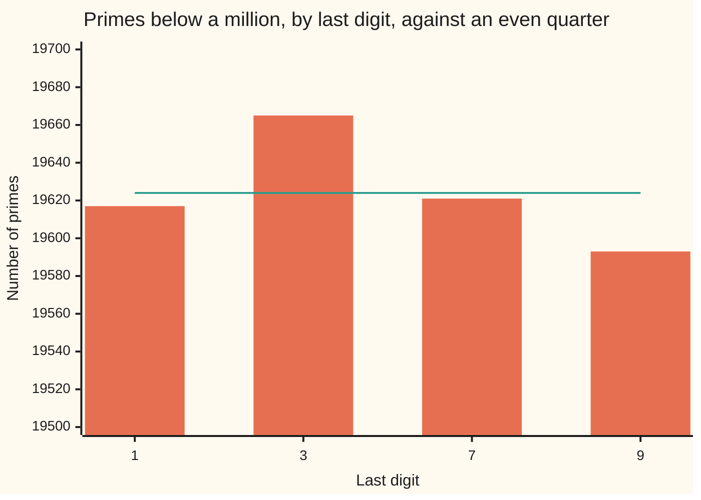

# Dirichlet characters: periodic multiplicative patterns that pick out one remainder class

[Syllabus](../../../SYLLABUS.md) → [Algebraic and analytic number theory](../README.md) → [Characters and L-functions](../README.md#s03) → Dirichlet characters

---

## General Overview

Below a million there are 78,498 primes. Apart from 2 and 5, every one ends in 1, 3, 7 or 9. The four endings come out almost level: 19,617 end in 1, 19,665 in 3, 19,621 in 7 and 19,593 in 9. An even split of the 78,496 would give 19,624 each, so the primes ending in 3 lead by 41.

A list counts them easily. Proving anything about them, such as that they never run out, is hard. Prime theory runs on multiplication, and "ends in 3" does not respect it: 3 × 3 = 9 ends in 9, and 3 × 7 = 21 ends in 1.

A **Dirichlet character** fixes that. It gives every whole number a value that repeats every 10 steps and turns products into products. Mod 10 there are exactly four such patterns. Each one alone mixes the four endings. Added together with the right weights, they cancel on every ending except 3. So the count of primes ending in 3 becomes a quarter of four sums of characters over primes, and those sums are what the L-function cards can control.

**A Dirichlet character mod q is a pattern on the whole numbers that repeats every q steps and respects multiplication; there are exactly φ(q) of them, and because they cancel each other on every remainder class but one, a weighted average of them picks out one class coprime to q inside any sum.**

**What kind of fact this is:** a theorem (the orthogonality relations and the count of φ(q) characters), proved on this card in Why it works; "character" is a definition. The prime counts are exact counts made by the code. That each ending keeps about a quarter of the primes forever is a theorem too, the prime number theorem for progressions (de la Vallée Poussin, 1896): [Dirichlet's theorem](04-dirichlets-theorem-on-primes-in-progressions.md) states it, and Davenport's book (in Sources) proves it. The counts at three sizes below are evidence for it, not proof.

### The picture: primes below a million by last digit



Bars: the exact counts. Line: 19,624, a quarter of the 78,496 primes other than 2 and 5, which is the share the trivial character alone predicts. The axis starts at 19,500, so the gaps look larger than they are: the biggest is 0.21 percent.

---

## The formula

Notation first, in words. The **modulus** q is the clock size; here q = 10, so "n mod 10" is the last digit. A **unit** mod q is a remainder that shares no factor with q; the units form the group $`(\mathbb{Z} \bmod q)^{\times}`$, and there are φ(q) of them ([Euler's totient](../../02-Number%20theory/04-Powers%20on%20the%20Clock/03-eulers-totient.md)). Mod 10 the units are 1, 3, 7 and 9, and φ(10) = 4.

A **Dirichlet character** mod q is a function χ (the Greek letter chi) from the whole numbers to the complex numbers with three properties:

```math
\chi(n + q) = \chi(n), \qquad \chi(mn) = \chi(m)\,\chi(n) \text{ for all } m, n, \qquad \chi(n) = 0 \iff \gcd(n, q) > 1
```

**Read it aloud:** χ repeats every q steps, it turns every product into a product, and it is zero exactly on the numbers that share a factor with q.

The second property, for all m and n and not only coprime ones, is **complete multiplicativity** ([Multiplicative functions](../01-Arithmetic%20Functions%20Again/02-multiplicative-functions-and-dirichlet-convolution.md)). The **trivial character** $`\chi_0`$ is 1 on every unit and 0 elsewhere. A bar means the complex conjugate: $`\overline{\chi}(n)`$ is the conjugate of $`\chi(n)`$. The main result, for any unit a:

```math
\frac{1}{\varphi(q)} \sum_{\chi} \overline{\chi}(a)\, \chi(n) = \begin{cases} 1 & \text{if } n \equiv a \pmod q \\ 0 & \text{otherwise} \end{cases}
```

**Read it aloud:** weight each character's value at n by the conjugate of its value at a, add over all φ(q) characters and divide by φ(q); the answer is 1 when n is in a's class and 0 when it is not.

Feed every prime below x into it and swap the order of the two sums:

```math
\#\{p < x : p \equiv a \pmod q\} = \frac{1}{\varphi(q)} \sum_{\chi} \overline{\chi}(a)\, S(\chi), \qquad S(\chi) = \sum_{p < x} \chi(p)
```

**Read it aloud:** the number of primes below x in a's class is the average, over the characters, of each character's sum over the primes, weighted by the conjugate of its value at a.

| Symbol | Plain meaning | In our example | Push it up and the answer… |
| --- | --- | --- | --- |
| $`q`$ | the modulus: the clock size | 10, so the class is the last digit | more units, more characters |
| $`n`$, $`m`$, $`b`$ | any whole numbers; b is a unit used in Step 0 to reorder the units | 3 × 7 = 21 | — |
| $`a`$, $`a^{-1}`$ | the target class, a unit; its inverse, with $`a \cdot a^{-1} \equiv 1`$ | a = 3; $`3^{-1} = 7`$, since 21 ends in 1 | — |
| $`p`$, $`x`$, $`\#\{\dots\}`$ | a prime; the limit of the count; the number of members of a set | 19,665 primes below x = 1,000,000 end in 3 | more primes in every class |
| $`(\mathbb{Z} \bmod q)^{\times}`$ | the units mod q, a group under multiplication | {1, 3, 7, 9} | — |
| $`\varphi(q)`$ | Euler's totient: the number of units, and of characters | 4 | the share per class shrinks |
| $`\chi`$, $`\chi_j`$, $`\psi`$, $`i`$ | a character (ψ, psi, is a second one, in Step 4); mod 10, $`\chi_j(3^k) = i^{jk}`$ for j = 0 to 3, where i is the square root of −1 | $`\chi_1(3) = i`$, $`\chi_1(7) = -i`$ | — |
| $`\chi_0`$ | the trivial character: 1 on units, 0 elsewhere | gives the even share 19,624 | — |
| $`\overline{\chi}`$ | the conjugate character, equal to $`\chi(a^{-1})`$ at a | $`\overline{\chi}_1(3) = -i`$ | — |
| $`k`$, $`c_k`$ | an exponent; the number of primes in the class of $`3^k`$ | $`c_1 = 19{,}665`$, the class of 3 | — |
| $`S(\chi)`$ | χ added over the primes below x | $`S(\chi_1) = 24 + 44i`$ | the main term grows; the others stay small |
| $`g_t`$, $`m_t`$, $`\zeta_t`$, $`r`$ | in the fold: a unit that generates one cyclic piece, its order, a root of unity of that order, the number of pieces | mod 10: $`g_1 = 3`$, $`m_1 = 4`$, r = 1 | — |

### When it holds

- **The class must be a unit.** Every character is 0 at 5, so the filter for "ends in 5" gives 0, yet the prime 5 ends in 5. Classes that share a factor with q hold at most one prime each and need a separate count.
- **Every character must be completely multiplicative.** The pattern 1, i, −1, −i on 1, 3, 7, 9, in order of size, looks like a character but fails at 3 × 3: it gives −i at 9 where the product rule needs −1. With it the cancellation fails.
- **Use all φ(q) characters.** The two real ones, $`\chi_0`$ and $`\chi_2`$, cannot tell 3 from 7 and give 19,643, the average of the two counts.
- **Conjugate the weight.** Without the bar the filter picks out $`a^{-1}`$ instead of a: 19,621 primes ending in 7.
- **Divide by φ(q), not q.** Dividing 78,660 by 10 gives 7,866.

---

## Why it works

### Step 0: a pattern that respects multiplication cancels over the whole group

Take a character χ that is not trivial, so some unit b has $`\chi(b) \neq 1`$. Multiply every unit by b. The units come back reordered, since multiplying by b can be undone by multiplying by $`b^{-1}`$. So the sum of χ over the units is unchanged. But each term was multiplied by $`\chi(b)`$, so the sum was multiplied by $`\chi(b)`$. The only number unchanged by a factor other than 1 is 0.

So a non-trivial character adds to zero over the units. Everything below is this one fact, used twice. It is the same cancellation that makes the roots of unity add to zero on the [Powers and roots](../../07-Complex%20analysis/01-Complex%20Numbers%20and%20the%20Plane/05-powers-roots-and-roots-of-unity.md) card.

### Step 1: character values are roots of unity

From $`\chi(1) = \chi(1 \cdot 1) = \chi(1)^2`$ and $`\chi(1) \neq 0`$ comes $`\chi(1) = 1`$. For a unit n, [Euler's theorem](../../02-Number%20theory/04-Powers%20on%20the%20Clock/04-eulers-theorem.md) gives $`n^{\varphi(q)} \equiv 1`$, so

```math
\chi(n)^{\varphi(q)} = \chi\big(n^{\varphi(q)}\big) = \chi(1) = 1
```

**Read it aloud:** raise a character value to the power φ(q) and you get 1, so every value is a φ(q)-th root of unity, a point on the unit circle.

Mod 10 the values are among 1, i, −1 and −i. A point on the unit circle has its conjugate as its inverse, so $`\overline{\chi}(a) = 1/\chi(a) = \chi(a^{-1})`$.

### Step 2: the four characters mod 10

The powers of 3 mod 10 are 1, 3, 9, 7, then 1 again. Every unit is a power of 3, so 3 is a primitive root ([The order of a number and primitive roots](../../02-Number%20theory/04-Powers%20on%20the%20Clock/05-order-and-primitive-roots.md)). A character is then fixed by its value at 3, which must be one of the four 4th roots of unity. Put $`\chi_j(3) = i^j`$; then $`\chi_j(3^k) = i^{jk}`$.

| n | 1 | 3 | 7 | 9 |
| --- | ---: | ---: | ---: | ---: |
| $`\chi_0`$ | 1 | 1 | 1 | 1 |
| $`\chi_1`$ | 1 | i | −i | −1 |
| $`\chi_2`$ | 1 | −1 | −1 | 1 |
| $`\chi_3`$ | 1 | −i | i | −1 |

Read across: 7 is $`3^3`$, so $`\chi_1(7) = i^3 = -i`$. The code also tries all $`4^4 = 256`$ ways to fill a row with fourth roots of unity and keeps the ones that respect multiplication. Exactly these four survive.

In group language, a character is a homomorphism from the units to the nonzero complex numbers under multiplication ([Homomorphisms and isomorphisms](../../03-Algebra/08-Groups/05-homomorphisms-and-isomorphisms.md)), extended by 0. $`\chi_2`$ is real: it is +1 on the endings 1 and 9, whose numbers are squares mod 5, and −1 on 3 and 7.

Not every modulus has a primitive root: mod 8 the units 1, 3, 5, 7 all square to 1. There are still φ(8) = 4 characters, all real, as the fold below explains. The code counts them by brute force, and also mod 7 (six, two real) and mod 12 (four, all real).

### Step 3: summed over the numbers, two different characters cancel

For $`\chi_1`$, Step 0 is plain arithmetic: 1 + i + (−i) + (−1) = 0. More generally, $`\chi_j \overline{\chi}_k`$ is again a character, and it is trivial only when j = k. So

```math
\sum_{n \bmod q} \chi_j(n)\, \overline{\chi}_k(n) = \begin{cases} \varphi(q) & j = k \\ 0 & j \neq k \end{cases}
```

**Read it aloud:** two characters, one conjugated, multiplied and added over a full period give φ(q) if they are the same character and 0 if not.

So the rows of the table are perpendicular, as the columns of [The discrete Fourier transform](../../07-Complex%20analysis/08-Transforms%20in%20Outline/02-discrete-fourier-transform.md) are.

### Step 4: summed over the characters, every class but 1 cancels

Now swap the roles. Characters multiply value by value, and the product of two characters is a character, so the characters form a group of their own. Take a unit n other than 1. Some character ψ (the Greek letter psi) has $`\psi(n) \neq 1`$; mod 10, $`\chi_1`$ takes the value 1 only at 1. Multiplying every character by ψ reorders the characters and multiplies the sum $`\sum_\chi \chi(n)`$ by $`\psi(n)`$. So that sum is 0, by the argument of Step 0. At n = 1 every character gives 1, and the sum is φ(q).

### Step 5: shift the class from 1 to a

Apply Step 4 to $`n a^{-1}`$ in place of n. Since $`\chi(n a^{-1}) = \chi(n)\,\chi(a^{-1}) = \overline{\chi}(a)\,\chi(n)`$, the sum is φ(q) when $`n a^{-1} \equiv 1`$, that is when $`n \equiv a`$, and 0 otherwise. Divide by φ(q): that is the main formula.

Check it at a = 3. The weights $`\overline{\chi}_j(3)`$ are 1, −i, −1, i. At n = 3 each weighted term is 1, and the total is 4. At n = 7 the terms are 1 · 1, (−i)(−i), (−1)(−1) and i · i, which is 1 − 1 + 1 − 1 = 0. The code prints the sum for n = 1 to 10: 0 0 4 0 0 0 0 0 0 0.

### Step 6: run the primes through the filter

Add the main formula over every prime p below x. On the left, each prime ending in 3 contributes 1 and every other prime 0, so the left side is the count. On the right, swap the two sums, one over primes and one over characters. Each character's values over the primes collect into $`S(\chi)`$, and the second formula follows.

The trivial character gives $`S(\chi_0)`$, the number of primes not dividing q, and contributes an even quarter. The other three characters measure how far the classes depart from even. [Dirichlet's theorem](04-dirichlets-theorem-on-primes-in-progressions.md) starts from this split, but it does not bound $`S(\chi)`$. It weights each prime p by a power of 1/p slightly above the first, and shows that each non-trivial character's weighted sum stays bounded as that power comes down to 1, while the trivial character's grows without limit. That each non-trivial $`S(\chi)`$ is small next to $`S(\chi_0)`$ is the stronger prime number theorem for progressions, stated on that card and proved in Davenport's book.

### Step 7: the same orthogonality as the Fourier transform

Write each unit as $`3^k`$ and let $`c_k`$ be the number of primes in the class of $`3^k`$, so $`c_0, c_1, c_2, c_3`$ count the endings 1, 3, 9, 7. Then

```math
S(\chi_j) = \sum_{k=0}^{3} c_k\, i^{jk}
```

**Read it aloud:** the sum of $`\chi_j`$ over the primes is the four class counts, each turned by a quarter turn j times k.

That is a 4-point discrete Fourier transform of the counts, turning anticlockwise where the transform card turns clockwise, and the filter is its inverse. It is the same orthogonality on a different group: the clock under addition there, the units under multiplication here. The code computes the four sums both ways.

<details>
<summary>Detailed proof: every modulus q has exactly φ(q) characters</summary>

The units mod q form a finite group in which order does not matter, an abelian group. The structure theorem for finite abelian groups, stated on [Smith normal form](../../17-Topology/05-Homology/03-computing-homology-by-smith-normal-form.md), writes it as a product of cyclic groups, each made of the powers of one unit $`g_t`$ of order $`m_t`$, with $`m_1 m_2 \cdots m_r = \varphi(q)`$. Mod 10 there is one piece, the powers of 3, of order 4. Mod 8 there are two, the powers of 3 and of 5, each of order 2.

Every unit is $`g_1^{k_1} \cdots g_r^{k_r}`$ in exactly one way. A character is fixed by its values at the $`g_t`$, and by Step 1 each value is an $`m_t`$-th root of unity. Every choice works: set

$`\displaystyle \chi\big(g_1^{k_1} \cdots g_r^{k_r}\big) = \zeta_1^{k_1} \cdots \zeta_r^{k_r},`$

where $`\zeta_t`$ is any $`m_t`$-th root of unity. This respects multiplication because the exponents add. The number of choices is $`m_1 \cdots m_r = \varphi(q)`$.

For Step 4, take a unit n other than 1. Some exponent $`k_t`$ of n is not a multiple of $`m_t`$. Choose $`\zeta_t = e^{2\pi i/m_t}`$ and every other $`\zeta`$ equal to 1. That character is not 1 at n.

</details>

---

## Worked numbers, by hand

The four character sums come from the four counts, by reading the table of Step 2 down each column.

| Step | Arithmetic | Value |
| --- | --- | --- |
| primes below a million | sieve | 78,498 |
| $`S(\chi_0)`$ | drop 2 and 5, where every character is 0 | 78,496 |
| $`S(\chi_1)`$ | (19,617 − 19,593) + (19,665 − 19,621)i | 24 + 44i |
| $`S(\chi_2)`$ | (19,617 + 19,593) − (19,665 + 19,621) | −76 |
| $`S(\chi_3)`$ | the conjugate of $`S(\chi_1)`$ | 24 − 44i |
| weights $`\overline{\chi}_j(3)`$ | conjugates of 1, i, −1, −i | 1, −i, −1, i |
| weighted terms | 78,496; (−i)(24 + 44i) = 44 − 24i; (−1)(−76) = 76; i(24 − 44i) = 44 + 24i | four terms |
| add | the imaginary parts cancel: 78,496 + 44 + 76 + 44 | 78,660 |
| divide by φ(10) | 78,660 / 4 | **19,665** |

19,665 is exactly the number of primes below a million that end in 3, as the direct count says. The trivial character supplies 19,624 of it, an even quarter; the other three characters supply the lead of (44 + 76 + 44) / 4 = 41.

### At three sizes

| x | primes | end in 3 | $`S(\chi_0)`$ | $`S(\chi_1)`$ | $`S(\chi_2)`$ | non-trivial part, $`4 \times`$ end 3 − $`S(\chi_0)`$ | end 3 against a quarter |
| ---: | ---: | ---: | ---: | ---: | ---: | ---: | ---: |
| 10,000 | 1,229 | 310 | 1,227 | 3 + 2i | −9 | 13 | 1.010595 |
| 100,000 | 9,592 | 2,402 | 9,590 | −3 − 9i | −36 | 18 | 1.001877 |
| 1,000,000 | 78,498 | 19,665 | 78,496 | 24 + 44i | −76 | 164 | 1.002089 |

The trivial sum grows about eightfold per row. The non-trivial sums stay in the tens. So the ratio of the count to an even quarter sits near 1. That is evidence, not proof. That the ratio tends to 1 is the prime number theorem for progressions (de la Vallée Poussin, 1896), stated on [Dirichlet's theorem](04-dirichlets-theorem-on-primes-in-progressions.md) and proved in Davenport's book.

### What breaks if you drop a piece

| Mistake | Comes out at | What went wrong |
| --- | --- | --- |
| No conjugate on the weight | 19,621, not 19,665 | It picks out $`3^{-1} = 7`$: the count of primes ending in 7 |
| Divide by q = 10 | 7,866, not 19,665 | There are φ(10) = 4 characters, not 10 |
| Only the real characters $`\chi_0`$, $`\chi_2`$ | 19,643, not 19,665 | Real characters cannot tell 3 from 7; this is the average of 19,665 and 19,621 |
| Ask for the class 5 | 0, though the prime 5 ends in 5 | 5 shares a factor with 10, so every character is 0 there |

The code prints all four, and the failure of the pattern 1, i, −1, −i at 3 × 3.

---

## Code, from first principles, and it actually runs

Nothing is imported, and nothing is rounded: a value $`i^k`$ is stored as k, and every sum is a pair of integers. The code takes three independent roads. Road one sieves the primes below a million and reads their last digits. Road two adds each character over the primes and runs the filter for all four endings, which must match road one exactly. Road three finds the characters twice, from the primitive root 3 and by trying every table, and recomputes the character sums as a Fourier transform of the counts. It also checks both orthogonality relations and complete multiplicativity up to 200.

### Python

```python
# Dirichlet characters mod 10 and the primes ending in 3 -- the check behind the card.
# Nothing is imported.  A character value i^k is stored exactly as k mod 4, and
# every sum is a Gaussian integer (re, im), so no rounding enters.
# Road one counts primes by last digit.  Road two adds each character over the
# primes and filters with orthogonality.  The characters themselves are found
# twice: from the generator 3, and by trying every possible table.
Q, X = 10, 10**6
IPOW = [(1, 0), (0, 1), (-1, 0), (0, -1)]       # i^0, i^1, i^2, i^3

def gcd(a, b):                                  # Euclid's algorithm, written out
    while b:
        a, b = b, a % b
    return a

def gadd(a, b): return (a[0] + b[0], a[1] + b[1])
def gmul(a, b): return (a[0] * b[0] - a[1] * b[1], a[0] * b[1] + a[1] * b[0])
def conj(a): return (a[0], -a[1])
def yn(claim): return "yes" if claim else "no"

def show(z):                                    # a Gaussian integer as text: 24 + 44i
    re, im = z
    if im == 0:
        return str(re)
    i_part = ("" if abs(im) == 1 else str(abs(im))) + "i"
    if re == 0:
        return ("-" if im < 0 else "") + i_part
    return f"{re} {'-' if im < 0 else '+'} {i_part}"

def all_characters(q):                          # brute force: every table that is multiplicative
    units = [n for n in range(1, q) if gcd(n, q) == 1]
    m, found = len(units), []                   # values are m-th roots of unity, m = phi(q)
    for code in range(m ** m):
        e = {u: (code // m ** j) % m for j, u in enumerate(units)}
        if e[1] == 0 and all(e[a * b % q] == (e[a] + e[b]) % m for a in units for b in units):
            found.append(tuple(e[u] for u in units))
    return units, m, found

units = [n for n in range(1, Q) if gcd(n, Q) == 1]
ind, k, g = {}, 0, 1                            # road A: powers of the generator 3
while g not in ind:
    ind[g], g, k = k, g * 3 % Q, k + 1
chars = [{u: (j * ind[u]) % 4 for u in units} for j in range(4)]
def chi(j, n):                                  # value of chi_j at any integer n, or None for 0
    return None if gcd(n, Q) > 1 else chars[j][n % Q]
def val(j, n):
    c = chi(j, n)
    return (0, 0) if c is None else IPOW[c]

print(f"units mod 10: {units}; powers of 3: {[3 ** k % Q for k in range(4)]}")
print("n       " + "".join(f"{u:>4}" for u in units))
for j in range(4):
    print(f"chi_{j}   " + "".join(f"{show(IPOW[chars[j][u]]):>4}" for u in units))
_, _, brute = all_characters(Q)                 # road B: try all 4^4 = 256 tables
from_gen = sorted(tuple(c[u] for u in units) for c in chars)
print(f"characters mod 10 by trying all 256 tables: {len(brute)}; same as from the generator: {yn(sorted(brute) == from_gen)}")
assert sorted(brute) == from_gen
for q in (7, 8, 12):
    us, m, found = all_characters(q)
    real = sum(1 for f in found if all(2 * v % m == 0 for v in f))
    print(f"mod {q}: phi = {m}, characters found = {len(found)}, real ones = {real}")
    assert len(found) == m                       # as many characters as units

mult = all(val(j, a * b) == gmul(val(j, a), val(j, b)) for j in range(4) for a in range(1, 201) for b in range(1, 201))
print(f"chi(ab) = chi(a) chi(b) for every a, b up to 200 and every chi: {yn(mult)}")
assert mult
rows = [[(0, 0)] * 4 for _ in range(4)]
for j in range(4):
    for kk in range(4):
        s = (0, 0)
        for u in units:
            s = gadd(s, gmul(val(j, u), conj(val(kk, u))))
        rows[j][kk] = s
print("sum over n of chi_j(n) times conj chi_k(n): " + " | ".join(" ".join(show(z) for z in r) for r in rows))
filt = []
for n in range(1, 11):
    s = (0, 0)
    for j in range(4):
        s = gadd(s, gmul(conj(val(j, 3)), val(j, n)))
    filt.append(show(s))
print(f"sum over chi of conj chi(3) chi(n), n = 1..10: {' '.join(filt)}")
assert all(rows[j][kk] == ((4, 0) if j == kk else (0, 0)) for j in range(4) for kk in range(4))
assert filt == ["0", "0", "4", "0", "0", "0", "0", "0", "0", "0"]

sieve = bytearray([1]) * X                      # primes below a million
sieve[0] = sieve[1] = 0
for p in range(2, int(X ** 0.5) + 1):
    if sieve[p]:
        sieve[p * p::p] = bytearray(len(range(p * p, X, p)))
print("x        primes  end 1  end 3  end 7  end 9  S(chi_0)  S(chi_1)  S(chi_2)  4 x end 3 - S(chi_0)  ratio")
count, S, pi, results = {d: 0 for d in range(10)}, [(0, 0)] * 4, 0, {}
for p in range(2, X):
    if sieve[p]:
        pi += 1
        count[p % 10] += 1                       # road one: read the last digit
        S = [gadd(S[j], val(j, p)) for j in range(4)]   # road two: add each character
    if p + 1 in (10**4, 10**5, 10**6):
        print(f"{p + 1:<8} {pi:>6} {count[1]:>6} {count[3]:>6} {count[7]:>6} {count[9]:>6} {show(S[0]):>9} "
              f"{show(S[1]):>9} {show(S[2]):>9}  {4 * count[3] - S[0][0]:>19}  {count[3] / (S[0][0] / 4):.6f}")
print(f"S(chi_3) = {show(S[3])}, the conjugate of S(chi_1); primes ending in 2 or 5: {count[2] + count[5]}")
print("filter: end digit a, (1/4) sum of conj chi(a) S(chi), direct count")
for a in units:
    tot = (0, 0)
    for j in range(4):
        tot = gadd(tot, gmul(conj(val(j, a)), S[j]))
    print(f"  {a}: {show(tot)} / 4 = {tot[0] // 4}, direct {count[a]}")
    assert tot[1] == 0 and tot[0] == 4 * count[a]   # road two against road one, each class
terms = [gmul(conj(val(j, 3)), S[j]) for j in range(4)]
print(f"ending in 3, term by term: {' + '.join('(' + show(t) + ')' for t in terms)} = {sum(t[0] for t in terms)}")
dft = [(0, 0)] * 4                              # the same sums as a 4-point transform of the counts
for j in range(4):
    for kk in range(4):
        dft[j] = gadd(dft[j], gmul((count[3 ** kk % Q], 0), IPOW[j * kk % 4]))
print(f"transform of counts at 1, 3, 9, 7: {' '.join(show(z) for z in dft)}")
assert dft == S                                  # characters on a cyclic group are DFT columns
print(f"chart, bars {count[1]} {count[3]} {count[7]} {count[9]}, line {S[0][0] // 4}")
lead = sum(t[0] for t in terms[1:]) // 4         # the three non-trivial terms, divided by 4
print(f"lead of ending 3 over an even quarter: ({' + '.join(str(t[0]) for t in terms[1:])}) / 4 = {lead}; "
      f"largest gap from {S[0][0] // 4}: {100 * max(abs(count[a] - S[0][0] / 4) for a in units) / (S[0][0] / 4):.2f} percent")

wrong1 = sum(gmul(val(j, 3), S[j])[0] for j in range(4)) // 4
wrong2 = sum(t[0] for t in terms) // 10
wrong3 = (terms[0][0] + terms[2][0]) // 4
wrong4 = sum(gmul(conj(val(j, 5)), S[j])[0] for j in range(4)) // 4
print(f"mistake 1, no conjugate: {wrong1}, the count ending in 7, not {count[3]}")
print(f"mistake 2, divide by q = 10, not phi(10) = 4: {wrong2}, not {count[3]}")
print(f"mistake 3, real characters only: {wrong3}, the average of {count[3]} and {count[7]}")
print(f"mistake 4, class 5, which shares a factor with 10: {wrong4}, though the prime 5 ends in 5")
naive = {1: 0, 3: 1, 7: 2, 9: 3}                 # 1, i, -1, -i in order of size
bad = next((a, b) for a in units for b in units if naive[a * b % Q] != (naive[a] + naive[b]) % 4)
print(f"pattern 1, i, -1, -i on 1, 3, 7, 9: fails at {bad[0]} x {bad[1]}: f({bad[0] * bad[1] % Q}) = "
      f"{show(IPOW[naive[bad[0] * bad[1] % Q]])}, f({bad[0]}) f({bad[1]}) = {show(IPOW[(naive[bad[0]] + naive[bad[1]]) % 4])}")
assert wrong1 == count[7] and wrong4 == 0
print("ALL CHECKS PASS")
```

**Ran 2026-11-15 on macOS, Python 3.14.10, standard library only. All checks passed. Output, pasted from the run:**

```
units mod 10: [1, 3, 7, 9]; powers of 3: [1, 3, 9, 7]
n          1   3   7   9
chi_0      1   1   1   1
chi_1      1   i  -i  -1
chi_2      1  -1  -1   1
chi_3      1  -i   i  -1
characters mod 10 by trying all 256 tables: 4; same as from the generator: yes
mod 7: phi = 6, characters found = 6, real ones = 2
mod 8: phi = 4, characters found = 4, real ones = 4
mod 12: phi = 4, characters found = 4, real ones = 4
chi(ab) = chi(a) chi(b) for every a, b up to 200 and every chi: yes
sum over n of chi_j(n) times conj chi_k(n): 4 0 0 0 | 0 4 0 0 | 0 0 4 0 | 0 0 0 4
sum over chi of conj chi(3) chi(n), n = 1..10: 0 0 4 0 0 0 0 0 0 0
x        primes  end 1  end 3  end 7  end 9  S(chi_0)  S(chi_1)  S(chi_2)  4 x end 3 - S(chi_0)  ratio
10000      1229    306    310    308    303      1227    3 + 2i        -9                   13  1.010595
100000     9592   2387   2402   2411   2390      9590   -3 - 9i       -36                   18  1.001877
1000000   78498  19617  19665  19621  19593     78496  24 + 44i       -76                  164  1.002089
S(chi_3) = 24 - 44i, the conjugate of S(chi_1); primes ending in 2 or 5: 2
filter: end digit a, (1/4) sum of conj chi(a) S(chi), direct count
  1: 78468 / 4 = 19617, direct 19617
  3: 78660 / 4 = 19665, direct 19665
  7: 78484 / 4 = 19621, direct 19621
  9: 78372 / 4 = 19593, direct 19593
ending in 3, term by term: (78496) + (44 - 24i) + (76) + (44 + 24i) = 78660
transform of counts at 1, 3, 9, 7: 78496 24 + 44i -76 24 - 44i
chart, bars 19617 19665 19621 19593, line 19624
lead of ending 3 over an even quarter: (44 + 76 + 44) / 4 = 41; largest gap from 19624: 0.21 percent
mistake 1, no conjugate: 19621, the count ending in 7, not 19665
mistake 2, divide by q = 10, not phi(10) = 4: 7866, not 19665
mistake 3, real characters only: 19643, the average of 19665 and 19621
mistake 4, class 5, which shares a factor with 10: 0, though the prime 5 ends in 5
pattern 1, i, -1, -i on 1, 3, 7, 9: fails at 3 x 3: f(9) = -i, f(3) f(3) = -1
ALL CHECKS PASS
```

### Rust

Same numbers, same labels, built with `rustc --edition 2021 -O`.

```rust
// Dirichlet characters mod 10 and the primes ending in 3 -- the same check as the
// Python, in Rust.  No crates.  A character value i^k is stored exactly as k mod 4,
// and every sum is a Gaussian integer (re, im), so no rounding enters.
// Road one counts primes by last digit.  Road two adds each character over the
// primes and filters with orthogonality.  The characters themselves are found
// twice: from the generator 3, and by trying every possible table.
type G = (i64, i64);
const Q: usize = 10;
const X: usize = 1_000_000;
const IPOW: [G; 4] = [(1, 0), (0, 1), (-1, 0), (0, -1)];   // i^0, i^1, i^2, i^3

fn gcd(mut a: usize, mut b: usize) -> usize {   // Euclid's algorithm, written out
    while b != 0 { (a, b) = (b, a % b) }
    a
}
fn gadd(a: G, b: G) -> G { (a.0 + b.0, a.1 + b.1) }
fn gmul(a: G, b: G) -> G { (a.0 * b.0 - a.1 * b.1, a.0 * b.1 + a.1 * b.0) }
fn conj(a: G) -> G { (a.0, -a.1) }
fn yn(claim: bool) -> &'static str { if claim { "yes" } else { "no" } }

fn show(z: G) -> String {                       // a Gaussian integer as text: 24 + 44i
    let (re, im) = z;
    if im == 0 { return re.to_string() }
    let i_part = format!("{}i", if im.abs() == 1 { String::new() } else { im.abs().to_string() });
    if re == 0 { return format!("{}{}", if im < 0 { "-" } else { "" }, i_part) }
    format!("{} {} {}", re, if im < 0 { "-" } else { "+" }, i_part)
}

fn units_of(q: usize) -> Vec<usize> { (1..q).filter(|&n| gcd(n, q) == 1).collect() }

fn all_characters(q: usize) -> (usize, Vec<Vec<usize>>) {   // brute force: every multiplicative table
    let units = units_of(q);
    let m = units.len();                        // values are m-th roots of unity, m = phi(q)
    let mut found = Vec::new();
    for code in 0..m.pow(m as u32) {
        let mut e = vec![0usize; q];
        for (j, &u) in units.iter().enumerate() { e[u] = (code / m.pow(j as u32)) % m }
        if e[1] == 0 && units.iter().all(|&a| units.iter().all(|&b| e[a * b % q] == (e[a] + e[b]) % m)) {
            found.push(units.iter().map(|&u| e[u]).collect());
        }
    }
    (m, found)
}

fn main() {
    let units = units_of(Q);
    let mut ind = [usize::MAX; Q];              // road A: powers of the generator 3
    let (mut k, mut g) = (0, 1);
    while ind[g] == usize::MAX { ind[g] = k; g = g * 3 % Q; k += 1 }
    let chars: Vec<Vec<usize>> = (0..4).map(|j| (0..Q).map(|u| if ind[u] == usize::MAX { 0 } else { j * ind[u] % 4 }).collect()).collect();
    let val = |j: usize, n: usize| -> G { if gcd(n, Q) > 1 { (0, 0) } else { IPOW[chars[j][n % Q]] } };

    let pw: Vec<usize> = (0..4).map(|k| 3usize.pow(k) % Q).collect();
    println!("units mod 10: {:?}; powers of 3: {:?}", units, pw);
    println!("n       {}", units.iter().map(|u| format!("{:>4}", u)).collect::<String>());
    for j in 0..4 {
        println!("chi_{}   {}", j, units.iter().map(|&u| format!("{:>4}", show(IPOW[chars[j][u]]))).collect::<String>());
    }
    let (_, mut brute) = all_characters(Q);     // road B: try all 4^4 = 256 tables
    brute.sort();
    let mut from_gen: Vec<Vec<usize>> = (0..4).map(|j| units.iter().map(|&u| chars[j][u]).collect()).collect();
    from_gen.sort();
    println!("characters mod 10 by trying all 256 tables: {}; same as from the generator: {}", brute.len(), yn(brute == from_gen));
    assert!(brute == from_gen);
    for q in [7, 8, 12] {
        let (m, found) = all_characters(q);
        let real = found.iter().filter(|f| f.iter().all(|&v| 2 * v % m == 0)).count();
        println!("mod {}: phi = {}, characters found = {}, real ones = {}", q, m, found.len(), real);
        assert!(found.len() == m);              // as many characters as units
    }

    let mult = (0..4).all(|j| (1..=200).all(|a| (1..=200).all(|b| val(j, a * b) == gmul(val(j, a), val(j, b)))));
    println!("chi(ab) = chi(a) chi(b) for every a, b up to 200 and every chi: {}", yn(mult));
    assert!(mult);
    let mut rows = [[(0i64, 0i64); 4]; 4];
    for j in 0..4 { for kk in 0..4 { for &u in &units { rows[j][kk] = gadd(rows[j][kk], gmul(val(j, u), conj(val(kk, u)))) } } }
    let rs: Vec<String> = rows.iter().map(|r| r.iter().map(|&z| show(z)).collect::<Vec<_>>().join(" ")).collect();
    println!("sum over n of chi_j(n) times conj chi_k(n): {}", rs.join(" | "));
    let filt: Vec<String> = (1..=10).map(|n| show((0..4).fold((0, 0), |s, j| gadd(s, gmul(conj(val(j, 3)), val(j, n)))))).collect();
    println!("sum over chi of conj chi(3) chi(n), n = 1..10: {}", filt.join(" "));
    assert!((0..4).all(|j| (0..4).all(|kk| rows[j][kk] == if j == kk { (4, 0) } else { (0, 0) })));
    assert!(filt == ["0", "0", "4", "0", "0", "0", "0", "0", "0", "0"]);

    let mut sieve = vec![true; X];              // primes below a million
    sieve[0] = false; sieve[1] = false;
    let mut p = 2;
    while p * p < X { if sieve[p] { let mut m = p * p; while m < X { sieve[m] = false; m += p } } p += 1 }
    println!("x        primes  end 1  end 3  end 7  end 9  S(chi_0)  S(chi_1)  S(chi_2)  4 x end 3 - S(chi_0)  ratio");
    let mut count = [0i64; 10];
    let mut s = [(0i64, 0i64); 4];
    let mut pi = 0;
    for p in 2..X {
        if sieve[p] {
            pi += 1;
            count[p % 10] += 1;                 // road one: read the last digit
            for j in 0..4 { s[j] = gadd(s[j], val(j, p)) }   // road two: add each character
        }
        if p + 1 == 10_000 || p + 1 == 100_000 || p + 1 == 1_000_000 {
            println!("{:<8} {:>6} {:>6} {:>6} {:>6} {:>6} {:>9} {:>9} {:>9}  {:>19}  {:.6}", p + 1, pi, count[1], count[3], count[7], count[9],
                     show(s[0]), show(s[1]), show(s[2]), 4 * count[3] - s[0].0, count[3] as f64 / (s[0].0 as f64 / 4.0));
        }
    }
    println!("S(chi_3) = {}, the conjugate of S(chi_1); primes ending in 2 or 5: {}", show(s[3]), count[2] + count[5]);
    println!("filter: end digit a, (1/4) sum of conj chi(a) S(chi), direct count");
    for &a in &units {
        let tot = (0..4).fold((0, 0), |t, j| gadd(t, gmul(conj(val(j, a)), s[j])));
        println!("  {}: {} / 4 = {}, direct {}", a, show(tot), tot.0 / 4, count[a]);
        assert!(tot.1 == 0 && tot.0 == 4 * count[a]);   // road two against road one, each class
    }
    let terms: Vec<G> = (0..4).map(|j| gmul(conj(val(j, 3)), s[j])).collect();
    let tsum: i64 = terms.iter().map(|t| t.0).sum();
    println!("ending in 3, term by term: {} = {}", terms.iter().map(|&t| format!("({})", show(t))).collect::<Vec<_>>().join(" + "), tsum);
    let mut dft = [(0i64, 0i64); 4];            // the same sums as a 4-point transform of the counts
    for j in 0..4 { for kk in 0..4 { dft[j] = gadd(dft[j], gmul((count[3usize.pow(kk as u32) % Q], 0), IPOW[j * kk % 4])) } }
    println!("transform of counts at 1, 3, 9, 7: {}", dft.iter().map(|&z| show(z)).collect::<Vec<_>>().join(" "));
    assert!(dft == s);                          // characters on a cyclic group are DFT columns
    println!("chart, bars {} {} {} {}, line {}", count[1], count[3], count[7], count[9], s[0].0 / 4);
    let lead = terms[1..].iter().map(|t| t.0).sum::<i64>() / 4;   // the three non-trivial terms, divided by 4
    let gap = units.iter().map(|&a| (count[a] as f64 - s[0].0 as f64 / 4.0).abs()).fold(0.0, f64::max);
    println!("lead of ending 3 over an even quarter: ({}) / 4 = {}; largest gap from {}: {:.2} percent",
             terms[1..].iter().map(|t| t.0.to_string()).collect::<Vec<_>>().join(" + "), lead, s[0].0 / 4, 100.0 * gap / (s[0].0 as f64 / 4.0));

    let wrong1 = (0..4).map(|j| gmul(val(j, 3), s[j]).0).sum::<i64>() / 4;
    let wrong2 = tsum / 10;
    let wrong3 = (terms[0].0 + terms[2].0) / 4;
    let wrong4 = (0..4).map(|j| gmul(conj(val(j, 5)), s[j]).0).sum::<i64>() / 4;
    println!("mistake 1, no conjugate: {}, the count ending in 7, not {}", wrong1, count[3]);
    println!("mistake 2, divide by q = 10, not phi(10) = 4: {}, not {}", wrong2, count[3]);
    println!("mistake 3, real characters only: {}, the average of {} and {}", wrong3, count[3], count[7]);
    println!("mistake 4, class 5, which shares a factor with 10: {}, though the prime 5 ends in 5", wrong4);
    let naive = |n: usize| -> usize { [0, 0, 0, 1, 0, 0, 0, 2, 0, 3][n] };   // 1, i, -1, -i in order of size
    let mut bad = (0, 0);
    'outer: for &a in &units { for &b in &units { if naive(a * b % Q) != (naive(a) + naive(b)) % 4 { bad = (a, b); break 'outer } } }
    println!("pattern 1, i, -1, -i on 1, 3, 7, 9: fails at {} x {}: f({}) = {}, f({}) f({}) = {}", bad.0, bad.1, bad.0 * bad.1 % Q,
             show(IPOW[naive(bad.0 * bad.1 % Q)]), bad.0, bad.1, show(IPOW[(naive(bad.0) + naive(bad.1)) % 4]));
    assert!(wrong1 == count[7] && wrong4 == 0);
    println!("ALL CHECKS PASS");
}
```

**Ran 2026-11-15 on macOS, rustc 1.98.1, no crates. All checks passed. Output, pasted from the run:**

```
units mod 10: [1, 3, 7, 9]; powers of 3: [1, 3, 9, 7]
n          1   3   7   9
chi_0      1   1   1   1
chi_1      1   i  -i  -1
chi_2      1  -1  -1   1
chi_3      1  -i   i  -1
characters mod 10 by trying all 256 tables: 4; same as from the generator: yes
mod 7: phi = 6, characters found = 6, real ones = 2
mod 8: phi = 4, characters found = 4, real ones = 4
mod 12: phi = 4, characters found = 4, real ones = 4
chi(ab) = chi(a) chi(b) for every a, b up to 200 and every chi: yes
sum over n of chi_j(n) times conj chi_k(n): 4 0 0 0 | 0 4 0 0 | 0 0 4 0 | 0 0 0 4
sum over chi of conj chi(3) chi(n), n = 1..10: 0 0 4 0 0 0 0 0 0 0
x        primes  end 1  end 3  end 7  end 9  S(chi_0)  S(chi_1)  S(chi_2)  4 x end 3 - S(chi_0)  ratio
10000      1229    306    310    308    303      1227    3 + 2i        -9                   13  1.010595
100000     9592   2387   2402   2411   2390      9590   -3 - 9i       -36                   18  1.001877
1000000   78498  19617  19665  19621  19593     78496  24 + 44i       -76                  164  1.002089
S(chi_3) = 24 - 44i, the conjugate of S(chi_1); primes ending in 2 or 5: 2
filter: end digit a, (1/4) sum of conj chi(a) S(chi), direct count
  1: 78468 / 4 = 19617, direct 19617
  3: 78660 / 4 = 19665, direct 19665
  7: 78484 / 4 = 19621, direct 19621
  9: 78372 / 4 = 19593, direct 19593
ending in 3, term by term: (78496) + (44 - 24i) + (76) + (44 + 24i) = 78660
transform of counts at 1, 3, 9, 7: 78496 24 + 44i -76 24 - 44i
chart, bars 19617 19665 19621 19593, line 19624
lead of ending 3 over an even quarter: (44 + 76 + 44) / 4 = 41; largest gap from 19624: 0.21 percent
mistake 1, no conjugate: 19621, the count ending in 7, not 19665
mistake 2, divide by q = 10, not phi(10) = 4: 7866, not 19665
mistake 3, real characters only: 19643, the average of 19665 and 19621
mistake 4, class 5, which shares a factor with 10: 0, though the prime 5 ends in 5
pattern 1, i, -1, -i on 1, 3, 7, 9: fails at 3 x 3: f(9) = -i, f(3) f(3) = -1
ALL CHECKS PASS
```

The two outputs match line for line.

### Lean

Lean proves the filter, the count of characters and the prime-count formula for every modulus q, and checks the worked numbers mod 10.

- Take a unit a mod q and any character χ. Then $`\overline{\chi}(a) = \chi(a^{-1})`$, as in Step 1.
- Take a positive modulus q, a whole number a that shares no factor with q, and any whole number n. Then $`\frac{1}{\varphi(q)} \sum_{\chi} \overline{\chi}(a)\,\chi(n)`$ is 1 when $`n \equiv a \pmod q`$, and 0 otherwise.
- Every positive modulus q has exactly φ(q) Dirichlet characters.
- Take q and a as above, and any limit x. Then $`\#\{p < x : p \equiv a \pmod q\} = \frac{1}{\varphi(q)} \sum_{\chi} \overline{\chi}(a)\, S(\chi)`$.
- The units mod 10 are 1, 3, 7 and 9, so φ(10) = 4.
- The powers of 3 mod 10 are 1, 3, 9, 7, and 3 × 7 = 21 ends in 1.
- φ(7) = 6, φ(8) = 4 and φ(12) = 4, and mod 8 every unit squares to 1.
- The pattern 1, i, −1, −i on 1, 3, 7, 9 fails at 3 × 3: i · i is −1, not −i.
- The counts add up: $`4^4 = 256`$, 19,617 + 19,665 + 19,621 + 19,593 = 78,496, and 78,496 / 4 = 19,624.
- The weighted terms for ending 3 hold: (−i)(24 + 44i) = 44 − 24i and i(24 − 44i) = 44 + 24i.
- They add to 78,660, and 78,660 / 4 = 19,665, a lead of (44 + 76 + 44) / 4 = 41.
- The mistakes come out as on the card: 7,866 when dividing by 10, and 19,643 with the real characters only.

Sieving and counting the primes, the three sizes and the 256-table search are left to the Python and Rust checks.

```lean
-- Dirichlet characters: summing over all characters mod q, each weighted by the conjugate of its value at a unit a and divided by φ(q), gives 1 on a's class and 0 elsewhere, so it counts the primes in that class.
import Mathlib.NumberTheory.DirichletCharacter.Orthogonality
import Mathlib.RingTheory.RootsOfUnity.AlgebraicallyClosed
import Mathlib.Analysis.Complex.Polynomial.Basic
import Mathlib.Data.Nat.Totient

open Finset

/-- For a unit a mod q, the complex conjugate of χ(a) is χ(a⁻¹). -/
theorem conj_apply_eq_inv (q : ℕ) [NeZero q] (χ : DirichletCharacter ℂ q) {a : ZMod q}
    (ha : IsUnit a) : starRingEnd ℂ (χ a) = χ a⁻¹ := by
  have h1 : χ a * χ a⁻¹ = 1 := by
    rw [← map_mul, ZMod.mul_inv_of_unit a ha, map_one]
  have h2 : χ a * starRingEnd ℂ (χ a) = 1 := by
    have := MulChar.star_apply' χ a
    rw [RCLike.star_def] at this
    rw [this, ← MulChar.mul_apply, mul_inv_cancel, MulChar.one_apply ha]
  have hne : χ a ≠ 0 := by
    intro h; rw [h, zero_mul] at h1; exact zero_ne_one h1
  exact mul_left_cancel₀ hne (h2.trans h1.symm)

#print axioms conj_apply_eq_inv

/-- The filter for one remainder class. Let q be a positive modulus and a a whole number
that shares no factor with q. Weight each Dirichlet character mod q at n by the complex
conjugate of its value at a, add over all the characters and divide by φ(q): the answer
is 1 when n ≡ a (mod q) and 0 otherwise. -/
theorem dirichlet_character_filter (q : ℕ) [NeZero q] (a : ℕ) (ha : Nat.Coprime a q) (n : ℕ) :
    (1 / (Nat.totient q : ℂ)) *
        ∑ χ : DirichletCharacter ℂ q, starRingEnd ℂ (χ (a : ZMod q)) * χ (n : ZMod q) =
      if n ≡ a [MOD q] then 1 else 0 := by
  have hu : IsUnit (a : ZMod q) := (ZMod.unitOfCoprime a ha).isUnit
  simp_rw [conj_apply_eq_inv q _ hu]
  rw [DirichletCharacter.sum_char_inv_mul_char_eq ℂ hu]
  have hφ : (Nat.totient q : ℂ) ≠ 0 := by
    exact_mod_cast (Nat.totient_pos.mpr (Nat.pos_of_ne_zero (NeZero.ne q))).ne'
  have hiff : ((a : ZMod q) = (n : ZMod q)) ↔ n ≡ a [MOD q] := by
    rw [ZMod.natCast_eq_natCast_iff]; exact ⟨Nat.ModEq.symm, Nat.ModEq.symm⟩
  simp only [hiff]
  split_ifs
  · field_simp
  · rw [mul_zero]

/-- Every positive modulus q has exactly φ(q) Dirichlet characters with complex values. -/
theorem card_dirichlet_characters_eq_totient (q : ℕ) [NeZero q] :
    Nat.card (DirichletCharacter ℂ q) = Nat.totient q := by
  exact DirichletCharacter.card_eq_totient_of_hasEnoughRootsOfUnity ℂ q

/-- The filter run over the primes. For a positive modulus q, a whole number a coprime
to q and any limit x, the number of primes p < x with p ≡ a (mod q) equals
(1/φ(q)) times the sum over the characters χ mod q of conj χ(a) times S(χ),
where S(χ) is the sum of χ(p) over the primes p < x. -/
theorem count_primes_in_class_by_characters (q : ℕ) [NeZero q] (a : ℕ) (ha : Nat.Coprime a q)
    (x : ℕ) :
    ((((range x).filter (fun p => p.Prime ∧ p ≡ a [MOD q])).card : ℕ) : ℂ) =
      (1 / (Nat.totient q : ℂ)) *
        ∑ χ : DirichletCharacter ℂ q, starRingEnd ℂ (χ (a : ZMod q)) *
          ∑ p ∈ (range x).filter Nat.Prime, χ (p : ZMod q) := by
  have hfil : (range x).filter (fun p => p.Prime ∧ p ≡ a [MOD q]) =
      ((range x).filter Nat.Prime).filter (fun p => p ≡ a [MOD q]) := by
    rw [Finset.filter_filter]
  rw [hfil, Finset.card_filter, Nat.cast_sum]
  simp_rw [Finset.mul_sum]
  rw [Finset.sum_comm]
  refine Finset.sum_congr rfl fun p _ => ?_
  rw [← Finset.mul_sum, dirichlet_character_filter q a ha p]
  push_cast
  rfl

-- The units mod 10 are 1, 3, 7 and 9, and φ(10) = 4.
example : (range 10).filter (fun n => Nat.Coprime n 10) = {1, 3, 7, 9} := by decide
example : Nat.totient 10 = 4 := by decide
-- 3 is a primitive root mod 10: its powers are 1, 3, 9, 7. And 3 × 7 = 21 ends in 1.
example : (List.range 4).map (fun k => 3 ^ k % 10) = [1, 3, 9, 7] := by decide
example : 3 * 7 % 10 = 1 := by decide
-- The other moduli the code checks: φ(7) = 6, φ(8) = 4, φ(12) = 4; mod 8 every unit squares to 1.
example : Nat.totient 7 = 6 ∧ Nat.totient 8 = 4 ∧ Nat.totient 12 = 4 := by decide
example : ∀ u ∈ [1, 3, 5, 7], u ^ 2 % 8 = 1 := by decide
-- The pattern 1, i, −1, −i on 1, 3, 7, 9 fails at 3 × 3: 9 gets −i, but i · i = −1.
example : Complex.I * Complex.I ≠ -Complex.I := by
  simp [Complex.ext_iff]
-- Trying every table: 4^4 = 256 ways to fill a row with fourth roots of unity.
example : 4 ^ 4 = 256 := by norm_num
-- Worked numbers below a million: the four endings add to 78,496 and an even quarter is 19,624.
example : 19617 + 19665 + 19621 + 19593 = 78496 ∧ 78496 / 4 = 19624 := by norm_num
-- The weighted terms for ending 3: (−i)(24 + 44i) = 44 − 24i and i(24 − 44i) = 44 + 24i.
example : (-Complex.I) * (24 + 44 * Complex.I) = 44 - 24 * Complex.I := by
  simp [Complex.ext_iff]
example : Complex.I * (24 - 44 * Complex.I) = 44 + 24 * Complex.I := by
  simp [Complex.ext_iff]
-- Add and divide by φ(10) = 4: 78,660 / 4 = 19,665, a lead of (44 + 76 + 44) / 4 = 41.
example : 78496 + 44 + 76 + 44 = 78660 ∧ 78660 / 4 = 19665 ∧ (44 + 76 + 44) / 4 = 41 := by
  norm_num
-- The mistakes: dividing by q = 10 gives 7,866; real characters only give the average 19,643.
example : 78660 / 10 = 7866 ∧ (19665 + 19621) / 2 = 19643 := by norm_num

#print axioms dirichlet_character_filter
#print axioms card_dirichlet_characters_eq_totient
#print axioms count_primes_in_class_by_characters
```

**Checked 2026-11-15 on macOS, Lean 4.36.0-rc2, Mathlib v4.36.0-rc2. Every proof is complete and uses only Lean's standard axioms. Output, pasted from the run:**

```
'conj_apply_eq_inv' depends on axioms: [propext, Classical.choice, Quot.sound]
'dirichlet_character_filter' depends on axioms: [propext, Classical.choice, Quot.sound]
'card_dirichlet_characters_eq_totient' depends on axioms: [propext, Classical.choice, Quot.sound]
'count_primes_in_class_by_characters' depends on axioms: [propext, Classical.choice, Quot.sound]
```

> [!TIP]
> **Try changing**
> Guess first, then run it.
> - **Another generator.** Change `g * 3 % Q` to `g * 7 % Q`. Guess: 7 is also a primitive root, so the same four characters come out, with $`\chi_1`$ and $`\chi_3`$ swapped. The filter still gives 19,665, but the transform assert stops the run, because the transform line still walks the powers of 3.
> - **A non-generator.** Change it to `g * 9 % Q`. Guess: the powers of 9 are only 1 and 9, so 3 and 7 get no value and the run stops with a missing-key error.
> - **Another class.** Read the filter line for ending 1. Guess the sign of the non-trivial part first: 1 and 9 trail, and 78,468 / 4 = 19,617, which is 7 below the even quarter.
> - **Another modulus.** Add 5 to the list `(7, 8, 12)`. Guess: φ(5) = 4, a primitive root exists, and 4 characters are found, 2 of them real.

---

## The usual mistake

> [!warning]
> **Forgetting the conjugate on the weight.** The filter weights each character by $`\overline{\chi}(a)`$, not $`\chi(a)`$. Without the bar, each term becomes $`\chi(a)\chi(n) = \chi(an)`$, and the sum picks out the n with $`an \equiv 1`$: the inverse class. For a = 3 it returns 19,621, the primes ending in 7. 19,621 looks plausible, so nothing warns. Real characters hide the mistake, since they equal their own conjugates.
>
> - **Dividing by q.** The average runs over the φ(q) characters, not the q remainders: 78,660 / 10 = 7,866.
> - **Dropping the complex characters.** The real ones alone give 19,643, the average of the endings 3 and 7.
> - **Asking for a class that shares a factor with q.** Every character is 0 there, so the filter returns 0 and misses the prime 5.
> - **A pattern that is only periodic.** 1, i, −1, −i on 1, 3, 7, 9 repeats every 10 steps but fails at 3 × 3, so it does not cancel properly.

---

## Where you meet it in real life

- **Primes in progressions.** Dirichlet introduced characters in 1837 to prove that every class a mod q with gcd(a, q) = 1 holds infinitely many primes. The filter on this card is his first step. [Dirichlet's theorem](04-dirichlets-theorem-on-primes-in-progressions.md) finishes the proof.
- **Signal processing.** The columns of the discrete Fourier transform are the characters of the clock of N steps under addition. Spectrum analysers and audio codecs rely on the same orthogonality.
- **Primality testing.** On numbers prime to 10, the real character $`\chi_2`$ equals the Legendre symbol mod 5, the sign that says whether a number is a square mod 5. Its extension, the Jacobi symbol, drives the Solovay–Strassen probabilistic test for primes. [Quadratic residues](02-quadratic-residues-and-the-legendre-symbol.md) and [The Jacobi symbol](08-jacobi-symbol-and-computing-without-factoring.md) build them.
- **Prime races.** $`S(\chi_2)`$ is −9, −36 and −76 at the three sizes, so primes ending in 3 or 7 lead primes ending in 1 or 9 each time. Chebyshev noticed the same kind of lead mod 4 in 1853. Rubinstein and Sarnak (1994) measured how often such a lead holds, assuming the generalized Riemann hypothesis (on where the zeros of L-functions lie; for these L-functions it was proved in 2026, with the Riemann hypothesis) and one more hypothesis on those zeros.

> **Say it back**
> A Dirichlet character mod q repeats every q steps, turns products into products, and is zero on numbers sharing a factor with q. Its values are roots of unity, and there are exactly φ(q) characters; mod 10 there are four, fixed by their value at 3. A non-trivial character adds to zero over the units, and summing over the characters cancels every class except the one targeted. So the count of primes ending in 3 below a million is a quarter of 78,496 + (44 − 24i) + 76 + (44 + 24i), which is 19,665. The trivial character gives the even share and the other three give the deviation.

---

## What this builds on

- [Multiplicative functions](../01-Arithmetic%20Functions%20Again/02-multiplicative-functions-and-dirichlet-convolution.md): complete multiplicativity, the product rule for all m and n, which every character obeys.
- [Homomorphisms and isomorphisms](../../03-Algebra/08-Groups/05-homomorphisms-and-isomorphisms.md): a character is a homomorphism from the units to the nonzero complex numbers.
- [Euler's totient](../../02-Number%20theory/04-Powers%20on%20the%20Clock/03-eulers-totient.md): φ(q) counts the units, and so the characters; φ(10) = 4.
- [Powers and roots](../../07-Complex%20analysis/01-Complex%20Numbers%20and%20the%20Plane/05-powers-roots-and-roots-of-unity.md): character values are roots of unity, and roots of unity add to zero.
- [The discrete Fourier transform](../../07-Complex%20analysis/08-Transforms%20in%20Outline/02-discrete-fourier-transform.md): the same orthogonality on the clock under addition, used to isolate one frequency.

## Where this goes next

- [Quadratic residues](02-quadratic-residues-and-the-legendre-symbol.md): the real character mod a prime, the Legendre symbol, of which $`\chi_2`$ is the case p = 5.
- [Dirichlet L-functions](03-dirichlet-l-functions.md): the series $`\sum \chi(n)/n^s`$ in a complex variable s, which has an Euler product because χ is completely multiplicative, and which controls $`S(\chi)`$.
- [Gauss sums](06-gauss-sums.md): a character paired with the additive roots of unity, and the primitive characters that cannot be read off a smaller modulus.

On this shelf, [Dirichlet's theorem](04-dirichlets-theorem-on-primes-in-progressions.md) turns the filter into infinitely many primes per class, and [Siegel-Walfisz](05-siegel-walfisz-in-outline.md) bounds the error uniformly in q. [Quadratic reciprocity](07-quadratic-reciprocity-via-gauss-sums.md) uses Gauss sums of the real characters.

The three non-trivial sums are tiny next to 78,496 below a million, but how small must each non-trivial $`S(\chi)`$ stay as x grows, with one bound for many moduli q at once?

---

## Sources

Verified 2026-11-15: every link below resolves to the publisher's page.

- Apostol, Tom M. *Introduction to Analytic Number Theory*. Springer, 1976. [DOI 10.1007/978-1-4757-5579-4](https://doi.org/10.1007/978-1-4757-5579-4). Chapter 6 builds the characters of a finite abelian group and the orthogonality relations; chapter 7 uses them for primes in progressions.
- Davenport, Harold. *Multiplicative Number Theory*, 2nd ed. Springer, 1980. [DOI 10.1007/978-1-4757-5927-3](https://doi.org/10.1007/978-1-4757-5927-3). Dirichlet's characters and his original route to primes in progressions, and a proof of the prime number theorem for progressions.
- Serre, Jean-Pierre. *A Course in Arithmetic*. Springer, 1973. [DOI 10.1007/978-1-4684-9884-4](https://doi.org/10.1007/978-1-4684-9884-4). Chapter VI gives a short proof that a finite abelian group has as many characters as elements.
- Montgomery, Hugh L., and Robert C. Vaughan. *Multiplicative Number Theory I: Classical Theory*. Cambridge University Press, 2006. [DOI 10.1017/CBO9780511618314](https://doi.org/10.1017/CBO9780511618314). Characters mod q, orthogonality and the filter for a residue class.
- Rubinstein, Michael, and Peter Sarnak. "Chebyshev's bias." *Experimental Mathematics* 3 (1994), 173–197. [DOI 10.1080/10586458.1994.10504289](https://doi.org/10.1080/10586458.1994.10504289). Prime races between classes, measured assuming the generalized Riemann hypothesis.
