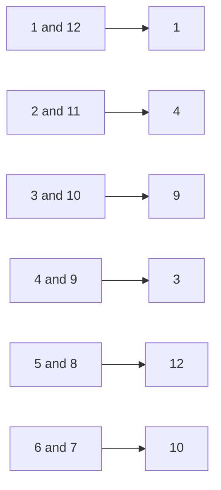

# Quadratic residues: which numbers are squares on a prime clock, and Euler's test

[Syllabus](../../../SYLLABUS.md) → [Algebraic and analytic number theory](../README.md) → [Characters and L-functions](../README.md#s03) → Quadratic residues

---

## General Overview

Take a 13-hour clock: the remainders 0 to 12, with arithmetic that wraps at 13. Is 3 a square on it? Is there a number that, multiplied by itself, lands on 3?

Yes. Four times four is 16, and 16 wraps to 3. So does nine times nine: 81 is six thirteens plus 3. Now try 2. Square every number from 1 to 12 and the results are 1, 4, 9, 3, 12, 10, then the same six again in reverse. 2 never appears, so 2 is not a square on the 13-clock.

Listing every square works for 13. It fails for a prime with 300 digits, the size used in cryptography. Euler found a test that needs no list: raise the number to half of one below the prime and look at the remainder. For 3 on the 13-clock, $`3^6`$ leaves 1, so 3 is a square. For 2, $`2^6 = 64`$ leaves 12, which is −1 on this clock, so 2 is not.

A number that is a square on a prime clock is a **quadratic residue** ("quadratic" means squared; "residue" means remainder). One that is not is a **non-residue**. The **Legendre symbol** records the answer as +1 or −1, and it multiplies the way a character does ([Dirichlet characters](01-dirichlet-characters.md)): two non-residues multiply to a residue.

The same symbol explains part of the shelf's house example. Of the 78,498 primes below a million, about a quarter end in each of 1, 3, 7 and 9. The code finds that 5 is a square on the clock of every prime ending in 1 or 9, and on the clock of no prime ending in 3 or 7.

**On the clock of an odd prime $`p`$, exactly half the nonzero remainders are squares; a number $`a`$ is one exactly when $`a^{(p-1)/2}`$ leaves 1, and leaves −1 otherwise; and that ±1 answer is a character: it multiplies.**

**What kind of fact this is:** a theorem, proved on this card in Why it works for every odd prime. The code checks it for every remainder of every odd prime below 2,000, and the last-digit rule for 5 is counted to a million here and proved on the [Quadratic reciprocity](07-quadratic-reciprocity-via-gauss-sums.md) card.

### The picture: squaring on the 13-clock



Each arrow squares. The twelve nonzero remainders pair off, $`x`$ with $`13 - x`$, and each pair lands on one square. Six squares come out: 1, 3, 4, 9, 10, 12. The other six, 2, 5, 6, 7, 8, 11, are the non-residues.

---

## The formula

Notation first. A number $`p`$ is an odd prime. The sign ≡ means "leaves the same remainder as" ([Powers on the clock](../../02-Number%20theory/04-Powers%20on%20the%20Clock/01-modular-exponentiation.md) uses it throughout). The **Legendre symbol** $`\left(\frac{a}{p}\right)`$, written inline as $`(a/p)`$ and read "a on p", is not a fraction. It is defined as follows.

```math
\left(\frac{a}{p}\right) = \begin{cases} +1 & \text{if } a \equiv x^2 \pmod{p} \text{ for some } x \text{ and } p \nmid a \\ -1 & \text{if no such } x \text{ exists} \\ 0 & \text{if } p \mid a \end{cases}
```

**Read it aloud:** a on p is plus one when a is a nonzero square on the p-clock, minus one when it is not a square, and zero when p divides a.

Euler's test, called **Euler's criterion**, computes it without a list:

```math
\left(\frac{a}{p}\right) \equiv a^{(p-1)/2} \pmod{p}
```

**Read it aloud:** raise a to the power half of p minus one; the remainder is 1 for a square, p − 1 (that is, −1) for a non-square, and 0 when p divides a.

With the card's numbers: $`p = 13`$, so the power is 6. $`3^3 = 27 \equiv 1`$, so $`3^6 \equiv 1`$ and $`(3/13) = +1`$. $`2^6 = 64 \equiv 12 \equiv -1`$, so $`(2/13) = -1`$.

The symbol multiplies, which makes it a character:

```math
\left(\frac{ab}{p}\right) = \left(\frac{a}{p}\right)\left(\frac{b}{p}\right)
```

**Read it aloud:** the symbol of a product is the product of the symbols.

On the 13-clock, 2 and 5 are both non-residues, so 10 must be a residue: $`(-1)(-1) = +1`$. It is: $`6^2 = 36 = 2 \times 13 + 10`$.

| Symbol | Plain meaning | In our example | Push it up and the answer… |
| --- | --- | --- | --- |
| $`p`$ | an odd prime: the clock size | 13 | more remainders, still half of them squares |
| $`a`$, $`b`$ | remainders being tested | 3; and 2, 5 | the answer repeats every $`p`$ steps |
| $`x`$ | a square root of $`a`$ on the clock: $`x^2 \equiv a`$ | 4 and 9, for $`a = 3`$ | — |
| $`\left(\frac{a}{p}\right)`$, $`(a/p)`$ | the Legendre symbol: +1, −1 or 0 | $`(3/13) = +1`$, $`(2/13) = -1`$ | — |
| $`(p-1)/2`$ | Euler's exponent: half of one below the prime | 6 | — |
| $`g`$ | a primitive root: its powers reach every nonzero remainder | 2 | — |
| $`k`$ | the exponent that writes $`a`$ as $`g^k`$ | 4, since $`3 = 2^4`$ | odd $`k`$ means a non-residue |
| $`q`$ | the modulus of a Dirichlet character: it repeats every $`q`$ steps | 13, the same as $`p`$ | — |
| $`\chi`$ | a Dirichlet character (from [Dirichlet characters](01-dirichlet-characters.md)) | $`\chi(a) = (a/13)`$ | — |
| $`X`$, $`d`$ | in the folded proof: a polynomial's unknown and its degree | $`d = 6`$ | more possible roots |

### When it holds

- **The modulus is prime.** On the 15-clock, 4 is a square ($`2 \times 2`$), yet $`4^7`$ leaves 4, neither 1 nor −1. Only 2 of the 8 remainders sharing no factor with 15 are squares (1 and 4), a quarter, not half. [The Jacobi symbol](08-jacobi-symbol-and-computing-without-factoring.md) is what survives for odd composite moduli.
- **The prime is odd.** For $`p = 2`$, half of one below the prime is not a whole number, and every remainder is a square ($`0^2 = 0`$, $`1^2 = 1`$).
- **The exponent is half, not all, of $`p - 1`$.** Fermat's exponent $`p - 1`$ gives 1 for every nonzero $`a`$ ($`2^{12} \equiv 1`$ on the 13-clock), so it cannot tell squares apart.
- **$`a`$ is not a multiple of $`p`$.** Multiples of $`p`$ are 0 on the clock; the symbol gives them 0, and they are neither residues nor non-residues.

---

## Why it works

### Step 0: squaring is two-to-one, so half are squares

The idea is a pairing. On the 13-clock, $`x`$ and $`13 - x`$ have the same square, because $`13 - x`$ is $`-x`$ on the clock and $`(-x)^2 = x^2`$. So 12 nonzero remainders give at most 6 squares.

They give exactly 6, because no third number shares a square. If $`x^2 \equiv y^2`$, then $`p`$ divides $`x^2 - y^2 = (x - y)(x + y)`$. A prime that divides a product divides one factor ([Euclid's lemma](../../02-Number%20theory/02-Greatest%20Common%20Divisor%20and%20Euclid%27s%20Algorithm/06-euclids-lemma.md)), so $`y \equiv x`$ or $`y \equiv -x`$.

So on the clock of any odd prime $`p`$, exactly $`(p-1)/2`$ nonzero remainders are residues and $`(p-1)/2`$ are non-residues. Summed over one full turn of the clock, the symbols cancel to 0.

### Step 1: Euler's power can only be +1 or −1

Let $`a`$ be nonzero on the $`p`$-clock and call $`b = a^{(p-1)/2}`$. Then $`b^2 = a^{p-1} \equiv 1`$ by [Fermat's little theorem](../../02-Number%20theory/04-Powers%20on%20the%20Clock/02-fermats-little-theorem.md).

So $`b`$ is a square root of 1. By Step 0's argument, 1 has exactly two square roots on a prime clock, 1 and −1. So $`b \equiv 1`$ or $`b \equiv -1`$. The remaining job is to show which numbers give which.

### Step 2: name every number by a power of one root

A **primitive root** $`g`$ is a remainder whose powers reach every nonzero remainder ([The order of a number and primitive roots](../../02-Number%20theory/04-Powers%20on%20the%20Clock/05-order-and-primitive-roots.md)). Every prime clock has one; that card states this, and Gauss proved it. On the 13-clock, $`g = 2`$ works: its powers run 2, 4, 8, 3, 6, 12, 11, 9, 5, 10, 7, 1.

So every nonzero $`a`$ is $`g^k`$ for one $`k`$ from 1 to $`p - 1`$. For example, $`3 = 2^4`$ and $`2 = 2^1`$.

### Step 3: squares are the even powers

If $`k`$ is even, $`a = g^k = (g^{k/2})^2`$ is a square. For 3 this hands over the root at once: $`3 = 2^4 = (2^2)^2 = 4^2`$.

The even powers $`g^2, g^4, \dots, g^{p-1}`$ are $`(p-1)/2`$ different remainders, all squares. Step 0 says there are only $`(p-1)/2`$ squares. So the even powers are all the squares, and every odd power is a non-residue.

### Step 4: Euler's criterion

The number $`g^{(p-1)/2}`$ is +1 or −1 by Step 1. It is not +1, because the powers of $`g`$ first return to 1 at step $`p - 1`$ (that is what "primitive" means). So $`g^{(p-1)/2} \equiv -1`$. On the 13-clock, $`2^6 = 64 \equiv 12`$, which is −1.

Now raise $`a = g^k`$ to the same power:

```math
a^{(p-1)/2} = \left(g^{k}\right)^{(p-1)/2} = \left(g^{(p-1)/2}\right)^{k} \equiv (-1)^k
```

This is +1 when $`k`$ is even, a residue by Step 3, and −1 when $`k`$ is odd, a non-residue. That is Euler's criterion. For 3, $`k = 4`$ gives +1; for 2, $`k = 1`$ gives −1.

<details>
<summary>A second proof, with no primitive root: count the roots of a polynomial</summary>

Every residue $`a = x^2`$ passes the test: $`a^{(p-1)/2} = x^{p-1} \equiv 1`$ by Fermat's little theorem. So all $`(p-1)/2`$ residues are roots of the polynomial below.

$`\displaystyle X^{(p-1)/2} - 1 \equiv 0 \pmod{p}`$

On a prime clock, a polynomial of degree $`d`$ has at most $`d`$ roots, because the clock is a field: a product is 0 only when one factor is 0. This polynomial has degree $`(p-1)/2`$, and the residues already fill that quota. So no non-residue is a root. By Step 1 a non-residue then gives −1.

</details>

### Step 5: the symbol is a character

Euler's criterion turns the product rule into ordinary algebra: $`(ab)^{(p-1)/2} = a^{(p-1)/2}\, b^{(p-1)/2}`$. So $`(ab/p) = (a/p)(b/p)`$ for every $`a`$ and $`b`$, and the code confirms all 144 pairs on the 13-clock. In words:

- residue times residue is a residue;
- residue times non-residue is a non-residue;
- non-residue times non-residue is a residue.

A **Dirichlet character** modulo $`q`$, written $`\chi`$, is a function on the whole numbers that repeats every $`q`$ steps, multiplies ($`\chi(ab) = \chi(a)\chi(b)`$), and is 0 on numbers sharing a factor with $`q`$ ([Dirichlet characters](01-dirichlet-characters.md)). The symbol $`a \mapsto (a/p)`$ meets all three conditions with $`q = p`$.

It is the only character modulo $`p`$ whose values are ±1 and not all +1. A character is fixed by its value at $`g`$, since every other value is a power of it. A value of ±1 that is not always +1 forces $`\chi(g) = -1`$, and that is the Legendre symbol by Step 4.

### Step 6: a first payoff, when −1 is a square

Put $`a = -1`$ in Euler's criterion: $`(-1/p) = (-1)^{(p-1)/2}`$. That is +1 when $`(p-1)/2`$ is even, that is when $`p`$ leaves remainder 1 on division by 4. So −1 is a square on the clock of a prime $`p \equiv 1 \pmod 4`$, and on no other odd prime's clock.

On the 13-clock, $`5^2 = 25 = 13 + 12`$, and 12 is −1. Below a million, the code finds −1 a square for 39,175 odd primes and finds 39,175 primes leaving remainder 1 on division by 4. Here the count agrees with a theorem proved above.

### Where proof ends and evidence begins

The last-digit rule for 5 is different. Euler's criterion decides $`(5/p)`$ for each prime separately. It does not show, by itself, that the answer depends only on the last digit of $`p`$.

That pattern comes from quadratic reciprocity, which swaps the two numbers: for 5 it says $`(5/p) = (p/5)`$. The squares on the 5-clock are 1 and 4, and an odd prime leaving 1 or 4 on division by 5 ends in 1 or 9. The proof is on the [Quadratic reciprocity](07-quadratic-reciprocity-via-gauss-sums.md) card. On this card the rule is evidence: the code tests every prime below a million that ends in 1, 3, 7 or 9, and none breaks it.

```
last digit 1   ##########  5 a square mod 19,617 of 19,617 primes
last digit 3               5 a square mod 0 of 19,665 primes
last digit 7               5 a square mod 0 of 19,621 primes
last digit 9   ##########  5 a square mod 19,593 of 19,593 primes
```

Each bar is the share of primes with that last digit for which 5 is a square: all or none.

---

## Worked numbers, by hand

Is 3 a square on the 13-clock? Euler's test, then the witness.

| Step | Arithmetic | Value |
| --- | --- | --- |
| Euler's exponent | (13 − 1) ÷ 2 | 6 |
| 3 cubed | 3 × 3 × 3 = 27 = 2 × 13 + 1 | 1 |
| 3 to the 6th | 1 × 1 | **1, so (3/13) = +1** |
| 2 to the 6th, for contrast | 64 = 4 × 13 + 12 | 12, that is −1 |
| 3 as a power of 2 | 2, 4, 8, 3: the 4th power | k = 4, even |
| the witness | (2 × 2)² = 4² = 16 = 13 + 3 | **x = 4, and also 13 − 4 = 9** |

Euler's test answers yes in three multiplications, and the primitive root then hands over the square root itself: 4 times 4 is 3 on the 13-clock.

The whole 13-clock, from the code:

| a | 1 | 2 | 3 | 4 | 5 | 6 | 7 | 8 | 9 | 10 | 11 | 12 |
| --- | --- | --- | --- | --- | --- | --- | --- | --- | --- | --- | --- | --- |
| $`a^6`$ on the clock | 1 | 12 | 1 | 1 | 12 | 12 | 12 | 12 | 1 | 1 | 12 | 1 |
| $`(a/13)`$ | +1 | −1 | +1 | +1 | −1 | −1 | −1 | −1 | +1 | +1 | −1 | +1 |

Six of each, and the row of symbols sums to 0, as Step 0 requires.

### What breaks if you drop a piece

| Mistake | Comes out at | What went wrong |
| --- | --- | --- |
| Exponent $`p - 1`$, not $`(p-1)/2`$ | $`2^{12} \equiv 1`$: 2 "passes" | Fermat's exponent gives 1 for every nonzero number |
| A composite modulus, 15 | $`4^7 \equiv 4`$, neither +1 nor −1; squares 1 and 4 only, 2 of 8 | Euclid's lemma fails without a prime, so Step 0's pairing and Step 1's ±1 both break |
| Treating the symbol as additive | 1 is a square, but 1 + 1 = 2 has symbol −1 | A character respects products, not sums |
| "−1 is never a square" | $`(12/13) = +1`$, since $`5^2 = 25 = 13 + 12`$ | −1 is a square exactly when $`p \equiv 1 \pmod 4`$ |

The code prints all four.

---

## Code, from first principles, and it actually runs

Nothing is imported, and modular powers are computed by square-and-multiply written out in the script. The code takes three independent roads to every symbol: listing all squares on the clock, Euler's test, and the parity of the exponent against a primitive root found by search. It runs all three on every remainder of every odd prime below 2,000 and asserts that they agree. It then sieves the primes below a million and counts, by last digit, where 5 passes Euler's test, and where −1 does.

### Python

```python
# Quadratic residues and Euler's test -- the check behind the card.  Nothing is
# imported.  Three roads decide whether a is a square on the p-clock: list every
# square (brute force), raise a to the power (p - 1)/2 (Euler's test), and read
# the parity of a's exponent against a primitive root.  Then the house count.
def power(a, k, n):                      # square-and-multiply, written out here
    out, a = 1, a % n
    while k:
        if k & 1:
            out = out * a % n
        a, k = a * a % n, k >> 1
    return out

def squares(p):                          # road one: every square on the p-clock
    return sorted({x * x % p for x in range(1, p)})

def euler(a, p):                         # road two: a^((p-1)/2), read as +1, -1 or 0
    r = power(a, (p - 1) // 2, p)
    return -1 if r == p - 1 else r

def primitive_root(p):                   # the smallest g whose powers reach all of 1..p-1
    return next(g for g in range(2, p) if len({power(g, k, p) for k in range(1, p)}) == p - 1)

def by_parity(p):                        # road three: a = g^k is a square exactly when k is even
    g, sym = primitive_root(p), {}
    for k in range(1, p):
        sym[power(g, k, p)] = 1 if k % 2 == 0 else -1
    return g, sym

def sieve(n):                            # Eratosthenes: the primes below n
    is_p = [True] * n
    is_p[0] = is_p[1] = False
    for i in range(2, int(n ** 0.5) + 1):
        if is_p[i]:
            for j in range(i * i, n, i):
                is_p[j] = False
    return [i for i in range(n) if is_p[i]]

def sign(s):
    return "+1" if s == 1 else "-1" if s == -1 else "0"

p = 13
res = squares(p)
non = [a for a in range(1, p) if a not in res]
g, sym = by_parity(p)
leg = {a: (1 if a in res else -1) for a in range(1, p)}
print(f"squares of 1..12 on the 13-clock: {[x * x % p for x in range(1, p)]}")
print(f"residues {res}; non-residues {non}")
print(f"square roots of 3: {[x for x in range(1, p) if x * x % p == 3]}; 4 x 4 = 16 = 13 + 3")
print(f"Euler's test: 3^3 = {3 ** 3} = {3 ** 3 % p} on the clock, so 3^6 = {power(3, 6, p)}; 2^6 = {2 ** 6} = {power(2, 6, p)} = -1")
print(f"primitive root {g}: powers {[power(g, k, p) for k in range(1, p)]}")
print(f"3 = {g}^4 = ({g}^2)^2 = {g * g}^2; 2 = {g}^1, odd")
print("a      " + " ".join(f"{a:>3}" for a in range(1, p)))
print("a^6    " + " ".join(f"{power(a, 6, p):>3}" for a in range(1, p)))
print("(a/13) " + " ".join(f"{sign(euler(a, p)):>3}" for a in range(1, p)))
pairs = sum(1 for a in range(1, p) for b in range(1, p) if euler(a * b, p) == euler(a, p) * euler(b, p))
print(f"(2/13)(5/13) = ({sign(euler(2, p))})({sign(euler(5, p))}) = {sign(euler(2, p) * euler(5, p))}; (10/13) = {sign(euler(10, p))}; 6 x 6 = 36 = 2 x 13 + 10")
print(f"product rule holds for {pairs} of {(p - 1) ** 2} pairs; symbols sum to {sum(euler(a, p) for a in range(1, p))} over 1..12")
small = [q for q in sieve(2000) if q > 2]
agree = 0
for q in small:
    sq, par = set(squares(q)), by_parity(q)[1]
    agree += sum(1 for a in range(1, q) if euler(a, q) == (1 if a in sq else -1) == par[a])
total = sum(q - 1 for q in small)
print(f"three roads agree on {agree:,} of {total:,} pairs (a, p), odd primes p below 2,000")
print(f"mistake 1, exponent p - 1 instead of (p - 1)/2: 2^12 = {power(2, 12, p)}, every a passes")
u15 = [a for a in range(1, 15) if all(a % d for d in (3, 5))]
sq15 = sorted({a * a % 15 for a in u15})
print(f"mistake 2, the 15-clock: 4 = 2 x 2, yet 4^7 = {power(4, 7, 15)}; squares of the {len(u15)} units: {sq15}")
print(f"mistake 3, adding: 1 is a square, (1/13) = {sign(euler(1, p))}, but 1 + 1 = 2 and (2/13) = {sign(euler(2, p))}")
print(f"mistake 4, -1 is never a square: (12/13) = {sign(euler(12, p))}, 5 x 5 = 25 = 13 + 12")
primes = sieve(10 ** 6)
print(f"primes below 1,000,000: {len(primes):,}")
for d in (1, 3, 7, 9):
    ps = [q for q in primes if q % 10 == d]
    yes = sum(1 for q in ps if euler(5, q) == 1)
    print(f"last digit {d}: {len(ps):,} primes; 5 is a square mod {yes:,} of them")
odd = [q for q in primes if q > 2]
m1 = sum(1 for q in odd if euler(q - 1, q) == 1)
print(f"-1 is a square mod {m1:,} odd primes; p = 1 mod 4 for {sum(1 for q in odd if q % 4 == 1):,}")
assert res == [1, 3, 4, 9, 10, 12] and euler(3, p) == 1 and euler(2, p) == -1 and euler(26, p) == 0
assert all(sym[a] == leg[a] == euler(a, p) for a in range(1, p))       # three roads at 13
assert agree == total and pairs == (p - 1) ** 2
assert power(4, 7, 15) == 4 and len(sq15) * 2 != len(u15)               # composite: the test fails
for d in (1, 3, 7, 9):                                                   # the last digit decides (5/p)
    ps = [q for q in primes if q % 10 == d]
    assert sum(1 for q in ps if euler(5, q) == 1) == (len(ps) if d in (1, 9) else 0)
assert m1 == sum(1 for q in odd if q % 4 == 1) and len(primes) == 78498
print("ALL CHECKS PASS")
```

**Ran 2026-11-15 on macOS, Python 3.14.10, standard library only. All checks passed. Output, pasted from the run:**

```
squares of 1..12 on the 13-clock: [1, 4, 9, 3, 12, 10, 10, 12, 3, 9, 4, 1]
residues [1, 3, 4, 9, 10, 12]; non-residues [2, 5, 6, 7, 8, 11]
square roots of 3: [4, 9]; 4 x 4 = 16 = 13 + 3
Euler's test: 3^3 = 27 = 1 on the clock, so 3^6 = 1; 2^6 = 64 = 12 = -1
primitive root 2: powers [2, 4, 8, 3, 6, 12, 11, 9, 5, 10, 7, 1]
3 = 2^4 = (2^2)^2 = 4^2; 2 = 2^1, odd
a        1   2   3   4   5   6   7   8   9  10  11  12
a^6      1  12   1   1  12  12  12  12   1   1  12   1
(a/13)  +1  -1  +1  +1  -1  -1  -1  -1  +1  +1  -1  +1
(2/13)(5/13) = (-1)(-1) = +1; (10/13) = +1; 6 x 6 = 36 = 2 x 13 + 10
product rule holds for 144 of 144 pairs; symbols sum to 0 over 1..12
three roads agree on 276,746 of 276,746 pairs (a, p), odd primes p below 2,000
mistake 1, exponent p - 1 instead of (p - 1)/2: 2^12 = 1, every a passes
mistake 2, the 15-clock: 4 = 2 x 2, yet 4^7 = 4; squares of the 8 units: [1, 4]
mistake 3, adding: 1 is a square, (1/13) = +1, but 1 + 1 = 2 and (2/13) = -1
mistake 4, -1 is never a square: (12/13) = +1, 5 x 5 = 25 = 13 + 12
primes below 1,000,000: 78,498
last digit 1: 19,617 primes; 5 is a square mod 19,617 of them
last digit 3: 19,665 primes; 5 is a square mod 0 of them
last digit 7: 19,621 primes; 5 is a square mod 0 of them
last digit 9: 19,593 primes; 5 is a square mod 19,593 of them
-1 is a square mod 39,175 odd primes; p = 1 mod 4 for 39,175
ALL CHECKS PASS
```

### Rust

Same numbers, same labels, built with `rustc --edition 2021 -O`.

```rust
// Quadratic residues and Euler's test -- the same check as the Python, in Rust.
// No crates.  Three roads decide whether a is a square on the p-clock: list every
// square (brute force), raise a to the power (p - 1)/2 (Euler's test), and read
// the parity of a's exponent against a primitive root.  Then the house count.
fn power(a: u64, mut k: u64, n: u64) -> u64 {     // square-and-multiply, written out here
    let (mut out, mut a) = (1u64, a % n);
    while k > 0 {
        if k & 1 == 1 { out = out * a % n; }
        a = a * a % n;
        k >>= 1;
    }
    out
}

fn squares(p: u64) -> Vec<u64> {                  // road one: every square on the p-clock
    let mut v: Vec<u64> = (1..p).map(|x| x * x % p).collect();
    v.sort();
    v.dedup();
    v
}

fn euler(a: u64, p: u64) -> i64 {                 // road two: a^((p-1)/2), read as +1, -1 or 0
    let r = power(a, (p - 1) / 2, p);
    if r == p - 1 { -1 } else { r as i64 }
}

fn primitive_root(p: u64) -> u64 {                // the smallest g whose powers reach all of 1..p-1
    (2..p).find(|&g| { let mut s: Vec<u64> = (1..p).map(|k| power(g, k, p)).collect();
                       s.sort(); s.dedup(); s.len() as u64 == p - 1 }).unwrap()
}

fn by_parity(p: u64) -> (u64, Vec<i64>) {         // road three: a = g^k is a square exactly when k is even
    let g = primitive_root(p);
    let mut sym = vec![0i64; p as usize];
    for k in 1..p { sym[power(g, k, p) as usize] = if k % 2 == 0 { 1 } else { -1 }; }
    (g, sym)
}

fn sieve(n: usize) -> Vec<u64> {                  // Eratosthenes: the primes below n
    let mut is_p = vec![true; n];
    is_p[0] = false;
    is_p[1] = false;
    let mut i = 2;
    while i * i < n {
        if is_p[i] { let mut j = i * i; while j < n { is_p[j] = false; j += i; } }
        i += 1;
    }
    (0..n).filter(|&i| is_p[i]).map(|i| i as u64).collect()
}

fn sign(s: i64) -> &'static str { if s == 1 { "+1" } else if s == -1 { "-1" } else { "0" } }

fn commas(n: u64) -> String {                     // 78498 -> 78,498
    let s = n.to_string();
    let mut out = String::new();
    for (i, c) in s.chars().enumerate() {
        if i > 0 && (s.len() - i) % 3 == 0 { out.push(','); }
        out.push(c);
    }
    out
}

fn main() {
    let p = 13u64;
    let res = squares(p);
    let non: Vec<u64> = (1..p).filter(|a| !res.contains(a)).collect();
    let (g, sym) = by_parity(p);
    let row = |f: &dyn Fn(u64) -> String| (1..p).map(|a| format!("{:>3}", f(a))).collect::<Vec<_>>().join(" ");
    println!("squares of 1..12 on the 13-clock: {:?}", (1..p).map(|x| x * x % p).collect::<Vec<_>>());
    println!("residues {:?}; non-residues {:?}", res, non);
    println!("square roots of 3: {:?}; 4 x 4 = 16 = 13 + 3", (1..p).filter(|x| x * x % p == 3).collect::<Vec<_>>());
    println!("Euler's test: 3^3 = {} = {} on the clock, so 3^6 = {}; 2^6 = {} = {} = -1",
             27, 27 % p, power(3, 6, p), 64, power(2, 6, p));
    println!("primitive root {}: powers {:?}", g, (1..p).map(|k| power(g, k, p)).collect::<Vec<_>>());
    println!("3 = {}^4 = ({}^2)^2 = {}^2; 2 = {}^1, odd", g, g, g * g, g);
    println!("a      {}", row(&|a| a.to_string()));
    println!("a^6    {}", row(&|a| power(a, 6, p).to_string()));
    println!("(a/13) {}", row(&|a| sign(euler(a, p)).to_string()));
    let pairs = (1..p).flat_map(|a| (1..p).map(move |b| (a, b)))
        .filter(|&(a, b)| euler(a * b, p) == euler(a, p) * euler(b, p)).count() as u64;
    println!("(2/13)(5/13) = ({})({}) = {}; (10/13) = {}; 6 x 6 = 36 = 2 x 13 + 10",
             sign(euler(2, p)), sign(euler(5, p)), sign(euler(2, p) * euler(5, p)), sign(euler(10, p)));
    println!("product rule holds for {} of {} pairs; symbols sum to {} over 1..12",
             pairs, (p - 1) * (p - 1), (1..p).map(|a| euler(a, p)).sum::<i64>());
    let small: Vec<u64> = sieve(2000).into_iter().filter(|&q| q > 2).collect();
    let (mut agree, mut total) = (0u64, 0u64);
    for &q in &small {
        let (sq, par) = (squares(q), by_parity(q).1);
        total += q - 1;
        agree += (1..q).filter(|&a| { let b = if sq.binary_search(&a).is_ok() { 1 } else { -1 };
                                      euler(a, q) == b && b == par[a as usize] }).count() as u64;
    }
    println!("three roads agree on {} of {} pairs (a, p), odd primes p below 2,000", commas(agree), commas(total));
    println!("mistake 1, exponent p - 1 instead of (p - 1)/2: 2^12 = {}, every a passes", power(2, 12, p));
    let u15: Vec<u64> = (1..15).filter(|a| a % 3 != 0 && a % 5 != 0).collect();
    let mut sq15: Vec<u64> = u15.iter().map(|a| a * a % 15).collect();
    sq15.sort();
    sq15.dedup();
    println!("mistake 2, the 15-clock: 4 = 2 x 2, yet 4^7 = {}; squares of the {} units: {:?}", power(4, 7, 15), u15.len(), sq15);
    println!("mistake 3, adding: 1 is a square, (1/13) = {}, but 1 + 1 = 2 and (2/13) = {}", sign(euler(1, p)), sign(euler(2, p)));
    println!("mistake 4, -1 is never a square: (12/13) = {}, 5 x 5 = 25 = 13 + 12", sign(euler(12, p)));
    let primes = sieve(1_000_000);
    println!("primes below 1,000,000: {}", commas(primes.len() as u64));
    let mut digit_ok = true;
    for d in [1u64, 3, 7, 9] {
        let ps: Vec<u64> = primes.iter().copied().filter(|q| q % 10 == d).collect();
        let yes = ps.iter().filter(|&&q| euler(5, q) == 1).count();
        println!("last digit {}: {} primes; 5 is a square mod {} of them", d, commas(ps.len() as u64), commas(yes as u64));
        digit_ok &= yes == if d == 1 || d == 9 { ps.len() } else { 0 };
    }
    let odd: Vec<u64> = primes.iter().copied().filter(|&q| q > 2).collect();
    let m1 = odd.iter().filter(|&&q| euler(q - 1, q) == 1).count();
    let one_mod4 = odd.iter().filter(|&&q| q % 4 == 1).count();
    println!("-1 is a square mod {} odd primes; p = 1 mod 4 for {}", commas(m1 as u64), commas(one_mod4 as u64));
    assert!(res == vec![1, 3, 4, 9, 10, 12] && euler(3, p) == 1 && euler(2, p) == -1 && euler(26, p) == 0);
    assert!((1..p).all(|a| { let l = if res.contains(&a) { 1 } else { -1 };
                             sym[a as usize] == l && l == euler(a, p) }));   // three roads at 13
    assert!(agree == total && pairs == (p - 1) * (p - 1));
    assert!(power(4, 7, 15) == 4 && sq15.len() * 2 != u15.len());          // composite: the test fails
    assert!(digit_ok);                                                      // the last digit decides (5/p)
    assert!(m1 == one_mod4 && primes.len() == 78498);
    println!("ALL CHECKS PASS");
}
```

**Ran 2026-11-15 on macOS, rustc 1.98.1, no crates. All checks passed. Output, pasted from the run:**

```
squares of 1..12 on the 13-clock: [1, 4, 9, 3, 12, 10, 10, 12, 3, 9, 4, 1]
residues [1, 3, 4, 9, 10, 12]; non-residues [2, 5, 6, 7, 8, 11]
square roots of 3: [4, 9]; 4 x 4 = 16 = 13 + 3
Euler's test: 3^3 = 27 = 1 on the clock, so 3^6 = 1; 2^6 = 64 = 12 = -1
primitive root 2: powers [2, 4, 8, 3, 6, 12, 11, 9, 5, 10, 7, 1]
3 = 2^4 = (2^2)^2 = 4^2; 2 = 2^1, odd
a        1   2   3   4   5   6   7   8   9  10  11  12
a^6      1  12   1   1  12  12  12  12   1   1  12   1
(a/13)  +1  -1  +1  +1  -1  -1  -1  -1  +1  +1  -1  +1
(2/13)(5/13) = (-1)(-1) = +1; (10/13) = +1; 6 x 6 = 36 = 2 x 13 + 10
product rule holds for 144 of 144 pairs; symbols sum to 0 over 1..12
three roads agree on 276,746 of 276,746 pairs (a, p), odd primes p below 2,000
mistake 1, exponent p - 1 instead of (p - 1)/2: 2^12 = 1, every a passes
mistake 2, the 15-clock: 4 = 2 x 2, yet 4^7 = 4; squares of the 8 units: [1, 4]
mistake 3, adding: 1 is a square, (1/13) = +1, but 1 + 1 = 2 and (2/13) = -1
mistake 4, -1 is never a square: (12/13) = +1, 5 x 5 = 25 = 13 + 12
primes below 1,000,000: 78,498
last digit 1: 19,617 primes; 5 is a square mod 19,617 of them
last digit 3: 19,665 primes; 5 is a square mod 0 of them
last digit 7: 19,621 primes; 5 is a square mod 0 of them
last digit 9: 19,593 primes; 5 is a square mod 19,593 of them
-1 is a square mod 39,175 odd primes; p = 1 mod 4 for 39,175
ALL CHECKS PASS
```

Whole numbers throughout: the two outputs match line for line.

### Lean

Lean proves the card's three main claims and Step 6 for every odd prime $`p`$, and checks the 13-clock examples.

- Take an odd prime $`p`$. Then exactly $`(p-1)/2`$ nonzero remainders are squares on the $`p`$-clock.
- Take an odd prime $`p`$ and a whole number $`a`$ that $`p`$ does not divide. Then $`a`$ is a square exactly when $`a^{(p-1)/2}`$ leaves 1, and a non-residue exactly when it leaves −1.
- Take an odd prime $`p`$ and any whole numbers $`a`$ and $`b`$. Then $`(ab/p) = (a/p)(b/p)`$.
- Take an odd prime $`p`$ and any whole number $`a`$, multiples of $`p`$ included. Then $`(a/p) \equiv a^{(p-1)/2} \pmod{p}`$, which is Euler's criterion.
- Take an odd prime $`p`$. Then −1 is a square on the $`p`$-clock exactly when $`p`$ leaves remainder 1 on division by 4.
- The 13-clock tables, the witness $`4 \times 4 = 3`$, and the numbers in the mistakes table are checked too.

The last-digit rule for 5, the counts below a million and the sweep below 2,000 are left to the Python and Rust checks.

```lean
-- Quadratic residues: on the clock of an odd prime p, exactly half the nonzero remainders are squares, Euler's test a^((p-1)/2) gives 1 for a square and −1 for a non-square, and the Legendre symbol multiplies.
import Mathlib.NumberTheory.LegendreSymbol.Basic
import Mathlib.NumberTheory.LegendreSymbol.QuadraticChar.Basic

/-- For an odd prime p, p / 2 = (p - 1) / 2. -/
theorem qr_half_eq (p : ℕ) [Fact p.Prime] (hp : p ≠ 2) : p / 2 = (p - 1) / 2 := by
  have := (Fact.out : p.Prime).eq_two_or_odd
  omega

/-- On the clock of an odd prime p, exactly (p - 1)/2 nonzero remainders are squares. -/
theorem qr_card_nonzero_squares (p : ℕ) [Fact p.Prime] (hp : p ≠ 2) :
    ((Finset.univ : Finset (ZMod p)).filter (fun x => x ≠ 0 ∧ IsSquare x)).card = (p - 1) / 2 := by
  classical
  have hF : ringChar (ZMod p) ≠ 2 := by rwa [ZMod.ringChar_zmod_n]
  set U := (Finset.univ : Finset (ZMod p)).filter (fun x => x ≠ 0) with hUdef
  have hS : (Finset.univ : Finset (ZMod p)).filter (fun x => x ≠ 0 ∧ IsSquare x)
      = U.filter (fun x => IsSquare x) := by
    ext x; simp [U]
  have hU : U.card = p - 1 := by
    rw [hUdef, Finset.filter_ne', Finset.card_erase_of_mem (Finset.mem_univ _),
      Finset.card_univ, ZMod.card]
  have hsplit := Finset.card_filter_add_card_filter_not (s := U) (fun x : ZMod p => IsSquare x)
  have hsum : ∑ a : ZMod p, quadraticChar (ZMod p) a = 0 := quadraticChar_sum_zero hF
  have h2 : ∑ a ∈ U, quadraticChar (ZMod p) a = ∑ a : ZMod p, quadraticChar (ZMod p) a := by
    rw [hUdef, Finset.sum_filter_of_ne]
    intro x _ hx h
    exact hx (by rw [h]; exact quadraticChar_zero)
  have h3 : ∑ a ∈ U, quadraticChar (ZMod p) a
      = ((U.filter (fun x => IsSquare x)).card : ℤ) - (U.filter (fun x => ¬ IsSquare x)).card := by
    rw [← Finset.sum_filter_add_sum_filter_not U (fun x => IsSquare x)]
    have hA : ∑ x ∈ U.filter (fun x => IsSquare x), quadraticChar (ZMod p) x
        = ∑ x ∈ U.filter (fun x => IsSquare x), (1 : ℤ) := by
      refine Finset.sum_congr rfl ?_
      intro x hx
      simp only [Finset.mem_filter, U, Finset.mem_univ, true_and] at hx
      exact (quadraticChar_one_iff_isSquare hx.1).mpr hx.2
    have hB : ∑ x ∈ U.filter (fun x => ¬ IsSquare x), quadraticChar (ZMod p) x
        = ∑ x ∈ U.filter (fun x => ¬ IsSquare x), (-1 : ℤ) := by
      refine Finset.sum_congr rfl ?_
      intro x hx
      simp only [Finset.mem_filter, U, Finset.mem_univ, true_and] at hx
      exact quadraticChar_neg_one_iff_not_isSquare.mpr hx.2
    rw [hA, hB]
    simp [sub_eq_add_neg]
  rw [h2, hsum] at h3
  rw [hS]
  omega

#print axioms qr_half_eq
#print axioms qr_card_nonzero_squares

/-- The card's main claim. Let p be an odd prime. On the p-clock (the remainders mod p):
exactly half the nonzero remainders, (p − 1)/2 of them, are squares; a remainder a that is not
a multiple of p is a square exactly when a^((p-1)/2) leaves 1, and is a non-square exactly when
it leaves −1; and the ±1 answer, the Legendre symbol (a/p), multiplies:
(ab/p) = (a/p)(b/p) for all whole numbers a and b. -/
theorem quadratic_residues_half_euler_test_and_product_rule (p : ℕ) [Fact p.Prime] (hp : p ≠ 2) :
    ((Finset.univ : Finset (ZMod p)).filter (fun x => x ≠ 0 ∧ IsSquare x)).card = (p - 1) / 2 ∧
      (∀ a : ℤ, (a : ZMod p) ≠ 0 →
        (IsSquare (a : ZMod p) ↔ (a : ZMod p) ^ ((p - 1) / 2) = 1) ∧
          (¬ IsSquare (a : ZMod p) ↔ (a : ZMod p) ^ ((p - 1) / 2) = -1)) ∧
      ∀ a b : ℤ, legendreSym p (a * b) = legendreSym p a * legendreSym p b := by
  have hhalf := qr_half_eq p hp
  have h2 : 2 < p := lt_of_le_of_ne (Fact.out : p.Prime).two_le (Ne.symm hp)
  have : Fact (2 < p) := ⟨h2⟩
  refine ⟨qr_card_nonzero_squares p hp, ?_, fun a b => legendreSym.mul p a b⟩
  intro a ha
  have he := ZMod.euler_criterion p ha
  rw [hhalf] at he
  refine ⟨he, ?_⟩
  have hd := ZMod.pow_div_two_eq_neg_one_or_one p ha
  rw [hhalf] at hd
  constructor
  · intro hns
    rcases hd with h | h
    · exact absurd (he.mpr h) hns
    · exact h
  · intro hneg hsq
    exact ZMod.neg_one_ne_one (hneg.symm.trans (he.mp hsq))

/-- Euler's criterion as the card writes it: for an odd prime p and every whole number a,
the Legendre symbol (a/p) (+1 for a nonzero square, −1 for a non-square, 0 when p divides a)
leaves the same remainder mod p as a^((p-1)/2). -/
theorem legendre_symbol_eq_euler_power (p : ℕ) [Fact p.Prime] (hp : p ≠ 2) (a : ℤ) :
    (legendreSym p a : ZMod p) = (a : ZMod p) ^ ((p - 1) / 2) := by
  rw [← qr_half_eq p hp]
  exact legendreSym.eq_pow p a

/-- The first payoff (Step 6): on the clock of an odd prime p, −1 is a square exactly when
p leaves remainder 1 on division by 4. -/
theorem neg_one_is_square_iff_mod_four_eq_one (p : ℕ) [Fact p.Prime] (hp : p ≠ 2) :
    IsSquare (-1 : ZMod p) ↔ p % 4 = 1 := by
  rw [ZMod.exists_sq_eq_neg_one_iff]
  have := (Fact.out : p.Prime).eq_two_or_odd
  omega

-- The 13-clock: squaring 1..12 gives 1, 4, 9, 3, 12, 10, then the same six in reverse.
example : (List.range 12).map (fun x => ((x + 1 : ℕ) : ZMod 13) ^ 2)
    = [1, 4, 9, 3, 12, 10, 10, 12, 3, 9, 4, 1] := by decide
-- The six nonzero squares are 1, 3, 4, 9, 10, 12: half of the twelve.
example : ((Finset.univ : Finset (ZMod 13)).filter (fun x => x ≠ 0 ∧ ∃ r, x = r * r))
    = {1, 3, 4, 9, 10, 12} := by decide
-- 3 is a square: 4 × 4 = 16 = 13 + 3, and 9 × 9 = 81 = 6 × 13 + 3.
example : (4 : ZMod 13) * 4 = 3 ∧ (9 : ZMod 13) * 9 = 3 := by decide
-- 2 is not a square on the 13-clock.
example : ¬ ∃ r : ZMod 13, (2 : ZMod 13) = r * r := by decide
-- Euler's test: 3^3 = 27 leaves 1, so 3^6 leaves 1; 2^6 = 64 leaves 12, that is −1.
example : (3 : ZMod 13) ^ 3 = 1 ∧ (3 : ZMod 13) ^ 6 = 1 := by decide
example : (2 : ZMod 13) ^ 6 = -1 ∧ (2 : ZMod 13) ^ 6 = 12 := by decide
-- The row a^6 on the 13-clock, for a = 1..12.
example : (List.range 12).map (fun x => ((x + 1 : ℕ) : ZMod 13) ^ 6)
    = [1, 12, 1, 1, 12, 12, 12, 12, 1, 1, 12, 1] := by decide
-- Primitive root 2: its powers 2^1..2^12 run 2, 4, 8, 3, 6, 12, 11, 9, 5, 10, 7, 1; 3 = 2^4.
example : (List.range 12).map (fun k => (2 : ZMod 13) ^ (k + 1))
    = [2, 4, 8, 3, 6, 12, 11, 9, 5, 10, 7, 1] := by decide
-- Product rule: 2 and 5 are non-squares, so 10 is a square: 6 × 6 = 36 = 2 × 13 + 10.
example : (6 : ZMod 13) * 6 = 10 ∧ (10 : ZMod 13) ^ 6 = 1 := by decide
-- What breaks: Fermat's exponent 12 gives 1 for 2 as well; on the 15-clock 4^7 leaves 4;
-- −1 is a square on the 13-clock, since 5 × 5 = 25 = 13 + 12.
example : (2 : ZMod 13) ^ 12 = 1 := by decide
example : (4 : ZMod 15) ^ 7 = 4 := by decide
example : (5 : ZMod 13) * 5 = -1 := by decide

#print axioms quadratic_residues_half_euler_test_and_product_rule
#print axioms legendre_symbol_eq_euler_power
#print axioms neg_one_is_square_iff_mod_four_eq_one
```

**Checked 2026-11-15 on macOS, Lean 4.36.0-rc2, Mathlib v4.36.0-rc2. Every proof is complete and uses only Lean's standard axioms. Output, pasted from the run:**

```
'qr_half_eq' depends on axioms: [propext, Quot.sound]
'qr_card_nonzero_squares' depends on axioms: [propext, Classical.choice, Quot.sound]
'quadratic_residues_half_euler_test_and_product_rule' depends on axioms: [propext, Classical.choice, Quot.sound]
'legendre_symbol_eq_euler_power' depends on axioms: [propext, Classical.choice, Quot.sound]
'neg_one_is_square_iff_mod_four_eq_one' depends on axioms: [propext, Classical.choice, Quot.sound]
```

> [!TIP]
> **Try changing**
> Guess first, then run.
> - **Another clock.** Change `p = 13` to `p = 11`. Guess first: is 3 still a square? Yes: the residues become 1, 3, 4, 5, 9, and the roots of 3 are 5 and 6, since $`5^2 = 25 = 2 \times 11 + 3`$. Lines whose labels are written for 13 now print wrong statements, such as "2^6 = 64 = 9 = -1", though 9 is not −1 on the 11-clock and Euler's power there is 5. The first assert then stops the run, because it pins the 13-clock's list.
> - **Test 2 instead of 5.** On the `yes =` line of the last-digit loop, change `euler(5, q)` to `euler(2, q)`; the printed label still says 5. Guess first: does the last digit decide it? No: each digit class splits near half, for example 9,822 of the 19,617 primes ending in 1. The rule for 2 follows the remainder on division by 8, not 10. The asserts still pass.
> - **Fermat's exponent.** In `euler`, change `(p - 1) // 2` to `p - 1`. Guess first: every symbol becomes +1, and the first assert fails at $`(2/13)`$.
> - **A composite clock.** Put `15` in place of `13` for `p`. Guess first: the primitive-root search finds nothing, because the 15-clock has no primitive root, and the run stops with an error.

---

## The usual mistake

> [!warning]
> **Using Euler's test on a modulus that is not prime.** The test rests on a prime clock twice: squaring is two-to-one only there, and only there does 1 have just the square roots ±1. On the 15-clock, 4 is plainly a square ($`2 \times 2`$), yet $`4^7`$ leaves 4, not 1. For odd composite moduli use [The Jacobi symbol](08-jacobi-symbol-and-computing-without-factoring.md), and read its +1 with care.
>
> - **Fermat's exponent in place of Euler's.** Raising to $`p - 1`$ gives 1 for every nonzero number: $`2^{12} \equiv 1`$ on the 13-clock, though 2 is a non-residue.
> - **Adding symbols.** The symbol multiplies; it does not add. 1 is a square, 1 + 1 = 2 is not: $`(2/13) = -1`$.
> - **"−1 is never a square."** It is a square on the clock of every prime leaving 1 on division by 4: $`(12/13) = +1`$, because $`5^2 = 25 = 13 + 12`$.
> - **Reading 12 as a new answer.** Euler's test on the 13-clock gives 12, not −1, on paper. They are the same remainder: 12 + 1 = 13 wraps to 0.

---

## Where you meet it in real life

- **Elliptic-curve cryptography.** A point on a curve $`y^2 = x^3 + 7`$ over a prime clock exists above $`x`$ exactly when $`x^3 + 7`$ is a square there. Euler's test says whether that point exists before any square root is attempted. The planned card The curve mod p counts such points.
- **Primality testing.** The Solovay-Strassen test checks Euler's criterion with [The Jacobi symbol](08-jacobi-symbol-and-computing-without-factoring.md) in place of the Legendre symbol. A composite number fails it for at least half the bases tried. [The Miller-Rabin test](../../02-Number%20theory/06-Codes%20and%20Secrets/05-miller-rabin.md) refines the same idea and is stronger still.
- **Concert-hall acoustics.** A quadratic-residue diffuser is a wall panel of wells whose depths follow the squares on a prime clock. For 13 the depths run in proportion to 0, 1, 4, 9, 3, 12, 10, 10, 12, 3, 9, 4, 1. The pattern scatters sound evenly across many frequencies.
- **Encryption that hides one bit.** Goldwasser-Micali encryption hides a bit by sending a residue or a non-residue on the clock of a product of two large primes. Deciding which one it is seems to need the factors, which is the opposite of the prime case on this card.

> **Say it back**
> On the clock of an odd prime, squaring pairs each nonzero number with its negative, so exactly half the nonzero remainders are squares. Euler's test raises a number to half of one below the prime: a square gives 1 and a non-square gives −1. The Legendre symbol records that ±1, and it multiplies, so it is a Dirichlet character, the only one mod p whose values are ±1 and not all +1. On the 13-clock, $`3^6`$ leaves 1, and indeed 4 times 4 is 3.

---

## What this builds on

- [Dirichlet characters](01-dirichlet-characters.md): the definition of a character, which the Legendre symbol meets.
- [The order of a number and primitive roots](../../02-Number%20theory/04-Powers%20on%20the%20Clock/05-order-and-primitive-roots.md): the primitive root that names every number as a power, used in Steps 2 to 4.
- [Powers on the clock](../../02-Number%20theory/04-Powers%20on%20the%20Clock/01-modular-exponentiation.md): square-and-multiply, which makes Euler's test fast even for 300-digit primes.

## Where this goes next

- [Dirichlet's theorem](04-dirichlets-theorem-on-primes-in-progressions.md): characters such as this one separate primes by remainder, and give infinitely many in each allowed class.
- [Quadratic reciprocity](07-quadratic-reciprocity-via-gauss-sums.md): proves that $`(5/p)`$ depends only on the last digit of $`p`$, and more generally links $`(p/q)`$ with $`(q/p)`$.
- [The curve mod p](../../22-Algebraic%20geometry/04-Elliptic%20Curves/05-reduction-mod-p-and-hasse.md): counts points on a curve over a prime clock, one Legendre symbol per value of $`x`$.

The shelf's other cards build on the symbol too: [Dirichlet L-functions](03-dirichlet-l-functions.md) attach a series to it, and [Gauss sums](06-gauss-sums.md) weight roots of unity by it.

Euler's test says whether a square root exists. Left open: how to find that root quickly on a 300-digit prime clock, without a primitive root to hand?

---

## Sources

Verified 2026-11-15: every link below resolves to the publisher's page.

- Euler, Leonhard. "Theoremata circa residua ex divisione potestatum relicta." *Novi Commentarii academiae scientiarum Petropolitanae* 7 (1761), 49–82. [Euler Archive page](https://scholarlycommons.pacific.edu/euler-works/262/). Euler's theorems on power remainders modulo a prime, including the test for when a remainder is a power.
- Gauss, Carl Friedrich. *Disquisitiones Arithmeticae*, trans. Arthur A. Clarke. Springer, 1986. [doi:10.1007/978-1-4939-7560-0](https://doi.org/10.1007/978-1-4939-7560-0). Section IV treats quadratic residues and proves reciprocity.
- Ireland, Kenneth, and Michael Rosen. *A Classical Introduction to Modern Number Theory*, 2nd ed. Springer, 1990. [doi:10.1007/978-1-4757-2103-4](https://doi.org/10.1007/978-1-4757-2103-4). Chapter 5: the Legendre symbol, Euler's criterion and the count of residues.
- Apostol, Tom M. *Introduction to Analytic Number Theory*. Springer, 1976. [doi:10.1007/978-1-4757-5579-4](https://doi.org/10.1007/978-1-4757-5579-4). Chapter 9: quadratic residues, the Legendre symbol and Euler's criterion; chapter 6 builds the characters it belongs to.
