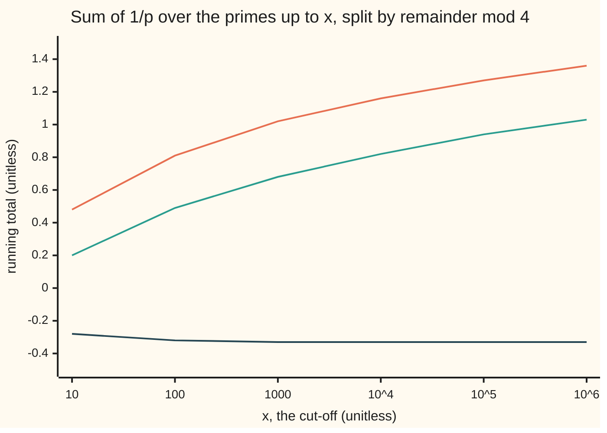

# Dirichlet's theorem: a progression coprime to its step holds infinitely many primes

[Syllabus](../../../SYLLABUS.md) → [Algebraic and analytic number theory](../README.md) → [Characters and L-functions](../README.md#s03) → Dirichlet's theorem

---

## General Overview

Start at 3 and keep adding 4: 3, 7, 11, 15, 19, 23, 27, … This list is a **progression** (a list with a fixed step). Some of its members are prime: 3, 7, 11, 19, 23, 31, 43. Below a million there are 39,322 of them. Does the list run out of primes at some point?

The odd primes have only two possible remainders on division by 4: 1 or 3. Below a million the two classes hold 39,175 and 39,322 primes. Each class takes about half. The last digits of primes tell the same story: below a million, the last digits 1, 3, 7 and 9 each take about a quarter.

In 1837 Peter Gustav Lejeune Dirichlet proved that this never stops. Every progression whose start and step share no factor holds infinitely many primes. His method weighs each class with a **character** (a repeating pattern of values: for step 4 the signs +1 and −1, in general complex roots of 1) and then adds 1/p over the primes. The sum for the class 3 mod 4 grows without limit, so the class cannot hold finitely many primes. The proof needs one input beyond Euler's proof for all primes: a certain number, L(1, χ), must not be zero. For the step 4 that number is π/4.

**Split 1/p over the primes into classes with characters: the trivial character carries the growth of the full sum, and every other character adds only a bounded amount when its L-function is not zero at 1, so each class coprime to the step gets an equal share of a sum that grows without limit.**

**What kind of fact this is:** a theorem. For the step 4 it is proved completely on this card in Why it works. For any step it is proved here, given that L(1, χ) is not zero, which [Dirichlet L-functions](03-dirichlet-l-functions.md) proves. The count of primes in each class, about π(x)/φ(q), is a later theorem (de la Vallée Poussin, 1896), stated here without proof. The counts to a million are evidence, not proof.

### The picture: two class sums grow, their difference stays still



Orange: the sum of 1/p over primes 3 mod 4. Green: the same over primes 1 mod 4. Dark: green minus orange, which is the sum of χ₄(p)/p. Both class sums keep climbing. Their difference settles near −0.33. That flat line is what L(1, χ₄) ≠ 0 looks like.

---

## The formula

Notation first, in words.

- The letter p always means a prime. The **modulus** q is the step, and a is the start. The **class** of a mod q is every whole number that leaves remainder a on division by q ([Congruence](../../02-Number%20theory/03-Clock%20Arithmetic/01-congruence-mod-n.md)).
- φ(q), the totient, counts the classes mod q that share no factor with q. For q = 4 these are 1 and 3, so φ(4) = 2.
- A **Dirichlet character** χ mod q is a pattern on whole numbers. It repeats every q steps, it is 0 on numbers that share a factor with q, and χ(mn) = χ(m)χ(n) ([Dirichlet characters](01-dirichlet-characters.md)). χ̄ is its complex conjugate. The **trivial character** χ₀ is 1 on every number coprime to q.
- The **L-function** of χ is $`L(s,\chi) = \sum_{n \ge 1} \chi(n)\, n^{-s}`$, for real s > 1 on this card ([Dirichlet L-functions](03-dirichlet-l-functions.md)).
- π(x; q, a) counts the primes up to x in the class of a mod q. π(x) counts all primes up to x. log is the natural logarithm. O(1) means an amount that stays bounded. f ∼ g means f/g tends to 1.

Mod 4 there are two characters. χ₀ is 1 on odd numbers and 0 on even ones. χ₄ is +1 on 1 mod 4, −1 on 3 mod 4, and 0 on even numbers.

The engine of the proof, for any modulus q and any a coprime to q:

```math
\sum_{p \equiv a \pmod q} \frac{1}{p^{s}} = \frac{1}{\varphi(q)} \sum_{\chi \bmod q} \overline{\chi}(a)\, \log L(s,\chi) + O(1), \qquad s \to 1^{+}
```

**Read it aloud:** the sum of one over p to the s, over the primes in the class of a, equals one over phi of q times the sum, over all characters, of chi-bar of a times log L of s and chi, plus a bounded amount.

For q = 4 and a = 3 the sum has two terms, since χ̄₄(3) = −1:

```math
\sum_{p \equiv 3 \pmod 4} \frac{1}{p^{s}} = \tfrac12 \log L(s,\chi_0) - \tfrac12 \log L(s,\chi_4) + O(1)
```

**Read it aloud:** the class-3 sum is half the log of the trivial L-function, minus half the log of the χ₄ L-function, plus a bounded amount.

The conclusions:

```math
\sum_{p \equiv a \pmod q} \frac{1}{p^{s}} = \frac{1}{\varphi(q)} \log\frac{1}{s-1} + O(1), \qquad \pi(x;q,a) \sim \frac{\pi(x)}{\varphi(q)}
```

**Read it aloud:** as s comes down to 1, the class sum grows like one over phi of q times log of one over s minus 1, the same for every class; and the prime count in each class is about pi of x over phi of q.

The first statement is proved on this card. It forces infinitely many primes in the class, and it gives each class an equal share in this weighted sense. The second statement, the equal share of the plain count, is the prime number theorem for progressions. It is stated, not proved.

| Symbol | Plain meaning | In our example | Push it up and the answer… |
| --- | --- | --- | --- |
| $`q`$, $`a`$ | the step and the start of the progression | q = 4, a = 3 | larger q: more classes, smaller share each |
| $`p`$ | a prime | 3, 7, 11, 19, 23 | — |
| $`\varphi(q)`$ | classes mod q coprime to q | φ(4) = 2 | each class's share 1/φ(q) falls |
| $`\chi`$, $`\overline{\chi}`$ | a character mod q; its complex conjugate | χ₄(3) = −1 | — |
| $`\chi_0`$, $`\chi_4`$ | the two characters mod 4 | χ₀(3) = 1, χ₄(3) = −1 | — |
| $`s`$ | a real number above 1, then sent down to 1 | 2, 1.1, 1.01, 1.001 | closer to 1: the class sum grows |
| $`L(s,\chi)`$ | the L-function: χ(n)/nˢ added over all n | L(1.001, χ₀) = 500.635298 | — |
| $`\zeta(s)`$ | the zeta function, the sum of 1/nˢ | L(s, χ₀) = (1 − 2⁻ˢ)ζ(s) | — |
| $`\pi(x;q,a)`$, $`\pi(x)`$, $`x`$ | primes up to the cut-off x in the class; all primes up to x | 39,322 and 78,498 at x = 10⁶ | both grow without limit |
| $`R(s,\chi)`$, $`O(1)`$, $`\sim`$ | the prime-power part of log L(s, χ); any bounded amount; f ∼ g: f/g tends to 1 | below 1 in size; π(x; 4, 3) ∼ π(x)/2 | — |
| $`\log`$ | the natural logarithm | log(1/0.001) = 6.907755 | — |
| $`\mathrm{artanh}`$ | the inverse hyperbolic tangent: u + u³/3 + u⁵/5 + … | artanh(1/9) for p = 3, s = 2 | — |

### When it holds

- **Start and step share no factor.** The class 2 mod 4 holds the even numbers 2, 6, 10, …, and only one of them, 2, is prime. Every member shares the factor 2 with the step.
- **L(1, χ) ≠ 0 for every non-trivial character.** If L(s, χ₄) had a zero at s = 1, the class-1 sum would add a growing term and a falling term that cancel. At s = 1.001, ½ log L(s, χ₀) + ½ log L(s, χ₄), with L(s, χ₄) multiplied by s − 1 to give it that zero, would come out at −0.466598, with no sign of growth.
- **s comes down to 1 from above.** The series and the Euler product agree for s > 1. The proof never evaluates a divergent sum; it watches what happens as s approaches 1.
- **The weighted share is not the count.** Equal sums of 1/pˢ do not make equal counts at a fixed x. At a million the class 3 mod 4 leads by 147.

---

## Why it works

### Step 0: Euler's proof already handles the trivial class

Euler took logs of the product $`\zeta(s) = \prod_p (1 - p^{-s})^{-1}`$ and found that the sum of 1/p over all primes grows without limit ([The zeta function](../../07-Complex%20analysis/09-Special%20Functions%20and%20the%20Zeta%20Function/05-zeta-function-and-euler-product.md)). That is the case q = 1: one class, holding every prime.

Dirichlet's idea is to filter. Attach to each prime the value of a character, take the log of its own Euler product, and then combine the patterns so that every class except one cancels. The only new risk is that a filtered log could fall to minus infinity and cancel the growth. That happens exactly when L(1, χ) = 0.

### Step 1: a character picks out one class

Mod 4 the filter is plain arithmetic. For odd n, $`\tfrac12(\chi_0(n) - \chi_4(n))`$ is 1 when n is 3 mod 4 and 0 when n is 1 mod 4. Check it: for n = 7, ½(1 − (−1)) = 1; for n = 5, ½(1 − 1) = 0.

For a general modulus the same job is done by **orthogonality** (the characters cancel in sums): for a coprime to q, $`\frac{1}{\varphi(q)}\sum_\chi \overline{\chi}(a)\chi(n)`$ is 1 when n ≡ a mod q and 0 otherwise. [Dirichlet characters](01-dirichlet-characters.md) proves this.

### Step 2: the log of an L-function is a sum over primes

χ is multiplicative, so the Euler product of [Dirichlet L-functions](03-dirichlet-l-functions.md) holds: $`L(s,\chi) = \prod_p (1 - \chi(p)p^{-s})^{-1}`$ for s > 1. Take logs and expand $`-\log(1-u) = u + u^2/2 + u^3/3 + \cdots`$:

```math
\log L(s,\chi) = \sum_p \frac{\chi(p)}{p^{s}} + R(s,\chi), \qquad |R(s,\chi)| \le \sum_p \sum_{k \ge 2} \frac{1}{k\,p^{k}} < 1
```

The prime-power terms (k ≥ 2) add at most the sum of 1/(p(p − 1)) over primes, which is below 1. So, up to a bounded amount, log L(s, χ) is the sum of χ(p)/pˢ.

Mod 4 the bounded part can be computed exactly. Subtract the two logs and the terms cancel in pairs:

```math
\tfrac12 \log\frac{L(s,\chi_0)}{L(s,\chi_4)} = \sum_{p \equiv 3 \pmod 4} \mathrm{artanh}\!\left(p^{-s}\right) = \sum_{p \equiv 3 \pmod 4} \left( \frac{1}{p^{s}} + \frac{1}{3p^{3s}} + \cdots \right)
```

Primes 1 mod 4 drop out completely. For a prime 3 mod 4, the even powers cancel and the odd powers survive. At s = 2 the left side, computed from series over all whole numbers, is 0.148897353. The right side, computed from primes up to a million, is 0.148897319.

### Step 3: the trivial L-function blows up at 1

$`L(s,\chi_0)`$ adds 1/nˢ over odd n only, so it is $`(1 - 2^{-s})\zeta(s)`$. Since ζ(s) is about 1/(s − 1) near 1, $`\log L(s,\chi_0)`$ grows like $`\log\frac{1}{s-1}`$. At s = 1.001, L(s, χ₀) = 500.635298.

For a general q, $`L(s,\chi_0) = \zeta(s)\prod_{p \mid q}(1 - p^{-s})`$, with the same growth.

### Step 4: every other L-function stays finite and, crucially, nonzero

For χ ≠ χ₀ the values of χ over one period add to 0. So the series for L(s, χ) converges for every s > 0, and L(s, χ) is continuous at s = 1 ([Dirichlet L-functions](03-dirichlet-l-functions.md)). As s comes down to 1, log L(s, χ) tends to log L(1, χ).

That limit is finite only if L(1, χ) ≠ 0. **This is the one extra input.** Mod 4 it is free. The series $`L(1,\chi_4) = 1 - \tfrac13 + \tfrac15 - \tfrac17 + \cdots`$ alternates with shrinking terms. So it lies above its first two terms, 1 − 1/3 = 0.666667. Its value is π/4 = 0.785398163397. For s > 1 the same argument keeps L(s, χ₄) above 2/3.

For a general q, the complex characters are the easy case, and the real ones are hard. [Dirichlet L-functions](03-dirichlet-l-functions.md) proves L(1, χ) ≠ 0 for every non-trivial χ, both cases in folds of its Step 5.

### Step 5: put the pieces together

Combine Steps 1 to 4. As s comes down to 1:

- the trivial character contributes $`\frac{1}{\varphi(q)}\log\frac{1}{s-1}`$, which grows without limit;
- every other character contributes a bounded amount;
- the prime powers contribute a bounded amount.

So the class sum grows without limit. A finite set of primes would give a sum below the sum of their reciprocals, a fixed number. So the class holds infinitely many primes.

The growth term carries the same weight 1/φ(q) for every class a. That is the equal share in the weighted sense, called **Dirichlet density**: the class sum divided by $`\log\frac{1}{s-1}`$ tends to 1/φ(q). Mod 4 the code tracks the class-3 log total ½ log(L₀/L₄) of Step 2. It is the class sum plus its bounded prime-power part, so it has the same limit. Divided by $`\log\frac{1}{s-1}`$ it gives 0.4233, 0.4521 and 0.4674 at s = 1.1, 1.01 and 1.001. It approaches 1/2 slowly, because the bounded part is divided by a log that grows slowly.

<details>
<summary>Detailed proof: the general modulus, given L(1, χ) ≠ 0</summary>

Fix q and a with gcd(a, q) = 1. For real s > 1 define $`\log L(s,\chi)`$ by the absolutely convergent sum of $`-\log(1 - \chi(p)p^{-s})`$ over primes, with the principal branch, so that it is a genuine logarithm of the product.

$`\displaystyle \log L(s,\chi) = \sum_p \frac{\chi(p)}{p^{s}} + R(s,\chi), \qquad |R(s,\chi)| \le \sum_p \frac{1}{p(p-1)} < 1.`$

Multiply by $`\overline{\chi}(a)/\varphi(q)`$ and add over all φ(q) characters. Orthogonality turns the prime sum into the class sum:

$`\displaystyle \frac{1}{\varphi(q)}\sum_\chi \overline{\chi}(a)\log L(s,\chi) = \sum_{p \equiv a \pmod q} \frac{1}{p^{s}} + O(1).`$

The trivial character gives $`\frac{1}{\varphi(q)}\log L(s,\chi_0) = \frac{1}{\varphi(q)}\log\frac{1}{s-1} + O(1)`$, since $`(s-1)\zeta(s) \to 1`$ and the finite product over p dividing q tends to φ(q)/q.

For χ ≠ χ₀, L(s, χ) is continuous on s > 0 and L(1, χ) ≠ 0. On s > 1 the function log L(s, χ) is continuous, and its exponential is L(s, χ), which tends to a nonzero limit. So log L(s, χ) stays bounded as s comes down to 1. (Mod 4 every value is real and positive, so no branch question arises.)

Therefore the class sum equals $`\frac{1}{\varphi(q)}\log\frac{1}{s-1} + O(1)`$, which is unbounded. A finite class of primes would give a sum bounded by a fixed number. ∎

</details>

### Step 6: the count, not just the weighted sum

The proof gives growth of a weighted sum. It does not say how many primes each class holds below x. That needs more: L(s, χ) must have no zeros on the whole line where the real part of s is 1. Charles de la Vallée Poussin proved this in 1896, together with the prime number theorem, and obtained

```math
\pi(x;q,a) \sim \frac{\pi(x)}{\varphi(q)}
```

which reads: the count in each class divided by π(x)/φ(q) tends to 1. This card states it without proof; Davenport's book (in Sources) proves it. Below a million, the class 3 mod 4 holds a share 0.5009 of the odd primes. The house example's four last digits hold shares 0.2499, 0.2505, 0.2500 and 0.2496.

---

## Worked numbers, by hand

| Step | Arithmetic | Value |
| --- | --- | --- |
| First primes 3 mod 4 | test 3, 7, 11, 15, 19, 23 | 3, 7, 11, 19, 23 (15 = 3 × 5) |
| The class filter at n = 7 | ½(χ₀(7) − χ₄(7)) = ½(1 + 1) | 1 |
| The class filter at n = 5 | ½(χ₀(5) − χ₄(5)) = ½(1 − 1) | 0 |
| Floor for L(1, χ₄) | 1 − 1/3 | 0.666667 |
| L(1, χ₄) | 1 − 1/3 + 1/5 − …, smoothed | 0.785398163397 = π/4 |
| L(1.001, χ₀) | sum of 1/n^1.001 over odd n, from ζ(1.001) | 500.635298 |
| L(1.001, χ₄) | 1 − 1/3^1.001 + … | 0.785591 |
| Class-3 log total at s = 1.001: the sum of 1/pˢ over p ≡ 3 mod 4, plus its prime-power part (Step 2) | ½ log(500.635298 / 0.785591) | 3.228598 |
| Same at s = 1.01 and 1.1 | ½ log(L₀/L₄) | 2.081895 and 0.974649 |
| Its share of log(1/(s − 1)) | 3.228598 / 6.907755 | **0.4674, rising towards 1/2** |

The class-3 log total grows each time s moves closer to 1, and nothing in it can stop the growth, because L(s, χ₄) stays near 0.785. Its prime-power part stays below 1, so the class sum itself grows without limit, and the primes 3 mod 4 never run out.

The counts behind the house example:

```
last digit 1   ███████████████████▌  19,617
last digit 3   ███████████████████▋  19,665
last digit 7   ███████████████████▌  19,621
last digit 9   ███████████████████▌  19,593
```

Each bar is the number of primes below a million with that last digit. Each is close to a quarter of the primes other than 2 and 5: the shares are 0.2499, 0.2505, 0.2500 and 0.2496.

### What breaks if you drop a piece

| Mistake | Comes out at | What went wrong |
| --- | --- | --- |
| Use the class 2 mod 4 | 1 prime below a million (class 0 mod 4: 0) | start and step share the factor 2 |
| Share over all 4 classes mod 4 | 78,498 / 4 = 19,624.5, against 39,322 | only φ(4) = 2 classes can hold primes beyond 2 |
| Read the equal share as equal counts | class 3 leads by 147 at a million | the share is a limit; at fixed x one class can lead |
| Allow L(1, χ₄) = 0 | class-1 log total ½ log(L₀L₄) at s = 1.001, with L₄ given that zero: −0.466598, not growing | the growing and falling logs cancel |

---

## Code, from first principles, and it actually runs

The code takes three independent roads. Road 1 counts primes with a sieve to a million and counts the primes 3 mod 4 below 10,000 again by trial division. Road 2 computes L(s, χ₀) and L(s, χ₄) from their series over all whole numbers, with no primes, smoothing the alternating series by repeated averaging. It then tests Step 2's identity at s = 2 against the primes. Road 3 multiplies the Euler product of L(1, χ₄) over the primes below a million and compares it with the series and with π/4. Road 3 is evidence, not proof: the card proves the product only for s > 1. That it still converges to L(1, χ₄) at s = 1 follows from the convergence of the sum of χ₄(p)/p, a theorem stated with its source on [Dirichlet L-functions](03-dirichlet-l-functions.md).

### Python

```python
# Dirichlet's theorem for primes 3 mod 4 -- the check behind the card.  Standard library only.
# Road 1 counts primes with a sieve, and again by trial division.  Road 2 computes the two
# L-functions mod 4 from their series over all whole numbers, using no primes, and tests the
# identity that ties them to the primes 3 mod 4.  Road 3 is the Euler product of L(1, chi4).
import math
X = 10 ** 6

def sieve(m):                                    # Eratosthenes: flag[n] is True when n is prime
    flag = [True] * (m + 1); flag[0] = flag[1] = False
    for p in range(2, math.isqrt(m) + 1):
        if flag[p]: flag[p * p::p] = [False] * len(flag[p * p::p])
    return flag
def is_prime(n):                                 # trial division, the second road to primality
    return n > 1 and all(n % d for d in range(2, math.isqrt(n) + 1))
def factor(n):                                   # prime factors by trial division
    out, d = [], 2
    while d * d <= n:
        while n % d == 0: out.append(d); n //= d
        d += 1
    return out + ([n] if n > 1 else [])
def alt(term, s, n=2000, m=20):                  # alternating series: partial sums, then average
    sums, tot = [], 0.0                          # neighbours m times (Euler's smoothing)
    for k in range(n):
        tot += (-1) ** k * term(k, s); sums.append(tot)
    w = sums[-(m + 1):]
    for _ in range(m): w = [(w[i] + w[i + 1]) / 2 for i in range(len(w) - 1)]
    return w[0]
def L4(s):                                       # L(s, chi4) = 1 - 1/3^s + 1/5^s - 1/7^s + ...
    return alt(lambda k, s: (2 * k + 1) ** -s, s)
def L0(s):                                       # L(s, chi0) = sum over odd n = (1 - 2^-s) zeta(s),
    eta = alt(lambda k, s: (k + 1) ** -s, s)     # with zeta from the alternating eta series
    return (1 - 2 ** -s) * eta / (1 - 2 ** (1 - s))
def f6(v): return f"{v:.6f}"

flag = sieve(X)
primes = [p for p in range(2, X + 1) if flag[p]]
three = [p for p in primes if p % 4 == 3]
print("first primes 3 mod 4:", three[:10])
e, f = 4 * 3 * 7 * 11 - 1, 4 * 5 * 13 * 17 - 1
print(f"Euclid's trick: 4 x 3 x 7 x 11 - 1 = {e} = {factor(e)}; new prime 3 mod 4: {factor(e)[-1]}")
print(f"same trick for 1 mod 4: 4 x 5 x 13 x 17 - 1 = {f} = {factor(f)}; each is 3 mod 4: "
      f"{'yes' if all(p % 4 == 3 for p in factor(f)) else 'no'}")
cnt, tot, rows, lead, marks = {1: 0, 3: 0}, {1: 0.0, 3: 0.0}, [], None, [10 ** k for k in range(1, 7)]
for p in primes + [X + 1]:                       # one pass; X + 1 only closes the last row
    while marks and p > marks[0]:
        rows.append((marks.pop(0), cnt[1], cnt[3], tot[1], tot[3]))
    if p % 2 and p <= X:
        cnt[p % 4] += 1; tot[p % 4] += 1 / p
        if lead is None and cnt[1] > cnt[3]: lead = (p, cnt[1], cnt[3])
print("x | primes 1 mod 4 | primes 3 mod 4 | share 3 mod 4 | sum 1/p, 1 mod 4 | sum 1/p, 3 mod 4 "
      "| difference = sum chi4(p)/p | (1/2) log log x")
for x, a, b, t1, t3 in rows:
    print(f"10^{len(str(x)) - 1} | {a} | {b} | {b / (a + b):.4f} | {f6(t1)} | {f6(t3)} | {f6(t1 - t3)} "
          f"| {f6(0.5 * math.log(math.log(x)))}")
chart = lambda i: "[" + ", ".join(f"{r[i]:.2f}" for r in rows) + "]"
print("chart, sum 1/p over p 3 mod 4:", chart(4))
print("chart, sum 1/p over p 1 mod 4:", chart(3))
print("chart, sum chi4(p)/p:", "[" + ", ".join(f"{r[3] - r[4]:.2f}" for r in rows) + "]")
trial = sum(1 for n in range(3, 10 ** 4, 4) if is_prime(n))
print(f"primes 3 mod 4 below 10^4: sieve {rows[3][2]}, trial division {trial}")
print(f"first prime where 1 mod 4 leads: {lead[0]} (counts {lead[1]} to {lead[2]})")
digits = {d: sum(1 for p in primes if p % 10 == d) for d in (1, 3, 7, 9)}
print(f"primes below 10^6: {len(primes)}; by last digit (2 and 5 aside): "
      + ", ".join(f"{d}: {v} ({v / (len(primes) - 2):.4f})" for d, v in digits.items()))
euler = 1.0
for p in primes:
    if p % 2: euler /= 1 - (1 if p % 4 == 1 else -1) / p
print(f"L(1, chi4): series {L4(1.0):.12f}; Euler product to 10^6 {euler:.12f}; "
      f"pi/4 cross-check {math.pi / 4:.12f}; floor 1 - 1/3 = {f6(2 / 3)}")
print("s | L(s, chi0) | L(s, chi4) | (1/2) log(L0/L4) | (1/2) log(L0 L4) | log(1/(s-1)) | 3 mod 4 share")
table = []
for label in ("2", "1.1", "1.01", "1.001"):
    s = float(label); a, b = L0(s), L4(s)
    g3, g1, big = 0.5 * math.log(a / b), 0.5 * math.log(a * b), math.log(1 / (s - 1))
    table.append((s, a, b, g3, g1, big))
    share = "-" if big == 0 else f"{g3 / big:.4f}"
    print(f"{label} | {f6(a)} | {f6(b)} | {f6(g3)} | {f6(g1)} | {f6(big)} | {share}")
side = sum(math.atanh(p ** -2.0) for p in three)
print(f"s = 2: (1/2) log(L0/L4) = {table[0][3]:.9f}; sum of artanh(p^-2) over p 3 mod 4 to 10^6 = "
      f"{side:.9f}; gap {table[0][3] - side:.9f}")
fake = 0.5 * (math.log(table[3][1]) + math.log((1.001 - 1) * table[3][2]))
print(f"mistake 1, class 2 mod 4 (shares 2 with the step): {sum(1 for p in primes if p % 4 == 2)} prime; "
      f"class 0 mod 4: {sum(1 for p in primes if p % 4 == 0)} primes")
print(f"mistake 2, sharing over all 4 classes: 78498 / 4 = {len(primes) / 4:.1f}, true count {rows[5][2]}")
print(f"mistake 3, equal share read as equal counts: 3 mod 4 leads by {rows[5][2] - rows[5][1]} at 10^6")
print(f"mistake 4, a zero at s = 1: (1/2) log(L0 x (s-1) L4) at s = 1.001 is {f6(fake)}, no longer growing")
assert trial == rows[3][2]                                      # sieve against trial division
assert abs(euler - L4(1.0)) < 1e-3 and abs(L4(1.0) - math.pi / 4) < 1e-10   # three roads to L(1, chi4)
assert abs(table[0][3] - side) < 2e-6                           # primes against whole-number series
assert all(r[2] >= 2 / 3 for r in table) and [r[3] for r in table] == sorted(r[3] for r in table)
assert max(abs(r[3] - r[4]) for r in rows) < 0.5 and lead[0] == 26861   # bounded; Leech 1957
assert factor(e) == [13, 71] and factor(e)[-1] % 4 == 3 and len(primes) == 78498   # pi(10^6) table
print("ALL CHECKS PASS")
```

**Ran 2026-11-15 on macOS, Python 3.14.10, standard library only. All checks passed. Output, pasted from the run:**

```
first primes 3 mod 4: [3, 7, 11, 19, 23, 31, 43, 47, 59, 67]
Euclid's trick: 4 x 3 x 7 x 11 - 1 = 923 = [13, 71]; new prime 3 mod 4: 71
same trick for 1 mod 4: 4 x 5 x 13 x 17 - 1 = 4419 = [3, 3, 491]; each is 3 mod 4: yes
x | primes 1 mod 4 | primes 3 mod 4 | share 3 mod 4 | sum 1/p, 1 mod 4 | sum 1/p, 3 mod 4 | difference = sum chi4(p)/p | (1/2) log log x
10^1 | 1 | 2 | 0.6667 | 0.200000 | 0.476190 | -0.276190 | 0.417016
10^2 | 11 | 13 | 0.5417 | 0.492152 | 0.810665 | -0.318513 | 0.763590
10^3 | 80 | 87 | 0.5210 | 0.682442 | 1.015638 | -0.333197 | 0.966322
10^4 | 609 | 619 | 0.5041 | 0.824694 | 1.158366 | -0.333671 | 1.110163
10^5 | 4783 | 4808 | 0.5013 | 0.935314 | 1.269958 | -0.334644 | 1.221735
10^6 | 39175 | 39322 | 0.5009 | 1.026174 | 1.361154 | -0.334979 | 1.312896
chart, sum 1/p over p 3 mod 4: [0.48, 0.81, 1.02, 1.16, 1.27, 1.36]
chart, sum 1/p over p 1 mod 4: [0.20, 0.49, 0.68, 0.82, 0.94, 1.03]
chart, sum chi4(p)/p: [-0.28, -0.32, -0.33, -0.33, -0.33, -0.33]
primes 3 mod 4 below 10^4: sieve 619, trial division 619
first prime where 1 mod 4 leads: 26861 (counts 1473 to 1472)
primes below 10^6: 78498; by last digit (2 and 5 aside): 1: 19617 (0.2499), 3: 19665 (0.2505), 7: 19621 (0.2500), 9: 19593 (0.2496)
L(1, chi4): series 0.785398163397; Euler product to 10^6 0.785399852889; pi/4 cross-check 0.785398163397; floor 1 - 1/3 = 0.666667
s | L(s, chi0) | L(s, chi4) | (1/2) log(L0/L4) | (1/2) log(L0 L4) | log(1/(s-1)) | 3 mod 4 share
2 | 1.233701 | 0.915966 | 0.148897 | 0.061121 | 0.000000 | -
1.1 | 5.646629 | 0.803933 | 0.974649 | 0.756410 | 2.302585 | 0.4233
1.01 | 50.636343 | 0.787319 | 2.081895 | 1.842774 | 4.605170 | 0.4521
1.001 | 500.635298 | 0.785591 | 3.228598 | 2.987279 | 6.907755 | 0.4674
s = 2: (1/2) log(L0/L4) = 0.148897353; sum of artanh(p^-2) over p 3 mod 4 to 10^6 = 0.148897319; gap 0.000000034
mistake 1, class 2 mod 4 (shares 2 with the step): 1 prime; class 0 mod 4: 0 primes
mistake 2, sharing over all 4 classes: 78498 / 4 = 19624.5, true count 39322
mistake 3, equal share read as equal counts: 3 mod 4 leads by 147 at 10^6
mistake 4, a zero at s = 1: (1/2) log(L0 x (s-1) L4) at s = 1.001 is -0.466598, no longer growing
ALL CHECKS PASS
```

### Rust

Same numbers, same labels, built with `rustc --edition 2021 -O`.

```rust
// Dirichlet's theorem for primes 3 mod 4 -- the same check as the Python, in Rust.  No crates.
// Road 1 counts primes with a sieve, and again by trial division.  Road 2 computes the two
// L-functions mod 4 from their series over all whole numbers, using no primes, and tests the
// identity that ties them to the primes 3 mod 4.  Road 3 is the Euler product of L(1, chi4).
const X: usize = 1_000_000;

fn sieve(m: usize) -> Vec<bool> {                // Eratosthenes: flag[n] is true when n is prime
    let mut flag = vec![true; m + 1];
    flag[0] = false; flag[1] = false;
    let mut p = 2;
    while p * p <= m {
        if flag[p] { let mut q = p * p; while q <= m { flag[q] = false; q += p } }
        p += 1;
    }
    flag
}
fn is_prime(n: usize) -> bool {                  // trial division, the second road to primality
    if n < 2 { return false }
    let mut d = 2;
    while d * d <= n { if n % d == 0 { return false } d += 1 }
    true
}
fn factor(mut n: usize) -> Vec<usize> {          // prime factors by trial division
    let (mut out, mut d) = (Vec::new(), 2);
    while d * d <= n { while n % d == 0 { out.push(d); n /= d } d += 1 }
    if n > 1 { out.push(n) }
    out
}
fn alt(term: &dyn Fn(usize, f64) -> f64, s: f64) -> f64 {   // alternating series: partial sums,
    let (n, m) = (2000, 20);                                 // then average neighbours m times
    let (mut sums, mut tot) = (Vec::new(), 0.0);
    for k in 0..n {
        let sign = if k % 2 == 0 { 1.0 } else { -1.0 };
        tot += sign * term(k, s); sums.push(tot);
    }
    let mut w: Vec<f64> = sums[n - m - 1..].to_vec();
    for _ in 0..m { w = (0..w.len() - 1).map(|i| (w[i] + w[i + 1]) / 2.0).collect() }
    w[0]
}
fn l4(s: f64) -> f64 { alt(&|k, s| ((2 * k + 1) as f64).powf(-s), s) }   // 1 - 1/3^s + 1/5^s - ...
fn l0(s: f64) -> f64 {                           // sum over odd n = (1 - 2^-s) zeta(s),
    let eta = alt(&|k, s| ((k + 1) as f64).powf(-s), s);     // with zeta from the eta series
    (1.0 - 2f64.powf(-s)) * eta / (1.0 - 2f64.powf(1.0 - s))
}
fn f6(v: f64) -> String { format!("{:.6}", v) }
fn list(v: &[f64]) -> String { format!("[{}]", v.iter().map(|x| format!("{:.2}", x)).collect::<Vec<_>>().join(", ")) }

fn main() {
    let flag = sieve(X);
    let primes: Vec<usize> = (2..=X).filter(|&n| flag[n]).collect();
    let three: Vec<usize> = primes.iter().copied().filter(|p| p % 4 == 3).collect();
    println!("first primes 3 mod 4: {:?}", &three[..10]);
    let (e, f) = (4 * 3 * 7 * 11 - 1, 4 * 5 * 13 * 17 - 1);
    let (fe, ff) = (factor(e), factor(f));
    println!("Euclid's trick: 4 x 3 x 7 x 11 - 1 = {} = {:?}; new prime 3 mod 4: {}", e, fe, fe[fe.len() - 1]);
    println!("same trick for 1 mod 4: 4 x 5 x 13 x 17 - 1 = {} = {:?}; each is 3 mod 4: {}", f, ff,
             if ff.iter().all(|p| p % 4 == 3) { "yes" } else { "no" });
    let (mut cnt, mut tot) = ([0usize; 4], [0.0f64; 4]);
    let mut rows: Vec<(usize, usize, usize, f64, f64)> = Vec::new();
    let mut marks: Vec<usize> = (1..7).map(|k| 10usize.pow(k)).collect();
    let mut lead: Option<(usize, usize, usize)> = None;
    let mut walk = primes.clone(); walk.push(X + 1);  // X + 1 only closes the last row
    for &p in &walk {
        while !marks.is_empty() && p > marks[0] { rows.push((marks.remove(0), cnt[1], cnt[3], tot[1], tot[3])) }
        if p % 2 == 1 && p <= X {
            cnt[p % 4] += 1; tot[p % 4] += 1.0 / p as f64;
            if lead.is_none() && cnt[1] > cnt[3] { lead = Some((p, cnt[1], cnt[3])) }
        }
    }
    println!("x | primes 1 mod 4 | primes 3 mod 4 | share 3 mod 4 | sum 1/p, 1 mod 4 | sum 1/p, 3 mod 4 | difference = sum chi4(p)/p | (1/2) log log x");
    for &(x, a, b, t1, t3) in &rows {
        println!("10^{} | {} | {} | {:.4} | {} | {} | {} | {}", x.to_string().len() - 1, a, b, b as f64 / (a + b) as f64,
                 f6(t1), f6(t3), f6(t1 - t3), f6(0.5 * (x as f64).ln().ln()));
    }
    println!("chart, sum 1/p over p 3 mod 4: {}", list(&rows.iter().map(|r| r.4).collect::<Vec<_>>()));
    println!("chart, sum 1/p over p 1 mod 4: {}", list(&rows.iter().map(|r| r.3).collect::<Vec<_>>()));
    println!("chart, sum chi4(p)/p: {}", list(&rows.iter().map(|r| r.3 - r.4).collect::<Vec<_>>()));
    let trial = (3..10_000).step_by(4).filter(|&n| is_prime(n)).count();
    println!("primes 3 mod 4 below 10^4: sieve {}, trial division {}", rows[3].2, trial);
    let lead = lead.unwrap();
    println!("first prime where 1 mod 4 leads: {} (counts {} to {})", lead.0, lead.1, lead.2);
    let digits: Vec<String> = [1, 3, 7, 9].iter().map(|&d| {
        let v = primes.iter().filter(|&&p| p % 10 == d).count();
        format!("{}: {} ({:.4})", d, v, v as f64 / (primes.len() - 2) as f64) }).collect();
    println!("primes below 10^6: {}; by last digit (2 and 5 aside): {}", primes.len(), digits.join(", "));
    let mut euler = 1.0f64;
    for &p in &primes { if p % 2 == 1 { euler /= 1.0 - (if p % 4 == 1 { 1.0 } else { -1.0 }) / p as f64 } }
    println!("L(1, chi4): series {:.12}; Euler product to 10^6 {:.12}; pi/4 cross-check {:.12}; floor 1 - 1/3 = {}",
             l4(1.0), euler, std::f64::consts::PI / 4.0, f6(2.0 / 3.0));
    println!("s | L(s, chi0) | L(s, chi4) | (1/2) log(L0/L4) | (1/2) log(L0 L4) | log(1/(s-1)) | 3 mod 4 share");
    let mut table: Vec<(f64, f64, f64, f64, f64, f64)> = Vec::new();
    for label in ["2", "1.1", "1.01", "1.001"] {
        let s: f64 = label.parse().unwrap(); let (a, b) = (l0(s), l4(s));
        let (g3, g1, big) = (0.5 * (a / b).ln(), 0.5 * (a * b).ln(), (1.0 / (s - 1.0)).ln());
        table.push((s, a, b, g3, g1, big));
        let share = if big == 0.0 { "-".to_string() } else { format!("{:.4}", g3 / big) };
        println!("{} | {} | {} | {} | {} | {} | {}", label, f6(a), f6(b), f6(g3), f6(g1), f6(big), share);
    }
    let side: f64 = three.iter().map(|&p| (p as f64).powf(-2.0).atanh()).sum();
    println!("s = 2: (1/2) log(L0/L4) = {:.9}; sum of artanh(p^-2) over p 3 mod 4 to 10^6 = {:.9}; gap {:.9}",
             table[0].3, side, table[0].3 - side);
    let fake = 0.5 * (table[3].1.ln() + ((1.001 - 1.0) * table[3].2).ln());
    println!("mistake 1, class 2 mod 4 (shares 2 with the step): {} prime; class 0 mod 4: {} primes",
             primes.iter().filter(|&&p| p % 4 == 2).count(), primes.iter().filter(|&&p| p % 4 == 0).count());
    println!("mistake 2, sharing over all 4 classes: 78498 / 4 = {:.1}, true count {}", primes.len() as f64 / 4.0, rows[5].2);
    println!("mistake 3, equal share read as equal counts: 3 mod 4 leads by {} at 10^6", rows[5].2 - rows[5].1);
    println!("mistake 4, a zero at s = 1: (1/2) log(L0 x (s-1) L4) at s = 1.001 is {}, no longer growing", f6(fake));
    assert!(trial == rows[3].2);                                     // sieve against trial division
    assert!((euler - l4(1.0)).abs() < 1e-3 && (l4(1.0) - std::f64::consts::PI / 4.0).abs() < 1e-10);
    assert!((table[0].3 - side).abs() < 2e-6);                       // primes against whole-number series
    assert!(table.iter().all(|r| r.2 >= 2.0 / 3.0) && table.windows(2).all(|w| w[0].3 <= w[1].3));
    assert!(rows.iter().all(|r| (r.3 - r.4).abs() < 0.5) && lead.0 == 26861);   // bounded; Leech 1957
    assert!(fe == vec![13, 71] && fe[fe.len() - 1] % 4 == 3 && primes.len() == 78498);   // pi(10^6) table
    println!("ALL CHECKS PASS");
}
```

**Ran 2026-11-15 on macOS, rustc 1.98.1, no crates. All checks passed. Output, pasted from the run:**

```
first primes 3 mod 4: [3, 7, 11, 19, 23, 31, 43, 47, 59, 67]
Euclid's trick: 4 x 3 x 7 x 11 - 1 = 923 = [13, 71]; new prime 3 mod 4: 71
same trick for 1 mod 4: 4 x 5 x 13 x 17 - 1 = 4419 = [3, 3, 491]; each is 3 mod 4: yes
x | primes 1 mod 4 | primes 3 mod 4 | share 3 mod 4 | sum 1/p, 1 mod 4 | sum 1/p, 3 mod 4 | difference = sum chi4(p)/p | (1/2) log log x
10^1 | 1 | 2 | 0.6667 | 0.200000 | 0.476190 | -0.276190 | 0.417016
10^2 | 11 | 13 | 0.5417 | 0.492152 | 0.810665 | -0.318513 | 0.763590
10^3 | 80 | 87 | 0.5210 | 0.682442 | 1.015638 | -0.333197 | 0.966322
10^4 | 609 | 619 | 0.5041 | 0.824694 | 1.158366 | -0.333671 | 1.110163
10^5 | 4783 | 4808 | 0.5013 | 0.935314 | 1.269958 | -0.334644 | 1.221735
10^6 | 39175 | 39322 | 0.5009 | 1.026174 | 1.361154 | -0.334979 | 1.312896
chart, sum 1/p over p 3 mod 4: [0.48, 0.81, 1.02, 1.16, 1.27, 1.36]
chart, sum 1/p over p 1 mod 4: [0.20, 0.49, 0.68, 0.82, 0.94, 1.03]
chart, sum chi4(p)/p: [-0.28, -0.32, -0.33, -0.33, -0.33, -0.33]
primes 3 mod 4 below 10^4: sieve 619, trial division 619
first prime where 1 mod 4 leads: 26861 (counts 1473 to 1472)
primes below 10^6: 78498; by last digit (2 and 5 aside): 1: 19617 (0.2499), 3: 19665 (0.2505), 7: 19621 (0.2500), 9: 19593 (0.2496)
L(1, chi4): series 0.785398163397; Euler product to 10^6 0.785399852889; pi/4 cross-check 0.785398163397; floor 1 - 1/3 = 0.666667
s | L(s, chi0) | L(s, chi4) | (1/2) log(L0/L4) | (1/2) log(L0 L4) | log(1/(s-1)) | 3 mod 4 share
2 | 1.233701 | 0.915966 | 0.148897 | 0.061121 | 0.000000 | -
1.1 | 5.646629 | 0.803933 | 0.974649 | 0.756410 | 2.302585 | 0.4233
1.01 | 50.636343 | 0.787319 | 2.081895 | 1.842774 | 4.605170 | 0.4521
1.001 | 500.635298 | 0.785591 | 3.228598 | 2.987279 | 6.907755 | 0.4674
s = 2: (1/2) log(L0/L4) = 0.148897353; sum of artanh(p^-2) over p 3 mod 4 to 10^6 = 0.148897319; gap 0.000000034
mistake 1, class 2 mod 4 (shares 2 with the step): 1 prime; class 0 mod 4: 0 primes
mistake 2, sharing over all 4 classes: 78498 / 4 = 19624.5, true count 39322
mistake 3, equal share read as equal counts: 3 mod 4 leads by 147 at 10^6
mistake 4, a zero at s = 1: (1/2) log(L0 x (s-1) L4) at s = 1.001 is -0.466598, no longer growing
ALL CHECKS PASS
```

The two outputs match line for line.

### Lean

Lean proves the theorem and the weighted equal share for every step and coprime start, and checks the numbers mod 4.

- Take a step $`q \ge 1`$ and a start $`a`$ that shares no factor with $`q`$. Then the class of $`a`$ mod $`q`$ holds infinitely many primes, with no assumption on L(1, χ).
- Take the same $`q`$ and $`a`$, and let a real number s come down to 1 from above. Then the sum of 1/pˢ over primes in the class is $`\frac{1}{\varphi(q)}\log\frac{1}{s-1}`$ plus a bounded amount.
- Take an odd whole number n. Then ½(χ₀(n) − χ₄(n)) is 1 when n is 3 mod 4, and 0 when n is 1 mod 4.
- The first primes 3 mod 4 are 3, 7, 11, 19 and 23, and φ(4) = 2.
- Euclid's trick gives the new prime 71 for 3 mod 4. For 1 mod 4 it gives only factors 3 mod 4: 4,419 = 3 × 3 × 491.
- Below 100 the classes 1 and 3 mod 4 hold 11 and 13 primes. The class 2 mod 4 holds only 2, and the class 0 mod 4 none.

The counts to a million, the L-function values and the Euler product are left to the Python and Rust checks.

```lean
-- Dirichlet's theorem: every progression whose start shares no factor with its step holds infinitely many primes, and each such class gets the share 1/φ(q) of the sum of 1/p^s as s comes down to 1.
import Mathlib.NumberTheory.LSeries.PrimesInAP
import Mathlib.NumberTheory.LegendreSymbol.ZModChar
import Mathlib.Analysis.SpecialFunctions.Log.Basic
import Mathlib.Analysis.Asymptotics.Defs
import Mathlib.Tactic.NormNum.Prime
import Mathlib.Analysis.Calculus.SmoothSeries
import Mathlib.Analysis.Calculus.MeanValue
import Mathlib.Analysis.SpecialFunctions.Pow.Deriv
import Mathlib.Analysis.SpecialFunctions.Log.Deriv
import Mathlib.Analysis.PSeries

open Filter Topology Asymptotics

section DirichletHelpers

open Complex LSeries DirichletCharacter ArithmeticFunction ArithmeticFunction.vonMangoldt
open scoped LSeries.notation

/-- On real `x > 1`, the real L-series of `residueClass a` is the real part of the auxiliary
function plus the pole term `(q.totient)⁻¹/(x-1)`. -/
lemma dirichletHelper_residueClass_tsum_eq {q : ℕ} [NeZero q] {a : ZMod q} (ha : IsUnit a)
    {x : ℝ} (hx : 1 < x) :
    ∑' n, residueClass a n / (n : ℝ) ^ x =
      (LFunctionResidueClassAux a x).re + (q.totient : ℝ)⁻¹ / (x - 1) := by
  refine ofReal_injective ?_
  simp only [ofReal_tsum, ofReal_div, ofReal_cpow (Nat.cast_nonneg _), ofReal_natCast,
    ofReal_add, ofReal_inv, ofReal_sub, ofReal_one]
  simp_rw [← LFunctionResidueClassAux_real ha hx,
    eqOn_LFunctionResidueClassAux ha <| Set.mem_ofPred.mpr (ofReal_re x ▸ hx), sub_add_cancel,
    LSeries, term]
  refine tsum_congr fun n ↦ ?_
  split_ifs with hn
  · simp only [hn, residueClass_apply_zero, ofReal_zero, zero_div]
  · rfl

/-- The real part of the auxiliary function is bounded on `[1, 2]`. -/
lemma dirichletHelper_aux_bounded {q : ℕ} [NeZero q] (a : ZMod q) :
    ∃ M : ℝ, ∀ x ∈ Set.Icc (1 : ℝ) 2, |(LFunctionResidueClassAux a x).re| ≤ M := by
  have : ContinuousOn (fun x : ℝ ↦ (LFunctionResidueClassAux a x).re) (Set.Icc 1 2) :=
    continuous_re.continuousOn.comp (t := Set.univ) (continuousOn_LFunctionResidueClassAux a)
      (fun ⦃x⦄ a ↦ trivial) |>.comp continuous_ofReal.continuousOn fun x hx ↦ by
        simpa only [Set.mem_ofPred_eq, ofReal_re] using hx.1
  obtain ⟨M, hM⟩ := isCompact_Icc.exists_bound_of_continuousOn this
  exact ⟨M, fun x hx ↦ by simpa [Real.norm_eq_abs] using hM x hx⟩

/-- For a prime-class indicator, the term `log p * p^(-s)` is the prime part of the
von Mangoldt residue-class series. -/
lemma dirichletHelper_indicator_eq {q a : ℕ} (s : ℝ) (n : ℕ) :
    {p : ℕ | p.Prime ∧ p ≡ a [MOD q]}.indicator (fun p : ℕ ↦ Real.log p * (p : ℝ) ^ (-s)) n =
      (if n.Prime then residueClass (a : ZMod q) n else 0) / (n : ℝ) ^ s := by
  by_cases hp : n.Prime
  · by_cases hm : n ≡ a [MOD q]
    · have hm' : (n : ZMod q) = a := (ZMod.natCast_eq_natCast_iff _ _ _).mpr hm
      simp [Set.indicator, hp, hm, hm', vonMangoldt_apply_prime hp, Real.rpow_neg,
        div_eq_mul_inv]
    · have hm' : ¬ (n : ZMod q) = a := fun e ↦ hm ((ZMod.natCast_eq_natCast_iff _ _ _).mp e)
      simp [Set.indicator, hp, hm, hm']
  · simp [Set.indicator, hp]

lemma dirichletHelper_summable {q : ℕ} (a : ZMod q) {s : ℝ} (hs : 1 < s) :
    Summable fun n : ℕ ↦ residueClass a n / (n : ℝ) ^ s :=
  LSeries.summable_real_of_abscissaOfAbsConv_lt <|
    (abscissaOfAbsConv_residueClass_le_one a).trans_lt <| mod_cast hs

lemma dirichletHelper_summable_prime {q : ℕ} (a : ZMod q) {s : ℝ} (hs : 1 < s) :
    Summable fun n : ℕ ↦ (if n.Prime then residueClass a n else 0) / (n : ℝ) ^ s := by
  refine (dirichletHelper_summable a hs).of_nonneg_of_le (fun n ↦ ?_) (fun n ↦ ?_)
  · have := residueClass_nonneg a n
    split_ifs <;> positivity
  · refine div_le_div_of_nonneg_right ?_ (by positivity)
    split_ifs
    exacts [le_rfl, residueClass_nonneg a n]

lemma dirichletHelper_summable_nonprime {q : ℕ} (a : ZMod q) {s : ℝ} (hs : 1 < s) :
    Summable fun n : ℕ ↦ (if n.Prime then 0 else residueClass a n) / (n : ℝ) ^ s := by
  refine (dirichletHelper_summable a hs).of_nonneg_of_le (fun n ↦ ?_) (fun n ↦ ?_)
  · have := residueClass_nonneg a n
    split_ifs <;> positivity
  · refine div_le_div_of_nonneg_right ?_ (by positivity)
    split_ifs
    exacts [residueClass_nonneg a n, le_rfl]

/-- Split the residue-class series into its prime part and its prime-power part. -/
lemma dirichletHelper_split {q a : ℕ} {s : ℝ} (hs : 1 < s) :
    ∑' n, residueClass (a : ZMod q) n / (n : ℝ) ^ s =
      ∑' p : {p : ℕ // p.Prime ∧ p ≡ a [MOD q]}, Real.log p * ((p : ℕ) : ℝ) ^ (-s) +
        ∑' n : ℕ, (if n.Prime then 0 else residueClass (a : ZMod q) n) / (n : ℝ) ^ s := by
  have h1 := tsum_subtype {p : ℕ | p.Prime ∧ p ≡ a [MOD q]}
    (fun p : ℕ ↦ Real.log p * (p : ℝ) ^ (-s))
  have h1' : ∑' p : {p : ℕ // p.Prime ∧ p ≡ a [MOD q]}, Real.log p * ((p : ℕ) : ℝ) ^ (-s) =
      ∑' n : ℕ, (if n.Prime then residueClass (a : ZMod q) n else 0) / (n : ℝ) ^ s := by
    rw [show (∑' p : {p : ℕ // p.Prime ∧ p ≡ a [MOD q]}, Real.log p * ((p : ℕ) : ℝ) ^ (-s)) =
      ∑' p : ({p : ℕ | p.Prime ∧ p ≡ a [MOD q]} : Set ℕ), Real.log p * ((p : ℕ) : ℝ) ^ (-s)
      from rfl, h1]
    exact tsum_congr (dirichletHelper_indicator_eq s)
  rw [h1', ← (dirichletHelper_summable_prime _ hs).tsum_add
    (dirichletHelper_summable_nonprime _ hs)]
  refine tsum_congr fun n ↦ ?_
  split_ifs <;> simp

/-- The prime-power part is bounded by its value at `s = 1`. -/
lemma dirichletHelper_nonprime_le {q : ℕ} (a : ZMod q) {s : ℝ} (hs : 1 < s) :
    0 ≤ ∑' n : ℕ, (if n.Prime then 0 else residueClass a n) / (n : ℝ) ^ s ∧
    ∑' n : ℕ, (if n.Prime then 0 else residueClass a n) / (n : ℝ) ^ s ≤
      ∑' n : ℕ, (if n.Prime then 0 else residueClass a n) / n := by
  have hnn (n : ℕ) : 0 ≤ (if n.Prime then 0 else residueClass a n) := by
    have := residueClass_nonneg a n
    split_ifs <;> positivity
  refine ⟨tsum_nonneg fun n ↦ div_nonneg (hnn n) (by positivity), ?_⟩
  refine Summable.tsum_le_tsum (fun n ↦ ?_) (dirichletHelper_summable_nonprime a hs)
    (summable_residueClass_non_primes_div a)
  rcases n.eq_zero_or_pos with rfl | hn
  · simp
  · refine div_le_div_of_nonneg_left (hnn n) (mod_cast hn) ?_
    conv_lhs => rw [← Real.rpow_one n]
    exact Real.rpow_le_rpow_of_exponent_le (by exact_mod_cast hn) hs.le

/-- Termwise derivative of the prime sum. -/
lemma dirichletHelper_hasDerivAt {q a : ℕ} {s : ℝ} (hs : 1 < s) :
    HasDerivAt (fun t : ℝ ↦ ∑' p : {p : ℕ // p.Prime ∧ p ≡ a [MOD q]}, ((p : ℕ) : ℝ) ^ (-t))
      (∑' p : {p : ℕ // p.Prime ∧ p ≡ a [MOD q]}, -(Real.log p * ((p : ℕ) : ℝ) ^ (-s))) s := by
  set s₀ : ℝ := (1 + s) / 2 with hs₀
  have h1s₀ : 1 < s₀ := by rw [hs₀]; linarith
  have hss₀ : s₀ < s := by rw [hs₀]; linarith
  have hu : Summable fun p : {p : ℕ // p.Prime ∧ p ≡ a [MOD q]} ↦
      Real.log p * ((p : ℕ) : ℝ) ^ (-s₀) := by
    have := (summable_subtype_iff_indicator (s := {p : ℕ | p.Prime ∧ p ≡ a [MOD q]})
      (f := fun p : ℕ ↦ Real.log p * (p : ℝ) ^ (-s₀))).mpr
      ((dirichletHelper_summable_prime (a : ZMod q) h1s₀).congr
        fun n ↦ (dirichletHelper_indicator_eq s₀ n).symm)
    exact this
  refine hasDerivAt_tsum_of_isPreconnected hu isOpen_Ioi isPreconnected_Ioi
    (g := fun (p : {p : ℕ // p.Prime ∧ p ≡ a [MOD q]}) (t : ℝ) ↦ ((p : ℕ) : ℝ) ^ (-t))
    (g' := fun (p : {p : ℕ // p.Prime ∧ p ≡ a [MOD q]}) (t : ℝ) ↦
      -(Real.log p * ((p : ℕ) : ℝ) ^ (-t)))
    (fun p y _ ↦ ?_) (fun p y hy ↦ ?_) (y₀ := s) hss₀ ?_ hss₀
  · have hp : (0 : ℝ) < (p : ℕ) := by exact_mod_cast p.2.1.pos
    have := (Real.hasStrictDerivAt_const_rpow hp (-y)).hasDerivAt.comp y (hasDerivAt_neg y)
    exact this.congr_deriv (by ring)
  · have hp : (1 : ℝ) ≤ (p : ℕ) := by exact_mod_cast p.2.1.one_lt.le
    have hy' : s₀ < y := hy
    rw [norm_neg, Real.norm_eq_abs, abs_of_nonneg (by positivity [Real.log_nonneg hp])]
    gcongr
  · exact (Real.summable_nat_rpow.mpr (by linarith : -s < -1)).subtype
      (fun p : ℕ ↦ p.Prime ∧ p ≡ a [MOD q])

end DirichletHelpers

/-- Dirichlet's theorem: if the step q is positive and the start a shares no factor with q,
then infinitely many primes p satisfy p ≡ a (mod q). -/
theorem infinitely_many_primes_in_progression {q a : ℕ} (hq : 0 < q) (h : Nat.Coprime a q) :
    {p : ℕ | p.Prime ∧ p ≡ a [MOD q]}.Infinite := by
  exact Nat.infinite_setOfPred_prime_and_modEq hq.ne' h

/-- The weighted equal share (Dirichlet density): if the step q is positive and a shares no
factor with q, then as s comes down to 1 from above, the sum of 1/p^s over the primes
p ≡ a (mod q) equals (1/φ(q)) · log(1/(s − 1)) plus an amount that stays bounded. -/
theorem sum_inv_rpow_primes_in_class_eq_log_div_totient_add_bounded {q a : ℕ} (hq : 0 < q)
    (h : Nat.Coprime a q) :
    (fun s : ℝ => (∑' p : {p : ℕ // p.Prime ∧ p ≡ a [MOD q]}, ((p : ℕ) : ℝ) ^ (-s))
        - ((q.totient : ℝ))⁻¹ * Real.log (1 / (s - 1)))
      =O[𝓝[>] 1] (fun _ => (1 : ℝ)) := by
  have : NeZero q := ⟨hq.ne'⟩
  have hA : IsUnit (a : ZMod q) := (ZMod.isUnit_iff_coprime a q).mpr h
  obtain ⟨M, hM⟩ := dirichletHelper_aux_bounded (a : ZMod q)
  set E₁ : ℝ := ∑' n : ℕ, (if n.Prime then 0 else
    ArithmeticFunction.vonMangoldt.residueClass (a : ZMod q) n) / n with hE₁
  set P : ℝ → ℝ := fun s ↦ ∑' p : {p : ℕ // p.Prime ∧ p ≡ a [MOD q]}, ((p : ℕ) : ℝ) ^ (-s)
    with hP
  set H : ℝ → ℝ := fun s ↦ P s + (q.totient : ℝ)⁻¹ * Real.log (s - 1) with hH
  set H' : ℝ → ℝ := fun s ↦
    -(ArithmeticFunction.vonMangoldt.LFunctionResidueClassAux (a : ZMod q) s).re +
      ∑' n : ℕ, (if n.Prime then 0 else
        ArithmeticFunction.vonMangoldt.residueClass (a : ZMod q) n) / (n : ℝ) ^ s with hH'
  have hderiv : ∀ s ∈ Set.Ioc (1 : ℝ) 2, HasDerivWithinAt H (H' s) (Set.Ioc 1 2) s := by
    intro s hs
    refine HasDerivAt.hasDerivWithinAt ?_
    have h1 := dirichletHelper_hasDerivAt (q := q) (a := a) hs.1
    have h2 := ((hasDerivAt_id s).sub_const 1).log (sub_ne_zero.mpr hs.1.ne')
    have h3 := h1.add (h2.const_mul (q.totient : ℝ)⁻¹)
    refine h3.congr_deriv ?_
    have e1 := dirichletHelper_residueClass_tsum_eq hA hs.1
    have e2 := dirichletHelper_split (q := q) (a := a) hs.1
    rw [tsum_neg]
    have e3 : (q.totient : ℝ)⁻¹ * (1 / (s - 1)) = (q.totient : ℝ)⁻¹ / (s - 1) := by ring
    simp only [hH', id_eq, e3]
    linarith
  have hbound : ∀ s ∈ Set.Ioc (1 : ℝ) 2, ‖H' s‖ ≤ M + E₁ := by
    intro s hs
    have hg := hM s (Set.mem_Icc_of_Ioc hs)
    have hE := dirichletHelper_nonprime_le (a : ZMod q) hs.1
    rw [Real.norm_eq_abs]
    simp only [hH']
    rw [abs_le]
    constructor
    · have := neg_abs_le (ArithmeticFunction.vonMangoldt.LFunctionResidueClassAux
        (a : ZMod q) s).re
      have := le_abs_self (ArithmeticFunction.vonMangoldt.LFunctionResidueClassAux
        (a : ZMod q) s).re
      linarith [hE.1, hE.2]
    · have := neg_abs_le (ArithmeticFunction.vonMangoldt.LFunctionResidueClassAux
        (a : ZMod q) s).re
      linarith [hE.1, hE.2]
  have h2mem : (2 : ℝ) ∈ Set.Ioc (1 : ℝ) 2 := Set.right_mem_Ioc.mpr one_lt_two
  refine IsBigO.of_bound (M + E₁ + ‖H 2‖) ?_
  filter_upwards [Ioc_mem_nhdsGT one_lt_two] with s hs
  have key := Convex.norm_image_sub_le_of_norm_hasDerivWithin_le hderiv hbound (convex_Ioc 1 2) h2mem hs
  have heq : P s - (q.totient : ℝ)⁻¹ * Real.log (1 / (s - 1)) = H s := by
    simp only [hH, one_div, Real.log_inv]
    ring
  have hMpos : 0 ≤ M + E₁ := by
    have hg := hM 2 (Set.mem_Icc_of_Ioc h2mem)
    have hE := dirichletHelper_nonprime_le (a : ZMod q) (s := 2) one_lt_two
    linarith [abs_nonneg (ArithmeticFunction.vonMangoldt.LFunctionResidueClassAux
      (a : ZMod q) (2 : ℝ)).re]
  have hdist : ‖s - 2‖ ≤ 1 := by
    rw [Real.norm_eq_abs, abs_le]
    constructor <;> linarith [hs.1, hs.2]
  show ‖P s - (q.totient : ℝ)⁻¹ * Real.log (1 / (s - 1))‖ ≤ (M + E₁ + ‖H 2‖) * ‖(1 : ℝ)‖
  rw [heq, norm_one, mul_one]
  calc ‖H s‖ = ‖(H s - H 2) + H 2‖ := by ring_nf
    _ ≤ ‖H s - H 2‖ + ‖H 2‖ := norm_add_le _ _
    _ ≤ (M + E₁) * ‖s - 2‖ + ‖H 2‖ := by gcongr
    _ ≤ (M + E₁) * 1 + ‖H 2‖ := by gcongr
    _ = M + E₁ + ‖H 2‖ := by ring

/-- The class filter mod 4: for odd n, (χ₀(n) − χ₄(n))/2 is 1 when n ≡ 3 (mod 4) and 0 when
n ≡ 1 (mod 4); here χ₀(n) = 1 because n is odd. -/
theorem chi_four_filter_picks_three_mod_four (n : ℕ) (hn : n % 2 = 1) :
    (1 - ZMod.χ₄ (n : ZMod 4)) / 2 = if n % 4 = 3 then 1 else 0 := by
  rcases (show n % 4 = 1 ∨ n % 4 = 3 by omega) with h4 | h4
  · rw [ZMod.χ₄_nat_one_mod_four h4, if_neg (by omega)]
    rfl
  · rw [ZMod.χ₄_nat_three_mod_four h4, if_pos h4]
    rfl

-- The first primes 3 mod 4 are 3, 7, 11, 19, 23; the skipped member 15 is 3 × 5.
example : [3, 7, 11, 19, 23].all (fun p => p.Prime ∧ p % 4 = 3) := by decide
example : ¬ Nat.Prime 15 ∧ 15 = 3 * 5 := by decide

-- Mod 4 only the classes 1 and 3 share no factor with the step: φ(4) = 2.
example : Nat.totient 4 = 2 := by decide

-- The class filter at n = 7 gives 1, and at n = 5 gives 0.
example : (1 - ZMod.χ₄ (7 : ZMod 4)) / 2 = 1 := by decide
example : (1 - ZMod.χ₄ (5 : ZMod 4)) / 2 = 0 := by decide

-- Euclid's trick for 3 mod 4: 4 × 3 × 7 × 11 − 1 = 923 = 13 × 71, and 71 ≡ 3 (mod 4).
example : 4 * 3 * 7 * 11 - 1 = 923 ∧ 923 = 13 * 71 ∧ Nat.Prime 71 ∧ 71 % 4 = 3 := by
  norm_num

-- The same trick fails for 1 mod 4: 4 × 5 × 13 × 17 − 1 = 4419 = 3 × 3 × 491, each factor 3 mod 4.
example : 4 * 5 * 13 * 17 - 1 = 4419 ∧ 4419 = 3 * 3 * 491 ∧ Nat.Prime 491 ∧ 491 % 4 = 3 := by
  norm_num

-- The class 2 mod 4 holds just one prime below 100, namely 2; the class 0 mod 4 holds none.
example : ((Finset.range 100).filter (fun p => p.Prime ∧ p % 4 = 2)) = {2} := by decide
example : ((Finset.range 100).filter (fun p => p.Prime ∧ p % 4 = 0)) = ∅ := by decide

-- Below 100 the classes 1 and 3 mod 4 hold 11 and 13 primes.
example : ((Finset.range 100).filter (fun p => p.Prime ∧ p % 4 = 1)).card = 11 := by decide
example : ((Finset.range 100).filter (fun p => p.Prime ∧ p % 4 = 3)).card = 13 := by decide

#print axioms dirichletHelper_residueClass_tsum_eq
#print axioms dirichletHelper_aux_bounded
#print axioms dirichletHelper_indicator_eq
#print axioms dirichletHelper_summable
#print axioms dirichletHelper_summable_prime
#print axioms dirichletHelper_summable_nonprime
#print axioms dirichletHelper_split
#print axioms dirichletHelper_nonprime_le
#print axioms dirichletHelper_hasDerivAt
#print axioms infinitely_many_primes_in_progression
#print axioms sum_inv_rpow_primes_in_class_eq_log_div_totient_add_bounded
#print axioms chi_four_filter_picks_three_mod_four
```

**Checked 2026-11-15 on macOS, Lean 4.36.0-rc2, Mathlib v4.36.0-rc2. Every proof is complete and uses only Lean's standard axioms. Output, pasted from the run:**

```
'dirichletHelper_residueClass_tsum_eq' depends on axioms: [propext, Classical.choice, Quot.sound]
'dirichletHelper_aux_bounded' depends on axioms: [propext, Classical.choice, Quot.sound]
'dirichletHelper_indicator_eq' depends on axioms: [propext, Classical.choice, Quot.sound]
'dirichletHelper_summable' depends on axioms: [propext, Classical.choice, Quot.sound]
'dirichletHelper_summable_prime' depends on axioms: [propext, Classical.choice, Quot.sound]
'dirichletHelper_summable_nonprime' depends on axioms: [propext, Classical.choice, Quot.sound]
'dirichletHelper_split' depends on axioms: [propext, Classical.choice, Quot.sound]
'dirichletHelper_nonprime_le' depends on axioms: [propext, Classical.choice, Quot.sound]
'dirichletHelper_hasDerivAt' depends on axioms: [propext, Classical.choice, Quot.sound]
'infinitely_many_primes_in_progression' depends on axioms: [propext, Classical.choice, Quot.sound]
'sum_inv_rpow_primes_in_class_eq_log_div_totient_add_bounded' depends on axioms: [propext, Classical.choice, Quot.sound]
'chi_four_filter_picks_three_mod_four' depends on axioms: [propext, Classical.choice, Quot.sound]
```

> [!TIP]
> **Try changing**
> Guess first, then run it. Some asserts are pinned to the card's numbers, so expect one to stop the program.
> - **Closer to 1.** Replace `"1.001"` in the table loop with `"1.0001"`. Guess the share column. It reads 0.4755, with L(s, χ₀) = 5000.635193: still rising, still slow.
> - **A short Euler product.** Change `for p in primes:` in the Euler-product loop to `for p in primes[:168]:`, the primes up to 1,000. The product reads 0.786751, which misses π/4 by 0.00135, and the second assert stops it.
> - **Euclid's trick, one more step.** Set `e` to `4 * 3 * 7 * 11 * 19 - 1`. It factors as 17,555 = 5 × 3,511, and 3,511 is a new prime 3 mod 4. The last assert stops it, since it pins 923.

---

## The usual mistake

> [!warning]
> **Thinking the proof is just Euler's proof with a filter.** The filter is the easy half. The trap is the subtraction: the class-3 sum is ½ log L(s, χ₀) minus ½ log L(s, χ₄). If L(1, χ₄) were 0, its log would fall to minus infinity and could cancel the growth. Here L(1, χ₄) = 0.785398, so it cannot. For a general modulus, proving L(1, χ) ≠ 0 for the real characters is the hard part of the whole theorem.
>
> - **Ignoring the coprime condition.** The class 2 mod 4 holds 1 prime, and the class 0 mod 4 holds none.
> - **Dividing by the step instead of φ(q).** 78,498 / 4 = 19,624.5 primes per class mod 4 is half the true 39,322.
> - **Expecting a Euclid-style proof for every class.** For 3 mod 4, 4 × 3 × 7 × 11 − 1 = 923 = 13 × 71 gives the new prime 71. For 1 mod 4 the same trick fails: 4 × 5 × 13 × 17 − 1 = 4,419 = 3 × 3 × 491, and every factor is 3 mod 4.
> - **Treating the lead of one class as a failure of the theorem.** The class 3 mod 4 leads at most cut-offs. The class 1 mod 4 first leads at 26,861, by 1,473 to 1,472. That bias does not contradict the equal share in the limit.

---

## Where you meet it in real life

- **Fast exact multiplication.** The number theoretic transform (an exact whole-number version of the fast Fourier transform) runs mod a prime p with p ≡ 1 mod a large power of 2. Dirichlet's theorem guarantees such primes exist for every power of 2.
- **Cryptography.** The Rabin cryptosystem and the Blum Blum Shub random generator use primes p ≡ 3 mod 4, because a square root mod such a prime takes one power. The theorem guarantees these primes never run out, and the equal share says about half of all large primes qualify.
- **Prime races.** Chebyshev noticed in 1853 that primes 3 mod 4 usually lead. Granville and Martin (in Sources) explain this bias. The first lead change is at 26,861.
- **The road to Chebotarev.** Splitting primes by class mod q is the simplest case of splitting primes by how they factor in a number field. The same L-function method proves that general version.

> **Say it back**
> A character is a repeating multiplicative pattern of roots of 1 that, combined with the others, picks out one class mod q. The log of each L-function is, up to a bounded amount, the sum of χ(p)/p^s. The trivial L-function grows like 1/(s − 1) as s comes down to 1, so its log grows without limit. Every other L-function tends to a nonzero value, so its log stays bounded. Each class coprime to q therefore gets a share 1/φ(q) of a growing sum, and holds infinitely many primes.

---

## What this builds on

- [Dirichlet L-functions](03-dirichlet-l-functions.md): the Euler product of L(s, χ), its continuity at 1, and the proof that L(1, χ) ≠ 0.
- [Quadratic residues](02-quadratic-residues-and-the-legendre-symbol.md): the Legendre symbol, which is the real character whose L-value is the hard case.
- [Congruence](../../02-Number%20theory/03-Clock%20Arithmetic/01-congruence-mod-n.md): classes mod q, and what "3 mod 4" means.
- [The zeta function](../../07-Complex%20analysis/09-Special%20Functions%20and%20the%20Zeta%20Function/05-zeta-function-and-euler-product.md): Euler's proof that the sum of 1/p diverges, which is the one-class case of this card.

## Where this goes next

- [Siegel-Walfisz](05-siegel-walfisz-in-outline.md): the count π(x; q, a) with an error term, uniform while q is at most a fixed power of log x.
- [Hasse-Minkowski](../09-Local%20Fields%20and%20Class%20Field%20Theory/01-hasse-minkowski-and-the-hilbert-symbol.md): a quadratic equation has a rational solution exactly when it has one in every completion.

Other cards on this shelf use the same characters for other questions: [Gauss sums](06-gauss-sums.md), [Quadratic reciprocity](07-quadratic-reciprocity-via-gauss-sums.md) and [The Jacobi symbol](08-jacobi-symbol-and-computing-without-factoring.md).

This card proves that each class holds infinitely many primes and gets an equal weighted share; it leaves open how large the smallest prime in a class can be, and how uniform the count stays as the modulus grows.

---

## Sources

Verified 2026-11-15: every link below resolves to the publisher's page.

- Dirichlet, P. G. L. "There are infinitely many prime numbers in all arithmetic progressions with first term and difference coprime," 1837, translated by R. Stephan. [arXiv:0808.1408](https://arxiv.org/abs/0808.1408). The original proof, which introduced L-series.
- Apostol, Tom M. *Introduction to Analytic Number Theory*. Springer, 1976. [doi:10.1007/978-1-4757-5579-4](https://doi.org/10.1007/978-1-4757-5579-4). Chapter 7 proves the theorem with characters and the non-vanishing of L(1, χ).
- Ireland, Kenneth, and Michael Rosen. *A Classical Introduction to Modern Number Theory*, 2nd ed. Springer, 1990. [doi:10.1007/978-1-4757-2103-4](https://doi.org/10.1007/978-1-4757-2103-4). Chapter 16 gives the log-of-L-function proof used here.
- Davenport, Harold. *Multiplicative Number Theory*, 2nd ed. Springer, 1980. [doi:10.1007/978-1-4757-5927-3](https://doi.org/10.1007/978-1-4757-5927-3). The prime number theorem for progressions, with the zero-free region it needs.
- Granville, Andrew, and Greg Martin. "Prime number races." *American Mathematical Monthly* 113 (2006), 1–33. [doi:10.1080/00029890.2006.11920275](https://doi.org/10.1080/00029890.2006.11920275). Chebyshev's bias between the classes mod 4, and the first lead change at 26,861.
