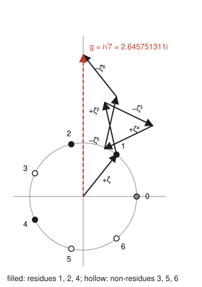

# Gauss sums: weighted sums over roots of unity, with a size you can pin down exactly

[Syllabus](../../../SYLLABUS.md) → [Algebraic and analytic number theory](../README.md) → [Characters and L-functions](../README.md#s03) → Gauss sums

---

## General Overview

Square the numbers 0 to 6 and keep the remainder after dividing by 7. Only 0, 1, 2 and 4 come out. So mod 7 the nonzero numbers split into two teams of three: the squares 1, 2, 4 and the non-squares 3, 5, 6.

Now put the seven 7th roots of unity round a circle. These are the seven complex numbers whose 7th power is 1: equal clock marks at distance 1 from the centre, numbered 0 to 6 anticlockwise from the point 1. Add the three marks numbered 1, 2 and 4, and subtract the three at 3, 5 and 6. Six arrows of length 1 could land anywhere within 6 of the start. They land at 2.645751311 straight up the imaginary axis. That number is the square root of 7, exactly.

That sum is the **quadratic Gauss sum** mod 7. The pattern "square or not" looks random. Six steps of length 1 in random directions end, on a typical run, about the square root of 6 from the start: 2.449489743. Here the size is not typical but exact: always the square root of the prime. Even the direction is fixed: straight up for 7, along the positive real axis for 5. Carl Friedrich Gauss knew the square of the sum by 1801. Fixing its direction took him until 1805.

**A Gauss sum weights the p-th roots of unity by the Legendre symbol (+1 on squares, −1 on non-squares); it is one output of a Fourier transform of that ±1 pattern, so Parseval's identity (a Fourier transform keeps total energy) forces its size to be exactly the square root of p, and a determinant fixes its direction: the square root of p when p leaves remainder 1 on division by 4, and i times the square root of p when it leaves 3.**

**What kind of fact this is:** a theorem, proved on this card in Why it works: the size, the square and the sign, for every odd prime. The code checks the sign for all 1,228 odd primes below 10,000; that agreement is a check on the proof, not a replacement for it. The size for a primitive character to a composite modulus is stated with a source.

### The picture: six steps that end at the square root of 7

<p align="center"></p>

Drawn to scale, 90 units per 1. Arrow a is the root $`\zeta^a`$, added if a is a square mod 7 and subtracted if not. The walk wanders right, doubles back, and ends exactly on the imaginary axis at height 2.645751311, the dashed arrow.

---

## The formula

Notation first, in words. The letter $`p`$ is always an odd prime; here $`p = 7`$. The **Legendre symbol** $`\left(\frac{a}{p}\right)`$ is +1 if $`a`$ is a nonzero square mod $`p`$, −1 if it is not a square, and 0 if $`p`$ divides $`a`$ ([Quadratic residues](02-quadratic-residues-and-the-legendre-symbol.md) builds it). It is the real character mod $`p`$ of [Dirichlet characters](01-dirichlet-characters.md). The symbol $`\zeta_n`$ (zeta, sub n) means the first $`n`$-th root of unity anticlockwise from 1:

```math
\zeta_n = e^{2\pi i/n} = \cos\frac{2\pi}{n} + i\sin\frac{2\pi}{n}
```

**Read it aloud:** zeta sub n is the point on the unit circle one n-th of a full turn anticlockwise from 1.

Write $`\zeta`$ for $`\zeta_p`$ when the prime is clear. The **quadratic Gauss sum** is

```math
g = \sum_{a=0}^{p-1} \left(\frac{a}{p}\right) \zeta_p^{\,a} = \sum_{x=0}^{p-1} \zeta_p^{\,x^2}
```

**Read it aloud:** weight each p-th root of unity by plus or minus one, by whether its exponent is a square, and add; or, the same thing, add the root at every square, counting repeats.

The three facts this card proves:

```math
\lvert g\rvert^2 = p, \qquad g^2 = \left(\frac{-1}{p}\right) p, \qquad g = \begin{cases} \sqrt{p} & p \equiv 1 \pmod 4 \\ i\sqrt{p} & p \equiv 3 \pmod 4 \end{cases}
```

**Read it aloud:** the sum has squared size p; its square is p or minus p; and of the two square roots, it is always the one on the positive real or positive imaginary axis.

For p = 7: $`7 \equiv 3 \pmod 4`$, so $`g = i\sqrt{7} = 2.645751311i`$ and $`g^2 = -7`$.

More generally, any Dirichlet character χ mod q has a Gauss sum $`g(\chi) = \sum_{a} \chi(a)\,\zeta_q^{\,a}`$, adding over a full period. A character is **primitive** if it does not come from a character of a smaller modulus that divides q. The smallest such modulus is the **conductor**. For a primitive χ, $`\lvert g(\chi)\rvert = \sqrt{q}`$. Every non-trivial character mod a prime is primitive, and this card proves the prime case for all of them.

| Symbol | Plain meaning | In our example | Push it up and the answer… |
| --- | --- | --- | --- |
| $`p`$ | an odd prime, the modulus | 7 | the size grows as the square root of p |
| $`a`$, $`x`$, $`j`$, $`k`$ | whole numbers mod p: a weight's place, a number squared, matrix places, a frequency | a = 1 to 6 | — |
| $`\left(\frac{a}{p}\right)`$ | the Legendre symbol: +1 square, −1 non-square, 0 at 0 | + + − + − − for a = 1 to 6 | — |
| $`\zeta_n`$, $`n`$, $`\zeta`$ | $`e^{2\pi i/n}`$ for a whole number $`n`$; $`\zeta = \zeta_p`$ | $`\zeta_7 = 0.623489802 + 0.781831482i`$ | — |
| $`i`$ | the square root of −1 | $`g = 2.645751311i`$ | — |
| $`g`$ | the quadratic Gauss sum | $`i\sqrt{7}`$ | — |
| $`\chi`$, $`\chi_j`$, $`q`$, $`g(\chi)`$ | a Dirichlet character; character number j, numbered by its values on the powers of 3 as on [Dirichlet characters](01-dirichlet-characters.md): $`\chi_j(3^k) = e^{2\pi i jk/6}`$ mod 7, $`i^{jk}`$ mod 10; a modulus; the character's Gauss sum | mod 7, $`\chi_0`$ to $`\chi_5`$, with $`\chi_3`$ the Legendre symbol; mod 10, $`\chi_2`$ is the real one | — |
| $`X_k`$ | output k of the transform of the Legendre list | $`X_k = \left(\frac{k}{7}\right) g`$ | — |
| $`F`$ | the p by p matrix with $`\zeta^{jk}`$ in row j, column k | 7 by 7 | — |
| $`R`$, $`I`$ | the matrix that sends place j to place −j; the identity matrix | R swaps 1 and 6, 2 and 5, 3 and 4 | — |
| $`\lambda`$; $`m_1, m_2, m_3, m_4`$ | an eigenvalue of F; how often F has eigenvalue $`\sqrt{p}`$, $`-\sqrt{p}`$, $`i\sqrt{p}`$, $`-i\sqrt{p}`$ | 2, 2, 2, 1 | — |

### When it holds

- **The modulus is prime.** For a composite n the sum of $`\zeta_n^{x^2}`$ can collapse: mod 6 it is exactly 0, not something of size 2.449489743.
- **The character is non-trivial.** Weight every root by +1 and the sum is −1, of size 1, since the roots add to zero and the root 1 is left out.
- **For a composite modulus, the character is primitive.** The real character $`\chi_2`$ mod 10 comes from the Legendre symbol mod 5, so its conductor is 5 and its Gauss sum is 2.236067977, the square root of 5, not of 10. The character mod 8 that comes from the one mod 4 gives 0.
- **The root is exactly $`\zeta_p = e^{2\pi i/p}`$.** Any other primitive p-th root of unity (one whose powers reach all p roots), $`\zeta^k`$, keeps the size but multiplies g by $`\left(\frac{k}{p}\right)`$. The clockwise root $`e^{-2\pi i/7}`$ gives −2.645751311i.
- **The square form adds over every x, 0 included.** Leave out x = 0 and the sum is $`-1 + 2.645751311i`$, of size 2.828427125.

---

## Why it works

### Step 0: the idea

The ±1 pattern of squares is, up to one factor, its own Fourier transform. That factor is g. A Fourier transform keeps total energy (Parseval), so the pattern's energy, p − 1, must equal the energy of $`g`$ times the pattern, divided by p. That forces $`\lvert g\rvert^2 = p`$.

The size and the square come from algebra. The sign cannot: algebra treats every primitive p-th root of unity alike, and swapping one for another can flip the sign. So the sign needs a fact about where $`e^{2\pi i/p}`$ actually sits. Schur's proof gets it from a product of sines that are all positive.

### Step 1: the two forms of g agree

Each nonzero square mod p is hit by exactly two values of x, namely x and −x. The value 0 is hit once. So

```math
\sum_{x} \zeta^{x^2} = 1 + 2\sum_{a \text{ square}} \zeta^a = \sum_{a \text{ square}} \zeta^a - \sum_{a \text{ non-square}} \zeta^a
```

**Read it aloud:** the root 1 plus twice the squares equals the squares minus the non-squares, because all p roots together add to zero.

For p = 7 the squares 1, 2, 4 add to $`-0.5 + 1.322875656i`$ and the non-squares 3, 5, 6 to its conjugate. The difference is $`2.645751311i`$.

### Step 2: the size, from Parseval

List the Legendre symbols $`\left(\frac{a}{p}\right)`$ for a = 0 to p − 1 and transform the list, turning anticlockwise:

```math
X_k = \sum_{a=0}^{p-1} \left(\frac{a}{p}\right) \zeta^{ka}
```

**Read it aloud:** output k weights the root at k times a by the symbol of a, and adds.

At k = 0 the symbols add to 0: three +1 and three −1. For k not 0, put b = ka. As a runs over all places mod p, so does b. The symbol is multiplicative, and $`\left(\frac{k}{p}\right)`$ is its own inverse, so $`\left(\frac{a}{p}\right) = \left(\frac{k}{p}\right)\left(\frac{b}{p}\right)`$. That pulls out of the sum:

```math
X_k = \left(\frac{k}{p}\right) \sum_{b} \left(\frac{b}{p}\right) \zeta^{b} = \left(\frac{k}{p}\right) g
```

**Read it aloud:** every output of the transform is the Gauss sum times the symbol of its frequency.

[The discrete Fourier transform](../../07-Complex%20analysis/08-Transforms%20in%20Outline/02-discrete-fourier-transform.md) proves Parseval's identity: the inputs' squared sizes add to the outputs' squared sizes divided by p. That card turns clockwise. Turning anticlockwise only relabels output k as output −k, so the sizes are unchanged. The inputs are p − 1 copies of ±1. The outputs are p − 1 copies of $`\pm g`$ and one 0. So

```math
p - 1 = \frac{1}{p}(p-1)\lvert g\rvert^2, \qquad \lvert g\rvert^2 = p
```

**Read it aloud:** six equals one seventh of six times the squared size of g, so the squared size is 7.

The same argument works for every non-trivial character mod p, with $`\overline{\chi}(k)`$ in place of the symbol. The code finds all six characters mod 7. The five non-trivial ones all have $`\lvert g(\chi)\rvert^2 = 7`$.

### Step 3: the square, from one conjugation

Conjugating a root of unity turns it back: $`\overline{\zeta^a} = \zeta^{-a}`$. So $`\overline{g}`$ is the transform at k = −1, which Step 2 gives as $`\left(\frac{-1}{p}\right) g`$. Multiply both sides by g and use $`g\overline{g} = \lvert g\rvert^2 = p`$:

```math
g^2 = \left(\frac{-1}{p}\right) p
```

**Read it aloud:** g squared is p, signed by whether −1 is a square mod p.

By Euler's criterion (a is a square mod p exactly when $`a^{(p-1)/2} \equiv 1`$), −1 is a square exactly when $`p \equiv 1 \pmod 4`$. Mod 7 it is not: −1 is 6, a non-square. So $`g^2 = -7`$ and g is $`i\sqrt{7}`$ or $`-i\sqrt{7}`$. The code also squares g exactly, with whole-number coefficients on the powers of ζ. It gets −7 for p = 7, and $`\left(\frac{-1}{p}\right) p`$ for all 45 odd primes below 200.

### Step 4: why the sign is the hard part

Replace ζ by another primitive p-th root of unity $`\zeta^k`$. By Step 2 the sum becomes $`X_k = \left(\frac{k}{p}\right) g`$. Mod 7, using $`\zeta^2`$ gives $`+2.645751311i`$, since 2 is a square. Using $`\zeta^3`$ gives $`-2.645751311i`$, since 3 is not.

Every algebraic fact about ζ, such as $`\zeta^7 = 1`$ and Steps 1 to 3, is equally true of $`\zeta^3`$. So no amount of algebra alone can decide the sign. The proof must use that ζ is exactly a seventh of a turn anticlockwise.

### Step 5: g is the trace of the Fourier matrix

Build F, the p by p matrix with $`\zeta^{jk}`$ in row j, column k. The **trace** of a matrix is the sum down its main diagonal. Here the diagonal holds $`\zeta^{k^2}`$, so the trace of F is $`\sum_k \zeta^{k^2} = g`$.

Now square F. Row j against column l adds $`\zeta^{(j+l)k}`$ over k, which is p when $`j + l \equiv 0`$ and 0 otherwise, by the cancellation of [Powers and roots](../../07-Complex%20analysis/01-Complex%20Numbers%20and%20the%20Plane/05-powers-roots-and-roots-of-unity.md). So $`F^2 = pR`$, where R sends place j to place −j. Then $`F^4 = p^2 R^2 = p^2 I`$.

An **eigenvalue** λ of F (lambda) is a number with $`Fv = \lambda v`$ for some nonzero vector v. From $`F^4 = p^2 I`$, every eigenvalue has $`\lambda^4 = p^2`$, so it is one of $`\sqrt{p}`$, $`-\sqrt{p}`$, $`i\sqrt{p}`$, $`-i\sqrt{p}`$. F has p eigenvalues, counted with repeats, and its trace is their sum. Call the counts $`m_1`$ to $`m_4`$. Three facts pin them down almost completely:

| Fact | Equation | For p = 7 |
| --- | --- | --- |
| p eigenvalues in all | $`m_1 + m_2 + m_3 + m_4 = p`$ | 7 |
| trace of $`F^2 = pR`$ is p, as R fixes only place 0 | $`(m_1 + m_2) - (m_3 + m_4) = 1`$ | $`m_1 + m_2 = 4`$, $`m_3 + m_4 = 3`$ |
| $`\lvert \text{trace } F\rvert^2 = \lvert g\rvert^2 = p`$ | $`(m_1 - m_2)^2 + (m_3 - m_4)^2 = 1`$ | one difference is ±1, the other 0 |

For p = 7, $`m_1 + m_2 = 4`$ is even, so $`m_1 - m_2`$ is even and must be 0. Then $`m_3 - m_4 = \pm 1`$: the counts are (2, 2, 2, 1) or (2, 2, 1, 2), and g is $`i\sqrt{7}`$ or $`-i\sqrt{7}`$. Still two choices. The determinant breaks the tie.

### Step 6: the determinant fixes the sign

The **determinant** of F is the product of its eigenvalues. F is also a Vandermonde matrix: row j holds the j-th powers of the list 1, ζ, ζ², and so on. Its determinant is the product of all differences of that list, over pairs j < k:

```math
\det F = \prod_{0 \le j < k \le p-1} \left(\zeta^k - \zeta^j\right), \qquad \zeta^k - \zeta^j = e^{\pi i (j+k)/p} \cdot 2i \sin\frac{\pi(k-j)}{p}
```

**Read it aloud:** the determinant multiplies the gaps between every pair of roots; each gap is a turn, times 2i, times a sine.

Here ζ being exactly $`e^{2\pi i/p}`$ is used. Since $`0 < k - j < p`$, every sine is positive. The turns multiply to 1, as the fold below shows. So the determinant points along $`i^{p(p-1)/2}`$, one factor of i for each of the $`p(p-1)/2`$ pairs. For p = 7 that is $`i^{21} = i`$.

The eigenvalue counts give the same determinant's direction another way. Each $`-\sqrt{p}`$ contributes −1, each $`i\sqrt{p}`$ contributes i, and each $`-i\sqrt{p}`$ contributes −i:

- counts (2, 2, 2, 1): $`(-1)^2 \cdot i^2 \cdot (-i)^1 = i`$. This matches.
- counts (2, 2, 1, 2): $`(-1)^2 \cdot i \cdot (-i)^2 = -i`$. This does not.

So the counts are (2, 2, 2, 1), and $`g = \sqrt{7}\big((m_1 - m_2) + i(m_3 - m_4)\big) = i\sqrt{7}`$. The code checks the direction of the Vandermonde product for all 14 odd primes below 50, and then compares Schur's deduced sign with the direct sum for all 1,228 odd primes below 10,000.

<details>
<summary>Detailed proof: Schur's argument for every odd prime</summary>

**The turns multiply to 1.** Each index from 0 to p − 1 appears in p − 1 pairs, so the exponents j + k add to $`(p-1) \cdot p(p-1)/2`$. The total turn is

$`\displaystyle \exp\Big(\frac{\pi i}{p} \cdot \frac{p(p-1)^2}{2}\Big) = \exp\Big(\pi i \cdot \frac{(p-1)^2}{2}\Big) = 1,`$

since p − 1 is even, so $`(p-1)^2`$ is a multiple of 4 and $`(p-1)^2/2`$ is even. Hence $`\det F = i^{p(p-1)/2} \times`$ a positive number.

**The eigenvalue side.** The product of the eigenvalues is $`p^{p/2}(-1)^{m_2 + m_4}\, i^{m_3 + m_4}`$.

**Case p = 4n + 1.** Then $`m_1 + m_2 = 2n + 1`$ is odd, so $`m_1 - m_2 = \pm 1`$ and $`m_3 = m_4 = n`$. The exponent $`p(p-1)/2 = (4n+1)\,2n`$ leaves 2n mod 4, so the determinant's direction is $`(-1)^n`$. The eigenvalue side gives $`(-1)^{m_2 + n}\, i^{2n} = (-1)^{m_2}`$. So $`m_2 \equiv n`$ mod 2. Of the two options, $`m_2 = n`$ (with $`m_1 = n + 1`$) or $`m_2 = n + 1`$, only the first has that parity. So $`m_1 - m_2 = 1`$ and $`g = \sqrt{p}`$.

**Case p = 4n + 3.** Then $`m_1 + m_2 = 2n + 2`$ is even, so $`m_1 = m_2 = n + 1`$ and $`m_3 - m_4 = \pm 1`$, with $`m_3 + m_4 = 2n + 1`$. The exponent $`(4n+3)(2n+1)`$ leaves 2n + 3 mod 4, so the direction is $`(-1)^{n+1} i`$. The eigenvalue side gives $`(-1)^{n + 1 + m_4}\, i^{2n+1} = (-1)^{m_4 + 1}\, i`$. So $`m_4 \equiv n`$ mod 2, which forces $`m_4 = n`$, $`m_3 = n + 1`$, and $`g = i\sqrt{p}`$.

</details>

---

## Worked numbers, by hand

The prime is 7, and $`\zeta = \zeta_7`$.

| Step | Arithmetic | Value |
| --- | --- | --- |
| squares mod 7 | $`x^2`$ for x = 0 to 6: 0, 1, 4, 2, 2, 4, 1 | squares 1, 2, 4 |
| real part, squares | 0.623489802 − 0.222520934 − 0.900968868 | −0.500000000 |
| imaginary part, squares | 0.781831482 + 0.974927912 − 0.433883739 | 1.322875656 |
| non-squares 3, 5, 6 | the conjugate, since 3, 5, 6 are 7 minus 4, 2, 1 | −0.500000000 − 1.322875656i |
| g | squares minus non-squares | 0.000000000 + 2.645751311i |
| size squared | $`2.645751311^2`$ | 7.000000000 |
| exact square | whole-number arithmetic on powers of ζ | −7 |
| sign | 7 leaves 3 on division by 4 | **g = i√7 = 2.645751311i** |

Six unit steps cancel down to exactly the square root of 7, pointing straight up. That is far below the 6 they could reach.

### What breaks if you drop a piece

| Mistake | Comes out at | What went wrong |
| --- | --- | --- |
| Clockwise root $`e^{-2\pi i/7}`$, the transform card's direction | −2.645751311i | The right size, the wrong sign: the sign belongs to $`e^{+2\pi i/p}`$ |
| Leave x = 0 out of the sum of $`\zeta^{x^2}`$ | −1 + 2.645751311i, size 2.828427125 | Step 1 needs the root 1 once |
| Trivial character, every weight +1 | −1, size 1 | Nothing cancels except all p roots together |
| Composite modulus 6 | 0, not size 2.449489743 | Parseval's step needs every nonzero k to be invertible mod n |
| $`\chi_2`$ mod 10, conductor 5 | 2.236067977, not 3.162277660 | The character only sees mod 5, so the size is the square root of 5 |
| Character mod 8 that comes from mod 4 | 0 | Not primitive: its two halves cancel exactly |

---

## Code, from first principles, and it actually runs

The code imports nothing; it writes its own cosine, sine and square root. It takes four roads to g. Road one adds the weighted roots directly and as the sum of $`\zeta^{x^2}`$. Road two squares g exactly, with whole-number coefficients on the powers of ζ, for every odd prime below 200. Road three transforms the Legendre list and checks Parseval. Road four uses only Schur's three equations and the determinant's direction to deduce the sign, then compares it with the direct sum for every odd prime below 10,000.

### Python

```python
# Gauss sums: the quadratic Gauss sum mod 7 has size root seven -- the check behind the card.
# Nothing is imported: cos and sin are written out, so no library holds the answer.
# Road 1 adds the weighted roots of unity directly, two ways.  Road 2 squares the sum
# exactly in Z[zeta_p], with integer lists.  Road 3 is Parseval on the Legendre list.
# Road 4 deduces the sign from eigenvalue counts and a determinant (Schur), then
# compares it with the direct sum for every odd prime below 10,000.
PI = 3.14159265358979323846

def cs(t):                                      # (cos t, sin t) by Taylor series after reduction
    t = t - 2 * PI * ((t / (2 * PI) + 0.5) // 1)
    c, s, term, k = 0.0, 0.0, 1.0, 0
    while abs(term) > 1e-18:
        if k % 4 == 0: c += term
        elif k % 4 == 1: s += term
        elif k % 4 == 2: c -= term
        else: s -= term
        k += 1
        term = term * t / k
    return c, s

def sqrt(x):                                    # square root by Newton's method
    r = x if x > 1 else 1.0
    for _ in range(60): r = 0.5 * (r + x / r)
    return r

def f(x): return f"{x + 0.0:.9f}" if abs(x) > 5e-10 else "0.000000000"
def cx(z): return f"{f(z[0])} {'+' if z[1] >= -5e-10 else '-'} {f(abs(z[1]))}i"
def isprime(n): return n > 1 and all(n % d for d in range(2, int(n ** 0.5) + 1))
def leg(a, p): r = pow(a, (p - 1) // 2, p); return 0 if r == 0 else (1 if r == 1 else -1)
ROOTS = {}
def zeta(k, n):                                 # zeta_n^k = e^(2 pi i k / n), from a table built by
    if n not in ROOTS:                          # turning one step at a time, re-aimed every 64 steps
        t, c1, s1 = [], *cs(2 * PI / n)
        for j in range(n):
            if j % 64 == 0: c, s = cs(2 * PI * j / n)
            else: c, s = c * c1 - s * s1, c * s1 + s * c1
            t.append((c, s))
        ROOTS[n] = t
    return ROOTS[n][k % n]
def wsum(w, n, turn=1):                         # sum of w[a] zeta_n^(turn a), a = 0..n-1
    re = im = 0.0
    for a in range(n):
        if w[a]: c, s = zeta(turn * a, n); re += w[a] * c; im += w[a] * s
    return (re, im)
def sq_sum(n, skip0=False):                     # sum of zeta_n^(x^2), x = 0..n-1
    w = [0] * n
    for x in range(1 if skip0 else 0, n): w[x * x % n] += 1
    return wsum(w, n)
def size(z): return sqrt(z[0] ** 2 + z[1] ** 2)

p = 7
L = [leg(a, p) for a in range(p)]
print("Legendre symbol mod 7 by Euler's criterion, a = 1..6: " + " ".join("+" if v > 0 else "-" for v in L[1:]))
print("x^2 mod 7 for x = 0..6: " + " ".join(str(x * x % p) for x in range(p)))
for a in range(1, p): print(f"  a = {a}  zeta_7^a = {cx(zeta(a, p))}  weight {'+' if L[a] > 0 else '-'}1")
R = wsum([1 if v > 0 else 0 for v in L], p); N = wsum([1 if v < 0 else 0 for v in L], p)
g = wsum(L, p); g2 = sq_sum(p); r7 = sqrt(7.0)
print(f"sum over residues 1, 2, 4: {cx(R)};  over non-residues 3, 5, 6: {cx(N)}")
print(f"g = residues - non-residues: {cx(g)};  as sum of zeta^(x^2): {cx(g2)}")
print(f"sqrt 7 = {f(r7)};  |g|^2 = {f(g[0] ** 2 + g[1] ** 2)}")
assert abs(g[0]) < 1e-12 and abs(g[1] - r7) < 1e-12 and abs(g2[1] - g[1]) < 1e-12

def zmul(u, v, n):                              # exact product in Z[zeta_n], as lists mod x^n - 1
    w = [0] * n
    for i in range(n):
        if u[i]:
            for j in range(n): w[(i + j) % n] += u[i] * v[j]
    return w
def as_int(w):                                  # an element is an integer iff coefficients 1..n-1 agree
    return w[0] - w[1] if len(set(w[1:])) == 1 else None
print(f"exact in Z[zeta_7]: g^2 = {as_int(zmul(L, L, p))};  g times conj g = {as_int(zmul(L, [L[-a % p] for a in range(p)], p))}")
ok, cnt = True, 0
for q in range(3, 200):
    if isprime(q):
        Lq = [leg(a, q) for a in range(q)]; cnt += 1
        ok = ok and as_int(zmul(Lq, Lq, q)) == leg(q - 1, q) * q
print(f"exact g^2 = (-1/p) p for all {cnt} odd primes below 200: {'yes' if ok else 'no'}")
assert ok and as_int(zmul(L, L, p)) == -7

X = [wsum(L, p, k) for k in range(p)]           # Parseval road: transform of the Legendre list
ratio = [round(x[1] / g[1]) for x in X]
print("transform X_k over g, k = 0..6: " + " ".join(str(v) for v in ratio) + ";  (k/7): " + " ".join(str(v) for v in L))
e_in, e_out = sum(v * v for v in L), sum(x[0] ** 2 + x[1] ** 2 for x in X) / p
print(f"Parseval: sum (a/7)^2 = {e_in};  (1/7) sum |X_k|^2 = {f(e_out)};  so |g|^2 = 7 x {e_in} / {e_in}")
assert ratio == L and all(abs(x[0]) < 1e-12 for x in X) and abs(e_out - 6) < 1e-9
ind = {pow(3, k, p): k for k in range(6)}       # all six characters mod 7, from the primitive root 3
for j in range(6):
    re = im = 0.0
    for a in range(1, p): c1, s1 = cs(2 * PI * j * ind[a] / 6); c2, s2 = zeta(a, p); re += c1 * c2 - s1 * s2; im += c1 * s2 + s1 * c2
    print(f"  chi_{j} mod 7: g = {cx((re, im))},  |g|^2 = {f(re * re + im * im)}")
    assert abs(re * re + im * im - (1 if j == 0 else 7)) < 1e-9

def schur(q):                                   # the one (a, b, c, d) allowed by trace, size and determinant
    ab, cd, ph, out = (q + 1) // 2, (q - 1) // 2, (q * (q - 1) // 2) % 4, []
    for s in (-1, 0, 1):
        for t in (-1, 0, 1):
            if s * s + t * t == 1 and (ab + s) % 2 == 0 and (cd + t) % 2 == 0:
                a, b, c, d = (ab + s) // 2, (ab - s) // 2, (cd + t) // 2, (cd - t) // 2
                if (2 * (b + d) + c + d) % 4 == ph: out.append((a, b, c, d))
    return out
F2 = all(abs(sum(complex(*zeta(j * k, p)) * complex(*zeta(k * l, p)) for k in range(p)) - (p if (j + l) % p == 0 else 0)) < 1e-9 for j in range(p) for l in range(p))
print(f"Schur, mod 7: F^2 = 7 x reversal: {'yes' if F2 else 'no'};  det phase i^21 = i;  (m1, m2, m3, m4) = {schur(7)[0]};  g = i sqrt 7")
vok, vn = True, 0
for q in range(3, 50):
    if isprime(q):
        z = complex(1, 0); vn += 1
        for j in range(q):
            for k in range(j + 1, q): d = complex(*zeta(k, q)) - complex(*zeta(j, q)); z *= d / abs(d)
        vok = vok and abs(z - [1, 1j, -1, -1j][(q * (q - 1) // 2) % 4]) < 1e-9
print(f"Vandermonde det of F has phase i^(p(p-1)/2) for all {vn} odd primes below 50: {'yes' if vok else 'no'}")
assert F2 and vok and len(schur(7)) == 1
n1 = n3 = 0; ok = True
for q in range(3, 10000):
    if isprime(q):
        a, b, c, d = schur(q)[0]; z = sq_sum(q); rq = sqrt(float(q))
        ok = ok and len(schur(q)) == 1 and abs(z[0] - (a - b) * rq) < 1e-9 and abs(z[1] - (c - d) * rq) < 1e-9
        if q % 4 == 1: n1 += 1
        else: n3 += 1
print(f"odd primes below 10,000: {n1 + n3}; p = 1 mod 4: {n1}, p = 3 mod 4: {n3}; direct sum = Schur's sign every time: {'yes' if ok else 'no'}")
print(f"mod 5: g = {cx(sq_sum(5))};  sqrt 5 = {f(sqrt(5.0))}")
assert ok and n1 + n3 == 1228

bad = [("clockwise root e^(-2 pi i/7)", wsum(L, p, -1)), ("root zeta_7^3, 3 a non-residue", wsum(L, p, 3)),
       ("root zeta_7^2, 2 a residue", wsum(L, p, 2)), ("drop x = 0 from sum of zeta^(x^2)", sq_sum(p, True)),
       ("trivial character mod 7", wsum([0] + [1] * 6, p)), ("sum of zeta_6^(x^2), modulus 6", sq_sum(6)),
       ("sum of zeta_4^(x^2), modulus 4", sq_sum(4)),
       ("chi_2 mod 10, conductor 5", wsum([0, 1, 0, -1, 0, 0, 0, -1, 0, 1], 10)),
       ("mod 8 lifted from mod 4", wsum([0, 1, 0, -1, 0, 1, 0, -1], 8)),
       ("primitive (2/n) mod 8", wsum([0, 1, 0, -1, 0, -1, 0, 1], 8))]
for name, z in bad: print(f"  {name:<36} {cx(z):>28}  size {f(size(z))}")
assert abs(bad[0][1][1] + r7) < 1e-12 and abs(size(bad[3][1]) - sqrt(8.0)) < 1e-12 and size(bad[5][1]) < 1e-9
assert abs(size(bad[7][1]) - sqrt(5.0)) < 1e-9 and size(bad[8][1]) < 1e-9 and abs(size(bad[9][1]) - sqrt(8.0)) < 1e-9
print(f"sqrt 6 = {f(sqrt(6.0))};  sqrt 8 = {f(sqrt(8.0))};  sqrt 10 = {f(sqrt(10.0))}")
for q in (11, 13, 101): print(f"try: mod {q}, g = {cx(sq_sum(q))},  sqrt {q} = {f(sqrt(float(q)))}")

pts, z = [(0.0, 0.0)], (0.0, 0.0)
for a in range(1, p): c, s = zeta(a, p); z = (z[0] + L[a] * c, z[1] + L[a] * s); pts.append(z)
print("figure, walk " + " ".join(f"({x + 0.0:.3f},{y + 0.0:.3f})" for x, y in pts))
print("ALL CHECKS PASS")
```

**Ran 2026-11-15 on macOS, Python 3.14.10, standard library only. All checks passed. Output, pasted from the run:**

```
Legendre symbol mod 7 by Euler's criterion, a = 1..6: + + - + - -
x^2 mod 7 for x = 0..6: 0 1 4 2 2 4 1
  a = 1  zeta_7^a = 0.623489802 + 0.781831482i  weight +1
  a = 2  zeta_7^a = -0.222520934 + 0.974927912i  weight +1
  a = 3  zeta_7^a = -0.900968868 + 0.433883739i  weight -1
  a = 4  zeta_7^a = -0.900968868 - 0.433883739i  weight +1
  a = 5  zeta_7^a = -0.222520934 - 0.974927912i  weight -1
  a = 6  zeta_7^a = 0.623489802 - 0.781831482i  weight -1
sum over residues 1, 2, 4: -0.500000000 + 1.322875656i;  over non-residues 3, 5, 6: -0.500000000 - 1.322875656i
g = residues - non-residues: 0.000000000 + 2.645751311i;  as sum of zeta^(x^2): 0.000000000 + 2.645751311i
sqrt 7 = 2.645751311;  |g|^2 = 7.000000000
exact in Z[zeta_7]: g^2 = -7;  g times conj g = 7
exact g^2 = (-1/p) p for all 45 odd primes below 200: yes
transform X_k over g, k = 0..6: 0 1 1 -1 1 -1 -1;  (k/7): 0 1 1 -1 1 -1 -1
Parseval: sum (a/7)^2 = 6;  (1/7) sum |X_k|^2 = 6.000000000;  so |g|^2 = 7 x 6 / 6
  chi_0 mod 7: g = -1.000000000 + 0.000000000i,  |g|^2 = 1.000000000
  chi_1 mod 7: g = -2.440133358 + 1.022618792i,  |g|^2 = 7.000000000
  chi_2 mod 7: g = 2.370469406 - 1.175106292i,  |g|^2 = 7.000000000
  chi_3 mod 7: g = 0.000000000 + 2.645751311i,  |g|^2 = 7.000000000
  chi_4 mod 7: g = 2.370469406 + 1.175106292i,  |g|^2 = 7.000000000
  chi_5 mod 7: g = 2.440133358 + 1.022618792i,  |g|^2 = 7.000000000
Schur, mod 7: F^2 = 7 x reversal: yes;  det phase i^21 = i;  (m1, m2, m3, m4) = (2, 2, 2, 1);  g = i sqrt 7
Vandermonde det of F has phase i^(p(p-1)/2) for all 14 odd primes below 50: yes
odd primes below 10,000: 1228; p = 1 mod 4: 609, p = 3 mod 4: 619; direct sum = Schur's sign every time: yes
mod 5: g = 2.236067977 + 0.000000000i;  sqrt 5 = 2.236067977
  clockwise root e^(-2 pi i/7)           0.000000000 - 2.645751311i  size 2.645751311
  root zeta_7^3, 3 a non-residue         0.000000000 - 2.645751311i  size 2.645751311
  root zeta_7^2, 2 a residue             0.000000000 + 2.645751311i  size 2.645751311
  drop x = 0 from sum of zeta^(x^2)     -1.000000000 + 2.645751311i  size 2.828427125
  trivial character mod 7               -1.000000000 + 0.000000000i  size 1.000000000
  sum of zeta_6^(x^2), modulus 6         0.000000000 + 0.000000000i  size 0.000000000
  sum of zeta_4^(x^2), modulus 4         2.000000000 + 2.000000000i  size 2.828427125
  chi_2 mod 10, conductor 5              2.236067977 + 0.000000000i  size 2.236067977
  mod 8 lifted from mod 4                0.000000000 + 0.000000000i  size 0.000000000
  primitive (2/n) mod 8                  2.828427125 + 0.000000000i  size 2.828427125
sqrt 6 = 2.449489743;  sqrt 8 = 2.828427125;  sqrt 10 = 3.162277660
try: mod 11, g = 0.000000000 + 3.316624790i,  sqrt 11 = 3.316624790
try: mod 13, g = 3.605551275 + 0.000000000i,  sqrt 13 = 3.605551275
try: mod 101, g = 10.049875621 + 0.000000000i,  sqrt 101 = 10.049875621
figure, walk (0.000,0.000) (0.623,0.782) (0.401,1.757) (1.302,1.323) (0.401,0.889) (0.623,1.864) (0.000,2.646)
ALL CHECKS PASS
```

### Rust

Same numbers, same labels, built with `rustc --edition 2021 -O`.

```rust
// Gauss sums: the quadratic Gauss sum mod 7 has size root seven -- the same check as the
// Python, in Rust.  No crates; cos and sin are written out, so no library holds the answer.
// Road 1 adds the weighted roots of unity directly, two ways.  Road 2 squares the sum
// exactly in Z[zeta_p], with integer lists.  Road 3 is Parseval on the Legendre list.
// Road 4 deduces the sign from eigenvalue counts and a determinant (Schur), then
// compares it with the direct sum for every odd prime below 10,000.
use std::collections::HashMap;
type C = (f64, f64);
const PI: f64 = 3.14159265358979323846;

fn cs(t: f64) -> C {                            // (cos t, sin t) by Taylor series after reduction
    let t = t - 2.0 * PI * (t / (2.0 * PI) + 0.5).floor();
    let (mut c, mut s, mut term, mut k) = (0.0, 0.0, 1.0f64, 0u32);
    while term.abs() > 1e-18 {
        match k % 4 { 0 => c += term, 1 => s += term, 2 => c -= term, _ => s -= term }
        k += 1;
        term = term * t / k as f64;
    }
    (c, s)
}
fn sqrt(x: f64) -> f64 {                        // square root by Newton's method
    let mut r = if x > 1.0 { x } else { 1.0 };
    for _ in 0..60 { r = 0.5 * (r + x / r); } r
}
fn f(x: f64) -> String { if x.abs() > 5e-10 { format!("{:.9}", x + 0.0) } else { "0.000000000".into() } }
fn cx(z: C) -> String { format!("{} {} {}i", f(z.0), if z.1 >= -5e-10 { '+' } else { '-' }, f(z.1.abs())) }
fn yn(b: bool) -> &'static str { if b { "yes" } else { "no" } }
fn isprime(n: i64) -> bool { n > 1 && (2..=((n as f64).sqrt() as i64)).all(|d| n % d != 0) }
fn modpow(mut b: i64, mut e: i64, m: i64) -> i64 {
    let mut r = 1 % m; b %= m;
    while e > 0 { if e & 1 == 1 { r = r * b % m; } b = b * b % m; e >>= 1; } r
}
fn leg(a: i64, p: i64) -> i64 { let r = modpow(a, (p - 1) / 2, p); if r == 0 { 0 } else if r == 1 { 1 } else { -1 } }
struct Z { roots: HashMap<i64, Vec<C>> }
impl Z {
    fn zeta(&mut self, k: i64, n: i64) -> C {   // zeta_n^k = e^(2 pi i k / n), from a table built by
        let t = self.roots.entry(n).or_insert_with(|| {   // turning one step, re-aimed every 64
            let (c1, s1) = cs(2.0 * PI / n as f64);
            let (mut c, mut s, mut v) = (0.0, 0.0, Vec::new());
            for j in 0..n {
                (c, s) = if j % 64 == 0 { cs(2.0 * PI * j as f64 / n as f64) } else { (c * c1 - s * s1, c * s1 + s * c1) };
                v.push((c, s));
            } v
        });
        t[k.rem_euclid(n) as usize]
    }
    fn wsum(&mut self, w: &[i64], n: i64, turn: i64) -> C {   // sum of w[a] zeta_n^(turn a)
        let (mut re, mut im) = (0.0, 0.0);
        for a in 0..n { if w[a as usize] != 0 {
            let (c, s) = self.zeta(turn * a, n); re += w[a as usize] as f64 * c; im += w[a as usize] as f64 * s; } }
        (re, im)
    }
    fn sq_sum(&mut self, n: i64, skip0: bool) -> C {   // sum of zeta_n^(x^2), x = 0..n-1
        let mut w = vec![0i64; n as usize];
        for x in (if skip0 { 1 } else { 0 })..n { w[(x * x % n) as usize] += 1; } self.wsum(&w, n, 1)
    }
}
fn size(z: C) -> f64 { sqrt(z.0 * z.0 + z.1 * z.1) }
fn cmul(a: C, b: C) -> C { (a.0 * b.0 - a.1 * b.1, a.0 * b.1 + a.1 * b.0) }
fn zmul(u: &[i64], v: &[i64], n: usize) -> Vec<i64> {   // exact product in Z[zeta_n], mod x^n - 1
    let mut w = vec![0i64; n];
    for i in 0..n { if u[i] != 0 { for j in 0..n { w[(i + j) % n] += u[i] * v[j]; } } } w
}
fn as_int(w: &[i64]) -> Option<i64> {           // an integer iff coefficients 1..n-1 agree
    if w[1..].iter().all(|&x| x == w[1]) { Some(w[0] - w[1]) } else { None }
}
fn schur(q: i64) -> Vec<(i64, i64, i64, i64)> { // the one (a, b, c, d) allowed by trace, size, determinant
    let (ab, cd, ph) = ((q + 1) / 2, (q - 1) / 2, (q * (q - 1) / 2) % 4);
    let mut out = Vec::new();
    for s in [-1i64, 0, 1] { for t in [-1i64, 0, 1] {
        if s * s + t * t == 1 && (ab + s) % 2 == 0 && (cd + t) % 2 == 0 {
            let (a, b, c, d) = ((ab + s) / 2, (ab - s) / 2, (cd + t) / 2, (cd - t) / 2);
            if (2 * (b + d) + c + d) % 4 == ph { out.push((a, b, c, d)); }
        }
    } }
    out
}
fn main() {
    let mut z = Z { roots: HashMap::new() };
    let p = 7i64;
    let l: Vec<i64> = (0..p).map(|a| leg(a, p)).collect();
    let sg = |v: i64| if v > 0 { "+" } else { "-" };
    println!("Legendre symbol mod 7 by Euler's criterion, a = 1..6: {}", l[1..].iter().map(|&v| sg(v)).collect::<Vec<_>>().join(" "));
    println!("x^2 mod 7 for x = 0..6: {}", (0..p).map(|x| (x * x % p).to_string()).collect::<Vec<_>>().join(" "));
    for a in 1..p { println!("  a = {}  zeta_7^a = {}  weight {}1", a, cx(z.zeta(a, p)), sg(l[a as usize])); }
    let rw: Vec<i64> = l.iter().map(|&v| (v > 0) as i64).collect();
    let nw: Vec<i64> = l.iter().map(|&v| (v < 0) as i64).collect();
    let (r, n) = (z.wsum(&rw, p, 1), z.wsum(&nw, p, 1));
    let (g, g2, r7) = (z.wsum(&l, p, 1), z.sq_sum(p, false), sqrt(7.0));
    println!("sum over residues 1, 2, 4: {};  over non-residues 3, 5, 6: {}", cx(r), cx(n));
    println!("g = residues - non-residues: {};  as sum of zeta^(x^2): {}", cx(g), cx(g2));
    println!("sqrt 7 = {};  |g|^2 = {}", f(r7), f(g.0 * g.0 + g.1 * g.1));
    assert!(g.0.abs() < 1e-12 && (g.1 - r7).abs() < 1e-12 && (g2.1 - g.1).abs() < 1e-12);
    let lc: Vec<i64> = (0..p).map(|a| l[((p - a) % p) as usize]).collect();
    let (gg, ggc) = (as_int(&zmul(&l, &l, 7)).unwrap(), as_int(&zmul(&l, &lc, 7)).unwrap());
    println!("exact in Z[zeta_7]: g^2 = {};  g times conj g = {}", gg, ggc);
    let (mut ok, mut cnt) = (true, 0);
    for q in 3..200 { if isprime(q) {
        let lq: Vec<i64> = (0..q).map(|a| leg(a, q)).collect(); cnt += 1;
        ok = ok && as_int(&zmul(&lq, &lq, q as usize)) == Some(leg(q - 1, q) * q);
    } }
    println!("exact g^2 = (-1/p) p for all {} odd primes below 200: {}", cnt, yn(ok));
    assert!(ok && gg == -7);
    let x: Vec<C> = (0..p).map(|k| z.wsum(&l, p, k)).collect();   // Parseval road
    let ratio: Vec<i64> = x.iter().map(|v| (v.1 / g.1).round() as i64).collect();
    let js = |v: &[i64]| v.iter().map(|t| t.to_string()).collect::<Vec<_>>().join(" ");
    println!("transform X_k over g, k = 0..6: {};  (k/7): {}", js(&ratio), js(&l));
    let e_in: i64 = l.iter().map(|v| v * v).sum();
    let e_out = x.iter().map(|v| v.0 * v.0 + v.1 * v.1).sum::<f64>() / p as f64;
    println!("Parseval: sum (a/7)^2 = {};  (1/7) sum |X_k|^2 = {};  so |g|^2 = 7 x {} / {}", e_in, f(e_out), e_in, e_in);
    assert!(ratio == l && x.iter().all(|v| v.0.abs() < 1e-12) && (e_out - 6.0).abs() < 1e-9);
    let mut ind = HashMap::new();                // all six characters mod 7, from the primitive root 3
    for k in 0..6 { ind.insert(modpow(3, k, p), k); }
    for j in 0..6i64 {
        let (mut re, mut im) = (0.0, 0.0);
        for a in 1..p {
            let (c1, s1) = cs(2.0 * PI * (j * ind[&a]) as f64 / 6.0); let (c2, s2) = z.zeta(a, p);
            re += c1 * c2 - s1 * s2; im += c1 * s2 + s1 * c2;
        }
        println!("  chi_{} mod 7: g = {},  |g|^2 = {}", j, cx((re, im)), f(re * re + im * im));
        assert!((re * re + im * im - if j == 0 { 1.0 } else { 7.0 }).abs() < 1e-9);
    }
    let mut f2 = true;
    for j in 0..p { for m in 0..p {
        let mut s = (0.0, 0.0);
        for k in 0..p { let t = cmul(z.zeta(j * k, p), z.zeta(k * m, p)); s = (s.0 + t.0, s.1 + t.1); }
        let want = if (j + m) % p == 0 { p as f64 } else { 0.0 };
        f2 = f2 && ((s.0 - want).powi(2) + s.1 * s.1).sqrt() < 1e-9;
    } }
    let s7 = schur(7)[0];
    println!("Schur, mod 7: F^2 = 7 x reversal: {};  det phase i^21 = i;  (m1, m2, m3, m4) = ({}, {}, {}, {});  g = i sqrt 7", yn(f2), s7.0, s7.1, s7.2, s7.3);
    let (mut vok, mut vn) = (true, 0);
    for q in 3..50 { if isprime(q) {
        let mut w = (1.0, 0.0); vn += 1;
        for j in 0..q { for k in (j + 1)..q {
            let (a, b) = (z.zeta(k, q), z.zeta(j, q)); let d = (a.0 - b.0, a.1 - b.1);
            let m = (d.0 * d.0 + d.1 * d.1).sqrt(); w = cmul(w, (d.0 / m, d.1 / m));
        } }
        let want = [(1.0, 0.0), (0.0, 1.0), (-1.0, 0.0), (0.0, -1.0)][((q * (q - 1) / 2) % 4) as usize];
        vok = vok && ((w.0 - want.0).powi(2) + (w.1 - want.1).powi(2)).sqrt() < 1e-9;
    } }
    println!("Vandermonde det of F has phase i^(p(p-1)/2) for all {} odd primes below 50: {}", vn, yn(vok));
    assert!(f2 && vok && schur(7).len() == 1);
    let (mut n1, mut n3, mut ok) = (0, 0, true);
    for q in 3..10000 { if isprime(q) {
        let (a, b, c, d) = schur(q)[0]; let w = z.sq_sum(q, false); let rq = sqrt(q as f64);
        ok = ok && schur(q).len() == 1 && (w.0 - (a - b) as f64 * rq).abs() < 1e-9 && (w.1 - (c - d) as f64 * rq).abs() < 1e-9;
        if q % 4 == 1 { n1 += 1; } else { n3 += 1; }
    } }
    println!("odd primes below 10,000: {}; p = 1 mod 4: {}, p = 3 mod 4: {}; direct sum = Schur's sign every time: {}", n1 + n3, n1, n3, yn(ok));
    println!("mod 5: g = {};  sqrt 5 = {}", cx(z.sq_sum(5, false)), f(sqrt(5.0)));
    assert!(ok && n1 + n3 == 1228);
    let bad: Vec<(&str, C)> = vec![
        ("clockwise root e^(-2 pi i/7)", z.wsum(&l, p, -1)), ("root zeta_7^3, 3 a non-residue", z.wsum(&l, p, 3)),
        ("root zeta_7^2, 2 a residue", z.wsum(&l, p, 2)), ("drop x = 0 from sum of zeta^(x^2)", z.sq_sum(p, true)),
        ("trivial character mod 7", z.wsum(&[0, 1, 1, 1, 1, 1, 1], p, 1)), ("sum of zeta_6^(x^2), modulus 6", z.sq_sum(6, false)),
        ("sum of zeta_4^(x^2), modulus 4", z.sq_sum(4, false)),
        ("chi_2 mod 10, conductor 5", z.wsum(&[0, 1, 0, -1, 0, 0, 0, -1, 0, 1], 10, 1)),
        ("mod 8 lifted from mod 4", z.wsum(&[0, 1, 0, -1, 0, 1, 0, -1], 8, 1)),
        ("primitive (2/n) mod 8", z.wsum(&[0, 1, 0, -1, 0, -1, 0, 1], 8, 1))];
    for (name, v) in &bad { println!("  {:<36} {:>28}  size {}", name, cx(*v), f(size(*v))); }
    assert!((bad[0].1 .1 + r7).abs() < 1e-12 && (size(bad[3].1) - sqrt(8.0)).abs() < 1e-12 && size(bad[5].1) < 1e-9);
    assert!((size(bad[7].1) - sqrt(5.0)).abs() < 1e-9 && size(bad[8].1) < 1e-9 && (size(bad[9].1) - sqrt(8.0)).abs() < 1e-9);
    println!("sqrt 6 = {};  sqrt 8 = {};  sqrt 10 = {}", f(sqrt(6.0)), f(sqrt(8.0)), f(sqrt(10.0)));
    for q in [11i64, 13, 101] { println!("try: mod {}, g = {},  sqrt {} = {}", q, cx(z.sq_sum(q, false)), q, f(sqrt(q as f64))); }
    let (mut pts, mut w) = (vec![(0.0f64, 0.0f64)], (0.0, 0.0));
    for a in 1..p { let (c, s) = z.zeta(a, p); w = (w.0 + l[a as usize] as f64 * c, w.1 + l[a as usize] as f64 * s); pts.push(w); }
    println!("figure, walk {}", pts.iter().map(|(x, y)| format!("({:.3},{:.3})", x + 0.0, y + 0.0)).collect::<Vec<_>>().join(" "));
    println!("ALL CHECKS PASS");
}
```

**Ran 2026-11-15 on macOS, rustc 1.98.1, no crates. All checks passed. Output, pasted from the run:**

```
Legendre symbol mod 7 by Euler's criterion, a = 1..6: + + - + - -
x^2 mod 7 for x = 0..6: 0 1 4 2 2 4 1
  a = 1  zeta_7^a = 0.623489802 + 0.781831482i  weight +1
  a = 2  zeta_7^a = -0.222520934 + 0.974927912i  weight +1
  a = 3  zeta_7^a = -0.900968868 + 0.433883739i  weight -1
  a = 4  zeta_7^a = -0.900968868 - 0.433883739i  weight +1
  a = 5  zeta_7^a = -0.222520934 - 0.974927912i  weight -1
  a = 6  zeta_7^a = 0.623489802 - 0.781831482i  weight -1
sum over residues 1, 2, 4: -0.500000000 + 1.322875656i;  over non-residues 3, 5, 6: -0.500000000 - 1.322875656i
g = residues - non-residues: 0.000000000 + 2.645751311i;  as sum of zeta^(x^2): 0.000000000 + 2.645751311i
sqrt 7 = 2.645751311;  |g|^2 = 7.000000000
exact in Z[zeta_7]: g^2 = -7;  g times conj g = 7
exact g^2 = (-1/p) p for all 45 odd primes below 200: yes
transform X_k over g, k = 0..6: 0 1 1 -1 1 -1 -1;  (k/7): 0 1 1 -1 1 -1 -1
Parseval: sum (a/7)^2 = 6;  (1/7) sum |X_k|^2 = 6.000000000;  so |g|^2 = 7 x 6 / 6
  chi_0 mod 7: g = -1.000000000 + 0.000000000i,  |g|^2 = 1.000000000
  chi_1 mod 7: g = -2.440133358 + 1.022618792i,  |g|^2 = 7.000000000
  chi_2 mod 7: g = 2.370469406 - 1.175106292i,  |g|^2 = 7.000000000
  chi_3 mod 7: g = 0.000000000 + 2.645751311i,  |g|^2 = 7.000000000
  chi_4 mod 7: g = 2.370469406 + 1.175106292i,  |g|^2 = 7.000000000
  chi_5 mod 7: g = 2.440133358 + 1.022618792i,  |g|^2 = 7.000000000
Schur, mod 7: F^2 = 7 x reversal: yes;  det phase i^21 = i;  (m1, m2, m3, m4) = (2, 2, 2, 1);  g = i sqrt 7
Vandermonde det of F has phase i^(p(p-1)/2) for all 14 odd primes below 50: yes
odd primes below 10,000: 1228; p = 1 mod 4: 609, p = 3 mod 4: 619; direct sum = Schur's sign every time: yes
mod 5: g = 2.236067977 + 0.000000000i;  sqrt 5 = 2.236067977
  clockwise root e^(-2 pi i/7)           0.000000000 - 2.645751311i  size 2.645751311
  root zeta_7^3, 3 a non-residue         0.000000000 - 2.645751311i  size 2.645751311
  root zeta_7^2, 2 a residue             0.000000000 + 2.645751311i  size 2.645751311
  drop x = 0 from sum of zeta^(x^2)     -1.000000000 + 2.645751311i  size 2.828427125
  trivial character mod 7               -1.000000000 + 0.000000000i  size 1.000000000
  sum of zeta_6^(x^2), modulus 6         0.000000000 + 0.000000000i  size 0.000000000
  sum of zeta_4^(x^2), modulus 4         2.000000000 + 2.000000000i  size 2.828427125
  chi_2 mod 10, conductor 5              2.236067977 + 0.000000000i  size 2.236067977
  mod 8 lifted from mod 4                0.000000000 + 0.000000000i  size 0.000000000
  primitive (2/n) mod 8                  2.828427125 + 0.000000000i  size 2.828427125
sqrt 6 = 2.449489743;  sqrt 8 = 2.828427125;  sqrt 10 = 3.162277660
try: mod 11, g = 0.000000000 + 3.316624790i,  sqrt 11 = 3.316624790
try: mod 13, g = 3.605551275 + 0.000000000i,  sqrt 13 = 3.605551275
try: mod 101, g = 10.049875621 + 0.000000000i,  sqrt 101 = 10.049875621
figure, walk (0.000,0.000) (0.623,0.782) (0.401,1.757) (1.302,1.323) (0.401,0.889) (0.623,1.864) (0.000,2.646)
ALL CHECKS PASS
```

The two outputs match line for line.

### Lean

Lean proves the value of g, its two forms and the size of $`g(\chi)`$ for every odd prime, and checks the worked numbers.

- Take an odd prime p. Then $`g = \sqrt{p}`$ when $`p \equiv 1 \pmod 4`$, and $`g = i\sqrt{p}`$ when $`p \equiv 3 \pmod 4`$.
- Take an odd prime p. Then the sum of $`\zeta_p^{\,x^2}`$ over x = 0 to p − 1 equals g, the sum weighted by the Legendre symbol.
- Take any prime p and a non-trivial Dirichlet character χ mod p. Then $`\lvert g(\chi)\rvert = \sqrt{p}`$.
- The squares mod 7 are 0, 1, 2 and 4. The Legendre symbols for a = 1 to 6 are + + − + − −.
- The symbol of −1 mod 7 is −1, and 7 leaves 3 on division by 4.
- For p = 7 there are 21 pairs j < k, and 21 leaves 1 on division by 4, so $`i^{21} = i`$.
- The counts (2, 2, 2, 1) satisfy Schur's three equations for p = 7.
- There are 14 odd primes below 50.

The decimals, the composite moduli and the 1,228 sign comparisons are left to the Python and Rust checks.

```lean
-- Gauss sums: for every odd prime p the quadratic Gauss sum is exactly √p when p ≡ 1 mod 4 and i√p when p ≡ 3 mod 4, it equals the sum of ζ_p^(x²), and every non-trivial character mod p has a Gauss sum of size √p.
import Mathlib.NumberTheory.LegendreSymbol.Basic
import Mathlib.NumberTheory.DirichletCharacter.Basic
import Mathlib.Analysis.SpecialFunctions.Trigonometric.Basic
import Mathlib.Analysis.SpecialFunctions.Sqrt
import Mathlib.Tactic.NormNum.LegendreSymbol
import Mathlib.Tactic.NormNum.Prime
import Mathlib.NumberTheory.GaussSum
import Mathlib.Analysis.SpecialFunctions.Complex.CircleAddChar
import Mathlib.Analysis.SpecialFunctions.Gaussian.PoissonSummation
import Mathlib.NumberTheory.ModularForms.JacobiTheta.TwoVariable
import Mathlib.Analysis.SpecialFunctions.Pow.Continuity

open Complex Finset

section GaussSumHelpers
open Real Filter Topology

lemma gs_tail_bound (s : ℝ) (hs : 0 < s) (g : ℤ → ℂ)
    (hg : ∀ k : ℤ, ‖g k‖ ≤ rexp (-π * s * (k : ℝ) ^ 2)) :
    ‖∑' k, g k - g 0‖ ≤ 2 * (rexp (-π * s) / (1 - rexp (-π * s))) := by
  set q := rexp (-π * s) with hqdef
  have hq0 : 0 ≤ q := (Real.exp_pos _).le
  have hq1 : q < 1 := by
    rw [hqdef, ← Real.exp_zero]
    exact Real.exp_lt_exp.mpr (by nlinarith [Real.pi_pos])
  have hb : ∀ n : ℕ, rexp (-π * s * ((n : ℝ) + 1) ^ 2) ≤ q ^ (n + 1) := by
    intro n
    rw [hqdef, ← Real.exp_nat_mul]
    apply Real.exp_le_exp.mpr
    push_cast
    have h1 : ((n : ℝ) + 1) ≤ ((n : ℝ) + 1) ^ 2 := by nlinarith
    have h2 : 0 < π * s := mul_pos Real.pi_pos hs
    nlinarith
  have hgeo : HasSum (fun n : ℕ => q ^ (n + 1)) (q / (1 - q)) := by
    have := (hasSum_geometric_of_lt_one hq0 hq1).mul_left q
    simpa [pow_succ', div_eq_mul_inv] using this
  have h1 : ∀ n : ℕ, ‖g ((n : ℤ) + 1)‖ ≤ q ^ (n + 1) := fun n => by
    have := hg ((n : ℤ) + 1); push_cast at this; exact this.trans (hb n)
  have h2 : ∀ n : ℕ, ‖g (-((n : ℤ) + 1))‖ ≤ q ^ (n + 1) := fun n => by
    have := hg (-((n : ℤ) + 1)); push_cast at this; rw [neg_sq] at this; exact this.trans (hb n)
  have s1 : Summable (fun n : ℕ => g ((n : ℤ) + 1)) := Summable.of_norm_bounded hgeo.summable h1
  have s2 : Summable (fun n : ℕ => g (-((n : ℤ) + 1))) := Summable.of_norm_bounded hgeo.summable h2
  have s0 : Summable (fun n : ℕ => g n) := (summable_nat_add_iff 1).mp (by simpa using s1)
  rw [tsum_of_nat_of_neg_add_one s0 s2, s0.tsum_eq_zero_add]
  have e1 : ∑' n : ℕ, g ((n + 1 : ℕ) : ℤ) = ∑' n : ℕ, g ((n : ℤ) + 1) := by
    congr 1
  rw [e1]
  have : g ((0 : ℕ) : ℤ) + ∑' n : ℕ, g ((n : ℤ) + 1) + ∑' n : ℕ, g (-((n : ℤ) + 1)) - g 0
      = ∑' n : ℕ, g ((n : ℤ) + 1) + ∑' n : ℕ, g (-((n : ℤ) + 1)) := by simp only [Nat.cast_zero]; ring
  rw [this]
  refine (norm_add_le _ _).trans ?_
  have := tsum_of_norm_bounded hgeo h1
  have := tsum_of_norm_bounded hgeo h2
  linarith

#print axioms gs_tail_bound

lemma gs_bound_tendsto (c : ℝ) (hc : 0 < c) :
    Tendsto (fun t : ℝ => 2 * (rexp (-π * (t⁻¹ * c)) / (1 - rexp (-π * (t⁻¹ * c)))))
      (𝓝[>] 0) (𝓝 0) := by
  have hs : Tendsto (fun t : ℝ => t⁻¹ * c) (𝓝[>] 0) atTop :=
    tendsto_inv_nhdsGT_zero.atTop_mul_const hc
  have hq : Tendsto (fun t : ℝ => rexp (-π * (t⁻¹ * c))) (𝓝[>] 0) (𝓝 0) :=
    Real.tendsto_exp_atBot.comp (hs.const_mul_atTop_of_neg (by linarith [Real.pi_pos]))
  have := ((hq.div (tendsto_const_nhds.sub hq) (by norm_num : (1:ℝ) - 0 ≠ 0)).const_mul 2)
  simpa using this

#print axioms gs_bound_tendsto

lemma gs_theta_tendsto (c : ℝ) (hc : 0 < c) (φ : ℝ → ℤ → ℝ) (hφ0 : ∀ t, φ t 0 = 0) :
    Tendsto (fun t : ℝ => ∑' k : ℤ, cexp (↑(-π * (t⁻¹ * c) * (k : ℝ) ^ 2) + ↑(φ t k) * I))
      (𝓝[>] 0) (𝓝 1) := by
  rw [tendsto_iff_norm_sub_tendsto_zero]
  refine squeeze_zero' (Eventually.of_forall fun t => norm_nonneg _) ?_ (gs_bound_tendsto c hc)
  filter_upwards [self_mem_nhdsWithin] with t ht
  have ht : 0 < t := ht
  have h := gs_tail_bound (t⁻¹ * c) (by positivity)
    (fun k : ℤ => cexp (↑(-π * (t⁻¹ * c) * (k : ℝ) ^ 2) + ↑(φ t k) * I)) (fun k => by
      rw [Complex.norm_exp]
      simp only [add_re, ofReal_re, mul_re, ofReal_im, I_re, I_im]
      apply le_of_eq; congr 1; ring)
  simpa [hφ0] using h

#print axioms gs_theta_tendsto

lemma gs_summable (a : ℂ) (ha : 0 < a.re) : Summable (fun n : ℤ => cexp (-π * a * n ^ 2)) := by
  have := (summable_jacobiTheta₂_term_iff 0 (I * a)).mpr (by simpa using ha)
  convert this using 2 with n
  simp only [jacobiTheta₂_term]
  congr 1
  ring_nf; rw [I_sq]; ring

#print axioms gs_summable

lemma gs_tsum_split (f : ℤ → ℂ) (hf : Summable f) (M : ℕ) [NeZero M] :
    ∑' n, f n = ∑ r ∈ range M, ∑' m : ℤ, f (m * M + r) := by
  let e : Fin M × ℤ ≃ ℤ := (Equiv.prodComm _ _).trans (Int.divModEquiv M).symm
  have hs : Summable (f ∘ e) := e.summable_iff.mpr hf
  rw [← e.tsum_eq]
  change ∑' c, (f ∘ e) c = _
  rw [Summable.tsum_prod' hs (fun r => hs.prod_factor r), tsum_fintype]
  rw [← Fin.sum_univ_eq_sum_range (fun r => ∑' m : ℤ, f (m * M + r))]
  rfl

#print axioms gs_tsum_split

lemma gs_cpow_half_ofReal_mul (t : ℝ) (ht : 0 < t) (w : ℂ) (hw : w ≠ 0) :
    ((t : ℂ) * w) ^ (1 / 2 : ℂ) = (Real.sqrt t : ℂ) * w ^ (1 / 2 : ℂ) := by
  have ht' : (t : ℂ) ≠ 0 := by exact_mod_cast ht.ne'
  rw [Complex.cpow_def_of_ne_zero (mul_ne_zero ht' hw), Complex.log_ofReal_mul ht hw,
    Complex.cpow_def_of_ne_zero hw, add_mul, Complex.exp_add, Real.sqrt_eq_rpow,
    Complex.ofReal_cpow ht.le, Complex.cpow_def_of_ne_zero ht', ← Complex.ofReal_log ht.le]
  push_cast
  ring_nf

#print axioms gs_cpow_half_ofReal_mul

lemma gs_sideA (N : ℕ) [NeZero N] (t : ℝ) (ht : 0 < t) :
    ((Real.sqrt t * N : ℝ) : ℂ) * ∑' n : ℤ, cexp (-π * ((t : ℂ) - 2 * I / N) * n ^ 2)
      = ∑ r ∈ range N, cexp (2 * π * I * ((r : ℂ) ^ 2) / N) *
        ∑' k : ℤ, cexp (↑(-π * (t⁻¹ * ((N : ℝ) ^ 2)⁻¹) * (k : ℝ) ^ 2) +
          ↑(2 * π * r * k / N) * I) := by
  have hN : (N : ℂ) ≠ 0 := Nat.cast_ne_zero.mpr (NeZero.ne N)
  have hNr : (N : ℝ) ≠ 0 := Nat.cast_ne_zero.mpr (NeZero.ne N)
  have ht' : (t : ℂ) ≠ 0 := by exact_mod_cast ht.ne'
  have hre : 0 < ((t : ℂ) - 2 * I / N).re := by
    have : ((t : ℂ) - 2 * I / N) = (t : ℂ) + ((-2 / (N : ℝ) : ℝ) : ℂ) * I := by
      push_cast; ring
    rw [this]; simpa using ht
  rw [gs_tsum_split _ (gs_summable _ hre) N, Finset.mul_sum]
  refine Finset.sum_congr rfl (fun r _ => ?_)
  have hterm : ∀ m : ℤ, cexp (-π * ((t : ℂ) - 2 * I / N) * (((m * N + r : ℤ)) : ℂ) ^ 2)
      = cexp (2 * π * I * ((r : ℂ) ^ 2) / N) * cexp (-π * t * r ^ 2) *
        cexp (-π * ((t : ℂ) * N ^ 2) * m ^ 2 + 2 * π * (-(t * N * r : ℂ)) * m) := by
    intro m
    rw [← Complex.exp_add, ← Complex.exp_add]
    have : -π * ((t : ℂ) - 2 * I / N) * (((m * N + r : ℤ)) : ℂ) ^ 2
        = (2 * π * I * ((r : ℂ) ^ 2) / N + -π * t * r ^ 2 +
          (-π * ((t : ℂ) * N ^ 2) * m ^ 2 + 2 * π * (-(t * N * r : ℂ)) * m)) +
          ((m ^ 2 * N + 2 * m * r : ℤ) : ℂ) * (2 * π * I) := by
      push_cast; field_simp; ring
    rw [this, Complex.exp_add, Complex.exp_int_mul_two_pi_mul_I, mul_one]
  simp_rw [hterm]
  have hre2 : 0 < ((t : ℂ) * N ^ 2).re := by
    have : ((t : ℂ) * N ^ 2) = ((t * N ^ 2 : ℝ) : ℂ) := by push_cast; ring
    rw [this, ofReal_re]; positivity
  rw [tsum_mul_left, Complex.tsum_exp_neg_quadratic hre2]
  have hsq : ((t : ℂ) * N ^ 2) ^ (1 / 2 : ℂ) = ((Real.sqrt t * N : ℝ) : ℂ) := by
    rw [gs_cpow_half_ofReal_mul t ht _ (pow_ne_zero 2 hN), one_div,
      Complex.sq_cpow_two_inv (by simp [Nat.pos_of_ne_zero (NeZero.ne N)])]
    push_cast; ring
  rw [hsq]
  have hsqne : ((Real.sqrt t * N : ℝ) : ℂ) ≠ 0 := by
    have : 0 < Real.sqrt t * N := mul_pos (Real.sqrt_pos.mpr ht)
      (Nat.cast_pos.mpr (Nat.pos_of_ne_zero (NeZero.ne N)))
    exact_mod_cast this.ne'
  have hS : cexp (-π * (t : ℂ) * (r : ℂ) ^ 2) *
      ∑' n : ℤ, cexp (-π / ((t : ℂ) * (N : ℂ) ^ 2) * ((n : ℂ) + I * -((t : ℂ) * N * r)) ^ 2)
      = ∑' k : ℤ, cexp (↑(-π * (t⁻¹ * ((N : ℝ) ^ 2)⁻¹) * (k : ℝ) ^ 2) +
          ↑(2 * π * r * k / N) * I) := by
    rw [← tsum_mul_left]
    congr 1; ext k
    rw [← Complex.exp_add]
    congr 1
    push_cast
    field_simp
    ring_nf
    rw [I_sq]
    ring
  rw [← hS]
  field_simp

#print axioms gs_sideA

lemma gs_I3 : I ^ 3 = -I := by rw [pow_succ, I_sq]; ring

#print axioms gs_I3

lemma gs_cpow_ne_zero (z s : ℂ) (hz : z ≠ 0) : z ^ s ≠ 0 := by
  rw [Complex.cpow_def_of_ne_zero hz]; exact Complex.exp_ne_zero _

#print axioms gs_cpow_ne_zero

lemma gs_sideB (N : ℕ) [NeZero N] (t : ℝ) (ht : 0 < t) :
    ((Real.sqrt t * N : ℝ) : ℂ) * ∑' n : ℤ, cexp (-π * ((t : ℂ) - 2 * I / N) * n ^ 2)
      = N / (((t : ℂ) - 2 * I / N) ^ (1 / 2 : ℂ) *
          (2 * (N : ℂ) ^ 2 / (2 + I * N * t)) ^ (1 / 2 : ℂ)) *
        ∑ e ∈ range 2, cexp (-π * I * N * (e : ℂ) ^ 2 / 2) *
          ∑' k : ℤ, cexp (↑(-π * (t⁻¹ * ((N : ℝ) ^ 2)⁻¹) * (k : ℝ) ^ 2) +
            ((-π * (k : ℝ) ^ 2 / (2 * N) + π * e * k : ℝ) : ℂ) * I) := by
  set a : ℂ := (t : ℂ) - 2 * I / N with ha_def
  set w : ℂ := 2 * (N : ℂ) ^ 2 / (2 + I * N * t) with hw_def
  set D : ℂ := (t : ℂ) * w with hD_def
  have hN : (N : ℂ) ≠ 0 := Nat.cast_ne_zero.mpr (NeZero.ne N)
  have hNr : (N : ℝ) ≠ 0 := Nat.cast_ne_zero.mpr (NeZero.ne N)
  have ht' : (t : ℂ) ≠ 0 := by exact_mod_cast ht.ne'
  have hden : (2 + I * N * t : ℂ) ≠ 0 := by
    intro h; have := congrArg Complex.re h; simp at this
  have hw0 : w ≠ 0 := div_ne_zero (mul_ne_zero two_ne_zero (pow_ne_zero 2 hN)) hden
  have hD0 : D ≠ 0 := mul_ne_zero ht' hw0
  have ha_eq : a = (t : ℂ) + ((-2 / (N : ℝ) : ℝ) : ℂ) * I := by
    rw [ha_def]; push_cast; ring
  have hre : 0 < a.re := by rw [ha_eq]; simpa using ht
  have ha0 : a ≠ 0 := by
    intro h; rw [h] at hre; simp at hre
  have hkey : 1 / a = I * N / 2 + D / 4 := by
    have e1 : a = ((t : ℂ) * N - 2 * I) / N := by rw [ha_def]; field_simp
    have h0 : (t : ℂ) * N - 2 * I ≠ 0 := by
      intro h; rw [h, zero_div] at e1; exact ha0 e1
    rw [e1, hD_def, hw_def]
    generalize hz : (2 + I * N * t : ℂ) = z at *
    field_simp
    rw [← hz]
    ring_nf
    simp only [I_sq, gs_I3]
    ring
  have hDinv : 1 / D = ((t⁻¹ * ((N : ℝ) ^ 2)⁻¹ : ℝ) : ℂ) + I / (2 * N) := by
    rw [hD_def, hw_def]; push_cast; field_simp
  have hDre : 0 < D.re := by
    have h1 : 0 < (1 / D).re := by
      rw [hDinv]; simp only [add_re, ofReal_re, div_re, I_re, I_im]; simp; positivity
    have : D = (1 / D)⁻¹ := by field_simp
    rw [this, inv_re]; exact div_pos h1 (normSq_pos.mpr (by simpa using hD0))
  rw [Complex.tsum_exp_neg_mul_int_sq hre]
  have hsum : Summable (fun n : ℤ => cexp (-π / a * (n : ℂ) ^ 2)) := by
    have hre' : 0 < (a⁻¹).re := by rw [inv_re]; exact div_pos hre (normSq_pos.mpr ha0)
    exact (gs_summable a⁻¹ hre').congr (fun n => by rw [div_eq_mul_inv])
  rw [gs_tsum_split _ hsum 2]
  have hterm : ∀ e ∈ range 2, ∑' m : ℤ, cexp (-π / a * (((m * (2 : ℕ) + e : ℤ)) : ℂ) ^ 2)
      = cexp (-π * I * N * (e : ℂ) ^ 2 / 2) * (1 / D ^ (1 / 2 : ℂ) *
        ∑' k : ℤ, cexp (↑(-π * (t⁻¹ * ((N : ℝ) ^ 2)⁻¹) * (k : ℝ) ^ 2) +
            ((-π * (k : ℝ) ^ 2 / (2 * N) + π * e * k : ℝ) : ℂ) * I)) := by
    intro e _
    have h1 : ∀ m : ℤ, cexp (-π / a * (((m * (2 : ℕ) + e : ℤ)) : ℂ) ^ 2)
        = cexp (-π * I * N * (e : ℂ) ^ 2 / 2) * cexp (-π * D * (e : ℂ) ^ 2 / 4) *
          cexp (-π * D * m ^ 2 + 2 * π * (-(D * e / 2)) * m) := by
      intro m
      rw [← Complex.exp_add, ← Complex.exp_add]
      have : -π / a * (((m * (2 : ℕ) + e : ℤ)) : ℂ) ^ 2
          = (-π * I * N * (e : ℂ) ^ 2 / 2 + -π * D * (e : ℂ) ^ 2 / 4 +
            (-π * D * m ^ 2 + 2 * π * (-(D * e / 2)) * m)) +
            ((-((N : ℤ) * m ^ 2 + N * m * e)) : ℤ) * (2 * π * I) := by
        rw [div_eq_mul_one_div (-π : ℂ) a, hkey]; push_cast; ring
      rw [this, Complex.exp_add, Complex.exp_int_mul_two_pi_mul_I, mul_one]
    simp_rw [h1]
    rw [tsum_mul_left, Complex.tsum_exp_neg_quadratic hDre, mul_assoc]
    congr 1
    rw [mul_left_comm]
    congr 1
    rw [← tsum_mul_left]
    congr 1; ext k
    rw [← Complex.exp_add]
    congr 1
    have h2 : -π * D * (e : ℂ) ^ 2 / 4 + -π / D * ((k : ℂ) + I * -(D * e / 2)) ^ 2
        = -π * (1 / D) * (k : ℂ) ^ 2 + π * I * e * k := by
      field_simp
      ring_nf
      rw [I_sq]
      ring
    rw [h2, hDinv]
    push_cast
    ring
  rw [Finset.sum_congr rfl hterm]
  simp_rw [mul_left_comm (cexp _) (1 / D ^ (1 / 2 : ℂ))]
  rw [← Finset.mul_sum, hD_def, gs_cpow_half_ofReal_mul t ht w hw0]
  have h3 : ((Real.sqrt t : ℝ) : ℂ) ≠ 0 := by
    exact_mod_cast (Real.sqrt_pos.mpr ht).ne'
  have h4 := gs_cpow_ne_zero a (1 / 2) ha0
  have h5 := gs_cpow_ne_zero w (1 / 2) hw0
  push_cast
  field_simp

#print axioms gs_sideB

lemma gs_eval (N : ℕ) [NeZero N] :
    ∑ r ∈ range N, cexp (2 * π * I * ((r : ℂ) ^ 2) / N)
      = N / ((-2 * I / N) ^ (1 / 2 : ℂ) * ((N : ℂ) ^ 2) ^ (1 / 2 : ℂ)) *
        ∑ e ∈ range 2, cexp (-π * I * N * (e : ℂ) ^ 2 / 2) := by
  have hN : (N : ℂ) ≠ 0 := Nat.cast_ne_zero.mpr (NeZero.ne N)
  have hNr : (0 : ℝ) < N := Nat.cast_pos.mpr (Nat.pos_of_ne_zero (NeZero.ne N))
  have hc : (0 : ℝ) < ((N : ℝ) ^ 2)⁻¹ := by positivity
  have hA : Tendsto (fun t : ℝ => ∑ r ∈ range N, cexp (2 * π * I * ((r : ℂ) ^ 2) / N) *
        ∑' k : ℤ, cexp (((-π * (t⁻¹ * ((N : ℝ) ^ 2)⁻¹) * (k : ℝ) ^ 2 : ℝ) : ℂ) +
          ((2 * π * r * k / N : ℝ) : ℂ) * I)) (𝓝[>] 0)
        (𝓝 (∑ r ∈ range N, cexp (2 * π * I * ((r : ℂ) ^ 2) / N) * 1)) := by
    apply tendsto_finsetSum
    intro r _
    exact tendsto_const_nhds.mul
      (gs_theta_tendsto _ hc (fun t k => 2 * π * r * k / N) (by intro t; simp))
  have h0 : Tendsto (fun t : ℝ => (t : ℂ)) (𝓝[>] 0) (𝓝 0) := by
    have := (continuous_ofReal.tendsto (0 : ℝ)).mono_left (nhdsWithin_le_nhds (s := Set.Ioi 0))
    simpa using this
  have ha : Tendsto (fun t : ℝ => ((t : ℂ) - 2 * I / N) ^ (1 / 2 : ℂ)) (𝓝[>] 0)
      (𝓝 ((-2 * I / N) ^ (1 / 2 : ℂ))) := by
    have h1 : Tendsto (fun t : ℝ => ((t : ℂ) - 2 * I / N)) (𝓝[>] 0) (𝓝 (-2 * I / N)) := by
      have := h0.sub (tendsto_const_nhds (x := 2 * I / N))
      convert this using 2; ring
    refine ((continuousAt_cpow_const ?_).tendsto).comp h1
    rw [mem_slitPlane_iff]; right
    have : (-2 * I / N : ℂ) = ((-2 / (N : ℝ) : ℝ) : ℂ) * I := by push_cast; ring
    rw [this]; simp [hNr.ne']
  have hw : Tendsto (fun t : ℝ => (2 * (N : ℂ) ^ 2 / (2 + I * N * t)) ^ (1 / 2 : ℂ)) (𝓝[>] 0)
      (𝓝 (((N : ℂ) ^ 2) ^ (1 / 2 : ℂ))) := by
    have h1 : Tendsto (fun t : ℝ => (2 * (N : ℂ) ^ 2 / (2 + I * N * t))) (𝓝[>] 0)
        (𝓝 ((N : ℂ) ^ 2)) := by
      have := (tendsto_const_nhds (x := 2 * (N : ℂ) ^ 2)).div
        (tendsto_const_nhds.add (tendsto_const_nhds.mul h0)) (by simp : (2 : ℂ) + I * N * 0 ≠ 0)
      convert this using 2; simp
    refine ((continuousAt_cpow_const ?_).tendsto).comp h1
    rw [mem_slitPlane_iff]; left
    have : ((N : ℂ) ^ 2) = (((N : ℝ) ^ 2 : ℝ) : ℂ) := by push_cast; ring
    rw [this, ofReal_re]; positivity
  have hB : Tendsto (fun t : ℝ => N / (((t : ℂ) - 2 * I / N) ^ (1 / 2 : ℂ) *
          (2 * (N : ℂ) ^ 2 / (2 + I * N * t)) ^ (1 / 2 : ℂ)) *
        ∑ e ∈ range 2, cexp (-π * I * N * (e : ℂ) ^ 2 / 2) *
          ∑' k : ℤ, cexp (((-π * (t⁻¹ * ((N : ℝ) ^ 2)⁻¹) * (k : ℝ) ^ 2 : ℝ) : ℂ) +
            ((-π * (k : ℝ) ^ 2 / (2 * N) + π * e * k : ℝ) : ℂ) * I)) (𝓝[>] 0)
        (𝓝 (N / ((-2 * I / N) ^ (1 / 2 : ℂ) * ((N : ℂ) ^ 2) ^ (1 / 2 : ℂ)) *
          ∑ e ∈ range 2, cexp (-π * I * N * (e : ℂ) ^ 2 / 2) * 1)) := by
    have hne : (-2 * I / N) ^ (1 / 2 : ℂ) * ((N : ℂ) ^ 2) ^ (1 / 2 : ℂ) ≠ 0 :=
      mul_ne_zero (gs_cpow_ne_zero _ _ (by simp [hN])) (gs_cpow_ne_zero _ _ (pow_ne_zero 2 hN))
    refine (tendsto_const_nhds.div (ha.mul hw) hne).mul (tendsto_finsetSum _ fun e _ => ?_)
    exact tendsto_const_nhds.mul
      (gs_theta_tendsto _ hc (fun t k => -π * (k : ℝ) ^ 2 / (2 * N) + π * e * k)
        (by intro t; simp))
  have hEq2 : ∀ᶠ t in 𝓝[>] (0 : ℝ), (∑ r ∈ range N, cexp (2 * π * I * ((r : ℂ) ^ 2) / N) *
        ∑' k : ℤ, cexp (((-π * (t⁻¹ * ((N : ℝ) ^ 2)⁻¹) * (k : ℝ) ^ 2 : ℝ) : ℂ) +
          ((2 * π * r * k / N : ℝ) : ℂ) * I)) = N / (((t : ℂ) - 2 * I / N) ^ (1 / 2 : ℂ) *
          (2 * (N : ℂ) ^ 2 / (2 + I * N * t)) ^ (1 / 2 : ℂ)) *
        ∑ e ∈ range 2, cexp (-π * I * N * (e : ℂ) ^ 2 / 2) *
          ∑' k : ℤ, cexp (((-π * (t⁻¹ * ((N : ℝ) ^ 2)⁻¹) * (k : ℝ) ^ 2 : ℝ) : ℂ) +
            ((-π * (k : ℝ) ^ 2 / (2 * N) + π * e * k : ℝ) : ℂ) * I) := by
    filter_upwards [self_mem_nhdsWithin] with t ht
    rw [← gs_sideA N t ht, ← gs_sideB N t ht]
  have := tendsto_nhds_unique (hA.congr' hEq2) hB
  simpa using this

#print axioms gs_eval

lemma gs_eval_odd (N : ℕ) (hN : N % 2 = 1) :
    ∑ r ∈ range N, cexp (2 * π * I * ((r : ℂ) ^ 2) / N)
      = if N % 4 = 1 then (Real.sqrt N : ℂ) else I * Real.sqrt N := by
  have hpos : 0 < N := by omega
  have : NeZero N := ⟨by omega⟩
  have hNr : (0 : ℝ) < N := Nat.cast_pos.mpr hpos
  have hN : (N : ℂ) ≠ 0 := Nat.cast_ne_zero.mpr (by omega)
  have hs : (0 : ℝ) < Real.sqrt N := Real.sqrt_pos.mpr hNr
  have hs' : ((Real.sqrt N : ℝ) : ℂ) ≠ 0 := by exact_mod_cast hs.ne'
  have hss : ((Real.sqrt N : ℝ) : ℂ) ^ 2 = N := by
    rw [← ofReal_pow, Real.sq_sqrt hNr.le]; push_cast; rfl
  have h1 : (-2 * I / N) ^ (1 / 2 : ℂ) = (1 - I) / (Real.sqrt N : ℂ) := by
    have hx : 0 < ((1 - I) / (Real.sqrt N : ℂ)).re := by
      have : (1 - I) / (Real.sqrt N : ℂ) = (((Real.sqrt N)⁻¹ : ℝ) : ℂ) + ((-(Real.sqrt N)⁻¹ : ℝ) : ℂ) * I := by
        push_cast; field_simp; ring
      rw [this]; simp; positivity
    have : (-2 * I / N : ℂ) = ((1 - I) / (Real.sqrt N : ℂ)) ^ 2 := by
      rw [div_pow, hss]; ring_nf; rw [I_sq]; ring
    rw [this, one_div, Complex.sq_cpow_two_inv hx]
  have h2 : ((N : ℂ) ^ 2) ^ (1 / 2 : ℂ) = N := by
    rw [one_div, Complex.sq_cpow_two_inv (by simp [hpos])]
  rw [gs_eval N, h1, h2, Finset.sum_range_succ, Finset.sum_range_one]
  set m := N / 4 with hm
  have h1I : (1 : ℂ) - I ≠ 0 := by
    intro h; have := congrArg Complex.re h; simp at this
  have hfac : (N : ℂ) / ((1 - I) / (Real.sqrt N : ℂ) * N) = (Real.sqrt N : ℂ) / (1 - I) := by
    field_simp
  rw [hfac]
  simp only [Nat.cast_zero, ne_eq, OfNat.ofNat_ne_zero, not_false_eq_true, zero_pow, mul_zero,
    zero_div, Complex.exp_zero]
  have h4 : N % 4 = 1 ∨ N % 4 = 3 := by omega
  rcases h4 with h | h
  · simp only [h, ↓reduceIte]
    have he : cexp (-π * I * N * ((1 : ℕ) : ℂ) ^ 2 / 2) = -I := by
      have hN' : (N : ℂ) = 4 * (m : ℂ) + 1 := by
        have : N = 4 * m + 1 := by omega
        exact_mod_cast this
      have : -π * I * N * ((1 : ℕ) : ℂ) ^ 2 / 2 = -π / 2 * I + ((-(m : ℤ) : ℤ) : ℂ) * (2 * π * I) := by
        rw [hN']; push_cast; ring
      rw [this, Complex.exp_add, Complex.exp_int_mul_two_pi_mul_I, mul_one, exp_neg_pi_div_two_mul_I]
    rw [he]
    field_simp
    ring
  · have hn : ¬ N % 4 = 1 := by omega
    simp only [hn, ↓reduceIte]
    have he : cexp (-π * I * N * ((1 : ℕ) : ℂ) ^ 2 / 2) = I := by
      have hN' : (N : ℂ) = 4 * (m : ℂ) + 3 := by
        have : N = 4 * m + 3 := by omega
        exact_mod_cast this
      have : -π * I * N * ((1 : ℕ) : ℂ) ^ 2 / 2 = π / 2 * I + ((-(m : ℤ) - 1 : ℤ) : ℂ) * (2 * π * I) := by
        rw [hN']; push_cast; ring
      rw [this, Complex.exp_add, Complex.exp_int_mul_two_pi_mul_I, mul_one, exp_pi_div_two_mul_I]
    rw [he]
    field_simp
    ring_nf
    simp only [I_sq]
    ring

#print axioms gs_eval_odd

end GaussSumHelpers

lemma gs_sum_range_eq_sum_zmod (p : ℕ) [NeZero p] {M : Type*} [AddCommMonoid M]
    (f : ZMod p → M) : ∑ a ∈ range p, f (a : ZMod p) = ∑ a : ZMod p, f a := by
  refine Finset.sum_bij' (fun a _ => (a : ZMod p)) (fun b _ => b.val) (by simp)
    (fun b _ => by simpa using ZMod.val_lt b) (fun a ha => ?_) (fun b _ => by simp) (fun _ _ => rfl)
  simpa using ZMod.val_cast_of_lt (Finset.mem_range.mp ha)

#print axioms gs_sum_range_eq_sum_zmod

lemma gs_exp_eq_stdAddChar (p : ℕ) [NeZero p] (a : ℕ) :
    exp (2 * Real.pi * I * a / p) = ZMod.stdAddChar (a : ZMod p) := by
  have := ZMod.stdAddChar_coe (N := p) (a : ℤ)
  simpa using this.symm

#print axioms gs_exp_eq_stdAddChar

/-- The quadratic Gauss sum mod `p`: the `p`-th roots of unity `ζ_p ^ a = e^(2πia/p)`,
`a = 0, …, p - 1`, each weighted by the Legendre symbol `(a/p)`, and added. -/
noncomputable def quadGaussSum (p : ℕ) [Fact p.Prime] : ℂ :=
  ∑ a ∈ range p, (legendreSym p a : ℂ) * exp (2 * Real.pi * I * a / p)

lemma gs_sum_exp_sq_eq (p : ℕ) [Fact p.Prime] (hp : p ≠ 2) :
    ∑ x ∈ range p, exp (2 * Real.pi * I * ((x : ℂ) ^ 2) / p) = quadGaussSum p := by
  set ψ : AddChar (ZMod p) ℂ := ZMod.stdAddChar
  have hL : ∑ x ∈ range p, exp (2 * Real.pi * I * ((x : ℂ) ^ 2) / p)
      = ∑ y : ZMod p, ψ (y ^ 2) := by
    rw [← gs_sum_range_eq_sum_zmod p (fun y => ψ (y ^ 2))]
    refine Finset.sum_congr rfl (fun x _ => ?_)
    have := gs_exp_eq_stdAddChar p (x ^ 2)
    push_cast at this
    exact this
  have hR : quadGaussSum p = ∑ y : ZMod p, quadraticChar (ZMod p) y * ψ y := by
    unfold quadGaussSum
    rw [← gs_sum_range_eq_sum_zmod p (fun y => (quadraticChar (ZMod p) y : ℂ) * ψ y)]
    refine Finset.sum_congr rfl (fun x _ => ?_)
    rw [gs_exp_eq_stdAddChar p x, legendreSym, Int.cast_natCast]
  rw [hL, hR]
  classical
  have hfib : ∑ y : ZMod p, ψ (y ^ 2)
      = ∑ b : ZMod p, ∑ y ∈ univ.filter (fun y : ZMod p => y ^ 2 = b), ψ (y ^ 2) :=
    (Finset.sum_fiberwise univ (fun y : ZMod p => y ^ 2) _).symm
  rw [hfib]
  have hcard : ∀ b : ZMod p, ∑ y ∈ univ.filter (fun y : ZMod p => y ^ 2 = b), ψ (y ^ 2)
      = (quadraticChar (ZMod p) b + 1 : ℤ) * ψ b := by
    intro b
    rw [Finset.sum_congr rfl (fun y hy => by rw [(Finset.mem_filter.mp hy).2]), Finset.sum_const,
      nsmul_eq_mul]
    congr 1
    have h := quadraticChar_card_sqrts ((ZMod.ringChar_zmod_n p).substr hp) b
    rw [Set.toFinset_ofPred] at h
    exact_mod_cast h
  simp_rw [hcard]
  push_cast
  simp_rw [add_mul, one_mul, Finset.sum_add_distrib]
  have hne : ψ ≠ 1 := by
    have := ZMod.isPrimitive_stdAddChar p (a := 1) one_ne_zero
    rwa [AddChar.mulShift_one] at this
  rw [AddChar.sum_eq_zero_of_ne_one hne, add_zero]

#print axioms gs_sum_exp_sq_eq

/-- The card's main claim: for an odd prime `p`, the quadratic Gauss sum is exactly `√p`
when `p` leaves remainder 1 on division by 4, and `i√p` when it leaves remainder 3. -/
theorem quadGaussSum_eq_sqrt_or_I_sqrt (p : ℕ) [Fact p.Prime] (hp : p ≠ 2) :
    quadGaussSum p = if p % 4 = 1 then (Real.sqrt p : ℂ) else I * Real.sqrt p := by
  have hodd : p % 2 = 1 := Nat.odd_iff.mp ((Fact.out : p.Prime).odd_of_ne_two hp)
  rw [← gs_sum_exp_sq_eq p hp]
  exact gs_eval_odd p hodd

/-- The two forms of `g` agree: for an odd prime `p`, adding `ζ_p ^ (x²)` over every
`x = 0, …, p - 1`, `x = 0` included, gives the Legendre-weighted sum. -/
theorem sum_exp_sq_eq_quadGaussSum (p : ℕ) [Fact p.Prime] (hp : p ≠ 2) :
    ∑ x ∈ range p, exp (2 * Real.pi * I * ((x : ℂ) ^ 2) / p) = quadGaussSum p := by
  exact gs_sum_exp_sq_eq p hp

/-- For a prime `p`, every non-trivial Dirichlet character `χ` mod `p` has a Gauss sum
`g(χ) = Σ χ(a) ζ_p ^ a` of size exactly `√p`. -/
theorem norm_gaussSum_of_ne_one (p : ℕ) [Fact p.Prime] (χ : DirichletCharacter ℂ p)
    (hχ : χ ≠ 1) :
    ‖∑ a ∈ range p, χ (a : ZMod p) * exp (2 * Real.pi * I * a / p)‖ = Real.sqrt p := by
  have hg : ∑ a ∈ range p, χ (a : ZMod p) * exp (2 * Real.pi * I * a / p)
      = gaussSum χ ZMod.stdAddChar := by
    rw [gaussSum, ← gs_sum_range_eq_sum_zmod p (fun a => χ a * ZMod.stdAddChar a)]
    refine Finset.sum_congr rfl (fun x _ => ?_)
    rw [gs_exp_eq_stdAddChar p x]
  rw [hg]
  have h1 := gaussSum_mul_gaussSum_eq_card hχ (ZMod.isPrimitive_stdAddChar p)
  rw [← star_gaussSum_eq, ZMod.card] at h1
  have h2 : ‖gaussSum χ ZMod.stdAddChar‖ ^ 2 = p := by
    have := Complex.mul_conj (gaussSum χ ZMod.stdAddChar)
    rw [← starRingEnd_apply] at h1
    rw [h1, Complex.normSq_eq_norm_sq] at this
    exact_mod_cast this.symm
  rw [← h2, Real.sqrt_sq (norm_nonneg _)]

-- The squares mod 7: x² mod 7 for x = 0, …, 6 is 0, 1, 4, 2, 2, 4, 1, so the squares are 0, 1, 2, 4.
example : (List.range 7).map (fun x => x ^ 2 % 7) = [0, 1, 4, 2, 2, 4, 1] := by decide
example : (range 7).image (fun x => x ^ 2 % 7) = {0, 1, 2, 4} := by decide

-- Euler's criterion mod 7, a = 1, …, 6: a³ mod 7 is 1, 1, 6, 1, 6, 6, so the symbols are + + - + - -.
example : (List.range' 1 6).map (fun a => a ^ 3 % 7) = [1, 1, 6, 1, 6, 6] := by decide

section seven
local instance : Fact (Nat.Prime 7) := ⟨by norm_num⟩

-- The Legendre symbols mod 7 for a = 1, …, 6, and (-1/7) = -1, so g² = -7.
example : legendreSym 7 1 = 1 ∧ legendreSym 7 2 = 1 ∧ legendreSym 7 3 = -1 ∧
    legendreSym 7 4 = 1 ∧ legendreSym 7 5 = -1 ∧ legendreSym 7 6 = -1 := by
  refine ⟨?_, ?_, ?_, ?_, ?_, ?_⟩ <;> norm_num
example : legendreSym 7 (-1) * 7 = -7 := by norm_num

end seven

-- 7 leaves 3 on division by 4, so g = i√7; and the determinant's direction is i^21 = i.
example : 7 % 4 = 3 := by norm_num
example : 7 * (7 - 1) / 2 = 21 ∧ 21 % 4 = 1 := by norm_num

-- Schur's eigenvalue counts for p = 7, (m₁, m₂, m₃, m₄) = (2, 2, 2, 1): they total 7,
-- (m₁ + m₂) - (m₃ + m₄) = 1, and (m₁ - m₂)² + (m₃ - m₄)² = 1.
example : (2 + 2 + 2 + 1 : ℤ) = 7 ∧ ((2 + 2) - (2 + 1) : ℤ) = 1 ∧
    ((2 - 2) ^ 2 + (2 - 1) ^ 2 : ℤ) = 1 := by norm_num

-- 14 odd primes below 50.
example : ((range 50).filter (fun n => n.Prime ∧ n ≠ 2)).card = 14 := by decide

#print axioms quadGaussSum_eq_sqrt_or_I_sqrt
#print axioms sum_exp_sq_eq_quadGaussSum
#print axioms norm_gaussSum_of_ne_one
```

**Checked 2026-11-15 on macOS, Lean 4.36.0-rc2, Mathlib v4.36.0-rc2. Every proof is complete and uses only Lean's standard axioms. Output, pasted from the run:**

```
'gs_tail_bound' depends on axioms: [propext, Classical.choice, Quot.sound]
'gs_bound_tendsto' depends on axioms: [propext, Classical.choice, Quot.sound]
'gs_theta_tendsto' depends on axioms: [propext, Classical.choice, Quot.sound]
'gs_summable' depends on axioms: [propext, Classical.choice, Quot.sound]
'gs_tsum_split' depends on axioms: [propext, Classical.choice, Quot.sound]
'gs_cpow_half_ofReal_mul' depends on axioms: [propext, Classical.choice, Quot.sound]
'gs_sideA' depends on axioms: [propext, Classical.choice, Quot.sound]
'gs_I3' depends on axioms: [propext, Classical.choice, Quot.sound]
'gs_cpow_ne_zero' depends on axioms: [propext, Classical.choice, Quot.sound]
'gs_sideB' depends on axioms: [propext, Classical.choice, Quot.sound]
'gs_eval' depends on axioms: [propext, Classical.choice, Quot.sound]
'gs_eval_odd' depends on axioms: [propext, Classical.choice, Quot.sound]
'gs_sum_range_eq_sum_zmod' depends on axioms: [propext, Classical.choice, Quot.sound]
'gs_exp_eq_stdAddChar' depends on axioms: [propext, Classical.choice, Quot.sound]
'gs_sum_exp_sq_eq' depends on axioms: [propext, Classical.choice, Quot.sound]
'quadGaussSum_eq_sqrt_or_I_sqrt' depends on axioms: [propext, Classical.choice, Quot.sound]
'sum_exp_sq_eq_quadGaussSum' depends on axioms: [propext, Classical.choice, Quot.sound]
'norm_gaussSum_of_ne_one' depends on axioms: [propext, Classical.choice, Quot.sound]
```

> [!TIP]
> **Try changing**
> Guess first, then run it.
> - **Another prime.** Change `p = 7` to `p = 11`. Guess the sign first: 11 leaves 3 on division by 4. Answer: g = 3.316624790i, straight up, with $`\lvert g\rvert^2`$ = 11; then the first assert stops the run, because it pins the square root of 7.
> - **A bigger prime.** 101 leaves 1 on division by 4. Guess the direction of g. Answer: 10.049875621, real and positive, the square root of 101.
> - **Another root.** Change `wsum(L, p, 2)` to `wsum(L, p, 6)`. Guess: 6 is −1, a non-square mod 7, so the sign flips to −2.645751311i, the same as the clockwise root.
> - **A wider count.** Change `range(3, 10000)` to `range(3, 20000)`. Guess: Schur's sign still matches every prime, but the run stops at the assert that pins the count at 1,228.

---

## The usual mistake

> [!warning]
> **Taking ζ to be the clockwise root.** The transform card uses $`e^{-2\pi i/N}`$. With that root the sum mod 7 is −2.645751311i: the right size, the wrong sign. Gauss's sign rule is a statement about $`\zeta_p = e^{2\pi i/p}`$ alone. Any other primitive p-th root of unity $`\zeta^k`$ multiplies g by $`\left(\frac{k}{p}\right)`$.
>
> - **Assuming g is real.** It is a sum of real symbols times roots, but mod 7 it is 2.645751311i. Its square is −7, not 7.
> - **Leaving out x = 0.** The sum of $`\zeta^{x^2}`$ over x = 1 to 6 is $`-1 + 2.645751311i`$, of size 2.828427125, the square root of 8.
> - **Expecting size $`\sqrt{q}`$ for any character mod q.** Only primitive characters reach it. $`\chi_2`$ mod 10 gives 2.236067977, and a character mod 8 that comes from mod 4 gives 0.
> - **Using a composite modulus.** The sum of $`\zeta_6^{x^2}`$ is 0, and the sum of $`\zeta_4^{x^2}`$ is $`2 + 2i`$, of size 2.828427125, not 2.

---

## Where you meet it in real life

- **Quadratic reciprocity.** Computing $`g^q`$ mod a second prime q in two ways links "is q a square mod p" to "is p a square mod q". [Quadratic reciprocity](07-quadratic-reciprocity-via-gauss-sums.md) does it with this card's $`g^2 = \left(\frac{-1}{p}\right) p`$.
- **Square roots built from roots of unity.** Step 1 writes $`i\sqrt{7}`$ as a signed sum of 7th roots of unity, and $`\sqrt{5} = \zeta_5 - \zeta_5^2 - \zeta_5^3 + \zeta_5^4 = 2.236067977`$. So the square root of every odd prime, up to a factor i, lies in the field of its own roots of unity.
- **L-functions.** The functional equation of a Dirichlet L-function ([The functional equation of L(s, chi)](09-dirichlet-l-functions-functional-equation.md)) links the series at each point to the series of the conjugate character at the mirror point. It carries the factor $`g(\chi)/\sqrt{q}`$, divided by i when $`\chi(-1) = -1`$. For the Legendre symbol mod p, Gauss's sign makes that factor exactly 1. The same holds for every real primitive character, by the composite-modulus version in the Sources. [Dirichlet L-functions](03-dirichlet-l-functions.md) introduces the series.
- **Mobile phone signals.** Chu's sequences, the basis of the Zadoff–Chu sequences in 4G and 5G networks, are points on the unit circle whose angle grows with the square of the position: a "chirp". Every frequency of such a sequence has the same size, the square root of its length, by a Gauss sum. Phones use them to announce themselves to a base station.
- **Concert-hall acoustics.** A quadratic-residue diffuser is a wall of wells whose depths follow the squares mod a prime. Its reflections spread sound evenly over angle, because the sum of $`\zeta^{x^2 + kx}`$ has the same size for every k.

> **Say it back**
> The quadratic Gauss sum adds the p-th roots of unity, plus for squares and minus for non-squares. The ±1 pattern of squares is its own Fourier transform times g, so Parseval gives $`\lvert g\rvert^2 = p`$. Conjugating gives $`g^2 = \left(\frac{-1}{p}\right) p`$, which leaves only the sign open. Schur settles it: g is the trace of the Fourier matrix, whose eigenvalue counts are pinned by three equations and a determinant made of positive sines. Mod 7, six unit steps end exactly at $`i\sqrt{7} = 2.645751311i`$.

---

## What this builds on

- [Dirichlet characters](01-dirichlet-characters.md): characters, their values on the unit circle, and the real character that is the Legendre symbol.
- [Powers and roots](../../07-Complex%20analysis/01-Complex%20Numbers%20and%20the%20Plane/05-powers-roots-and-roots-of-unity.md): the p-th roots of unity and the fact that they add to zero, used in Steps 1 and 5.
- [The discrete Fourier transform](../../07-Complex%20analysis/08-Transforms%20in%20Outline/02-discrete-fourier-transform.md): the matrix of roots, unitary after scaling, and Parseval's identity, which gives the size in Step 2.

## Where this goes next

- [Quadratic reciprocity](07-quadratic-reciprocity-via-gauss-sums.md): gives the number $`\left(\frac{-1}{p}\right) p`$, here −7, its own name, and turns $`g^2 = \left(\frac{-1}{p}\right) p`$ into the reciprocity law.
- [The functional equation of L(s, chi)](09-dirichlet-l-functions-functional-equation.md): a twisted theta function, with the Gauss sum as the sign.
- [Polya-Vinogradov](10-polya-vinogradov-inequality.md): a character sum over any stretch of numbers is at most about root q times log q.
- [Kloosterman sums](11-kloosterman-sums.md): roots of unity at x and at 1/x, and why the total stays below 2 root p.
- [Cubic reciprocity](../06-Algebraic%20Numbers/12-cubic-reciprocity-and-jacobi-sums.md): Jacobi sums, primes in the Eisenstein integers, and when 2 is a cube.
- [Weyl differencing](../08-Additive%20Combinatorics%20and%20Probabilistic%20Number%20Theory/08-weyl-differencing-and-van-der-corput.md): squaring an exponential sum to lower its degree, and van der Corput's bounds.
- [The circle method](../08-Additive%20Combinatorics%20and%20Probabilistic%20Number%20Theory/09-hardy-littlewood-circle-method.md): count solutions as an integral round the circle, split into major and minor arcs.
- [Kronecker-Weber](../09-Local%20Fields%20and%20Class%20Field%20Theory/04-kronecker-weber-theorem.md): every abelian extension of Q sits inside a cyclotomic field.

On this shelf, [Quadratic residues](02-quadratic-residues-and-the-legendre-symbol.md) builds the Legendre symbol used here, and [The Jacobi symbol](08-jacobi-symbol-and-computing-without-factoring.md) extends it to odd composite moduli.

For the quadratic character the direction of g is always along the real or the imaginary axis. The four complex characters mod 7 point in scattered directions, such as $`-2.440133358 + 1.022618792i`$. Is there any rule for those directions?

---

## Sources

Verified 2026-11-15: every link below resolves to the publisher's page.

- Ireland, Kenneth, and Michael Rosen. *A Classical Introduction to Modern Number Theory*, 2nd ed. Springer, 1990. [DOI 10.1007/978-1-4757-2103-4](https://doi.org/10.1007/978-1-4757-2103-4). Chapter 6, "Quadratic Gauss Sums": the square of g and the determination of its sign.
- Davenport, Harold. *Multiplicative Number Theory*, 2nd ed. Springer, 1980. [DOI 10.1007/978-1-4757-5927-3](https://doi.org/10.1007/978-1-4757-5927-3). Chapter 2, "Gauss' Sum": the evaluation with its sign, and the sums of general characters.
- Montgomery, Hugh L., and Robert C. Vaughan. *Multiplicative Number Theory I: Classical Theory*. Cambridge University Press, 2006. [DOI 10.1017/CBO9780511618314](https://doi.org/10.1017/CBO9780511618314). Chapter 9, "Primitive characters and Gauss sums": conductors, and the size $`\sqrt{q}`$ for a primitive character.
- Berndt, Bruce C., and Ronald J. Evans. "The determination of Gauss sums." *Bulletin of the American Mathematical Society* 5 (1981), 107–129. [DOI 10.1090/S0273-0979-1981-14930-2](https://doi.org/10.1090/S0273-0979-1981-14930-2). The history of the sign problem, from Gauss's years of effort to later proofs, Schur's among them.
- Chu, D. "Polyphase codes with good periodic correlation properties." *IEEE Transactions on Information Theory* 18 (1972), 531–532. [DOI 10.1109/TIT.1972.1054840](https://doi.org/10.1109/TIT.1972.1054840). The chirp sequences whose flat spectrum is a Gauss sum.
