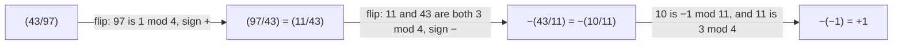

# Quadratic reciprocity: swapping the two primes, proved with a Gauss sum

[Syllabus](../../../SYLLABUS.md) → [Algebraic and analytic number theory](../README.md) → [Characters and L-functions](../README.md#s03) → Quadratic reciprocity

---

## General Overview

Is 43 a perfect square on a clock with 97 hours? Put another way: is there a whole number whose square leaves remainder 43 when divided by 97? There is. 25 × 25 = 625 = 6 × 97 + 43. But finding 25 meant trying numbers until one worked, and for a prime with 300 digits that search would never end.

Quadratic reciprocity answers the question without searching. It says that "is 43 a square mod 97?" and the swapped question "is 97 a square mod 43?" have the same answer, up to a sign that depends only on the two primes' remainders mod 4. The swapped question is smaller, because 97 shrinks to its remainder 11 mod 43. Swap again, shrink again, and after three short moves the answer is yes.

So deciding whether a number is a square mod a prime takes a handful of swaps and divisions, much like Euclid's algorithm, once each number met along the way is split into primes; the Jacobi symbol removes even that step. The proof uses one object, a Gauss sum, computed two ways.

**For two different odd primes p and q, "is q a square mod p?" and "is p a square mod q?" have the same answer unless both primes leave remainder 3 when divided by 4, in which case the answers are opposite; a Gauss sum proves it by computing its own q-th power in two ways.**

**What kind of fact this is:** a theorem, proved in full on this card in Why it works. The checks over 990 pairs of primes and over the primes below a million are exact counts that agree with it; they are evidence, and the proof is what covers every pair.

### The picture: settling (43/97) in three moves



Each arrow either swaps the two numbers or replaces the top number by its remainder. The answer +1 means 43 is a square mod 97, and 25 is a square root.

---

## The formula

Notation first. A **quadratic residue** mod an odd prime p is a number that is a perfect square on the p-hour clock and is not a multiple of p. The **Legendre symbol** $`(a/p)`$ records the answer as a sign ([Quadratic residues](02-quadratic-residues-and-the-legendre-symbol.md)):

```math
(a/p) = \begin{cases} +1 & a \text{ is a nonzero square mod } p \\ -1 & a \text{ is not a square mod } p \\ 0 & p \text{ divides } a \end{cases}
```

The symbol is written like a fraction but is not one. On this shelf q usually names a modulus; on this card q is a second odd prime. The law:

```math
(p/q)\,(q/p) = (-1)^{\frac{p-1}{2}\cdot\frac{q-1}{2}}
```

**Read it aloud:** the two answers, multiplied, give +1 unless both $`\frac{p-1}{2}`$ and $`\frac{q-1}{2}`$ are odd, which happens exactly when both primes are 3 more than a multiple of 4.

The proof reaches it in an equivalent form. Write $`p^* = (-1)^{(p-1)/2}\, p`$: p itself if p is 1 mod 4, and −p if p is 3 mod 4. Then

```math
(q/p) = (p^*/q)
```

**Read it aloud:** q is a square mod p exactly when the signed prime $`p^*`$ is a square mod q.

The two companion rules, called the **supplements**, handle −1 and 2:

```math
(-1/p) = (-1)^{(p-1)/2}, \qquad (2/p) = +1 \iff p \equiv 1 \text{ or } 7 \pmod 8
```

The first is Euler's criterion at a = −1. The second is stated here and proved in Ireland and Rosen, chapter 5 (Sources); the code tests it, with the flip rule, against Euler's criterion for 4,180 cases.

| Symbol | Plain meaning | In our example | Push it up and the answer… |
| --- | --- | --- | --- |
| $`p`$, $`q`$ | two different odd primes | 97 and 43 | — |
| $`a`$ | the number being tested as a square | 43 | only its remainder mod p matters |
| $`(a/p)`$ | the Legendre symbol: +1 square, −1 not, 0 if p divides a | $`(43/97) = +1`$ | — |
| $`p^*`$ | p with a sign: p if p is 1 mod 4, −p if 3 mod 4 | $`97^* = 97`$, $`43^* = -43`$ | — |
| $`\zeta`$ | a stand-in for a p-th root of unity: $`\zeta^p = 1`$ and $`1 + \zeta + \dots + \zeta^{p-1} = 0`$ | written x in the code | — |
| $`g`$ | the Gauss sum $`\sum_{a=1}^{p-1} (a/p)\,\zeta^a`$ | for p = 3: $`\zeta - \zeta^2`$ | — |
| $`b`$, $`q^{-1}`$ | a renamed exponent, $`b = aq`$ mod p; the inverse of q mod p | — | — |
| $`c`$, $`k`$ | a whole number and a counter inside one proof step | — | — |
| $`\chi_2`$ | the real character mod 10 from [Dirichlet characters](01-dirichlet-characters.md): +1 on endings 1 and 9, −1 on 3 and 7 | equals (5/p) | — |
| $`u`$, $`v`$ | any two elements in arithmetic mod q | — | — |

### When it holds

- **Both primes must be odd.** For 2 the exponent $`\frac{q-1}{2}`$ is not a whole number, and every number is 0 or 1 mod 2, so "square mod 2" says nothing. The rule for 2 replaces the law there.
- **The primes must differ.** With q = p, the step that cancels g fails: in arithmetic mod 97, $`g^{97} = 0`$, and 0 cannot be divided out. The code finds all 97 coefficients of $`g^{97}`$ equal to 0.
- **Both must be prime.** The rules applied to the composite 15 say yes when the answer is no: $`(2/3)(2/5) = (-1)(-1) = +1`$, yet the squares mod 15 are 0, 1, 4, 6, 9 and 10. [The Jacobi symbol](08-jacobi-symbol-and-computing-without-factoring.md) lets the top number be composite, but not the bottom: it too gives (2/15) = +1, and a +1 over a composite proves nothing.

---

## Why it works

### Step 0: one number, raised to the q-th power two ways

The Gauss sum g is a weighted total of roots of unity, the weights being the signs $`(a/p)`$. Do arithmetic with remainders mod q and raise g to the q-th power.

- **Way one.** Mod q, a q-th power passes through sums term by term. Each $`\zeta^a`$ becomes $`\zeta^{aq}`$, which only reshuffles the terms. The reshuffle multiplies g by $`(q/p)`$.
- **Way two.** $`g^2 = p^*`$, so $`g^q = g \cdot (p^*)^{(q-1)/2}`$. Euler's criterion reads that power as $`(p^*/q)`$.

Two answers for one number: $`(q/p)\, g = (p^*/q)\, g`$. Cancel g and the law appears. The steps below make each move exact.

### Step 1: where ζ lives

The complex root $`e^{2\pi i/p}`$ used on [Gauss sums](06-gauss-sums.md) cannot be reduced mod q. So build a stand-in. Take polynomials in a letter ζ with coefficients mod q, and wrap them by two rules: $`\zeta^p = 1`$ and $`1 + \zeta + \zeta^2 + \dots + \zeta^{p-1} = 0`$.

This is the construction of [Finite fields](../../03-Algebra/09-Rings%20and%20Fields/05-finite-fields.md): polynomials, wrapped by a fixed polynomial. Here the wrapping polynomial may factor mod q, so the result can be a ring rather than a field. The proof never divides by g; the only division is by the number $`p^*`$, which has an inverse mod q, so a ring is enough. The arithmetic has **characteristic q**: adding 1 to itself q times gives 0.

The code uses only the first rule, $`\zeta^p = 1`$, and writes x for ζ. There $`g^2`$ is $`p^*`$ plus a multiple of $`1 + x + \dots + x^{p-1}`$ (see the fold in Step 2). That extra piece becomes 0 when multiplied by g, so $`g^q = \pm g`$ still holds exactly.

### Step 2: the square of the Gauss sum is p*

```math
g^2 = p^*
```

**Read it aloud:** the Gauss sum, squared, is the prime with a plus sign if it is 1 mod 4 and a minus sign if it is 3 mod 4.

Smallest case, p = 3. The squares mod 3 are just 1, so $`(1/3) = +1`$, $`(2/3) = -1`$ and $`g = \zeta - \zeta^2`$. Then $`g^2 = \zeta^2 - 2\zeta^3 + \zeta^4 = \zeta^2 - 2 + \zeta`$. The second rule, $`1 + \zeta + \zeta^2 = 0`$, turns $`\zeta + \zeta^2`$ into −1, so $`g^2 = -3 = 3^*`$.

The proof for every p uses only the two rules for ζ and the fact that half the nonzero remainders are squares, so it holds in this arithmetic exactly as over the complex numbers.

<details>
<summary>Detailed proof: g squared equals p*</summary>

Multiply out the square as a double sum over a and b from 1 to p − 1. The symbol is multiplicative, $`(a/p)(b/p) = (ab/p)`$, so

$`\displaystyle g^2 = \sum_{a=1}^{p-1}\sum_{b=1}^{p-1} (ab/p)\, \zeta^{a+b}.`$

For each a, write b = ac with c running over 1 to p − 1. Then $`(ab/p) = (a^2 c/p) = (c/p)`$, since $`a^2`$ is a square. So

$`\displaystyle g^2 = \sum_{c=1}^{p-1} (c/p) \sum_{a=1}^{p-1} \zeta^{a(1+c)}.`$

The inner sum is p − 1 when $`1 + c \equiv 0`$, that is c = p − 1. For every other c, $`a(1 + c)`$ runs over all nonzero remainders, so the inner sum is $`\zeta + \zeta^2 + \dots + \zeta^{p-1} = -1`$ by the second rule. Hence

$`\displaystyle g^2 = (-1/p)(p-1) - \sum_{c=1}^{p-2} (c/p) = (-1/p)(p-1) + (-1/p) = (-1/p)\, p.`$

The middle step uses that the p − 1 signs $`(c/p)`$ add to 0, so the ones with c ≤ p − 2 add to $`-(-1/p)`$. Finally $`(-1/p) = (-1)^{(p-1)/2}`$ by Euler's criterion, so $`g^2 = p^*`$.

With only the first rule, as in the code, the same algebra leaves $`(-1/p)(p-1)`$ on $`\zeta^0`$ and $`-(-1/p)`$ on every other power. The code prints exactly that: 96 and −1 for p = 97, −42 and 1 for p = 43.

</details>

### Step 3: the q-th power passes through sums

In characteristic q, for any two elements u and v:

```math
(u + v)^q = u^q + v^q
```

**Read it aloud:** mod q, the q-th power of a sum is the sum of the q-th powers.

The binomial expansion of $`(u + v)^q`$ has middle coefficients $`\binom{q}{k}`$ for k from 1 to q − 1. Each is a multiple of q, because q appears in the top of $`\frac{q!}{k!\,(q-k)!}`$ and not in the bottom. Mod q they vanish. The same holds for longer sums.

Also, each coefficient $`(a/p)`$ is +1 or −1, and Fermat's little theorem gives $`c^q \equiv c`$ for any whole number c. So

```math
g^q = \sum_{a=1}^{p-1} (a/p)\,\zeta^{aq}
```

### Step 4: the reshuffle multiplies g by (q/p)

As a runs over 1 to p − 1, so does b = aq mod p, in a new order, because q has an inverse mod p. Since $`\zeta^p = 1`$, $`\zeta^{aq} = \zeta^b`$. Write $`a = b\,q^{-1}`$, where $`q^{-1}`$ is the inverse of q mod p. The symbol is multiplicative and $`(q^{-1}/p) = (q/p)`$, because $`q \cdot q^{-1} = 1`$ is a square. So $`(a/p) = (b/p)(q/p)`$ and

```math
g^q = (q/p) \sum_{b=1}^{p-1} (b/p)\,\zeta^b = (q/p)\, g
```

### Step 5: the power through g squared gives (p*/q)

q is odd, so $`g^q = g \cdot (g^2)^{(q-1)/2} = g \cdot (p^*)^{(q-1)/2}`$. Euler's criterion ([Quadratic residues](02-quadratic-residues-and-the-legendre-symbol.md)) says $`a^{(q-1)/2} \equiv (a/q)`$ mod q. So

```math
g^q = (p^*/q)\, g
```

### Step 6: cancel g, then unpack p*

Steps 4 and 5 give $`(q/p)\, g = (p^*/q)\, g`$. Multiply both sides by g. Since $`g^2 = p^*`$:

```math
(q/p)\, p^* \equiv (p^*/q)\, p^* \pmod q
```

q does not divide $`p^*`$, so $`p^*`$ can be cancelled mod q. Then $`(q/p) \equiv (p^*/q)`$ mod q. Both sides are +1 or −1, and +1 and −1 differ mod q because q ≥ 3. So they are equal as numbers: $`(q/p) = (p^*/q)`$.

To reach the symmetric form, split the sign off $`p^*`$. The symbol is multiplicative, so $`(p^*/q) = (-1/q)^{(p-1)/2}\,(p/q)`$, and $`(-1/q) = (-1)^{(q-1)/2}`$. Hence

```math
(q/p) = (-1)^{\frac{p-1}{2}\cdot\frac{q-1}{2}}\,(p/q)
```

Multiply both sides by $`(p/q)`$, whose square is 1, and the law is proved.

### Step 7: watch it happen at p = 3, q = 5

Take g = ζ − ζ² with coefficients mod 5.

- **Way one.** $`g^5 = \zeta^5 - \zeta^{10} = \zeta^2 - \zeta = -g`$, using $`\zeta^3 = 1`$. So $`(5/3) = -1`$: 5 leaves 2 mod 3, and 2 is not a square mod 3.
- **Way two.** $`g^5 = g \cdot (g^2)^2 = g \cdot 9 \equiv -g`$ mod 5. So $`(-3/5) = -1`$: −3 leaves 2 mod 5, and the squares mod 5 are 1 and 4.

Both ways give −g, as the proof demands. The code repeats this for p = 97, q = 43: in characteristic 43, $`g^{43}`$ equals +g, coefficient by coefficient, so $`(43/97) = +1`$ straight from the Gauss sum.

### Step 8: why the house example splits as it does

Below a million there are 78,496 primes other than 2 and 5 ([Dirichlet characters](01-dirichlet-characters.md) counts them by last digit). For which of them is 5 a square? Since 5 is 1 mod 4, the law gives $`(5/p) = (p/5)`$. The squares mod 5 are 1 and 4. So 5 is a square mod p exactly when p leaves 1 or 4 mod 5, which for an odd prime means p ends in 1 or 9.

One question about infinitely many primes has become a rule about last digits. The code tests every prime below a million by Euler's criterion and finds the two lists identical:

```
5 is a square mod p   ███████████████████▉ 39,210   (p ends in 1 or 9)
5 is not a square     ████████████████████ 39,286   (p ends in 3 or 7)
```

In the language of [Dirichlet characters](01-dirichlet-characters.md), $`(5/p)`$ is the real character $`\chi_2`$ mod 10.

---

## Worked numbers, by hand

Is 43 a square mod 97? Use the law, the rule for −1, and remainders.

| Step | Arithmetic | Value |
| --- | --- | --- |
| flip (43/97) | 97 is 1 mod 4, so the sign is + | $`+(97/43)`$ |
| shrink the top | 97 mod 43 = 11 | $`+(11/43)`$ |
| flip (11/43) | 11 and 43 are both 3 mod 4, so the sign is − | $`-(43/11)`$ |
| shrink the top | 43 mod 11 = 10 | $`-(10/11)`$ |
| 10 is −1 mod 11 | $`(-1/11) = -1`$, since 11 is 3 mod 4 | $`-(-1)`$ |
| answer | | **+1** |

So 43 is a square mod 97. The witness confirms it: 25² = 625 = 6 × 97 + 43. Euler's criterion agrees, $`43^{48} \equiv 1`$ mod 97, and so does the list of all 48 squares mod 97.

### What breaks if you drop a piece

| Mistake | Comes out at | What went wrong |
| --- | --- | --- |
| No sign on the flip of (11/43) | (43/97) = −1 | Both primes are 3 mod 4, so the flip needs a minus; 25² mod 97 = 43 shows −1 is wrong |
| Sign taken from 43 alone on the first flip | (43/97) = −1 | The sign is − only when both primes are 3 mod 4; 97 is 1 mod 4 |
| $`g^2 = p`$ instead of $`p^*`$, so $`(q/p) = (p/q)`$ always | (3/7) = −1 but (7/3) = +1 | The unsigned rule fails for 276 of the 990 pairs of odd primes below 200: every pair with both 3 mod 4 |
| q = p = 97 | $`g^{97} = 0`$ | In characteristic p, $`\zeta^{ap} = 1`$ for every a, so $`g^p`$ is the sum of the signs, which is 0; nothing can be cancelled |

The code prints all four, and the failure at the composite 15.

---

## Code, from first principles, and it actually runs

Nothing is imported; `pow(a, k, n)` (a power mod n) is used as a tool. The code takes four roads to (43/97), and they must agree:

1. Brute force: list every square mod 97 and find the roots of 43.
2. Euler's criterion: $`43^{48}`$ mod 97.
3. Reciprocity: the flip rule, the rule for −1 and the rule for 2, logging each move.
4. The Gauss sum: build g with coefficients mod 43 and $`x^{97} = 1`$, raise it to the 43rd power, and read the sign.

Then it tests the proof's pieces: $`g^2 = p^*`$ for p = 97 and 43, the Gauss-sum road against Euler for all 110 ordered pairs of odd primes below 40, the law itself for all 990 pairs below 200, the whole flip chain against Euler for every a from 1 to p − 1 at each odd prime p below 200 (4,180 cases), and the rule for 5 on all 78,496 primes below a million.

### Python

```python
# Quadratic reciprocity via Gauss sums: is 43 a square mod 97?
P, Q = 97, 43

def odd_primes_below(n):
    s = bytearray([1]) * n
    s[0:2] = b"\x00\x00"
    for i in range(2, int(n ** 0.5) + 1):
        if s[i]:
            s[i * i::i] = bytearray(len(range(i * i, n, i)))
    return [i for i in range(3, n) if s[i]]

def euler(a, p):  # Euler's criterion: a^((p-1)/2) mod p is 1 or p - 1
    r = pow(a % p, (p - 1) // 2, p)
    return 0 if r == 0 else (1 if r == 1 else -1)

def by_squares(a, p):  # list every square mod p
    return 1 if a % p in {x * x % p for x in range(1, p)} else -1

def recip(a, p, log):  # the flip rule, the rule for -1 and the rule for 2
    a %= p
    if a == 1:
        return 1
    if a == p - 1:
        log.append(f"({a}/{p}) = (-1/{p}) = {1 if p % 4 == 1 else -1}")
        return 1 if p % 4 == 1 else -1
    f = next(d for d in range(2, a + 1) if a % d == 0)
    if f < a:
        return recip(f, p, log) * recip(a // f, p, log)
    if a == 2:
        return 1 if p % 8 in (1, 7) else -1
    sign = -1 if a % 4 == 3 and p % 4 == 3 else 1
    log.append(f"({a}/{p}) = {'+' if sign > 0 else '-'}({p}/{a}) = "
               f"{'+' if sign > 0 else '-'}({p % a}/{a})")
    return sign * recip(p, a, log)

def mul(u, v, p, q):  # multiply in (Z mod q)[x] with x^p = 1
    w = [0] * p
    for i, ui in enumerate(u):
        if ui:
            for j, vj in enumerate(v):
                w[(i + j) % p] = (w[(i + j) % p] + ui * vj) % q
    return w

def power(u, k, p, q):
    r, b = [1] + [0] * (p - 1), u
    while k:
        if k & 1:
            r = mul(r, b, p, q)
        b, k = mul(b, b, p, q), k >> 1
    return r

def gauss(p, q):  # g = sum of (a/p) x^a, coefficients mod q
    return [euler(a, p) % q for a in range(p)]

def gauss_sign(p, q):  # g^q = +g or -g in characteristic q
    g, h = gauss(p, q), power(gauss(p, q), q, p, q)
    return 1 if h == g else (-1 if h == [(-c) % q for c in g] else 0)

def show(u, q):
    c = [x if x <= q // 2 else x - q for x in u]
    t = [(f"{v}" if i == 0 else f"{v}x^{i}".replace("1x", "x")) for i, v in enumerate(c) if v]
    return " + ".join(t).replace("+ -", "- ").replace("x^1 ", "x ")

# Road 1: brute force. Road 2: Euler's criterion. Road 3: reciprocity.
wit = [x for x in range(P) if x * x % P == Q]
print(f"square roots of {Q} mod {P}: {wit}")
for w in wit[:1]:
    print(f"check: {w}^2 = {w * w} = {w * w // P} x {P} + {w * w % P}")
print(f"by listing all {P // 2} squares mod {P}: {by_squares(Q, P):+d}")
print(f"Euler: {Q}^{(P - 1) // 2} mod {P} = {pow(Q, (P - 1) // 2, P)}, so {euler(Q, P):+d}")
log = []
r = recip(Q, P, log)
for line in log:
    print("flip:", line)
print(f"reciprocity: ({Q}/{P}) = {r:+d}; rules applied: {len(log)}")
assert r == euler(Q, P) == by_squares(Q, P) and (len(wit) == 2) == (r == 1)
# Road 4: the Gauss sum itself
g3 = power(gauss(3, 10 ** 9), 2, 3, 10 ** 9)
print(f"p = 3: g = x - x^2, g^2 = {show(g3, 10 ** 9)}, which is -3 once 1 + x + x^2 = 0")
g5 = power(gauss(3, 5), 5, 3, 5)
print(f"p = 3, q = 5: g^5 = {show(g5, 5)} = -g; (5/3) = {euler(5, 3):+d}, (-3/5) = {euler(-3, 5):+d}")
assert g5 == [(-c) % 5 for c in gauss(3, 5)] and euler(5, 3) == euler(-3, 5) == -1
for p in (P, Q):
    g2, e = power(gauss(p, 10 ** 9), 2, p, 10 ** 9), euler(-1, p)
    assert g2 == [e * (p - 1) % 10 ** 9] + [-e % 10 ** 9] * (p - 1)
    print(f"p = {p}: g^2 = {e * (p - 1)} on x^0 and {-e} on every other power, "
          f"so g^2 = p* = {e * p}")
for p, q in ((P, Q), (Q, P)):
    s = gauss_sign(p, q)
    print(f"in characteristic {q}, g^{q} = {s:+d} g for p = {p}: ({q}/{p}) = {s:+d}, "
          f"Euler says {euler(q, p):+d}, (p*/q) = {euler(euler(-1, p) * p, q):+d}")
    assert s == euler(q, p) == euler(euler(-1, p) * p, q)
small = odd_primes_below(40)
ok = sum(gauss_sign(p, q) == euler(q, p) == euler(euler(-1, p) * p, q)
         for p in small for q in small if p != q)
print(f"Gauss-sum road against Euler, all ordered pairs of odd primes below 40: "
      f"{ok} of {len(small) * (len(small) - 1)}")
assert ok == len(small) * (len(small) - 1)
pr = odd_primes_below(200)
pairs = [(p, q) for p in pr for q in pr if p < q]
law = sum(euler(p, q) * euler(q, p) == (-1) ** ((p - 1) // 2 * (q - 1) // 2) for p, q in pairs)
neg = sum(euler(p, q) * euler(q, p) == -1 for p, q in pairs)
both3 = sum(p % 4 == 3 and q % 4 == 3 for p, q in pairs)
print(f"pairs of odd primes below 200: {len(pairs)}; law holds for {law}; "
      f"(p/q)(q/p) = -1 for {neg}; both 3 mod 4: {both3}")
assert law == len(pairs) and neg == both3
agree, tests = sum(recip(a, p, []) == euler(a, p) for p in pr for a in range(1, p)), sum(p - 1 for p in pr)
print(f"reciprocity road against Euler, every a from 1 to p - 1, odd primes p below 200: {agree} of {tests}")
assert agree == tests
# The house example: 5 is a square mod p exactly when p ends in 1 or 9
big = [p for p in odd_primes_below(10 ** 6) if p != 5]
sq5 = [p for p in big if euler(5, p) == 1]
end19 = [p for p in big if p % 10 in (1, 9)]
print(f"primes below a million other than 2 and 5: {len(big)}; 5 is a square mod "
      f"{len(sq5)}; end in 1 or 9: {len(end19)}; not a square: {len(big) - len(sq5)}")
assert sq5 == end19
print("bars, square:", len(sq5), "not square:", len(big) - len(sq5))
# What breaks
bad1 = recip(43, 11, [])
print(f"mistake 1, no sign on the flip of (11/43): (43/97) = {bad1:+d}, yet 25^2 mod 97 = {25 * 25 % 97}")
bad2 = -1 * recip(97, 43, [])
print(f"mistake 2, sign from 43 alone on the first flip: (43/97) = {bad2:+d}")
print(f"mistake 3, g^2 = p, not p*, so (q/p) = (p/q) always: (3/7) = {euler(3, 7):+d}, "
      f"(7/3) = {euler(7, 3):+d}; the rule fails for {both3} of {len(pairs)} pairs")
z = power(gauss(P, P), P, P, P)
print(f"mistake 4, q = p = {P}: g^{P} has {sum(1 for c in z if c)} nonzero coefficients, "
      f"so g^{P} = 0 and g cannot be cancelled")
sq15 = sorted({x * x % 15 for x in range(15)})
print(f"mistake 5, 15 is not prime: (2/3)(2/5) = {euler(2, 3) * euler(2, 5):+d}, yet the squares mod 15 are {sq15}")
assert 2 not in sq15 and euler(2, 3) * euler(2, 5) == 1
assert bad1 == bad2 == -1 and euler(3, 7) == -euler(7, 3) and not any(z)
print("ALL CHECKS PASS")
```

**Ran 2026-11-15 on macOS, Python 3.14.10, standard library only. All checks passed. Output, pasted from the run:**

```
square roots of 43 mod 97: [25, 72]
check: 25^2 = 625 = 6 x 97 + 43
by listing all 48 squares mod 97: +1
Euler: 43^48 mod 97 = 1, so +1
flip: (43/97) = +(97/43) = +(11/43)
flip: (11/43) = -(43/11) = -(10/11)
flip: (10/11) = (-1/11) = -1
reciprocity: (43/97) = +1; rules applied: 3
p = 3: g = x - x^2, g^2 = -2 + x + x^2, which is -3 once 1 + x + x^2 = 0
p = 3, q = 5: g^5 = -x + x^2 = -g; (5/3) = -1, (-3/5) = -1
p = 97: g^2 = 96 on x^0 and -1 on every other power, so g^2 = p* = 97
p = 43: g^2 = -42 on x^0 and 1 on every other power, so g^2 = p* = -43
in characteristic 43, g^43 = +1 g for p = 97: (43/97) = +1, Euler says +1, (p*/q) = +1
in characteristic 97, g^97 = +1 g for p = 43: (97/43) = +1, Euler says +1, (p*/q) = +1
Gauss-sum road against Euler, all ordered pairs of odd primes below 40: 110 of 110
pairs of odd primes below 200: 990; law holds for 990; (p/q)(q/p) = -1 for 276; both 3 mod 4: 276
reciprocity road against Euler, every a from 1 to p - 1, odd primes p below 200: 4180 of 4180
primes below a million other than 2 and 5: 78496; 5 is a square mod 39210; end in 1 or 9: 39210; not a square: 39286
bars, square: 39210 not square: 39286
mistake 1, no sign on the flip of (11/43): (43/97) = -1, yet 25^2 mod 97 = 43
mistake 2, sign from 43 alone on the first flip: (43/97) = -1
mistake 3, g^2 = p, not p*, so (q/p) = (p/q) always: (3/7) = -1, (7/3) = +1; the rule fails for 276 of 990 pairs
mistake 4, q = p = 97: g^97 has 0 nonzero coefficients, so g^97 = 0 and g cannot be cancelled
mistake 5, 15 is not prime: (2/3)(2/5) = +1, yet the squares mod 15 are [0, 1, 4, 6, 9, 10]
ALL CHECKS PASS
```

### Rust

Same numbers, same labels, built with `rustc --edition 2021 -O`.

```rust
// Quadratic reciprocity via Gauss sums: is 43 a square mod 97?
const P: i64 = 97;
const Q: i64 = 43;
const BIG: i64 = 1_000_000_000;

fn odd_primes_below(n: usize) -> Vec<i64> {
    let mut s = vec![true; n];
    for i in (2..n).take_while(|i| i * i < n) {
        if s[i] {
            for j in (i * i..n).step_by(i) { s[j] = false; }
        }
    }
    (3..n).filter(|&k| s[k]).map(|k| k as i64).collect()
}
fn pow_mod(a: i64, mut k: i64, m: i64) -> i64 {
    let (mut r, mut b) = (1i128, a.rem_euclid(m) as i128);
    while k > 0 {
        if k & 1 == 1 { r = r * b % m as i128; }
        b = b * b % m as i128;
        k >>= 1;
    }
    r as i64
}
// Euler's criterion: a^((p-1)/2) mod p is 1 or p - 1
fn euler(a: i64, p: i64) -> i64 {
    let r = pow_mod(a, (p - 1) / 2, p);
    if r == 0 { 0 } else if r == 1 { 1 } else { -1 }
}
// list every square mod p
fn by_squares(a: i64, p: i64) -> i64 {
    if (1..p).any(|x| x * x % p == a.rem_euclid(p)) { 1 } else { -1 }
}
fn pm(s: i64) -> &'static str { if s > 0 { "+" } else { "-" } }
// the flip rule, the rule for -1 and the rule for 2
fn recip(a: i64, p: i64, log: &mut Vec<String>) -> i64 {
    let a = a.rem_euclid(p);
    if a == 1 { return 1; }
    if a == p - 1 {
        let v = if p % 4 == 1 { 1 } else { -1 };
        log.push(format!("({}/{}) = (-1/{}) = {}", a, p, p, v));
        return v;
    }
    let f = (2..=a).find(|d| a % d == 0).unwrap();
    if f < a { return recip(f, p, log) * recip(a / f, p, log); }
    if a == 2 { return if p % 8 == 1 || p % 8 == 7 { 1 } else { -1 }; }
    let sign = if a % 4 == 3 && p % 4 == 3 { -1 } else { 1 };
    log.push(format!("({}/{}) = {}({}/{}) = {}({}/{})", a, p, pm(sign), p, a, pm(sign), p % a, a));
    sign * recip(p, a, log)
}
// multiply in (Z mod q)[x] with x^p = 1
fn mul(u: &[i64], v: &[i64], p: usize, q: i64) -> Vec<i64> {
    let mut w = vec![0i64; p];
    for (i, &ui) in u.iter().enumerate() {
        if ui != 0 {
            for (j, &vj) in v.iter().enumerate() {
                let k = (i + j) % p;
                w[k] = ((w[k] as i128 + ui as i128 * vj as i128) % q as i128) as i64;
            }
        }
    }
    w
}
fn power(u: &[i64], mut k: i64, p: usize, q: i64) -> Vec<i64> {
    let mut r = vec![0i64; p]; r[0] = 1;
    let mut b = u.to_vec();
    while k > 0 {
        if k & 1 == 1 { r = mul(&r, &b, p, q); }
        b = mul(&b, &b, p, q);
        k >>= 1;
    }
    r
}
// g = sum of (a/p) x^a, coefficients mod q
fn gauss(p: i64, q: i64) -> Vec<i64> {
    (0..p).map(|a| euler(a, p).rem_euclid(q)).collect()
}
fn neg(u: &[i64], q: i64) -> Vec<i64> { u.iter().map(|c| (-c).rem_euclid(q)).collect() }
// g^q = +g or -g in characteristic q
fn gauss_sign(p: i64, q: i64) -> i64 {
    let (g, h) = (gauss(p, q), power(&gauss(p, q), q, p as usize, q));
    if h == g { 1 } else if h == neg(&g, q) { -1 } else { 0 }
}
fn show(u: &[i64], q: i64) -> String {
    let mut t = Vec::new();
    for (i, &x) in u.iter().enumerate() {
        let v = if x <= q / 2 { x } else { x - q };
        if v != 0 { t.push(if i == 0 { format!("{}", v) } else { format!("{}x^{}", v, i).replace("1x", "x") }); }
    }
    t.join(" + ").replace("+ -", "- ").replace("x^1 ", "x ")
}
fn main() {
    let wit: Vec<i64> = (0..P).filter(|x| x * x % P == Q).collect();
    println!("square roots of {} mod {}: {:?}", Q, P, wit);
    for &w in wit.iter().take(1) { println!("check: {}^2 = {} = {} x {} + {}", w, w * w, w * w / P, P, w * w % P); }
    println!("by listing all {} squares mod {}: {:+}", P / 2, P, by_squares(Q, P));
    println!("Euler: {}^{} mod {} = {}, so {:+}", Q, (P - 1) / 2, P, pow_mod(Q, (P - 1) / 2, P), euler(Q, P));
    let mut log = Vec::new();
    let r = recip(Q, P, &mut log);
    for line in &log { println!("flip: {}", line); }
    println!("reciprocity: ({}/{}) = {:+}; rules applied: {}", Q, P, r, log.len());
    assert!(r == euler(Q, P) && r == by_squares(Q, P) && (wit.len() == 2) == (r == 1));
    let g3 = power(&gauss(3, BIG), 2, 3, BIG);
    println!("p = 3: g = x - x^2, g^2 = {}, which is -3 once 1 + x + x^2 = 0", show(&g3, BIG));
    let g5 = power(&gauss(3, 5), 5, 3, 5);
    println!("p = 3, q = 5: g^5 = {} = -g; (5/3) = {:+}, (-3/5) = {:+}", show(&g5, 5), euler(5, 3), euler(-3, 5));
    assert!(g5 == neg(&gauss(3, 5), 5) && euler(5, 3) == -1 && euler(-3, 5) == -1);
    for &p in &[P, Q] {
        let (g2, e) = (power(&gauss(p, BIG), 2, p as usize, BIG), euler(-1, p));
        let mut want = vec![(-e).rem_euclid(BIG); p as usize];
        want[0] = (e * (p - 1)).rem_euclid(BIG);
        assert!(g2 == want);
        println!("p = {}: g^2 = {} on x^0 and {} on every other power, so g^2 = p* = {}", p, e * (p - 1), -e, e * p);
    }
    for &(p, q) in &[(P, Q), (Q, P)] {
        let s = gauss_sign(p, q);
        let ps = euler(euler(-1, p) * p, q);
        println!("in characteristic {}, g^{} = {:+} g for p = {}: ({}/{}) = {:+}, Euler says {:+}, (p*/q) = {:+}", q, q, s, p, q, p, s, euler(q, p), ps);
        assert!(s == euler(q, p) && s == ps);
    }
    let small = odd_primes_below(40);
    let mut ok = 0;
    for &p in &small {
        for &q in &small {
            ok += (p != q && gauss_sign(p, q) == euler(q, p) && euler(q, p) == euler(euler(-1, p) * p, q)) as usize;
        }
    }
    let total = small.len() * (small.len() - 1);
    println!("Gauss-sum road against Euler, all ordered pairs of odd primes below 40: {} of {}", ok, total);
    assert!(ok == total);
    let pr = odd_primes_below(200);
    let (mut npairs, mut law, mut negs, mut both3) = (0, 0, 0, 0);
    for (i, &p) in pr.iter().enumerate() {
        for &q in &pr[i + 1..] {
            npairs += 1;
            let prod = euler(p, q) * euler(q, p);
            let sign = if ((p - 1) / 2 * (q - 1) / 2) % 2 == 0 { 1 } else { -1 };
            law += (prod == sign) as i32;
            negs += (prod == -1) as i32;
            both3 += (p % 4 == 3 && q % 4 == 3) as i32;
        }
    }
    println!("pairs of odd primes below 200: {}; law holds for {}; (p/q)(q/p) = -1 for {}; both 3 mod 4: {}", npairs, law, negs, both3);
    assert!(law == npairs && negs == both3);
    let (agree, tests) = (pr.iter().map(|&p| (1..p).filter(|&a| recip(a, p, &mut Vec::new()) == euler(a, p)).count()).sum::<usize>(), pr.iter().map(|&p| (p - 1) as usize).sum::<usize>());
    println!("reciprocity road against Euler, every a from 1 to p - 1, odd primes p below 200: {} of {}", agree, tests);
    assert!(agree == tests);
    // The house example: 5 is a square mod p exactly when p ends in 1 or 9
    let big: Vec<i64> = odd_primes_below(1_000_000).into_iter().filter(|&p| p != 5).collect();
    let sq5: Vec<i64> = big.iter().cloned().filter(|&p| euler(5, p) == 1).collect();
    let end19: Vec<i64> = big.iter().cloned().filter(|&p| p % 10 == 1 || p % 10 == 9).collect();
    println!("primes below a million other than 2 and 5: {}; 5 is a square mod {}; end in 1 or 9: {}; not a square: {}", big.len(), sq5.len(), end19.len(), big.len() - sq5.len());
    assert!(sq5 == end19);
    println!("bars, square: {} not square: {}", sq5.len(), big.len() - sq5.len());
    // What breaks
    let bad1 = recip(43, 11, &mut Vec::new());
    println!("mistake 1, no sign on the flip of (11/43): (43/97) = {:+}, yet 25^2 mod 97 = {}", bad1, 25 * 25 % 97);
    let bad2 = -1 * recip(97, 43, &mut Vec::new());
    println!("mistake 2, sign from 43 alone on the first flip: (43/97) = {:+}", bad2);
    println!("mistake 3, g^2 = p, not p*, so (q/p) = (p/q) always: (3/7) = {:+}, (7/3) = {:+}; the rule fails for {} of {} pairs", euler(3, 7), euler(7, 3), both3, npairs);
    let z = power(&gauss(P, P), P, P as usize, P);
    let nz = z.iter().filter(|&&c| c != 0).count();
    println!("mistake 4, q = p = {}: g^{} has {} nonzero coefficients, so g^{} = 0 and g cannot be cancelled", P, P, nz, P);
    let mut sq15: Vec<i64> = (0..15).map(|x| x * x % 15).collect();
    sq15.sort(); sq15.dedup();
    println!("mistake 5, 15 is not prime: (2/3)(2/5) = {:+}, yet the squares mod 15 are {:?}", euler(2, 3) * euler(2, 5), sq15);
    assert!(!sq15.contains(&2) && euler(2, 3) * euler(2, 5) == 1);
    assert!(bad1 == -1 && bad2 == -1 && euler(3, 7) == -euler(7, 3) && nz == 0);
    println!("ALL CHECKS PASS");
}
```

**Ran 2026-11-15 on macOS, rustc 1.98.1, no crates. All checks passed. Output, pasted from the run:**

```
square roots of 43 mod 97: [25, 72]
check: 25^2 = 625 = 6 x 97 + 43
by listing all 48 squares mod 97: +1
Euler: 43^48 mod 97 = 1, so +1
flip: (43/97) = +(97/43) = +(11/43)
flip: (11/43) = -(43/11) = -(10/11)
flip: (10/11) = (-1/11) = -1
reciprocity: (43/97) = +1; rules applied: 3
p = 3: g = x - x^2, g^2 = -2 + x + x^2, which is -3 once 1 + x + x^2 = 0
p = 3, q = 5: g^5 = -x + x^2 = -g; (5/3) = -1, (-3/5) = -1
p = 97: g^2 = 96 on x^0 and -1 on every other power, so g^2 = p* = 97
p = 43: g^2 = -42 on x^0 and 1 on every other power, so g^2 = p* = -43
in characteristic 43, g^43 = +1 g for p = 97: (43/97) = +1, Euler says +1, (p*/q) = +1
in characteristic 97, g^97 = +1 g for p = 43: (97/43) = +1, Euler says +1, (p*/q) = +1
Gauss-sum road against Euler, all ordered pairs of odd primes below 40: 110 of 110
pairs of odd primes below 200: 990; law holds for 990; (p/q)(q/p) = -1 for 276; both 3 mod 4: 276
reciprocity road against Euler, every a from 1 to p - 1, odd primes p below 200: 4180 of 4180
primes below a million other than 2 and 5: 78496; 5 is a square mod 39210; end in 1 or 9: 39210; not a square: 39286
bars, square: 39210 not square: 39286
mistake 1, no sign on the flip of (11/43): (43/97) = -1, yet 25^2 mod 97 = 43
mistake 2, sign from 43 alone on the first flip: (43/97) = -1
mistake 3, g^2 = p, not p*, so (q/p) = (p/q) always: (3/7) = -1, (7/3) = +1; the rule fails for 276 of 990 pairs
mistake 4, q = p = 97: g^97 has 0 nonzero coefficients, so g^97 = 0 and g cannot be cancelled
mistake 5, 15 is not prime: (2/3)(2/5) = +1, yet the squares mod 15 are [0, 1, 4, 6, 9, 10]
ALL CHECKS PASS
```

The two outputs match line for line.

### Lean

Lean proves the law in both forms and $`g^2 = p^*`$, for all odd primes, and checks the worked numbers.

- Take two different odd primes p and q. Then $`(p/q)\,(q/p) = (-1)^{\frac{p-1}{2}\cdot\frac{q-1}{2}}`$.
- Take the same p and q. Then $`(q/p) = (p^*/q)`$, so q is a square mod p exactly when $`p^*`$ is a square mod q.
- Take an odd prime p, and any arithmetic where ζ obeys the two rules of Step 1. Then the Gauss sum g satisfies $`g^2 = p^*`$.
- Take p = 97 and a = 43. Then (43/97) = +1, with witness 25² = 625 = 6 × 97 + 43, and $`43^{48} \equiv 1`$ mod 97.
- Every value in the flip chain is checked: (97/43) = (11/43) = +1, and (43/11) = (10/11) = (−1/11) = −1.
- Step 7 and the third mistake are checked: (5/3) = (−3/5) = −1, while (3/7) = −1 and (7/3) = +1.
- Take the composite 15. Then (2/3)(2/5) = +1 and the Jacobi symbol (2/15) = +1, yet no square mod 15 equals 2.

The powers $`g^{43}`$ and $`g^{97}`$, and the counts over 990 pairs and the primes below a million, are left to the Python and Rust checks.

```lean
-- Quadratic reciprocity: for two different odd primes p and q, (p/q)(q/p) = (-1)^((p-1)/2 · (q-1)/2), equivalently (q/p) = (p*/q), and the Gauss sum built from any ζ with ζ^p = 1 and 1 + ζ + … + ζ^(p-1) = 0 squares to p*.
import Mathlib.NumberTheory.LegendreSymbol.QuadraticReciprocity
import Mathlib.NumberTheory.LegendreSymbol.JacobiSymbol
import Mathlib.Tactic.NormNum.LegendreSymbol
import Mathlib.Tactic.NormNum.Prime

instance fact_prime_3 : Fact (Nat.Prime 3) := ⟨by norm_num⟩
instance fact_prime_5 : Fact (Nat.Prime 5) := ⟨by norm_num⟩
instance fact_prime_7 : Fact (Nat.Prime 7) := ⟨by norm_num⟩
instance fact_prime_11 : Fact (Nat.Prime 11) := ⟨by norm_num⟩
instance fact_prime_43 : Fact (Nat.Prime 43) := ⟨by norm_num⟩
instance fact_prime_97 : Fact (Nat.Prime 97) := ⟨by norm_num⟩

/-- **Quadratic reciprocity.** For two different odd primes p and q, the Legendre symbols
(p/q) and (q/p) multiply to (-1)^((p-1)/2 · (q-1)/2): the answers to "is p a square mod q?"
and "is q a square mod p?" agree unless both primes are 3 mod 4, when they are opposite.
In Mathlib, `legendreSym q p` is (p/q). -/
theorem quadratic_reciprocity_odd_primes (p q : ℕ) [Fact p.Prime] [Fact q.Prime]
    (hp : p ≠ 2) (hq : q ≠ 2) (hpq : p ≠ q) :
    legendreSym q p * legendreSym p q = (-1) ^ ((p - 1) / 2 * ((q - 1) / 2)) := by
  have hp1 : p % 2 = 1 := (Nat.Prime.eq_two_or_odd (Fact.out : p.Prime)).resolve_left hp
  have hq1 : q % 2 = 1 := (Nat.Prime.eq_two_or_odd (Fact.out : q.Prime)).resolve_left hq
  have ep : (p - 1) / 2 = p / 2 := by omega
  have eq' : (q - 1) / 2 = q / 2 := by omega
  rw [ep, eq']
  exact legendreSym.quadratic_reciprocity hp hq hpq

/-- **The p* form.** For two different odd primes p and q, with p* = (-1)^((p-1)/2) · p,
q is a square mod p exactly when p* is a square mod q: (q/p) = (p*/q). -/
theorem legendre_eq_legendre_p_star (p q : ℕ) [Fact p.Prime] [Fact q.Prime]
    (hp : p ≠ 2) (hq : q ≠ 2) (hpq : p ≠ q) :
    legendreSym p q = legendreSym q ((-1) ^ ((p - 1) / 2) * p) := by
  have hp1 : p % 2 = 1 := (Nat.Prime.eq_two_or_odd (Fact.out : p.Prime)).resolve_left hp
  have hq1 : q % 2 = 1 := (Nat.Prime.eq_two_or_odd (Fact.out : q.Prime)).resolve_left hq
  have ep : (p - 1) / 2 = p / 2 := by omega
  have hq₂ : ringChar (ZMod q) ≠ 2 := by rw [ZMod.ringChar_zmod_n]; exact hq
  have hneg : legendreSym q ((-1) ^ ((p - 1) / 2) * p) = (-1) ^ (q / 2 * (p / 2)) * legendreSym q p := by
    rw [ep]
    unfold legendreSym
    push_cast
    rw [map_mul, map_pow, quadraticChar_neg_one hq₂, ZMod.card q, ZMod.χ₄_eq_neg_one_pow hq1,
      ← pow_mul]
  rw [hneg, legendreSym.quadratic_reciprocity' hp hq, ← mul_assoc, ← pow_add, mul_comm (q / 2),
    ← two_mul, pow_mul]
  simp

/-- **The Gauss sum squared is p*.** In any commutative ring (for instance arithmetic mod q),
if ζ satisfies the two rules ζ^p = 1 and 1 + ζ + … + ζ^(p-1) = 0, then the Gauss sum
g = ∑_{a=1}^{p-1} (a/p) ζ^a satisfies g² = p* = (-1)^((p-1)/2) · p, for every odd prime p. -/
theorem gauss_sum_sq_eq_p_star {R : Type*} [CommRing R] (p : ℕ) [Fact p.Prime] (hp : p ≠ 2)
    (ζ : R) (h1 : ζ ^ p = 1) (h2 : ∑ i ∈ Finset.range p, ζ ^ i = 0) :
    (∑ a ∈ Finset.Ico 1 p, (legendreSym p a : R) * ζ ^ a) ^ 2
      = (((-1) ^ ((p - 1) / 2) * p : ℤ) : R) := by
  classical
  have hpp : p.Prime := Fact.out
  have hp1 : p % 2 = 1 := hpp.eq_two_or_odd.resolve_left hp
  have hF : ringChar (ZMod p) ≠ 2 := by rw [ZMod.ringChar_zmod_n]; exact hp
  set χ := quadraticChar (ZMod p) with hχ
  set e : ZMod p → R := fun x => ζ ^ x.val with he
  have hmod : ∀ n : ℕ, ζ ^ (n % p) = ζ ^ n := by
    intro n
    conv_rhs => rw [← Nat.mod_add_div n p, pow_add, pow_mul, h1, one_pow, mul_one]
  have he_add : ∀ x y : ZMod p, e (x + y) = e x * e y := by
    intro x y
    simp only [he, ZMod.val_add, hmod, pow_add]
  have he_zero : e 0 = 1 := by simp [he]
  have hsum_e : ∑ x : ZMod p, e x = 0 := by
    rw [← h2]
    refine Finset.sum_nbij' (fun x => x.val) (fun i => (i : ZMod p)) ?_ ?_ ?_ ?_ ?_
    · intro x _; simp [ZMod.val_lt]
    · intro i _; simp
    · intro x _; simp
    · intro i hi
      have hi' : i < p := by simpa using hi
      simp [ZMod.val_natCast, Nat.mod_eq_of_lt hi']
    · intro x _; rfl
  have hsum_mul : ∀ c : ZMod p, ∑ x : ZMod p, e (x * c) = if c = 0 then (p : R) else 0 := by
    intro c
    split_ifs with hc
    · simp [hc, he_zero]
    · rw [← hsum_e]
      exact Fintype.sum_bijective _ (mulRight_bijective₀ c hc) _ _ (fun x => rfl)
  have hG : ∑ a ∈ Finset.Ico 1 p, (legendreSym p a : R) * ζ ^ a
      = ∑ x : ZMod p, (χ x : R) * e x := by
    have h0 : ∑ a ∈ Finset.Ico 1 p, (legendreSym p a : R) * ζ ^ a
        = ∑ a ∈ Finset.range p, (legendreSym p a : R) * ζ ^ a := by
      rw [Finset.range_eq_Ico, Finset.sum_eq_sum_Ico_succ_bot hpp.pos]
      simp [legendreSym]
    rw [h0]
    symm
    refine Finset.sum_nbij' (fun x => x.val) (fun i => (i : ZMod p)) ?_ ?_ ?_ ?_ ?_
    · intro x _; simp [ZMod.val_lt]
    · intro i _; simp
    · intro x _; simp
    · intro i hi
      have hi' : i < p := by simpa using hi
      simp [ZMod.val_natCast, Nat.mod_eq_of_lt hi']
    · intro x _
      simp [legendreSym, hχ, he]
  have hinner : ∀ x : ZMod p, ∑ y : ZMod p, (χ x : R) * e x * ((χ y : R) * e y)
      = ∑ c : ZMod p, (χ c : R) * e (x * (1 + c)) := by
    intro x
    by_cases hx : x = 0
    · subst hx
      simp only [MulChar.map_zero, Int.cast_zero, zero_mul, Finset.sum_const_zero, he_zero,
        mul_one]
      rw [← Int.cast_sum, quadraticChar_sum_zero hF, Int.cast_zero]
    · rw [← Fintype.sum_bijective _ (mulLeft_bijective₀ x hx)
        (fun c => (χ x : R) * e x * ((χ (x * c) : R) * e (x * c))) _ (fun c => rfl)]
      refine Finset.sum_congr rfl (fun c _ => ?_)
      have hsq := quadraticChar_sq_one hx
      have hsq' : (χ x : R) * (χ x : R) = 1 := by
        rw [← Int.cast_mul, ← sq, hsq, Int.cast_one]
      rw [map_mul, mul_add, mul_one, he_add, Int.cast_mul]
      linear_combination ((χ c : R) * e x * e (x * c)) * hsq'
  have hneg : (χ (-1) : ℤ) = (-1) ^ ((p - 1) / 2) := by
    have ep : (p - 1) / 2 = p / 2 := by omega
    rw [hχ, quadraticChar_neg_one hF, ZMod.card p, ZMod.χ₄_eq_neg_one_pow hp1, ep]
  rw [hG, sq, Finset.sum_mul_sum, Finset.sum_congr rfl (fun x _ => hinner x), Finset.sum_comm]
  simp_rw [← Finset.mul_sum, hsum_mul, add_eq_zero_iff_neg_eq, mul_ite, mul_zero]
  rw [Finset.sum_ite_eq]
  simp only [Finset.mem_univ, ite_true]
  rw [hneg]
  push_cast
  ring

-- Worked numbers: 43 is a square mod 97, with witness 25.
example : (25 * 25 : ℕ) = 6 * 97 + 43 := by norm_num
example : (25 : ZMod 97) ^ 2 = 43 := by decide
example : (43 : ℕ) ^ 48 % 97 = 1 := by norm_num
example : legendreSym 97 43 = 1 := by norm_num
-- The chain (43/97) = +(97/43) = +(11/43) = -(43/11) = -(10/11) = -(-1/11) = +1.
example : legendreSym 43 97 = legendreSym 43 11 := by norm_num
example : legendreSym 43 11 = 1 := by norm_num
example : legendreSym 11 43 = legendreSym 11 10 := by norm_num
example : legendreSym 11 10 = -1 := by norm_num
example : legendreSym 11 (-1) = -1 := by norm_num
-- p* signs: 97* = 97 and 43* = -43; (43/97) = (97*/43) and (97/43) = (43*/97).
example : legendreSym 97 43 = legendreSym 43 ((-1) ^ ((97 - 1) / 2) * 97) := by norm_num
example : legendreSym 43 97 = legendreSym 97 ((-1) ^ ((43 - 1) / 2) * 43) := by norm_num
-- Step 7 and mistake 3: (5/3) = (-3/5) = -1; (3/7) = -1 but (7/3) = +1.
example : legendreSym 3 5 = -1 := by norm_num
example : legendreSym 5 (-3) = -1 := by norm_num
example : legendreSym 7 3 = -1 := by norm_num
example : legendreSym 3 7 = 1 := by norm_num
-- Mistake 5: over the composite 15 the rules say +1, yet 2 is not a square mod 15.
example : legendreSym 3 2 * legendreSym 5 2 = 1 := by norm_num
example : jacobiSym 2 15 = 1 := by norm_num
example : ¬ ∃ x : ZMod 15, x ^ 2 = 2 := by decide

#print axioms quadratic_reciprocity_odd_primes
#print axioms legendre_eq_legendre_p_star
#print axioms gauss_sum_sq_eq_p_star
```

**Checked 2026-11-15 on macOS, Lean 4.36.0-rc2, Mathlib v4.36.0-rc2. Every proof is complete and uses only Lean's standard axioms. Output, pasted from the run:**

```
'quadratic_reciprocity_odd_primes' depends on axioms: [propext, Classical.choice, Quot.sound]
'legendre_eq_legendre_p_star' depends on axioms: [propext, Classical.choice, Quot.sound]
'gauss_sum_sq_eq_p_star' depends on axioms: [propext, Classical.choice, Quot.sound]
```

> [!TIP]
> **Try changing**
> Guess first, then run it.
> - **Test 5 instead of 43.** Set `P, Q = 97, 5`. Guess: 97 ends in 7, so by Step 8 the answer is −1. The run lists no square roots, flips once to (2/5), and the rule for 2 gives −1 because 5 is 5 mod 8.
> - **Test 3.** Set `P, Q = 97, 3`. Guess: 97 is 1 mod 4, so (3/97) = (97/3) = (1/3) = +1. The run finds two square roots and every road agrees.
> - **More pairs.** Change `odd_primes_below(200)` to `odd_primes_below(1000)`. Guess: the law holds for every pair, and the count with product −1 still equals the count with both primes 3 mod 4.
> - **Drop the sign of p\*.** In the line that sets `ok`, replace `euler(euler(-1, p) * p, q)` with `euler(p, q)`. Guess: the pairs with p equal to 3 mod 4 now disagree whenever $`(-1/q) = -1`$, so the count falls below 110 and the assert stops the run.

---

## The usual mistake

> [!warning]
> **Flipping without the sign.** The law is not $`(p/q) = (q/p)`$. When both primes are 3 mod 4 the two answers are opposite. For (43/97) the second flip, (11/43) to (43/11), needs a minus; without it the chain ends at −1 and declares 43 a non-square, though 25² leaves 43 mod 97. In the Gauss-sum proof the same slip is writing $`g^2 = p`$ instead of $`p^*`$.
>
> - **Taking the sign from one prime.** The sign is − only when both are 3 mod 4. Using 43 alone on the first flip gives (43/97) = −1.
> - **Flipping before shrinking.** (97/43) must first become (11/43). Flipping (97/43) as it stands asks about 43 mod 97 again, an endless loop.
> - **Flipping a composite.** The law needs both numbers prime. Split the top into primes first, or use the Jacobi symbol, which may flip a composite top. A composite bottom stays unsafe: treating 15 as prime gives (2/15) = +1, though 2 is not a square mod 15, and the Jacobi symbol gives the same +1.

---

## Where you meet it in real life

- **Primality testing.** The Solovay–Strassen test picks a random a and compares $`a^{(n-1)/2}`$ mod n with the symbol (a/n) computed by reciprocity. For a prime they always agree; for a composite they disagree for at least half of the a that share no factor with n.
- **Elliptic-curve cryptography.** To find a point (x, y) on a curve $`y^2 = x^3 + Ax + B`$ mod a prime, with A and B the curve's fixed coefficients, software must know whether the right side is a square mod p before taking a square root. The Legendre symbol, by Euler's criterion or by reciprocity, answers it in a fraction of a second.
- **Factoring large numbers.** The quadratic sieve factors n using only primes p for which n is a square mod p. The Legendre symbol (n/p), computed by reciprocity, picks those primes.
- **Primes by last digit.** Step 8 turned "is 5 a square mod p?" into "does p end in 1 or 9?". The same move decides, for any fixed a, which primes have a as a square, by a rule on p mod 4a.

> **Say it back**
> The Legendre symbol (a/p) is +1 when a is a square mod p and −1 when it is not. Quadratic reciprocity says (p/q) and (q/p) agree for two odd primes, unless both are 3 mod 4, when they are opposite. The proof raises the Gauss sum g to the q-th power in characteristic q: passing the power through the sum gives (q/p) g, and using $`g^2 = p^*`$ with Euler's criterion gives (p*/q) g. Cancelling g proves the law. With it, (43/97) = +(11/43) = −(10/11) = +1, so 43 is a square mod 97, and 25 is a square root.

---

## What this builds on

- [Gauss sums](06-gauss-sums.md): the sum $`\sum (a/p)\,\zeta^a`$ over the complex numbers and its size $`\sqrt p`$. This card uses the same sum in arithmetic mod q.
- [Quadratic residues](02-quadratic-residues-and-the-legendre-symbol.md): the Legendre symbol, its multiplicativity, and Euler's criterion $`a^{(p-1)/2} \equiv (a/p)`$, used in Steps 2, 4 and 5.
- [Finite fields](../../03-Algebra/09-Rings%20and%20Fields/05-finite-fields.md): building new arithmetic by wrapping polynomials, which gives ζ a home in characteristic q.

## Where this goes next

- [The Jacobi symbol](08-jacobi-symbol-and-computing-without-factoring.md): extends (a/n) to odd composite n, so the flip chain runs without ever factoring the top number.

On this shelf, [Dirichlet characters](01-dirichlet-characters.md) supplies the real character $`\chi_2`$ that Step 8 identifies with (5/p), and [Dirichlet's theorem](04-dirichlets-theorem-on-primes-in-progressions.md) shows each of the two last-digit classes in Step 8 holds infinitely many primes.

Every top number in the flip chain for (43/97) was a prime or −1; how do you run it when a top number is a 300-digit composite you cannot factor?

---

## Sources

Verified 2026-11-15: every link below resolves to the publisher's page.

- Ireland, Kenneth, and Michael Rosen. *A Classical Introduction to Modern Number Theory*, 2nd ed. Springer, 1990. [DOI 10.1007/978-1-4757-2103-4](https://doi.org/10.1007/978-1-4757-2103-4). Chapter 5 proves the law and the rule for 2; chapter 6 gives the Gauss-sum proof followed here.
- Serre, Jean-Pierre. *A Course in Arithmetic*. Springer, 1973. [DOI 10.1007/978-1-4684-9884-4](https://doi.org/10.1007/978-1-4684-9884-4). Chapter I proves reciprocity with a Gauss sum inside a finite field of characteristic q, the setting of Step 1.
- Apostol, Tom M. *Introduction to Analytic Number Theory*. Springer, 1976. [DOI 10.1007/978-1-4757-5579-4](https://doi.org/10.1007/978-1-4757-5579-4). Chapter 9 covers quadratic residues, Gauss sums and the reciprocity law.
- Lemmermeyer, Franz. *Reciprocity Laws: From Euler to Eisenstein*. Springer, 2000. [DOI 10.1007/978-3-662-12893-0](https://doi.org/10.1007/978-3-662-12893-0). The history of the law and a chronology of its many published proofs.
- Solovay, Robert, and Volker Strassen. "A fast Monte-Carlo test for primality." *SIAM Journal on Computing* 6 (1977), 84–85. [DOI 10.1137/0206006](https://doi.org/10.1137/0206006). The primality test built on the Jacobi symbol and Euler's criterion.
