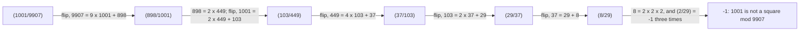

# The Jacobi symbol: extending the symbol to odd moduli so it computes without factoring

[Syllabus](../../../SYLLABUS.md) → [Algebraic and analytic number theory](../README.md) → [Characters and L-functions](../README.md#s03) → The Jacobi symbol

---

## General Overview

Is 1001 a perfect square on the 9907 clock? That is, does some whole number x have a square that leaves remainder 1001 on division by 9907? The number 9907 is prime, and there are 9907 candidates for x. None of them works.

The Legendre symbol (a/p) records this kind of answer as +1 (a square) or −1 (not a square) for a prime p ([Quadratic residues](02-quadratic-residues-and-the-legendre-symbol.md)). Quadratic reciprocity lets you flip (a/p) into (p/a), which is usually smaller ([Quadratic reciprocity](07-quadratic-reciprocity-via-gauss-sums.md)). But the flip only applies when the top is a prime too. So the Legendre route first factors 1001 into 7 × 11 × 13. For a number with hundreds of digits, that factoring step is out of reach.

The **Jacobi symbol** (a/n) removes the factoring. It is defined for any odd bottom n, prime or not, as the product of the Legendre symbols over n's prime factors. It obeys the same flip-and-reduce rules. So it is computed like Euclid's algorithm for the greatest common divisor: flip, take a remainder, pull out factors of 2, repeat. For (1001/9907) that takes six rounds and gives −1. No step asks whether any number is prime.

The same symbol drives a primality test. A prime n forces a fixed link between the power $`a^{(n-1)/2}`$ and the symbol (a/n). Every odd composite breaks that link for at least half of its bases. That includes 561, which fools [The Fermat test](../../02-Number%20theory/06-Codes%20and%20Secrets/04-fermat-test-and-carmichael.md) with all 320 of its coprime bases but fools this test with only 80.

**The Jacobi symbol extends the Legendre symbol to every odd bottom by multiplying over its prime factors; it keeps the flip and the rule for 2, so it is computed in a few rounds of remainders without factoring anything, and the gap between it and Euler's power $`a^{(n-1)/2}`$ proves a number composite for at least half of all bases.**

**What kind of fact this is:** theorems, proved in Why it works: Jacobi reciprocity from Legendre reciprocity, and the bound of half the bases in full. That every Miller-Rabin liar also fools this test is stated with a source. The code's counts below 2,000 are evidence, not proof.

### The picture: six rounds, no factoring



Each arrow is one round. No flip changes the sign here, because every flip pairs a number that is 1 more than a multiple of 4. The only −1s come from the three factors of 2 in the last round.

---

## The formula

Notation first. A number p is always a prime. The sign ≡ means "leaves the same remainder as". The **Legendre symbol** $`\left(\frac{a}{p}\right)`$, written inline as (a/p), is +1 if a is a nonzero square mod the odd prime p, −1 if it is not, and 0 if p divides a.

The **Jacobi symbol** extends it to an odd bottom n that need not be prime. Write n as a product of primes, then multiply:

```math
\left(\frac{a}{n}\right) = \left(\frac{a}{p_1}\right)^{e_1} \left(\frac{a}{p_2}\right)^{e_2} \cdots \left(\frac{a}{p_k}\right)^{e_k}, \qquad n = p_1^{e_1} p_2^{e_2} \cdots p_k^{e_k} \text{ odd}
```

**Read it aloud:** the Jacobi symbol of a on n is the product of the Legendre symbols of a on each prime factor of n, each counted as often as that prime divides n.

The definition uses the factors. The point of the card is that you never need them, because three rules compute the symbol. For odd positive m and n with no common factor:

```math
\left(\frac{m}{n}\right) = (-1)^{\frac{m-1}{2} \cdot \frac{n-1}{2}} \left(\frac{n}{m}\right), \qquad \left(\frac{2}{n}\right) = (-1)^{\frac{n^2-1}{8}}, \qquad \left(\frac{a}{n}\right) = \left(\frac{a \bmod n}{n}\right)
```

**Read it aloud:** flipping top and bottom changes the sign only when both are 3 more than a multiple of 4; a factor 2 on top gives −1 only when the bottom is 3 or 5 more than a multiple of 8; and the top can be replaced by its remainder on division by the bottom.

The test built on it, from Solovay and Strassen (1977):

```math
n > 1 \text{ odd is prime} \iff a^{(n-1)/2} \equiv \left(\frac{a}{n}\right) \pmod n \text{ for every } a \text{ with } \gcd(a, n) = 1
```

**Read it aloud:** an odd number above 1 is prime exactly when, for every base with no factor in common with it, the base raised to half of one less than the number matches its Jacobi symbol on that clock.

| Symbol | Plain meaning | In our example | Push it up and the answer… |
| --- | --- | --- | --- |
| $`n`$ | the bottom: any odd positive number | 9907; later 561 | more rounds, but only as many as its digits allow |
| $`a`$ | the top: any whole number | 1001; later the bases 2, 5, 13 | replaced at once by its remainder mod n |
| $`m`$ | the other odd number in a flip | 1001 against 9907 | — |
| $`x`$ | a candidate square root mod n | none of the 9907 works | — |
| $`p`$, $`p_i`$, $`e_i`$, $`k`$ | a prime; the prime factors of n, how often each divides n, and how many there are | 9907 is prime, so k = 1; 561 = 3 × 11 × 17 | — |
| $`\left(\frac{a}{p}\right)`$ | the Legendre symbol: +1 square, −1 not, 0 if p divides a | (7/9907) = −1, (11/9907) = +1 | — |
| $`\left(\frac{a}{n}\right)`$ | the Jacobi symbol: the product above | (1001/9907) = −1; (2/15) = +1 | — |
| $`a \bmod n`$ | the remainder of a on division by n | 9907 mod 1001 = 898 | — |
| $`(n-1)/2`$ | Euler's exponent: half of one less than n | 4953 for 9907; 280 for 561 | — |
| $`\varphi(n)`$ | Euler's totient: how many bases below n share no factor with n | 320 for 561 | more bases, and at most half of them lie |
| Euler liar | a base that satisfies the test although n is composite | 80 of the 320 for 561 | — |
| $`u`$, $`v`$, $`c`$, $`d`$, $`b`$, $`j`$, $`q_i`$, $`r`$, $`s`$, $`t`$ | working letters in Why it works: odd numbers u, v; a remainder c mod d; a non-square b; a power j; the r prime factors $`q_i`$ of m; the sign exponents s(u) = (u − 1)/2 and t(u) = $`(u^2 - 1)/8`$ | — | — |

### When it holds

- **The bottom is odd.** The exponents (n − 1)/2 and $`(n^2 - 1)/8`$ are whole numbers only for odd n. An even bottom needs the Kronecker symbol, a further extension met on [The class number formula](../06-Algebraic%20Numbers/06-class-number-formula-and-the-dedekind-zeta-function.md).
- **Pull out the 2s before flipping.** Reciprocity is for two odd numbers. Flipping (8/29) into (29/8) is meaningless.
- **Top and bottom share no factor.** If they do, the symbol is 0. In a primality test that common factor proves n composite on the spot.
- **−1 is a proof, +1 is not.** For prime n the Jacobi symbol is the Legendre symbol, so +1 means a square. For composite n, (2/15) = +1, yet 2 is not a square mod 15.
- **The test needs a random base each round.** The half-the-bases bound is about a random draw. A fixed base can lie every time: base 2 always passes 561.

---

## Why it works

### Step 0: every rule of the Legendre symbol is multiplicative, so the product keeps every rule

The Jacobi symbol is a product of Legendre symbols. If each factor obeys a rule, and the signs in the rule also multiply, the product obeys the same rule. The only work is to show that signs such as $`(-1)^{(n-1)/2}`$ multiply correctly over odd numbers.

### Step 1: the symbol multiplies in the top and in the bottom

In the top: each Legendre symbol satisfies (ab/p) = (a/p)(b/p), by Euler's criterion ([Quadratic residues](02-quadratic-residues-and-the-legendre-symbol.md)). Multiply over the prime factors and (ab/n) = (a/n)(b/n).

In the bottom: (a/mn) = (a/m)(a/n) straight from the definition, since the prime factors of mn are those of m together with those of n.

The top only matters through its remainder mod n, because each (a/p) depends only on a mod p. So (9907/1001) = (898/1001).

### Step 2: the two sign patterns multiply over odd numbers

For odd u and v, two small identities hold:

- (uv − 1)/2 and (u − 1)/2 + (v − 1)/2 have the same parity (both even or both odd). Their difference is (u − 1)(v − 1)/2, and two even factors make that a multiple of 2.
- $`(u^2v^2 - 1)/8`$ and $`(u^2 - 1)/8 + (v^2 - 1)/8`$ have the same parity. Their difference is $`(u^2 - 1)(v^2 - 1)/8`$. The square of an odd number is 1 more than a multiple of 8, so that difference is a multiple of 8.

So "3 more than a multiple of 4" and "3 or 5 more than a multiple of 8" behave like signs that multiply.

### Step 3: the rule for 2 and reciprocity carry over

For a prime p, $`(2/p) = (-1)^{(p^2-1)/8}`$. Multiply over the prime factors of n and use Step 2: $`(2/n) = (-1)^{(n^2-1)/8}`$.

For reciprocity, write $`m = q_1 \cdots q_r`$ and $`n = p_1 \cdots p_k`$ as products of odd primes, repeats allowed. Then (m/n)(n/m) is the product of (q/p)(p/q) over every pair. Each pair gives the Legendre sign. Step 2 collects all the signs into one: the sign for m and n.

<details>
<summary>Detailed proof: Jacobi reciprocity from Legendre reciprocity</summary>

Let $`s(u) = (u-1)/2`$ for odd u. Step 2 says $`s(uv) \equiv s(u) + s(v) \pmod 2`$, so $`s(m) \equiv \sum_i s(q_i)`$ and $`s(n) \equiv \sum_j s(p_j)`$ mod 2.

By the definition and Step 1,

$`\displaystyle \left(\frac{m}{n}\right)\left(\frac{n}{m}\right) = \prod_{i,j} \left(\frac{q_i}{p_j}\right)\left(\frac{p_j}{q_i}\right) = \prod_{i,j} (-1)^{s(q_i)\, s(p_j)}`$

using Legendre reciprocity for each pair of distinct odd primes. No pair has $`q_i = p_j`$, because m and n share no factor. The exponents add to

$`\displaystyle \sum_{i,j} s(q_i)\, s(p_j) = \Big(\sum_i s(q_i)\Big)\Big(\sum_j s(p_j)\Big) \equiv s(m)\, s(n) \pmod 2`$

so the product is $`(-1)^{s(m)s(n)}`$. That is the flip rule. The same argument with $`t(u) = (u^2-1)/8`$ gives the rule for 2, and with $`s`$ alone gives $`(-1/n) = (-1)^{(n-1)/2}`$.

</details>

### Step 4: the rounds end fast

Each round replaces the pair (top, bottom) by (bottom mod top, top), after pulling out 2s. The new bottom is the old top, so the bottoms fall. They fall fast: for d at most c, the remainder c mod d is always below c/2. If d is at most c/2, the remainder is below d; if d is larger, the remainder is c − d. So the bottom at least halves every two rounds.

The number of rounds therefore grows with the number of digits of n, not with n itself. This is the same reason Euclid's algorithm is fast. The 19-digit case in the code, with the prime $`2^{61} - 1`$ as bottom, takes 27 rounds.

### Step 5: what the answer tells you

If (a/n) = −1, then some factor (a/p) is −1. So a is not a square mod that prime p. A square mod n would also be a square mod p, so a is not a square mod n either. That is a proof.

If (a/n) = +1 and n is composite, the −1s may have paired off. (2/15) = (2/3)(2/5) = (−1)(−1) = +1, yet the squares mod 15 are 0, 1, 4, 6, 9 and 10.

### Step 6: Euler's criterion becomes a test that no composite can pass for most bases

For a prime n, Euler's criterion says $`a^{(n-1)/2} \equiv (a/n)`$ for every base a not divisible by n ([Quadratic residues](02-quadratic-residues-and-the-legendre-symbol.md)). So a base where the two sides differ proves n composite, without a factor. That base is a **witness**. A base where they agree on a composite n is an **Euler liar**.

The Euler liars of a composite n form a subgroup (a set closed under multiplication) of the units mod n (the φ(n) bases below n that share no factor with n). Both sides multiply, so the product of two liars is a liar, and 1 is a liar. A subgroup's size divides the group's size ([Cosets and Lagrange's theorem](../../03-Algebra/08-Groups/04-cosets-and-lagranges-theorem.md)). So if even one witness exists, the liars are at most half of the φ(n) bases.

A witness always exists. The fold below shows one for every odd composite, Carmichael numbers included.

<details>
<summary>Detailed proof: every odd composite has a witness</summary>

**Case 1: some prime p divides n twice.** Take $`a = 1 + n/p`$. Every prime of n divides n/p, so a shares no factor with n. Since $`(n/p)^2`$ is a multiple of n, the binomial theorem gives $`a^j \equiv 1 + j\, n/p \pmod n`$ for every j. With j = n − 1 this is $`1 - n/p`$, not 1. A liar would satisfy $`a^{n-1} \equiv (a/n)^2 = 1`$, by squaring the test. So a is a witness.

**Case 2: n is a product of distinct primes**, so n = pm with m > 1 and p not dividing m. Pick b with (b/p) = −1. The Chinese remainder theorem gives a with a ≡ b mod p and a ≡ 1 mod m. Then (a/n) = (a/p)(a/m) = (−1)(1/m) = −1. But mod m, $`a^{(n-1)/2} \equiv 1`$. A liar would need $`a^{(n-1)/2} \equiv -1 \pmod n`$, so −1 ≡ 1 mod m, which fails because m is odd and above 1.

Case 2 covers every Carmichael number, since they are products of distinct primes.

</details>

### Step 7: why Carmichael numbers lose their cover

The Fermat test checks $`a^{n-1} \equiv 1`$, the square of Euler's power. Squaring sends both +1 and −1 to 1, so it cannot see the sign, and 561 passes for all coprime bases. Euler's test keeps the sign and compares it with an independent computation, the Jacobi symbol. Case 2 above shows the sign must go wrong for some base.

[The Miller-Rabin test](../../02-Number%20theory/06-Codes%20and%20Secrets/05-miller-rabin.md) watches the whole chain of squarings and cuts the doubt fourfold per base. Monier (1980) proves that every strong liar is an Euler liar, so Miller-Rabin is never the weaker test. The code confirms it on every odd composite below 2,000:

| n | coprime bases | Fermat liars | Euler liars | strong liars |
| --- | ---: | ---: | ---: | ---: |
| 221 = 13 × 17 | 192 | 16 | 8 | 6 |
| 561 = 3 × 11 × 17 | 320 | 320 | 80 | 10 |
| 1105 = 5 × 13 × 17 | 768 | 768 | 192 | 30 |
| 1729 = 7 × 13 × 19 | 1296 | 1296 | 648 | 162 |

The number 1729 has exactly half its bases as Euler liars, so the bound of one half cannot be improved.

---

## Worked numbers, by hand

The symbol (1001/9907), one round per row. A flip changes the sign only when both numbers are 3 more than a multiple of 4. Here 1001, 449, 37 and 29 are each 1 more than a multiple of 4, so no flip changes the sign.

| Step | Arithmetic | Value |
| --- | --- | --- |
| round 1: flip, reduce | 9907 = 9 × 1001 + 898 | (898/1001) |
| round 2: pull out a 2 | 898 = 2 × 449; 1001 = 125 × 8 + 1, so (2/1001) = +1 | (449/1001) |
| round 2: flip, reduce | 1001 = 2 × 449 + 103 | (103/449) |
| round 3: flip, reduce | 449 = 4 × 103 + 37 | (37/103) |
| round 4: flip, reduce | 103 = 2 × 37 + 29 | (29/37) |
| round 5: flip, reduce | 37 = 1 × 29 + 8 | (8/29) |
| round 6: pull out three 2s | 29 = 3 × 8 + 5, so (2/29) = −1; three of them: (−1)(−1)(−1) | (1/29) times −1 |
| answer | (1/29) = 1 | **−1** |

So 1001 is not a square on the 9907 clock: no x has x² ≡ 1001. The code confirms it three more ways: Euler's power $`1001^{4953}`$ is 9906, which is −1 on that clock; the factored route gives (7/9907)(11/9907)(13/9907) = (−1)(+1)(+1); and a search of all 9907 values of x finds no square root.

### Solovay-Strassen on 561, three bases

Here (n − 1)/2 = 280. For base 13, (13/561) = (561/13) by the flip, since 561 = 140 × 4 + 1. Then 561 = 43 × 13 + 2, so it is (2/13) = −1, since 13 = 8 + 5.

| Base | $`a^{280}`$ mod 561 | (a/561) | Verdict | Fermat's $`a^{560}`$ |
| --- | ---: | ---: | --- | ---: |
| 2 | 1 | +1 | liar, says prime | 1 |
| 5 | 67 | +1 | witness: 67 is neither 1 nor −1 | 1 |
| 13 | 1 | −1 | witness: the power and the symbol disagree | 1 |

Base 13 is the case Fermat cannot see. Its power is 1, its symbol is −1, and squaring hides the difference.

### What breaks if you drop a piece

| Mistake | Comes out at | What went wrong |
| --- | --- | --- |
| Drop the rule for 2 in round 6 | (1001/9907) = +1 | the three factors of 2 each carry (2/29) = −1 |
| Flip without the sign rule | (3/7) = +1; the truth is −1 | 3 and 7 are both 3 more than a multiple of 4, so the flip changes the sign |
| Read +1 as "a square" | 2 called a square mod 15 | (2/15) = (2/3)(2/5) = (−1)(−1); the squares mod 15 are 0, 1, 4, 6, 9, 10 |
| Use the Fermat test on 561 | all 320 coprime bases pass | squaring hides the sign; Euler's test is fooled by only 80 |

The code prints every row.

---

## Code, from first principles, and it actually runs

The script computes (1001/9907) by the three rules alone, logging each round. Three independent roads reach the same −1: Euler's power, the definition with 1001 factored, and a search for a square root. It checks the algorithm against the definition for every top below every odd bottom under 1,000, and reciprocity for every coprime pair below 300. Then it counts Fermat, Euler and strong liars on every base of every odd composite below 2,000. Nothing is imported.

### Python

```python
# The Jacobi symbol -- the check behind the card.  Standard library only, nothing imported.
# (1001/9907) by reciprocity alone, in six rounds and with no factoring; then three more
# roads to the same -1; then Euler's criterion as the Solovay-Strassen test, against the
# Fermat and Miller-Rabin tests, on every base of every odd composite below 2,000.
def gcd(a, b): return a if b == 0 else gcd(b, a % b)
def modpow(b, e, n):                       # square and multiply on the n clock
    r, b = 1, b % n
    while e:
        if e & 1: r = r * b % n
        b, e = b * b % n, e >> 1
    return r
def jacobi(a, n, log=None, two_rule=True, flip_rule=True):   # road one: reciprocity only
    a, s, r = a % n, 1, 0
    while a:
        r, k, start = r + 1, 0, (a, n)
        while a % 2 == 0:                  # pull out the twos: (2/n) = -1 when n is 3 or 5 mod 8
            a, k = a // 2, k + 1
            if two_rule and n % 8 in (3, 5): s = -s
        two = -1 if n % 8 in (3, 5) else 1
        if a == 1:
            if log is not None: log.append(f"round {r}: ({start[0]}/{start[1]})  twos out: {k}, each (2/{n}) = {two:+d}  top is 1, so the sign is the answer: {s:+d}")
            return s, r
        flip = -1 if a % 4 == 3 and n % 4 == 3 else 1
        if flip_rule: s *= flip            # reciprocity: flip, and change sign if both are 3 mod 4
        a, n = n % a, a
        if log is not None: log.append(f"round {r}: ({start[0]}/{start[1]})  twos out: {k}{f', (2/{start[1]}) = {two:+d}' if k else ''}  flip: ({start[1]}/{n}), sign {flip:+d}  reduce: ({a}/{n})  sign so far {s:+d}")
    return (s if n == 1 else 0), r
def is_prime(n): return n > 1 and all(n % d for d in range(2, int(n ** 0.5) + 1))
def euler(a, p):                           # a^((p-1)/2) on the p clock, read as -1, 0 or +1
    v = modpow(a, (p - 1) // 2, p)
    return -1 if v == p - 1 else v
def jacobi_def(a, n):                      # road three: the definition, factor n and multiply Legendre symbols
    s, m, p = 1, n, 3
    while m > 1:
        while m % p == 0: s, m = s * euler(a, p), m // p
        p += 2
    return s
log = []
J, rounds = jacobi(1001, 9907, log)
for line in log: print(line)
print(f"(1001/9907) = {J:+d} after {rounds} rounds; 9907 prime by trial division: {is_prime(9907)}")
e = modpow(1001, 4953, 9907)
print(f"road two, Euler's criterion: 1001^4953 on the 9907 clock = {e}, which is 9907 - 1, so {euler(1001, 9907):+d}")
print(f"road three, factor 1001 = 7 x 11 x 13 = {7 * 11 * 13}: (7/9907) = {euler(7, 9907):+d}, (11/9907) = {euler(11, 9907):+d}, (13/9907) = {euler(13, 9907):+d}, product {jacobi_def(1001, 9907):+d}")
sq = sum(1 for x in range(9907) if x * x % 9907 == 1001)
print(f"road four, brute force: x with x^2 = 1001 on the 9907 clock: {sq} of 9907 tried; residues mod 9907: {len({x * x % 9907 for x in range(1, 9907)})}")
pairs = bad = 0
for n in range(3, 1000, 2):
    for a in range(n):
        pairs += 1; bad += jacobi(a, n)[0] != jacobi_def(a, n)
print(f"reciprocity algorithm against the definition, odd n below 1,000, every a below n: {pairs} pairs, {bad} disagree")
recip = sum(1 for m in range(3, 300, 2) for n in range(3, 300, 2) if gcd(m, n) == 1 and jacobi_def(m, n) * jacobi_def(n, m) != (-1) ** ((m - 1) // 2 * ((n - 1) // 2)))
print(f"reciprocity for every coprime odd m, n below 300, from the definition: {recip} failures")
P = 2 ** 61 - 1; A = 10 ** 18 + 9
JP, RP = jacobi(A, P)
print(f"a 19-digit case: ({A}/{P}) = {JP:+d} in {RP} rounds; Euler's criterion gives {euler(A, P):+d}")
sq15 = sorted({x * x % 15 for x in range(15)})
print(f"(2/15) = {jacobi(2, 15)[0]:+d}, yet the squares mod 15 are {sq15}: 2 is not one; (2/3) = {euler(2, 3):+d}, (2/5) = {euler(2, 5):+d}")
def census(n):                             # coprime bases; Fermat, Euler (Solovay-Strassen) and strong liars
    d, s = n - 1, 0
    while d % 2 == 0: d, s = d // 2, s + 1
    co = f = eu = st = 0; subset = True
    for a in range(1, n):
        if gcd(a, n) != 1: continue
        co += 1; f += modpow(a, n - 1, n) == 1
        e_ok = modpow(a, (n - 1) // 2, n) == jacobi(a, n)[0] % n
        x = modpow(a, d, n); s_ok = x == 1 or x == n - 1
        for _ in range(s - 1):
            x = x * x % n; s_ok = s_ok or x == n - 1
        eu += e_ok; st += s_ok; subset = subset and (e_ok or not s_ok)
    return co, f, eu, st, subset
for n in (221, 561, 1105, 1729):
    co, f, eu, st, _ = census(n)
    print(f"{n}: coprime bases {co}, Fermat liars {f}, Euler liars {eu}, strong liars {st}")
for a in (2, 5, 13):
    x, j = modpow(a, 280, 561), jacobi(a, 561)[0]
    print(f"561, base {a:>2}: a^280 = {x:>3}, (a/561) = {j:+d} -> {'liar, says prime' if x == j % 561 else 'witness, proves composite'}; Fermat's a^560 = {modpow(a, 560, 561)}")
worst, arg, comps, sub_ok, half_ok = 0, [], 0, True, True
for n in range(9, 2000, 2):
    if is_prime(n): continue
    co, f, eu, st, sub = census(n); comps += 1
    sub_ok, half_ok, pm = sub_ok and sub, half_ok and 2 * eu <= co, eu * 1000 // co
    if pm > worst: worst, arg = pm, [n]
    elif pm == worst: arg.append(n)
print(f"odd composites below 2,000: {comps}; none has Euler liars above half its coprime bases: {half_ok}; most, per thousand: {worst}, at {arg}")
print(f"every strong liar of every one of them is an Euler liar: {sub_ok}")
print(f"20 rounds: Solovay-Strassen leaves at most 1 in {2 ** 20}, Miller-Rabin at most 1 in {4 ** 20}")
print(f"what breaks: drop the 2 rule, (1001/9907) = {jacobi(1001, 9907, two_rule=False)[0]:+d}; drop the reciprocity sign, (3/7) = {jacobi(3, 7, flip_rule=False)[0]:+d} against {euler(3, 7):+d}")
assert J == -1 and rounds == 6 and e == 9906 and jacobi_def(1001, 9907) == -1 and sq == 0
assert bad == 0 and recip == 0 and JP == euler(A, P) and jacobi(2, 15)[0] == 1 and 2 not in sq15
assert census(561)[1:4] == (320, 80, 10) and census(1729)[2] * 2 == census(1729)[0] and worst == 500 and half_ok and sub_ok
assert modpow(13, 280, 561) == 1 and jacobi(13, 561)[0] == -1 and modpow(5, 280, 561) == 67
assert jacobi(1001, 9907, two_rule=False)[0] == 1 and jacobi(3, 7, flip_rule=False)[0] == 1 and euler(3, 7) == -1
print("ALL CHECKS PASS")
```

**Ran 2026-11-15 on macOS, Python 3.14.10, standard library only. All checks passed. Output, pasted from the run:**

```
round 1: (1001/9907)  twos out: 0  flip: (9907/1001), sign +1  reduce: (898/1001)  sign so far +1
round 2: (898/1001)  twos out: 1, (2/1001) = +1  flip: (1001/449), sign +1  reduce: (103/449)  sign so far +1
round 3: (103/449)  twos out: 0  flip: (449/103), sign +1  reduce: (37/103)  sign so far +1
round 4: (37/103)  twos out: 0  flip: (103/37), sign +1  reduce: (29/37)  sign so far +1
round 5: (29/37)  twos out: 0  flip: (37/29), sign +1  reduce: (8/29)  sign so far +1
round 6: (8/29)  twos out: 3, each (2/29) = -1  top is 1, so the sign is the answer: -1
(1001/9907) = -1 after 6 rounds; 9907 prime by trial division: True
road two, Euler's criterion: 1001^4953 on the 9907 clock = 9906, which is 9907 - 1, so -1
road three, factor 1001 = 7 x 11 x 13 = 1001: (7/9907) = -1, (11/9907) = +1, (13/9907) = +1, product -1
road four, brute force: x with x^2 = 1001 on the 9907 clock: 0 of 9907 tried; residues mod 9907: 4953
reciprocity algorithm against the definition, odd n below 1,000, every a below n: 249999 pairs, 0 disagree
reciprocity for every coprime odd m, n below 300, from the definition: 0 failures
a 19-digit case: (1000000000000000009/2305843009213693951) = +1 in 27 rounds; Euler's criterion gives +1
(2/15) = +1, yet the squares mod 15 are [0, 1, 4, 6, 9, 10]: 2 is not one; (2/3) = -1, (2/5) = -1
221: coprime bases 192, Fermat liars 16, Euler liars 8, strong liars 6
561: coprime bases 320, Fermat liars 320, Euler liars 80, strong liars 10
1105: coprime bases 768, Fermat liars 768, Euler liars 192, strong liars 30
1729: coprime bases 1296, Fermat liars 1296, Euler liars 648, strong liars 162
561, base  2: a^280 =   1, (a/561) = +1 -> liar, says prime; Fermat's a^560 = 1
561, base  5: a^280 =  67, (a/561) = +1 -> witness, proves composite; Fermat's a^560 = 1
561, base 13: a^280 =   1, (a/561) = -1 -> witness, proves composite; Fermat's a^560 = 1
odd composites below 2,000: 697; none has Euler liars above half its coprime bases: True; most, per thousand: 500, at [1729]
every strong liar of every one of them is an Euler liar: True
20 rounds: Solovay-Strassen leaves at most 1 in 1048576, Miller-Rabin at most 1 in 1099511627776
what breaks: drop the 2 rule, (1001/9907) = +1; drop the reciprocity sign, (3/7) = +1 against -1
ALL CHECKS PASS
```

### Rust

Same numbers, built with `rustc --edition 2021 -O`. Arithmetic is in u128, and every multiplication checks for overflow.

```rust
// The Jacobi symbol -- the same check as the Python twin, in Rust.  No crates.
// (1001/9907) by reciprocity alone, in six rounds and with no factoring; then three more
// roads to the same -1; then Euler's criterion as the Solovay-Strassen test, against the
// Fermat and Miller-Rabin tests, on every base of every odd composite below 2,000.
fn gcd(a: u128, b: u128) -> u128 { if b == 0 { a } else { gcd(b, a % b) } }
fn mulmod(a: u128, b: u128, n: u128) -> u128 { a.checked_mul(b).expect("overflow") % n }
fn modpow(mut b: u128, mut e: u128, n: u128) -> u128 {       // square and multiply on the n clock
    let mut r = 1; b %= n;
    while e > 0 {
        if e & 1 == 1 { r = mulmod(r, b, n); }
        b = mulmod(b, b, n); e >>= 1;
    }
    r
}
fn py(b: bool) -> &'static str { if b { "True" } else { "False" } }
fn jacobi_full(a: u128, n: u128, log: &mut Vec<String>, two_rule: bool, flip_rule: bool) -> (i32, u32) {
    let (mut a, mut n, mut s, mut r) = (a % n, n, 1i32, 0u32);   // road one: reciprocity only
    while a != 0 {
        r += 1; let mut k = 0; let start = (a, n);
        while a % 2 == 0 {                 // pull out the twos: (2/n) = -1 when n is 3 or 5 mod 8
            a /= 2; k += 1;
            if two_rule && (n % 8 == 3 || n % 8 == 5) { s = -s; }
        }
        let two = if n % 8 == 3 || n % 8 == 5 { -1 } else { 1 };
        if a == 1 {
            log.push(format!("round {}: ({}/{})  twos out: {}, each (2/{}) = {:+}  top is 1, so the sign is the answer: {:+}", r, start.0, start.1, k, n, two, s));
            return (s, r);
        }
        let flip = if a % 4 == 3 && n % 4 == 3 { -1 } else { 1 };
        if flip_rule { s *= flip; }        // reciprocity: flip, and change sign if both are 3 mod 4
        let (na, nn) = (n % a, a); a = na; n = nn;
        let tw = if k > 0 { format!(", (2/{}) = {:+}", start.1, two) } else { String::new() };
        log.push(format!("round {}: ({}/{})  twos out: {}{}  flip: ({}/{}), sign {:+}  reduce: ({}/{})  sign so far {:+}", r, start.0, start.1, k, tw, start.1, n, flip, a, n, s));
    }
    (if n == 1 { s } else { 0 }, r)
}
fn jacobi(a: u128, n: u128) -> (i32, u32) { jacobi_full(a, n, &mut Vec::new(), true, true) }
fn is_prime(n: u128) -> bool { n > 1 && (2..).take_while(|d| d * d <= n).all(|d| n % d != 0) }
fn euler(a: u128, p: u128) -> i32 {        // a^((p-1)/2) on the p clock, read as -1, 0 or +1
    let v = modpow(a, (p - 1) / 2, p);
    if v == p - 1 { -1 } else { v as i32 }
}
fn jacobi_def(a: u128, n: u128) -> i32 {   // road three: the definition, factor n and multiply Legendre symbols
    let (mut s, mut m, mut p) = (1, n, 3);
    while m > 1 {
        while m % p == 0 { s *= euler(a, p); m /= p; }
        p += 2;
    }
    s
}
fn census(n: u128) -> (u32, u32, u32, u32, bool) {   // coprime bases; Fermat, Euler and strong liars
    let (mut d, mut s) = (n - 1, 0);
    while d % 2 == 0 { d /= 2; s += 1; }
    let (mut co, mut f, mut eu, mut st, mut subset) = (0, 0, 0, 0, true);
    for a in 1..n {
        if gcd(a, n) != 1 { continue; }
        co += 1; if modpow(a, n - 1, n) == 1 { f += 1; }
        let j = jacobi(a, n).0;
        let e_ok = modpow(a, (n - 1) / 2, n) == if j == -1 { n - 1 } else { j as u128 };
        let mut x = modpow(a, d, n); let mut s_ok = x == 1 || x == n - 1;
        for _ in 1..s { x = mulmod(x, x, n); s_ok = s_ok || x == n - 1; }
        if e_ok { eu += 1; } if s_ok { st += 1; } subset = subset && (e_ok || !s_ok);
    }
    (co, f, eu, st, subset)
}
fn main() {
    let mut log = Vec::new();
    let (jv, rounds) = jacobi_full(1001, 9907, &mut log, true, true);
    for line in &log { println!("{}", line); }
    println!("(1001/9907) = {:+} after {} rounds; 9907 prime by trial division: {}", jv, rounds, py(is_prime(9907)));
    let e = modpow(1001, 4953, 9907);
    println!("road two, Euler's criterion: 1001^4953 on the 9907 clock = {}, which is 9907 - 1, so {:+}", e, euler(1001, 9907));
    println!("road three, factor 1001 = 7 x 11 x 13 = {}: (7/9907) = {:+}, (11/9907) = {:+}, (13/9907) = {:+}, product {:+}", 7 * 11 * 13, euler(7, 9907), euler(11, 9907), euler(13, 9907), jacobi_def(1001, 9907));
    let sq = (0..9907u128).filter(|x| x * x % 9907 == 1001).count();
    let mut res: Vec<u128> = (1..9907u128).map(|x| x * x % 9907).collect(); res.sort(); res.dedup();
    println!("road four, brute force: x with x^2 = 1001 on the 9907 clock: {} of 9907 tried; residues mod 9907: {}", sq, res.len());
    let (mut pairs, mut bad) = (0, 0);
    for n in (3..1000u128).step_by(2) {
        for a in 0..n { pairs += 1; if jacobi(a, n).0 != jacobi_def(a, n) { bad += 1; } }
    }
    println!("reciprocity algorithm against the definition, odd n below 1,000, every a below n: {} pairs, {} disagree", pairs, bad);
    let mut recip = 0;
    for m in (3..300u128).step_by(2) { for n in (3..300u128).step_by(2) {
        let sign = if ((m - 1) / 2 * ((n - 1) / 2)) % 2 == 0 { 1 } else { -1 };
        if gcd(m, n) == 1 && jacobi_def(m, n) * jacobi_def(n, m) != sign { recip += 1; }
    } }
    println!("reciprocity for every coprime odd m, n below 300, from the definition: {} failures", recip);
    let (p, a) = ((1u128 << 61) - 1, 1_000_000_000_000_000_009u128);
    let (jp, rp) = jacobi(a, p);
    println!("a 19-digit case: ({}/{}) = {:+} in {} rounds; Euler's criterion gives {:+}", a, p, jp, rp, euler(a, p));
    let mut sq15: Vec<u128> = (0..15u128).map(|x| x * x % 15).collect(); sq15.sort(); sq15.dedup();
    println!("(2/15) = {:+}, yet the squares mod 15 are {:?}: 2 is not one; (2/3) = {:+}, (2/5) = {:+}", jacobi(2, 15).0, sq15, euler(2, 3), euler(2, 5));
    for n in [221u128, 561, 1105, 1729] {
        let (co, f, eu, st, _) = census(n);
        println!("{}: coprime bases {}, Fermat liars {}, Euler liars {}, strong liars {}", n, co, f, eu, st);
    }
    for a in [2u128, 5, 13] {
        let (x, j) = (modpow(a, 280, 561), jacobi(a, 561).0);
        let v = if x == (if j == -1 { 560 } else { j as u128 }) { "liar, says prime" } else { "witness, proves composite" };
        println!("561, base {:>2}: a^280 = {:>3}, (a/561) = {:+} -> {}; Fermat's a^560 = {}", a, x, j, v, modpow(a, 560, 561));
    }
    let (mut worst, mut arg, mut comps, mut sub_ok, mut half_ok) = (0u32, Vec::new(), 0, true, true);
    for n in (9..2000u128).step_by(2) {
        if is_prime(n) { continue; }
        let (co, _f, eu, _st, sub) = census(n); comps += 1;
        sub_ok = sub_ok && sub; half_ok = half_ok && 2 * eu <= co; let pm = eu * 1000 / co;
        if pm > worst { worst = pm; arg = vec![n]; } else if pm == worst { arg.push(n); }
    }
    println!("odd composites below 2,000: {}; none has Euler liars above half its coprime bases: {}; most, per thousand: {}, at {:?}", comps, py(half_ok), worst, arg);
    println!("every strong liar of every one of them is an Euler liar: {}", py(sub_ok));
    println!("20 rounds: Solovay-Strassen leaves at most 1 in {}, Miller-Rabin at most 1 in {}", 1u128 << 20, 1u128 << 40);
    let no2 = jacobi_full(1001, 9907, &mut Vec::new(), false, true).0;
    let noflip = jacobi_full(3, 7, &mut Vec::new(), true, false).0;
    println!("what breaks: drop the 2 rule, (1001/9907) = {:+}; drop the reciprocity sign, (3/7) = {:+} against {:+}", no2, noflip, euler(3, 7));
    assert!(jv == -1 && rounds == 6 && e == 9906 && jacobi_def(1001, 9907) == -1 && sq == 0);
    assert!(bad == 0 && recip == 0 && jp == euler(a, p) && jacobi(2, 15).0 == 1 && !sq15.contains(&2));
    let (c561, c1729) = (census(561), census(1729));
    assert!((c561.1, c561.2, c561.3) == (320, 80, 10) && c1729.2 * 2 == c1729.0 && worst == 500 && half_ok && sub_ok);
    assert!(modpow(13, 280, 561) == 1 && jacobi(13, 561).0 == -1 && modpow(5, 280, 561) == 67);
    assert!(no2 == 1 && noflip == 1 && euler(3, 7) == -1);
    println!("ALL CHECKS PASS");
}
```

**Ran 2026-11-15 on macOS, rustc 1.98.1, no crates. All checks passed. Output, pasted from the run:**

```
round 1: (1001/9907)  twos out: 0  flip: (9907/1001), sign +1  reduce: (898/1001)  sign so far +1
round 2: (898/1001)  twos out: 1, (2/1001) = +1  flip: (1001/449), sign +1  reduce: (103/449)  sign so far +1
round 3: (103/449)  twos out: 0  flip: (449/103), sign +1  reduce: (37/103)  sign so far +1
round 4: (37/103)  twos out: 0  flip: (103/37), sign +1  reduce: (29/37)  sign so far +1
round 5: (29/37)  twos out: 0  flip: (37/29), sign +1  reduce: (8/29)  sign so far +1
round 6: (8/29)  twos out: 3, each (2/29) = -1  top is 1, so the sign is the answer: -1
(1001/9907) = -1 after 6 rounds; 9907 prime by trial division: True
road two, Euler's criterion: 1001^4953 on the 9907 clock = 9906, which is 9907 - 1, so -1
road three, factor 1001 = 7 x 11 x 13 = 1001: (7/9907) = -1, (11/9907) = +1, (13/9907) = +1, product -1
road four, brute force: x with x^2 = 1001 on the 9907 clock: 0 of 9907 tried; residues mod 9907: 4953
reciprocity algorithm against the definition, odd n below 1,000, every a below n: 249999 pairs, 0 disagree
reciprocity for every coprime odd m, n below 300, from the definition: 0 failures
a 19-digit case: (1000000000000000009/2305843009213693951) = +1 in 27 rounds; Euler's criterion gives +1
(2/15) = +1, yet the squares mod 15 are [0, 1, 4, 6, 9, 10]: 2 is not one; (2/3) = -1, (2/5) = -1
221: coprime bases 192, Fermat liars 16, Euler liars 8, strong liars 6
561: coprime bases 320, Fermat liars 320, Euler liars 80, strong liars 10
1105: coprime bases 768, Fermat liars 768, Euler liars 192, strong liars 30
1729: coprime bases 1296, Fermat liars 1296, Euler liars 648, strong liars 162
561, base  2: a^280 =   1, (a/561) = +1 -> liar, says prime; Fermat's a^560 = 1
561, base  5: a^280 =  67, (a/561) = +1 -> witness, proves composite; Fermat's a^560 = 1
561, base 13: a^280 =   1, (a/561) = -1 -> witness, proves composite; Fermat's a^560 = 1
odd composites below 2,000: 697; none has Euler liars above half its coprime bases: True; most, per thousand: 500, at [1729]
every strong liar of every one of them is an Euler liar: True
20 rounds: Solovay-Strassen leaves at most 1 in 1048576, Miller-Rabin at most 1 in 1099511627776
what breaks: drop the 2 rule, (1001/9907) = +1; drop the reciprocity sign, (3/7) = +1 against -1
ALL CHECKS PASS
```

### Lean

Lean proves the three rules, the test and the half-the-bases bound for all odd numbers, and checks the worked numbers.

- Take odd m and n with no common factor. Then $`(m/n) = (-1)^{\frac{m-1}{2}\cdot\frac{n-1}{2}}\,(n/m)`$.
- Take any odd n. Then $`(2/n) = (-1)^{(n^2-1)/8}`$.
- Take any odd n and any whole number a. Then $`\left(\frac{a}{n}\right) = \left(\frac{a \bmod n}{n}\right)`$.
- Take an odd n above 1. Then n is prime exactly when $`a^{(n-1)/2} \equiv (a/n)`$ mod n for every base a sharing no factor with n.
- Every odd composite has a witness, Carmichael numbers included.
- Take an odd composite n. Then at most half of its φ(n) coprime bases below n are Euler liars.
- (1001/9907) = −1, 9907 is prime, and $`1001^{4953}`$ mod 9907 is 9906.
- The factored route is checked: (7/9907), (11/9907) and (13/9907) are −1, +1 and +1.
- Every round is checked: (898/1001), (103/449), (37/103), (29/37) and (8/29) are all −1, and (2/29) = −1.
- (2/15) = +1, yet 2 is not a square mod 15; and (3/7) = −1.
- On 561 = 3 × 11 × 17, bases 2, 5 and 13 give the powers 1, 67, 1 and the symbols +1, +1, −1.
- 561 has 80 Euler liars among its 320 coprime bases. 1729 has 648 among 1296, so the bound of one half is reached.

Round counts, the 19-digit case, strong liars and the search for square roots are left to the Python and Rust checks.

```lean
-- The Jacobi symbol: the Jacobi symbol on odd bottoms obeys the flip, the rule for 2 and reduction of the top, and Euler's criterion against it is a primality test that every odd composite fails for at least half of its coprime bases.
import Mathlib.NumberTheory.LegendreSymbol.JacobiSymbol
import Mathlib.Tactic.NormNum.LegendreSymbol
import Mathlib.Tactic.NormNum.PowMod
import Mathlib.Tactic.NormNum.Prime
import Mathlib.Data.ZMod.Basic

open scoped NumberTheorySymbols

theorem chi8_eq_neg_one_pow (n : ℕ) (hn : Odd n) :
    (ZMod.χ₈ (n : ZMod 8) : ℤ) = (-1) ^ ((n ^ 2 - 1) / 8) := by
  obtain ⟨q, r, hr16, rfl⟩ : ∃ q r, r < 16 ∧ n = 16 * q + r :=
    ⟨n / 16, n % 16, Nat.mod_lt _ (by norm_num), (Nat.div_add_mod n 16).symm⟩
  have hodd : (16 * q + r) % 2 = 1 := Nat.odd_iff.mp hn
  have hr1 : 1 ≤ r ^ 2 := Nat.one_le_pow _ _ (by omega)
  have hsq : (16 * q + r) ^ 2 - 1 = 8 * (2 * (16 * q * q + 2 * q * r)) + (r ^ 2 - 1) := by
    have : (16 * q + r) ^ 2 = 8 * (2 * (16 * q * q + 2 * q * r)) + r ^ 2 := by ring
    rw [this, Nat.add_sub_assoc hr1]
  rw [hsq, Nat.mul_add_div (by norm_num), pow_add, pow_mul, neg_one_sq, one_pow, one_mul,
    ZMod.χ₈_nat_eq_if_mod_eight]
  have h2 : (16 * q + r) % 2 = r % 2 := by omega
  have h8 : (16 * q + r) % 8 = r % 8 := by omega
  rw [h2, h8]
  rw [h2] at hodd
  interval_cases r <;> simp_all

theorem one_add_pow_of_sq_zero {R : Type*} [CommRing R] (x : R) (hx : x * x = 0) (k : ℕ) :
    (1 + x) ^ k = 1 + (k : R) * x := by
  induction k with
  | zero => simp
  | succ k ih =>
    rw [pow_succ, ih]
    push_cast
    linear_combination (k : R) * hx

theorem exists_euler_witness (n : ℕ) (hn : Odd n) (h1 : 1 < n) (hc : ¬ n.Prime) :
    ∃ a : ℤ, Int.gcd a n = 1 ∧
      (a : ZMod n) ^ ((n - 1) / 2) ≠ ((J(a | n) : ℤ) : ZMod n) := by
  set p := n.minFac with hpdef
  have hp : p.Prime := Nat.minFac_prime (by omega)
  have hpn : p ∣ n := Nat.minFac_dvd n
  obtain ⟨j, hj⟩ := hn
  have hp2 : p ≠ 2 := by
    intro h
    rw [h] at hpn
    omega
  have hpe : ¬ p ∣ (n - 1) / 2 := by
    intro h
    have h' : p ∣ n - 1 := h.trans ⟨2, by omega⟩
    have h'' : p ∣ n - (n - 1) := Nat.dvd_sub hpn h'
    rw [show n - (n - 1) = 1 by omega] at h''
    exact hp.one_lt.ne' (Nat.dvd_one.mp h'')
  by_cases hsq : p ^ 2 ∣ n
  · obtain ⟨t, ht⟩ := hsq
    have ht0 : t ≠ 0 := by rintro rfl; simp at ht; omega
    refine ⟨1 + ((p * t : ℕ) : ℤ), ?_, ?_⟩
    · rw [← Int.isCoprime_iff_gcd_eq_one]
      refine ⟨1 - ((p * t : ℕ) : ℤ), t, ?_⟩
      rw [ht]; push_cast; ring
    · have hJ : J(1 + ((p * t : ℕ) : ℤ) | n) = 1 := by
        rw [ht, jacobiSym.mul_right' _ (pow_ne_zero _ hp.ne_zero) ht0, jacobiSym.pow_right]
        rw [jacobiSym.mod_left' (b := p) (a₂ := 1) (by push_cast; simp),
          jacobiSym.mod_left' (b := t) (a₂ := 1) (by push_cast; simp)]
        simp [jacobiSym.one_left]
      rw [hJ]
      have hx : ((p * t : ℕ) : ZMod n) * ((p * t : ℕ) : ZMod n) = 0 := by
        rw [← Nat.cast_mul, ZMod.natCast_eq_zero_iff]
        exact ⟨t, by rw [ht]; ring⟩
      intro h
      push_cast at h hx
      rw [one_add_pow_of_sq_zero _ hx] at h
      have h0 : ((((n - 1) / 2) * (p * t) : ℕ) : ZMod n) = 0 := by
        push_cast
        linear_combination h
      rw [ZMod.natCast_eq_zero_iff] at h0
      apply hpe
      apply Nat.dvd_of_mul_dvd_mul_right (Nat.pos_of_ne_zero (Nat.mul_ne_zero hp.ne_zero ht0))
      calc p * (p * t) = n := by rw [ht]; ring
        _ ∣ _ := h0
  · obtain ⟨m, hm⟩ := hpn
    have hcop : Nat.Coprime p m := by
      rw [Nat.Prime.coprime_iff_not_dvd hp]
      rintro ⟨u, hu⟩
      exact hsq ⟨u, by rw [hm, hu]; ring⟩
    have hm0 : m ≠ 0 := by rintro rfl; simp at hm; omega
    have hm1 : m ≠ 1 := by
      rintro rfl
      rw [mul_one] at hm
      exact hc (hm ▸ hp)
    have hm2 : ¬ 2 ∣ m := by
      rintro ⟨u, hu⟩
      have : 2 ∣ n := ⟨p * u, by rw [hm, hu]; ring⟩
      omega
    have := Fact.mk hp
    obtain ⟨x, hx⟩ := FiniteField.exists_nonsquare (F := ZMod p)
      (by rw [ZMod.ringChar_zmod_n]; exact hp2)
    obtain ⟨k, hk1, hk2⟩ := Nat.chineseRemainder hcop x.val 1
    have hJp : J((k : ℤ) | p) = -1 := by
      rw [ZMod.nonsquare_iff_jacobiSym_eq_neg_one]
      have : (((k : ℕ) : ℤ) : ZMod p) = x := by
        rw [Int.cast_natCast, (ZMod.natCast_eq_natCast_iff _ _ _).mpr hk1, ZMod.natCast_zmod_val]
      rw [this]
      exact hx
    have hJm : J((k : ℤ) | m) = 1 := by
      rw [jacobiSym.mod_left' (a₂ := 1) ?_, jacobiSym.one_left]
      have := congrArg (Nat.cast : ℕ → ℤ) hk2
      push_cast at this
      exact this
    have hJ : J((k : ℤ) | n) = -1 := by
      rw [hm, jacobiSym.mul_right' _ hp.ne_zero hm0, hJp, hJm]
      norm_num
    refine ⟨k, ?_, ?_⟩
    · by_contra hg
      have := (jacobiSym.eq_zero_iff (a := (k : ℤ)) (b := n)).mpr ⟨by omega, hg⟩
      rw [hJ] at this
      norm_num at this
    · rw [hJ]
      intro h
      have hdvd : m ∣ n := ⟨p, by rw [hm]; ring⟩
      have h2 := congrArg (ZMod.castHom hdvd (ZMod m)) h
      simp only [map_pow, map_natCast, map_neg, map_one, Int.cast_natCast, Int.cast_neg,
        Int.cast_one] at h2
      have hk1' : ((k : ℕ) : ZMod m) = 1 := by
        rw [(ZMod.natCast_eq_natCast_iff _ _ _).mpr hk2, Nat.cast_one]
      rw [hk1', one_pow] at h2
      have h22 : ((2 : ℕ) : ZMod m) = 0 := by
        push_cast
        linear_combination h2
      rw [ZMod.natCast_eq_zero_iff] at h22
      have := Nat.le_of_dvd (by norm_num) h22
      interval_cases m <;> simp_all

#print axioms chi8_eq_neg_one_pow
#print axioms one_add_pow_of_sq_zero
#print axioms exists_euler_witness

/-- For odd positive m and n with no common factor, the Jacobi symbol (Mathlib's `jacobiSym`,
the product of the Legendre symbols over the prime factors of the bottom) obeys three rules
that compute it without factoring: flipping top and bottom multiplies by
(-1)^((m-1)/2 * (n-1)/2); a 2 on top gives (2/n) = (-1)^((n^2-1)/8); and the top can be
replaced by its remainder mod n. -/
theorem jacobi_symbol_reciprocity_rules (m n : ℕ) (hm : Odd m) (hn : Odd n)
    (hmn : Nat.Coprime m n) :
    J((m : ℤ) | n) = (-1) ^ ((m - 1) / 2 * ((n - 1) / 2)) * J((n : ℤ) | m) ∧
    J(2 | n) = (-1) ^ ((n ^ 2 - 1) / 8) ∧
    ∀ a : ℤ, J(a | n) = J(a % (n : ℤ) | n) := by
  refine ⟨?_, ?_, fun a => jacobiSym.mod_left a n⟩
  · rw [jacobiSym.quadratic_reciprocity hm hn]
    obtain ⟨i, rfl⟩ := hm
    obtain ⟨j, rfl⟩ := hn
    congr 3 <;> omega
  · rw [jacobiSym.at_two hn, chi8_eq_neg_one_pow n hn]

/-- Solovay-Strassen: an odd number n above 1 is prime exactly when, for every base a with
no factor in common with n, Euler's power a^((n-1)/2) equals the Jacobi symbol (a/n) mod n. -/
theorem odd_prime_iff_euler_power_eq_jacobi (n : ℕ) (hn : Odd n) (h1 : 1 < n) :
    n.Prime ↔ ∀ a : ℤ, Int.gcd a n = 1 →
      (a : ZMod n) ^ ((n - 1) / 2) = ((J(a | n) : ℤ) : ZMod n) := by
  constructor
  · intro hp a _
    have := Fact.mk hp
    rw [← jacobiSym.legendreSym.to_jacobiSym, legendreSym.eq_pow]
    obtain ⟨j, rfl⟩ := hn
    congr 1
    omega
  · intro h
    by_contra hc
    obtain ⟨a, ha, hne⟩ := exists_euler_witness n hn h1 hc
    exact hne (h a ha)

/-- Every odd composite n has at most half of its φ(n) coprime bases below n as Euler liars:
bases a where a^((n-1)/2) agrees with (a/n) mod n. -/
theorem euler_liars_at_most_half (n : ℕ) (hn : Odd n) (h1 : 1 < n) (hc : ¬ n.Prime) :
    2 * ((Finset.range n).filter (fun a : ℕ => Nat.Coprime a n ∧
      ((a : ZMod n) ^ ((n - 1) / 2) = ((J((a : ℤ) | n) : ℤ) : ZMod n)))).card
      ≤ n.totient := by
  obtain ⟨a, ha, hne⟩ := exists_euler_witness n hn h1 hc
  have : NeZero n := ⟨by omega⟩
  set e := (n - 1) / 2 with he
  set b := (a : ZMod n).val with hbdef
  have hbn : b < n := ZMod.val_lt _
  have hbcast : ((b : ℕ) : ZMod n) = (a : ZMod n) := ZMod.natCast_zmod_val _
  have hbJ : J((b : ℤ) | n) = J(a | n) := by
    rw [jacobiSym.mod_left a, hbdef, ZMod.val_intCast]
  have hbcop : Nat.Coprime b n := by
    have hJ0 : J((b : ℤ) | n) ≠ 0 := by
      rw [hbJ]
      rcases jacobiSym.eq_one_or_neg_one ha with h | h <;> rw [h] <;> norm_num
    have := mt jacobiSym.eq_zero_iff_not_coprime.mpr hJ0
    rw [not_not, Int.gcd_natCast_natCast] at this
    exact this
  have hbu : IsUnit ((b : ℕ) : ZMod n) := (ZMod.isUnit_iff_coprime b n).mpr hbcop
  let Q : ℕ → Prop := fun x => (x : ZMod n) ^ e = ((J((x : ℤ) | n) : ℤ) : ZMod n)
  let U := (Finset.range n).filter (fun x : ℕ => Nat.Coprime x n)
  have hU : U.card = n.totient := by
    rw [Nat.totient_eq_card_coprime]
    congr 1
    apply Finset.filter_congr
    intro x _
    exact Nat.coprime_comm
  have hS : (Finset.range n).filter (fun x : ℕ => Nat.Coprime x n ∧ Q x) = U.filter Q := by
    rw [Finset.filter_filter]
  have hT : (Finset.range n).filter (fun x : ℕ => Nat.Coprime x n ∧ ¬ Q x) =
      U.filter (fun x => ¬ Q x) := by
    rw [Finset.filter_filter]
  have hsum := Finset.card_filter_add_card_filter_not (s := U) Q
  have hle : (U.filter Q).card ≤ (U.filter (fun x => ¬ Q x)).card := by
    apply Finset.card_le_card_of_injOn (fun x => (b * x) % n)
    · intro x hx
      simp only [Finset.mem_coe, Finset.mem_filter, Finset.mem_range, U] at hx ⊢
      obtain ⟨⟨_, hxc⟩, hxQ⟩ := hx
      have hxu : IsUnit ((x : ℕ) : ZMod n) := (ZMod.isUnit_iff_coprime x n).mpr hxc
      refine ⟨⟨Nat.mod_lt _ (by omega), ?_⟩, ?_⟩
      · rw [← ZMod.isUnit_iff_coprime, ZMod.natCast_mod, Nat.cast_mul]
        exact hbu.mul hxu
      · intro hQ
        apply hne
        simp only [Q] at hQ hxQ
        have hxg : Int.gcd (x : ℤ) n = 1 := by rw [Int.gcd_natCast_natCast]; exact hxc
        have hsq := jacobiSym.sq_one hxg
        rw [ZMod.natCast_mod, Int.natCast_mod, ← jacobiSym.mod_left, Nat.cast_mul,
          Nat.cast_mul, jacobiSym.mul_left, mul_pow, hxQ, Int.cast_mul] at hQ
        rw [← hbcast, ← hbJ]
        have h3 := congrArg (· * ((J((x : ℤ) | n) : ℤ) : ZMod n)) hQ
        have hsq' : ((J((x : ℤ) | n) : ℤ) : ZMod n) * ((J((x : ℤ) | n) : ℤ) : ZMod n) = 1 := by
          rw [← Int.cast_mul, ← sq, hsq, Int.cast_one]
        calc ((b : ℕ) : ZMod n) ^ e
            = ((b : ℕ) : ZMod n) ^ e * (((J((x : ℤ) | n) : ℤ) : ZMod n) *
                ((J((x : ℤ) | n) : ℤ) : ZMod n)) := by rw [hsq', mul_one]
          _ = ((J((b : ℤ) | n) : ℤ) : ZMod n) * (((J((x : ℤ) | n) : ℤ) : ZMod n) *
                ((J((x : ℤ) | n) : ℤ) : ZMod n)) := by linear_combination h3
          _ = ((J((b : ℤ) | n) : ℤ) : ZMod n) := by rw [hsq', mul_one]
    · intro x hx y hy hxy
      simp only [Finset.mem_coe, Finset.mem_filter, Finset.mem_range, U] at hx hy hxy
      have h2 := congrArg (fun z : ℕ => (z : ZMod n)) hxy
      simp only [ZMod.natCast_mod, Nat.cast_mul] at h2
      have h3 := hbu.mul_left_cancel h2
      rw [ZMod.natCast_eq_natCast_iff'] at h3
      rwa [Nat.mod_eq_of_lt hx.1.1, Nat.mod_eq_of_lt hy.1.1] at h3
  rw [hS]
  omega

-- The card's worked numbers.
-- (1001/9907) = -1, and 9907 is prime.
example : J(1001 | 9907) = -1 := by norm_num
example : Nat.Prime 9907 := by norm_num
-- Euler's power: 1001^4953 is 9906, that is -1, on the 9907 clock.
example : 1001 ^ 4953 % 9907 = 9906 := by decide +kernel
-- The factored route: (7/9907)(11/9907)(13/9907) = (-1)(+1)(+1).
example : 1001 = 7 * 11 * 13 := by norm_num
example : J(7 | 9907) = -1 ∧ J(11 | 9907) = 1 ∧ J(13 | 9907) = 1 := by norm_num
-- The rounds: (898/1001), (103/449), (37/103), (29/37), (8/29); (2/29) = -1.
example : J(898 | 1001) = -1 ∧ J(103 | 449) = -1 ∧ J(37 | 103) = -1 ∧ J(29 | 37) = -1 ∧
    J(8 | 29) = -1 ∧ J(2 | 29) = -1 := by norm_num
-- (2/15) = +1, yet 2 is not a square mod 15.
example : J(2 | 15) = 1 := by norm_num
example : ¬ IsSquare (2 : ZMod 15) := by decide
-- Flip without the sign rule fails: (3/7) = -1.
example : J(3 | 7) = -1 := by norm_num
-- Solovay-Strassen on 561, bases 2, 5, 13.
example : 2 ^ 280 % 561 = 1 ∧ J(2 | 561) = 1 := ⟨by decide +kernel, by norm_num⟩
example : 5 ^ 280 % 561 = 67 ∧ J(5 | 561) = 1 := ⟨by decide +kernel, by norm_num⟩
example : 13 ^ 280 % 561 = 1 ∧ J(13 | 561) = -1 := ⟨by decide +kernel, by norm_num⟩
example : 561 = 3 * 11 * 17 ∧ Nat.totient 561 = 320 := by
  refine ⟨by norm_num, by decide +kernel⟩
-- 561 has 80 Euler liars among its 320 coprime bases.
example : ((Finset.range 561).filter (fun a : ℕ => Nat.Coprime a 561 ∧
      ((a : ZMod 561) ^ ((561 - 1) / 2) = ((J((a : ℤ) | 561) : ℤ) : ZMod 561)))).card = 80 := by
  decide +kernel
-- 1729 has exactly half: 648 Euler liars among its 1296 coprime bases.
example : Nat.totient 1729 = 1296 := by decide +kernel
example : ((Finset.range 1729).filter (fun a : ℕ => Nat.Coprime a 1729 ∧
      ((a : ZMod 1729) ^ ((1729 - 1) / 2) = ((J((a : ℤ) | 1729) : ℤ) : ZMod 1729)))).card = 648 := by
  decide +kernel

#print axioms jacobi_symbol_reciprocity_rules
#print axioms odd_prime_iff_euler_power_eq_jacobi
#print axioms euler_liars_at_most_half
```

**Checked 2026-11-15 on macOS, Lean 4.36.0-rc2, Mathlib v4.36.0-rc2. Every proof is complete and uses only Lean's standard axioms. Output, pasted from the run:**

```
'chi8_eq_neg_one_pow' depends on axioms: [propext, Classical.choice, Quot.sound]
'one_add_pow_of_sq_zero' depends on axioms: [propext]
'exists_euler_witness' depends on axioms: [propext, Classical.choice, Quot.sound]
'jacobi_symbol_reciprocity_rules' depends on axioms: [propext, Classical.choice, Quot.sound]
'odd_prime_iff_euler_power_eq_jacobi' depends on axioms: [propext, Classical.choice, Quot.sound]
'euler_liars_at_most_half' depends on axioms: [propext, Classical.choice, Quot.sound]
```

> [!TIP]
> **Try changing**
> Guess first, then run it. An assert is a line that stops the program if a number comes out wrong; they are pinned to the card's numbers, so expect one to stop it.
> - **Ask about 1002 instead.** Change `jacobi(1001, 9907, log)` to `jacobi(1002, 9907, log)`. Guess the sign first. It is −1 again, but in 3 rounds, not 6, so the first assert stops the run.
> - **Break the rule for 2.** Change `(3, 5)` to `(3, 7)` on the line `if two_rule and n % 8 in (3, 5)`. The algorithm then disagrees with the definition on 83584 of the 249999 pairs, and an assert stops the run.
> - **Test with Fermat's power.** In `census`, change `(n - 1) // 2` to `n - 1`. Guess how many of 561's bases now pass. Its Euler liars jump from 80 to 160, and the third assert stops the run.
> - **Try a bigger bottom.** Set `P` to `2 ** 89 - 1`, a prime. Guess the round count. It is 22, fewer than for the 19-digit case, and every check still passes. Python only: the Rust u128 multiplication would overflow.

---

## The usual mistake

> [!warning]
> **Reading (a/n) = +1 as "a is a square mod n".** That is true only when n is prime. For composite n, two −1s from different primes multiply to +1. (2/15) = +1, yet 2 is not a square mod 15. The reverse holds: −1 always proves "not a square".
>
> - Dropping the sign of the 2s pulled out. In our example that gives +1 instead of −1.
> - Forgetting the flip sign when both numbers are 3 more than a multiple of 4: (3/7) comes out +1, not −1.
> - Comparing Euler's power 9906 with −1 as plain numbers. On the 9907 clock, 9906 is −1.
> - Using one fixed base. Base 2 passes 561 every time.

---

## Where you meet it in real life

- **Finding RSA primes.** The 1978 RSA paper uses the Solovay-Strassen test to find its large primes. Most libraries now use Miller-Rabin instead: it is never weaker, and its bound per base is a quarter, not a half.
- **Square roots mod a prime.** Algorithms that take square roots mod p ([Square roots on a prime clock](../../02-Number%20theory/06-Codes%20and%20Secrets/06-square-roots-mod-p.md)) first need a non-square. They find one by testing small numbers until the symbol gives −1.
- **The quadratic residuosity problem.** Mod n = pq with secret primes p and q, half the numbers with symbol +1 are squares and half are not, as with 2 mod 15. Telling them apart seems to need the factors. The Goldwasser–Micali encryption scheme rests on that.

> **Say it back**
> The Jacobi symbol (a/n) is the product of the Legendre symbols of a over the prime factors of an odd n. Because every Legendre rule is multiplicative, it keeps the flip, the rule for 2 and the reduction of the top. So it is computed by remainders like Euclid's algorithm, in rounds that grow with the digits, with no factoring: (1001/9907) = −1 in six rounds. A −1 proves "not a square"; a +1 on a composite proves nothing. For a prime n Euler's power matches the symbol, and every odd composite breaks the match for at least half its bases, so even 561 is caught.

---

## What this builds on

- [Quadratic reciprocity](07-quadratic-reciprocity-via-gauss-sums.md): the flip and the rule for 2 for primes, which this card multiplies up to every odd bottom.
- [The Miller-Rabin test](../../02-Number%20theory/06-Codes%20and%20Secrets/05-miller-rabin.md): witnesses, liars and the fourfold cut per base; its strong liars are all Euler liars.
- [The Fermat test](../../02-Number%20theory/06-Codes%20and%20Secrets/04-fermat-test-and-carmichael.md): the probable-prime test and the Carmichael numbers that fool it, which Euler's test catches.
- [Quadratic residues](02-quadratic-residues-and-the-legendre-symbol.md): the Legendre symbol and Euler's criterion, the fact every step here leans on.
- [Cosets and Lagrange's theorem](../../03-Algebra/08-Groups/04-cosets-and-lagranges-theorem.md): a proper subgroup holds at most half the group, which caps the Euler liars.

## Where this goes next

- [The class number formula](../06-Algebraic%20Numbers/06-class-number-formula-and-the-dedekind-zeta-function.md): the Kronecker symbol extends the Jacobi symbol to even bottoms and records how primes split in a quadratic field.
- [RSA in full](../../14-Applied%20and%20computational/04-Cryptography/04-rsa-in-full.md): where fast primality tests generate the key's secret primes.

On this shelf, [Dirichlet characters](01-dirichlet-characters.md) and [Dirichlet L-functions](03-dirichlet-l-functions.md) apply here too: for fixed odd n, the map a ↦ (a/n) is a real Dirichlet character mod n, with its own L-function and Euler product.

Mod n = pq, the Jacobi symbol splits the numbers with symbol +1 into squares and non-squares only through the factors: is there any fast way to tell the two halves apart without factoring n?

---

## Sources

Verified 2026-11-15: every link below resolves to the publisher's page.

- Solovay, R., and V. Strassen. "A Fast Monte-Carlo Test for Primality." *SIAM Journal on Computing* 6, no. 1 (1977), 84–85. [doi:10.1137/0206006](https://doi.org/10.1137/0206006). The test on this card: Euler's criterion against the Jacobi symbol, with the bound of half the bases.
- Monier, Louis. "Evaluation and comparison of two efficient probabilistic primality testing algorithms." *Theoretical Computer Science* 12, no. 1 (1980), 97–108. [doi:10.1016/0304-3975(80)90007-9](https://doi.org/10.1016/0304-3975(80)90007-9). Exact liar counts for the Solovay-Strassen and Miller-Rabin tests, and the comparison between them.
- Ireland, Kenneth, and Michael Rosen. *A Classical Introduction to Modern Number Theory*, 2nd ed. Springer, 1990. [doi:10.1007/978-1-4757-2103-4](https://doi.org/10.1007/978-1-4757-2103-4). Chapter 5 defines the Jacobi symbol and derives its reciprocity law from the Legendre case.
- Cohen, Henri. *A Course in Computational Algebraic Number Theory*. Springer, 1993. [doi:10.1007/978-3-662-02945-9](https://doi.org/10.1007/978-3-662-02945-9). Section 1.4 gives the flip-and-reduce algorithm for the symbol as computers run it.
- Rivest, R. L., A. Shamir, and L. Adleman. "A method for obtaining digital signatures and public-key cryptosystems." *Communications of the ACM* 21, no. 2 (1978), 120–126. [doi:10.1145/359340.359342](https://doi.org/10.1145/359340.359342). The RSA paper, which uses the Solovay-Strassen test to find its primes.
