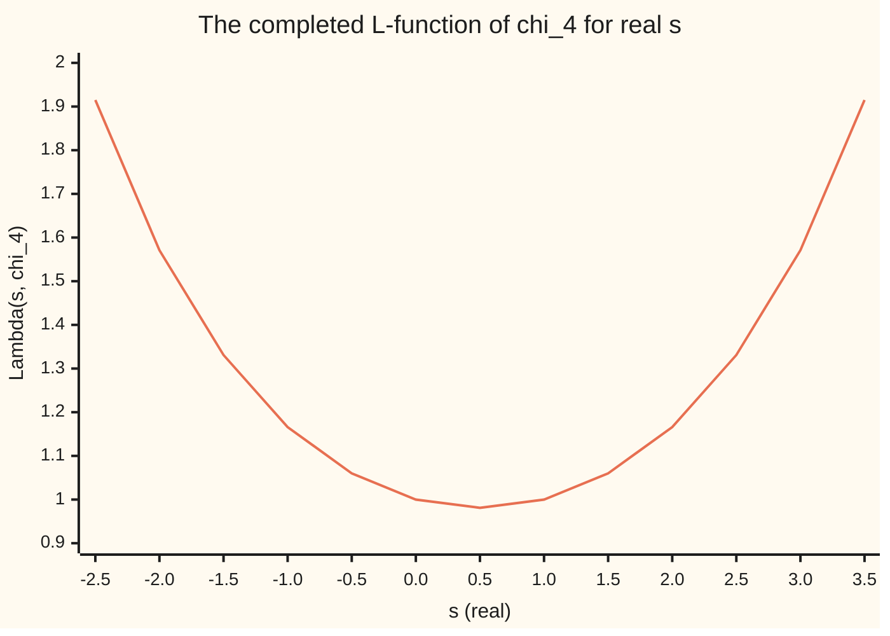

# The functional equation of L(s, chi): a twisted theta function, with the Gauss sum as the sign

[Syllabus](../../../SYLLABUS.md) → [Algebraic and analytic number theory](../README.md) → [Characters and L-functions](../README.md#s03) → The functional equation of L(s, chi)

---

## General Overview

Below a million, 39,175 primes leave remainder 1 on division by 4 and 39,322 leave 3. The function that watches this split is the L-function of the odd character mod 4, χ₄, whose weights run 1, 0, −1, 0 and repeat ([Dirichlet L-functions](03-dirichlet-l-functions.md)). Here s is the input, a real or complex number:

L(s, χ₄) = 1 − 1/3^s + 1/5^s − 1/7^s + …

At s = 1 the series gives π/4 = 0.785398. At s = 0 it reads 1 − 1 + 1 − 1 + …, which has no total. At s = −1 it reads 1 − 3 + 5 − 7 + …, which has none either. Yet the continued function has definite values there: L(0, χ₄) = 1/2 and L(−1, χ₄) = 0.

The **functional equation** delivers those values. It ties L at s to L at the mirror point 1 − s, as [The functional equation](../02-The%20Zeta%20Function%20and%20the%20Prime%20Number%20Theorem/02-functional-equation-proved.md) does for zeta. Multiply L(s, χ₄) by a known gamma factor. The product, Λ(s, χ₄), takes the same value at s and 1 − s. So the convergent value at 1 fixes the value at 0.

The proof is zeta's proof with three changes:

- the bell curves are weighted by the character, which makes a **twisted theta function**;
- for an odd character each bell curve is also multiplied by n, so the weights do not cancel between n and −n;
- the flip x → 1/x brings out a constant of size 1, the **root number** ε(χ). It is the Gauss sum divided by its size, and also divided by i when χ is odd: for χ₄, 2i ÷ 2 ÷ i = 1.

**Completed by the factor $`(q/\pi)^{(s+a)/2}\,\Gamma((s+a)/2)`$, with a = 0 for an even character and a = 1 for an odd one, the L-function of a primitive character χ mod q becomes a function Λ that is finite at every s and satisfies Λ(s, χ) = ε(χ) Λ(1 − s, χ̄); the proof flips a theta function weighted by χ, and the Gauss sum fixes the sign ε(χ) = g(χ)/(iᵃ√q).**

**What kind of fact this is:** a theorem, classical, proved on this card in Why it works for every primitive character. Three inputs are stated, not proved here: the Gauss-sum expansion of χ(n) when n shares a factor with q, and |g(χ)| = √q for a composite modulus (Davenport, chapters 5 and 9), and ε = 1 for a real primitive character to a composite modulus. The checks test the equation at sample points, which is evidence, not proof.

### The picture: Λ(s, χ₄) along the real line, the same on both sides of 1/2



The one line is Λ(s, χ₄), computed by the theta integral of Step 4. It is a mirror image about s = 1/2, where it is lowest, at 0.980714. Its value at 0 and at 1 is exactly 1.

---

## The formula

Notation, in words first. As on [Dirichlet characters](01-dirichlet-characters.md), χ is a character mod q and χ̄ its conjugate: each value replaced by its complex conjugate. A character is **even** if χ(−1) = 1 and **odd** if χ(−1) = −1. Its **parity** a is 0 for even and 1 for odd, so χ(−1) = (−1)ᵃ. As on [Gauss sums](06-gauss-sums.md), $`g(\chi) = \sum_{n=0}^{q-1} \chi(n)\, e^{2\pi i n/q}`$ is the Gauss sum, and a **primitive** character is one that does not come from a smaller modulus.

Two clashes, said once. Λ with two arguments, s and χ, is the **completed L-function**; von Mangoldt's Λ(n) takes one whole number. ε(χ), with its character, is the **root number**; a bare ε elsewhere in this wing is a small exponent.

```math
\Lambda(s,\chi) = \left(\frac{q}{\pi}\right)^{(s+a)/2} \Gamma\!\left(\frac{s+a}{2}\right) L(s,\chi), \qquad \Lambda(s,\chi) = \varepsilon(\chi)\,\Lambda(1-s,\bar\chi), \qquad \varepsilon(\chi) = \frac{g(\chi)}{i^{a}\sqrt{q}}
```

**Read it aloud:** Lambda of s and chi is q over pi to the power s plus a over two, times gamma of s plus a over two, times L of s and chi; it equals the root number times Lambda at one minus s for the conjugate character; and the root number is the Gauss sum over i to the a times root q.

For χ₄: q = 4, a = 1 and g(χ₄) = 2i, so ε = 1 and Λ(s, χ₄) = (4/π)^((s+1)/2) Γ((s+1)/2) L(s, χ₄).

The proof also gives a formula for Λ that works at every s. It uses the twisted theta function. This wing keeps θ for Chebyshev's prime sum, so it is written W, as on the zeta card:

```math
W(x,\chi) = \sum_{n=-\infty}^{\infty} n^{a}\chi(n)\, e^{-\pi n^2 x/q}, \qquad w(x,\chi) = \tfrac12 W(x,\chi), \qquad W\!\left(\tfrac1x,\chi\right) = \varepsilon(\chi)\, x^{a+1/2}\, W(x,\bar\chi)
```

```math
\Lambda(s,\chi) = \int_1^\infty \left( x^{(s+a)/2}\, w(x,\chi) + \varepsilon(\chi)\, x^{(1-s+a)/2}\, w(x,\bar\chi) \right) \frac{dx}{x}
```

**Read it aloud:** W adds n to the a, times chi of n, times a bell curve, over every whole n, and flipping x to one over x turns it into the root number times a power of x times W of the conjugate; Lambda is the area from 1 to infinity under two such terms, one for s and one for one minus s.

Swap s with 1 − s and χ with χ̄, and multiply by ε(χ). The two terms trade places, because ε(χ) ε(χ̄) = 1. That is the functional equation.

| Symbol | Plain meaning | In our example | Push it up and the answer… |
| --- | --- | --- | --- |
| $`s,\ \sigma,\ t`$ | the input; its real part; its height | s = 2 and its mirror −1 | — |
| $`q`$ | the modulus: the length of the repeat | 4 | the bell curves widen, by q |
| $`\chi,\ \bar\chi`$ | a primitive character; its conjugate | χ₄, with χ̄₄ = χ₄ | — |
| $`\chi_5,\ \chi_{5,i},\ \chi_{23},\ \chi_{12}`$ | the Legendre symbol mod 5; the character mod 5 with χ(2) = i; the Legendre symbol mod 23; χ₄ with the multiples of 3 set to 0 | test cases in the code | — |
| $`a`$ | the parity: 0 if χ(−1) = 1, 1 if χ(−1) = −1 | 1 | moves the gamma factor's poles by 1 |
| $`L(s,\chi)`$ | the L-function: the sum of χ(n)/nˢ, continued | L(1, χ₄) = 0.785398, L(0, χ₄) = 1/2 | — |
| $`\Gamma`$ | the gamma function, the factorial stretched to complex inputs | Γ(1/2) = √π, a pole at 0 | — |
| $`\Lambda(s,\chi)`$ | the completed L-function | Λ(2, χ₄) = Λ(−1, χ₄) = 1.166244 | lowest at 1/2 on the real line |
| $`g(\chi),\ i,\ \varepsilon(\chi)`$ | the Gauss sum; the square root of −1; the root number $`g(\chi)/(i^a\sqrt q)`$, of size 1 | g(χ₄) = 2i and ε(χ₄) = 1; ε(χ₅,ᵢ) = 0.850651 + 0.525731i | the size of g is always √q |
| $`x;\ n,\ m,\ j,\ k,\ b`$ | a positive real number, the bells' variable; whole numbers that count bells and waves, and b the remainder in Step 7 | x = 2 and 1/x = 0.5 | the bells narrow |
| $`W(x,\chi),\ w(x,\chi);\ e(y),\ f,\ \hat f,\ \xi,\ \alpha`$ | the twisted theta function; half of it, the sum over n ≥ 1; in the Step 2 fold, $`e(y) = e^{2\pi i y}`$, one bell f, its Fourier transform $`\hat f`$ at frequency ξ, and a shift α | W(0.5, χ₄) = 1.175932 | falls like $`e^{-\pi x/q}`$ |
| $`B_{k,\chi},\ B_k;\ h_K,\ w_K`$ | a generalised Bernoulli number (Step 7), built from the Bernoulli polynomial $`B_k`$; a quadratic field's class number and its count of roots of unity | h = 1, w = 4 for χ₄; h = 3, w = 2 for χ₂₃ | — |

### When it holds

- **χ is primitive.** Step 1 needs it. The imprimitive χ₁₂ (χ₄ with the multiples of 3 removed) has a Gauss sum of size 2, not √12 = 3.464102, and no mirror.
- **The parity a matches χ(−1).** For an odd χ the plain bell-curve sum is 0: the terms at n and −n cancel. With a = 0, χ₄ gives 1.166244 at 2 and 0 at −1.
- **The scale is q/π, not 1/π.** With zeta's π alone, χ₄ gives 0.145780 at 2 and 1.166244 at −1.
- **The mirror side carries ε(χ) and χ̄.** For a real character both are invisible: ε = 1 and χ̄ = χ. For the complex χ₅,ᵢ, dropping either breaks the equation.
- **χ is not the trivial character.** For q = 1, W has the extra term 1 at n = 0, and zeta's poles at 0 and 1 return.

---

## Why it works

### Step 0: the idea

Zeta's proof needs a sum of bell curves that keeps its shape under x → 1/x. Poisson summation supplies it. Weight the bell curves by χ and Poisson summation still works, but it turns the weights χ(n) into their **Fourier coefficients**: the amounts of each wave $`e^{2\pi i mn/q}`$ in the pattern χ.

For a primitive character those coefficients are χ̄ again, times one constant. The constant is a Gauss sum. So the twisted theta function flips into the theta function of χ̄, times ε(χ). Everything else is zeta's proof.

### Step 1: the Gauss sum writes χ as a sum of waves

For a primitive character χ mod q and every whole number n,

```math
\chi(n) = \frac{1}{g(\bar\chi)} \sum_{m=0}^{q-1} \bar\chi(m)\, e^{2\pi i mn/q}
```

**Read it aloud:** chi of n is one over the Gauss sum of the conjugate, times the sum over m of chi-bar of m times the wave at m n over q.

When n is coprime to q, substitute m = k n⁻¹ mod q. Then χ̄(m) = χ̄(k) χ(n), and the sum becomes χ(n) g(χ̄). When n shares a factor with q, the left side is 0, and primitivity makes the right side 0 too (Davenport, chapter 5). That is where an imprimitive χ₁₂ fails.

Two facts about the constant are used later. Conjugating the Gauss sum gives $`\overline{g(\chi)} = \chi(-1)\, g(\bar\chi)`$. With $`\lvert g(\chi)\rvert^2 = q`$ ([Gauss sums](06-gauss-sums.md)), that gives $`g(\chi)\,g(\bar\chi) = \chi(-1)\,q`$.

### Step 2: Poisson summation flips the twisted bell curves

Put the expansion of Step 1 into W(x, χ). Poisson summation swaps each bell curve for its Fourier transform, another bell curve; each wave shifts that transform by m/q. The shifted transforms, added over m, are exactly the bell curves of W at 1/x, now weighted by χ̄. The result is

```math
W\!\left(\tfrac1x,\chi\right) = \varepsilon(\chi)\, x^{a+1/2}\, W(x,\bar\chi), \qquad \varepsilon(\chi) = \frac{g(\chi)}{i^{a}\sqrt q}
```

**Read it aloud:** the twisted theta function at one over x equals the root number times x to the a plus a half times the theta function of the conjugate at x.

For χ₄ at x = 2 both sides are 1.175932. For the complex χ₅,ᵢ at x = 1.5 both sides are 1.305744 + 0.610522i.

<details>
<summary>Detailed proof: the twisted theta identity, even and odd</summary>

Write e(y) for $`e^{2\pi i y}`$. Poisson summation with a shift reads $`\sum_n f(n)\, e(n\alpha) = \sum_k \hat f(k - \alpha)`$, where $`\hat f`$ is the Fourier transform ([Poisson summation and sampling](../../20-Harmonic%20analysis/02-The%20Fourier%20Transform/08-poisson-summation-and-sampling.md)).

**Even χ, a = 0.** Take $`f(y) = e^{-\pi y^2 x/q}`$, whose transform is $`\hat f(\xi) = \sqrt{q/x}\; e^{-\pi q \xi^2/x}`$. Step 1 gives

$`\displaystyle W(x,\chi) = \frac{1}{g(\bar\chi)} \sum_{m} \bar\chi(m) \sum_n f(n)\, e(mn/q) = \frac{\sqrt{q/x}}{g(\bar\chi)} \sum_m \bar\chi(m) \sum_k e^{-\pi (qk - m)^2/(qx)}.`$

As k runs over the whole numbers and m over 0 to q − 1, j = qk − m runs over every whole number once, with j ≡ −m mod q. Since χ is even, χ̄(m) = χ̄(−j) = χ̄(j). So the double sum is W(1/x, χ̄). By Step 1, g(χ)g(χ̄) = q, so $`\sqrt q / g(\bar\chi) = g(\chi)/\sqrt q = \varepsilon(\chi)`$:

$`\displaystyle W(x,\chi) = \varepsilon(\chi)\, x^{-1/2}\, W(1/x,\bar\chi).`$

Replace x by 1/x. That is the identity with a = 0.

**Odd χ, a = 1.** Take $`f(y) = y\, e^{-\pi y^2 x/q}`$. Its transform is $`\hat f(\xi) = -i\,(q/x)^{3/2}\, \xi\, e^{-\pi q\xi^2/x}`$: differentiate the bell's pair once. The same steps give $`\hat f(k - m/q) = -i\,(q/x)^{3/2}\, (j/q)\, e^{-\pi j^2/(qx)}`$, with the same j. Now χ̄(m) = χ̄(−j) = −χ̄(j), and g(χ)g(χ̄) = −q, so 1/g(χ̄) = −g(χ)/q. Collect the constants:

$`\displaystyle W(x,\chi) = \frac{-g(\chi)}{q} \cdot (-i)\left(\frac{q}{x}\right)^{3/2} \cdot \frac{-1}{q}\, W(1/x,\bar\chi) = \frac{g(\chi)}{i\sqrt q}\, x^{-3/2}\, W(1/x,\bar\chi).`$

Replace x by 1/x. That is the identity with a = 1.

</details>

### Step 3: the Mellin transform turns each bell curve into the gamma factor times n⁻ˢ

The Mellin transform of a function is its integral against $`x^{s-1}`$ from 0 to infinity. Rescale x by πn²/q in Euler's integral for gamma ([The gamma function](../../07-Complex%20analysis/09-Special%20Functions%20and%20the%20Zeta%20Function/02-gamma-function.md)). The weight nᵃ is cancelled by the scaling, which is why it was chosen:

```math
\int_0^\infty x^{(s+a)/2-1}\, n^a e^{-\pi n^2 x/q}\, dx = \left(\frac{q}{\pi}\right)^{(s+a)/2} \Gamma\!\left(\frac{s+a}{2}\right) n^{-s}
```

Multiply by χ(n) and add over n = 1, 2, 3, …. The terms at n and −n of W are equal, since $`(-n)^a\chi(-n) = n^a \chi(n)`$, and the term at n = 0 is 0. So the sum over n ≥ 1 is w = W/2, and

```math
\Lambda(s,\chi) = \int_0^\infty x^{(s+a)/2}\, w(x,\chi)\, \frac{dx}{x}, \qquad \sigma > 1
```

### Step 4: fold the integral at x = 1

Split at x = 1. On the piece from 0 to 1, replace x by 1/x and use Step 2, rewritten for w. The power becomes $`x^{-(s+a)/2} \cdot x^{a+1/2} = x^{(1-s+a)/2}`$, and the character becomes χ̄:

```math
\int_0^1 x^{(s+a)/2}\, w(x,\chi)\, \frac{dx}{x} = \varepsilon(\chi) \int_1^\infty x^{(1-s+a)/2}\, w(x,\bar\chi)\, \frac{dx}{x}
```

Add the piece from 1 to infinity. That is the theta formula of The formula section.

Here is the first real difference from zeta. Zeta's sum W has the term 1 at n = 0, which left the two fractions 1/(s − 1) − 1/s and the poles. The twisted W has no such term. So nothing is left over, and **Λ(s, χ) has no poles at all**.

The weights in w fall like $`e^{-\pi x/q}`$, faster than any power of x grows. So both integrals are finite for every complex s, and Λ is holomorphic (it has a complex derivative) everywhere. This continues L(s, χ) to every s.

### Step 5: read off the equation, and |ε(χ)| = 1

Swap s with 1 − s and χ with χ̄ in the theta formula. The first term becomes $`x^{(1-s+a)/2}\,w(x,\bar\chi)`$, the second $`\varepsilon(\bar\chi)\,x^{(s+a)/2}\,w(x,\chi)`$. Multiply by ε(χ). By Step 1,

```math
\varepsilon(\chi)\,\varepsilon(\bar\chi) = \frac{g(\chi)\,g(\bar\chi)}{i^{2a}\,q} = \frac{\chi(-1)\,q}{(-1)^a\,q} = 1
```

So the two terms trade places exactly, and **Λ(s, χ) = ε(χ) Λ(1 − s, χ̄)**. The same Step 1 fact gives ε(χ̄) as the complex conjugate of ε(χ), so ε(χ) times its conjugate is 1: the root number has size 1.

### Step 6: the root number for real and complex characters

For a real character, χ̄ = χ, and ε(χ)² = 1, so ε is +1 or −1. Gauss's sign settles it. For an odd prime p, [Gauss sums](06-gauss-sums.md) proves g = √p when p leaves 1 on division by 4 and g = i√p when p leaves 3. In the first case −1 is a square, so the Legendre symbol is even and ε = √p/√p = 1. In the second it is odd and ε = i√p/(i√p) = 1. For a real primitive character to a composite modulus, such as χ₄, ε = 1 too; this card states that case, and the checks confirm it for χ₄.

| Character | q | a | g(χ) | ε(χ) |
| --- | ---: | ---: | --- | --- |
| χ₄ | 4 | 1 | 2i | 1 |
| χ₅, the Legendre symbol mod 5 | 5 | 0 | 2.236068 | 1 |
| χ₂₃, the Legendre symbol mod 23 | 23 | 1 | 4.795832i | 1 |
| χ₅,ᵢ, with χ(2) = i | 5 | 1 | −1.175571 + 1.902113i | 0.850651 + 0.525731i |

For a complex character the root number is a genuine point on the unit circle, and it is not ±1. For χ̄₅,ᵢ the checks find 0.850651 − 0.525731i, the conjugate, as Step 5 says.

### Step 7: the trivial zeros and the values at 0

Turn the definition round: L(s, χ) = Λ(s, χ) divided by the gamma factor. Gamma is never 0 and has poles at 0, −1, −2, …. So the gamma factor has poles where (s + a)/2 is 0, −1, −2, …:

- **odd χ (a = 1):** at s = −1, −3, −5, …;
- **even χ (a = 0):** at s = 0, −2, −4, ….

At those points Λ is finite. By the mirror it equals ε times Λ at 1 − s, which is not 0: there the gamma factor is finite and L is not 0, by the Euler product when 1 − s > 1 and by [Dirichlet L-functions](03-dirichlet-l-functions.md) when 1 − s = 1. A finite Λ over an infinite gamma factor makes L(s, χ) 0 there, and since Λ is not 0 the zero is simple (of order exactly 1). These are the **trivial zeros**. For χ₄, Λ(−1) = Λ(2) = 1.166244, and L changes sign through −1: L(−0.99) = +0.00582763 and L(−1.01) = −0.00583466.

The exact values come from the **generalised Bernoulli numbers** $`B_{k,\chi} = q^{k-1}\sum_{b=1}^{q} \chi(b)\, B_k(b/q)`$, fractions built from the Bernoulli polynomials $`B_k`$: $`L(1-k,\chi) = -B_{k,\chi}/k`$. This follows from the Hurwitz zeta values at negative integers in Apostol, chapter 12. The code computes them, and they agree with both numerical roads:

| | L(0) | L(−1) | L(−2) | L(−3) | L(−4) |
| --- | ---: | ---: | ---: | ---: | ---: |
| χ₄, odd | 1/2 | 0 | −1/2 | 0 | 5/2 |
| χ₅, even | 0 | −2/5 | 0 | 2 | 0 |

### Step 8: on the line σ = 1/2

For a real χ with ε = 1, Λ has real values on the real axis, so Λ at the complex conjugate of s is the conjugate of Λ(s). On the line σ = 1/2 the mirror point 1 − s is that conjugate. So Λ(1/2 + it, χ₄) equals its own conjugate: it is a real number. The checks bisect for its sign changes and find the first zero of L(s, χ₄) on the line at 1/2 + 6.020949i, and the second at 1/2 + 10.243770i.

---

## Worked numbers, by hand

The example is χ₄ and the mirror pair 1 and 0. Compute Λ at 1 from the convergent series, then use the mirror to find L(0, χ₄).

| Step | Arithmetic | Value |
| --- | --- | --- |
| g(χ₄) | χ₄(1)·i + χ₄(3)·(−i) = i + i | 2i |
| ε(χ₄) | 2i ÷ (i × √4) | 1 |
| L(1, χ₄) | 1 − 1/3 + 1/5 − … | 0.785398 = π/4 |
| Λ(1, χ₄) | (4/π)¹ × Γ(1) × π/4 | 1.000000 |
| Λ(0, χ₄) | the mirror: ε × Λ(1, χ̄₄) = Λ(1, χ₄) | 1.000000 |
| gamma factor at 0 | (4/π)^(1/2) × Γ(1/2) = (2/√π) × √π | 2.000000 |
| L(0, χ₄) | 1.000000 ÷ 2.000000 | **1/2** |

The series 1 − 1 + 1 − … has no total, but the continued function is 1/2 at s = 0, fixed by the mirror from π/4 at s = 1.

The trivial zero at −1 by the same route. L(2, χ₄) = 0.915965594, Catalan's constant. Then Λ(2) = (4/π)^(3/2) Γ(3/2) L(2) = 4 L(2)/π = 1.166244. The mirror gives Λ(−1) = 1.166244, finite. The gamma factor at −1 contains Γ(0), a pole. So L(−1, χ₄) = 0.

### What breaks if you drop a piece

| Mistake | Comes out at | What went wrong |
| --- | --- | --- |
| Parity a = 0 for the odd χ₄: $`(4/\pi)^{s/2}\Gamma(s/2)L(s,\chi_4)`$ | 1.166244 at 2, 0 at −1 | the gamma factor's poles sit at 0, −2, …, but χ₄'s trivial zeros are at −1, −3, … |
| 1/π in place of q/π | 0.145780 at 2, 1.166244 at −1 | the bells must be q times wider for Poisson summation to land on whole numbers |
| Drop ε, or the bar, for χ₅,ᵢ | Λ(3) = 2.503119 + 0.225706i; without ε the mirror gives 2.247941 − 1.123970i, without the bar 2.247941 + 1.123970i | the flip turns χ into χ̄ and brings out g(χ)/(i√5) |
| Imprimitive χ₁₂, q = 12 | 14.660766 at 3, 9.068997 at −2; the Gauss sum has size 2, not 3.464102 | Step 1 fails at n sharing a factor with 12; L(s, χ₁₂) = (1 + 3⁻ˢ) L(s, χ₄) carries an extra factor with no mirror |

With the root number included, the mirror gives 2.503119 + 0.225706i, equal to Λ(3). The code prints every row.

---

## Code, from first principles, and it actually runs

The code reaches Λ by **three independent roads**. Road 1 is the theta integral of Step 4, symmetric by construction and valid at every s; it takes ε from the Gauss sum. Road 2 knows nothing of the proof: it writes L(s, χ) as a combination of Hurwitz zeta functions $`\zeta(s,\alpha) = \sum_{n \ge 0} (n+\alpha)^{-s}`$, each computed by the Euler–Maclaurin formula (a sum rewritten as an integral plus correction terms), and gamma by Stirling's series (an expansion of log Γ that is accurate for large inputs). It evaluates Λ at s and at 1 − s separately. Road 3 gives exact values at 0, −1, −2, … from generalised Bernoulli numbers, as fractions. The script also checks the twisted theta identity, bisects for zeros on the line, finds two class numbers and sieves the house example's primes. `cmath` supplies only exp and log.

### Python

```python
# The functional equation of L(s, chi): the check behind the card.  Standard library only.
# Road 1: the twisted theta integral of Step 4, symmetric by construction, valid at every s.
# Road 2: L by the Hurwitz zeta function (Euler-Maclaurin) and Gamma by Stirling, both
#         written out, evaluated at s and at 1 - s separately.  It never uses the proof.
# Road 3: exact L(0), L(-1), ... from generalised Bernoulli numbers, as fractions.
import cmath, math
from fractions import Fraction

PI = math.pi
B = [Fraction(1)]                       # Bernoulli numbers B_0 .. B_24, with B_1 = -1/2
for n in range(1, 25):
    B.append(-sum(math.comb(n + 1, k) * B[k] for k in range(n)) / (n + 1))

CH = {"chi4": ([0, 1, 0, -1], 4, 1),    # name: (values over one period, modulus q, parity a)
      "chi5": ([0, 1, -1, -1, 1], 5, 0),
      "chi5i": ([0, 1, 1j, -1j, -1], 5, 1),
      "chi23": ([0] + [1 if pow(n, 11, 23) == 1 else -1 for n in range(1, 23)], 23, 1),   # Euler's criterion
      "chi12": ([0, 1, 0, 0, 0, 1, 0, -1, 0, 0, 0, -1], 12, 1)}   # chi4 with 3 removed: imprimitive
def bar(v): return [complex(z).conjugate() for z in v]
def gauss(v, q): return sum(v[n] * cmath.exp(2j * PI * n / q) for n in range(q))
def eps(name): return gauss(*CH[name][:2]) / (1j ** CH[name][2] * math.sqrt(CH[name][1]))
def theta(v, q, a, x):                  # sum over every whole n of n^a chi(n) e^(-pi n^2 x / q)
    return 2 * sum(n ** a * v[n % q] * math.exp(-PI * n * n * x / q) for n in range(1, 60))

TAB = {}                                # w on the grid, per character
def lam1(s, name, steps=6000, T=None):  # road 1: int_1^T (x^((s+a)/2) w + eps x^((1-s+a)/2) w-bar) dx/x
    v, q, a = CH[name]
    s, h = complex(s), math.log(T or 14 * q) / steps
    if (name, steps, T) not in TAB:     # w(x) = sum over n >= 1 of n^a chi(n) e^(-pi n^2 x / q), x = e^u
        TAB[name, steps, T] = [sum(n ** a * v[n % q] * math.exp(-PI * n * n * math.exp(k * h) / q)
                                   for n in range(1, int(4 * math.sqrt(q)) + 3)) for k in range(steps + 1)]
    e, tot = eps(name), 0
    for k, w in enumerate(TAB[name, steps, T]):
        f = cmath.exp((s + a) / 2 * k * h) * w + e * cmath.exp((1 - s + a) / 2 * k * h) * complex(w).conjugate()
        tot += f * (1 if k in (0, steps) else 4 if k % 2 else 2)
    return tot * h / 3
def gamma(z):                           # shift right to Re z >= 10, then Stirling's series
    z, p = complex(z), 1
    while z.real < 10: p, z = p * z, z + 1
    ln = (z - 0.5) * cmath.log(z) - z + 0.5 * math.log(2 * PI)
    ln += sum(float(B[2 * k]) / (2 * k * (2 * k - 1) * z ** (2 * k - 1)) for k in range(1, 8))
    return cmath.exp(ln) / p
def hurwitz(s, al):                     # sum over n >= 0 of (n + al)^-s, by Euler-Maclaurin
    N = 15 if s.real > 0 else 6
    t = sum((n + al) ** -s for n in range(N)) + (N + al) ** (1 - s) / (s - 1) + (N + al) ** -s / 2
    poch = s
    for k in range(1, 13):
        t += float(B[2 * k]) / math.factorial(2 * k) * poch * (N + al) ** (-s - 2 * k + 1)
        poch *= (s + 2 * k - 1) * (s + 2 * k)
    return t
def L2(s, name, conj=False):            # road 2: L(s, chi) = q^-s * sum of chi(b) zeta(s, b/q)
    v, q, a = CH[name]
    return q ** -complex(s) * sum((bar(v) if conj else v)[b] * hurwitz(complex(s), b / q) for b in range(1, q))
def gf(s, name):                        # the gamma factor (q/pi)^((s+a)/2) Gamma((s+a)/2)
    q, a = CH[name][1], CH[name][2]
    return (q / PI) ** ((complex(s) + a) / 2) * gamma((complex(s) + a) / 2)
def lam2(s, name, conj=False): return gf(s, name) * L2(s, name, conj)
def L1(s, name): return lam1(s, name) / gf(s, name)                 # L read back from road 1
def Lneg(m, name):                      # road 3: L(-m, chi) = -B_(m+1, chi) / (m + 1)
    v, q, a = CH[name]
    bp = lambda n, x: sum(math.comb(n, k) * B[k] * x ** (n - k) for k in range(n + 1))
    return -Fraction(q) ** m * sum(v[b] * bp(m + 1, Fraction(b, q)) for b in range(1, q)) / (m + 1)
def c(z, real=True):                    # print a value; near-zeros print as 0 in both languages
    f = lambda x: f"{0.0 if abs(x) < 5e-7 else x:.6f}"
    return f(z.real) if real else f"{f(z.real)}{'+' if z.imag > -5e-7 else '-'}{f(abs(z.imag))}i"

print("Gauss sums and signs: eps = g / (i^a sqrt q)")
for name in ("chi4", "chi5", "chi5i", "chi23"):
    v, q, a = CH[name]
    g, e = gauss(v, q), eps(name)
    print(f"  {name:5} q = {q:2}  a = {a}  g = {c(g, 0)}  eps = {c(e, 0)}  |eps| = {abs(e):.6f}")
    assert abs(abs(g) - math.sqrt(q)) < 1e-12
assert abs(eps("chi4") - 1) < 1e-12 and abs(eps("chi23") - 1) < 1e-12 and abs(eps("chi5") - 1) < 1e-12
print("twisted theta: W(1/x, chi) against eps x^(a+1/2) W(x, chi-bar)")
for name, x in (("chi4", 2.0), ("chi5i", 1.5)):
    v, q, a = CH[name]
    lhs, rhs = theta(v, q, a, 1 / x), eps(name) * x ** (a + 0.5) * theta(bar(v), q, a, x)
    print(f"  {name}, x = {x}:  {c(lhs, name == 'chi4')}  against  {c(rhs, name == 'chi4')}")
    assert abs(lhs - rhs) < 1e-12
print("the mirror: Lambda(s, chi) against eps Lambda(1 - s, chi-bar)")
for name, lab, s in (("chi4", "3", 3), ("chi4", "0.25", 0.25), ("chi4", "2+3i", 2 + 3j), ("chi5", "2", 2), ("chi5i", "3", 3), ("chi5i", "0.3+2i", 0.3 + 2j)):
    s, re = complex(s), name != "chi5i" and "i" not in lab
    r1, a2, b2 = lam1(s, name), lam2(s, name), eps(name) * lam2(1 - s, name, True)
    print(f"  {name:5} s = {lab:6}  road 1 {c(r1, re)}  road 2 at s {c(a2, re)}  at 1-s {c(b2, re)}")
    assert abs(r1 - a2) < 1e-9 and abs(a2 - b2) < 1e-9
print("worked numbers for chi4")
G = L2(2, "chi4").real
print(f"  L(2) = {G:.9f}  4 L(2)/pi = {4 * G / PI:.6f}  road 1: Lambda(2) = {c(lam1(2, 'chi4'))}  Lambda(-1) = {c(lam1(-1, 'chi4'))}")
print(f"  road 1: Lambda(1) = {c(lam1(1, 'chi4'))}  Lambda(0) = {c(lam1(0, 'chi4'))}  gamma factor at 0 = {c(gf(0, 'chi4'))}  so L(1) = {c(L1(1, 'chi4'))}  pi/4 = {PI / 4:.6f}")
assert abs(lam1(1, "chi4") - 1) < 1e-10 and abs(L1(1, "chi4") - PI / 4) < 1e-10 and abs(lam1(-1, "chi4") - 4 * G / PI) < 1e-9
print("exact values L(-m, chi) = -B_(m+1, chi) / (m + 1), road 2 in brackets")
for name in ("chi4", "chi5"):
    row = []
    for m in range(5):
        ex, r2 = Lneg(m, name), L2(-m, name).real
        assert abs(r2 - float(ex)) < 1e-9
        if (m + CH[name][2]) % 2 == 1:  # where the gamma factor is finite, road 1 too
            assert abs(L1(-m, name).real - float(ex)) < 1e-9
        row.append(f"L({-m}) = {str(ex):>4} ({c(r2)})")
    print(f"  {name}: " + "  ".join(row))
print("trivial zeros of chi4: Lambda finite, Gamma((s+1)/2) infinite, so L = 0")
for s in (-1, -3):
    up, dn = L1(s + 0.01, "chi4").real, L1(s - 0.01, "chi4").real
    print(f"  s = {s}  Lambda(s) = Lambda({1 - s}) = {c(lam1(s, 'chi4'))}  L(s+0.01) = {up:+.8f}  L(s-0.01) = {dn:+.8f}")
    assert up * dn < 0 and abs(up - L2(s + 0.01, "chi4").real) < 1e-9
print("what breaks")
wp = [(4 / PI) ** (s / 2) * gamma(s / 2).real * L2(s, "chi4").real for s in (2.0, -1.0)]
fq = [4 ** (-(s + 1) / 2) * lam1(s, "chi4").real for s in (2.0, -1.0)]
print(f"  parity a = 0 for chi4: {c(wp[0])} at 2, {c(wp[1])} at -1;  1/pi in place of q/pi: {c(fq[0])} at 2, {c(fq[1])} at -1")
pz = [lam2(3, "chi5i"), eps("chi5i") * lam2(-2, "chi5i", True), lam2(-2, "chi5i", True), lam2(-2, "chi5i")]
print(f"  chi5i: Lambda(3) = {c(pz[0], 0)}, eps Lambda(-2, bar) = {c(pz[1], 0)}, no eps {c(pz[2], 0)}, no bar {c(pz[3], 0)}")
im, g12 = [lam2(3, "chi12").real, lam2(-2, "chi12").real], abs(gauss(*CH["chi12"][:2]))
print(f"  imprimitive chi12: Lambda(3) = {c(im[0])}, Lambda(-2) = {c(im[1])}, |g| = {g12:.6f}, sqrt 12 = {math.sqrt(12):.6f}")
assert abs(wp[1]) < 1e-9 and abs(wp[0] - 4 * G / PI) < 1e-9 and abs(pz[2] - pz[0]) > 0.01 and abs(pz[3] - pz[0]) > 0.01
assert abs(im[0] - im[1]) > 1 and abs(g12 - 2) < 1e-12
def bisect(lo, hi):                     # Lambda is real on the line Re s = 1/2: a zero is a sign change
    f = lambda t: lam1(complex(0.5, t), "chi4").real
    assert f(lo) * f(hi) < 0
    for _ in range(30):
        mid = (lo + hi) / 2
        lo, hi = (lo, mid) if f(lo) * f(mid) <= 0 else (mid, hi)
    return lo
t1 = bisect(5.5, 6.5)
assert abs(lam2(complex(0.5, t1), "chi4")) < 1e-8 and abs(lam1(complex(0.5, 6.0), "chi4").imag) < 1e-10
print(f"first zero of L(s, chi4) on the line, by bisection: 1/2 + {t1:.6f}i   road 2 there: |Lambda| < 1e-8")
l0 = L1(0, "chi23").real
print(f"class numbers: L(0, chi4) = {Lneg(0, 'chi4')} = 2h/w, w = 4, h = 1;  L(0, chi23) = {Lneg(0, 'chi23')}, road 1 {l0:.6f} = 2h/w, w = 2, h = 3")
assert abs(l0 - 3) < 1e-9 and Lneg(0, "chi23") == 3
print(f"try: Lambda(1/2) = {c(lam1(0.5, 'chi4'))}  cut at x = 4: Lambda(1) = {c(lam1(1, 'chi4', T=4))}  "
      f"second zero: {bisect(9.5, 10.5):.6f}  eps(chi5i-bar) = {c(gauss(bar(CH['chi5i'][0]), 5) / (1j * math.sqrt(5)), 0)}")
sv = bytearray([0, 0]) + bytearray([1]) * 999998   # the primes below a million, by a sieve, split mod 4
for i in (i for i in range(2, 1001) if sv[i]): sv[i * i::i] = bytes(len(range(i * i, 1000000, i)))
print(f"house example: primes below 1,000,000 leaving 1 mod 4 = {sum(sv[1::4]):,}, leaving 3 = {sum(sv[3::4]):,}")
pts = [-2.5 + 0.5 * k for k in range(13)]
vals = [lam1(p, "chi4").real for p in pts]
print("chart, sigma  " + " ".join(f"{p:5.1f}" for p in pts))
print("chart, Lambda " + " ".join(f"{v:5.3f}" for v in vals))
assert all(abs(vals[k] - lam2(1 - pts[k], "chi4").real) < 1e-9 for k in range(5))  # road 2 at the mirror
print("ALL CHECKS PASS")
```

**Ran 2026-11-24 on macOS, Python 3.14.10, standard library only. All checks passed. Output, pasted from the run:**

```
Gauss sums and signs: eps = g / (i^a sqrt q)
  chi4  q =  4  a = 1  g = 0.000000+2.000000i  eps = 1.000000+0.000000i  |eps| = 1.000000
  chi5  q =  5  a = 0  g = 2.236068+0.000000i  eps = 1.000000+0.000000i  |eps| = 1.000000
  chi5i q =  5  a = 1  g = -1.175571+1.902113i  eps = 0.850651+0.525731i  |eps| = 1.000000
  chi23 q = 23  a = 1  g = 0.000000+4.795832i  eps = 1.000000+0.000000i  |eps| = 1.000000
twisted theta: W(1/x, chi) against eps x^(a+1/2) W(x, chi-bar)
  chi4, x = 2.0:  1.175932  against  1.175932
  chi5i, x = 1.5:  1.305744+0.610522i  against  1.305744+0.610522i
the mirror: Lambda(s, chi) against eps Lambda(1 - s, chi-bar)
  chi4  s = 3       road 1 1.570796  road 2 at s 1.570796  at 1-s 1.570796
  chi4  s = 0.25    road 1 0.985505  road 2 at s 0.985505  at 1-s 0.985505
  chi4  s = 2+3i    road 1 0.431700+0.410591i  road 2 at s 0.431700+0.410591i  at 1-s 0.431700+0.410591i
  chi5  s = 2       road 1 1.123970  road 2 at s 1.123970  at 1-s 1.123970
  chi5i s = 3       road 1 2.503119+0.225706i  road 2 at s 2.503119+0.225706i  at 1-s 2.503119+0.225706i
  chi5i s = 0.3+2i  road 1 1.088613+0.237478i  road 2 at s 1.088613+0.237478i  at 1-s 1.088613+0.237478i
worked numbers for chi4
  L(2) = 0.915965594  4 L(2)/pi = 1.166244  road 1: Lambda(2) = 1.166244  Lambda(-1) = 1.166244
  road 1: Lambda(1) = 1.000000  Lambda(0) = 1.000000  gamma factor at 0 = 2.000000  so L(1) = 0.785398  pi/4 = 0.785398
exact values L(-m, chi) = -B_(m+1, chi) / (m + 1), road 2 in brackets
  chi4: L(0) =  1/2 (0.500000)  L(-1) =    0 (0.000000)  L(-2) = -1/2 (-0.500000)  L(-3) =    0 (0.000000)  L(-4) =  5/2 (2.500000)
  chi5: L(0) =    0 (0.000000)  L(-1) = -2/5 (-0.400000)  L(-2) =    0 (0.000000)  L(-3) =    2 (2.000000)  L(-4) =    0 (0.000000)
trivial zeros of chi4: Lambda finite, Gamma((s+1)/2) infinite, so L = 0
  s = -1  Lambda(s) = Lambda(2) = 1.166244  L(s+0.01) = +0.00582763  L(s-0.01) = -0.00583466
  s = -3  Lambda(s) = Lambda(4) = 2.404825  L(s+0.01) = -0.01518472  L(s-0.01) = +0.01543464
what breaks
  parity a = 0 for chi4: 1.166244 at 2, 0.000000 at -1;  1/pi in place of q/pi: 0.145780 at 2, 1.166244 at -1
  chi5i: Lambda(3) = 2.503119+0.225706i, eps Lambda(-2, bar) = 2.503119+0.225706i, no eps 2.247941-1.123970i, no bar 2.247941+1.123970i
  imprimitive chi12: Lambda(3) = 14.660766, Lambda(-2) = 9.068997, |g| = 2.000000, sqrt 12 = 3.464102
first zero of L(s, chi4) on the line, by bisection: 1/2 + 6.020949i   road 2 there: |Lambda| < 1e-8
class numbers: L(0, chi4) = 1/2 = 2h/w, w = 4, h = 1;  L(0, chi23) = 3, road 1 3.000000 = 2h/w, w = 2, h = 3
try: Lambda(1/2) = 0.980714  cut at x = 4: Lambda(1) = 0.920601  second zero: 10.243770  eps(chi5i-bar) = 0.850651-0.525731i
house example: primes below 1,000,000 leaving 1 mod 4 = 39,175, leaving 3 = 39,322
chart, sigma   -2.5  -2.0  -1.5  -1.0  -0.5   0.0   0.5   1.0   1.5   2.0   2.5   3.0   3.5
chart, Lambda 1.915 1.571 1.331 1.166 1.060 1.000 0.981 1.000 1.060 1.166 1.331 1.571 1.915
ALL CHECKS PASS
```

Road 2 at 1 − s, multiplied by the root number, matches road 2 at s: the theorem, tested by a method that never used it.

### Rust

Same roads, same numbers. Rust has no complex type, so a small one is written out, with a fraction type for the Bernoulli numbers.

```rust
// The functional equation of L(s, chi): the same check as the Python script, in Rust.  No crates:
// a small complex struct and a fraction struct (i128, reduced by gcd, checked overflow) are written out.
use std::{ops::{Add, Div, Mul, Sub}, sync::OnceLock};
const PI: f64 = std::f64::consts::PI;
#[derive(Clone, Copy)] struct C { re: f64, im: f64 }
fn c(re: f64, im: f64) -> C { C { re, im } }  fn r(x: f64) -> C { c(x, 0.0) }
impl Add for C { type Output = C; fn add(self, o: C) -> C { c(self.re + o.re, self.im + o.im) } }
impl Sub for C { type Output = C; fn sub(self, o: C) -> C { c(self.re - o.re, self.im - o.im) } }
impl Mul for C { type Output = C; fn mul(self, o: C) -> C { c(self.re * o.re - self.im * o.im, self.re * o.im + self.im * o.re) } }
impl Div for C { type Output = C; fn div(self, o: C) -> C { let d = o.re * o.re + o.im * o.im;
    c((self.re * o.re + self.im * o.im) / d, (self.im * o.re - self.re * o.im) / d) } }
impl C {
    fn exp(self) -> C { let m = self.re.exp(); c(m * self.im.cos(), m * self.im.sin()) }
    fn ln(self) -> C { c(self.re.hypot(self.im).ln(), self.im.atan2(self.re)) }
    fn abs(self) -> f64 { self.re.hypot(self.im) }  fn conj(self) -> C { c(self.re, -self.im) } }
fn rpow(x: f64, s: C) -> C { let (m, ph) = (x.powf(s.re), s.im * x.ln()); c(m * ph.cos(), m * ph.sin()) } // x^s, x > 0
#[derive(Clone, Copy, PartialEq)] struct Q { n: i128, d: i128 }
fn gcd(a: i128, b: i128) -> i128 { if b == 0 { a.abs() } else { gcd(b, a % b) } }
fn q(n: i128, d: i128) -> Q { let g = gcd(n, d).max(1) * d.signum(); Q { n: n / g, d: d / g } }
fn qadd(a: Q, b: Q) -> Q { q(a.n.checked_mul(b.d).unwrap() + b.n.checked_mul(a.d).unwrap(), a.d.checked_mul(b.d).unwrap()) }
fn qmul(a: Q, b: Q) -> Q { q(a.n.checked_mul(b.n).unwrap(), a.d.checked_mul(b.d).unwrap()) }
fn qs(a: Q) -> String { if a.d == 1 { format!("{}", a.n) } else { format!("{}/{}", a.n, a.d) } }  fn qf(a: Q) -> f64 { a.n as f64 / a.d as f64 }
fn comb(n: i128, k: i128) -> i128 { (0..k).fold(1, |acc, i| acc * (n - i) / (i + 1)) }
static BQ: OnceLock<Vec<Q>> = OnceLock::new();
fn bq() -> &'static Vec<Q> { BQ.get_or_init(|| { // Bernoulli numbers B_0 .. B_24, with B_1 = -1/2
    let mut v = vec![q(1, 1)];
    for n in 1..25i128 {
        let acc = (0..n).fold(q(0, 1), |acc, k| qadd(acc, qmul(q(comb(n + 1, k), 1), v[k as usize])));
        v.push(q(-acc.n, acc.d * (n + 1)));
    }
    v }) }
fn bf(k: usize) -> f64 { qf(bq()[k]) }
#[derive(Clone)] struct Ch { v: Vec<C>, q: usize, a: i32 }
fn ch(v: &[f64], q: usize, a: i32) -> Ch { Ch { v: v.iter().map(|&x| r(x)).collect(), q, a } }
fn bar(x: &Ch) -> Ch { Ch { v: x.v.iter().map(|z| z.conj()).collect(), q: x.q, a: x.a } }
fn gauss(x: &Ch) -> C { (0..x.q).fold(r(0.0), |t, n| t + x.v[n] * c(0.0, 2.0 * PI * n as f64 / x.q as f64).exp()) }
fn eps(x: &Ch) -> C { gauss(x) / (if x.a == 1 { c(0.0, 1.0) } else { r(1.0) } * r((x.q as f64).sqrt())) }
fn theta(x: &Ch, t: f64) -> C { // sum over every whole n of n^a chi(n) e^(-pi n^2 t / q)
    (1..60).fold(r(0.0), |acc, n| acc + x.v[n % x.q] * r(2.0 * (n as f64).powi(x.a) * (-PI * (n * n) as f64 * t / x.q as f64).exp())) }
fn lam1(s: C, x: &Ch) -> C { lam1_at(s, x, 6000, 14.0 * x.q as f64) }
fn lam1_at(s: C, x: &Ch, steps: usize, tt: f64) -> C { // road 1: the twisted theta integral
    let (h, e, a) = (tt.ln() / steps as f64, eps(x), x.a as f64);
    let mm = (4.0 * (x.q as f64).sqrt()) as usize + 3;
    let mut tot = r(0.0);
    for (k, u) in (0..=steps).map(|k| (k, k as f64 * h)) {
        let w = (1..mm).fold(r(0.0), |acc, n| acc + x.v[n % x.q] * r((n as f64).powi(x.a) * (-PI * (n * n) as f64 * u.exp() / x.q as f64).exp()));
        let f = ((s + r(a)) * r(u / 2.0)).exp() * w + e * ((r(1.0 + a) - s) * r(u / 2.0)).exp() * w.conj();
        tot = tot + f * r(if k == 0 || k == steps { 1.0 } else if k % 2 == 1 { 4.0 } else { 2.0 });
    }
    tot * r(h / 3.0)
}
fn gamma(z0: C) -> C { // shift right to Re z >= 10, then Stirling's series
    let (mut z, mut p) = (z0, r(1.0)); while z.re < 10.0 { p = p * z; z = z + r(1.0); }
    let mut l = (z - r(0.5)) * z.ln() - z + r(0.5 * (2.0 * PI).ln());
    for k in 1..8 { l = l + r(bf(2 * k) / (2 * k * (2 * k - 1)) as f64) / (r((2 * k - 1) as f64) * z.ln()).exp(); }
    l.exp() / p
}
fn hurwitz(s: C, al: f64) -> C { // sum over n >= 0 of (n + al)^-s, by Euler-Maclaurin
    let nn = if s.re > 0.0 { 15 } else { 6 }; let n = nn as f64 + al;
    let mut t = (0..nn).fold(r(0.0), |t, m| t + rpow(m as f64 + al, r(0.0) - s));
    t = t + rpow(n, r(1.0) - s) / (s - r(1.0)) + rpow(n, r(0.0) - s) * r(0.5);
    let (mut poch, mut fact) = (s, 1.0);
    for k in 1..=12usize {
        fact *= ((2 * k - 1) * (2 * k)) as f64;
        t = t + r(bf(2 * k) / fact) * poch * rpow(n, r(1.0 - 2.0 * k as f64) - s);
        poch = poch * (s + r((2 * k - 1) as f64)) * (s + r((2 * k) as f64));
    }
    t
}
fn l2(s: C, x: &Ch) -> C { // road 2: L(s, chi) = q^-s * sum of chi(b) zeta(s, b/q)
    rpow(x.q as f64, r(0.0) - s) * (1..x.q).fold(r(0.0), |t, b| t + x.v[b] * hurwitz(s, b as f64 / x.q as f64)) }
fn gf(s: C, x: &Ch) -> C { let h = (s + r(x.a as f64)) * r(0.5); rpow(x.q as f64 / PI, h) * gamma(h) }
fn lam2(s: C, x: &Ch) -> C { gf(s, x) * l2(s, x) }
fn l1(s: C, x: &Ch) -> C { lam1(s, x) / gf(s, x) }
fn lneg(m: i128, x: &Ch) -> Q { // road 3: L(-m, chi) = -B_(m+1, chi) / (m + 1)
    let (n, xp) = (m + 1, |b: usize, e: i128| (0..e).fold(q(1, 1), |p, _| qmul(p, q(b as i128, x.q as i128))));
    let bp = |b: usize| (0..=n).fold(q(0, 1), |t, k| qadd(t, qmul(q(comb(n, k), 1), qmul(bq()[k as usize], xp(b, n - k)))));
    let t = (1..x.q).fold(q(0, 1), |t, b| qadd(t, qmul(q(x.v[b].re as i128, 1), bp(b))));
    qmul(t, q(-(x.q as i128).pow(m as u32), n))
}
fn f6(x: f64) -> String { format!("{:.6}", if x.abs() < 5e-7 { 0.0 } else { x }) }
fn cs(z: C, real: bool) -> String { if real { f6(z.re) } else { format!("{}{}{}i", f6(z.re), if z.im > -5e-7 { "+" } else { "-" }, f6(z.im.abs())) } }
fn commas(n: usize) -> String { format!("{},{:03}", n / 1000, n % 1000) }
fn bisect(mut lo: f64, mut hi: f64, x: &Ch) -> f64 { // Lambda is real on the line Re s = 1/2
    let f = |t: f64| lam1(c(0.5, t), x).re; assert!(f(lo) * f(hi) < 0.0);
    for _ in 0..30 { let mid = (lo + hi) / 2.0; if f(lo) * f(mid) <= 0.0 { hi = mid; } else { lo = mid; } }
    lo
}
fn main() {
    let leg23: Vec<f64> = (0..23u64).map(|n| if n == 0 { 0.0 } else if (0..11).fold(1u64, |p, _| p * n % 23) == 1 { 1.0 } else { -1.0 }).collect();
    let (chi4, chi5) = (ch(&[0.0, 1.0, 0.0, -1.0], 4, 1), ch(&[0.0, 1.0, -1.0, -1.0, 1.0], 5, 0));
    let chi5i = Ch { v: vec![r(0.0), r(1.0), c(0.0, 1.0), c(0.0, -1.0), r(-1.0)], q: 5, a: 1 };
    let (chi23, chi12) = (ch(&leg23, 23, 1), ch(&[0.0, 1.0, 0.0, 0.0, 0.0, 1.0, 0.0, -1.0, 0.0, 0.0, 0.0, -1.0], 12, 1));
    println!("Gauss sums and signs: eps = g / (i^a sqrt q)");
    for (name, x) in [("chi4", &chi4), ("chi5", &chi5), ("chi5i", &chi5i), ("chi23", &chi23)] {
        let (g, e) = (gauss(x), eps(x));
        println!("  {:5} q = {:2}  a = {}  g = {}  eps = {}  |eps| = {:.6}", name, x.q, x.a, cs(g, false), cs(e, false), e.abs());
        assert!((g.abs() - (x.q as f64).sqrt()).abs() < 1e-12);
    }
    assert!((eps(&chi4) - r(1.0)).abs() < 1e-12 && (eps(&chi23) - r(1.0)).abs() < 1e-12 && (eps(&chi5) - r(1.0)).abs() < 1e-12);
    println!("twisted theta: W(1/x, chi) against eps x^(a+1/2) W(x, chi-bar)");
    for (name, x, t) in [("chi4", &chi4, 2.0f64), ("chi5i", &chi5i, 1.5)] {
        let (lhs, rhs) = (theta(x, 1.0 / t), eps(x) * r(t.powf(x.a as f64 + 0.5)) * theta(&bar(x), t));
        println!("  {}, x = {:.1}:  {}  against  {}", name, t, cs(lhs, name == "chi4"), cs(rhs, name == "chi4"));
        assert!((lhs - rhs).abs() < 1e-12);
    }
    println!("the mirror: Lambda(s, chi) against eps Lambda(1 - s, chi-bar)");
    for (name, x, lab, s) in [("chi4", &chi4, "3", r(3.0)), ("chi4", &chi4, "0.25", r(0.25)), ("chi4", &chi4, "2+3i", c(2.0, 3.0)),
                              ("chi5", &chi5, "2", r(2.0)), ("chi5i", &chi5i, "3", r(3.0)), ("chi5i", &chi5i, "0.3+2i", c(0.3, 2.0))] {
        let re = name != "chi5i" && !lab.contains('i');
        let (r1, a2, b2) = (lam1(s, x), lam2(s, x), eps(x) * lam2(r(1.0) - s, &bar(x)));
        println!("  {:5} s = {:6}  road 1 {}  road 2 at s {}  at 1-s {}", name, lab, cs(r1, re), cs(a2, re), cs(b2, re));
        assert!((r1 - a2).abs() < 1e-9 && (a2 - b2).abs() < 1e-9);
    }
    println!("worked numbers for chi4");
    let g2 = l2(r(2.0), &chi4).re;
    println!("  L(2) = {:.9}  4 L(2)/pi = {:.6}  road 1: Lambda(2) = {}  Lambda(-1) = {}", g2, 4.0 * g2 / PI, f6(lam1(r(2.0), &chi4).re), f6(lam1(r(-1.0), &chi4).re));
    println!("  road 1: Lambda(1) = {}  Lambda(0) = {}  gamma factor at 0 = {}  so L(1) = {}  pi/4 = {:.6}", f6(lam1(r(1.0), &chi4).re),
             f6(lam1(r(0.0), &chi4).re), f6(gf(r(0.0), &chi4).re), f6(l1(r(1.0), &chi4).re), PI / 4.0);
    assert!((lam1(r(1.0), &chi4) - r(1.0)).abs() < 1e-10 && (l1(r(1.0), &chi4) - r(PI / 4.0)).abs() < 1e-10 && (lam1(r(-1.0), &chi4) - r(4.0 * g2 / PI)).abs() < 1e-9);
    println!("exact values L(-m, chi) = -B_(m+1, chi) / (m + 1), road 2 in brackets");
    for (name, x) in [("chi4", &chi4), ("chi5", &chi5)] {
        let mut row = vec![];
        for m in 0..5i128 {
            let (ex, r2) = (lneg(m, x), l2(r(-(m as f64)), x).re);
            assert!((r2 - qf(ex)).abs() < 1e-9);
            if (m + x.a as i128) % 2 == 1 { assert!((l1(r(-(m as f64)), x).re - qf(ex)).abs() < 1e-9); }
            row.push(format!("L({}) = {:>4} ({})", -m, qs(ex), f6(r2)));
        }
        println!("  {}: {}", name, row.join("  "));
    }
    println!("trivial zeros of chi4: Lambda finite, Gamma((s+1)/2) infinite, so L = 0");
    for s in [-1i32, -3] {
        let (up, dn) = (l1(r(s as f64 + 0.01), &chi4).re, l1(r(s as f64 - 0.01), &chi4).re);
        println!("  s = {}  Lambda(s) = Lambda({}) = {}  L(s+0.01) = {:+.8}  L(s-0.01) = {:+.8}", s, 1 - s, f6(lam1(r(s as f64), &chi4).re), up, dn);
        assert!(up * dn < 0.0 && (up - l2(r(s as f64 + 0.01), &chi4).re).abs() < 1e-9);
    }
    println!("what breaks");
    let wp: Vec<f64> = [2.0f64, -1.0].iter().map(|&s| (4.0 / PI).powf(s / 2.0) * gamma(r(s / 2.0)).re * l2(r(s), &chi4).re).collect();
    let fq: Vec<f64> = [2.0f64, -1.0].iter().map(|&s| 4f64.powf(-(s + 1.0) / 2.0) * lam1(r(s), &chi4).re).collect();
    println!("  parity a = 0 for chi4: {} at 2, {} at -1;  1/pi in place of q/pi: {} at 2, {} at -1", f6(wp[0]), f6(wp[1]), f6(fq[0]), f6(fq[1]));
    let pb = bar(&chi5i);
    let pz = [lam2(r(3.0), &chi5i), eps(&chi5i) * lam2(r(-2.0), &pb), lam2(r(-2.0), &pb), lam2(r(-2.0), &chi5i)];
    println!("  chi5i: Lambda(3) = {}, eps Lambda(-2, bar) = {}, no eps {}, no bar {}", cs(pz[0], false), cs(pz[1], false), cs(pz[2], false), cs(pz[3], false));
    let (im, g12) = ([lam2(r(3.0), &chi12).re, lam2(r(-2.0), &chi12).re], gauss(&chi12).abs());
    println!("  imprimitive chi12: Lambda(3) = {}, Lambda(-2) = {}, |g| = {:.6}, sqrt 12 = {:.6}", f6(im[0]), f6(im[1]), g12, 12f64.sqrt());
    assert!(wp[1].abs() < 1e-9 && (wp[0] - 4.0 * g2 / PI).abs() < 1e-9 && (pz[2] - pz[0]).abs() > 0.01 && (pz[3] - pz[0]).abs() > 0.01);
    assert!((im[0] - im[1]).abs() > 1.0 && (g12 - 2.0).abs() < 1e-12);
    let t1 = bisect(5.5, 6.5, &chi4);
    assert!(lam2(c(0.5, t1), &chi4).abs() < 1e-8 && lam1(c(0.5, 6.0), &chi4).im.abs() < 1e-10);
    println!("first zero of L(s, chi4) on the line, by bisection: 1/2 + {:.6}i   road 2 there: |Lambda| < 1e-8", t1);
    let l0 = l1(r(0.0), &chi23).re;
    println!("class numbers: L(0, chi4) = {} = 2h/w, w = 4, h = 1;  L(0, chi23) = {}, road 1 {:.6} = 2h/w, w = 2, h = 3", qs(lneg(0, &chi4)), qs(lneg(0, &chi23)), l0);
    assert!((l0 - 3.0).abs() < 1e-9 && lneg(0, &chi23) == q(3, 1));
    println!("try: Lambda(1/2) = {}  cut at x = 4: Lambda(1) = {}  second zero: {:.6}  eps(chi5i-bar) = {}",
             f6(lam1(r(0.5), &chi4).re), f6(lam1_at(r(1.0), &chi4, 6000, 4.0).re), bisect(9.5, 10.5, &chi4), cs(eps(&pb), false));
    let (mut comp, mut n1, mut n3) = (vec![false; 1_000_000], 0, 0); // the primes below a million, by a sieve, split mod 4
    for i in 2..1_000_000usize {
        if comp[i] { continue; }
        if i % 4 == 1 { n1 += 1; } else if i % 4 == 3 { n3 += 1; }
        let mut j = i * i; while j < 1_000_000 { comp[j] = true; j += i; }
    }
    println!("house example: primes below 1,000,000 leaving 1 mod 4 = {}, leaving 3 = {}", commas(n1), commas(n3));
    let pts: Vec<f64> = (0..13).map(|k| -2.5 + 0.5 * k as f64).collect();
    let vals: Vec<f64> = pts.iter().map(|&p| lam1(r(p), &chi4).re).collect();
    println!("chart, sigma  {}", pts.iter().map(|p| format!("{:5.1}", p)).collect::<Vec<_>>().join(" "));
    println!("chart, Lambda {}", vals.iter().map(|v| format!("{:5.3}", v)).collect::<Vec<_>>().join(" "));
    for k in 0..5 { assert!((vals[k] - lam2(r(1.0 - pts[k]), &chi4).re).abs() < 1e-9); } // road 2 at the mirror
    println!("ALL CHECKS PASS");
}
```

**Ran 2026-11-24 on macOS, rustc 1.98.1, no crates. All checks passed. Output, pasted from the run:**

```
Gauss sums and signs: eps = g / (i^a sqrt q)
  chi4  q =  4  a = 1  g = 0.000000+2.000000i  eps = 1.000000+0.000000i  |eps| = 1.000000
  chi5  q =  5  a = 0  g = 2.236068+0.000000i  eps = 1.000000+0.000000i  |eps| = 1.000000
  chi5i q =  5  a = 1  g = -1.175571+1.902113i  eps = 0.850651+0.525731i  |eps| = 1.000000
  chi23 q = 23  a = 1  g = 0.000000+4.795832i  eps = 1.000000+0.000000i  |eps| = 1.000000
twisted theta: W(1/x, chi) against eps x^(a+1/2) W(x, chi-bar)
  chi4, x = 2.0:  1.175932  against  1.175932
  chi5i, x = 1.5:  1.305744+0.610522i  against  1.305744+0.610522i
the mirror: Lambda(s, chi) against eps Lambda(1 - s, chi-bar)
  chi4  s = 3       road 1 1.570796  road 2 at s 1.570796  at 1-s 1.570796
  chi4  s = 0.25    road 1 0.985505  road 2 at s 0.985505  at 1-s 0.985505
  chi4  s = 2+3i    road 1 0.431700+0.410591i  road 2 at s 0.431700+0.410591i  at 1-s 0.431700+0.410591i
  chi5  s = 2       road 1 1.123970  road 2 at s 1.123970  at 1-s 1.123970
  chi5i s = 3       road 1 2.503119+0.225706i  road 2 at s 2.503119+0.225706i  at 1-s 2.503119+0.225706i
  chi5i s = 0.3+2i  road 1 1.088613+0.237478i  road 2 at s 1.088613+0.237478i  at 1-s 1.088613+0.237478i
worked numbers for chi4
  L(2) = 0.915965594  4 L(2)/pi = 1.166244  road 1: Lambda(2) = 1.166244  Lambda(-1) = 1.166244
  road 1: Lambda(1) = 1.000000  Lambda(0) = 1.000000  gamma factor at 0 = 2.000000  so L(1) = 0.785398  pi/4 = 0.785398
exact values L(-m, chi) = -B_(m+1, chi) / (m + 1), road 2 in brackets
  chi4: L(0) =  1/2 (0.500000)  L(-1) =    0 (0.000000)  L(-2) = -1/2 (-0.500000)  L(-3) =    0 (0.000000)  L(-4) =  5/2 (2.500000)
  chi5: L(0) =    0 (0.000000)  L(-1) = -2/5 (-0.400000)  L(-2) =    0 (0.000000)  L(-3) =    2 (2.000000)  L(-4) =    0 (0.000000)
trivial zeros of chi4: Lambda finite, Gamma((s+1)/2) infinite, so L = 0
  s = -1  Lambda(s) = Lambda(2) = 1.166244  L(s+0.01) = +0.00582763  L(s-0.01) = -0.00583466
  s = -3  Lambda(s) = Lambda(4) = 2.404825  L(s+0.01) = -0.01518472  L(s-0.01) = +0.01543464
what breaks
  parity a = 0 for chi4: 1.166244 at 2, 0.000000 at -1;  1/pi in place of q/pi: 0.145780 at 2, 1.166244 at -1
  chi5i: Lambda(3) = 2.503119+0.225706i, eps Lambda(-2, bar) = 2.503119+0.225706i, no eps 2.247941-1.123970i, no bar 2.247941+1.123970i
  imprimitive chi12: Lambda(3) = 14.660766, Lambda(-2) = 9.068997, |g| = 2.000000, sqrt 12 = 3.464102
first zero of L(s, chi4) on the line, by bisection: 1/2 + 6.020949i   road 2 there: |Lambda| < 1e-8
class numbers: L(0, chi4) = 1/2 = 2h/w, w = 4, h = 1;  L(0, chi23) = 3, road 1 3.000000 = 2h/w, w = 2, h = 3
try: Lambda(1/2) = 0.980714  cut at x = 4: Lambda(1) = 0.920601  second zero: 10.243770  eps(chi5i-bar) = 0.850651-0.525731i
house example: primes below 1,000,000 leaving 1 mod 4 = 39,175, leaving 3 = 39,322
chart, sigma   -2.5  -2.0  -1.5  -1.0  -0.5   0.0   0.5   1.0   1.5   2.0   2.5   3.0   3.5
chart, Lambda 1.915 1.571 1.331 1.166 1.060 1.000 0.981 1.000 1.060 1.166 1.331 1.571 1.915
ALL CHECKS PASS
```

The two outputs are identical, line for line.

### Lean

Lean proves the functional equation for every primitive character except the trivial one, the trivial zeros, and the hand arithmetic for χ₄.

- Take a primitive character χ mod q, other than the trivial one. Then Λ(s, χ) is finite at every s, and Λ(s, χ) = ε(χ) Λ(1 − s, χ̄).
- The root number there is ε(χ) = g(χ)/(iᵃ√q), with g(χ) the Gauss sum.
- Take any character χ and any s where Γ((s + a)/2) is finite. Then $`\Lambda(s,\chi) = (q/\pi)^{(s+a)/2}\,\Gamma((s+a)/2)\,L(s,\chi)`$.
- Take a primitive χ, not the trivial one, and s = −2n − a for a whole number n ≥ 0. Then L(s, χ) = 0, while Λ(s, χ) is finite and not 0: these are the trivial zeros.
- For χ₄, the Gauss sum is 2i and ε(χ₄) = 1.
- Take L(1, χ₄) = π/4 as given. Then Λ(1, χ₄) = (4/π) × Γ(1) × π/4 = 1.
- The gamma factor of χ₄ at 0 is (4/π)^(1/2) × Γ(1/2) = 2.

The twisted theta identity, |ε(χ)| = 1, the Bernoulli values and the zeros on the line are left to the Python and Rust checks.

```lean
-- The functional equation of L(s, chi): for a primitive, non-trivial Dirichlet character chi mod q, the completed L-function (q/pi)^((s+a)/2) Gamma((s+a)/2) L(s, chi) is finite at every s and equals g(chi)/(i^a sqrt q) times its value at 1 - s for the conjugate character.
import Mathlib.NumberTheory.LSeries.DirichletContinuation
import Mathlib.NumberTheory.LSeries.Nonvanishing
import Mathlib.NumberTheory.MulChar.Lemmas

open Complex DirichletCharacter

namespace CardDirichletFE

variable {N : ℕ} [NeZero N]

open scoped Classical in
/-- The parity a of a Dirichlet character: 0 when chi(-1) = 1 (even), 1 when chi(-1) = -1 (odd). -/
noncomputable def parity (χ : DirichletCharacter ℂ N) : ℕ := if χ.Even then 0 else 1

/-- The card's completed L-function Lambda(s, chi) = q^((s+a)/2) times Mathlib's completed
L-function, which carries pi^(-(s+a)/2) Gamma((s+a)/2) L(s, chi) and is continued to every s. -/
noncomputable def completedL (χ : DirichletCharacter ℂ N) (s : ℂ) : ℂ :=
  (N : ℂ) ^ ((s + parity χ) / 2) * completedLFunction χ s

/-- The card's root number epsilon(chi) = g(chi) / (i^a sqrt q), with g(chi) the Gauss sum
sum over n mod q of chi(n) e^(2 pi i n / q). -/
noncomputable def rootNum (χ : DirichletCharacter ℂ N) : ℂ :=
  gaussSum χ ZMod.stdAddChar / (I ^ parity χ * (Real.sqrt N : ℂ))

/-- Conjugating a character does not change its parity. -/
lemma even_star_iff (χ : DirichletCharacter ℂ N) : (star χ).Even ↔ χ.Even := by
  unfold DirichletCharacter.Even
  rw [MulChar.star_apply]
  constructor
  · intro h
    simpa using congrArg star h
  · intro h
    rw [h]
    simp

lemma parity_star (χ : DirichletCharacter ℂ N) : parity (star χ) = parity χ := by
  unfold parity
  by_cases h : χ.Even
  · rw [if_pos ((even_star_iff χ).mpr h), if_pos h]
  · rw [if_neg (fun h' => h ((even_star_iff χ).mp h')), if_neg h]

lemma gammaFactor_eq_parity (χ : DirichletCharacter ℂ N) (s : ℂ) :
    gammaFactor χ s = Gammaℝ (s + parity χ) := by
  rcases χ.even_or_odd with h | h
  · rw [h.gammaFactor_def, parity, if_pos h]
    simp
  · rw [h.gammaFactor_def, parity, if_neg h.not_even]
    simp

lemma rootNum_eq_rootNumber (χ : DirichletCharacter ℂ N) : rootNum χ = rootNumber χ := by
  rw [rootNum, rootNumber, div_div]
  congr 2
  rw [Real.sqrt_eq_rpow, ofReal_cpow (Nat.cast_nonneg _)]
  push_cast
  rfl

/-- The functional equation. Let chi be a primitive Dirichlet character mod q that is not the
trivial character. Then its completed L-function Lambda(s, chi), with gamma factor
(q/pi)^((s+a)/2) Gamma((s+a)/2), is finite (complex-differentiable) at every s, and
Lambda(s, chi) = epsilon(chi) Lambda(1 - s, chi-bar), where chi-bar is chi with every value
replaced by its complex conjugate and epsilon(chi) = g(chi) / (i^a sqrt q). -/
theorem completed_L_function_of_primitive_character_satisfies_functional_equation
    (χ : DirichletCharacter ℂ N) (hprim : χ.IsPrimitive) (hχ : χ ≠ 1) :
    Differentiable ℂ (completedL χ) ∧
      ∀ s : ℂ, completedL χ s = rootNum χ * completedL (star χ) (1 - s) := by
  have hN : (N : ℂ) ≠ 0 := Nat.cast_ne_zero.mpr (NeZero.ne N)
  refine ⟨fun s => ?_, fun s => ?_⟩
  · exact (DifferentiableAt.const_cpow (by fun_prop) (Or.inl hN)).mul
      (differentiable_completedLFunction hχ s)
  · have h := hprim.completedLFunction_one_sub (1 - s)
    rw [sub_sub_cancel] at h
    have hp : (N : ℂ) ^ ((s + parity χ) / 2) * (N : ℂ) ^ (1 - s - 1 / 2) =
        (N : ℂ) ^ ((1 - s + parity χ) / 2) := by
      rw [← cpow_add _ _ hN]
      ring_nf
    simp only [completedL]
    rw [h, parity_star, MulChar.star_eq_inv, rootNum_eq_rootNumber, ← hp]
    ring

/-- The completed L-function is the gamma factor times the L-function: wherever
Gamma((s+a)/2) is finite, Lambda(s, chi) = (q/pi)^((s+a)/2) Gamma((s+a)/2) L(s, chi), where
L(s, chi) is the sum of chi(n)/n^s continued to every s. -/
theorem completed_L_function_is_gamma_factor_times_L_function
    (χ : DirichletCharacter ℂ N) (s : ℂ) (hs : ∀ n : ℕ, (s + parity χ) / 2 ≠ -(n : ℂ)) :
    completedL χ s =
      ((N : ℂ) / (Real.pi : ℂ)) ^ ((s + parity χ) / 2) * Gamma ((s + parity χ) / 2) * LFunction χ s := by
  have hG : gammaFactor χ s ≠ 0 := by
    rw [gammaFactor_eq_parity, Ne, Gammaℝ_eq_zero_iff]
    rintro ⟨n, hn⟩
    apply hs n
    rw [hn]
    ring
  have hNs : s ≠ 0 ∨ N ≠ 1 := by
    by_contra h
    push_neg at h
    obtain ⟨rfl, hN1⟩ := h
    have h1 : χ = 1 := level_one' χ hN1
    apply hs 0
    simp [parity, h1]
  have hcp : ((N : ℂ) / (Real.pi : ℂ)) ^ ((s + parity χ) / 2) =
      (N : ℂ) ^ ((s + parity χ) / 2) / (Real.pi : ℂ) ^ ((s + parity χ) / 2) := by
    have := div_cpow_ofReal_nonneg (Nat.cast_nonneg N : (0 : ℝ) ≤ N) Real.pi_pos.le
      ((s + parity χ) / 2)
    simpa using this
  have hpi : (Real.pi : ℂ) ^ ((s + parity χ) / 2) ≠ 0 := by
    rw [Ne, cpow_eq_zero_iff]
    simp [Real.pi_ne_zero]
  rw [LFunction_eq_completed_div_gammaFactor χ s hNs]
  rw [gammaFactor_eq_parity, Gammaℝ_def] at hG ⊢
  rw [hcp, completedL]
  have hneg : (Real.pi : ℂ) ^ (-(s + parity χ) / 2) =
      ((Real.pi : ℂ) ^ ((s + parity χ) / 2))⁻¹ := by
    rw [neg_div, cpow_neg]
  rw [hneg] at hG ⊢
  have hΓ : Gamma ((s + parity χ) / 2) ≠ 0 := by
    intro h0
    apply hG
    rw [h0, mul_zero]
  field_simp

/-- The trivial zeros. For a primitive, non-trivial chi of parity a, at every point
s = -2n - a (s = -1, -3, -5, ... for odd chi; s = 0, -2, -4, ... for even chi) the gamma
factor has a pole while Lambda(s, chi) stays finite and non-zero, so L(s, chi) = 0. -/
theorem L_function_vanishes_at_trivial_zeros
    (χ : DirichletCharacter ℂ N) (hprim : χ.IsPrimitive) (hχ : χ ≠ 1) (n : ℕ) :
    LFunction χ (-(2 * n : ℂ) - parity χ) = 0 ∧ completedL χ (-(2 * n : ℂ) - parity χ) ≠ 0 := by
  have hN1 : N ≠ 1 := fun h => hχ (level_one' χ h)
  have hN : (N : ℂ) ≠ 0 := Nat.cast_ne_zero.mpr (NeZero.ne N)
  constructor
  · rw [LFunction_eq_completed_div_gammaFactor χ _ (Or.inr hN1), gammaFactor_eq_parity,
      show -(2 * n : ℂ) - parity χ + parity χ = -(2 * n) by ring,
      Gammaℝ_eq_zero_iff.mpr ⟨n, rfl⟩, div_zero]
  · simp only [completedL]
    refine mul_ne_zero ?_ ?_
    · rw [Ne, cpow_eq_zero_iff]
      tauto
    · have e : completedLFunction χ (-(2 * n : ℂ) - parity χ) =
          completedLFunction χ (1 - (1 - (-(2 * n : ℂ) - parity χ))) := by
        rw [sub_sub_cancel]
      rw [e, hprim.completedLFunction_one_sub]
      refine mul_ne_zero (mul_ne_zero ?_ (rootNumber_ne_zero hprim))
        (completedLFunction_ne_zero_of_one_le_re χ⁻¹ (Or.inl (inv_ne_one.mpr hχ)) ?_)
      · rw [Ne, cpow_eq_zero_iff]
        tauto
      · simp
        have h1 : (0 : ℝ) ≤ n := Nat.cast_nonneg n
        have h2 : (0 : ℝ) ≤ parity χ := Nat.cast_nonneg _
        linarith

end CardDirichletFE

-- Worked numbers for chi_4 (values 1, 0, -1, 0 at n = 1, 2, 3, 0 mod 4; odd, so a = 1).
-- The Gauss sum: chi_4(1) i + chi_4(3) (-i) = i + i = 2i.
example : (1 : ℂ) * I + (-1) * (-I) = 2 * I := by
  ring
-- The root number: 2i / (i sqrt 4) = 1.
example : 2 * I / (I * (Real.sqrt 4 : ℂ)) = 1 := by
  have h4 : Real.sqrt 4 = 2 := by
    rw [show (4 : ℝ) = 2 ^ 2 by norm_num, Real.sqrt_sq (by norm_num)]
  rw [h4]
  push_cast
  field_simp
-- Lambda(1, chi_4) = (4/pi)^1 Gamma(1) (pi/4) = 1.
example : (4 / Real.pi) * Real.Gamma 1 * (Real.pi / 4) = 1 := by
  rw [Real.Gamma_one]
  field_simp
-- The gamma factor at 0: (4/pi)^(1/2) Gamma(1/2) = 2, so L(0, chi_4) = 1 / 2.
example : (4 / Real.pi) ^ (1 / 2 : ℝ) * Real.Gamma (1 / 2) = 2 := by
  rw [Real.Gamma_one_half_eq, ← Real.sqrt_eq_rpow, Real.sqrt_div' _ Real.pi_pos.le]
  have h4 : Real.sqrt 4 = 2 := by
    rw [show (4 : ℝ) = 2 ^ 2 by norm_num, Real.sqrt_sq (by norm_num)]
  rw [h4]
  have : Real.sqrt Real.pi ≠ 0 := (Real.sqrt_pos.mpr Real.pi_pos).ne'
  field_simp

open CardDirichletFE

#print axioms even_star_iff
#print axioms parity_star
#print axioms gammaFactor_eq_parity
#print axioms rootNum_eq_rootNumber
#print axioms completed_L_function_of_primitive_character_satisfies_functional_equation
#print axioms completed_L_function_is_gamma_factor_times_L_function
#print axioms L_function_vanishes_at_trivial_zeros
```

**Checked 2026-11-24 on macOS, Lean 4.36.0-rc2, Mathlib v4.36.0-rc2. Every proof is complete and uses only Lean's standard axioms. Output, pasted from the run:**

```
'CardDirichletFE.even_star_iff' depends on axioms: [propext, Classical.choice, Quot.sound]
'CardDirichletFE.parity_star' depends on axioms: [propext, Classical.choice, Quot.sound]
'CardDirichletFE.gammaFactor_eq_parity' depends on axioms: [propext, Classical.choice, Quot.sound]
'CardDirichletFE.rootNum_eq_rootNumber' depends on axioms: [propext, Classical.choice, Quot.sound]
'CardDirichletFE.completed_L_function_of_primitive_character_satisfies_functional_equation' depends on axioms: [propext, Classical.choice, Quot.sound]
'CardDirichletFE.completed_L_function_is_gamma_factor_times_L_function' depends on axioms: [propext, Classical.choice, Quot.sound]
'CardDirichletFE.L_function_vanishes_at_trivial_zeros' depends on axioms: [propext, Classical.choice, Quot.sound]
```

> [!TIP]
> **Try changing**
> - Guess first: where is Λ(s, χ₄) lowest on the real line? Print `lam1(0.5, 'chi4')`. It is **0.980714**: the mirror forces a turning point at 1/2, and the chart shows it is the bottom.
> - Guess first: how much of the integral lies beyond x = 4? Call `lam1(1, 'chi4', T=4)`. It gives **0.920601** instead of 1. The twisted bells fall like $`e^{-\pi x/4}`$, four times slower than zeta's, so the cut costs far more here.
> - Guess first: where is the second zero of L(s, χ₄) on the line? Call `bisect(9.5, 10.5)`. It finds **10.243770**.
> - Guess first: what is the root number of χ̄₅,ᵢ? Its Gauss sum gives **0.850651 − 0.525731i**, the conjugate of ε(χ₅,ᵢ), so the two root numbers multiply to 1.

---

## The usual mistake

> [!warning]
> **Taking the root number to be 1 for every character.** It is 1 for every real primitive character, by Gauss's sign: χ₄, χ₅ and χ₂₃ all have ε = 1. A complex character's root number is a point on the unit circle, in general not ±1. For χ₅,ᵢ it is 0.850651 + 0.525731i, and leaving it out turns the mirror value 2.503119 + 0.225706i into 2.247941 − 1.123970i.
>
> Smaller traps:
> - **Using zeta's gamma factor for an odd character.** With a = 0, χ₄ gives 1.166244 at 2 against 0 at −1.
> - **Putting χ on both sides.** For χ₅,ᵢ the mirror without the bar gives 2.247941 + 1.123970i.
> - **Applying the equation to an imprimitive character.** χ₁₂ gives 14.660766 at 3 and 9.068997 at −2. Pass to the primitive χ₄ first and handle the factor (1 + 3⁻ˢ) by hand.
> - **Putting χ₄'s trivial zeros at the negative even numbers.** Those belong to even characters. For χ₄, L(−2) = −1/2 and L(−4) = 5/2; the zeros are at −1, −3, −5, ….

---

## Where you meet it in real life

- **Class numbers.** For a real odd character the value at 0 counts how far unique factorisation fails in a quadratic field: $`L(0,\chi) = 2h_K/w_K`$, where $`h_K`$ is the field's class number and $`w_K`$ the number of roots of unity in its ring of integers ([The class number formula](../06-Algebraic%20Numbers/06-class-number-formula-and-the-dedekind-zeta-function.md)). For χ₄, L(0) = 1/2 with $`w_K = 4`$ (±1, ±i), so the Gaussian integers have $`h_K = 1`$. For χ₂₃, road 1 gives L(0) = 3.000000 with $`w_K = 2`$, so the field of √−23 has $`h_K = 3`$. The functional equation is what turns the value at 1 into this finite value at 0.
- **Primes in progressions.** The zeros of L(s, χ) control how evenly primes split between classes, such as 39,175 against 39,322 mod 4 ([Dirichlet's theorem](04-dirichlets-theorem-on-primes-in-progressions.md), [Siegel-Walfisz](05-siegel-walfisz-in-outline.md)). The functional equation places the trivial zeros and pushes every other zero into the strip 0 ≤ σ ≤ 1.
- **Computing L-values.** Software for L-functions evaluates them by formulas of the shape of Step 4: two sums that both converge fast, one for s and one for 1 − s, joined by the root number. Road 1 is the simplest such formula.
- **Checking zeros by computer.** Searches for zeros evaluate a real function on the line σ = 1/2 and count its sign changes, as Step 8 does at 6.020949. The functional equation is what makes that function real.
- **Elliptic curves.** The L-function of an elliptic curve has a functional equation of the same shape with a root number of +1 or −1 ([The L-function](../../22-Algebraic%20geometry/04-Elliptic%20Curves/07-l-functions-of-elliptic-curves.md)). The sign decides whether the order of vanishing at the centre is even or odd.

> **Say it back**
> Weight zeta's bell curves by a primitive character χ, times n when χ is odd, and Poisson summation flips them into the bell curves of the conjugate χ̄, times one constant. That constant, ε(χ) = g(χ)/(iᵃ√q), comes from writing χ as a sum of waves, and it has size 1. A Mellin integral folded at x = 1 then gives Λ(s, χ) = ε(χ) Λ(1 − s, χ̄), with no poles. For χ₄, ε = 1 and Λ(1) = 1, so L(0, χ₄) = 1/2. Where the gamma factor is infinite, at −1, −3, … for odd χ and 0, −2, … for even χ, L must be 0.

---

## What this builds on

- [Gauss sums](06-gauss-sums.md): the sum g(χ), its size √q, and Gauss's sign, which makes the root number 1 for the Legendre symbols. This card turns that card's closing note on L-functions into a proved theorem.
- [Dirichlet L-functions](03-dirichlet-l-functions.md): the series L(s, χ), its Euler product, and L(1, χ₄) = π/4, the input to the worked numbers.
- [Dirichlet characters](01-dirichlet-characters.md): characters, the conjugate χ̄ and the value χ(−1) that sets the parity.
- [The functional equation](../02-The%20Zeta%20Function%20and%20the%20Prime%20Number%20Theorem/02-functional-equation-proved.md): the untwisted proof, step by step, that this card follows.
- [The gamma function](../../07-Complex%20analysis/09-Special%20Functions%20and%20the%20Zeta%20Function/02-gamma-function.md): Euler's integral, Γ(1/2) = √π, and the poles that place the trivial zeros.
- [Poisson summation and sampling](../../20-Harmonic%20analysis/02-The%20Fourier%20Transform/08-poisson-summation-and-sampling.md): the identity behind Step 2, used here with a shift.

## Where this goes next

- [Polya-Vinogradov](10-polya-vinogradov-inequality.md): the next card uses the same Gauss-sum expansion of χ(n) in waves to bound a character's running total by about √q log q.
- [Kloosterman sums](11-kloosterman-sums.md): sums that put the waves of a Gauss sum at a number and at its inverse mod p, and stay below 2√p.
- [The class number formula](../06-Algebraic%20Numbers/06-class-number-formula-and-the-dedekind-zeta-function.md): L(1, χ) and L(0, χ) read as the class number of a quadratic field.
- [Birch-Swinnerton-Dyer](../07-Diophantine%20and%20Modular/06-birch-swinnerton-dyer-and-the-congruent-number-problem.md): an L-function with a functional equation and a sign ±1, whose order of vanishing at the centre is conjectured to be a curve's rank.
- [The L-function](../../22-Algebraic%20geometry/04-Elliptic%20Curves/07-l-functions-of-elliptic-curves.md): the general pattern of a series, an Euler product, a functional equation and a root number.

The zero-free region for L(s, χ) near σ = 1 follows the zeta argument of [The zero-free region](../02-The%20Zeta%20Function%20and%20the%20Prime%20Number%20Theorem/03-the-zero-free-region.md), with one possible exception for a real character: the exceptional zero of [Siegel-Walfisz](05-siegel-walfisz-in-outline.md).

The question this card leaves open: the mirror pairs a zero of L(s, χ) at σ with a zero of L(s, χ̄) at 1 − σ, so do all the nontrivial zeros sit on the line σ = 1/2 itself? That is the generalised Riemann hypothesis, GRH, stated on [Siegel-Walfisz](05-siegel-walfisz-in-outline.md).

---

## Sources

Verified 2026-11-24: every link below resolves to the publisher's page.

- Davenport, Harold. *Multiplicative Number Theory*, 2nd ed. Springer, 1980. [doi:10.1007/978-1-4757-5927-3](https://doi.org/10.1007/978-1-4757-5927-3). Chapters 5 and 9: the Gauss-sum expansion for primitive characters that this card states, then the functional equation of L(s, χ) by the twisted theta function, for even and odd primitive characters.
- Apostol, Tom M. *Introduction to Analytic Number Theory*. Springer, 1976. [doi:10.1007/978-1-4757-5579-4](https://doi.org/10.1007/978-1-4757-5579-4). Chapter 12: a second proof through the Hurwitz zeta function, the root number, and values at negative integers by Bernoulli numbers.
- Montgomery, Hugh L., and Robert C. Vaughan. *Multiplicative Number Theory I: Classical Theory*. Cambridge University Press, 2006. [doi:10.1017/CBO9780511618314](https://doi.org/10.1017/CBO9780511618314). Chapter 10: the functional equation, the root number of size 1, and the trivial zeros for primitive characters.
