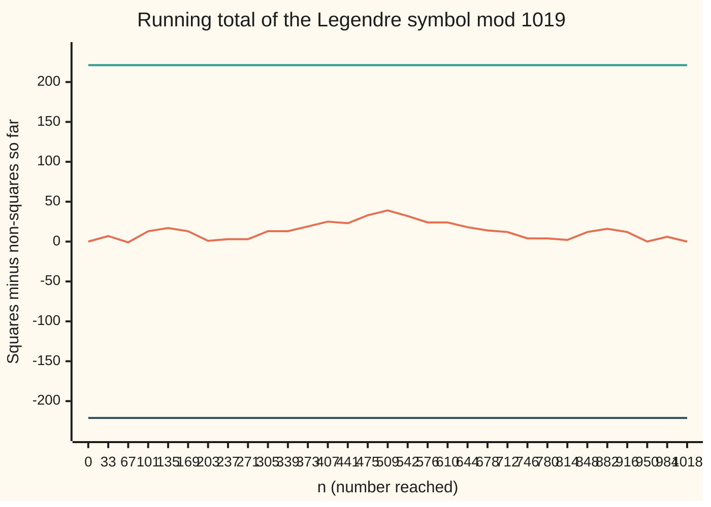

# Polya-Vinogradov: a character sum over any stretch of numbers is at most about root q times log q

[Syllabus](../../../SYLLABUS.md) → [Algebraic and analytic number theory](../README.md) → [Characters and L-functions](../README.md#s03) → Polya-Vinogradov

---

## General Overview

Take the prime 1019 and walk along the numbers 1, 2, 3, … up to 1018. At each number, step up by 1 if it is a square on the 1019-clock and down by 1 if it is not. Halfway, at n = 509, the walk has seen 274 squares and 235 non-squares. It stands at 39, and that is as high as it ever gets. It never goes lower than −1.

So any stretch of consecutive numbers on this clock has at most 40 more squares than non-squares, or the other way round. A theorem of George Pólya and Ivan Vinogradov, both 1918, gives a bound of that kind with no walking: every stretch is out of balance by less than $`\sqrt{1019}\,\log 1019 = 221.1`$. Here log is the natural logarithm, ln.

The bound is not sharp: 40 is less than a fifth of 221.1. Its strength is that it holds for every stretch and every prime. That makes it a working tool. It shows the least non-square on a prime clock is fairly small: mod 1009 the numbers 2 to 10 are all squares, and 11 is the first that is not. It also hides a surprise: the 39 at the halfway point is exactly 3 times 13, and 13 is a class number, a count from the theory of quadratic forms.

**On a prime clock of size q, the square-or-not pattern is a blend of steady turns round a circle, each with weight one over root q. A steady turn summed over any stretch circles back and stays small, so every stretch of the pattern totals less than root q times log q.**

**What kind of fact this is:** a theorem, proved on this card in Why it works for every non-principal character to a prime modulus; for a composite modulus, two inputs are stated with a source. The class-number identity behind the 39 is quoted with a source and counted by the code for 154 primes. The least non-residue bound is proved in a weak form and stated in its strongest form. Whether that least non-residue is below every small power of p is open as of 2026-11-24.

### The picture: the walk mod 1019 against the bound



Orange: the running total S(n), sampled at 31 points. Green and dark blue: the bound +221.1 and −221.1 that no stretch can cross. The walk is a mirror image about n = 509, and it peaks there at 39.

---

## The formula

Notation first, in words. The **modulus** q is the clock size; on this card it is mostly a prime p. A **Dirichlet character** χ (chi) mod q is a pattern on the whole numbers that repeats every q steps and respects multiplication ([Dirichlet characters](01-dirichlet-characters.md)). Its complex conjugate is $`\overline{\chi}`$. The **principal character** $`\chi_0`$ is 1 on every number coprime to q and 0 elsewhere.

The **Legendre symbol** $`\left(\frac{n}{p}\right)`$ is +1 on the nonzero squares mod p, −1 on the non-squares and 0 on multiples of p ([Quadratic residues](02-quadratic-residues-and-the-legendre-symbol.md)). A non-square is called a **non-residue**. The symbol is the real non-principal character mod p.

A **stretch** is a run of consecutive whole numbers $`M < n \le M + N`$: it starts after M and has length N. Write $`S(n)`$ for the running total of the symbol from 1 to n.

The **Pólya–Vinogradov inequality**: for every primitive character χ mod q, with q at least 3, and every stretch,

```math
\Big\lvert \sum_{M < n \le M+N} \chi(n) \Big\rvert < \sqrt{q}\,\log q
```

**Read it aloud:** add the character over any stretch of consecutive numbers, and the total has size less than root q times the log of q.

Mod 1019 the bound is 221.108664045, and the largest stretch total is 40, over n = 68 to 509.

The proof rests on one identity. Write $`\zeta_q = e^{2\pi i/q}`$ for the root of unity a q-th of a turn round the circle, and $`g(\chi) = \sum_{a} \chi(a)\,\zeta_q^{\,a}`$ for the **Gauss sum** of χ ([Gauss sums](06-gauss-sums.md)). A character is **primitive** when it does not come from a character to a smaller modulus. Every non-principal character mod a prime is primitive. For a primitive χ,

```math
\chi(n) = \frac{1}{g(\overline{\chi})} \sum_{a=1}^{q-1} \overline{\chi}(a)\, \zeta_q^{\,an} \quad \text{for every whole number } n
```

**Read it aloud:** the character is a blend of the q − 1 rotations n ↦ ζ to the a n, with weights the conjugate character divided by its Gauss sum.

The proof then walks a chain of three bounds. Here $`H_m = 1 + \frac12 + \dots + \frac1m`$ is the **harmonic sum**:

```math
\Big\lvert \sum_{M < n \le M+N} \chi(n) \Big\rvert \le \frac{1}{\sqrt{q}} \sum_{a=1}^{q-1} \frac{1}{\sin(\pi a/q)} \le \sqrt{q}\, H_{(q-1)/2} < \sqrt{q}\,\log q
```

**Read it aloud:** the stretch total is at most the sum of one over the sines, divided by root q; that is at most root q times a harmonic sum; and that is less than root q log q.

Mod 1019 the chain reads 40 ≤ 143.315262210 ≤ 217.407928900 < 221.108664045.

| Symbol | Plain meaning | In our example | Push it up and the answer… |
| --- | --- | --- | --- |
| $`q`$, $`p`$ | the modulus; a prime modulus | p = 1019 | the bound grows like root q log q |
| $`\chi`$, $`\overline{\chi}`$, $`\chi_0`$ | a character; its conjugate; the principal character | the Legendre symbol mod 1019, its own conjugate | — |
| $`\left(\frac{n}{p}\right)`$ | the Legendre symbol: +1 square, −1 non-square, 0 at multiples of p | + − + + + − − − + − + + for n = 1 to 12 | — |
| $`M`$, $`N`$, $`n`$ | where the stretch starts, its length, a number in it | M = 67, N = 442 for the largest stretch | a longer stretch does not raise the bound |
| $`S(n)`$ | running total of the symbol from 1 to n | S(509) = 39, S(67) = −1 | — |
| $`\zeta_q`$, $`i`$, $`e`$ | $`e^{2\pi i/q}`$; the square root of −1; Euler's number, the base of ln | $`\zeta_{1019}`$ | — |
| $`g(\chi)`$ | the Gauss sum of χ, of size $`\sqrt{q}`$ when χ is primitive | 31.921779399i | a bigger Gauss sum means smaller weights |
| $`a`$, $`b`$, $`x`$, $`k`$ | a frequency, 1 to q − 1; in Step 1, the product an mod p; any whole number; in Step 5, the least whole number above $`p/n_p`$ | a = 1 to 1018 | — |
| $`H_m`$, $`\gamma`$ | the harmonic sum $`1 + \frac12 + \dots + \frac1m`$; Euler's constant, the limit of $`H_m - \log m`$ | $`H_{509}`$, with 1019 times it 6940.047945957 | grows like log m |
| $`h(-p)`$ | the class number of discriminant −p, a count of reduced quadratic forms | 13 | — |
| $`n_p`$, $`m`$, $`\varepsilon`$ | the least non-residue mod p; a cut-off below which all numbers are assumed squares; a small positive exponent | $`n_{1009} = 11`$ | — |
| $`B(N, m)`$ | how many n up to N have a prime factor at least m | used in Step 5 | more such n weakens the argument |

### When it holds

- **The character is not principal.** The principal character mod 1019 adds to 1018 over n = 1 to 1018, far over 221.1. Nothing cancels.
- **The numbers are consecutive.** Over the squares $`n^2`$ for n = 1 to 509 the symbol is always +1, so the total is 509. The proof needs the stretch to be a geometric series of each rotation.
- **The character is primitive.** The character mod 8 that comes from the one mod 4 has Gauss sum 0, so the expansion would divide by 0. Davenport's chapter 23 (Sources) treats such characters through the primitive character behind them.
- **The stretch is longer than the bound.** A stretch of length N can never be off by more than N. For mod 1019 the theorem says something new only when N is above 221.
- **The constant is explicit.** The bound has constant 1, with no hidden factor, for every q from 3 up. The proof below gives it in full for a prime q.

---

## Why it works

### Step 0: the idea

A sum of a character over a stretch is hard to control, because the character's values look random. A single rotation is easy: $`\zeta_q^{\,an}`$ turns by the same angle at each step, so its sum over a stretch is a geometric series that circles back and stays small.

So write the character as a blend of rotations. The Gauss sum makes this possible, and it makes every weight small: size $`1/\sqrt{q}`$. There are q − 1 rotations. Their stretch sums are bounded by $`1/\sin(\pi a/q)`$, and those add up to about $`q\log q`$. Divide by root q and the result is root q log q.

### Step 1: the character is a blend of rotations

Take a prime p and a non-principal χ mod p. Fix n with p not dividing n. Put b = an. As a runs over 1 to p − 1, so does b mod p. Since $`\overline{\chi}`$ respects multiplication and $`\overline{\chi}(n) = 1/\chi(n)`$, we get $`\overline{\chi}(a) = \chi(n)\,\overline{\chi}(b)`$, and the sum pulls apart:

```math
\sum_{a=1}^{p-1} \overline{\chi}(a)\,\zeta_p^{\,an} = \chi(n) \sum_{b=1}^{p-1} \overline{\chi}(b)\,\zeta_p^{\,b} = \chi(n)\, g(\overline{\chi})
```

**Read it aloud:** weighting the rotation at speed a n by the conjugate character gives the character at n times the Gauss sum.

If p divides n, every rotation sits at 1, and the conjugate character adds to 0 over a full period. That is $`\chi(n) = 0`$ again. [Gauss sums](06-gauss-sums.md) proves $`\lvert g(\overline{\chi})\rvert = \sqrt{p}`$, so g is not 0 and we may divide by it. That gives the expansion in The formula. [The functional equation of L(s, chi)](09-dirichlet-l-functions-functional-equation.md) uses the same expansion in its Step 1.

Mod 1019 the Gauss sum of the Legendre symbol is 31.921779399i, which is $`i\sqrt{1019}`$, as 1019 leaves 3 on division by 4. The code rebuilds all 1019 symbols from the 1018 rotations, each to within $`10^{-9}`$.

### Step 2: one rotation over a stretch is a short geometric series

Add the expansion over the stretch and swap the two sums:

```math
\sum_{M < n \le M+N} \chi(n) = \frac{1}{g(\overline{\chi})} \sum_{a=1}^{q-1} \overline{\chi}(a) \sum_{M < n \le M+N} \zeta_q^{\,an}
```

**Read it aloud:** the stretch total is the Gauss-sum-weighted blend of each rotation's own stretch total.

The inner sum is a geometric series with ratio $`\zeta_q^{\,a}`$. For any whole number x, $`\lvert \zeta_q^{\,x} - 1\rvert = 2\lvert\sin(\pi x/q)\rvert`$: that is the chord from 1 to the root. So

```math
\Big\lvert \sum_{M < n \le M+N} \zeta_q^{\,an} \Big\rvert = \frac{\lvert \zeta_q^{\,aN} - 1\rvert}{\lvert \zeta_q^{\,a} - 1\rvert} = \frac{\lvert\sin(\pi a N/q)\rvert}{\sin(\pi a/q)} \le \frac{1}{\sin(\pi a/q)}
```

**Read it aloud:** a rotation summed over N steps has size the chord after N steps over the chord after one step, which is at most one over the sine of pi a over q.

The code sums the stretch 1 to 509 this way, through the 1018 closed forms, and gets 39.000000000. The stretch 68 to 509 gives 40.000000000. Both match the direct count.

### Step 3: the start and length drop out

The weights have size $`\lvert\overline{\chi}(a)\rvert / \lvert g\rvert = 1/\sqrt{q}`$. Put that and Step 2 into the triangle inequality (the size of a sum is at most the sum of the sizes):

```math
\Big\lvert \sum_{M < n \le M+N} \chi(n) \Big\rvert \le \frac{1}{\sqrt{q}} \sum_{a=1}^{q-1} \frac{1}{\sin(\pi a/q)}
```

**Read it aloud:** the stretch total is at most one over root q times the sum of one over the sines.

Neither M nor N is left on the right. One number bounds every stretch at once. Mod 1019 the sum of the 1018 cosecants (a cosecant is one over a sine) is 4574.878184774, and over root 1019 that is 143.315262210.

### Step 4: the cosecants add to less than q log q

Two estimates finish the proof. Pair a with q − a: they have the same sine, so the sum is twice the sum over a up to (q − 1)/2. On that range $`\sin(\pi a/q) \ge 2a/q`$, because the sine curve lies above its chord from 0 to π/2. So

```math
\sum_{a=1}^{q-1} \frac{1}{\sin(\pi a/q)} \le 2 \sum_{a=1}^{(q-1)/2} \frac{q}{2a} = q\, H_{(q-1)/2}
```

**Read it aloud:** the cosecant sum is at most q times the harmonic sum up to half of q.

Then $`H_m < \log(2m + 1)`$, from the midpoint rule for the curve 1/x (fold below). With m = (q − 1)/2 that is log q. Mod 1019: 4574.878184774 ≤ 6940.047945957 < 7058.181996854, which is 1019 log 1019. Divide by root 1019: 143.315262210 ≤ 217.407928900 < 221.108664045.

<details>
<summary>Detailed proof: the two estimates, and the composite modulus</summary>

**The sine above its chord.** On $`0 \le x \le \pi/2`$ the sine is concave (it bends down), so it lies above the straight line from (0, 0) to (π/2, 1). That line is $`2x/\pi`$. Put $`x = \pi a/q`$ with $`a \le q/2`$:

$`\displaystyle \sin\frac{\pi a}{q} \ge \frac{2a}{q}.`$

**The harmonic sum.** The curve 1/x is convex (it bends up), so on each interval from a − 1/2 to a + 1/2 its average is more than its value at the middle:

$`\displaystyle \frac{1}{a} < \int_{a-1/2}^{a+1/2} \frac{dx}{x}, \qquad H_m < \int_{1/2}^{m+1/2} \frac{dx}{x} = \log(2m+1).`$

**An even modulus.** For even q the middle term a = q/2 has sine 1 and stays on its own. The pairs give at most $`q\,H_{q/2-1} < q\log(q-1)`$, so the cosecant sum is below $`q\log(q-1) + 1`$. That is below $`q \log q`$, because $`\log\frac{q}{q-1} > \frac{1}{q}`$.

**A composite modulus.** Steps 2 to 4 never use that q is prime. Step 1 uses it twice: to get $`\lvert g(\overline{\chi})\rvert = \sqrt{q}`$, and to get 0 on the left when n shares a factor with q. For a primitive character to any modulus both facts hold. Montgomery and Vaughan prove them in chapter 9 (Sources). The Gauss sum card proves the first for primes only.

</details>

### Step 5: the least non-residue

Write $`n_p`$ for the least non-residue mod p. Three bounds, from weakest to strongest at p = 1009:

1. **Direct.** If 1 to N are all squares, the stretch 1 to N totals N. The theorem says N < root p log p, which is 219.707795021 for p = 1009. So $`n_{1009} \le 220`$.
2. **Vinogradov's trick.** Suppose every n below m is a square. The symbol multiplies, so every n whose prime factors are all below m is a square too. Only an n with a prime factor at least m can be −1. Call the count of those $`B(N, m)`$. Then the total from 1 to N is at least $`N - 2B(N, m)`$. If that reaches the bound, the assumption is false. At p = 1009 this first happens at m = 72, so $`n_{1009} \le 71`$.
3. **Elementary.** Let k be the least whole number above $`p/n_p`$. Then $`0 < k\,n_p - p < n_p`$, so $`k\,n_p - p`$ is a square: it is a positive number below $`n_p`$. It equals $`k\,n_p`$ on the clock, and $`n_p`$ is a non-residue, so k is a non-residue too. Hence $`k \ge n_p`$. That gives $`n_p < \sqrt{p} + 1`$, here 32.764760349.

The truth is 11. At this size the elementary bound wins. The trick wins in the long run. The count $`B(N, m)`$ is about N times $`\log(\log N/\log m)`$, so the trick fires once m passes about $`N^{1/\sqrt{e}}`$. Taking N near root p log p gives Vinogradov's bound: for every ε > 0 and every large enough p,

```math
n_p < p^{1/(2\sqrt{e}) + \varepsilon}
```

**Read it aloud:** the least non-residue is below p to the power one over two root e, plus any small ε, once p is large.

The exponent is 0.303265330, against 0.5 for the elementary bound. Burgess (1957, Sources) halved it to 0.151632665 with a sharper bound for short stretches.

### Step 6: why the walk peaks at 39

For p = 1019, −1 is a non-residue, so $`\left(\frac{p-n}{p}\right) = -\left(\frac{n}{p}\right)`$. The walk back from 1018 is the walk forward with the sign flipped. Since S(1018) = 0, the walk is a mirror image about 509, as in the chart.

The value at the middle is a class number. For a prime p > 3 that leaves 3 on division by 4,

```math
S\Big(\frac{p-1}{2}\Big) = \Big(2 - \Big(\frac{2}{p}\Big)\Big)\, h(-p)
```

**Read it aloud:** the running total at half the clock is the class number of minus p, times 3 when 2 is a non-residue and times 1 when it is a square.

1019 is 3 mod 8, so 2 is a non-residue and the factor is 3. The code counts 13 reduced forms of discriminant −1019, and 3 × 13 = 39 = S(509). It confirms the identity for all 154 such primes from 7 to 2,000. The identity comes from the class number formula, quoted from Davenport's chapter 6 (Sources). Since $`h(-p) \ge 1`$, for every such prime the first half of the clock holds more squares than non-squares.

---

## Worked numbers, by hand

The prime is 1019 and χ is the Legendre symbol.

| Step | Arithmetic | Value |
| --- | --- | --- |
| 1019 mod 8 | 1019 = 8 × 127 + 3 | 3 |
| symbols, n = 1 to 12 | Euler's criterion | + − + + + − − − + − + + |
| first half | 274 squares, 235 non-squares in 1 to 509 | S(509) = 39 |
| lowest point | S(67) | −1 |
| largest stretch | S(509) − S(67), over 68 to 509 | 40 |
| Gauss sum | $`i\sqrt{1019}`$ | 31.921779399i |
| cosecant sum | sum of 1/sin(πa/1019), a = 1 to 1018 | 4574.878184774 |
| first bound | 4574.878184774 / 31.921779399 | 143.315262210 |
| harmonic bound | 1019 × $`H_{509}`$ / 31.921779399 | 217.407928900 |
| Pólya–Vinogradov | 31.921779399 × ln 1019 | **221.108664045** |

No stretch mod 1019 is out of balance by more than 221.1; the worst one is out by 40, which is 0.180906525 of the bound.

### What breaks if you drop a piece

| Mistake | Comes out at | What went wrong |
| --- | --- | --- |
| Use the principal character | 1018 over n = 1 to 1018 | No cancellation: every value is 1 |
| Sum over squares $`n^2`$, not a stretch | 509 over n = 1 to 509 | Each value is +1; no geometric series to use |
| Forget to divide by the Gauss sum | 4574.878184774, not 143.315262210 | The weights have size $`1/\sqrt{q}`$, not 1 |
| Expand a character mod 8 that comes from mod 4 | Gauss sum 0 | Not primitive: the expansion divides by 0 |

---

## Code, from first principles, and it actually runs

Both programs use only the standard library: integers, sine, cosine and log. They take five roads. Road one adds the symbol over every stretch mod 1019 by brute force. Road two rebuilds the symbol from its Gauss sum and sums the stretch in closed form. Road three walks the proof's chain of bounds for 1019, and checks its harmonic sum against Euler's expansion $`\log m + \gamma + \frac{1}{2m} - \frac{1}{12m^2}`$. It then checks the theorem itself, largest stretch against bound, for all 429 odd primes below 3,000 and for a complex character mod 1019. Road four counts reduced quadratic forms to reach the class number 13 without the walk. Road five finds the least non-residue mod 1009 and the three bounds on it.

### Python

```python
# Polya-Vinogradov: a character sum over any stretch is below sqrt(q) log q -- the check behind the card.
# Road 1 adds the Legendre symbol (n/1019) over every stretch by brute force.  Road 2 rebuilds
# the symbol from its Gauss sum (the finite Fourier expansion) and sums the stretch in closed form.
# Road 3 walks the proof's chain of bounds.  Road 4 counts reduced quadratic forms to get the class
# number 13 another way.  Road 5 bounds the least non-residue mod 1009 and compares with the truth.
import math

def leg(a, p):                                  # Legendre symbol by Euler's criterion
    r = pow(a, (p - 1) // 2, p)
    return 0 if r == 0 else (1 if r == 1 else -1)
def isprime(n): return n > 1 and all(n % d for d in range(2, math.isqrt(n) + 1))
def f(x): return f"{x + 0.0:.9f}"
def sums(p): return list(acc(p))
def acc(p):                                     # partial sums S(0), S(1), ..., S(p - 1)
    s = 0; yield 0
    for n in range(1, p): s += leg(n, p); yield s
def classno(D):                                 # reduced forms ax^2 + bxy + cy^2 of discriminant D < 0
    h = 0
    for a in range(1, math.isqrt(-D // 3) + 1):
        for b in range(-a + 1, a + 1):
            if (b * b - D) % (4 * a) == 0:
                c = (b * b - D) // (4 * a)
                if c >= a and not (b < 0 and a == c) and math.gcd(math.gcd(a, abs(b)), c) == 1: h += 1
    return h

p = 1019; S = sums(p); bound = math.sqrt(p) * math.log(p)
top = max(S); n_top = S.index(top); low = min(S); n_low = S.index(low)
print(f"p = {p} = 8 x {p // 8} + {p % 8};  (n/{p}) for n = 1..12: " + " ".join("+" if leg(n, p) > 0 else "-" for n in range(1, 13)))
print(f"partial sums S(n): largest {top} at n = {n_top}, smallest {low} at n = {n_low};  S({p - 1}) = {S[-1]}")
res = sum(1 for n in range(1, n_top + 1) if leg(n, p) > 0)
print(f"n = 1..{n_top}: {res} residues, {n_top - res} non-residues, difference {2 * res - n_top}")
print(f"largest stretch sum: {top - low}, over n = {n_low + 1}..{n_top} (M = {n_low}, N = {n_top - n_low})")
print(f"bound sqrt({p}) ln {p} = {f(bound)};  largest stretch / bound = {f((top - low) / bound)}")
assert top == 39 and n_top == 509 and top - low == 40 and S[-1] == 0

# Road 2: the Fourier expansion through the Gauss sum g = sum (a/p) zeta^a
z = [complex(math.cos(2 * math.pi * k / p), math.sin(2 * math.pi * k / p)) for k in range(p)]
g = sum(leg(a, p) * z[a] for a in range(1, p))
err = max(abs(sum(leg(a, p) * z[a * n % p] for a in range(1, p)) / g - leg(n, p)) for n in range(p))
print(f"g = {f(g.real)} + {f(g.imag)}i;  sqrt {p} = {f(math.sqrt(p))};  expansion rebuilds every (n/{p}), worst error below 1e-9: {'yes' if err < 1e-9 else 'no'}")
def geo(a, M, N):                               # sum of zeta^(a n) for M < n <= M + N, closed form
    t = math.pi * a / p
    return complex(math.cos(t * (2 * M + N + 1)), math.sin(t * (2 * M + N + 1))) * math.sin(t * N) / math.sin(t)
four = sum(leg(a, p) * geo(a, 0, n_top) for a in range(1, p)) / g
four2 = sum(leg(a, p) * geo(a, n_low, n_top - n_low) for a in range(1, p)) / g
print(f"S({n_top}) through the expansion: {f(four.real)};  stretch {n_low + 1}..{n_top}: {f(four2.real)}")
assert abs(g.real) < 1e-8 and abs(g.imag - math.sqrt(p)) < 1e-8 and err < 1e-9 and abs(four - 39) < 1e-8 and abs(four2 - 40) < 1e-8

# Road 3: the chain of bounds in the proof
csc = sum(1 / math.sin(math.pi * a / p) for a in range(1, p)); H = sum(1 / a for a in range(1, (p - 1) // 2 + 1))
print(f"sum of 1/sin(pi a/{p}), a = 1..{p - 1}: {f(csc)};  {p} x H_{(p - 1) // 2} = {f(p * H)};  {p} ln {p} = {f(p * math.log(p))}")
print(f"so |stretch| <= {f(csc / math.sqrt(p))} <= {f(p * H / math.sqrt(p))} < {f(bound)}")
assert top - low < csc / math.sqrt(p) < p * H / math.sqrt(p) < bound
mh = (p - 1) // 2                               # H_m against Euler's expansion log m + gamma + 1/(2m) - 1/(12 m^2)
assert abs(H - (math.log(mh) + 0.5772156649015329 + 1 / (2 * mh) - 1 / (12 * mh * mh))) < 1e-9
worst, wp, cnt = 0.0, 0, 0
for q in range(3, 3000):
    if isprime(q):
        T = sums(q); r = (max(T) - min(T)) / (math.sqrt(q) * math.log(q)); cnt += 1
        if r > worst: worst, wp = r, q
print(f"all {cnt} odd primes below 3,000: largest stretch / (sqrt p ln p) is at most {f(worst)}, at p = {wp}")
assert worst < 1
r0 = next(r for r in range(2, p) if all(pow(r, (p - 1) // d, p) != 1 for d in (2, 509)))
ind = {pow(r0, k, p): k for k in range(p - 1)}; w, best = [0j], 0.0
for n in range(1, p):
    k = ind[n]; w.append(w[-1] + complex(math.cos(2 * math.pi * k / (p - 1)), math.sin(2 * math.pi * k / (p - 1))))
for i in range(p):
    for j in range(i + 1, p): best = max(best, abs(w[j] - w[i]))
print(f"complex character of order {p - 1} (chi({r0}) = zeta_{p - 1}): largest stretch {f(best)}")
assert best < bound

# Road 4: the 39 is three class numbers
h = classno(-p); ok, cnt = True, 0
for q in range(7, 2000):
    if isprime(q) and q % 4 == 3:
        cnt += 1; ok = ok and sums(q)[(q - 1) // 2] == (2 - leg(2, q)) * classno(-q)
print(f"class number of discriminant -{p} by reduced forms: {h};  3 x {h} = {3 * h} = S({(p - 1) // 2})")
print(f"S((p-1)/2) = (2 - (2/p)) h(-p) for all {cnt} primes p = 3 mod 4 from 7 to 2,000: {'yes' if ok else 'no'}")
assert h == 13 and 3 * h == top and ok

# Road 5: the least non-residue mod 1009
q = 1009; B = math.sqrt(q) * math.log(q)
n_q = next(n for n in range(2, q) if leg(n, q) < 0)
print(f"mod {q}: (n/{q}) for n = 2..{n_q}: " + " ".join("+" if leg(n, q) > 0 else "-" for n in range(2, n_q + 1)) + f";  least non-residue {n_q}")
big = [1] * q                                   # largest prime factor of each n below q
for d in range(2, q):
    if big[d] == 1:
        for k in range(d, q, d): big[k] = d
m = next(m for m in range(2, q) if max(N - 2 * sum(1 for n in range(2, N + 1) if big[n] >= m) for N in range(1, q)) >= B)
print(f"bounds on it: sqrt {q} ln {q} = {f(B)}, so direct Polya-Vinogradov {math.floor(B) + 1};  Vinogradov's trick {m - 1};  elementary sqrt {q} + 1 = {f(math.sqrt(q) + 1)};  true {n_q}")
print(f"exponents of p: elementary 0.5;  Vinogradov 1/(2 sqrt e) = {f(1 / (2 * math.sqrt(math.e)))};  Burgess 1/(4 sqrt e) = {f(1 / (4 * math.sqrt(math.e)))}")
assert n_q == 11 and m - 1 == 71 and n_q <= m - 1 < math.sqrt(q) * math.log(q) and m - 1 > math.sqrt(q) + 1

# What breaks
print(f"break, principal character mod {p}, n = 1..{p - 1}: {p - 1}, over the bound {f(bound)}")
sq = sum(leg(n * n, p) for n in range(1, n_top + 1))
print(f"break, (n^2/{p}) over n = 1..{n_top}, squares not a stretch: {sq}")
print(f"break, forget to divide by |g|: {f(csc)}, not {f(csc / math.sqrt(p))}")
z8 = [complex(math.cos(math.pi * k / 4), math.sin(math.pi * k / 4)) for k in range(8)]
g8 = sum(c * z8[a] for a, c in enumerate([0, 1, 0, -1, 0, 1, 0, -1]))
print(f"break, character mod 8 lifted from mod 4: g = {f(abs(g8))}, so the expansion divides by 0")
assert p - 1 > bound and sq == n_top and abs(g8) < 1e-12

for q in (1031, 100003):
    T = sums(q)
    print(f"try: p = {q} = {q % 8} mod 8: largest S = {max(T)} at n = {T.index(max(T))}, S({(q - 1) // 2}) = {T[(q - 1) // 2]}, stretch {max(T) - min(T)}, bound {f(math.sqrt(q) * math.log(q))}, h(-p) = {classno(-q)}, least non-residue {next(n for n in range(2, q) if leg(n, q) < 0)}")
print("chart, n: " + " ".join(str(k * (p - 1) // 30) for k in range(31)))
print("chart, S: " + " ".join(str(S[k * (p - 1) // 30]) for k in range(31)))
print("ALL CHECKS PASS")
```

**Ran 2026-11-24 on macOS, Python 3.14.10, standard library only. All checks passed. Output, pasted from the run:**

```
p = 1019 = 8 x 127 + 3;  (n/1019) for n = 1..12: + - + + + - - - + - + +
partial sums S(n): largest 39 at n = 509, smallest -1 at n = 67;  S(1018) = 0
n = 1..509: 274 residues, 235 non-residues, difference 39
largest stretch sum: 40, over n = 68..509 (M = 67, N = 442)
bound sqrt(1019) ln 1019 = 221.108664045;  largest stretch / bound = 0.180906525
g = 0.000000000 + 31.921779399i;  sqrt 1019 = 31.921779399;  expansion rebuilds every (n/1019), worst error below 1e-9: yes
S(509) through the expansion: 39.000000000;  stretch 68..509: 40.000000000
sum of 1/sin(pi a/1019), a = 1..1018: 4574.878184774;  1019 x H_509 = 6940.047945957;  1019 ln 1019 = 7058.181996854
so |stretch| <= 143.315262210 <= 217.407928900 < 221.108664045
all 429 odd primes below 3,000: largest stretch / (sqrt p ln p) is at most 0.555738860, at p = 5
complex character of order 1018 (chi(2) = zeta_1018): largest stretch 46.184157537
class number of discriminant -1019 by reduced forms: 13;  3 x 13 = 39 = S(509)
S((p-1)/2) = (2 - (2/p)) h(-p) for all 154 primes p = 3 mod 4 from 7 to 2,000: yes
mod 1009: (n/1009) for n = 2..11: + + + + + + + + + -;  least non-residue 11
bounds on it: sqrt 1009 ln 1009 = 219.707795021, so direct Polya-Vinogradov 220;  Vinogradov's trick 71;  elementary sqrt 1009 + 1 = 32.764760349;  true 11
exponents of p: elementary 0.5;  Vinogradov 1/(2 sqrt e) = 0.303265330;  Burgess 1/(4 sqrt e) = 0.151632665
break, principal character mod 1019, n = 1..1018: 1018, over the bound 221.108664045
break, (n^2/1019) over n = 1..509, squares not a stretch: 509
break, forget to divide by |g|: 4574.878184774, not 143.315262210
break, character mod 8 lifted from mod 4: g = 0.000000000, so the expansion divides by 0
try: p = 1031 = 7 mod 8: largest S = 51 at n = 441, S(515) = 35, stretch 51, bound 222.782685863, h(-p) = 35, least non-residue 7
try: p = 100003 = 3 mod 8: largest S = 263 at n = 40001, S(50001) = 117, stretch 409, bound 3640.770797130, h(-p) = 39, least non-residue 2
chart, n: 0 33 67 101 135 169 203 237 271 305 339 373 407 441 475 509 542 576 610 644 678 712 746 780 814 848 882 916 950 984 1018
chart, S: 0 7 -1 13 17 13 1 3 3 13 13 19 25 23 33 39 32 24 24 18 14 12 4 4 2 12 16 12 0 6 0
ALL CHECKS PASS
```

### Rust

Same numbers, same labels, built with `rustc --edition 2021 -O`.

```rust
// Polya-Vinogradov: a character sum over any stretch is below sqrt(q) log q -- the same check as the
// Python, in Rust.  No crates.  Road 1 adds the Legendre symbol (n/1019) over every stretch by brute
// force.  Road 2 rebuilds the symbol from its Gauss sum (the finite Fourier expansion) and sums the
// stretch in closed form.  Road 3 walks the proof's chain of bounds.  Road 4 counts reduced quadratic
// forms to get the class number 13 another way.  Road 5 bounds the least non-residue mod 1009.
use std::f64::consts::{E, PI};
#[derive(Clone, Copy)]
struct C(f64, f64);
impl C {
    fn add(self, o: C) -> C { C(self.0 + o.0, self.1 + o.1) }
    fn sub(self, o: C) -> C { C(self.0 - o.0, self.1 - o.1) }
    fn scale(self, k: f64) -> C { C(self.0 * k, self.1 * k) }
    fn div(self, o: C) -> C { let d = o.0 * o.0 + o.1 * o.1; C((self.0 * o.0 + self.1 * o.1) / d, (self.1 * o.0 - self.0 * o.1) / d) }
    fn abs(self) -> f64 { (self.0 * self.0 + self.1 * self.1).sqrt() }
}
fn cis(t: f64) -> C { C(t.cos(), t.sin()) }
fn modpow(mut b: i64, mut e: i64, m: i64) -> i64 {
    let mut r = 1 % m; b %= m;
    while e > 0 { if e & 1 == 1 { r = r * b % m; } b = b * b % m; e >>= 1; } r
}
fn leg(a: i64, p: i64) -> i64 { let r = modpow(a, (p - 1) / 2, p); if r == 0 { 0 } else if r == 1 { 1 } else { -1 } }
fn isqrt(n: i64) -> i64 { let mut r = (n as f64).sqrt() as i64; while r * r > n { r -= 1; } while (r + 1) * (r + 1) <= n { r += 1; } r }
fn isprime(n: i64) -> bool { n > 1 && (2..=isqrt(n)).all(|d| n % d != 0) }
fn gcd(a: i64, b: i64) -> i64 { if b == 0 { a } else { gcd(b, a % b) } }
fn f(x: f64) -> String { format!("{:.9}", x + 0.0) }
fn yn(b: bool) -> &'static str { if b { "yes" } else { "no" } }
fn sg(v: i64) -> &'static str { if v > 0 { "+" } else { "-" } }
fn sums(p: i64) -> Vec<i64> {                    // partial sums S(0), S(1), ..., S(p - 1)
    let mut v = vec![0i64];
    for n in 1..p { let s = v[v.len() - 1] + leg(n, p); v.push(s); } v
}
fn imax(v: &[i64]) -> i64 { *v.iter().max().unwrap() }
fn imin(v: &[i64]) -> i64 { *v.iter().min().unwrap() }
fn pos(v: &[i64], x: i64) -> usize { v.iter().position(|&y| y == x).unwrap() }
fn classno(d: i64) -> i64 {                      // reduced forms ax^2 + bxy + cy^2 of discriminant d < 0
    let mut h = 0;
    for a in 1..=isqrt(-d / 3) { for b in (-a + 1)..=a {
        if (b * b - d) % (4 * a) == 0 {
            let c = (b * b - d) / (4 * a);
            if c >= a && !(b < 0 && a == c) && gcd(gcd(a, b.abs()), c) == 1 { h += 1; }
        }
    } }
    h
}
fn main() {
    let p = 1019i64; let s = sums(p); let bound = (p as f64).sqrt() * (p as f64).ln();
    let (top, low) = (imax(&s), imin(&s)); let (n_top, n_low) = (pos(&s, top) as i64, pos(&s, low) as i64);
    println!("p = {} = 8 x {} + {};  (n/{}) for n = 1..12: {}", p, p / 8, p % 8, p, (1..13).map(|n| sg(leg(n, p))).collect::<Vec<_>>().join(" "));
    println!("partial sums S(n): largest {} at n = {}, smallest {} at n = {};  S({}) = {}", top, n_top, low, n_low, p - 1, s[s.len() - 1]);
    let res = (1..=n_top).filter(|&n| leg(n, p) > 0).count() as i64;
    println!("n = 1..{}: {} residues, {} non-residues, difference {}", n_top, res, n_top - res, 2 * res - n_top);
    println!("largest stretch sum: {}, over n = {}..{} (M = {}, N = {})", top - low, n_low + 1, n_top, n_low, n_top - n_low);
    println!("bound sqrt({}) ln {} = {};  largest stretch / bound = {}", p, p, f(bound), f((top - low) as f64 / bound));
    assert!(top == 39 && n_top == 509 && top - low == 40 && s[s.len() - 1] == 0);

    // Road 2: the Fourier expansion through the Gauss sum g = sum (a/p) zeta^a
    let z: Vec<C> = (0..p).map(|k| cis(2.0 * PI * k as f64 / p as f64)).collect();
    let mut g = C(0.0, 0.0);
    for a in 1..p { g = g.add(z[a as usize].scale(leg(a, p) as f64)); }
    let mut err = 0.0f64;
    for n in 0..p {
        let mut t = C(0.0, 0.0);
        for a in 1..p { t = t.add(z[(a * n % p) as usize].scale(leg(a, p) as f64)); }
        err = err.max(t.div(g).sub(C(leg(n, p) as f64, 0.0)).abs());
    }
    println!("g = {} + {}i;  sqrt {} = {};  expansion rebuilds every (n/{}), worst error below 1e-9: {}", f(g.0), f(g.1), p, f((p as f64).sqrt()), p, yn(err < 1e-9));
    let geo = |a: i64, m: i64, n: i64| -> C {      // sum of zeta^(a n) for m < n <= m + N, closed form
        let t = PI * a as f64 / p as f64;
        cis(t * (2 * m + n + 1) as f64).scale((t * n as f64).sin() / t.sin())
    };
    let (mut u, mut v) = (C(0.0, 0.0), C(0.0, 0.0));
    for a in 1..p { u = u.add(geo(a, 0, n_top).scale(leg(a, p) as f64)); v = v.add(geo(a, n_low, n_top - n_low).scale(leg(a, p) as f64)); }
    let (four, four2) = (u.div(g), v.div(g));
    println!("S({}) through the expansion: {};  stretch {}..{}: {}", n_top, f(four.0), n_low + 1, n_top, f(four2.0));
    assert!(g.0.abs() < 1e-8 && (g.1 - (p as f64).sqrt()).abs() < 1e-8 && err < 1e-9 && four.sub(C(39.0, 0.0)).abs() < 1e-8 && four2.sub(C(40.0, 0.0)).abs() < 1e-8);

    // Road 3: the chain of bounds in the proof
    let csc: f64 = (1..p).map(|a| 1.0 / (PI * a as f64 / p as f64).sin()).sum();
    let h_: f64 = (1..=(p - 1) / 2).map(|a| 1.0 / a as f64).sum();
    let pf = p as f64;
    println!("sum of 1/sin(pi a/{}), a = 1..{}: {};  {} x H_{} = {};  {} ln {} = {}", p, p - 1, f(csc), p, (p - 1) / 2, f(pf * h_), p, p, f(pf * pf.ln()));
    println!("so |stretch| <= {} <= {} < {}", f(csc / pf.sqrt()), f(pf * h_ / pf.sqrt()), f(bound));
    assert!(((top - low) as f64) < csc / pf.sqrt() && csc / pf.sqrt() < pf * h_ / pf.sqrt() && pf * h_ / pf.sqrt() < bound);
    let mh = ((p - 1) / 2) as f64;                // H_m against Euler's expansion log m + gamma + 1/(2m) - 1/(12 m^2)
    assert!((h_ - (mh.ln() + 0.5772156649015329 + 1.0 / (2.0 * mh) - 1.0 / (12.0 * mh * mh))).abs() < 1e-9);
    let (mut worst, mut wp, mut cnt) = (0.0f64, 0, 0);
    for q in 3..3000 { if isprime(q) {
        let t = sums(q); let r = (imax(&t) - imin(&t)) as f64 / ((q as f64).sqrt() * (q as f64).ln()); cnt += 1;
        if r > worst { worst = r; wp = q; }
    } }
    println!("all {} odd primes below 3,000: largest stretch / (sqrt p ln p) is at most {}, at p = {}", cnt, f(worst), wp);
    assert!(worst < 1.0);
    let r0 = (2..p).find(|&r| [2i64, 509].iter().all(|&d| modpow(r, (p - 1) / d, p) != 1)).unwrap();
    let mut ind = vec![0i64; p as usize];
    for k in 0..p - 1 { ind[modpow(r0, k, p) as usize] = k; }
    let mut w = vec![C(0.0, 0.0)];
    for n in 1..p { let k = ind[n as usize]; let last = w[w.len() - 1]; w.push(last.add(cis(2.0 * PI * k as f64 / (p - 1) as f64))); }
    let mut best = 0.0f64;
    for i in 0..p as usize { for j in i + 1..p as usize { best = best.max(w[j].sub(w[i]).abs()); } }
    println!("complex character of order {} (chi({}) = zeta_{}): largest stretch {}", p - 1, r0, p - 1, f(best));
    assert!(best < bound);

    // Road 4: the 39 is three class numbers
    let h = classno(-p); let (mut ok, mut cnt) = (true, 0);
    for q in 7..2000 { if isprime(q) && q % 4 == 3 {
        cnt += 1; ok = ok && sums(q)[((q - 1) / 2) as usize] == (2 - leg(2, q)) * classno(-q);
    } }
    println!("class number of discriminant -{} by reduced forms: {};  3 x {} = {} = S({})", p, h, h, 3 * h, (p - 1) / 2);
    println!("S((p-1)/2) = (2 - (2/p)) h(-p) for all {} primes p = 3 mod 4 from 7 to 2,000: {}", cnt, yn(ok));
    assert!(h == 13 && 3 * h == top && ok);

    // Road 5: the least non-residue mod 1009
    let q = 1009i64; let bq = (q as f64).sqrt() * (q as f64).ln();
    let n_q = (2..q).find(|&n| leg(n, q) < 0).unwrap();
    println!("mod {}: (n/{}) for n = 2..{}: {};  least non-residue {}", q, q, n_q, (2..=n_q).map(|n| sg(leg(n, q))).collect::<Vec<_>>().join(" "), n_q);
    let mut big = vec![1i64; q as usize];        // largest prime factor of each n below q
    for d in 2..q as usize { if big[d] == 1 { let mut k = d; while k < q as usize { big[k] = d as i64; k += d; } } }
    let m = (2..q).find(|&m| (1..q).map(|nn| nn - 2 * (2..=nn).filter(|&n| big[n as usize] >= m).count() as i64).max().unwrap() as f64 >= bq).unwrap();
    println!("bounds on it: sqrt {} ln {} = {}, so direct Polya-Vinogradov {};  Vinogradov's trick {};  elementary sqrt {} + 1 = {};  true {}", q, q, f(bq), bq.floor() as i64 + 1, m - 1, q, f((q as f64).sqrt() + 1.0), n_q);
    println!("exponents of p: elementary 0.5;  Vinogradov 1/(2 sqrt e) = {};  Burgess 1/(4 sqrt e) = {}", f(1.0 / (2.0 * E.sqrt())), f(1.0 / (4.0 * E.sqrt())));
    assert!(n_q == 11 && m - 1 == 71 && n_q <= m - 1 && ((m - 1) as f64) < bq && (m - 1) as f64 > (q as f64).sqrt() + 1.0);

    // What breaks
    println!("break, principal character mod {}, n = 1..{}: {}, over the bound {}", p, p - 1, p - 1, f(bound));
    let sq: i64 = (1..=n_top).map(|n| leg(n * n, p)).sum();
    println!("break, (n^2/{}) over n = 1..{}, squares not a stretch: {}", p, n_top, sq);
    println!("break, forget to divide by |g|: {}, not {}", f(csc), f(csc / pf.sqrt()));
    let mut g8 = C(0.0, 0.0);
    for (a, c) in [0i64, 1, 0, -1, 0, 1, 0, -1].iter().enumerate() { g8 = g8.add(cis(PI * a as f64 / 4.0).scale(*c as f64)); }
    println!("break, character mod 8 lifted from mod 4: g = {}, so the expansion divides by 0", f(g8.abs()));
    assert!((p - 1) as f64 > bound && sq == n_top && g8.abs() < 1e-12);

    for q in [1031i64, 100003] {
        let t = sums(q); let (mx, mn) = (imax(&t), imin(&t));
        println!("try: p = {} = {} mod 8: largest S = {} at n = {}, S({}) = {}, stretch {}, bound {}, h(-p) = {}, least non-residue {}", q, q % 8, mx, pos(&t, mx), (q - 1) / 2, t[((q - 1) / 2) as usize], mx - mn, f((q as f64).sqrt() * (q as f64).ln()), classno(-q), (2..q).find(|&n| leg(n, q) < 0).unwrap());
    }
    println!("chart, n: {}", (0..31).map(|k| (k * (p - 1) / 30).to_string()).collect::<Vec<_>>().join(" "));
    println!("chart, S: {}", (0..31).map(|k| s[(k * (p - 1) / 30) as usize].to_string()).collect::<Vec<_>>().join(" "));
    println!("ALL CHECKS PASS");
}
```

**Ran 2026-11-24 on macOS, rustc 1.98.1, no crates. All checks passed. Output, pasted from the run:**

```
p = 1019 = 8 x 127 + 3;  (n/1019) for n = 1..12: + - + + + - - - + - + +
partial sums S(n): largest 39 at n = 509, smallest -1 at n = 67;  S(1018) = 0
n = 1..509: 274 residues, 235 non-residues, difference 39
largest stretch sum: 40, over n = 68..509 (M = 67, N = 442)
bound sqrt(1019) ln 1019 = 221.108664045;  largest stretch / bound = 0.180906525
g = 0.000000000 + 31.921779399i;  sqrt 1019 = 31.921779399;  expansion rebuilds every (n/1019), worst error below 1e-9: yes
S(509) through the expansion: 39.000000000;  stretch 68..509: 40.000000000
sum of 1/sin(pi a/1019), a = 1..1018: 4574.878184774;  1019 x H_509 = 6940.047945957;  1019 ln 1019 = 7058.181996854
so |stretch| <= 143.315262210 <= 217.407928900 < 221.108664045
all 429 odd primes below 3,000: largest stretch / (sqrt p ln p) is at most 0.555738860, at p = 5
complex character of order 1018 (chi(2) = zeta_1018): largest stretch 46.184157537
class number of discriminant -1019 by reduced forms: 13;  3 x 13 = 39 = S(509)
S((p-1)/2) = (2 - (2/p)) h(-p) for all 154 primes p = 3 mod 4 from 7 to 2,000: yes
mod 1009: (n/1009) for n = 2..11: + + + + + + + + + -;  least non-residue 11
bounds on it: sqrt 1009 ln 1009 = 219.707795021, so direct Polya-Vinogradov 220;  Vinogradov's trick 71;  elementary sqrt 1009 + 1 = 32.764760349;  true 11
exponents of p: elementary 0.5;  Vinogradov 1/(2 sqrt e) = 0.303265330;  Burgess 1/(4 sqrt e) = 0.151632665
break, principal character mod 1019, n = 1..1018: 1018, over the bound 221.108664045
break, (n^2/1019) over n = 1..509, squares not a stretch: 509
break, forget to divide by |g|: 4574.878184774, not 143.315262210
break, character mod 8 lifted from mod 4: g = 0.000000000, so the expansion divides by 0
try: p = 1031 = 7 mod 8: largest S = 51 at n = 441, S(515) = 35, stretch 51, bound 222.782685863, h(-p) = 35, least non-residue 7
try: p = 100003 = 3 mod 8: largest S = 263 at n = 40001, S(50001) = 117, stretch 409, bound 3640.770797130, h(-p) = 39, least non-residue 2
chart, n: 0 33 67 101 135 169 203 237 271 305 339 373 407 441 475 509 542 576 610 644 678 712 746 780 814 848 882 916 950 984 1018
chart, S: 0 7 -1 13 17 13 1 3 3 13 13 19 25 23 33 39 32 24 24 18 14 12 4 4 2 12 16 12 0 6 0
ALL CHECKS PASS
```

The two outputs match line for line.

### Lean

Lean proves the inequality for every primitive character to any modulus from 3 up, and checks the worked counts.

- Take a primitive character χ mod q, with q at least 3, and any stretch. Then the total of χ over the stretch has size less than $`\sqrt{q}\,\log q`$.
- Take a primitive character χ mod q and any whole number n. Then χ(n) is $`1/g(\overline{\chi})`$ times the sum of $`\overline{\chi}(a)\,\zeta_q^{\,an}`$ over every a mod q.
- Take an odd prime p. Then its least non-residue $`n_p`$ is less than $`\sqrt{p} + 1`$.
- 1019 leaves 3 on division by 8.
- Mod 1019 the running total S(509) is 39, which is 3 times 13.
- Mod 1009 the numbers 2 to 10 are squares, and 11 is a non-residue.

The class number 13, its identity, the chain's numbers and Vinogradov's trick are left to the Python and Rust checks.

```lean
-- Polya-Vinogradov: a primitive character summed over any stretch of consecutive whole numbers has size less than root q times log q.
import Mathlib.Analysis.Fourier.ZMod
import Mathlib.Analysis.SpecialFunctions.Log.Basic
import Mathlib.Tactic.NormNum.LegendreSymbol
import Mathlib.Data.Int.Interval
import Mathlib.NumberTheory.LSeries.Nonvanishing
import Mathlib.Analysis.SpecialFunctions.Log.Deriv
import Mathlib.Analysis.SpecialFunctions.Trigonometric.Bounds

open ZMod

theorem pv_inv_lt_log_sub {k : ℝ} (hk : 1 ≤ k) :
    1 / k < Real.log (2 * k + 1) - Real.log (2 * k - 1) := by
  set x : ℝ := 1 / (2 * k) with hxdef
  have hx0 : 0 < x := by positivity
  have hx : |x| < 1 := by
    rw [abs_of_pos hx0, hxdef, div_lt_one (by positivity)]; linarith
  have hs := Real.hasSum_log_sub_log_of_abs_lt_one hx
  have hle := sum_le_hasSum (Finset.range 2)
    (fun i _ => mul_nonneg (by positivity) (pow_nonneg hx0.le _)) hs
  have e1 : Real.log (1 + x) - Real.log (1 - x) =
      Real.log (2 * k + 1) - Real.log (2 * k - 1) := by
    have h1 : 1 + x = (2 * k + 1) / (2 * k) := by rw [hxdef]; field_simp
    have h2 : 1 - x = (2 * k - 1) / (2 * k) := by rw [hxdef]; field_simp
    rw [h1, h2, Real.log_div (by linarith) (by positivity),
      Real.log_div (by linarith) (by positivity)]
    ring
  rw [e1] at hle
  simp only [Finset.sum_range_succ, Finset.sum_range_zero] at hle
  have h3 : 0 < x ^ 3 := by positivity
  have hkx : 1 / k = 2 * x := by rw [hxdef]; field_simp
  push_cast at hle
  rw [hkx]
  nlinarith

theorem pv_inv_lt_two_log_sub {v : ℝ} (hv : 1 ≤ v) :
    1 / v < 2 * (Real.log (2 * v) - Real.log (2 * v - 1)) := by
  have h := Real.log_lt_sub_one_of_pos (x := (2 * v - 1) / (2 * v)) (by
    apply div_pos <;> linarith) (by
    intro h; rw [div_eq_one_iff_eq (by linarith)] at h; linarith)
  rw [Real.log_div (by linarith) (by linarith)] at h
  have : (2 * v - 1) / (2 * v) - 1 = -(1 / v) / 2 := by field_simp; ring
  rw [this] at h
  linarith

theorem pv_expansion {q : ℕ} [NeZero q]
    (χ : DirichletCharacter ℂ q) (hχ : χ.IsPrimitive) (n : ZMod q) :
    χ n = (gaussSum (star χ) stdAddChar)⁻¹ *
      ∑ a : ZMod q, (star χ) a * stdAddChar (a * n) := by
  have hst : star χ = χ⁻¹ := MulChar.star_eq_inv χ
  have hg : gaussSum χ⁻¹ stdAddChar ≠ 0 := by
    intro h
    have := DirichletCharacter.norm_gaussSum_stdAddChar hχ.inv
    rw [h, norm_zero] at this
    have hq : (0 : ℝ) < q := by exact_mod_cast Nat.pos_of_ne_zero (NeZero.ne q)
    have := Real.sqrt_pos.mpr hq
    linarith
  have hsum : ∑ a : ZMod q, χ⁻¹ a * stdAddChar (a * n) =
      gaussSum χ⁻¹ (stdAddChar.mulShift n) := by
    simp only [gaussSum, AddChar.mulShift_apply, mul_comm n]
  rw [hst, hsum, gaussSum_mulShift_of_isPrimitive _ hχ.inv, inv_inv]
  field_simp


theorem pv_term (q v : ℕ) (Φ : ℝ → ℝ)
    (hΦ : ∀ u, Φ u = if u ≤ q then Real.log u else 2 * Real.log q - Real.log (2 * q - u))
    (hv : 1 ≤ v) (hvq : v < q) :
    1 / ((min v (q - v) : ℕ) : ℝ) < Φ (2 * v + 1) - Φ (2 * v - 1) := by
  have hV : (1 : ℝ) ≤ v := by exact_mod_cast hv
  have hVQ : (v : ℝ) + 1 ≤ q := by exact_mod_cast hvq
  rcases (by omega : 2 * v + 1 ≤ q ∨ 2 * v = q ∨ q + 1 ≤ 2 * v) with h | h | h
  · have hm : min v (q - v) = v := by omega
    have h1 : (2 * (v : ℝ) + 1) ≤ q := by exact_mod_cast h
    have h2 : (2 * (v : ℝ) - 1) ≤ q := by linarith
    rw [hm, hΦ, hΦ, ite_eq_left h1, ite_eq_left h2]
    exact pv_inv_lt_log_sub hV
  · have hm : min v (q - v) = v := by omega
    have hQ : (q : ℝ) = 2 * v := by exact_mod_cast h.symm
    have h1 : ¬ (2 * (v : ℝ) + 1) ≤ q := by rw [hQ]; linarith
    have h2 : (2 * (v : ℝ) - 1) ≤ q := by linarith
    rw [hm, hΦ, hΦ, ite_eq_right h1, ite_eq_left h2, hQ]
    have e : 2 * (2 * (v : ℝ)) - (2 * v + 1) = 2 * v - 1 := by ring
    rw [e]
    have := pv_inv_lt_two_log_sub hV
    have e2 : Real.log (2 * (v : ℝ)) * 2 = 2 * Real.log (2 * v) := by ring
    linarith
  · have hm : min v (q - v) = q - v := by omega
    have hc : ((q - v : ℕ) : ℝ) = q - v := Nat.cast_sub hvq.le
    have hk : (1 : ℝ) ≤ q - v := by linarith
    have hqv : (q : ℝ) + 1 ≤ 2 * v := by exact_mod_cast h
    have h1 : ¬ (2 * (v : ℝ) + 1) ≤ q := by linarith
    have key := pv_inv_lt_log_sub hk
    have e2 : 2 * ((q : ℝ) - v) - 1 = 2 * q - (2 * v + 1) := by ring
    rw [e2] at key
    rw [hm, hc, hΦ, hΦ, ite_eq_right h1]
    by_cases h2 : (2 * (v : ℝ) - 1) ≤ q
    · rw [ite_eq_left h2]
      have e3 : 2 * (v : ℝ) - 1 = q := by linarith
      have e1 : 2 * ((q : ℝ) - v) + 1 = 2 * v - 1 := by linarith
      rw [e1, e3] at key
      rw [e3]
      linarith
    · rw [ite_eq_right h2]
      have e1 : 2 * ((q : ℝ) - v) + 1 = 2 * q - (2 * v - 1) := by ring
      rw [e1] at key
      linarith

theorem pv_harmonic_bound (q : ℕ) (hq : 2 ≤ q) :
    ∑ i ∈ Finset.range (q - 1), 1 / ((min (i + 1) (q - (i + 1)) : ℕ) : ℝ) <
      2 * Real.log q := by
  set Φ : ℝ → ℝ := fun u =>
    if u ≤ q then Real.log u else 2 * Real.log q - Real.log (2 * q - u) with hΦdef
  have hΦ : ∀ u, Φ u = if u ≤ q then Real.log u else 2 * Real.log q - Real.log (2 * q - u) :=
    fun u => rfl
  have hlt : ∀ i ∈ Finset.range (q - 1), 1 / ((min (i + 1) (q - (i + 1)) : ℕ) : ℝ) <
      Φ (2 * ((i + 1 : ℕ) : ℝ) + 1) - Φ (2 * (i : ℝ) + 1) := by
    intro i hi
    rw [Finset.mem_range] at hi
    have := pv_term q (i + 1) Φ hΦ (by omega) (by omega)
    have e : (2 * (i : ℝ) + 1) = 2 * ((i + 1 : ℕ) : ℝ) - 1 := by push_cast; ring
    rw [e]
    exact this
  have hQ : (2 : ℝ) ≤ q := by exact_mod_cast hq
  calc _ < ∑ i ∈ Finset.range (q - 1),
        (Φ (2 * ((i + 1 : ℕ) : ℝ) + 1) - Φ (2 * (i : ℝ) + 1)) :=
        Finset.sum_lt_sum_of_nonempty (by simp; omega) hlt
    _ = Φ (2 * ((q - 1 : ℕ) : ℝ) + 1) - Φ (2 * ((0 : ℕ) : ℝ) + 1) :=
        Finset.sum_range_sub (fun i : ℕ => Φ (2 * (i : ℝ) + 1)) (q - 1)
    _ = 2 * Real.log q := by
        rw [Nat.cast_sub (by omega), hΦ, hΦ]
        have h1 : ¬ (2 * ((q : ℝ) - ((1 : ℕ) : ℝ)) + 1) ≤ q := by push_cast; linarith
        have h2 : (2 * ((0 : ℕ) : ℝ) + 1) ≤ q := by push_cast; linarith
        rw [ite_eq_right h1, ite_eq_left h2]
        push_cast
        have e : 2 * (q : ℝ) - (2 * (q - 1) + 1) = 1 := by ring
        rw [e]
        simp

theorem pv_sum_zmod_val (q : ℕ) [NeZero q] (f : ℕ → ℝ) :
    ∑ a : ZMod q, f a.val = ∑ v ∈ Finset.range q, f v := by
  refine Finset.sum_nbij' (fun a => a.val) (fun v => (v : ZMod q)) ?_ ?_ ?_ ?_ ?_
  · intro a _; simp [ZMod.val_lt]
  · intro v _; simp
  · intro a _; simp
  · intro v hv
    exact ZMod.val_cast_of_lt (by simpa using hv)
  · intro a _; rfl

theorem pv_geom_sum (z : ℂ) (hz : ‖z‖ = 1) (hz1 : z ≠ 1) (M : ℤ) (N : ℕ) :
    ‖∑ n ∈ Finset.Ioc M (M + N), z ^ n‖ ≤ 2 / ‖z - 1‖ := by
  have hz0 : z ≠ 0 := by intro h; rw [h, norm_zero] at hz; norm_num at hz
  have key : ∀ N : ℕ, (z - 1) * ∑ n ∈ Finset.Ioc M (M + N), z ^ n =
      z ^ (M + N + 1) - z ^ (M + 1) := by
    intro N
    induction N with
    | zero => simp
    | succ N ih =>
      have h1 : M + ((N + 1 : ℕ) : ℤ) = (M + N) + 1 := by push_cast; ring
      rw [h1, ← Finset.insert_Ioc_right_eq_Ioc_add_one (by omega),
        Finset.sum_insert (by simp), mul_add, ih, zpow_add_one₀ hz0 (M + N + 1)]
      ring
  have hz1' : z - 1 ≠ 0 := sub_ne_zero.mpr hz1
  have hS : ∑ n ∈ Finset.Ioc M (M + N), z ^ n =
      (z ^ (M + N + 1) - z ^ (M + 1)) / (z - 1) := by
    rw [← key N]; field_simp
  rw [hS, norm_div]
  apply div_le_div_of_nonneg_right _ (norm_nonneg _)
  calc ‖z ^ (M + N + 1) - z ^ (M + 1)‖ ≤ ‖z ^ (M + N + 1)‖ + ‖z ^ (M + 1)‖ :=
        norm_sub_le _ _
    _ = 2 := by rw [norm_zpow, norm_zpow, hz]; norm_num

theorem pv_char_sum_bound (q : ℕ) [NeZero q] (a : ZMod q) (ha : a ≠ 0) (M : ℤ) (N : ℕ) :
    ‖∑ n ∈ Finset.Ioc M (M + N), stdAddChar (a * (n : ZMod q))‖ ≤
      (q : ℝ) / (2 * ((min a.val (q - a.val) : ℕ) : ℝ)) := by
  have hv0 : 0 < a.val := ZMod.val_pos.mpr ha
  have hvq : a.val < q := ZMod.val_lt a
  set v := a.val with hvdef
  set z : ℂ := stdAddChar a with hzdef
  have hterm : ∀ n : ℤ, stdAddChar (a * (n : ZMod q)) = z ^ n := by
    intro n; rw [mul_comm, ← zsmul_eq_mul, AddChar.map_zsmul_eq_zpow]
  rw [Finset.sum_congr rfl (fun n _ => hterm n)]
  have hq0 : (0 : ℝ) < q := by exact_mod_cast (hv0.trans hvq)
  have hzexp : z = Complex.exp (Complex.I * ((2 * Real.pi * v / q : ℝ) : ℂ)) := by
    have : a = ((v : ℤ) : ZMod q) := by rw [Int.cast_natCast, hvdef, ZMod.natCast_zmod_val]
    rw [hzdef, this, ZMod.stdAddChar_coe]
    congr 1; push_cast; ring
  have hnorm : ‖z‖ = 1 := by rw [hzexp, mul_comm]; exact Complex.norm_exp_ofReal_mul_I _
  set k := min v (q - v) with hkdef
  have hk1 : (1 : ℝ) ≤ k := by
    have : 1 ≤ k := by omega
    exact_mod_cast this
  have hsin : 2 * (k : ℝ) / q ≤ Real.sin (Real.pi * v / q) := by
    rcases le_total v (q - v) with h | h
    · have hk : k = v := min_eq_left h
      have h2 : (2 * (v : ℝ)) ≤ q := by
        have : 2 * v ≤ q := by omega
        exact_mod_cast this
      have := Real.mul_le_sin (x := Real.pi * v / q) (by positivity) (by
        rw [div_le_iff₀ hq0]; nlinarith [Real.pi_pos])
      rw [hk]
      calc 2 * (v : ℝ) / q = 2 / Real.pi * (Real.pi * v / q) := by
            field_simp
        _ ≤ _ := this
    · have hk : k = q - v := min_eq_right h
      have hc : ((q - v : ℕ) : ℝ) = q - v := Nat.cast_sub hvq.le
      have h2 : (2 * ((q : ℝ) - v)) ≤ q := by
        have : 2 * (q - v) ≤ q := by omega
        have h3 := (by exact_mod_cast this : ((2 * (q - v) : ℕ) : ℝ) ≤ q)
        rw [Nat.cast_mul, hc] at h3
        push_cast at h3
        linarith
      have hvq' : (v : ℝ) < q := by exact_mod_cast hvq
      have := Real.mul_le_sin (x := Real.pi * (q - v) / q)
        (div_nonneg (mul_nonneg Real.pi_pos.le (by linarith)) hq0.le) (by
        rw [div_le_iff₀ hq0]; nlinarith [Real.pi_pos])
      have hs : Real.sin (Real.pi * v / q) = Real.sin (Real.pi * (q - v) / q) := by
        rw [← Real.sin_pi_sub]; congr 1; field_simp
      rw [hk, hc, hs]
      calc 2 * ((q : ℝ) - v) / q = 2 / Real.pi * (Real.pi * (q - v) / q) := by
            field_simp
        _ ≤ _ := this
  have hzsub : 4 * (k : ℝ) / q ≤ ‖z - 1‖ := by
    rw [hzexp, Complex.norm_exp_I_mul_ofReal_sub_one, Real.norm_eq_abs]
    have e : 2 * Real.pi * v / q / 2 = Real.pi * v / q := by ring
    rw [e]
    calc 4 * (k : ℝ) / q = 2 * (2 * k / q) := by ring
      _ ≤ 2 * Real.sin (Real.pi * v / q) := by linarith
      _ ≤ _ := le_abs_self _
  have hpos : 0 < 4 * (k : ℝ) / q := by positivity
  have hz1 : z ≠ 1 := by intro h; rw [h, sub_self, norm_zero] at hzsub; linarith
  calc _ ≤ 2 / ‖z - 1‖ := pv_geom_sum z hnorm hz1 M N
    _ ≤ 2 / (4 * (k : ℝ) / q) := div_le_div_of_nonneg_left (by norm_num) hpos hzsub
    _ = q / (2 * k) := by field_simp; norm_num

#print axioms pv_inv_lt_log_sub
#print axioms pv_inv_lt_two_log_sub
#print axioms pv_expansion
#print axioms pv_term
#print axioms pv_harmonic_bound
#print axioms pv_sum_zmod_val
#print axioms pv_geom_sum
#print axioms pv_char_sum_bound

/-- The Polya-Vinogradov inequality: for every primitive Dirichlet character `χ` mod `q`,
with `q` at least 3, and every stretch of consecutive whole numbers `M < n ≤ M + N`,
the sum of `χ(n)` over the stretch has size less than `√q · log q` (natural log). -/
theorem polya_vinogradov_inequality {q : ℕ} (hq : 3 ≤ q) (χ : DirichletCharacter ℂ q)
    (hχ : χ.IsPrimitive) (M : ℤ) (N : ℕ) :
    ‖∑ n ∈ Finset.Ioc M (M + N), χ (n : ZMod q)‖ < Real.sqrt q * Real.log q := by
  have : NeZero q := ⟨by omega⟩
  have : Fact (1 < q) := ⟨by omega⟩
  have hstarprim : (star χ).IsPrimitive := by rw [MulChar.star_eq_inv]; exact hχ.inv
  have hg : ‖gaussSum (star χ) stdAddChar‖ = Real.sqrt q :=
    DirichletCharacter.norm_gaussSum_stdAddChar hstarprim
  have hexp : ∑ n ∈ Finset.Ioc M (M + N), χ (n : ZMod q) =
      (gaussSum (star χ) stdAddChar)⁻¹ * ∑ a : ZMod q, (star χ) a *
        ∑ n ∈ Finset.Ioc M (M + N), stdAddChar (a * (n : ZMod q)) := by
    rw [Finset.sum_congr rfl (fun (n : ℤ) _ => pv_expansion χ hχ (n : ZMod q)), ← Finset.mul_sum,
      Finset.sum_comm]
    simp_rw [Finset.mul_sum]
  set B : ℕ → ℝ := fun v => if v = 0 then 0 else (q : ℝ) / (2 * ((min v (q - v) : ℕ) : ℝ))
    with hBdef
  have hB : ∀ a : ZMod q, ‖(star χ) a *
      ∑ n ∈ Finset.Ioc M (M + N), stdAddChar (a * (n : ZMod q))‖ ≤ B a.val := by
    intro a
    by_cases ha : a = 0
    · subst ha
      have h0 : (star χ) (0 : ZMod q) = 0 := MulChar.map_zero _
      rw [h0, zero_mul, norm_zero]
      simp [hBdef]
    · have hv : a.val ≠ 0 := (ZMod.val_ne_zero a).mpr ha
      rw [norm_mul, hBdef]
      simp only [hv, ite_false]
      calc _ ≤ 1 * ((q : ℝ) / (2 * ((min a.val (q - a.val) : ℕ) : ℝ))) :=
            mul_le_mul (DirichletCharacter.norm_le_one _ _)
              (pv_char_sum_bound q a ha M N) (norm_nonneg _) zero_le_one
        _ = _ := one_mul _
  have hQ : (0 : ℝ) < q := by exact_mod_cast (show 0 < q by omega)
  have hBsum : ∑ a : ZMod q, B a.val < q * Real.log q := by
    rw [pv_sum_zmod_val q B]
    have h1 := Finset.sum_range_succ' B (q - 1)
    rw [Nat.sub_add_cancel (by omega : 1 ≤ q)] at h1
    rw [h1]
    have h2 : ∀ i ∈ Finset.range (q - 1), B (i + 1) =
        (q : ℝ) / 2 * (1 / ((min (i + 1) (q - (i + 1)) : ℕ) : ℝ)) := by
      intro i _
      simp only [hBdef, Nat.add_one_ne_zero, ite_false]
      ring
    rw [Finset.sum_congr rfl h2, ← Finset.mul_sum]
    have h3 := pv_harmonic_bound q (by omega)
    have h0 : B 0 = 0 := by simp [hBdef]
    rw [h0, add_zero]
    calc (q : ℝ) / 2 * _ < (q : ℝ) / 2 * (2 * Real.log q) :=
          mul_lt_mul_of_pos_left h3 (by positivity)
      _ = q * Real.log q := by ring
  have hs : 0 < Real.sqrt q := Real.sqrt_pos.mpr hQ
  rw [hexp, norm_mul, norm_inv, hg]
  calc (Real.sqrt q)⁻¹ * ‖∑ a : ZMod q, (star χ) a *
        ∑ n ∈ Finset.Ioc M (M + N), stdAddChar (a * (n : ZMod q))‖
      ≤ (Real.sqrt q)⁻¹ * ∑ a : ZMod q, B a.val :=
        mul_le_mul_of_nonneg_left ((norm_sum_le _ _).trans
          (Finset.sum_le_sum fun a _ => hB a)) (inv_nonneg.mpr hs.le)
    _ < (Real.sqrt q)⁻¹ * (q * Real.log q) := mul_lt_mul_of_pos_left hBsum (inv_pos.mpr hs)
    _ = Real.sqrt q * Real.log q := by
        have hsq : Real.sqrt q * Real.sqrt q = q := Real.mul_self_sqrt hQ.le
        rw [inv_mul_eq_iff_eq_mul₀ hs.ne', ← mul_assoc, hsq]

/-- The expansion behind the proof: a primitive character `χ` mod `q` is a blend of rotations,
`χ(n) = (1 / g(χ̄)) · ∑ₐ χ̄(a) ζ_q^(a n)` for every `n`. Here `star χ` is the conjugate
character `χ̄`, `stdAddChar x = e^(2πi x/q)`, so `stdAddChar (a * n) = ζ_q^(a n)`, and
`gaussSum (star χ) stdAddChar` is the Gauss sum `g(χ̄)`. The `a = 0` term is zero when `q > 1`. -/
theorem primitive_character_eq_gaussSum_expansion {q : ℕ} [NeZero q]
    (χ : DirichletCharacter ℂ q) (hχ : χ.IsPrimitive) (n : ZMod q) :
    χ n = (gaussSum (star χ) stdAddChar)⁻¹ *
      ∑ a : ZMod q, (star χ) a * stdAddChar (a * n) := by
  exact pv_expansion χ hχ n

/-- The elementary bound on the least non-residue: for an odd prime `p`, the least positive
`n` with Legendre symbol `(n/p) = -1` satisfies `n < √p + 1`. -/
theorem least_nonresidue_lt_sqrt_add_one {p : ℕ} [Fact p.Prime] (hp : p ≠ 2) {n : ℕ}
    (hn : legendreSym p n = -1) (hmin : ∀ m : ℕ, 0 < m → m < n → legendreSym p m ≠ -1) :
    (n : ℝ) < Real.sqrt p + 1 := by
  have hp2 := (Fact.out : p.Prime).two_le
  have legeq : ∀ a b : ℤ, (a : ZMod p) = (b : ZMod p) → legendreSym p a = legendreSym p b := by
    intro a b h; simp only [legendreSym, h]
  have hzero : ∀ a : ℕ, p ∣ a → legendreSym p a = 0 := by
    intro a ha
    rw [legendreSym.eq_zero_iff, Int.cast_natCast, ZMod.natCast_eq_zero_iff]
    exact ha
  have hn0 : ¬ p ∣ n := by intro h; rw [hzero n h] at hn; norm_num at hn
  have hn1 : n ≠ 1 := by
    rintro rfl; rw [Nat.cast_one, legendreSym.at_one] at hn; norm_num at hn
  have hnpos : 0 < n := Nat.pos_of_ne_zero (by rintro rfl; exact hn0 (dvd_zero p))
  have hnp : n < p := by
    by_contra h
    rw [not_lt] at h
    have hmpos : 0 < n % p := Nat.pos_of_ne_zero (fun h0 => hn0 (Nat.dvd_of_mod_eq_zero h0))
    apply hmin (n % p) hmpos ((Nat.mod_lt _ (by omega)).trans_le h)
    rw [← hn]
    apply legeq
    simp
  have hpn : p % n ≠ 0 := by
    intro h
    rcases (Fact.out : p.Prime).eq_one_or_self_of_dvd n (Nat.dvd_of_mod_eq_zero h) with h1 | h1
    · exact hn1 h1
    · omega
  have hmodlt : p % n < n := Nat.mod_lt _ hnpos
  obtain ⟨d, hd⟩ : ∃ d, p / n = d := ⟨_, rfl⟩
  have hdm : n * d + p % n = p := by rw [← hd]; exact Nat.div_add_mod p n
  have hk : legendreSym p ((d + 1 : ℕ) : ℤ) = -1 := by
    set r := n - p % n with hr
    have hr0 : 0 < r := by omega
    have hrn : r < n := by omega
    have hrp : ((r : ℤ) : ZMod p) ≠ 0 := by
      rw [Int.cast_natCast, Ne, ZMod.natCast_eq_zero_iff]
      intro h; exact absurd (Nat.le_of_dvd hr0 h) (by omega)
    have hr1 : legendreSym p r = 1 := by
      rcases legendreSym.eq_one_or_neg_one p hrp with h | h
      · exact h
      · exact absurd h (hmin r hr0 hrn)
    have hkn : (d + 1) * n = r + p := by
      have : (d + 1) * n = n * d + n := by ring
      omega
    have h4 : legendreSym p (((d + 1) * n : ℕ) : ℤ) = legendreSym p r := by
      apply legeq
      rw [hkn]
      push_cast
      rw [ZMod.natCast_self, add_zero]
    rw [Nat.cast_mul, legendreSym.mul, hn, hr1] at h4
    linarith
  have hkn : n ≤ d + 1 := by
    by_contra h
    rw [not_le] at h
    exact hmin (d + 1) (by omega) h hk
  have hsq : (n - 1) * (n - 1) < p := by
    have h5 : (n - 1) * (n - 1) ≤ n * d := Nat.mul_le_mul (by omega) (by omega)
    omega
  have hn1' : (1 : ℝ) ≤ n := by exact_mod_cast hnpos
  have hsqR : ((n : ℝ) - 1) ^ 2 < p := by
    have := (by exact_mod_cast hsq : (((n - 1) * (n - 1) : ℕ) : ℝ) < p)
    push_cast [Nat.one_le_iff_ne_zero.mpr hnpos.ne'] at this
    nlinarith
  have := (Real.lt_sqrt (by linarith : (0 : ℝ) ≤ n - 1)).mpr hsqR
  linarith

-- 1019 leaves 3 on division by 8.
example : 1019 % 8 = 3 := by decide

-- The walk mod 1019 at the halfway point: S(509) = 39 (274 squares, 235 non-squares).
-- For a prime modulus the Jacobi symbol is the Legendre symbol.
example : ∑ n ∈ Finset.Icc (1 : ℤ) 509, jacobiSym n 1019 = 39 := by decide +kernel

-- 39 is 3 times the class number 13.
example : 3 * 13 = 39 := by decide

-- Mod 1009 the numbers 2 to 10 are squares and 11 is the least non-residue.
example : ∀ m ∈ Finset.Icc (2 : ℤ) 10, jacobiSym m 1009 = 1 := by decide +kernel
example : jacobiSym 11 1009 = -1 := by norm_num

#print axioms polya_vinogradov_inequality
#print axioms primitive_character_eq_gaussSum_expansion
#print axioms least_nonresidue_lt_sqrt_add_one
```

**Checked 2026-11-24 on macOS, Lean 4.36.0-rc2, Mathlib v4.36.0-rc2. Every proof is complete and uses only Lean's standard axioms. Output, pasted from the run:**

```
'pv_inv_lt_log_sub' depends on axioms: [propext, Classical.choice, Quot.sound]
'pv_inv_lt_two_log_sub' depends on axioms: [propext, Classical.choice, Quot.sound]
'pv_expansion' depends on axioms: [propext, Classical.choice, Quot.sound]
'pv_term' depends on axioms: [propext, Classical.choice, Quot.sound]
'pv_harmonic_bound' depends on axioms: [propext, Classical.choice, Quot.sound]
'pv_sum_zmod_val' depends on axioms: [propext, Classical.choice, Quot.sound]
'pv_geom_sum' depends on axioms: [propext, Classical.choice, Quot.sound]
'pv_char_sum_bound' depends on axioms: [propext, Classical.choice, Quot.sound]
'polya_vinogradov_inequality' depends on axioms: [propext, Classical.choice, Quot.sound]
'primitive_character_eq_gaussSum_expansion' depends on axioms: [propext, Classical.choice, Quot.sound]
'least_nonresidue_lt_sqrt_add_one' depends on axioms: [propext, Classical.choice, Quot.sound]
```

> [!TIP]
> **Try changing**
> Guess first, then run it.
> - **Another prime, 7 mod 8.** The first try line runs p = 1031. Guess: 2 is now a square, so is the half-way total $`h(-1031)`$ itself, not three times it? Answer: yes, S(515) = 35 = $`h(-1031)`$, while the largest running total is 51, at n = 441. Changing `p = 1019` to `p = 1031` prints that 51 at n = 441, then the first assert stops the run, because it pins 39; the 35 is only on the try line.
> - **A much bigger prime.** Change `p = 1019` to `p = 100003`. Guess first: does the worst stretch, as a share of the bound, rise or fall from 0.180906525? Answer: before the first assert stops the run, it prints the largest stretch, 409, against a bound of 3640.770797130, so the share falls. The second try line shows the same two numbers.
> - **Another least non-residue.** Change `q = 1009` to `q = 1031`. Guess: 1031 is 7 mod 8, so 2 is a square; is 3? Answer: 3 is a square too; the mod-1031 line shows the least non-residue is 7, as the first try line does, and then the assert that pins 11 stops the run.

---

## The usual mistake

> [!warning]
> **Reading the bound as the typical size.** Root q log q is a ceiling for every stretch and every character at once, not a forecast. Mod 1019 the worst stretch is 40, a fifth of 221.1, and for all 429 odd primes below 3,000 no stretch exceeds 0.555738860 of the bound. The log factor is the part of the proof most likely to be loose: under GRH (every zero of every L(s, χ) with real part between 0 and 1 has real part 1/2) Montgomery and Vaughan cut it to log log q (Sources).
>
> - **Using it on short stretches.** Mod 1019 the theorem tells nothing for N up to 221: the plain count N is smaller.
> - **Using the principal character.** It counts numbers coprime to q: 1018 over n = 1 to 1018.
> - **Expanding a character that is not primitive.** The one mod 8 from mod 4 has Gauss sum 0.
> - **Summing over a polynomial.** The symbol of $`n^2`$ is always +1: 509 over n = 1 to 509.

---

## Where you meet it in real life

- **Pseudorandom bits.** The Legendre symbol mod a large prime has been proposed as a source of random-looking bits. This card guarantees balance: any window of N consecutive symbols holds N/2 squares, give or take half of root p log p.
- **Square roots mod a prime.** The Tonelli–Shanks method takes square roots on a prime clock, and it needs one non-residue to start. Programs try 2, 3, 5 and so on. Step 5 proves the search stops below $`\sqrt{p} + 1`$, and Burgess's bound lowers that to $`p^{0.151632665 + \varepsilon}`$ once p is large. Mod 1009 it stops at 11. For a prime with hundreds of digits even Burgess's bound allows far too many tries, so the proof guarantees that the search ends, not that it ends quickly.
- **Class numbers.** Step 6 turns a class number into half of a character walk, so for every prime p > 3 that leaves 3 on division by 4, this card's bound gives $`h(-p) < \sqrt{p}\,\log p`$.
- **Analytic number theory.** Sieve and L-function proofs often need a character summed over a range shorter than q. This inequality is the first tool, and stronger bounds are measured against it.

> **Say it back**
> A primitive character mod q is a blend of q − 1 rotations, with weights of size one over root q, because its Gauss sum has size root q. Each rotation, summed over a stretch, is a geometric series of size at most one over a sine. The sines add to less than q log q, so any stretch totals less than root q log q, whatever its start or length. Mod 1019 the bound is 221.1 and the worst stretch is 40; the walk peaks at 39, three times the class number 13. The same bound shows the least non-residue mod p is below a fixed power of p less than one half, though mod 1009 it is only 11.

---

## What this builds on

- [Gauss sums](06-gauss-sums.md): the size $`\lvert g(\chi)\rvert = \sqrt{p}`$ and the identity that pulls χ out of a twisted sum, which make the expansion in Step 1.
- [Dirichlet characters](01-dirichlet-characters.md): characters, their conjugates and the principal character.
- [Quadratic residues](02-quadratic-residues-and-the-legendre-symbol.md): the Legendre symbol, Euler's criterion and the rule that two non-residues multiply to a residue, used in Step 5.

## Where this goes next

- [Kloosterman sums](11-kloosterman-sums.md): the next card on this shelf, a sum that mixes a number with its inverse mod p and still has size about root p.
- [The class number formula](../06-Algebraic%20Numbers/06-class-number-formula-and-the-dedekind-zeta-function.md): proves where the 13 behind the 39 comes from.
- [The large sieve](../04-Sieves%20and%20Prime%20Gaps/03-the-large-sieve.md): bounds many character sums at once, on average over the moduli.
- Weil and Burgess bounds (planned): Burgess's bound beats this card on stretches as short as $`p^{1/4 + \varepsilon}`$.

Vinogradov conjectured that $`n_p < p^{\varepsilon}`$ for every ε > 0 and every large enough p: is that true? It is open as of 2026-11-24.

---

## Sources

Verified 2026-11-24: every link below resolves to the publisher's page.

- Davenport, Harold. *Multiplicative Number Theory*, 2nd ed. Springer, 1980. [DOI 10.1007/978-1-4757-5927-3](https://doi.org/10.1007/978-1-4757-5927-3). Chapter 23, "The Pólya-Vinogradov Inequality" ([DOI 10.1007/978-1-4757-5927-3_23](https://doi.org/10.1007/978-1-4757-5927-3_23)): the proof on this card and its extension to every non-principal character. Chapter 6, "Dirichlet's Class Number Formula": the half-sum formula for $`h(-p)`$ in Step 6.
- Montgomery, Hugh L., and Robert C. Vaughan. *Multiplicative Number Theory I: Classical Theory*. Cambridge University Press, 2006. Chapter 9, "Primitive characters and Gauss sums" ([DOI 10.1017/CBO9780511618314.011](https://doi.org/10.1017/CBO9780511618314.011)): the expansion of a primitive character to any modulus and the inequality.
- Burgess, D. A. "The distribution of quadratic residues and non-residues." *Mathematika* 4 (1957), 106–112. [DOI 10.1112/S0025579300001157](https://doi.org/10.1112/S0025579300001157). Vinogradov's exponent for the least non-residue, and its improvement to $`1/(4\sqrt{e})`$.
- Montgomery, H. L., and R. C. Vaughan. "Exponential sums with multiplicative coefficients." *Inventiones Mathematicae* 43 (1977), 69–82. [DOI 10.1007/BF01390204](https://doi.org/10.1007/BF01390204). The bound $`\sqrt{q}\,\log\log q`$, conditional on GRH.
- Granville, Andrew, and K. Soundararajan. "Large character sums: pretentious characters and the Pólya-Vinogradov theorem." *Journal of the American Mathematical Society* 20 (2007), 357–384. [DOI 10.1090/S0894-0347-06-00536-4](https://doi.org/10.1090/S0894-0347-06-00536-4). Which characters can come near the bound, and unconditional improvements for characters of fixed odd order.
