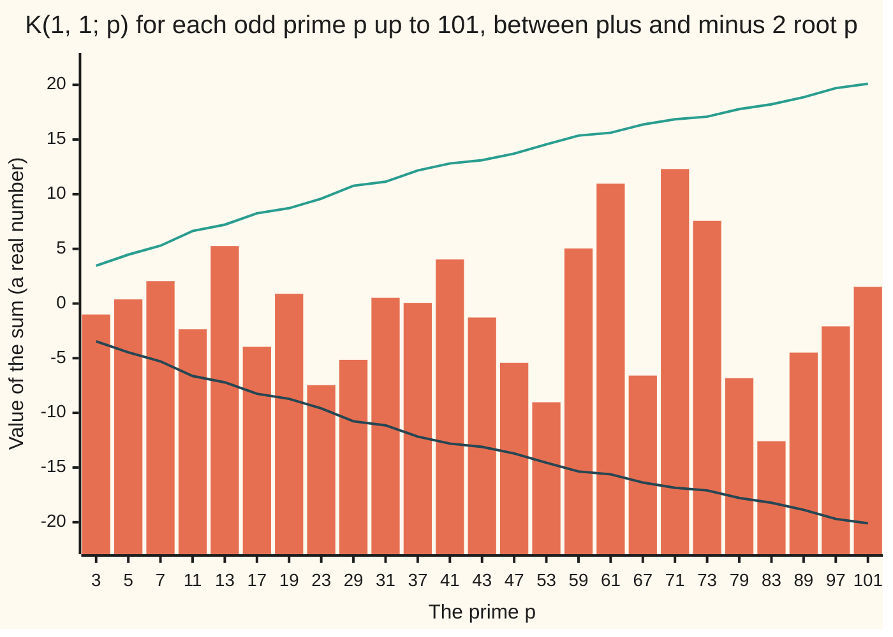

# Kloosterman sums: roots of unity at x and at 1/x, and why the total stays below 2 root p

[Syllabus](../../../SYLLABUS.md) → [Algebraic and analytic number theory](../README.md) → [Characters and L-functions](../README.md#s03) → Kloosterman sums

---

## General Overview

Take the twelve nonzero remainders mod 13. Each one x has a partner mod 13, written $`x^{-1}`$: the remainder that multiplies with x to give 1. The partner of 2 is 7, because 2 × 7 = 14 leaves 1. Now add each remainder to its partner: 2 + 7 = 9. That gives twelve exponents t, one for each x.

Put thirteen equal clock marks on a circle of radius 1, numbered 0 to 12. Take one unit step towards mark t for each of the twelve exponents. Twelve steps could carry the walk 12 away from the start. It ends at 5.259534, exactly on the real axis. That total is the **Kloosterman sum** K(1, 1; 13).

The partners jump about with no visible pattern, so the twelve directions look random. They are not random, and the total obeys a hard ceiling: never more than twice the square root of the prime. At 13 that ceiling is 7.211103. At 101 the hundred steps end at 1.525782, under a ceiling of 20.099751.

Hendrik Kloosterman met these sums in 1926, counting the ways to write a number as $`ax^2 + by^2 + cz^2 + dt^2`$. They turn up wherever a count involves inverses modulo a whole number, and a good bound on them turns an error term into a theorem. Mod 100,003, for instance, take the numbers 1 to 50,001 and count those whose partner is also at most 50,001. Weil's ceiling alone pins that count at 25,000.25 give or take 10,871.6, and the true count is 24,925 (Where you meet it in real life).

**A Kloosterman sum adds the p-th roots of unity at x plus its partner, over every nonzero x mod p; the average of its fourth power over all weights can be counted exactly, which caps every sum at $`2^{1/4} p^{3/4}`$, and Weil's theorem on curves over finite fields lowers the cap to $`2\sqrt{p}`$.**

**What kind of fact this is:** a theorem. The exact fourth moment and Kloosterman's bound are proved on this card in Why it works. Weil's bound is a theorem (Weil, 1948), stated here with its source, not proved: its proof needs the Riemann hypothesis for curves over finite fields. The code checks all 13,808 sums $`K(a, 1; p)`$ with p below 400; that is evidence for Weil's bound, not a proof of it.

### The picture: 25 sums against their ceiling



Bars: the sum $`K(1, 1; p)`$, printed by both checks. Upper line: $`2\sqrt{p}`$. Lower line: $`-2\sqrt{p}`$. The bars change sign with no pattern, and none crosses a line. At p = 83 the bar reaches −12.59 against a ceiling of 18.22.

---

## The formula

Notation first, in words. The letter $`p`$ is an odd prime; here $`p = 13`$. The symbol $`\zeta_p = e^{2\pi i/p}`$ is the first p-th root of unity anticlockwise from 1, as on [Gauss sums](06-gauss-sums.md); $`i`$ is the square root of −1. For a remainder x not divisible by p, $`x^{-1}`$ is its **inverse mod p**: the remainder with $`x \cdot x^{-1} \equiv 1 \pmod p`$. It is a remainder, never the fraction 1/x of ordinary arithmetic. The **Kloosterman sum** with weights a and b is

```math
K(a, b; p) = \sum_{x=1}^{p-1} \zeta_p^{\,a x + b x^{-1}}
```

**Read it aloud:** for every nonzero x mod p, take the root of unity at a times x plus b times the inverse of x, and add them up.

For a = b = 1 and p = 13, the exponents are $`x + x^{-1}`$: 2, 9, 12, 1, 0, 4, 9, 0, 12, 1, 4, 11. The sum is 5.259534.

This card proves the first two facts below and states the third. Write $`S_4(p)`$ for the fourth moment: the total on the left of the first fact.

```math
\sum_{a=1}^{p-1} K(a, 1; p)^4 = 2p^3 - 3p^2 - 3p - 1, \qquad \lvert K(a, b; p)\rvert < 2^{1/4}\, p^{3/4}, \qquad \lvert K(a, b; p)\rvert \le 2\sqrt{p}
```

**Read it aloud:** the fourth powers of the sums, added over all nonzero weights a, come to exactly two p cubed minus three p squared minus three p minus one; so every sum is below the fourth root of 2 times p to the three quarters; and, by Weil, below twice the square root of p. The two bounds need p to divide neither a nor b.

At p = 13: the fourth powers add to 3,847, Kloosterman's bound is 8.141698 and Weil's is 7.211103. At p = 7 the fourth powers add to 517.

| Symbol | Plain meaning | In our example | Push it up and the answer… |
| --- | --- | --- | --- |
| $`p`$; $`q`$ | an odd prime, the modulus; a modulus that need not be prime | 13 (also 7 and 101); q = 117 | the sum has more steps, but grows at most like $`\sqrt{p}`$ |
| $`a`$, $`b`$ | the two whole-number weights | a = b = 1 | the sum moves; only the product ab matters mod p |
| $`x`$, $`x^{-1}`$ | a nonzero remainder and its inverse mod p | x = 2, $`x^{-1}`$ = 7 | — |
| $`t`$, $`m`$; $`c_t`$ | an exponent mod p, a clock mark (t is $`x + x^{-1}`$); the real part $`\cos(2\pi t/p)`$ of the root at mark t | t = 9 for x = 2; $`c_1`$ = 0.885456 | — |
| $`\zeta_p`$, $`i`$ | $`e^{2\pi i/p}`$, the first p-th root of unity; the square root of −1 | $`\zeta_{13}`$ | — |
| $`K(a, b; p)`$ | the Kloosterman sum, always a real number | K(1, 1; 13) = 5.259534 | — |
| $`S_4(p)`$; $`j`$ | the fourth moment: $`K(a, 1; p)^4`$ added over a = 1 to p − 1; half the power of a higher moment | 3,847 | grows like $`2p^3`$ |
| $`x_1, x_2, x_3, x_4`$; $`s`$; $`N`$ | four nonzero remainders; the sum $`x_1 + x_2`$; how many quadruples solve the two equations of Step 2 | N = 396 | N grows like $`3p^2`$ |
| $`\mathrm{GF}(p^k)`$, $`k`$, $`w`$, $`\mathrm{Tr}`$ | the field with $`p^k`$ elements; its degree; a root of $`w^2 = 2`$, giving GF(169) = {u + vw}; the trace, $`\mathrm{Tr}(z) = z + z^p`$ for k = 2 | GF(169), $`\mathrm{Tr}(u + vw) = 2u`$ | — |
| $`K_k(a, b)`$, $`z`$ | the same sum over the nonzero elements z of $`\mathrm{GF}(p^k)`$, with exponent $`\mathrm{Tr}(az + bz^{-1})`$ | $`K_2(1, 1) = -1.662698`$ | — |
| $`\alpha`$, $`\beta`$; $`\theta_p`$ | the two numbers with $`\alpha + \beta = -K`$ and $`\alpha\beta = p`$; the angle with $`K(1, 1; p) = 2\sqrt{p}\cos\theta_p`$ | a complex pair, each of size $`\sqrt{13}`$ | — |
| $`y`$, $`c`$, $`r`$, $`d`$ | the second coordinate on the curve $`y^p - y = x + d\,x^{-1}`$; a remainder from 1 to p − 1; an element of $`\mathrm{GF}(p^k)`$ in the point-count proof; the curve's second weight, 1 or a non-square mod p | 338 points over GF(169) for d = 1, 312 for d = 2 | — |

### When it holds

- **The modulus is prime.** At a composite modulus the sum factors into one piece per prime-power part. Each piece can reach about twice the square root of its own modulus, so the caps multiply. At 117 = 9 × 13, K(1, 1; 117) = −23.0154, past $`2\sqrt{117}`$ = 21.6333 but inside $`2\sqrt{9} \cdot 2\sqrt{13}`$ = 43.2666.
- **p divides neither a nor b.** If p divides both, every step is the root 1 and K(0, 0; 13) = 12, far above 7.211103. If p divides only one, the sum collapses to −1.
- **The fourth moment adds over a = 1 to p − 1.** Keep a = 0 and the total is 3,848, not 3,847: the extra term is $`K(0, 1; 13)^4 = 1`$.
- **The bound comes from the fourth power, not the square.** The squares add to 155, and their square root, 12.4499, is worse than the trivial bound of 12 steps.
- **Weil's $`2\sqrt{p}`$ needs Weil's theorem.** Counting alone proves $`2^{1/4} p^{3/4}`$. The step from there to $`2\sqrt{p}`$ is the Riemann hypothesis for curves over finite fields.

---

## Why it works

### Step 0: the idea

One sum is hard to pin down. The average of its fourth power, over all weights a, is easy. Adding $`\zeta_p^{\,am}`$ over all a gives p when m ≡ 0 mod p and 0 otherwise: the roots of unity cancel ([Powers and roots](../../07-Complex%20analysis/01-Complex%20Numbers%20and%20the%20Plane/05-powers-roots-and-roots-of-unity.md)). So averaging over a throws away every term except the solutions of one equation, and those can be counted.

Every fourth power is at least 0. So one sum's fourth power is at most the total. That turns an exact count into a bound on every single sum.

### Step 1: the sum is real, and only ab matters

Replace x by −x. Its inverse becomes $`-x^{-1}`$, so every exponent changes sign. The sum is therefore equal to its own complex conjugate, and so it is real. At p = 13 the sines cancel in pairs t and 13 − t, and the imaginary part prints as 0.000000.

For a not divisible by p, replace x by $`a^{-1}y`$. As x runs over the nonzero remainders, so does y. The exponent $`ax + bx^{-1}`$ becomes $`y + ab\,y^{-1}`$. So

```math
K(a, b; p) = K(1, ab; p)
```

**Read it aloud:** the two weights act only through their product.

The same swap of x for its inverse shows $`K(1, c; p) = K(c, 1; p)`$. The code checks both for all twelve weights mod 13.

### Step 2: averaging over both weights leaves a count

Since K is real, $`K^4 = K \cdot K \cdot \overline{K} \cdot \overline{K}`$. Multiply out the four sums. Each product is one root of unity, with exponent $`a(x_1 + x_2 - x_3 - x_4) + b(x_1^{-1} + x_2^{-1} - x_3^{-1} - x_4^{-1})`$.

Now add over every a and every b from 0 to p − 1. By Step 0, a term survives only when both brackets are 0 mod p, and then it counts $`p^2`$. So

```math
\sum_{a=0}^{p-1} \sum_{b=0}^{p-1} K(a, b; p)^4 = p^2 N, \qquad N = \#\{x_1 + x_2 = x_3 + x_4, \ x_1^{-1} + x_2^{-1} = x_3^{-1} + x_4^{-1}\}
```

**Read it aloud:** the fourth powers over all weight pairs add to p squared times the number of nonzero quadruples with equal sums and equal sums of inverses.

### Step 3: counting the solutions

Call the common sum $`s = x_1 + x_2`$.

- **If s is not 0.** The sum of inverses is $`x_1^{-1} + x_2^{-1} = s\,(x_1 x_2)^{-1}`$. Equal sums of inverses then force $`x_1 x_2 = x_3 x_4`$. Two pairs with the same sum and the same product are the two roots of one quadratic, so $`\{x_3, x_4\} = \{x_1, x_2\}`$. There are (p − 1)(p − 2) pairs with s not 0. Each gives two orders, except the p − 1 pairs with $`x_1 = x_2`$. That makes $`(p-1)(2p-5)`$.
- **If s is 0.** Then $`x_2 = -x_1`$ and the inverses also add to 0. Any $`x_3`$ with $`x_4 = -x_3`$ works. That makes $`(p-1)^2`$.

So $`N = (p-1)(2p-5) + (p-1)^2 = 3(p-1)(p-2)`$. At p = 13 the code counts 252 + 144 = 396 by trying every $`x_1, x_2, x_3`$, and $`3 \cdot 12 \cdot 11 = 396`$.

### Step 4: removing the edge terms

Sort the $`p^2`$ weight pairs of Step 2.

| Weights | Value of K | Fourth powers they add |
| --- | --- | --- |
| a = b = 0 | p − 1, every step at the root 1 | $`(p-1)^4`$ |
| exactly one of a, b is 0 | −1, the roots without the root 1 | $`2(p-1)`$ |
| both nonzero | $`K(1, ab; p)`$ by Step 1; each product c = ab arises p − 1 times | $`(p-1) S_4(p)`$ |

So $`p^2 N = (p-1)^4 + 2(p-1) + (p-1) S_4(p)`$. Put in $`N = 3(p-1)(p-2)`$ and divide by p − 1:

```math
S_4(p) = 3p^2(p-2) - (p-1)^3 - 2 = 2p^3 - 3p^2 - 3p - 1
```

**Read it aloud:** the fourth moment is three p squared times p minus 2, less p minus 1 cubed, less 2.

At p = 13: $`p^2 N`$ = 66,924, $`(p-1)^4`$ = 20,736 and 2(p − 1) = 24. Then (66,924 − 20,736 − 24) / 12 = 3,847. Road one adds the twelve fourth powers directly and gets 3,847.000000.

<details>
<summary>Detailed proof: why the edge values are p − 1 and −1</summary>

With a = b = 0 every exponent is 0, so each of the p − 1 terms is 1.

With a = 0 and b not 0, the exponent $`b x^{-1}`$ runs over every nonzero remainder once as x does. All p roots of unity add to 0, so the nonzero ones add to −1:

$`\displaystyle K(0, b; p) = \sum_{m=1}^{p-1} \zeta_p^{\,m} = -1.`$

The case b = 0, a not 0 is the same with ax in place of $`bx^{-1}`$. These are the only weights where p divides ab, which is why both bounds exclude them.

</details>

### Step 5: Kloosterman's bound

Every $`K(a, 1; p)^4`$ is at least 0, so any one of them is at most the total, which is below $`2p^3`$. Take fourth roots:

```math
\lvert K(a, b; p)\rvert \le S_4(p)^{1/4} < 2^{1/4}\, p^{3/4}
```

**Read it aloud:** one sum is at most the fourth root of the total, which is below the fourth root of 2 times p to the three quarters.

At p = 13 the fourth root of 3,847 is 7.8755, and $`2^{1/4} \cdot 13^{3/4}`$ = 8.141698. The trivial bound is 12, one per step. As p grows, $`p^{3/4}`$ falls ever further below p.

### Step 6: why counting stops at the three-quarters power

The fourth moment cannot tell one large sum from many middling ones. A total of 3,847 at p = 13 would allow one sum of 7.8755 and eleven sums of 0. Higher moments help a little: the sixth moment at p = 13 is 112,826, below $`(2\sqrt{13})^6`$ = 140,608. But the moment of power 2j grows like $`p^{j+1}`$, so it caps one sum at about $`p^{1/2 + 1/(2j)}`$: closer to $`\sqrt{p}`$ as j grows, never reaching it.

Weil's route passes through bigger fields. Build $`\mathrm{GF}(p^k)`$, the field with $`p^k`$ elements ([Finite fields](../../03-Algebra/09-Rings%20and%20Fields/05-finite-fields.md)). Its **trace** $`\mathrm{Tr}`$ sends each element to a remainder mod p; for k = 2, $`\mathrm{Tr}(z) = z + z^p`$. The same sum over this field is

```math
K_k(a, b) = \sum_{z \ne 0 \text{ in } \mathrm{GF}(p^k)} \zeta_p^{\,\mathrm{Tr}(az + bz^{-1})}, \qquad K_k = -(\alpha^k + \beta^k), \quad \alpha + \beta = -K(a, b; p), \quad \alpha\beta = p
```

**Read it aloud:** the sum over the field of p to the k elements is minus the k-th powers of two numbers, which add to minus the original sum and multiply to p.

The factorisation is a theorem, proved in Iwaniec and Kowalski (Sources). At k = 2 it gives $`K_2 = -(\alpha^2 + \beta^2) = 2\alpha\beta - (\alpha + \beta)^2 = 2p - K^2`$. The code builds GF(169) as $`\{u + vw\}`$ with $`w^2 = 2`$, adds 168 roots directly, and gets −1.662698. That matches $`26 - 5.259534^2`$.

Now the curve. Over $`\mathrm{GF}(p^k)`$, count the points (x, y) with x not 0 on

```math
y^p - y = x + x^{-1}, \qquad \#\text{points} = p^k - 1 + \sum_{c=1}^{p-1} K_k(c, c) = p^k - 1 - \sum_{c=1}^{p-1} \left(\alpha_c^k + \beta_c^k\right)
```

**Read it aloud:** the number of points is p to the k, minus 1, plus the Kloosterman sums with both weights equal to c, added over c.

The proof is two lines, in the fold below. The code counts the curve over GF(169) by brute force: 338 points. The sums over GF(169) give 338.000000, and so does $`2p - K(c, c; 13)^2`$ added over c.

This curve, with its two points at the ends added, has genus p − 1: drawn over the complex numbers, it is a surface with p − 1 holes. Its $`2(p-1)`$ numbers $`\alpha_c, \beta_c`$ are exactly the ones above. **Weil's theorem** (1948), the Riemann hypothesis for curves over finite fields, says every such number has size exactly $`\sqrt{p}`$. Then $`\lvert K\rvert = \lvert\alpha + \beta\rvert \le 2\sqrt{p}`$ for every sum this curve carries. This step is stated, not proved here.

This curve carries only half the sums. Its two weights c and c multiply to $`c^2`$, a square mod p, so by Step 1 its sums are $`K(1, c^2; p)`$: each square class twice, and no other. At 13 its twelve sums take the six values −4.6367, −0.4333, 0.5690, 2.1594, 4.0821 and 5.2595; the largest sum of all, 6.2962 at a = 11, is not among them. The other half lives on the curve $`y^p - y = x + d\,x^{-1}`$ with d a non-square mod p. The fold's proof, run with $`d\,x^{-1}`$, counts its points as $`p^k - 1 + \sum_c K_k(c, cd)`$. With d = 2 its sums take the other six values, and the code counts 312 points over GF(169), matching $`p^2 - 1 + \sum_c (2p - K(c, 2c; 13)^2)`$. Weil's theorem for the two curves together gives $`\lvert K(a, b; p)\rvert \le 2\sqrt{p}`$ whenever p divides neither weight.

Over GF(169) the first curve's count, 338, sits 170 from $`p^2 - 1`$, inside Weil's allowance of $`2(p-1)p`$ = 312. Over all 13,808 sums with p below 400, the largest ratio $`\lvert K\rvert / 2\sqrt{p}`$ is 0.997424, at a = 171 and p = 211, where K = 28.976853.

<details>
<summary>Detailed proof: the point count is a sum of Kloosterman sums</summary>

Fix r in $`\mathrm{GF}(p^k)`$. The map $`y \mapsto y^p - y`$ adds: it sends a sum to a sum. Its kernel (the elements it sends to 0) is the p elements of GF(p), and its image is exactly the elements of trace 0. So $`y^p - y = r`$ has p solutions when $`\mathrm{Tr}(r) = 0`$ and none otherwise.

The roots of unity detect a zero trace, by Step 0:

$`\displaystyle \sum_{c=0}^{p-1} \zeta_p^{\,c\,\mathrm{Tr}(r)} = \begin{cases} p & \mathrm{Tr}(r) = 0 \\ 0 & \text{otherwise.} \end{cases}`$

Put $`r = x + x^{-1}`$ and add over the nonzero x. The c = 0 terms give $`p^k - 1`$. Each other c gives $`\sum_x \zeta_p^{\,\mathrm{Tr}(cx + cx^{-1})} = K_k(c, c)`$. That is the formula. With $`r = x + d\,x^{-1}`$ for any nonzero d, the same steps give $`p^k - 1 + \sum_{c=1}^{p-1} K_k(c, cd)`$.

</details>

---

## Worked numbers, by hand

The prime is 13, with a = b = 1. Write $`c_t`$ for $`\cos(2\pi t/13)`$, the real part of the root at mark t.

| Step | Arithmetic | Value |
| --- | --- | --- |
| inverses mod 13 | $`x^{-1}`$ for x = 1 to 12 | 1 7 9 10 8 11 2 5 3 4 6 12 |
| exponents | $`t = x + x^{-1}`$ mod 13 | 2 9 12 1 0 4 9 0 12 1 4 11 |
| mark 0 | 2 terms × 1.000000 | 2.000000 |
| marks 1 and 12 | 4 terms × 0.885456 (since $`c_{12} = c_1`$) | 3.541824 |
| marks 2 and 11 | 2 terms × 0.568065 | 1.136129 |
| marks 4 and 9 | 4 terms × −0.354605 | −1.418420 |
| imaginary part | the sines at t and 13 − t cancel | 0.000000 |
| total | 2.000000 + 3.541824 + 1.136129 − 1.418420 | **K(1, 1; 13) = 5.259534** |

Twelve unit steps end 5.259534 from the start. That is under Weil's 7.211103, under Kloosterman's 8.141698, and far under the 12 the steps could reach.

The other eleven weights mod 13 give K(a, 1; 13) = 5.2595, −0.2396, −0.4333, 0.5690, −3.0299, −3.3360, −0.8706, −4.8200, 4.0821, 2.1594, 6.2962, −4.6367 for a = 1 to 12. Their fourth powers add to 3,847.000000. The largest in size is 6.2962, at a = 11.

### What breaks if you drop a piece

| Mistake | Comes out at | What went wrong |
| --- | --- | --- |
| Bound by the second moment instead of the fourth | $`\sqrt{155}`$ = 12.4499 at p = 13 | The squares add to $`p^2 - p - 1`$, which only says K is below about p: no better than 12 |
| p divides both weights | K(0, 0; 13) = 12.0000, above 7.211103 | Every step is the root 1; nothing cancels |
| Composite modulus 117 = 9 × 13 | K(1, 1; 117) = −23.0154, past 21.6333 | The sum splits into a mod-9 piece and a mod-13 piece, and their caps multiply to 43.2666 |
| Keep a = 0 in the fourth moment | 3,848, not 3,847 | It adds $`K(0, 1; 13)^4 = 1`$ |

---

## Code, from first principles, and it actually runs

The code adds roots of unity with the standard cosine and sine, and finds every inverse with its own Euclid's algorithm. It takes four roads. Road one adds the sums directly. Road two counts the quadruples of Step 3 by brute force and turns the count into the fourth moment. Road three is the closed form $`2p^3 - 3p^2 - 3p - 1`$, checked against road one for all 45 odd primes below 200. Road four builds GF(169), sums over it, counts the points of both curves, d = 1 and d = 2, by brute force and checks the factorisation $`K_2 = 2p - K^2\,`$. A last block puts the bound to work on the count of x up to 50,001 whose inverse mod 100,003 is also at most 50,001.

### Python

```python
# Kloosterman sums: K(1,1;13) = 5.2595 sits under Weil's 2 sqrt 13 = 7.2111 -- the check behind the card.
# Road 1 adds the roots of unity directly.  Road 2 gets the fourth moment by counting solutions of
# x1 + x2 = x3 + x4, 1/x1 + 1/x2 = 1/x3 + 1/x4 by brute force.  Road 3 is the closed form
# 2p^3 - 3p^2 - 3p - 1.  Road 4 rebuilds the sums over GF(p^2) and counts points on the curves
# y^p - y = x + d/x, d = 1, 2, checking K_2 = 2p - K^2 behind Weil's bound, then puts the bound to work.
import math

def isprime(n): return n > 1 and all(n % d for d in range(2, int(n ** 0.5) + 1))
def inv(x, q):                                  # inverse mod q by Euclid's algorithm, or None
    r0, r1, s0, s1 = q, x % q, 0, 1
    while r1: k = r0 // r1; r0, r1, s0, s1 = r1, r0 - k * r1, s1, s0 - k * s1
    return s0 % q if r0 == 1 else None
def ks(a, b, q, imag=False):                    # K(a, b; q) = sum over units x of zeta_q^(a x + b/x)
    t, f = 0.0, math.sin if imag else math.cos
    for x in range(1, q):
        xi = inv(x, q)
        if xi is not None: t += f(2 * math.pi * ((a * x + b * xi) % q) / q)
    return t
def ktab(p):                                    # K(a, 1; p) for a = 0..p-1, from one cosine table
    c, iv = [math.cos(2 * math.pi * t / p) for t in range(p)], [0] + [inv(x, p) for x in range(1, p)]
    return [sum(c[(a * x + iv[x]) % p] for x in range(1, p)) for a in range(p)]
def closed(p): return 2 * p ** 3 - 3 * p ** 2 - 3 * p - 1
def f4(x): return f"{(x if abs(x) > 5e-5 else 0.0):.4f}"
def f6(x): return f"{(x if abs(x) > 5e-7 else 0.0):.6f}"

p = 13
iv = [inv(x, p) for x in range(1, p)]
print("x = 1..12, 1/x mod 13: " + " ".join(map(str, iv)))
t = [(x + iv[x - 1]) % p for x in range(1, p)]
print("t = x + 1/x mod 13:    " + " ".join(map(str, t)))
k = 0.0
for g in ((0,), (1, 12), (2, 11), (4, 9)):
    n = sum(t.count(u) for u in g); c = math.cos(2 * math.pi * g[0] / p); k += n * c
    print(f"  t in {str(list(g)):<8} {n} terms, cos(2 pi t/13) = {f6(c):>9}, adds {f6(n * c):>9}")
K13 = ks(1, 1, p)
print(f"K(1,1;13) grouped = {f6(k)};  direct = {f6(K13)};  imaginary part = {f6(ks(1, 1, p, True))}")
print(f"bounds at 13: Weil 2 sqrt p = {f6(2 * math.sqrt(p))};  Kloosterman 2^(1/4) p^(3/4) = {f6((2 * p ** 3) ** 0.25)};  trivial p - 1 = 12")
K101 = ks(1, 1, 101)
print(f"K(1,1;101) = {f6(K101)};  Weil {f6(2 * math.sqrt(101))};  Kloosterman {f6((2 * 101 ** 3) ** 0.25)};  trivial 100")
assert abs(k - K13) < 1e-12 and abs(ks(1, 1, p, True)) < 1e-12 and abs(K13 - 5.2595) < 1e-4 and abs(K101 - 1.5258) < 1e-4
T = ktab(p)
print("K(a,1;13), a = 1..12: " + " ".join(f4(v) for v in T[1:]))
print(f"K(a,1;13) = K(1,a;13) for every a: {'yes' if all(abs(ks(a, 1, p) - ks(1, a, p)) < 1e-12 for a in range(1, p)) else 'no'};  largest |K(a,1;13)| = {f4(max(abs(v) for v in T[1:]))}")
S4 = sum(v ** 4 for v in T[1:])
print(f"fourth moment p = 13: sum of K(a,1;13)^4 = {f6(S4)};  2p^3 - 3p^2 - 3p - 1 = {closed(13)};  fourth root {f4(S4 ** 0.25)}")
S7 = sum(v ** 4 for v in ktab(7)[1:])
print(f"fourth moment p = 7: {f6(S7)};  closed form {closed(7)};  K(1,1;7) = {f6(ks(1, 1, 7))}")
assert round(S4) == 3847 and abs(S4 - 3847) < 1e-6 and round(S7) == 517 and abs(S7 - 517) < 1e-6

def nsol(p):                                    # brute force: x1 + x2 = x3 + x4 and 1/x1 + 1/x2 = 1/x3 + 1/x4
    iv, n = [0] + [inv(x, p) for x in range(1, p)], [0, 0]
    for x1 in range(1, p):
        for x2 in range(1, p):
            for x3 in range(1, p):
                x4 = (x1 + x2 - x3) % p
                if x4 and (iv[x1] + iv[x2] - iv[x3] - iv[x4]) % p == 0: n[(x1 + x2) % p == 0] += 1
    return n                                    # [solutions with x1 + x2 != 0, solutions with x1 + x2 = 0]
for q in (7, 13):
    n0, n1 = nsol(q); n = n0 + n1; s = (q * q * n - (q - 1) ** 4 - 2 * (q - 1)) // (q - 1)
    print(f"p = {q}: solutions N = {n0} (sum s != 0) + {n1} (s = 0) = {n};  3(p-1)(p-2) = {3 * (q - 1) * (q - 2)}")
    print(f"  p^2 N = {q * q * n};  (p-1)^4 = {(q - 1) ** 4};  2(p-1) = {2 * (q - 1)};  (p^2 N - (p-1)^4 - 2(p-1))/(p-1) = {s}")
    assert n0 == (q - 1) * (2 * q - 5) and n1 == (q - 1) ** 2 and n == 3 * (q - 1) * (q - 2) and s == closed(q)
pr = [q for q in range(3, 60) if isprime(q)]
okn = all(sum(nsol(q)) == 3 * (q - 1) * (q - 2) for q in pr)
pr2 = [q for q in range(3, 200) if isprime(q)]
ok4 = all(abs(sum(v ** 4 for v in ktab(q)[1:]) - closed(q)) < 1e-6 for q in pr2)
print(f"brute-force N = 3(p-1)(p-2) for all {len(pr)} odd primes below 60: {'yes' if okn else 'no'}")
print(f"sum of K^4 = 2p^3 - 3p^2 - 3p - 1 for all {len(pr2)} odd primes below 200: {'yes' if ok4 else 'no'}")
assert okn and ok4

worst, wk, cnt = 0.0, None, 0                    # Weil and Kloosterman bounds on every K(a,1;p)
for q in range(3, 400):
    if isprime(q):
        for a, v in enumerate(ktab(q)[1:], 1):
            cnt += 1; r = abs(v) / (2 * math.sqrt(q))
            if r > worst: worst, wk = r, (a, q, v)
print(f"all {cnt} sums K(a,1;p), odd p below 400: largest |K|/(2 sqrt p) = {f6(worst)}, at a = {wk[0]}, p = {wk[1]}, K = {f6(wk[2])}")
assert worst < 1

def gf2(p):                                     # GF(p^2) = GF(p)[w], w^2 = d, d the least non-square
    d = next(d for d in range(2, p) if pow(d, (p - 1) // 2, p) == p - 1)
    mul = lambda u, v: ((u[0] * v[0] + d * u[1] * v[1]) % p, (u[0] * v[1] + u[1] * v[0]) % p)
    def pw(u, e):
        r = (1, 0)
        while e: r, u, e = (mul(r, u) if e & 1 else r), mul(u, u), e >> 1
        return r
    els = [(u, v) for u in range(p) for v in range(p)]
    return els, mul, pw, d
def k2(p, c):                                   # K_2(c, c) = sum over z in GF(p^2)* of zeta_p^(c Tr(z + 1/z))
    els, mul, pw, d = gf2(p); s = 0.0
    for z in els[1:]:
        zi = pw(z, p * p - 2); s += math.cos(2 * math.pi * c * (2 * (z[0] + zi[0])) / p)
    return s
v2 = k2(13, 1)
print(f"over GF(169): K_2(1,1) = {f6(v2)};  2p - K(1,1;13)^2 = {f6(26 - K13 ** 2)}")
okh = all(abs(k2(q, 1) - (2 * q - ks(1, 1, q) ** 2)) < 1e-9 for q in pr[:10])
print(f"K_2 = 2p - K^2 for all odd primes up to {pr[9]}: {'yes' if okh else 'no'}")
assert abs(v2 - (26 - K13 ** 2)) < 1e-9 and okh

def curve(p, e=1):                              # points (x, y), x != 0, on y^p - y = x + e/x over GF(p^2)
    els, mul, pw, d = gf2(p); m = {}
    for y in els:
        u = pw(y, p); key = ((u[0] - y[0]) % p, (u[1] - y[1]) % p); m[key] = m.get(key, 0) + 1
    tot = 0
    for x in els[1:]:
        xi = pw(x, p * p - 2); tot += m.get(((x[0] + e * xi[0]) % p, (x[1] + e * xi[1]) % p), 0)
    return tot
n1 = p * sum(1 for x in range(1, p) if (x + inv(x, p)) % p == 0)
print(f"curve over GF(13): points with x != 0: {n1};  p - 1 + sum of K(c,c;13) = {f6(p - 1 + sum(ks(c, c, p) for c in range(1, p)))}")
nc = curve(p, 1); r2 = p * p - 1 + sum(k2(p, c) for c in range(1, p)); r3 = p * p - 1 + sum(2 * p - ks(c, c, p) ** 2 for c in range(1, p))
print(f"curve over GF(169): brute count {nc};  p^2 - 1 + sum K_2(c,c) = {f6(r2)};  p^2 - 1 + sum (2p - K(c,c)^2) = {f6(r3)}")
print(f"  gap from p^2 - 1 = {nc - p * p + 1};  Weil allows 2(p-1)p = {2 * (p - 1) * p}")
assert abs(nc - r2) < 1e-6 and abs(nc - r3) < 1e-6 and abs(nc - p * p + 1) <= 2 * (p - 1) * p and abs(n1 - (p - 1 + sum(ks(c, c, p) for c in range(1, p)))) < 1e-9
nd = curve(p, 2); rd = p * p - 1 + sum(2 * p - ks(c, 2 * c, p) ** 2 for c in range(1, p))   # d = 2, a non-square
sq, ns = (sorted({f4(ks(c, e * c, p)) for c in range(1, p)}, key=float) for e in (1, 2))
print(f"K(c,c;13) takes {len(sq)} values: {' '.join(sq)};  K(c,2c;13) takes the other {len(ns)}: {' '.join(ns)}")
print(f"curve y^p - y = x + 2/x over GF(169): brute count {nd};  p^2 - 1 + sum (2p - K(c,2c)^2) = {f6(rd)}")
assert abs(nd - rd) < 1e-6 and set(sq) | set(ns) == {f4(v) for v in T[1:]} and not set(sq) & set(ns)
q = 100003; A = (q - 1) // 2; na = sum(1 for x in range(1, A + 1) if inv(x, q) <= A)   # a count the bound pins down
sa = (sum(abs(math.sin(math.pi * a * A / q) / math.sin(math.pi * a / q)) for a in range(1, q)) / q) ** 2
ew, ek = A * A / q ** 2 + 2 * math.sqrt(q) * sa, A * A / q ** 2 + (2 * q ** 3) ** 0.25 * sa
print(f"mod {q}: x = 1..{A} with 1/x also <= {A}: {na};  expected {A}^2/{q} = {f4(A * A / q)};  error cap from Weil {f4(ew)}, from Kloosterman {f4(ek)}")
assert abs(na - A * A / q) <= ew < A * A / q < A < ek

S2 = sum(v ** 2 for v in T[1:])                 # what breaks
print(f"second moment p = 13: {f6(S2)} = p^2 - p - 1 = {p * p - p - 1};  bound sqrt = {f4(math.sqrt(S2))}, worse than trivial 12")
print(f"p divides a and b: K(0,0;13) = {f4(ks(0, 0, p))};  p divides a only: K(0,1;13) = {f4(ks(0, 1, p))}")
cq = next(q for q in range(2, 400) if abs(ks(1, 1, q)) > 2 * math.sqrt(q))
print(f"smallest modulus with |K(1,1;q)| > 2 sqrt q: q = {cq} = 9 x 13, K = {f4(ks(1, 1, cq))} against {f4(2 * math.sqrt(cq))};  caps multiplied 2 sqrt 9 x 2 sqrt 13 = {f4(4 * math.sqrt(cq))}")
print(f"fourth moment with a = 0 kept: {f6(sum(v ** 4 for v in T))}")
assert abs(S2 - 155) < 1e-9 and cq == 117 and abs(ks(1, 1, cq)) < 4 * math.sqrt(cq) and abs(ks(0, 0, p) - 12) < 1e-12 and abs(sum(v ** 4 for v in T) - 3848) < 1e-6
print(f"try: q = 176: K = {f4(ks(1, 1, 176))} against {f4(2 * math.sqrt(176))};  sixth moment p = 13: {f6(sum(v ** 6 for v in T[1:]))}, (2 sqrt 13)^6 = {64 * 13 ** 3}")
for q in (11, 1009, 10007): print(f"try: K(1,1;{q}) = {f4(ks(1, 1, q))};  2 sqrt p = {f4(2 * math.sqrt(q))}")

cp = [q for q in range(3, 102) if isprime(q)]
print("chart, primes: " + ", ".join(map(str, cp)))
print("chart, K(1,1;p): " + ", ".join(f"{ks(1, 1, q):.2f}" for q in cp))
print("chart, 2 sqrt p: " + ", ".join(f"{2 * math.sqrt(q):.2f}" for q in cp))
print("chart, -2 sqrt p: " + ", ".join(f"{-2 * math.sqrt(q):.2f}" for q in cp))
print("ALL CHECKS PASS")
```

**Ran 2026-11-24 on macOS, Python 3.14.10, standard library only. All checks passed. Output, pasted from the run:**

```
x = 1..12, 1/x mod 13: 1 7 9 10 8 11 2 5 3 4 6 12
t = x + 1/x mod 13:    2 9 12 1 0 4 9 0 12 1 4 11
  t in [0]      2 terms, cos(2 pi t/13) =  1.000000, adds  2.000000
  t in [1, 12]  4 terms, cos(2 pi t/13) =  0.885456, adds  3.541824
  t in [2, 11]  2 terms, cos(2 pi t/13) =  0.568065, adds  1.136129
  t in [4, 9]   4 terms, cos(2 pi t/13) = -0.354605, adds -1.418420
K(1,1;13) grouped = 5.259534;  direct = 5.259534;  imaginary part = 0.000000
bounds at 13: Weil 2 sqrt p = 7.211103;  Kloosterman 2^(1/4) p^(3/4) = 8.141698;  trivial p - 1 = 12
K(1,1;101) = 1.525782;  Weil 20.099751;  Kloosterman 37.887725;  trivial 100
K(a,1;13), a = 1..12: 5.2595 -0.2396 -0.4333 0.5690 -3.0299 -3.3360 -0.8706 -4.8200 4.0821 2.1594 6.2962 -4.6367
K(a,1;13) = K(1,a;13) for every a: yes;  largest |K(a,1;13)| = 6.2962
fourth moment p = 13: sum of K(a,1;13)^4 = 3847.000000;  2p^3 - 3p^2 - 3p - 1 = 3847;  fourth root 7.8755
fourth moment p = 7: 517.000000;  closed form 517;  K(1,1;7) = 2.048917
p = 7: solutions N = 54 (sum s != 0) + 36 (s = 0) = 90;  3(p-1)(p-2) = 90
  p^2 N = 4410;  (p-1)^4 = 1296;  2(p-1) = 12;  (p^2 N - (p-1)^4 - 2(p-1))/(p-1) = 517
p = 13: solutions N = 252 (sum s != 0) + 144 (s = 0) = 396;  3(p-1)(p-2) = 396
  p^2 N = 66924;  (p-1)^4 = 20736;  2(p-1) = 24;  (p^2 N - (p-1)^4 - 2(p-1))/(p-1) = 3847
brute-force N = 3(p-1)(p-2) for all 16 odd primes below 60: yes
sum of K^4 = 2p^3 - 3p^2 - 3p - 1 for all 45 odd primes below 200: yes
all 13808 sums K(a,1;p), odd p below 400: largest |K|/(2 sqrt p) = 0.997424, at a = 171, p = 211, K = 28.976853
over GF(169): K_2(1,1) = -1.662698;  2p - K(1,1;13)^2 = -1.662698
K_2 = 2p - K^2 for all odd primes up to 31: yes
curve over GF(13): points with x != 0: 26;  p - 1 + sum of K(c,c;13) = 26.000000
curve over GF(169): brute count 338;  p^2 - 1 + sum K_2(c,c) = 338.000000;  p^2 - 1 + sum (2p - K(c,c)^2) = 338.000000
  gap from p^2 - 1 = 170;  Weil allows 2(p-1)p = 312
K(c,c;13) takes 6 values: -4.6367 -0.4333 0.5690 2.1594 4.0821 5.2595;  K(c,2c;13) takes the other 6: -4.8200 -3.3360 -3.0299 -0.8706 -0.2396 6.2962
curve y^p - y = x + 2/x over GF(169): brute count 312;  p^2 - 1 + sum (2p - K(c,2c)^2) = 312.000000
mod 100003: x = 1..50001 with 1/x also <= 50001: 24925;  expected 50001^2/100003 = 25000.2500;  error cap from Weil 10871.5972, from Kloosterman 114951.6129
second moment p = 13: 155.000000 = p^2 - p - 1 = 155;  bound sqrt = 12.4499, worse than trivial 12
p divides a and b: K(0,0;13) = 12.0000;  p divides a only: K(0,1;13) = -1.0000
smallest modulus with |K(1,1;q)| > 2 sqrt q: q = 117 = 9 x 13, K = -23.0154 against 21.6333;  caps multiplied 2 sqrt 9 x 2 sqrt 13 = 43.2666
fourth moment with a = 0 kept: 3848.000000
try: q = 176: K = 32.3400 against 26.5330;  sixth moment p = 13: 112826.000000, (2 sqrt 13)^6 = 140608
try: K(1,1;11) = -2.3579;  2 sqrt p = 6.6332
try: K(1,1;1009) = 20.2558;  2 sqrt p = 63.5295
try: K(1,1;10007) = -151.3585;  2 sqrt p = 200.0700
chart, primes: 3, 5, 7, 11, 13, 17, 19, 23, 29, 31, 37, 41, 43, 47, 53, 59, 61, 67, 71, 73, 79, 83, 89, 97, 101
chart, K(1,1;p): -1.00, 0.38, 2.05, -2.36, 5.26, -3.96, 0.89, -7.46, -5.15, 0.52, 0.04, 4.03, -1.28, -5.43, -9.03, 5.03, 10.96, -6.59, 12.30, 7.56, -6.82, -12.59, -4.49, -2.09, 1.53
chart, 2 sqrt p: 3.46, 4.47, 5.29, 6.63, 7.21, 8.25, 8.72, 9.59, 10.77, 11.14, 12.17, 12.81, 13.11, 13.71, 14.56, 15.36, 15.62, 16.37, 16.85, 17.09, 17.78, 18.22, 18.87, 19.70, 20.10
chart, -2 sqrt p: -3.46, -4.47, -5.29, -6.63, -7.21, -8.25, -8.72, -9.59, -10.77, -11.14, -12.17, -12.81, -13.11, -13.71, -14.56, -15.36, -15.62, -16.37, -16.85, -17.09, -17.78, -18.22, -18.87, -19.70, -20.10
ALL CHECKS PASS
```

### Rust

Same numbers, same labels, built with `rustc --edition 2021 -O`.

```rust
// Kloosterman sums: K(1,1;13) = 5.2595 sits under Weil's 2 sqrt 13 = 7.2111 -- the same check as the
// Python, in Rust, no crates.  Road 1 adds the roots of unity directly.  Road 2 gets the fourth moment
// by counting solutions of x1 + x2 = x3 + x4, 1/x1 + 1/x2 = 1/x3 + 1/x4 by brute force.  Road 3 is the
// closed form 2p^3 - 3p^2 - 3p - 1.  Road 4 rebuilds the sums over GF(p^2) and counts points on the
// curves y^p - y = x + d/x, d = 1, 2, checking K_2 = 2p - K^2 behind Weil's bound, then puts the bound to work.
use std::collections::HashMap;
use std::f64::consts::PI;
type G = (i64, i64);

fn isprime(n: i64) -> bool { n > 1 && (2..).take_while(|d| d * d <= n).all(|d| n % d != 0) }
fn inv(x: i64, q: i64) -> Option<i64> {          // inverse mod q by Euclid's algorithm, or None
    let (mut r0, mut r1, mut s0, mut s1) = (q, x.rem_euclid(q), 0i64, 1i64);
    while r1 != 0 { let k = r0 / r1; (r0, r1, s0, s1) = (r1, r0 - k * r1, s1, s0 - k * s1); }
    if r0 == 1 { Some(s0.rem_euclid(q)) } else { None }
}
fn ks(a: i64, b: i64, q: i64, imag: bool) -> f64 { // K(a, b; q) = sum over units x of zeta_q^(a x + b/x)
    let mut t = 0.0;
    for x in 1..q { if let Some(xi) = inv(x, q) {
        let th = 2.0 * PI * ((a * x + b * xi).rem_euclid(q)) as f64 / q as f64;
        t += if imag { th.sin() } else { th.cos() };
    } }
    t
}
fn k(a: i64, b: i64, q: i64) -> f64 { ks(a, b, q, false) }
fn ktab(p: i64) -> Vec<f64> {                    // K(a, 1; p) for a = 0..p-1, from one cosine table
    let c: Vec<f64> = (0..p).map(|t| (2.0 * PI * t as f64 / p as f64).cos()).collect();
    let iv: Vec<i64> = (0..p).map(|x| if x == 0 { 0 } else { inv(x, p).unwrap() }).collect();
    (0..p).map(|a| (1..p).map(|x| c[((a * x + iv[x as usize]) % p) as usize]).sum()).collect()
}
fn closed(p: i64) -> i64 { 2 * p * p * p - 3 * p * p - 3 * p - 1 }
fn f4(x: f64) -> String { format!("{:.4}", if x.abs() > 5e-5 { x } else { 0.0 }) }
fn f6(x: f64) -> String { format!("{:.6}", if x.abs() > 5e-7 { x } else { 0.0 }) }
fn yn(b: bool) -> &'static str { if b { "yes" } else { "no" } }
fn mom(v: &[f64], e: i32) -> f64 { v.iter().map(|x| x.powi(e)).sum() }
fn nsol(p: i64) -> (i64, i64) {                         // brute force: x1 + x2 = x3 + x4 and 1/x1 + 1/x2 = 1/x3 + 1/x4
    let iv: Vec<i64> = (0..p).map(|x| if x == 0 { 0 } else { inv(x, p).unwrap() }).collect();
    let mut n = (0, 0);                          // (solutions with x1 + x2 != 0, solutions with x1 + x2 = 0)
    for x1 in 1..p { for x2 in 1..p { for x3 in 1..p {
        let x4 = (x1 + x2 - x3).rem_euclid(p);
        if x4 != 0 && (iv[x1 as usize] + iv[x2 as usize] - iv[x3 as usize] - iv[x4 as usize]).rem_euclid(p) == 0 { if (x1 + x2) % p == 0 { n.1 += 1 } else { n.0 += 1 } }
    } } }
    n
}
struct F { p: i64, d: i64 }                      // GF(p^2) = GF(p)[w], w^2 = d, d the least non-square
impl F {
    fn new(p: i64) -> F { let d = (2..p).find(|&d| modpow(d, (p - 1) / 2, p) == p - 1).unwrap(); F { p, d } }
    fn mul(&self, u: G, v: G) -> G { ((u.0 * v.0 + self.d * u.1 * v.1) % self.p, (u.0 * v.1 + u.1 * v.0) % self.p) }
    fn pw(&self, mut u: G, mut e: i64) -> G {
        let mut r = (1, 0);
        while e > 0 { if e & 1 == 1 { r = self.mul(r, u); } u = self.mul(u, u); e >>= 1; } r
    }
    fn els(&self) -> Vec<G> { (0..self.p).flat_map(|u| (0..self.p).map(move |v| (u, v))).collect() }
}
fn modpow(mut b: i64, mut e: i64, m: i64) -> i64 {
    let mut r = 1 % m; b %= m;
    while e > 0 { if e & 1 == 1 { r = r * b % m; } b = b * b % m; e >>= 1; } r
}
fn k2(p: i64, c: i64) -> f64 {                   // K_2(c, c) = sum over z in GF(p^2)* of zeta_p^(c Tr(z + 1/z))
    let f = F::new(p); let mut s = 0.0;
    for z in f.els().into_iter().skip(1) {
        let zi = f.pw(z, p * p - 2); s += (2.0 * PI * (c * 2 * (z.0 + zi.0)) as f64 / p as f64).cos();
    }
    s
}
fn curve(p: i64, e: i64) -> i64 {                // points (x, y), x != 0, on y^p - y = x + e/x over GF(p^2)
    let f = F::new(p); let mut m: HashMap<G, i64> = HashMap::new();
    for y in f.els() { let u = f.pw(y, p); *m.entry(((u.0 - y.0).rem_euclid(p), (u.1 - y.1).rem_euclid(p))).or_insert(0) += 1; }
    let mut tot = 0;
    for x in f.els().into_iter().skip(1) { let xi = f.pw(x, p * p - 2); tot += m.get(&((x.0 + e * xi.0) % p, (x.1 + e * xi.1) % p)).unwrap_or(&0); }
    tot
}
fn main() {
    let p = 13i64;
    let iv: Vec<i64> = (1..p).map(|x| inv(x, p).unwrap()).collect();
    let js = |v: &[i64]| v.iter().map(|t| t.to_string()).collect::<Vec<_>>().join(" ");
    println!("x = 1..12, 1/x mod 13: {}", js(&iv));
    let t: Vec<i64> = (1..p).map(|x| (x + iv[(x - 1) as usize]) % p).collect();
    println!("t = x + 1/x mod 13:    {}", js(&t));
    let mut kg = 0.0;
    for g in [vec![0i64], vec![1, 12], vec![2, 11], vec![4, 9]] {
        let n = t.iter().filter(|x| g.contains(x)).count() as f64; let c = (2.0 * PI * g[0] as f64 / p as f64).cos(); kg += n * c;
        let gs = format!("[{}]", g.iter().map(|x| x.to_string()).collect::<Vec<_>>().join(", "));
        println!("  t in {:<8} {} terms, cos(2 pi t/13) = {:>9}, adds {:>9}", gs, n, f6(c), f6(n * c));
    }
    let k13 = k(1, 1, p);
    println!("K(1,1;13) grouped = {};  direct = {};  imaginary part = {}", f6(kg), f6(k13), f6(ks(1, 1, p, true)));
    println!("bounds at 13: Weil 2 sqrt p = {};  Kloosterman 2^(1/4) p^(3/4) = {};  trivial p - 1 = 12", f6(2.0 * (p as f64).sqrt()), f6((2.0 * (p * p * p) as f64).powf(0.25)));
    let k101 = k(1, 1, 101);
    println!("K(1,1;101) = {};  Weil {};  Kloosterman {};  trivial 100", f6(k101), f6(2.0 * 101f64.sqrt()), f6((2.0 * 1030301.0f64).powf(0.25)));
    assert!((kg - k13).abs() < 1e-12 && ks(1, 1, p, true).abs() < 1e-12 && (k13 - 5.2595).abs() < 1e-4 && (k101 - 1.5258).abs() < 1e-4);
    let tt = ktab(p);
    println!("K(a,1;13), a = 1..12: {}", tt[1..].iter().map(|&v| f4(v)).collect::<Vec<_>>().join(" "));
    let sym = (1..p).all(|a| (k(a, 1, p) - k(1, a, p)).abs() < 1e-12);
    println!("K(a,1;13) = K(1,a;13) for every a: {};  largest |K(a,1;13)| = {}", yn(sym), f4(tt[1..].iter().fold(0.0f64, |m, v| m.max(v.abs()))));
    let s4 = mom(&tt[1..], 4);
    println!("fourth moment p = 13: sum of K(a,1;13)^4 = {};  2p^3 - 3p^2 - 3p - 1 = {};  fourth root {}", f6(s4), closed(13), f4(s4.powf(0.25)));
    let s7 = mom(&ktab(7)[1..], 4);
    println!("fourth moment p = 7: {};  closed form {};  K(1,1;7) = {}", f6(s7), closed(7), f6(k(1, 1, 7)));
    assert!(s4.round() == 3847.0 && (s4 - 3847.0).abs() < 1e-6 && s7.round() == 517.0 && (s7 - 517.0).abs() < 1e-6);
    for q in [7i64, 13] {
        let (n0, n1) = nsol(q); let n = n0 + n1; let s = (q * q * n - (q - 1).pow(4) - 2 * (q - 1)) / (q - 1);
        println!("p = {}: solutions N = {} (sum s != 0) + {} (s = 0) = {};  3(p-1)(p-2) = {}", q, n0, n1, n, 3 * (q - 1) * (q - 2));
        println!("  p^2 N = {};  (p-1)^4 = {};  2(p-1) = {};  (p^2 N - (p-1)^4 - 2(p-1))/(p-1) = {}", q * q * n, (q - 1).pow(4), 2 * (q - 1), s);
        assert!(n0 == (q - 1) * (2 * q - 5) && n1 == (q - 1).pow(2) && n == 3 * (q - 1) * (q - 2) && s == closed(q));
    }
    let pr: Vec<i64> = (3..60).filter(|&q| isprime(q)).collect();
    let okn = pr.iter().all(|&q| { let n = nsol(q); n.0 + n.1 == 3 * (q - 1) * (q - 2) });
    let pr2: Vec<i64> = (3..200).filter(|&q| isprime(q)).collect();
    let ok4 = pr2.iter().all(|&q| (mom(&ktab(q)[1..], 4) - closed(q) as f64).abs() < 1e-6);
    println!("brute-force N = 3(p-1)(p-2) for all {} odd primes below 60: {}", pr.len(), yn(okn));
    println!("sum of K^4 = 2p^3 - 3p^2 - 3p - 1 for all {} odd primes below 200: {}", pr2.len(), yn(ok4));
    assert!(okn && ok4);
    let (mut worst, mut wk, mut cnt) = (0.0f64, (0i64, 0i64, 0.0f64), 0i64);   // Weil and Kloosterman bounds
    for q in (3..400).filter(|&q| isprime(q)) {
        for (a, v) in ktab(q).into_iter().enumerate().skip(1) {
            cnt += 1; let r = v.abs() / (2.0 * (q as f64).sqrt());
            if r > worst { worst = r; wk = (a as i64, q, v); }
        }
    }
    println!("all {} sums K(a,1;p), odd p below 400: largest |K|/(2 sqrt p) = {}, at a = {}, p = {}, K = {}", cnt, f6(worst), wk.0, wk.1, f6(wk.2));
    assert!(worst < 1.0);
    let v2 = k2(13, 1);
    println!("over GF(169): K_2(1,1) = {};  2p - K(1,1;13)^2 = {}", f6(v2), f6(26.0 - k13 * k13));
    let okh = pr[..10].iter().all(|&q| (k2(q, 1) - (2.0 * q as f64 - k(1, 1, q).powi(2))).abs() < 1e-9);
    println!("K_2 = 2p - K^2 for all odd primes up to {}: {}", pr[9], yn(okh));
    assert!((v2 - (26.0 - k13 * k13)).abs() < 1e-9 && okh);
    let n1 = p * (1..p).filter(|&x| (x + inv(x, p).unwrap()) % p == 0).count() as i64;
    let r1 = (p - 1) as f64 + (1..p).map(|c| k(c, c, p)).sum::<f64>();
    println!("curve over GF(13): points with x != 0: {};  p - 1 + sum of K(c,c;13) = {}", n1, f6(r1));
    let nc = curve(p, 1);
    let r2 = (p * p - 1) as f64 + (1..p).map(|c| k2(p, c)).sum::<f64>();
    let r3 = (p * p - 1) as f64 + (1..p).map(|c| 2.0 * p as f64 - k(c, c, p).powi(2)).sum::<f64>();
    println!("curve over GF(169): brute count {};  p^2 - 1 + sum K_2(c,c) = {};  p^2 - 1 + sum (2p - K(c,c)^2) = {}", nc, f6(r2), f6(r3));
    println!("  gap from p^2 - 1 = {};  Weil allows 2(p-1)p = {}", nc - p * p + 1, 2 * (p - 1) * p);
    assert!((nc as f64 - r2).abs() < 1e-6 && (nc as f64 - r3).abs() < 1e-6 && (nc - p * p + 1).abs() <= 2 * (p - 1) * p && (n1 as f64 - r1).abs() < 1e-9);
    let nd = curve(p, 2); let rd = (p * p - 1) as f64 + (1..p).map(|c| 2.0 * p as f64 - k(c, 2 * c, p).powi(2)).sum::<f64>(); // d = 2, a non-square
    let cls = |e: i64| { let mut v: Vec<String> = (1..p).map(|c| f4(k(c, e * c, p))).collect(); v.sort_by(|x, y| x.parse::<f64>().unwrap().total_cmp(&y.parse::<f64>().unwrap())); v.dedup(); v };
    let (sq, ns) = (cls(1), cls(2));
    println!("K(c,c;13) takes {} values: {};  K(c,2c;13) takes the other {}: {}", sq.len(), sq.join(" "), ns.len(), ns.join(" "));
    println!("curve y^p - y = x + 2/x over GF(169): brute count {};  p^2 - 1 + sum (2p - K(c,2c)^2) = {}", nd, f6(rd));
    let mut all: Vec<String> = tt[1..].iter().map(|&x| f4(x)).collect(); all.sort(); all.dedup();
    let mut both: Vec<String> = sq.iter().chain(ns.iter()).cloned().collect(); both.sort();
    assert!((nd as f64 - rd).abs() < 1e-6 && both == all && !sq.iter().any(|x| ns.contains(x)));
    let q = 100003i64; let am = (q - 1) / 2;       // a count the bound pins down
    let na = (1..=am).filter(|&x| inv(x, q).unwrap() <= am).count();
    let sa = ((1..q).map(|a| ((PI * a as f64 * am as f64 / q as f64).sin() / (PI * a as f64 / q as f64).sin()).abs()).sum::<f64>() / q as f64).powi(2);
    let (ex, e0) = ((am * am) as f64 / q as f64, (am * am) as f64 / (q * q) as f64);
    let (ew, ek) = (e0 + 2.0 * (q as f64).sqrt() * sa, e0 + (2.0 * (q * q * q) as f64).powf(0.25) * sa);
    println!("mod {}: x = 1..{} with 1/x also <= {}: {};  expected {}^2/{} = {};  error cap from Weil {}, from Kloosterman {}", q, am, am, na, am, q, f4(ex), f4(ew), f4(ek));
    assert!((na as f64 - ex).abs() <= ew && ew < ex && ex < am as f64 && (am as f64) < ek);
    let s2 = mom(&tt[1..], 2);                    // what breaks
    println!("second moment p = 13: {} = p^2 - p - 1 = {};  bound sqrt = {}, worse than trivial 12", f6(s2), p * p - p - 1, f4(s2.sqrt()));
    println!("p divides a and b: K(0,0;13) = {};  p divides a only: K(0,1;13) = {}", f4(k(0, 0, p)), f4(k(0, 1, p)));
    let cq = (2..400).find(|&q| k(1, 1, q).abs() > 2.0 * (q as f64).sqrt()).unwrap();
    println!("smallest modulus with |K(1,1;q)| > 2 sqrt q: q = {} = 9 x 13, K = {} against {};  caps multiplied 2 sqrt 9 x 2 sqrt 13 = {}", cq, f4(k(1, 1, cq)), f4(2.0 * (cq as f64).sqrt()), f4(4.0 * (cq as f64).sqrt()));
    println!("fourth moment with a = 0 kept: {}", f6(mom(&tt, 4)));
    assert!((s2 - 155.0).abs() < 1e-9 && cq == 117 && k(1, 1, cq).abs() < 4.0 * (cq as f64).sqrt() && (k(0, 0, p) - 12.0).abs() < 1e-12 && (mom(&tt, 4) - 3848.0).abs() < 1e-6);
    println!("try: q = 176: K = {} against {};  sixth moment p = 13: {}, (2 sqrt 13)^6 = {}", f4(k(1, 1, 176)), f4(2.0 * 176f64.sqrt()), f6(mom(&tt[1..], 6)), 64 * 13i64.pow(3));
    for q in [11i64, 1009, 10007] { println!("try: K(1,1;{}) = {};  2 sqrt p = {}", q, f4(k(1, 1, q)), f4(2.0 * (q as f64).sqrt())); }
    let cp: Vec<i64> = (3..102).filter(|&q| isprime(q)).collect();
    println!("chart, primes: {}", cp.iter().map(|q| q.to_string()).collect::<Vec<_>>().join(", "));
    println!("chart, K(1,1;p): {}", cp.iter().map(|&q| format!("{:.2}", k(1, 1, q))).collect::<Vec<_>>().join(", "));
    println!("chart, 2 sqrt p: {}", cp.iter().map(|&q| format!("{:.2}", 2.0 * (q as f64).sqrt())).collect::<Vec<_>>().join(", "));
    println!("chart, -2 sqrt p: {}", cp.iter().map(|&q| format!("{:.2}", -2.0 * (q as f64).sqrt())).collect::<Vec<_>>().join(", "));
    println!("ALL CHECKS PASS");
}
```

**Ran 2026-11-24 on macOS, rustc 1.98.1, no crates. All checks passed. Output, pasted from the run:**

```
x = 1..12, 1/x mod 13: 1 7 9 10 8 11 2 5 3 4 6 12
t = x + 1/x mod 13:    2 9 12 1 0 4 9 0 12 1 4 11
  t in [0]      2 terms, cos(2 pi t/13) =  1.000000, adds  2.000000
  t in [1, 12]  4 terms, cos(2 pi t/13) =  0.885456, adds  3.541824
  t in [2, 11]  2 terms, cos(2 pi t/13) =  0.568065, adds  1.136129
  t in [4, 9]   4 terms, cos(2 pi t/13) = -0.354605, adds -1.418420
K(1,1;13) grouped = 5.259534;  direct = 5.259534;  imaginary part = 0.000000
bounds at 13: Weil 2 sqrt p = 7.211103;  Kloosterman 2^(1/4) p^(3/4) = 8.141698;  trivial p - 1 = 12
K(1,1;101) = 1.525782;  Weil 20.099751;  Kloosterman 37.887725;  trivial 100
K(a,1;13), a = 1..12: 5.2595 -0.2396 -0.4333 0.5690 -3.0299 -3.3360 -0.8706 -4.8200 4.0821 2.1594 6.2962 -4.6367
K(a,1;13) = K(1,a;13) for every a: yes;  largest |K(a,1;13)| = 6.2962
fourth moment p = 13: sum of K(a,1;13)^4 = 3847.000000;  2p^3 - 3p^2 - 3p - 1 = 3847;  fourth root 7.8755
fourth moment p = 7: 517.000000;  closed form 517;  K(1,1;7) = 2.048917
p = 7: solutions N = 54 (sum s != 0) + 36 (s = 0) = 90;  3(p-1)(p-2) = 90
  p^2 N = 4410;  (p-1)^4 = 1296;  2(p-1) = 12;  (p^2 N - (p-1)^4 - 2(p-1))/(p-1) = 517
p = 13: solutions N = 252 (sum s != 0) + 144 (s = 0) = 396;  3(p-1)(p-2) = 396
  p^2 N = 66924;  (p-1)^4 = 20736;  2(p-1) = 24;  (p^2 N - (p-1)^4 - 2(p-1))/(p-1) = 3847
brute-force N = 3(p-1)(p-2) for all 16 odd primes below 60: yes
sum of K^4 = 2p^3 - 3p^2 - 3p - 1 for all 45 odd primes below 200: yes
all 13808 sums K(a,1;p), odd p below 400: largest |K|/(2 sqrt p) = 0.997424, at a = 171, p = 211, K = 28.976853
over GF(169): K_2(1,1) = -1.662698;  2p - K(1,1;13)^2 = -1.662698
K_2 = 2p - K^2 for all odd primes up to 31: yes
curve over GF(13): points with x != 0: 26;  p - 1 + sum of K(c,c;13) = 26.000000
curve over GF(169): brute count 338;  p^2 - 1 + sum K_2(c,c) = 338.000000;  p^2 - 1 + sum (2p - K(c,c)^2) = 338.000000
  gap from p^2 - 1 = 170;  Weil allows 2(p-1)p = 312
K(c,c;13) takes 6 values: -4.6367 -0.4333 0.5690 2.1594 4.0821 5.2595;  K(c,2c;13) takes the other 6: -4.8200 -3.3360 -3.0299 -0.8706 -0.2396 6.2962
curve y^p - y = x + 2/x over GF(169): brute count 312;  p^2 - 1 + sum (2p - K(c,2c)^2) = 312.000000
mod 100003: x = 1..50001 with 1/x also <= 50001: 24925;  expected 50001^2/100003 = 25000.2500;  error cap from Weil 10871.5972, from Kloosterman 114951.6129
second moment p = 13: 155.000000 = p^2 - p - 1 = 155;  bound sqrt = 12.4499, worse than trivial 12
p divides a and b: K(0,0;13) = 12.0000;  p divides a only: K(0,1;13) = -1.0000
smallest modulus with |K(1,1;q)| > 2 sqrt q: q = 117 = 9 x 13, K = -23.0154 against 21.6333;  caps multiplied 2 sqrt 9 x 2 sqrt 13 = 43.2666
fourth moment with a = 0 kept: 3848.000000
try: q = 176: K = 32.3400 against 26.5330;  sixth moment p = 13: 112826.000000, (2 sqrt 13)^6 = 140608
try: K(1,1;11) = -2.3579;  2 sqrt p = 6.6332
try: K(1,1;1009) = 20.2558;  2 sqrt p = 63.5295
try: K(1,1;10007) = -151.3585;  2 sqrt p = 200.0700
chart, primes: 3, 5, 7, 11, 13, 17, 19, 23, 29, 31, 37, 41, 43, 47, 53, 59, 61, 67, 71, 73, 79, 83, 89, 97, 101
chart, K(1,1;p): -1.00, 0.38, 2.05, -2.36, 5.26, -3.96, 0.89, -7.46, -5.15, 0.52, 0.04, 4.03, -1.28, -5.43, -9.03, 5.03, 10.96, -6.59, 12.30, 7.56, -6.82, -12.59, -4.49, -2.09, 1.53
chart, 2 sqrt p: 3.46, 4.47, 5.29, 6.63, 7.21, 8.25, 8.72, 9.59, 10.77, 11.14, 12.17, 12.81, 13.11, 13.71, 14.56, 15.36, 15.62, 16.37, 16.85, 17.09, 17.78, 18.22, 18.87, 19.70, 20.10
chart, -2 sqrt p: -3.46, -4.47, -5.29, -6.63, -7.21, -8.25, -8.72, -9.59, -10.77, -11.14, -12.17, -12.81, -13.11, -13.71, -14.56, -15.36, -15.62, -16.37, -16.85, -17.09, -17.78, -18.22, -18.87, -19.70, -20.10
ALL CHECKS PASS
```

### Lean

Lean proves the fourth moment and the quadruple count for every odd prime, and Kloosterman's bound for every prime.

- Take an odd prime p. Then the fourth moment is exactly $`S_4(p) = 2p^3 - 3p^2 - 3p - 1`$.
- Take a prime p dividing neither a nor b. Then $`\lvert K(a, b; p)\rvert < 2^{1/4} p^{3/4}`$.
- Take an odd prime p. Then exactly 3(p − 1)(p − 2) nonzero quadruples have equal sums and equal sums of inverses, as in Step 2.
- The closed form gives 517 at p = 7 and 3,847 at p = 13.
- Counting every quadruple directly gives 90 at p = 7 and 396 at p = 13.
- Step 4's arithmetic at p = 13 turns N = 396 into 3,847.

Single sums like K(1, 1; 13), Weil's $`2\sqrt{p}`$, the curve point counts and composite moduli are left to the Python and Rust checks.

```lean
-- Kloosterman sums: for every odd prime p the fourth powers of the Kloosterman sums K(a, 1; p) add up over a = 1 to p − 1 to exactly 2p³ − 3p² − 3p − 1, so every sum with p dividing neither weight has size below 2^(1/4) p^(3/4).
import Mathlib.Analysis.SpecialFunctions.Complex.CircleAddChar
import Mathlib.Analysis.SpecialFunctions.Pow.Real
import Mathlib.Data.ZMod.Basic

open Finset

/-- The Kloosterman sum `K(a, b; p)`: the sum over every nonzero `x` mod `p` of
`ζ_p ^ (a x + b x⁻¹)`, where `x⁻¹` is the inverse of `x` mod `p` and
`ZMod.stdAddChar t = exp (2πi t / p)`. -/
noncomputable def kloosterman (p : ℕ) [NeZero p] (a b : ZMod p) : ℂ :=
  ∑ x ∈ univ.filter (fun x : ZMod p => x ≠ 0), ZMod.stdAddChar (a * x + b * x⁻¹)

-- Helper lemmas for the three theorems below.

lemma kl_full (p : ℕ) [Fact p.Prime] (a b : ZMod p) :
    ∑ x : ZMod p, ZMod.stdAddChar (a * x + b * x⁻¹) = 1 + kloosterman p a b := by
  unfold kloosterman
  rw [Finset.filter_ne', Finset.sum_erase_eq_sub (mem_univ _)]
  simp

lemma kl_char_sum (p : ℕ) [Fact p.Prime] (t : ZMod p) :
    ∑ a : ZMod p, ZMod.stdAddChar (a * t) = if t = 0 then (p : ℂ) else 0 := by
  rw [AddChar.sum_mulShift t (ZMod.isPrimitive_stdAddChar p)]
  simp [ZMod.card]

lemma kl_zero_zero (p : ℕ) [Fact p.Prime] : kloosterman p 0 0 = (p : ℂ) - 1 := by
  have h := kl_full p 0 0
  simp [ZMod.card] at h
  linear_combination -h

lemma kl_b_zero (p : ℕ) [Fact p.Prime] (a : ZMod p) (ha : a ≠ 0) : kloosterman p a 0 = -1 := by
  have h := kl_full p a 0
  simp only [zero_mul, add_zero] at h
  simp_rw [mul_comm a] at h
  rw [kl_char_sum] at h
  simp only [ha, ite_false] at h
  linear_combination -h

lemma kl_a_zero (p : ℕ) [Fact p.Prime] (b : ZMod p) (hb : b ≠ 0) : kloosterman p 0 b = -1 := by
  have h := kl_full p 0 b
  simp only [zero_mul, zero_add] at h
  rw [← Equiv.sum_comp (Equiv.inv (ZMod p))] at h
  simp only [Equiv.inv_apply, inv_inv] at h
  simp_rw [mul_comm b] at h
  rw [kl_char_sum] at h
  simp only [hb, ite_false] at h
  linear_combination -h

lemma kl_mul (p : ℕ) [Fact p.Prime] (a b : ZMod p) (hb : b ≠ 0) :
    kloosterman p a b = kloosterman p (a * b) 1 := by
  have h1 := kl_full p a b
  have h2 := kl_full p (a * b) 1
  have h3 : ∑ y : ZMod p, ZMod.stdAddChar (a * (b * y) + b * (b * y)⁻¹)
      = ∑ x : ZMod p, ZMod.stdAddChar (a * x + b * x⁻¹) :=
    Equiv.sum_comp (Equiv.mulLeft₀ b hb) (fun x => ZMod.stdAddChar (a * x + b * x⁻¹))
  have e : ∀ y : ZMod p, a * (b * y) + b * (b * y)⁻¹ = a * b * y + 1 * y⁻¹ := by
    intro y
    rw [mul_inv, mul_inv_cancel_left₀ hb]; ring
  rw [← h3] at h1
  simp only [e] at h1
  linear_combination h2 - h1

lemma kl_conj (p : ℕ) [Fact p.Prime] (a b : ZMod p) :
    (starRingEnd ℂ) (kloosterman p a b) = kloosterman p a b := by
  have h1 := kl_full p a b
  have h2 : ∑ x : ZMod p, ZMod.stdAddChar (a * x + b * x⁻¹)
      = (starRingEnd ℂ) (∑ x : ZMod p, ZMod.stdAddChar (a * x + b * x⁻¹)) := by
    rw [map_sum]
    simp_rw [← AddChar.map_neg_eq_conj]
    rw [← Equiv.sum_comp (Equiv.neg (ZMod p))]
    refine Finset.sum_congr rfl fun x _ => ?_
    congr 1
    simp only [Equiv.neg_apply, inv_neg]
    ring
  rw [h1, map_add, map_one] at h2
  linear_combination -h2

lemma kl_norm_le (p : ℕ) [Fact p.Prime] (a b : ZMod p) :
    ‖kloosterman p a b‖ ≤ ((univ.filter (fun x : ZMod p => x ≠ 0)).card : ℝ) := by
  unfold kloosterman
  refine (norm_sum_le _ _).trans ?_
  simp [AddChar.norm_apply]

lemma kl_card (p : ℕ) [Fact p.Prime] :
    (univ.filter (fun x : ZMod p => x ≠ 0)).card + 1 = p := by
  rw [Finset.filter_ne', Finset.card_erase_add_one (mem_univ _), card_univ, ZMod.card]

lemma kl_split (p : ℕ) [Fact p.Prime] (g : ZMod p → ℂ) :
    ∑ a, g a = g 0 + ∑ a ∈ univ.filter (fun x : ZMod p => x ≠ 0), g a := by
  rw [Finset.filter_ne', Finset.add_sum_erase _ _ (mem_univ 0)]

lemma kl_pow_four (p : ℕ) [Fact p.Prime] (a b : ZMod p) :
    kloosterman p a b ^ 4 = ∑ x ∈ univ.filter (fun x : ZMod p => x ≠ 0) ×ˢ
      univ.filter (fun x : ZMod p => x ≠ 0) ×ˢ univ.filter (fun x : ZMod p => x ≠ 0) ×ˢ
      univ.filter (fun x : ZMod p => x ≠ 0),
      ZMod.stdAddChar (a * (x.1 + x.2.1 + x.2.2.1 + x.2.2.2)
        + b * (x.1⁻¹ + x.2.1⁻¹ + x.2.2.1⁻¹ + x.2.2.2⁻¹)) := by
  rw [show kloosterman p a b ^ 4 = kloosterman p a b * (kloosterman p a b *
    (kloosterman p a b * kloosterman p a b)) by ring]
  simp only [kloosterman, Finset.sum_mul, Finset.mul_sum, Finset.sum_product]
  refine sum_congr rfl fun x1 _ => sum_congr rfl fun x2 _ => sum_congr rfl fun x3 _ =>
    sum_congr rfl fun x4 _ => ?_
  rw [← AddChar.map_add_eq_mul, ← AddChar.map_add_eq_mul, ← AddChar.map_add_eq_mul]
  congr 1
  ring
lemma kl_two_ne_zero (p : ℕ) [hp' : Fact p.Prime] (hp : p ≠ 2) : (2 : ZMod p) ≠ 0 := by
  intro h
  have h2 : ((2 : ℕ) : ZMod p) = 0 := by exact_mod_cast h
  rw [ZMod.natCast_eq_zero_iff] at h2
  have := Nat.le_of_dvd two_pos h2
  have := hp'.out.two_le
  omega

lemma kl_inner4 (p : ℕ) [Fact p.Prime] (x1 x2 x3 : ZMod p) :
    ∑ x4 : ZMod p, (if x1 ≠ 0 ∧ x2 ≠ 0 ∧ x3 ≠ 0 ∧ x4 ≠ 0 ∧ x1 + x2 = x3 + x4 ∧
      x1⁻¹ + x2⁻¹ = x3⁻¹ + x4⁻¹ then 1 else 0 : ℕ)
    = if x1 ≠ 0 ∧ x2 ≠ 0 ∧ x3 ≠ 0 ∧ x1 + x2 - x3 ≠ 0 ∧
      x1⁻¹ + x2⁻¹ = x3⁻¹ + (x1 + x2 - x3)⁻¹ then 1 else 0 := by
  rw [Finset.sum_eq_single (x1 + x2 - x3)]
  · exact if_congr ⟨fun ⟨a, b, c, d, _, f⟩ => ⟨a, b, c, d, f⟩,
      fun ⟨a, b, c, d, f⟩ => ⟨a, b, c, d, by ring, f⟩⟩ rfl rfl
  · intro x4 _ hne
    rw [ite_eq_right_iff]
    rintro ⟨-, -, -, -, h, -⟩
    exact absurd (by linear_combination -h) hne
  · intro h; exact absurd (mem_univ _) h

lemma kl_mid (p : ℕ) [Fact p.Prime] (x1 x2 : ZMod p) :
    ∑ x3 : ZMod p, (if x1 ≠ 0 ∧ x2 ≠ 0 ∧ x3 ≠ 0 ∧ x1 + x2 - x3 ≠ 0 ∧
      x1⁻¹ + x2⁻¹ = x3⁻¹ + (x1 + x2 - x3)⁻¹ then 1 else 0 : ℕ)
    = if x1 ≠ 0 ∧ x2 ≠ 0 then
        (if x1 + x2 = 0 then p - 1 else if x1 = x2 then 1 else 2) else 0 := by
  by_cases h12 : x1 ≠ 0 ∧ x2 ≠ 0
  swap
  · rw [ite_eq_right_of_eq_false _ _ (eq_false h12)]
    exact Finset.sum_eq_zero fun x3 _ => by
      rw [ite_eq_right_iff]; exact fun h => absurd ⟨h.1, h.2.1⟩ h12
  rw [ite_eq_left_of_eq_true _ _ (eq_true h12)]
  obtain ⟨h1, h2⟩ := h12
  rw [← Finset.card_filter]
  by_cases hs : x1 + x2 = 0
  · rw [ite_eq_left_of_eq_true _ _ (eq_true hs)]
    have hx2 : x2 = -x1 := by linear_combination hs
    subst hx2
    have : (univ.filter fun x3 : ZMod p => x1 ≠ 0 ∧ -x1 ≠ 0 ∧ x3 ≠ 0 ∧ x1 + -x1 - x3 ≠ 0 ∧
        x1⁻¹ + (-x1)⁻¹ = x3⁻¹ + (x1 + -x1 - x3)⁻¹) = univ.filter (fun x3 : ZMod p => x3 ≠ 0) := by
      ext x3
      simp [h1, inv_neg]
    rw [this, Finset.filter_ne', Finset.card_erase_of_mem (mem_univ _), card_univ, ZMod.card]
  · rw [ite_eq_right_of_eq_false _ _ (eq_false hs)]
    have : (univ.filter fun x3 : ZMod p => x1 ≠ 0 ∧ x2 ≠ 0 ∧ x3 ≠ 0 ∧ x1 + x2 - x3 ≠ 0 ∧
        x1⁻¹ + x2⁻¹ = x3⁻¹ + (x1 + x2 - x3)⁻¹) = {x1, x2} := by
      ext x3
      simp only [mem_filter, mem_univ, true_and, mem_insert, mem_singleton]
      constructor
      · rintro ⟨-, -, h3, h4, h5⟩
        rw [inv_add_inv h1 h2, inv_add_inv h3 h4,
          div_eq_div_iff (mul_ne_zero h1 h2) (mul_ne_zero h3 h4)] at h5
        have key : (x3 - x1) * (x3 - x2) * (x1 + x2) = 0 := by linear_combination (-1) * h5
        rcases mul_eq_zero.1 key with h | h
        · rcases mul_eq_zero.1 h with h | h
          · left; linear_combination h
          · right; linear_combination h
        · exact absurd h hs
      · rintro (rfl | rfl)
        · simp [h1, h2]
        · simp [h1, h2, add_comm]
    rw [this]
    by_cases he : x1 = x2
    · rw [ite_eq_left_of_eq_true _ _ (eq_true he), he]; simp
    · rw [ite_eq_right_of_eq_false _ _ (eq_false he), Finset.card_pair he]

lemma kl_outer (p : ℕ) [hp' : Fact p.Prime] (hp : p ≠ 2) (x1 : ZMod p) :
    ∑ x2 : ZMod p, (if x1 ≠ 0 ∧ x2 ≠ 0 then
        (if x1 + x2 = 0 then p - 1 else if x1 = x2 then 1 else 2) else 0 : ℕ)
    = if x1 ≠ 0 then 3 * (p - 2) else 0 := by
  by_cases h1 : x1 = 0
  · simp [h1]
  rw [ite_eq_left_of_eq_true _ _ (eq_true h1)]
  have hp3 : 3 ≤ p := by have := hp'.out.two_le; omega
  have h2 := kl_two_ne_zero p hp
  have hne : x1 ≠ -x1 := by
    intro h
    have : (2 : ZMod p) * x1 = 0 := by linear_combination h
    exact (mul_ne_zero h2 h1) this
  have key : ∀ x2 : ZMod p, (if x1 ≠ 0 ∧ x2 ≠ 0 then
        (if x1 + x2 = 0 then p - 1 else if x1 = x2 then 1 else 2) else 0 : ℕ)
        + (if x2 = 0 then 2 else 0) + (if x2 = x1 then 1 else 0)
      = 2 + (if x2 = -x1 then p - 3 else 0) := by
    intro x2
    have hs : x1 + x2 = 0 ↔ x2 = -x1 :=
      ⟨fun h => by linear_combination h, fun h => by linear_combination h⟩
    simp only [hs]
    by_cases a : x2 = 0
    · subst a
      have : (0 : ZMod p) ≠ -x1 := fun h => h1 (by linear_combination h)
      simp [h1, this, Ne.symm h1]
    by_cases b : x2 = -x1
    · subst b
      simp [h1, a, Ne.symm hne]
      omega
    by_cases c : x2 = x1
    · subst c
      simp [a, b]
    · simp [a, b, c, h1, Ne.symm c]
  have hsum := Finset.sum_congr (s₁ := (univ : Finset (ZMod p))) rfl (fun x2 _ => key x2)
  simp only [Finset.sum_add_distrib, Finset.sum_ite_eq', mem_univ, ite_true, sum_const,
    card_univ, ZMod.card, smul_eq_mul] at hsum
  omega

lemma kl_quad_count (p : ℕ) [Fact p.Prime] (hp : p ≠ 2) :
    (univ.filter (fun x : ZMod p × ZMod p × ZMod p × ZMod p =>
      x.1 ≠ 0 ∧ x.2.1 ≠ 0 ∧ x.2.2.1 ≠ 0 ∧ x.2.2.2 ≠ 0 ∧
      x.1 + x.2.1 = x.2.2.1 + x.2.2.2 ∧
      x.1⁻¹ + x.2.1⁻¹ = x.2.2.1⁻¹ + x.2.2.2⁻¹)).card = 3 * (p - 1) * (p - 2) := by
  rw [Finset.card_filter]
  simp only [Fintype.sum_prod_type]
  simp only [kl_inner4, kl_mid, kl_outer p hp]
  rw [← Finset.sum_filter, sum_const, smul_eq_mul]
  have := kl_card p
  rw [show (univ.filter (fun x : ZMod p => x ≠ 0)).card = p - 1 by omega]
  ring

lemma kl_count_neg (p : ℕ) [Fact p.Prime] :
    ((univ.filter (fun x : ZMod p => x ≠ 0) ×ˢ univ.filter (fun x : ZMod p => x ≠ 0) ×ˢ
      univ.filter (fun x : ZMod p => x ≠ 0) ×ˢ univ.filter (fun x : ZMod p => x ≠ 0)).filter
      (fun x : ZMod p × ZMod p × ZMod p × ZMod p =>
        x.1 + x.2.1 + x.2.2.1 + x.2.2.2 = 0 ∧ x.1⁻¹ + x.2.1⁻¹ + x.2.2.1⁻¹ + x.2.2.2⁻¹ = 0)).card
    = (univ.filter (fun x : ZMod p × ZMod p × ZMod p × ZMod p =>
      x.1 ≠ 0 ∧ x.2.1 ≠ 0 ∧ x.2.2.1 ≠ 0 ∧ x.2.2.2 ≠ 0 ∧
      x.1 + x.2.1 = x.2.2.1 + x.2.2.2 ∧
      x.1⁻¹ + x.2.1⁻¹ = x.2.2.1⁻¹ + x.2.2.2⁻¹)).card := by
  refine Finset.card_nbij' (fun x => (x.1, x.2.1, -x.2.2.1, -x.2.2.2))
    (fun x => (x.1, x.2.1, -x.2.2.1, -x.2.2.2)) ?_ ?_ ?_ ?_
  · rintro ⟨x1, x2, x3, x4⟩ hx
    simp only [coe_filter, mem_product, mem_filter, mem_univ, true_and, Set.mem_ofPred_eq] at hx ⊢
    obtain ⟨⟨h1, h2, h3, h4⟩, hs, ht⟩ := hx
    refine ⟨h1, h2, neg_ne_zero.2 h3, neg_ne_zero.2 h4, by linear_combination hs, ?_⟩
    rw [inv_neg, inv_neg]
    linear_combination ht
  · rintro ⟨x1, x2, x3, x4⟩ hx
    simp only [coe_filter, mem_product, mem_filter, mem_univ, true_and, Set.mem_ofPred_eq] at hx ⊢
    obtain ⟨h1, h2, h3, h4, hs, ht⟩ := hx
    refine ⟨⟨h1, h2, neg_ne_zero.2 h3, neg_ne_zero.2 h4⟩, by linear_combination hs, ?_⟩
    rw [inv_neg, inv_neg]
    linear_combination ht
  · rintro ⟨x1, x2, x3, x4⟩ _
    simp
  · rintro ⟨x1, x2, x3, x4⟩ _
    simp

lemma kl_double_sum (p : ℕ) [Fact p.Prime] :
    ∑ a : ZMod p, ∑ b : ZMod p, kloosterman p a b ^ 4
      = (p : ℂ) ^ 2 * ((univ.filter (fun x : ZMod p × ZMod p × ZMod p × ZMod p =>
      x.1 ≠ 0 ∧ x.2.1 ≠ 0 ∧ x.2.2.1 ≠ 0 ∧ x.2.2.2 ≠ 0 ∧
      x.1 + x.2.1 = x.2.2.1 + x.2.2.2 ∧
      x.1⁻¹ + x.2.1⁻¹ = x.2.2.1⁻¹ + x.2.2.2⁻¹)).card : ℂ) := by
  rw [← kl_count_neg, Finset.card_filter]
  simp only [kl_pow_four]
  rw [Finset.sum_congr rfl fun a _ => Finset.sum_comm, Finset.sum_comm]
  push_cast
  rw [Finset.mul_sum]
  refine Finset.sum_congr rfl fun x _ => ?_
  have e : ∀ a b : ZMod p, ZMod.stdAddChar (a * (x.1 + x.2.1 + x.2.2.1 + x.2.2.2)
        + b * (x.1⁻¹ + x.2.1⁻¹ + x.2.2.1⁻¹ + x.2.2.2⁻¹))
      = ZMod.stdAddChar (a * (x.1 + x.2.1 + x.2.2.1 + x.2.2.2))
        * ZMod.stdAddChar (b * (x.1⁻¹ + x.2.1⁻¹ + x.2.2.1⁻¹ + x.2.2.2⁻¹)) :=
    fun a b => AddChar.map_add_eq_mul _ _ _
  simp only [e, ← Finset.sum_mul_sum, kl_char_sum]
  split_ifs <;> simp_all [sq]

lemma kl_inner_shift (p : ℕ) [Fact p.Prime] (a : ZMod p) (ha : a ≠ 0) (f : ZMod p → ℂ) :
    ∑ b ∈ univ.filter (fun x : ZMod p => x ≠ 0), f (a * b)
      = ∑ c ∈ univ.filter (fun x : ZMod p => x ≠ 0), f c := by
  have h := Equiv.sum_comp (Equiv.mulLeft₀ a ha) f
  have h' : ∑ b : ZMod p, f (a * b) = ∑ c : ZMod p, f c := h
  rw [kl_split p (fun b => f (a * b)), kl_split p f, mul_zero] at h'
  linear_combination h'

/-- The exact fourth moment: for an odd prime `p`, the fourth powers of the Kloosterman sums
`K(a, 1; p)`, added over the nonzero weights `a = 1, …, p − 1`, come to exactly
`2p³ − 3p² − 3p − 1`. -/
theorem kloosterman_fourth_moment (p : ℕ) [Fact p.Prime] (hp : p ≠ 2) :
    ∑ a ∈ univ.filter (fun a : ZMod p => a ≠ 0), kloosterman p a 1 ^ 4
      = 2 * (p : ℂ) ^ 3 - 3 * (p : ℂ) ^ 2 - 3 * (p : ℂ) - 1 := by
  have hD := kl_double_sum p
  rw [kl_quad_count p hp] at hD
  have hp2 : 2 ≤ p := (Fact.out : p.Prime).two_le
  have hcard : ((univ.filter (fun x : ZMod p => x ≠ 0)).card : ℂ) = (p : ℂ) - 1 := by
    have h : (((univ.filter (fun x : ZMod p => x ≠ 0)).card : ℕ) : ℂ) + 1 = p := by
      exact_mod_cast kl_card p
    linear_combination h
  rw [kl_split p, kl_split p, kl_zero_zero] at hD
  have e1 : ∑ b ∈ univ.filter (fun x : ZMod p => x ≠ 0), kloosterman p 0 b ^ 4
      = (p : ℂ) - 1 := by
    rw [Finset.sum_congr rfl fun b hb => by
      rw [kl_a_zero p b (by simpa using hb)]]
    simp [hcard]
    norm_num
  have e2 : ∑ a ∈ univ.filter (fun x : ZMod p => x ≠ 0), ∑ b : ZMod p, kloosterman p a b ^ 4
      = ∑ a ∈ univ.filter (fun x : ZMod p => x ≠ 0), (1 + ∑ c ∈ univ.filter
          (fun x : ZMod p => x ≠ 0), kloosterman p c 1 ^ 4) := by
    refine Finset.sum_congr rfl fun a ha => ?_
    have ha' : a ≠ 0 := by simpa using ha
    rw [kl_split p, kl_b_zero p a ha']
    congr 1
    · norm_num
    · rw [Finset.sum_congr rfl fun b hb => by rw [kl_mul p a b (by simpa using hb)]]
      exact kl_inner_shift p a ha' (fun c => kloosterman p c 1 ^ 4)
  rw [e1, e2, Finset.sum_const, nsmul_eq_mul, hcard] at hD
  have hp1 : (p : ℂ) - 1 ≠ 0 := by
    rw [sub_ne_zero]; exact_mod_cast (by omega : p ≠ 1)
  apply mul_left_cancel₀ hp1
  push_cast [Nat.cast_sub (by omega : 1 ≤ p), Nat.cast_sub hp2] at hD
  linear_combination hD

/-- Kloosterman's bound: for a prime `p` dividing neither weight `a` nor `b`, the Kloosterman sum
`K(a, b; p)` has size below `2^(1/4) p^(3/4)`. -/
theorem kloosterman_bound (p : ℕ) [Fact p.Prime] (a b : ZMod p) (ha : a ≠ 0) (hb : b ≠ 0) :
    ‖kloosterman p a b‖ < (2 : ℝ) ^ (1 / 4 : ℝ) * (p : ℝ) ^ (3 / 4 : ℝ) := by
  have hp0 : (0 : ℝ) ≤ p := Nat.cast_nonneg p
  have hB : ((2 : ℝ) ^ (1 / 4 : ℝ) * (p : ℝ) ^ (3 / 4 : ℝ)) ^ 4 = 2 * (p : ℝ) ^ 3 := by
    rw [mul_pow, ← Real.rpow_mul_natCast (by norm_num), ← Real.rpow_mul_natCast hp0]
    norm_num
  have hBnn : 0 ≤ (2 : ℝ) ^ (1 / 4 : ℝ) * (p : ℝ) ^ (3 / 4 : ℝ) := by positivity
  refine lt_of_pow_lt_pow_left₀ 4 hBnn ?_
  rw [hB]
  have hp2 : 2 ≤ p := (Fact.out : p.Prime).two_le
  by_cases hp : p = 2
  · have h1 := kl_norm_le p a b
    have hc := kl_card p
    have hc1 : (univ.filter (fun x : ZMod p => x ≠ 0)).card = 1 := by omega
    rw [hc1, Nat.cast_one] at h1
    have : ‖kloosterman p a b‖ ^ 4 ≤ 1 := pow_le_one₀ (norm_nonneg _) h1
    have hp' : (p : ℝ) = 2 := by exact_mod_cast hp
    rw [hp']
    linarith
  · rw [kl_mul p a b hb]
    have hc : a * b ≠ 0 := mul_ne_zero ha hb
    have hreal : ∀ c : ZMod p, kloosterman p c 1 = ((kloosterman p c 1).re : ℂ) := fun c =>
      (Complex.conj_eq_iff_re.1 (kl_conj p c 1)).symm
    have hM := kloosterman_fourth_moment p hp
    have hR : ∑ c ∈ univ.filter (fun x : ZMod p => x ≠ 0), (kloosterman p c 1).re ^ 4
        = 2 * (p : ℝ) ^ 3 - 3 * (p : ℝ) ^ 2 - 3 * (p : ℝ) - 1 := by
      apply Complex.ofReal_injective
      push_cast
      rw [← hM]
      exact Finset.sum_congr rfl fun c _ => by rw [← hreal c]
    have hle : (kloosterman p (a * b) 1).re ^ 4
        ≤ ∑ c ∈ univ.filter (fun x : ZMod p => x ≠ 0), (kloosterman p c 1).re ^ 4 :=
      Finset.single_le_sum (f := fun c => (kloosterman p c 1).re ^ 4)
        (fun c _ => by positivity) (by simpa using hc)
    have hn : ‖kloosterman p (a * b) 1‖ ^ 4 = (kloosterman p (a * b) 1).re ^ 4 := by
      rw [hreal (a * b), Complex.norm_real, Real.norm_eq_abs, Complex.ofReal_re,
        Even.pow_abs (by decide)]
    have hp3 : (0 : ℝ) < p := by positivity
    rw [hn]
    nlinarith

/-- The count behind the fourth moment: for an odd prime `p`, the quadruples of nonzero remainders
mod `p` with `x₁ + x₂ = x₃ + x₄` and `x₁⁻¹ + x₂⁻¹ = x₃⁻¹ + x₄⁻¹` number exactly `3(p − 1)(p − 2)`. -/
theorem kloosterman_quadruple_count (p : ℕ) [Fact p.Prime] (hp : p ≠ 2) :
    (univ.filter (fun x : ZMod p × ZMod p × ZMod p × ZMod p =>
      x.1 ≠ 0 ∧ x.2.1 ≠ 0 ∧ x.2.2.1 ≠ 0 ∧ x.2.2.2 ≠ 0 ∧
      x.1 + x.2.1 = x.2.2.1 + x.2.2.2 ∧
      x.1⁻¹ + x.2.1⁻¹ = x.2.2.1⁻¹ + x.2.2.2⁻¹)).card = 3 * (p - 1) * (p - 2) := by
  exact kl_quad_count p hp

-- The card's worked values of the fourth moment: 517 at p = 7 and 3,847 at p = 13.
example : 2 * 7 ^ 3 - 3 * 7 ^ 2 - 3 * 7 - 1 = 517 := by norm_num
example : 2 * 13 ^ 3 - 3 * 13 ^ 2 - 3 * 13 - 1 = 3847 := by norm_num
-- The card's count at p = 13: 3 · 12 · 11 = 396 quadruples, and Step 4's arithmetic.
example : 3 * (13 - 1) * (13 - 2) = 396 := by norm_num
example : (13 ^ 2 * 396 - (13 - 1) ^ 4 - 2 * (13 - 1)) / (13 - 1) = 3847 := by norm_num
-- The direct count of quadruples at p = 7: 3 · 6 · 5 = 90.
example : (univ.filter (fun x : ZMod 7 × ZMod 7 × ZMod 7 × ZMod 7 =>
      x.1 ≠ 0 ∧ x.2.1 ≠ 0 ∧ x.2.2.1 ≠ 0 ∧ x.2.2.2 ≠ 0 ∧
      x.1 + x.2.1 = x.2.2.1 + x.2.2.2 ∧
      x.1⁻¹ + x.2.1⁻¹ = x.2.2.1⁻¹ + x.2.2.2⁻¹)).card = 90 := by decide +kernel

-- The direct count of quadruples at p = 13: 3 · 12 · 11 = 396.
example : (univ.filter (fun x : ZMod 13 × ZMod 13 × ZMod 13 × ZMod 13 =>
      x.1 ≠ 0 ∧ x.2.1 ≠ 0 ∧ x.2.2.1 ≠ 0 ∧ x.2.2.2 ≠ 0 ∧
      x.1 + x.2.1 = x.2.2.1 + x.2.2.2 ∧
      x.1⁻¹ + x.2.1⁻¹ = x.2.2.1⁻¹ + x.2.2.2⁻¹)).card = 396 := by decide +kernel

#print axioms kl_full
#print axioms kl_char_sum
#print axioms kl_zero_zero
#print axioms kl_b_zero
#print axioms kl_a_zero
#print axioms kl_mul
#print axioms kl_conj
#print axioms kl_norm_le
#print axioms kl_card
#print axioms kl_split
#print axioms kl_pow_four
#print axioms kl_two_ne_zero
#print axioms kl_inner4
#print axioms kl_mid
#print axioms kl_outer
#print axioms kl_quad_count
#print axioms kl_count_neg
#print axioms kl_double_sum
#print axioms kl_inner_shift
#print axioms kloosterman_fourth_moment
#print axioms kloosterman_bound
#print axioms kloosterman_quadruple_count
```

**Checked 2026-11-24 on macOS, Lean 4.36.0-rc2, Mathlib v4.36.0-rc2. Every proof is complete and uses only Lean's standard axioms. Output, pasted from the run:**

```
'kl_full' depends on axioms: [propext, Classical.choice, Quot.sound]
'kl_char_sum' depends on axioms: [propext, Classical.choice, Quot.sound]
'kl_zero_zero' depends on axioms: [propext, Classical.choice, Quot.sound]
'kl_b_zero' depends on axioms: [propext, Classical.choice, Quot.sound]
'kl_a_zero' depends on axioms: [propext, Classical.choice, Quot.sound]
'kl_mul' depends on axioms: [propext, Classical.choice, Quot.sound]
'kl_conj' depends on axioms: [propext, Classical.choice, Quot.sound]
'kl_norm_le' depends on axioms: [propext, Classical.choice, Quot.sound]
'kl_card' depends on axioms: [propext, Classical.choice, Quot.sound]
'kl_split' depends on axioms: [propext, Classical.choice, Quot.sound]
'kl_pow_four' depends on axioms: [propext, Classical.choice, Quot.sound]
'kl_two_ne_zero' depends on axioms: [propext, Classical.choice, Quot.sound]
'kl_inner4' depends on axioms: [propext, Classical.choice, Quot.sound]
'kl_mid' depends on axioms: [propext, Classical.choice, Quot.sound]
'kl_outer' depends on axioms: [propext, Classical.choice, Quot.sound]
'kl_quad_count' depends on axioms: [propext, Classical.choice, Quot.sound]
'kl_count_neg' depends on axioms: [propext, Classical.choice, Quot.sound]
'kl_double_sum' depends on axioms: [propext, Classical.choice, Quot.sound]
'kl_inner_shift' depends on axioms: [propext, Classical.choice, Quot.sound]
'kloosterman_fourth_moment' depends on axioms: [propext, Classical.choice, Quot.sound]
'kloosterman_bound' depends on axioms: [propext, Classical.choice, Quot.sound]
'kloosterman_quadruple_count' depends on axioms: [propext, Classical.choice, Quot.sound]
```

> [!TIP]
> **Try changing**
> Guess first, then run it.
> - **A bigger prime.** The try lines print K(1, 1; 10007). Guess whether it is near 0 or near the ceiling of 200.0700. Answer: −151.3585, three quarters of the way to the ceiling.
> - **A composite modulus.** The try line prints K(1, 1; 176), with 176 = 16 × 11. Guess whether it passes $`2\sqrt{176}`$ = 26.5330. Answer: yes, 32.3400.
> - **A higher moment.** The try line adds sixth powers at p = 13. Guess whether their sixth root beats Weil's 7.211103. Answer: the total is 112,826, below $`(2\sqrt{13})^6`$ = 140,608, so yes, at this one prime.
> - **Another prime.** A try line prints K(1, 1; 11). Guess its sign. Answer: negative, −2.3579, under 6.6332. Changing `p = 13` to `p = 11` in the script instead stops the run at the first assert, which pins 5.2595.

---

## The usual mistake

> [!warning]
> **Thinking the fourth moment proves Weil's bound.** The total of 3,847 at p = 13 is consistent with one sum of 7.8755 and eleven sums of 0. An average cannot rule out one large sum, so counting stops at $`2^{1/4} p^{3/4}`$. The ceiling $`2\sqrt{p}`$ needs Weil's theorem on curves.
>
> - **Reading $`x^{-1}`$ as the fraction 1/x.** Mod 13 the inverse of 2 is 7, not one half.
> - **Applying $`2\sqrt{q}`$ to a composite modulus.** At 117 the sum is −23.0154, past 21.6333.
> - **Letting p divide the weights.** K(0, 0; 13) = 12.
> - **Using the second moment.** It gives 12.4499 at p = 13, worse than the trivial 12.

---

## Where you meet it in real life

- **Inverses spread evenly.** Of the numbers 1 to 50,001, how many have their inverse mod 100,003 also at most 50,001? Write "x is at most 50,001" as a blend of rotations, as [Polya-Vinogradov](10-polya-vinogradov-inequality.md) does for a character. The count becomes a blend of the sums K(a, b; 100,003). The terms where a weight is 0 give the fair share, 50,001 × 50,001 / 100,003 = 25,000.25, to within less than 1. Every other term is a Kloosterman sum, at most $`2\sqrt{p}`$ by Weil, times blend weights whose sizes the code adds up. Together they cap the error at 10,871.6, with no counting; the brute count is 24,925. Kloosterman's $`2^{1/4} p^{3/4}`$ in the same place allows 114,951.6, more than the 50,001 numbers there are.
- **Sums of four squares, weighted.** Kloosterman's 1926 paper counted the ways to write n as $`ax^2 + by^2 + cz^2 + dt^2`$. The error terms in his count were these sums, and his $`p^{3/4}`$ bound made the count work for every large n.
- **Bounded gaps between primes.** Zhang's 2013 proof that some gap between primes recurs forever uses Weil's bound for Kloosterman sums. [Reading a paper](../../25-Frontier/01-How%20Research%20Works/05-reading-a-research-paper.md) lists it in the paper's dependency table.
- **Zeros of the zeta function.** Conrey's 1989 proof that more than two fifths of the zeros lie on the critical line used deep bounds on Kloosterman sums, as [Zeros on the line](../02-The%20Zeta%20Function%20and%20the%20Prime%20Number%20Theorem/10-zeros-on-the-critical-line-and-proportion-results.md) records.
- **Error-correcting codes.** Lachaud and Wolfmann showed that the weights of the duals of certain binary Goppa codes are Kloosterman sums over the fields $`\mathrm{GF}(2^m)`$, and found every value those sums take.

> **Say it back**
> A Kloosterman sum adds the p-th roots of unity at x plus its inverse mod p, over every nonzero x; mod 13 it is 5.259534. Averaging the fourth power over all weights leaves only the quadruples with equal sums and equal sums of inverses, and there are exactly 3(p − 1)(p − 2) of them. That gives the fourth moment $`2p^3 - 3p^2 - 3p - 1`$, 3,847 at 13. One sum is at most the total, so $`\lvert K\rvert < 2^{1/4} p^{3/4}`$. Weil's theorem on the curves $`y^p - y = x + d\,x^{-1}`$, with d = 1 and with d a non-square, lowers the ceiling to $`2\sqrt{p}`$, 7.211103 at 13.

---

## What this builds on

- [Gauss sums](06-gauss-sums.md): the roots of unity $`\zeta_p`$ and a sum whose size is exactly $`\sqrt{p}`$. A Kloosterman sum has no exact size; Weil's bound caps it at twice that.
- [Dirichlet characters](01-dirichlet-characters.md): orthogonality, the fact that summing over a full period kills every term but one. Steps 2 and 4 use the additive form of it.
- [Finite fields](../../03-Algebra/09-Rings%20and%20Fields/05-finite-fields.md): the field $`\mathrm{GF}(p^k)`$ built from an irreducible polynomial, used for GF(169) in Step 6.

On this shelf, [Quadratic residues](02-quadratic-residues-and-the-legendre-symbol.md) supplies the non-square 2 mod 13 that builds GF(169). [Polya-Vinogradov](10-polya-vinogradov-inequality.md) gives another case of square-root cancellation, for character sums over an interval.

## Where this goes next

- [The curve mod p](../../22-Algebraic%20geometry/04-Elliptic%20Curves/05-reduction-mod-p-and-hasse.md): Hasse's bound on the points of an elliptic curve mod p, the genus-one case of the theorem that Step 6 uses.
- [Bounded gaps](../04-Sieves%20and%20Prime%20Gaps/05-bounded-gaps-zhang-maynard.md): the theorem whose first proof relied on Weil's bound for Kloosterman sums.
- [Reading a paper](../../25-Frontier/01-How%20Research%20Works/05-reading-a-research-paper.md): traces Zhang's proof down to Weil's Kloosterman bound and Deligne's proof of the Weil conjectures.
- [The Weil conjectures](../../22-Algebraic%20geometry/08-Sheaf%20Cohomology%20and%20Differentials/07-weil-conjectures-and-etale-cohomology.md): the proof that the numbers $`\alpha`$ and $`\beta`$ have size exactly $`\sqrt{p}`$.

Weil's bound writes each sum as $`K(1, 1; p) = 2\sqrt{p}\cos\theta_p`$ for an angle $`\theta_p`$. How do those angles spread out as p runs over the primes? A semicircle law is conjectured, and as of 2026-11-24 it is open.

---

## Sources

Verified 2026-11-24: every link below resolves to the publisher's page.

- Kloosterman, H. D. "On the representation of numbers in the form $`ax^2 + by^2 + cz^2 + dt^2`$." *Acta Mathematica* 49 (1926), 407–464. [DOI 10.1007/BF02564120](https://doi.org/10.1007/BF02564120). The sums, their use in counting representations, and the three-quarters-power bound.
- Weil, André. "On some exponential sums." *Proceedings of the National Academy of Sciences* 34 (1948), 204–207. [DOI 10.1073/pnas.34.5.204](https://doi.org/10.1073/pnas.34.5.204). The bound $`2\sqrt{p}`$, deduced from the Riemann hypothesis for curves over finite fields.
- Iwaniec, Henryk, and Emmanuel Kowalski. *Analytic Number Theory*. AMS Colloquium Publications 53, 2004. [DOI 10.1090/coll/053](https://doi.org/10.1090/coll/053). Chapter 11, "Sums over finite fields": Kloosterman sums over $`\mathrm{GF}(p^k)`$, their factorisation, and a proof of Weil's bound.
- Lachaud, Gilles, and Jacques Wolfmann. "The weights of the orthogonals of the extended quadratic binary Goppa codes." *IEEE Transactions on Information Theory* 36 (1990), 686–692. [DOI 10.1109/18.54892](https://doi.org/10.1109/18.54892). Code weights read off Kloosterman sums over $`\mathrm{GF}(2^m)`$.
