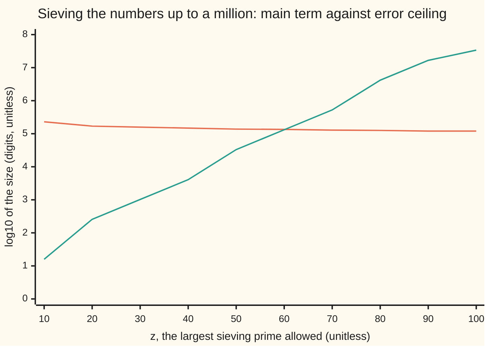

# Sieving by inclusion-exclusion: Legendre's count, and the error that swamps it

[Syllabus](../../../SYLLABUS.md) → [Algebraic and analytic number theory](../README.md) → [Sieves and Prime Gaps](../README.md#s04) → Sieving by inclusion-exclusion

---

## General Overview

Take the whole numbers 1 to 100 and cross out every multiple of 2, 3, 5 and 7. Exactly **22** survive: the number 1 and the 21 primes from 11 to 97.

Adrien-Marie Legendre turned this crossing-out into arithmetic. Take away the multiples of each prime, add back the multiples of each pair, take away those of each triple, and so on. Every count is a division rounded down. For 100 the layers are 100, 117, 45 and 6, and 100 − 117 + 45 − 6 = 22. No number is ever tested on its own.

The trouble starts when the range grows. To reach the primes below a million, sieve by the 168 primes up to 1,000:

- The formula now has 2^168 terms, about 3.74 × 10^50.
- Drop the rounding and the terms fold into one clean product, the **main term**: 80,965.3.
- The true count of survivors is 78,331. The main term is 3.4 percent too high.
- The only error bound the method proves is 2^168.

Then comes a deeper wall. Split the numbers up to a million by whether they have an even or an odd number of prime factors. Each half holds almost exactly half the multiples of every number, so a sieve cannot tell them apart. Yet one half holds every prime and the other none. This is the **parity problem**.

**Legendre's sieve counts the survivors exactly, but the ceiling of 2^k on its rounding errors swamps the main term once the number k of sieving primes outgrows log x, and no count of multiples can tell an even number of prime factors from an odd one, so a sieve alone cannot prove that primes exist.**

**What kind of fact this is:** Legendre's identity and its error bound are theorems, proved on this card in Why it works. So is the bound π(x) ≪ x / log log x, given Mertens' third theorem. Selberg's parity example is proved here too, given that L(x)/x → 0, which is equivalent to the prime number theorem and quoted with its source. The parity problem for sieves in general is a principle, not a theorem about every method; extra information has broken it (Step 6). The counts to a million are evidence, not proof.

### The picture: the error ceiling overtakes the main term



Orange: the main term, the predicted number of survivors, on a scale of digits (5.08 means about 120,000). Green: the error ceiling 2^k, where k is the number of primes up to z. The main term falls slowly. The ceiling doubles at every prime and passes the main term at z = 61, the 18th prime. From there on the bound says nothing.

---

## The formula

Notation first, in words. This card introduces three symbols:

- $`P(z)`$ is the product of the primes up to z. For z = 7 it is 2 × 3 × 5 × 7 = 210.
- $`S(x, z)`$ counts the whole numbers n from 1 to x that have no prime factor up to z. The number 1 always counts.
- The **parity problem** is the sieve's blindness to whether a number has an even or an odd count of prime factors (Step 5).

The letter p always means a prime, and π(z) counts the primes up to z. The **Möbius function** μ(d) is +1 or −1 when d is a product of an even or odd number of different primes, and 0 when a square divides d ([The Mobius function](../01-Arithmetic%20Functions%20Again/03-mobius-inversion.md)). The brackets ⌊ ⌋ mean "round down". The symbol ≪ means "at most a fixed multiple of" ([Big O and twiddle](../01-Arithmetic%20Functions%20Again/01-asymptotic-notation-and-error-terms.md)).

```math
S(x, z) = \sum_{d \mid P(z)} \mu(d) \left\lfloor \frac{x}{d} \right\rfloor = x \prod_{p \le z}\left(1 - \frac{1}{p}\right) + R(x, z), \qquad \lvert R(x, z) \rvert \le 2^{\pi(z)}
```

**Read it aloud:** the numbers up to x with no prime factor up to z are counted exactly by adding and subtracting the multiples of every divisor d of P(z); dropping the rounding leaves x times the product of one minus one over p, wrong by at most 2 to the power of the number of sieving primes.

| Symbol | Plain meaning | In our example | Push it up and the answer… |
| --- | --- | --- | --- |
| $`x`$ | the top of the range | 100; then 10^6 | S(x, z) grows in proportion |
| $`z`$, $`p`$ | the sieving limit; a prime up to it | z = 7, so p = 2, 3, 5, 7 | S(x, z) falls slowly |
| $`P(z)`$ | the product of the primes up to z | P(7) = 210 | gains a factor at each prime |
| $`d`$, $`\mu(d)`$ | a divisor of P(z), a product of different sieving primes; its Möbius sign | μ(6) = +1, μ(30) = −1 | — |
| $`\lfloor x/d \rfloor`$ | the number of multiples of d up to x | ⌊100/6⌋ = 16 | — |
| $`S(x, z)`$ | the survivors: numbers up to x with no prime factor up to z | S(100, 7) = 22; S(10^6, 1000) = 78,331 | — |
| $`k = \pi(z)`$ | the number of sieving primes; there are 2^k divisors d | k = 4; k = 168 | the number of terms doubles |
| $`R(x, z)`$ | the error: true count minus main term | −0.857; −2,634.3 | its ceiling 2^k doubles |
| $`\lambda(n)`$, $`L(y)`$ | Liouville's sign, +1 for an even count of prime factors with repeats and −1 for odd; its running total up to y | λ(12) = −1; L(10^6) = −530 | — |
| $`A^{+}`$, $`A^{-}`$, $`A^{\pm}_d`$ | the numbers up to x with λ = +1, or λ = −1; those of them divisible by d | 499,735 and 500,265; A⁺ for d = 6 has 83,194 | — |
| $`\gamma`$ | Euler's constant | 0.577216, so 2e^−γ = 1.1229 | — |

λ(n) and L(y) come from [Squarefree numbers](../01-Arithmetic%20Functions%20Again/07-squarefree-numbers-and-their-density.md). The S(x, z) here counts survivors; it is not the S(T) of the zero-counting card.

### When it holds

- **The identity is exact for every x and z.** It needs every squarefree d built from the sieving primes, with its sign. Drop a prime and the count changes: sieving 100 by 2, 3 and 5 only leaves 26, because 7, 49, 77 and 91 now survive.
- **The survivors are 1 and the primes above z only when every prime up to √x is a sieving prime.** Every composite up to x then has a prime factor up to z. For x = 100 that means 2, 3, 5 and 7, since √100 = 10. Leave a prime out and products of larger primes survive, as 49 = 7 × 7 does when z = 5.
- **The main term is a good estimate only while 2^k is small next to it.** For x = 10^6 the ceiling passes the main term at z = 61. At z = 1,000 the main term is 3.4 percent too high, and that is a real error, not a weak bound (Step 4).
- **Each prime must remove exactly one class of numbers.** The factor 1 − 1/p assumes each prime p removes one number in p. A sieve for twin primes removes two classes, n and n + 2, and needs 1 − 2/p instead.
- **The sieve uses only counts of multiples.** Two sets with the same counts get the same answer, whatever their primes (Step 5).

---

## Why it works

### Step 0: one sign sum decides each number

A number n survives exactly when it shares no factor with P(z). The Möbius function has a switch built in: added over the divisors of any number m, it gives 1 when m = 1 and 0 otherwise. Put m = gcd(n, P(z)), the greatest common divisor, and the switch is on exactly for the survivors.

Add the switch over every n up to x and swap the order of adding. That is the whole proof of Legendre's identity.

[Inclusion-exclusion for any number of sets](../../04-Combinatorics%20and%20graphs/04-Inclusion-Exclusion%20and%20Pigeonhole/01-inclusion-exclusion-for-n-sets.md) already runs this signed count on 1 to 1,000 by 2, 3, 5 and 7, and gets 228 survivors. [The sieve of Eratosthenes](../../02-Number%20theory/01-Divisibility%20and%20Primes/06-sieve-of-eratosthenes.md) crosses out the same multiples below 100 and explains why it can stop at 7.

### Step 1: Legendre's identity

Swap the two sums:

```math
S(x, z) = \sum_{n \le x} \sum_{d \mid \gcd(n, P(z))} \mu(d) = \sum_{d \mid P(z)} \mu(d) \cdot \#\{n \le x : d \mid n\} = \sum_{d \mid P(z)} \mu(d) \left\lfloor \frac{x}{d} \right\rfloor
```

The middle step counts, for each d, the numbers up to x that d divides. There are ⌊x/d⌋ of them.

For x = 100 and the primes 2, 3, 5, 7 there are 2^4 = 16 divisors of 210. Only 14 of them are at most 100. The other two, 105 and 210, have no multiples up to 100 and add 0.

### Step 2: the main term and the error

Write each rounded division as the exact division minus a fractional part between 0 and 1:

```math
\left\lfloor \frac{x}{d} \right\rfloor = \frac{x}{d} - \left\{ \frac{x}{d} \right\}
```

The exact parts add up to a product. Multiply out $`(1 - 1/2)(1 - 1/3)(1 - 1/5)(1 - 1/7)`$: every squarefree d appears once, as 1/d, with the sign μ(d). So the exact parts give $`x \prod_{p \le z}(1 - 1/p)`$. In whole numbers, the signed sum of 210/d over the 16 divisors is 48, which is 1 × 2 × 4 × 6.

The fractional parts are the error. Each is less than 1 in size, and there are 2^k of them, so the error is at most 2^k in size. At x = 100 the main term is 100 × 48/210 = 22.857, the true count is 22, and the error is −0.857, well inside the ceiling of 16.

### Step 3: the swamp

The main term shrinks slowly as z grows. By [Mertens' theorems](../01-Arithmetic%20Functions%20Again/09-mertens-theorems.md), the product of 1 − 1/p over the primes up to z is about $`e^{-\gamma}/\log z`$. The ceiling 2^k doubles at every prime.

For x = 10^6 the ceiling passes the main term at z = 61. The bound is useful only while 2^k stays below x, which means k below about log x / log 2. Since there are about z / log z primes up to z, that forces z to stay small, at most about log x times log log x.

That limit costs a great deal. Count the primes up to x in two groups: the π(z) primes up to z, and the larger primes, which all survive the sieve. With the number 1 also surviving,

```math
\pi(x) \le \pi(z) - 1 + x \prod_{p \le z}\left(1 - \frac{1}{p}\right) + 2^{\pi(z)}
```

Choose z = log x. Then $`2^{\pi(z)} \le 2^{\log x} = x^{\log 2}`$, far below x, and Mertens makes the main term about $`e^{-\gamma}x / \log\log x`$. So Legendre's sieve proves π(x) ≪ x / log log x, and no better.

The code tries every prime z up to 281 for four sizes of x and keeps the best bound:

| x | best z | Legendre's best bound on π(x) | x / log x | bound ÷ (x / log x) |
| --- | ---: | ---: | ---: | ---: |
| 10^6 | 37 | 152,828 | 72,382 | 2.111 |
| 10^9 | 73 | 128,144,199 | 48,254,942 | 2.656 |
| 10^12 | 113 | 115,843,783,889 | 36,191,206,825 | 3.201 |
| 10^15 | 173 | 108,341,812,803,032 | 28,952,965,460,217 | 3.742 |

The last column keeps growing, as log x / log log x does. [Chebyshev's bounds](../01-Arithmetic%20Functions%20Again/08-chebyshev-bounds.md) already gives π(x) ≪ x / log x with a fixed multiple. At a million the true count is 78,498.

### Step 4: the error is real, not just the bound

Is the ceiling 2^k only pessimistic? Partly. The code sieves the numbers up to a million at four limits z and adds Legendre's terms exactly:

| z | k | ceiling 2^k | terms with d ≤ x | counted | main term | error |
| ---: | ---: | ---: | ---: | ---: | ---: | ---: |
| 7 | 4 | 16 | 16 | 228,571 | 228,571.4 | −0.4 |
| 30 | 10 | 1,024 | 758 | 157,939 | 157,947.2 | −8.2 |
| 100 | 25 | 33,554,432 | 15,850 | 120,760 | 120,317.3 | +442.7 |
| 1,000 | 168 | 3.74 × 10^50 | 153,193 | **78,331** | 80,965.3 | −2,634.3 |

The true errors are far below the ceilings. But at z = 1,000 the error is 3.4 percent of the answer. With z kept at √x, as here, that share does not shrink as x grows (end of this step). Its 2,634.3 splits into two parts:

- **Rounding.** The 153,193 terms with d ≤ x carry fractional parts whose sizes add up to 67,777.1. With their signs they nearly cancel, to +2,649.5.
- **The tail.** Every d above x has no multiples up to x, so its rounded term is 0. Its exact part x/d is not 0. Together the d above x put +5,283.7 into the main term that no number up to x supplies.

So the true count is the main term minus the tail plus the rounding: 80,965.3 − 5,283.7 + 2,649.5 = 78,331, up to the decimals.

At z = √x the survivors are 1 and the primes above √x, about x / log x of them. Mertens puts the main term at about $`e^{-\gamma} x / \log\sqrt{x} = 2e^{-\gamma} x / \log x`$. Their ratio heads for 2e^−γ = 1.1229. At a million it is 1.0336. The main term is wrong by a fixed share, for ever.

### Step 5: the parity problem

Atle Selberg found the reason no refinement of the counting can fully fix this. Split the numbers up to x by Liouville's sign: A⁺ holds the n with λ(n) = +1, an even count of prime factors, and A⁻ the n with λ(n) = −1, an odd count.

**Both halves have the same sieve data.** λ is completely multiplicative, which means λ(dm) = λ(d)λ(m) for every d and m. So a multiple dm of d lies in A⁺ exactly when λ(m) = λ(d). Counting the m up to x/d,

```math
\lvert A^{\pm}_d \rvert = \frac{1}{2}\left( \left\lfloor \frac{x}{d} \right\rfloor \pm \lambda(d)\, L\!\left(\frac{x}{d}\right) \right) = \frac{x}{2d} + \text{small}
```

The running total L(y) is a vanishing share of y, by the prime number theorem: L(y)/y → 0 is equivalent to it (Montgomery and Vaughan, in Sources). So each half holds very nearly half the multiples of every d. The code counts them directly and by the formula:

| d | A⁺ multiples, counted | by the formula | A⁻ multiples | x/(2d) |
| ---: | ---: | ---: | ---: | ---: |
| 2 | 250,193 | 250,193 | 249,807 | 250,000.0 |
| 3 | 166,932 | 166,932 | 166,401 | 166,666.7 |
| 6 | 83,194 | 83,194 | 83,472 | 83,333.3 |
| 210 | 2,358 | 2,358 | 2,403 | 2,381.0 |

Over every squarefree d up to 1,000, the largest gap between |A⁺_d| and x/(2d) is 265.3, at d = 3.

**The survivors are completely different.** Sieve both halves to z = 1,000. A survivor is 1 or a prime above 1,000. Every prime has one prime factor, an odd count, so all 78,330 primes land in A⁻. A⁺ keeps only the number 1. The main term, the same for both, is 40,482.6.

**What this does to any sieve.** A sieve takes the counts of multiples and returns bounds. Fed the same model counts x/(2d), with errors this small, it must return the same bounds for A⁺ and A⁻. A lower bound for A⁻ must then also hold for A⁺, so it is at most 1, nothing next to the main term 40,482.6: a sieve alone cannot give A⁻ a lower bound of the right size. An upper bound for A⁺ must also cover A⁻'s 78,330, almost twice the fair share of 40,482.6. This is why sieve upper bounds for primes carry a factor near 2.

<details>
<summary>Detailed proof: the counts of multiples in each half</summary>

Fix a squarefree d up to x. A multiple of d up to x is dm with m ≤ x/d. Since λ is completely multiplicative and λ(d)² = 1,

$`\displaystyle \lambda(dm) = +1 \iff \lambda(m) = \lambda(d).`$

Among the ⌊x/d⌋ values of m, the number with λ(m) = +1 minus the number with λ(m) = −1 is L(x/d). So the number with λ(m) = λ(d) is

$`\displaystyle \lvert A^{+}_d \rvert = \frac{1}{2}\left(\left\lfloor \frac{x}{d}\right\rfloor + \lambda(d)\,L\!\left(\frac{x}{d}\right)\right), \qquad \lvert A^{-}_d \rvert = \left\lfloor \frac{x}{d}\right\rfloor - \lvert A^{+}_d \rvert.`$

Hence $`\lvert A^{\pm}_d \rvert - x/(2d)`$ is at most $`\tfrac{1}{2}(1 + \lvert L(x/d)\rvert)`$ in size. Given L(y) = o(y), this is o(x/d) for each fixed d: both halves meet the same sieve model, density 1/d and total x/2, with errors that are a vanishing share. The survivors to z = √x are 1 (λ = +1) and the primes in (√x, x] (λ = −1), so the two sieve answers are 1 and π(x) − π(√x).

</details>

Selberg's own upper-bound sieve allows at most (2 + o(1)) y / log y primes in any interval of length y, where o(1) shrinks to 0 as y grows. His example shows that no sieve of this kind can lower the 2.

### Step 6: getting past the wall

The parity problem is a limit on sieves that use only counts of multiples. It falls when extra information is fed in, usually a "bilinear" estimate: a bound on sums over products m × n with both factors in long ranges.

- **Chen's theorem** settles for numbers with at most two prime factors, which the parity barrier allows ([Goldbach](07-goldbach-and-chens-theorem.md)).
- **Friedlander and Iwaniec (1998)** proved that x² + y⁴ is prime infinitely often, by adding such bilinear estimates to a sieve.
- **Heath-Brown (2001)** did the same for x³ + 2y³.

For the twin primes and Goldbach's problem in full, no one has found the missing information. Both remain open as of 2026-11-15.

---

## Worked numbers, by hand

The example: the numbers 1 to 100, sieved by 2, 3, 5 and 7.

| Step | Arithmetic | Value |
| --- | --- | --- |
| d = 1 | ⌊100/1⌋ | +100 |
| single primes | 50 + 33 + 20 + 14 | −117 |
| pairs: 6, 10, 14, 15, 21, 35 | 16 + 10 + 7 + 6 + 4 + 2 | +45 |
| triples: 30, 42, 70, 105 | 3 + 2 + 1 + 0 | −6 |
| all four: 210 | ⌊100/210⌋ | 0 |
| Legendre's count | 100 − 117 + 45 − 6 + 0 | **22** |
| main term | 100 × (1/2)(2/3)(4/5)(6/7) = 100 × 48/210 | 22.857 |
| error | 22 − 22.857, against a ceiling of 2^4 = 16 | −0.857 |

The 22 survivors are 1 and the 21 primes from 11 to 97, which matches π(100) − π(10) + 1 = 25 − 4 + 1.

### What breaks if you drop a piece

| Mistake | Comes out at | What went wrong |
| --- | --- | --- |
| Read the main term at z = 1,000 as the count below a million | 80,965.3, against 78,331 | The tail of d above x is real; the ratio heads for 2e^−γ = 1.1229 |
| Stop sieving 100 at the prime 5 | 26, against 22 | 7 is a prime below √100 = 10 that was left out: 7, 49, 77 and 91 survive |
| Trust the error ceiling at z = 1,000 | ± 3.74 × 10^50 | True, but useless: it passes the main term at z = 61 |
| Expect the λ = +1 half to hold its share of survivors | 40,482.6 predicted, 1 true: the number 1, and no primes | The sieve sees counts of multiples, not the parity of the number of prime factors |

The last row is the hypothesis that fails. Both halves meet the sieve's assumption, density 1/d with small errors, yet one keeps 1 survivor and the other 78,330. The code prints every row.

---

## Code, from first principles, and it actually runs

The code builds the smallest prime factor of every number up to a million, and from it the primes and Liouville's λ. It takes three roads to each survivor count. Road one crosses out multiples, or tests every number for x = 100. Road two adds Legendre's signed rounded divisions over every squarefree d up to x. Road three is the main term, which must land within 2^k. Roads one and two must agree exactly. For the parity step, the multiples of d in each half are counted one by one and by the formula through L(y), and L(10^6) = −530 is checked against a second count of prime factors, one prime power at a time. π(10^6) = 78,498 and the 8,169 twin pairs are checked against known tables.

### Python

```python
# Legendre's sieve and the parity problem -- the check behind the card.
# Standard library only.  Road one crosses out multiples and counts what is left.
# Road two is Legendre's signed sum of floor(x/d) over squarefree d.  Road three
# is the main term x * prod(1 - 1/p), set against the 2^k ceiling on the error.
import math
X = 10**6
spf = list(range(X + 1))                          # smallest prime factor of each n
for i in range(2, 1001):
    if spf[i] == i:
        for j in range(i * i, X + 1, i):
            if spf[j] == j:
                spf[j] = i
primes = [p for p in range(2, X + 1) if spf[p] == p]
lam = [0, 1] + [0] * (X - 1)                      # Liouville's lambda from spf
for n in range(2, X + 1):
    lam[n] = -lam[n // spf[n]]
Lsum = [0] * (X + 1)                              # running total L(n) of lambda
for n in range(1, X + 1):
    Lsum[n] = Lsum[n - 1] + lam[n]
def big(k):                                       # 2^k, written for the reader
    if k <= 30:
        return f"{2**k:,}"
    e = int(k * math.log10(2))
    return f"{2**k / 10**e:.2f} x 10^{e}"
def legendre(x, ps):                              # walk squarefree d <= x built from ps
    out = {"layers": [0] * (len(ps) + 1), "terms": 0, "near": 0.0, "frac": 0.0}
    def go(i, d, k):
        s = 1 if k % 2 == 0 else -1
        out["layers"][k] += x // d; out["terms"] += 1
        out["near"] += s * x / d; out["frac"] += (x % d) / d
        for j in range(i, len(ps)):
            if d * ps[j] > x:
                break
            go(j + 1, d * ps[j], k + 1)
    go(0, 1, 0)
    out["sum"] = sum((-1)**k * v for k, v in enumerate(out["layers"]))
    return out
def count(x, ps):                                 # road one: test every n <= x
    return sum(1 for n in range(1, x + 1) if all(n % p for p in ps))
def mainterm(x, ps):
    return x * math.prod(1 - 1/p for p in ps)
small = [2, 3, 5, 7]
r = legendre(100, small)
pi = lambda y: sum(1 for p in primes if p <= y)
print(f"x = 100, primes 2, 3, 5, 7: layers {r['layers'][:4]} -> Legendre {r['sum']};"
      f" counted {count(100, small)}; pi(100) - pi(10) + 1 = {pi(100)} - {pi(10)} + 1")
print(f"x = 100: {2**4} terms, {r['terms']} with d <= 100; main term {mainterm(100, small):.3f};"
      f" error {r['sum'] - mainterm(100, small):+.3f}")
divs = sorted((bin(m).count("1"), math.prod(q for b, q in enumerate(small) if m >> b & 1)) for m in range(16))
print("x = 100, each d: floor(100/d):", " ".join(f"{d}:{100 // d}" for k, d in divs))
idsum = sum((-1)**k * (210 // d) for k, d in divs)
print(f"sum of mu(d) * 210/d over d | 210 = {idsum}; prod (p - 1) = {math.prod(p - 1 for p in small)}")
print(f"x = 100, primes 2, 3, 5 only: counted {count(100, small[:3])}; main term {mainterm(100, small[:3]):.3f}")
print("x = 10^6: z | k | 2^k | terms d <= x | Legendre | counted | main term | error | error/main")
alive = bytearray([1]) * (X + 1); alive[0] = 0
rows = {}
for z in (7, 30, 100, 1000):                      # road one, prime by prime
    ps = [p for p in primes if p <= z]
    for p in ps:
        alive[p::p] = bytearray(len(range(p, X + 1, p)))
    r, m, c = legendre(X, ps), mainterm(X, ps), sum(alive)
    rows[z] = (len(ps), r, m, c)
    print(f"{z:>4} | {len(ps):>3} | {big(len(ps))} | {r['terms']:,} | {r['sum']:,} | {c:,} | {m:,.1f}"
          f" | {c - m:+,.1f} | {100 * (c - m) / m:+.4f}%")
k, r, m, c = rows[1000]
print(f"z = 1000 split: near part (d <= x) {r['near']:,.1f}; tail (d > x) {m - r['near']:+,.1f};"
      f" rounding {r['sum'] - r['near']:+,.1f}; rounding terms in size {r['frac']:,.1f}")
pix = len(primes)
print(f"pi(10^6) = {pix:,}; survivors at z = 1000 are 1 and the primes above 1000: {1 + pix - 168:,};"
      f" main / counted = {m / c:.4f}; 2e^-gamma = {2 * math.exp(-0.5772156649015329):.4f}")
cross = next(p for p in primes if 2.0**pi(p) > mainterm(X, [q for q in primes if q <= p]))
print(f"x = 10^6: 2^k first passes the main term at z = {cross} (k = {pi(cross)})")
print("Legendre's best bound on pi(x): x | best z | bound | x / log x | ratio")
best = {}
for e in (6, 9, 12, 15):
    x = 10**e
    b = min((pi(z) - 1 + mainterm(x, primes[:pi(z)]) + 2.0**pi(z), z) for z in primes[:60])
    best[e] = b[0]
    print(f"10^{e} | {b[1]} | {b[0]:,.0f} | {x / math.log(x):,.0f} | {b[0] * math.log(x) / x:.3f}")
chart = [10, 20, 30, 40, 50, 60, 70, 80, 90, 100]
print("chart, log10 main term:", ", ".join(f"{math.log10(mainterm(X, primes[:pi(zz)])):.2f}" for zz in chart))
print("chart, log10 2^k:", ", ".join(f"{pi(zz) * math.log10(2):.2f}" for zz in chart))
plus = sum(1 for n in range(1, X + 1) if lam[n] == 1)
print(f"lambda = +1 below 10^6: {plus:,}; lambda = -1: {X - plus:,}; L(10^6) = {Lsum[X]}")
om = bytearray(X + 1)                             # Omega(n) a second way: +1 per prime power dividing n
for p in primes:
    q = p
    while q <= X:
        for j in range(q, X + 1, q): om[j] += 1
        q *= p
print("d | A+_d counted | A+_d by formula | A-_d | x/(2d)")
for d in (2, 3, 6, 210):
    direct = sum(1 for n in range(d, X + 1, d) if lam[n] == 1)
    formula = (X // d + lam[d] * Lsum[X // d]) // 2
    print(f"{d} | {direct:,} | {formula:,} | {X // d - direct:,} | {X / (2 * d):,.1f}")
    assert direct == formula                       # parity counts, two roads
worst = max((abs((X // d + lam[d] * Lsum[X // d]) / 2 - X / (2 * d)), d)
            for d in range(1, 1001) if all(d % (p * p) for p in primes[:11]))
print(f"largest |A+_d - x/(2d)| over squarefree d <= 1000: {worst[0]:.1f}, at d = {worst[1]}")
sp = sum(1 for n in range(1, X + 1) if alive[n] and lam[n] == 1)
sm = sum(1 for n in range(1, X + 1) if alive[n] and lam[n] == -1)
print(f"survivors at z = 1000: lambda = +1 {sp:,}; lambda = -1 {sm:,}; main term for each {m / 2:,.1f}")
twins = sum(1 for p in primes if p + 2 <= X and spf[p + 2] == p + 2)
tw = sum(1 for n in range(1, X - 1) if alive[n] and alive[n + 2])
tmain = X * 0.5 * math.prod(1 - 2/p for p in primes[1:168])
print(f"twin pairs below 10^6: {twins:,}; pairs above 1000 by the sieve {tw:,};"
      f" main term {tmain:,.1f}; ratio {tmain / tw:.4f}")
for z in (7, 30, 100, 1000):
    k, r, m, c = rows[z]
    assert r["sum"] == c and abs(c - m) <= 2**k     # Legendre = count; error under 2^k
assert count(100, small) == 22 == pi(100) - pi(10) + 1 and idsum == 48
assert pix == 78498 and c == 1 + pix - 168          # pi(10^6), known table
assert sp == 1 and sm == pix - 168 and sum(1 - 2 * (om[n] & 1) for n in range(1, X + 1)) == Lsum[X]   # L(10^6) two ways
assert twins == 8169 and tw == twins - sum(1 for p in primes if p + 2 <= 1000 and spf[p + 2] == p + 2)
assert best[6] >= pix and all(best[e] * math.log(10**e) / 10**e > 1.5 for e in best)
print("ALL CHECKS PASS")
```

**Ran 2026-11-15 on macOS, Python 3.14.10, standard library only. All checks passed. Output, pasted from the run:**

```
x = 100, primes 2, 3, 5, 7: layers [100, 117, 45, 6] -> Legendre 22; counted 22; pi(100) - pi(10) + 1 = 25 - 4 + 1
x = 100: 16 terms, 14 with d <= 100; main term 22.857; error -0.857
x = 100, each d: floor(100/d): 1:100 2:50 3:33 5:20 7:14 6:16 10:10 14:7 15:6 21:4 35:2 30:3 42:2 70:1 105:0 210:0
sum of mu(d) * 210/d over d | 210 = 48; prod (p - 1) = 48
x = 100, primes 2, 3, 5 only: counted 26; main term 26.667
x = 10^6: z | k | 2^k | terms d <= x | Legendre | counted | main term | error | error/main
   7 |   4 | 16 | 16 | 228,571 | 228,571 | 228,571.4 | -0.4 | -0.0002%
  30 |  10 | 1,024 | 758 | 157,939 | 157,939 | 157,947.2 | -8.2 | -0.0052%
 100 |  25 | 33,554,432 | 15,850 | 120,760 | 120,760 | 120,317.3 | +442.7 | +0.3680%
1000 | 168 | 3.74 x 10^50 | 153,193 | 78,331 | 78,331 | 80,965.3 | -2,634.3 | -3.2536%
z = 1000 split: near part (d <= x) 75,681.5; tail (d > x) +5,283.7; rounding +2,649.5; rounding terms in size 67,777.1
pi(10^6) = 78,498; survivors at z = 1000 are 1 and the primes above 1000: 78,331; main / counted = 1.0336; 2e^-gamma = 1.1229
x = 10^6: 2^k first passes the main term at z = 61 (k = 18)
Legendre's best bound on pi(x): x | best z | bound | x / log x | ratio
10^6 | 37 | 152,828 | 72,382 | 2.111
10^9 | 73 | 128,144,199 | 48,254,942 | 2.656
10^12 | 113 | 115,843,783,889 | 36,191,206,825 | 3.201
10^15 | 173 | 108,341,812,803,032 | 28,952,965,460,217 | 3.742
chart, log10 main term: 5.36, 5.23, 5.20, 5.17, 5.14, 5.13, 5.11, 5.10, 5.08, 5.08
chart, log10 2^k: 1.20, 2.41, 3.01, 3.61, 4.52, 5.12, 5.72, 6.62, 7.22, 7.53
lambda = +1 below 10^6: 499,735; lambda = -1: 500,265; L(10^6) = -530
d | A+_d counted | A+_d by formula | A-_d | x/(2d)
2 | 250,193 | 250,193 | 249,807 | 250,000.0
3 | 166,932 | 166,932 | 166,401 | 166,666.7
6 | 83,194 | 83,194 | 83,472 | 83,333.3
210 | 2,358 | 2,358 | 2,403 | 2,381.0
largest |A+_d - x/(2d)| over squarefree d <= 1000: 265.3, at d = 3
survivors at z = 1000: lambda = +1 1; lambda = -1 78,330; main term for each 40,482.6
twin pairs below 10^6: 8,169; pairs above 1000 by the sieve 8,134; main term 8,656.3; ratio 1.0642
ALL CHECKS PASS
```

### Rust

Same numbers, same labels, built with `rustc --edition 2021 -O`.

```rust
// Legendre's sieve and the parity problem -- the same check as the Python, in Rust.
// No crates.  Road one crosses out multiples and counts what is left.
// Road two is Legendre's signed sum of floor(x/d) over squarefree d.  Road three
// is the main term x * prod(1 - 1/p), set against the 2^k ceiling on the error.
const X: usize = 1_000_000;

fn com(v: f64, d: usize, plus: bool) -> String {      // thousands commas, d decimals
    let s = format!("{:.*}", d, v.abs());
    let (int, frac) = match s.find('.') { Some(i) => (&s[..i], &s[i..]), None => (&s[..], "") };
    let mut out = String::new();
    for (i, ch) in int.chars().enumerate() {
        if i > 0 && (int.len() - i) % 3 == 0 { out.push(',') }
        out.push(ch);
    }
    let sign = if v < 0.0 { "-" } else if plus { "+" } else { "" };
    format!("{}{}{}", sign, out, frac)
}
fn ci(v: usize) -> String { com(v as f64, 0, false) }
fn big(k: usize) -> String {                          // 2^k, written for the reader
    if k <= 30 { return ci(1usize << k) }
    let e = (k as f64 * 2f64.log10()) as i32;
    format!("{:.2} x 10^{}", 2f64.powi(k as i32) / 10f64.powi(e), e)
}
struct Leg { layers: Vec<i64>, terms: usize, near: f64, frac: f64 }
fn go(x: usize, ps: &[usize], i: usize, d: usize, k: usize, o: &mut Leg) {
    let s = if k % 2 == 0 { 1.0 } else { -1.0 };
    o.layers[k] += (x / d) as i64; o.terms += 1;
    o.near += s * (x as f64 / d as f64); o.frac += (x % d) as f64 / d as f64;
    for j in i..ps.len() {
        if d * ps[j] > x { break }
        go(x, ps, j + 1, d * ps[j], k + 1, o);
    }
}
fn legendre(x: usize, ps: &[usize]) -> (Leg, i64) {   // walk squarefree d <= x built from ps
    let mut o = Leg { layers: vec![0; ps.len() + 1], terms: 0, near: 0.0, frac: 0.0 };
    go(x, ps, 0, 1, 0, &mut o);
    let sum = o.layers.iter().enumerate().map(|(k, v)| if k % 2 == 0 { *v } else { -*v }).sum();
    (o, sum)
}
fn count(x: usize, ps: &[usize]) -> usize { (1..=x).filter(|n| ps.iter().all(|p| n % p != 0)).count() }
fn mainterm(x: f64, ps: &[usize]) -> f64 {
    let mut m = 1.0;
    for &p in ps { m *= 1.0 - 1.0 / p as f64 }
    x * m
}

fn main() {
    let mut spf: Vec<usize> = (0..=X).collect();      // smallest prime factor of each n
    for i in 2..=1000 {
        if spf[i] == i { let mut j = i * i; while j <= X { if spf[j] == j { spf[j] = i } j += i } }
    }
    let primes: Vec<usize> = (2..=X).filter(|&p| spf[p] == p).collect();
    let mut lam = vec![0i64; X + 1]; lam[1] = 1;      // Liouville's lambda from spf
    for n in 2..=X { lam[n] = -lam[n / spf[n]] }
    let mut lsum = vec![0i64; X + 1];                 // running total L(n) of lambda
    for n in 1..=X { lsum[n] = lsum[n - 1] + lam[n] }
    let pi = |y: usize| primes.iter().filter(|&&p| p <= y).count();
    let small = [2usize, 3, 5, 7];
    let (r, s100) = legendre(100, &small);
    println!("x = 100, primes 2, 3, 5, 7: layers [{}, {}, {}, {}] -> Legendre {}; counted {}; pi(100) - pi(10) + 1 = {} - {} + 1",
             r.layers[0], r.layers[1], r.layers[2], r.layers[3], s100, count(100, &small), pi(100), pi(10));
    let m100 = mainterm(100.0, &small);
    println!("x = 100: {} terms, {} with d <= 100; main term {:.3}; error {:+.3}", 1 << 4, r.terms, m100, s100 as f64 - m100);
    let mut divs: Vec<(u32, usize)> = (0..16usize)
        .map(|m| (m.count_ones(), (0..4).filter(|b| m >> b & 1 == 1).map(|b| small[b]).product())).collect();
    divs.sort();
    let shown: Vec<String> = divs.iter().map(|(_, d)| format!("{}:{}", d, 100 / d)).collect();
    println!("x = 100, each d: floor(100/d): {}", shown.join(" "));
    let idsum: i64 = divs.iter().map(|&(k, d)| if k % 2 == 0 { (210 / d) as i64 } else { -((210 / d) as i64) }).sum();
    println!("sum of mu(d) * 210/d over d | 210 = {}; prod (p - 1) = {}", idsum, small.iter().map(|p| p - 1).product::<usize>());
    println!("x = 100, primes 2, 3, 5 only: counted {}; main term {:.3}", count(100, &small[..3]), mainterm(100.0, &small[..3]));
    println!("x = 10^6: z | k | 2^k | terms d <= x | Legendre | counted | main term | error | error/main");
    let mut alive = vec![true; X + 1]; alive[0] = false;
    let mut rows: Vec<(usize, Leg, i64, f64, usize)> = Vec::new();
    for z in [7usize, 30, 100, 1000] {                // road one, prime by prime
        let ps: Vec<usize> = primes.iter().cloned().filter(|&p| p <= z).collect();
        for &p in &ps { let mut j = p; while j <= X { alive[j] = false; j += p } }
        let (r, sum) = legendre(X, &ps);
        let (m, c) = (mainterm(X as f64, &ps), alive.iter().filter(|&&b| b).count());
        println!("{:>4} | {:>3} | {} | {} | {} | {} | {} | {} | {:+.4}%", z, ps.len(), big(ps.len()), ci(r.terms),
                 com(sum as f64, 0, false), ci(c), com(m, 1, false), com(c as f64 - m, 1, true), 100.0 * (c as f64 - m) / m);
        rows.push((ps.len(), r, sum, m, c));
    }
    let (_, r, sum, m, c) = &rows[3];
    let (m, c) = (*m, *c);
    println!("z = 1000 split: near part (d <= x) {}; tail (d > x) {}; rounding {}; rounding terms in size {}",
             com(r.near, 1, false), com(m - r.near, 1, true), com(*sum as f64 - r.near, 1, true), com(r.frac, 1, false));
    let pix = primes.len();
    println!("pi(10^6) = {}; survivors at z = 1000 are 1 and the primes above 1000: {}; main / counted = {:.4}; 2e^-gamma = {:.4}",
             ci(pix), ci(1 + pix - 168), m / c as f64, 2.0 * (-0.5772156649015329f64).exp());
    let cross = *primes.iter().find(|&&p| 2f64.powi(pi(p) as i32) > mainterm(X as f64, &primes[..pi(p)])).unwrap();
    println!("x = 10^6: 2^k first passes the main term at z = {} (k = {})", cross, pi(cross));
    println!("Legendre's best bound on pi(x): x | best z | bound | x / log x | ratio");
    let mut best = Vec::new();
    for e in [6i32, 9, 12, 15] {
        let x = 10f64.powi(e);
        let mut b = (f64::MAX, 0usize);
        for &z in &primes[..60] {
            let k = pi(z);
            let v = (k as f64 - 1.0 + mainterm(x, &primes[..k])) + 2f64.powi(k as i32);
            if v < b.0 { b = (v, z) }
        }
        best.push((x, b.0));
        println!("10^{} | {} | {} | {} | {:.3}", e, b.1, com(b.0, 0, false), com(x / x.ln(), 0, false), b.0 * x.ln() / x);
    }
    let chart = [10usize, 20, 30, 40, 50, 60, 70, 80, 90, 100];
    let c1: Vec<String> = chart.iter().map(|&z| format!("{:.2}", mainterm(X as f64, &primes[..pi(z)]).log10())).collect();
    let c2: Vec<String> = chart.iter().map(|&z| format!("{:.2}", pi(z) as f64 * 2f64.log10())).collect();
    println!("chart, log10 main term: {}", c1.join(", "));
    println!("chart, log10 2^k: {}", c2.join(", "));
    let plus = (1..=X).filter(|&n| lam[n] == 1).count();
    println!("lambda = +1 below 10^6: {}; lambda = -1: {}; L(10^6) = {}", ci(plus), ci(X - plus), lsum[X]);
    let mut om = vec![0u8; X + 1];                    // Omega(n) a second way: +1 per prime power dividing n
    for &p in &primes { let mut q = p; while q <= X { let mut j = q; while j <= X { om[j] += 1; j += q } q *= p } }
    let l2: i64 = (1..=X).map(|n| 1 - 2 * (om[n] & 1) as i64).sum();
    println!("d | A+_d counted | A+_d by formula | A-_d | x/(2d)");
    for d in [2usize, 3, 6, 210] {
        let direct = (d..=X).step_by(d).filter(|&n| lam[n] == 1).count();
        let formula = ((X / d) as i64 + lam[d] * lsum[X / d]) / 2;
        println!("{} | {} | {} | {} | {}", d, ci(direct), com(formula as f64, 0, false), ci(X / d - direct), com(X as f64 / (2 * d) as f64, 1, false));
        assert!(direct as i64 == formula);             // parity counts, two roads
    }
    let mut worst = (0.0f64, 0usize);
    for d in 1..=1000usize {
        if primes[..11].iter().any(|p| d % (p * p) == 0) { continue }
        let v = (((X / d) as i64 + lam[d] * lsum[X / d]) as f64 / 2.0 - X as f64 / (2 * d) as f64).abs();
        if v > worst.0 || (v == worst.0 && d > worst.1) { worst = (v, d) }
    }
    println!("largest |A+_d - x/(2d)| over squarefree d <= 1000: {:.1}, at d = {}", worst.0, worst.1);
    let sp = (1..=X).filter(|&n| alive[n] && lam[n] == 1).count();
    let sm = (1..=X).filter(|&n| alive[n] && lam[n] == -1).count();
    println!("survivors at z = 1000: lambda = +1 {}; lambda = -1 {}; main term for each {}", ci(sp), ci(sm), com(m / 2.0, 1, false));
    let is_p = |n: usize| n <= X && spf[n] == n && n > 1;
    let twins = primes.iter().filter(|&&p| is_p(p + 2)).count();
    let tw = (1..X - 1).filter(|&n| alive[n] && alive[n + 2]).count();
    let mut tp = 1.0;
    for &p in &primes[1..168] { tp *= 1.0 - 2.0 / p as f64 }
    let tmain = X as f64 * 0.5 * tp;
    println!("twin pairs below 10^6: {}; pairs above 1000 by the sieve {}; main term {}; ratio {:.4}", ci(twins), ci(tw), com(tmain, 1, false), tmain / tw as f64);
    for (k, _, sum, m, c) in &rows {
        assert!(*sum == *c as i64 && (*c as f64 - m).abs() <= 2f64.powi(*k as i32)); // Legendre = count; error under 2^k
    }
    assert!(count(100, &small) == 22 && s100 == 22 && pi(100) - pi(10) + 1 == 22 && idsum == 48);
    assert!(pix == 78498 && c == 1 + pix - 168);       // pi(10^6), known table
    assert!(sp == 1 && sm == pix - 168 && l2 == lsum[X]);  // L(10^6) two ways
    let low_twins = primes.iter().filter(|&&p| p + 2 <= 1000 && is_p(p + 2)).count();
    assert!(twins == 8169 && tw == twins - low_twins);
    assert!(best[0].1 >= pix as f64 && best.iter().all(|(x, b)| b * x.ln() / x > 1.5));
    println!("ALL CHECKS PASS");
}
```

**Ran 2026-11-15 on macOS, rustc 1.98.1, no crates. All checks passed. Output, pasted from the run:**

```
x = 100, primes 2, 3, 5, 7: layers [100, 117, 45, 6] -> Legendre 22; counted 22; pi(100) - pi(10) + 1 = 25 - 4 + 1
x = 100: 16 terms, 14 with d <= 100; main term 22.857; error -0.857
x = 100, each d: floor(100/d): 1:100 2:50 3:33 5:20 7:14 6:16 10:10 14:7 15:6 21:4 35:2 30:3 42:2 70:1 105:0 210:0
sum of mu(d) * 210/d over d | 210 = 48; prod (p - 1) = 48
x = 100, primes 2, 3, 5 only: counted 26; main term 26.667
x = 10^6: z | k | 2^k | terms d <= x | Legendre | counted | main term | error | error/main
   7 |   4 | 16 | 16 | 228,571 | 228,571 | 228,571.4 | -0.4 | -0.0002%
  30 |  10 | 1,024 | 758 | 157,939 | 157,939 | 157,947.2 | -8.2 | -0.0052%
 100 |  25 | 33,554,432 | 15,850 | 120,760 | 120,760 | 120,317.3 | +442.7 | +0.3680%
1000 | 168 | 3.74 x 10^50 | 153,193 | 78,331 | 78,331 | 80,965.3 | -2,634.3 | -3.2536%
z = 1000 split: near part (d <= x) 75,681.5; tail (d > x) +5,283.7; rounding +2,649.5; rounding terms in size 67,777.1
pi(10^6) = 78,498; survivors at z = 1000 are 1 and the primes above 1000: 78,331; main / counted = 1.0336; 2e^-gamma = 1.1229
x = 10^6: 2^k first passes the main term at z = 61 (k = 18)
Legendre's best bound on pi(x): x | best z | bound | x / log x | ratio
10^6 | 37 | 152,828 | 72,382 | 2.111
10^9 | 73 | 128,144,199 | 48,254,942 | 2.656
10^12 | 113 | 115,843,783,889 | 36,191,206,825 | 3.201
10^15 | 173 | 108,341,812,803,032 | 28,952,965,460,217 | 3.742
chart, log10 main term: 5.36, 5.23, 5.20, 5.17, 5.14, 5.13, 5.11, 5.10, 5.08, 5.08
chart, log10 2^k: 1.20, 2.41, 3.01, 3.61, 4.52, 5.12, 5.72, 6.62, 7.22, 7.53
lambda = +1 below 10^6: 499,735; lambda = -1: 500,265; L(10^6) = -530
d | A+_d counted | A+_d by formula | A-_d | x/(2d)
2 | 250,193 | 250,193 | 249,807 | 250,000.0
3 | 166,932 | 166,932 | 166,401 | 166,666.7
6 | 83,194 | 83,194 | 83,472 | 83,333.3
210 | 2,358 | 2,358 | 2,403 | 2,381.0
largest |A+_d - x/(2d)| over squarefree d <= 1000: 265.3, at d = 3
survivors at z = 1000: lambda = +1 1; lambda = -1 78,330; main term for each 40,482.6
twin pairs below 10^6: 8,169; pairs above 1000 by the sieve 8,134; main term 8,656.3; ratio 1.0642
ALL CHECKS PASS
```

The two outputs match line for line.

### Lean

Lean proves the card's three exact statements for every whole number x and z, and checks the worked numbers for 100.

- Take any whole numbers x and z. Then S(x, z) equals the sum of μ(d) ⌊x/d⌋ over the divisors d of P(z), exactly.
- Take any whole numbers x and z. Then S(x, z) differs from the main term x ∏ (1 − 1/p) by at most 2^π(z).
- Suppose every prime p with p² ≤ x is at most z. Then the survivors up to x are exactly the number 1 and the primes above z.
- Take any whole numbers x and d, squarefree or not. Then 2 × |A⁺_d| = ⌊x/d⌋ + λ(d) L(x/d).
- Take x = 100 and the primes 2, 3, 5 and 7. Then 22 survive, and Legendre's signed sum and the layers 100 − 117 + 45 − 6 both give 22.
- That matches π(100) − π(10) + 1 = 22. Sieving 100 by 2, 3 and 5 alone leaves 26.
- P(7) = 210, the signed sum of 210/d over its divisors is 48, and λ(12) = −1.

The counts to a million and beyond, in every table of Steps 3 to 5, are left to the Python and Rust checks.

```lean
-- Sieving by inclusion-exclusion: Legendre's signed sum of rounded divisions counts the numbers up to x with no prime factor up to z exactly, and it differs from the main term x ∏ (1 - 1/p) by at most 2 to the power of the number of sieving primes.
import Mathlib.NumberTheory.ArithmeticFunction.Moebius
import Mathlib.NumberTheory.ArithmeticFunction.Liouville
import Mathlib.NumberTheory.PrimeCounting
import Mathlib.NumberTheory.Primorial
import Mathlib.Basic.Real.Basic

open Finset Nat ArithmeticFunction
open scoped ArithmeticFunction.Moebius Nat.Prime

/-- No sieving prime divides `n` exactly when `n` is coprime to the primorial. -/
lemma sieve_cond_iff_coprime (z n : ℕ) :
    (∀ p ∈ primesLE z, ¬ p ∣ n) ↔ Nat.Coprime n (primorial z) := by
  constructor
  · intro h
    refine Nat.coprime_of_dvd fun k hk hkn hkP => ?_
    have : k ∈ primeFactors (primorial z) :=
      Nat.mem_primeFactors.mpr ⟨hk, hkP, primorial_ne_zero z⟩
    rw [primeFactors_primorial] at this
    exact h k this hkn
  · intro hc p hp hpn
    have hpP : p ∣ primorial z := by
      rw [primorial_eq_prod_primesLE]; exact dvd_prod_of_mem _ hp
    have := Nat.dvd_one.mp (hc ▸ Nat.dvd_gcd hpn hpP)
    exact (prime_of_mem_primesLE hp).one_lt.ne' this

/-- The Möbius sum over the divisors of the primorial that divide `n` detects sieve survivors. -/
lemma sum_moebius_divisors_primorial_dvd (z n : ℕ) :
    ∑ d ∈ (primorial z).divisors, (if d ∣ n then μ d else 0)
      = if (∀ p ∈ primesLE z, ¬ p ∣ n) then 1 else 0 := by
  rw [← sum_filter]
  have hfilt : {d ∈ (primorial z).divisors | d ∣ n} = (Nat.gcd n (primorial z)).divisors := by
    ext d
    simp only [mem_filter, Nat.mem_divisors, Nat.dvd_gcd_iff]
    have h1 := primorial_ne_zero z
    have h2 : Nat.gcd n (primorial z) ≠ 0 := Nat.gcd_ne_zero_right h1
    tauto
  rw [hfilt, ← coe_mul_zeta_apply, moebius_mul_coe_zeta, ArithmeticFunction.one_apply]
  exact if_congr (sieve_cond_iff_coprime z n).symm rfl rfl

/-- The count of multiples of `d` in `[1, x]`. -/
lemma card_filter_dvd_Icc_one (x d : ℕ) : #{n ∈ Icc 1 x | d ∣ n} = x / d := by
  rw [← Nat.Ioc_filter_dvd_card_eq_div x d]
  congr 1

/-- Legendre's identity: the sieve count as a Möbius sum over the divisors of the primorial. -/
lemma legendre_identity (x z : ℕ) :
    ((#{n ∈ Icc 1 x | ∀ p ∈ primesLE z, ¬ p ∣ n} : ℕ) : ℤ)
        = ∑ d ∈ (primorial z).divisors, μ d * ((x / d : ℕ) : ℤ) := by
  rw [card_filter, Nat.cast_sum]
  simp_rw [← card_filter_dvd_Icc_one x, card_filter, Nat.cast_sum, mul_sum]
  rw [sum_comm]
  apply sum_congr rfl
  intro n _
  push_cast [Nat.cast_ite]
  rw [← sum_moebius_divisors_primorial_dvd z n]
  apply sum_congr rfl
  intro d _
  split_ifs <;> simp

/-- The divisors of a squarefree number: there are `2 ^ ω(n)` of them; for the primorial,
`2 ^ π(z)`. -/
lemma card_divisors_primorial (z : ℕ) : #(primorial z).divisors = 2 ^ π z := by
  rw [Nat.card_divisors (primorial_ne_zero z)]
  have hsq := squarefree_primorial z
  rw [prod_congr rfl (g := fun _ => 2) (fun p hp => by
    have h1 := hsq.natFactorization_le_one p
    have h2 : 0 < (primorial z).factorization p :=
      Nat.Prime.factorization_pos_of_dvd (Nat.prime_of_mem_primeFactors hp)
        (primorial_ne_zero z) (Nat.dvd_of_mem_primeFactors hp)
    omega)]
  rw [prod_const, primeFactors_primorial, primesLE_card_eq_primeCounting]

/-- The main term: `x ∏ (1 - 1/p)` expands as the Möbius sum of `x/d`. -/
lemma main_term_expand (x z : ℕ) :
    (x : ℝ) * ∏ p ∈ primesLE z, (1 - 1 / (p : ℝ))
      = ∑ d ∈ (primorial z).divisors, (μ d : ℝ) * ((x : ℝ) / d) := by
  let f : ArithmeticFunction ℝ := ⟨fun d => (d : ℝ)⁻¹, by simp⟩
  have hf : f.IsMultiplicative := by
    refine ⟨by simp [f], fun {m n} _ => ?_⟩
    simp [f, mul_comm]
  have key : ∏ p ∈ primesLE z, (1 - (p : ℝ)⁻¹)
      = ∑ d ∈ (primorial z).divisors, (μ d : ℝ) * (d : ℝ)⁻¹ := by
    have := hf.prodPrimeFactors_one_sub_of_squarefree f (squarefree_primorial z)
    rw [primeFactors_primorial] at this
    exact this
  simp_rw [one_div, key, mul_sum]
  apply sum_congr rfl
  intro d _
  rw [div_eq_mul_inv]; ring

lemma abs_floor_div_sub_le (x d : ℕ) : |((x / d : ℕ) : ℝ) - (x : ℝ) / d| ≤ 1 := by
  rcases Nat.eq_zero_or_pos d with rfl | hd
  · simp
  have hd' : (0 : ℝ) < d := by exact_mod_cast hd
  have hx : (x : ℝ) = d * ((x / d : ℕ) : ℝ) + ((x % d : ℕ) : ℝ) := by
    exact_mod_cast (Nat.div_add_mod x d).symm
  have hm : ((x % d : ℕ) : ℝ) < d := by exact_mod_cast Nat.mod_lt x hd
  have hm0 : (0 : ℝ) ≤ ((x % d : ℕ) : ℝ) := by positivity
  have : (x : ℝ) / d = ((x / d : ℕ) : ℝ) + ((x % d : ℕ) : ℝ) / d := by
    rw [hx, add_div, mul_div_cancel_left₀ _ hd'.ne']
  rw [this, abs_le]
  constructor
  · have : ((x % d : ℕ) : ℝ) / d ≤ 1 := by rw [div_le_one hd']; exact hm.le
    linarith
  · have : 0 ≤ ((x % d : ℕ) : ℝ) / d := by positivity
    linarith

lemma liouville_eq_one_or_neg_one {n : ℕ} (hn : n ≠ 0) :
    liouville n = 1 ∨ liouville n = -1 := by
  rw [liouville_apply hn]; exact neg_one_pow_eq_or ℤ _

lemma filter_dvd_Icc_eq_image (x d : ℕ) (hd : 0 < d) :
    {n ∈ Icc 1 x | d ∣ n} = (Icc 1 (x / d)).image (d * ·) := by
  ext n
  simp only [mem_filter, mem_Icc, mem_image]
  constructor
  · rintro ⟨⟨h1, h2⟩, m, rfl⟩
    refine ⟨m, ⟨?_, ?_⟩, rfl⟩
    · rcases Nat.eq_zero_or_pos m with rfl | hm
      · simp at h1
      · exact hm
    · rw [Nat.le_div_iff_mul_le hd, mul_comm]; exact h2
  · rintro ⟨m, ⟨h1, h2⟩, rfl⟩
    refine ⟨⟨?_, ?_⟩, dvd_mul_right d m⟩
    · exact Nat.one_le_iff_ne_zero.mpr (by positivity)
    · rw [Nat.le_div_iff_mul_le hd] at h2; rw [mul_comm]; exact h2

#print axioms sieve_cond_iff_coprime
#print axioms sum_moebius_divisors_primorial_dvd
#print axioms card_filter_dvd_Icc_one
#print axioms legendre_identity
#print axioms card_divisors_primorial
#print axioms main_term_expand
#print axioms abs_floor_div_sub_le
#print axioms liouville_eq_one_or_neg_one
#print axioms filter_dvd_Icc_eq_image

/-- Legendre's sieve. For every whole number x and every z, let S(x, z) count the n from 1 to x
that no prime p ≤ z divides. Then S(x, z) equals the signed sum of ⌊x/d⌋ over the divisors d of
P(z), the product of the primes up to z, with sign μ(d); and S(x, z) differs from the main term
x ∏_{p ≤ z} (1 - 1/p) by at most 2^π(z). -/
theorem legendre_sieve_identity_and_error_bound (x z : ℕ) :
    ((#{n ∈ Icc 1 x | ∀ p ∈ primesLE z, ¬ p ∣ n} : ℕ) : ℤ)
        = ∑ d ∈ (primorial z).divisors, μ d * ((x / d : ℕ) : ℤ) ∧
      |((#{n ∈ Icc 1 x | ∀ p ∈ primesLE z, ¬ p ∣ n} : ℕ) : ℝ)
          - (x : ℝ) * ∏ p ∈ primesLE z, (1 - 1 / (p : ℝ))|
        ≤ 2 ^ π z := by
  refine ⟨legendre_identity x z, ?_⟩
  have hR : ((#{n ∈ Icc 1 x | ∀ p ∈ primesLE z, ¬ p ∣ n} : ℕ) : ℝ)
      = ∑ d ∈ (primorial z).divisors, (μ d : ℝ) * ((x / d : ℕ) : ℝ) := by
    rw [← Int.cast_natCast, legendre_identity x z, Int.cast_sum]
    apply sum_congr rfl
    intro d _
    rw [Int.cast_mul, Int.cast_natCast]
  rw [hR, main_term_expand, ← sum_sub_distrib]
  calc |∑ d ∈ (primorial z).divisors, ((μ d : ℝ) * ((x / d : ℕ) : ℝ) - (μ d : ℝ) * ((x : ℝ) / d))|
      ≤ ∑ d ∈ (primorial z).divisors,
          |(μ d : ℝ) * ((x / d : ℕ) : ℝ) - (μ d : ℝ) * ((x : ℝ) / d)| := abs_sum_le_sum_abs _ _
    _ ≤ ∑ d ∈ (primorial z).divisors, (1 : ℝ) := by
        apply sum_le_sum
        intro d _
        rw [← mul_sub, abs_mul]
        have h1 : |(μ d : ℝ)| ≤ 1 := by exact_mod_cast abs_moebius_le_one
        have h2 := abs_floor_div_sub_le x d
        calc |(μ d : ℝ)| * |((x / d : ℕ) : ℝ) - (x : ℝ) / d| ≤ 1 * 1 :=
              mul_le_mul h1 h2 (abs_nonneg _) zero_le_one
          _ = 1 := one_mul 1
    _ = 2 ^ π z := by
        rw [sum_const, card_divisors_primorial]; simp

/-- When every prime up to √x is a sieving prime (every prime p with p² ≤ x has p ≤ z), the
survivors of the sieve up to x are exactly the number 1 and the primes above z. -/
theorem legendre_survivors_are_one_and_large_primes (x z : ℕ)
    (h : ∀ p, p.Prime → p * p ≤ x → p ≤ z) :
    {n ∈ Icc 1 x | ∀ p ∈ primesLE z, ¬ p ∣ n} = {n ∈ Icc 1 x | n = 1 ∨ (n.Prime ∧ z < n)} := by
  ext n
  simp only [mem_filter, mem_Icc, mem_primesLE]
  constructor
  · rintro ⟨⟨h1, h2⟩, hnd⟩
    refine ⟨⟨h1, h2⟩, ?_⟩
    by_cases hn1 : n = 1
    · exact Or.inl hn1
    right
    have hp : n.minFac.Prime := Nat.minFac_prime hn1
    have hpz : z < n.minFac := by
      by_contra hc
      exact hnd _ ⟨not_lt.mp hc, hp⟩ (Nat.minFac_dvd n)
    have hprime : n.Prime := by
      by_contra hnp
      have hsq := Nat.minFac_sq_le_self (by omega) hnp
      have := h _ hp (by nlinarith)
      omega
    exact ⟨hprime, lt_of_lt_of_le hpz (Nat.minFac_le (by omega))⟩
  · rintro ⟨⟨h1, h2⟩, hn⟩
    refine ⟨⟨h1, h2⟩, ?_⟩
    rintro p ⟨hpz, hp⟩ hpn
    rcases hn with rfl | ⟨hnp, hzn⟩
    · exact hp.one_lt.ne' (Nat.dvd_one.mp hpn)
    · have := (Nat.prime_dvd_prime_iff_eq hp hnp).mp hpn
      omega

/-- Selberg's parity example: the numbers n up to x with Liouville's λ(n) = +1 that d divides
number exactly (⌊x/d⌋ + λ(d) L(x/d)) / 2, where L(y) = ∑_{m ≤ y} λ(m). So each parity half holds
half the multiples of every d, up to the running total L. -/
theorem liouville_half_multiples_count (x d : ℕ) :
    2 * ((#{n ∈ Icc 1 x | d ∣ n ∧ liouville n = 1} : ℕ) : ℤ)
      = ((x / d : ℕ) : ℤ) + liouville d * ∑ m ∈ Icc 1 (x / d), liouville m := by
  rcases Nat.eq_zero_or_pos d with rfl | hd
  · simp
    intro n h1 _ h0; omega
  have key : 2 * ((#{n ∈ Icc 1 x | d ∣ n ∧ liouville n = 1} : ℕ) : ℤ)
      = ∑ n ∈ {n ∈ Icc 1 x | d ∣ n}, (1 + liouville n) := by
    rw [← filter_filter, card_eq_sum_ones, Nat.cast_sum, mul_sum, sum_filter]
    apply sum_congr rfl
    intro n hn
    have hn0 : n ≠ 0 := by
      simp only [mem_filter, mem_Icc] at hn; omega
    rcases liouville_eq_one_or_neg_one hn0 with h | h <;> simp [h]
  rw [key, filter_dvd_Icc_eq_image x d hd, sum_image (by
    intro a _ b _ hab; exact Nat.eq_of_mul_eq_mul_left hd hab)]
  simp only [liouville_apply_mul, sum_add_distrib, ← mul_sum, sum_const, card_Icc]
  simp

-- The card's worked numbers: sieving 1 to 100 by 2, 3, 5 and 7.
example : primorial 7 = 210 := by decide
example : #{n ∈ Icc 1 100 | ∀ p ∈ primesLE 7, ¬ p ∣ n} = 22 := by decide +kernel
example : #{n ∈ Icc 1 100 | ∀ p ∈ primesLE 5, ¬ p ∣ n} = 26 := by decide
example : ∑ d ∈ (210 : ℕ).divisors, μ d * ((100 / d : ℕ) : ℤ) = 22 := by decide +kernel
example : ∑ d ∈ (210 : ℕ).divisors, μ d * ((210 / d : ℕ) : ℤ) = 48 := by decide +kernel
example : ∑ p ∈ primesLE 7, 100 / p = 117 := by decide
example : (100 : ℤ) - 117 + 45 - 6 = 22 := by norm_num
example : π 100 - π 10 + 1 = 22 := by decide +kernel
example : liouville 12 = -1 := by decide +kernel

#print axioms legendre_sieve_identity_and_error_bound
#print axioms legendre_survivors_are_one_and_large_primes
#print axioms liouville_half_multiples_count
```

**Checked 2026-11-15 on macOS, Lean 4.36.0-rc2, Mathlib v4.36.0-rc2. Every proof is complete and uses only Lean's standard axioms. Output, pasted from the run:**

```
'sieve_cond_iff_coprime' depends on axioms: [propext, Classical.choice, Quot.sound]
'sum_moebius_divisors_primorial_dvd' depends on axioms: [propext, Classical.choice, Quot.sound]
'card_filter_dvd_Icc_one' depends on axioms: [propext, Classical.choice, Quot.sound]
'legendre_identity' depends on axioms: [propext, Classical.choice, Quot.sound]
'card_divisors_primorial' depends on axioms: [propext, Classical.choice, Quot.sound]
'main_term_expand' depends on axioms: [propext, Classical.choice, Quot.sound]
'abs_floor_div_sub_le' depends on axioms: [propext, Classical.choice, Quot.sound]
'liouville_eq_one_or_neg_one' depends on axioms: [propext, Classical.choice, Quot.sound]
'filter_dvd_Icc_eq_image' depends on axioms: [propext, Classical.choice, Quot.sound]
'legendre_sieve_identity_and_error_bound' depends on axioms: [propext, Classical.choice, Quot.sound]
'legendre_survivors_are_one_and_large_primes' depends on axioms: [propext, Classical.choice, Quot.sound]
'liouville_half_multiples_count' depends on axioms: [propext, Classical.choice, Quot.sound]
```

> [!TIP]
> **Try changing**
> - **Guess first:** what does sieving 100 by one more prime, 11, leave? Change `small = [2, 3, 5, 7]` to `small = [2, 3, 5, 7, 11]`. Legendre's sum and the direct count both give 21, against a main term of 20.779; 11 itself is gone. An assert then stops the run, because it still expects 22.
> - **Guess first:** does Legendre's best bound ever close on x / log x? Add `18` to the tuple `(6, 9, 12, 15)`. At 10^18 the best z is 227 and the ratio is 4.271, still climbing.
> - **Guess first:** do the two halves still look alike for a large d? Add `30030` (the product of the primes up to 13) to the tuple `(2, 3, 6, 210)`. A⁺ has 14 multiples and A⁻ has 19, against 16.7 each: once x/d is small, the counts of multiples stop being reliable, which is why sieves only use d up to a limit.

---

## The usual mistake

> [!warning]
> **Believing an exact formula gives an exact estimate.** Legendre's identity is exact, so it is tempting to read its main term as the count. At z = 1,000 the main term says 80,965.3 numbers up to a million survive; the truth is 78,331. The error is not rounding noise: about 5,283.7 comes from divisors d above a million, which have no multiples at all but still feed x/d into the product.
>
> - **Thinking the 2^k ceiling is the size of the error.** At z = 30 the ceiling is 1,024 and the true error is −8.2. The ceiling is only what the method can prove.
> - **Forgetting that 1 survives.** The survivors of 100 are 22, not 21: the primes 11 to 97 plus the number 1.
> - **Sieving below √x and calling the survivors prime.** Sieving 100 by 2, 3 and 5 leaves 26, including 49, 77 and 91.

---

## Where you meet it in real life

- **Counting primes exactly.** The record values of π(x) are computed by descendants of Legendre's formula: the methods of Meissel, Lehmer, and Lagarias, Miller and Odlyzko. They apply Legendre's identity only where it is cheap and cut off the 2^k explosion with other counts.
- **Wheels in prime-search software.** A wheel skips the multiples of the first few primes. With 2, 3, 5 and 7 it keeps 228,571 of the first million numbers, and the main term predicts 228,571.4: for so few primes the error is −0.4.
- **Twin primes.** There are 8,169 twin pairs (p, p + 2) below a million. Sieving both n and n + 2 by the primes up to 1,000 leaves the 8,134 pairs above 1,000. The twin main term predicts 8,656.3, too high by a ratio of 1.0642: the same disease as the prime count.
- **The frontier of prime problems.** The parity problem is why sieves reach "a prime plus a number with at most two prime factors" but not Goldbach itself.

> **Say it back**
> Legendre's sieve counts the numbers up to x with no prime factor up to z exactly, by adding and subtracting the rounded-down counts of multiples of every product of sieving primes. Dropping the rounding leaves the main term x times the product of 1 − 1/p, with an error of at most 2^k for k primes. That ceiling passes the main term once k nears log x, so the method proves only π(x) ≪ x / log log x. Even the true error stays a fixed share at z = √x: 80,965.3 against 78,331 below a million. And two halves of the integers, split by the parity of their prime factors, have the same counts of multiples but 1 and 78,330 survivors, so counting multiples alone cannot prove that primes exist.

---

## What this builds on

- [Big O and twiddle](../01-Arithmetic%20Functions%20Again/01-asymptotic-notation-and-error-terms.md): the language of main term plus error term, and the meaning of ≪ in π(x) ≪ x / log log x.
- [Inclusion-exclusion for any number of sets](../../04-Combinatorics%20and%20graphs/04-Inclusion-Exclusion%20and%20Pigeonhole/01-inclusion-exclusion-for-n-sets.md): the signed count of the union, run there on 1 to 1,000 by 2, 3, 5 and 7.
- [The sieve of Eratosthenes](../../02-Number%20theory/01-Divisibility%20and%20Primes/06-sieve-of-eratosthenes.md): the crossing-out itself, and why sieving to √x leaves exactly the primes.

The card also uses [The Mobius function](../01-Arithmetic%20Functions%20Again/03-mobius-inversion.md) for the sign switch, [Mertens' theorems](../01-Arithmetic%20Functions%20Again/09-mertens-theorems.md) for the size of the main term, [Squarefree numbers](../01-Arithmetic%20Functions%20Again/07-squarefree-numbers-and-their-density.md) for Liouville's λ, and [The prime number theorem](../02-The%20Zeta%20Function%20and%20the%20Prime%20Number%20Theorem/05-prime-number-theorem-proved.md) for L(y)/y → 0.

## Where this goes next

- [Brun's sieve and Selberg's](02-brun-and-selberg-sieves.md): the next card. It keeps only the terms that matter, with signs or weights chosen so the error stays small, and reaches upper bounds of the right size for primes and twin primes.
- [Goldbach](07-goldbach-and-chens-theorem.md): Chen's theorem, a sieve result shaped by the parity barrier.

The rest of the shelf builds on these sieves: [The large sieve](03-the-large-sieve.md), [Bombieri-Vinogradov](04-bombieri-vinogradov.md), [Bounded gaps](05-bounded-gaps-zhang-maynard.md), [Large gaps](06-large-gaps-and-the-cramer-model.md) and [Landau's four problems](08-landau-problems-and-legendre.md).

The question this card leaves open: how to choose which terms of Legendre's sum to keep, so the error stays below the main term while z grows like a power of x.

---

## Sources

Verified 2026-11-15: every link below resolves to the publisher's page.

- Selberg, Atle. "Sieve methods." *Proceedings of Symposia in Pure Mathematics* 20 (1971): 311–351. [DOI 10.1090/pspum/020/0567686](https://doi.org/10.1090/pspum/020/0567686). The parity example with Liouville's λ, and why the factor 2 in the upper bound cannot be removed by sieving alone.
- Friedlander, John, and Henryk Iwaniec. *Opera de Cribro*. American Mathematical Society, Colloquium Publications 57, 2010. [DOI 10.1090/coll/057](https://doi.org/10.1090/coll/057). Legendre's sieve, its error terms, and the parity problem in modern form.
- Montgomery, Hugh L., and Robert C. Vaughan. *Multiplicative Number Theory I: Classical Theory*. Cambridge University Press, 2006. [DOI 10.1017/CBO9780511618314](https://doi.org/10.1017/CBO9780511618314). The Eratosthenes–Legendre sieve with its x / log log x bound, and the equivalence of L(x) = o(x) with the prime number theorem.
- Friedlander, John, and Henryk Iwaniec. "The polynomial X² + Y⁴ captures its primes." *Annals of Mathematics* 148 (1998): 945–1040. [DOI 10.2307/121034](https://doi.org/10.2307/121034). A sieve that breaks the parity barrier with bilinear estimates.
- Heath-Brown, D. R. "Primes represented by x³ + 2y³." *Acta Mathematica* 186 (2001): 1–84. [DOI 10.1007/BF02392715](https://doi.org/10.1007/BF02392715). A second case where extra input gets past the parity problem.
