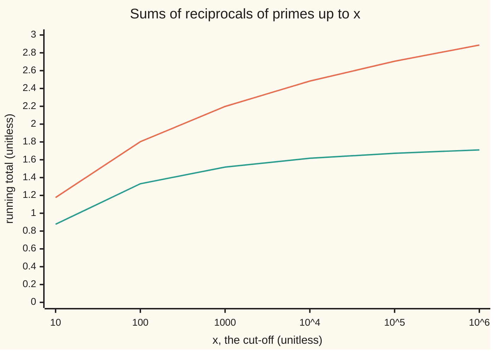

# Brun's sieve and Selberg's: truncating inclusion-exclusion so the error stays small

[Syllabus](../../../SYLLABUS.md) → [Algebraic and analytic number theory](../README.md) → [Sieves and Prime Gaps](../README.md#s04) → Brun's sieve and Selberg's

---

## General Overview

Twin primes are primes two apart, such as 11 and 13, or 999,959 and 999,961. Below a million there are 8,169 such pairs. Nobody knows whether they go on forever: that is the twin prime conjecture, open as of 2026-11-15.

Add up their reciprocals: 1/3 + 1/5, then 1/5 + 1/7, then 1/11 + 1/13, and so on. Up to a million the total is 1.7108. Do the same over all 78,498 primes below a million and the total is 2.8873.

The two totals behave differently. The sum over all primes grows without end, like log log x ([Mertens' theorems](../01-Arithmetic%20Functions%20Again/09-mertens-theorems.md)). The twin sum levels off. In 1975 Richard Brent summed every twin pair below 80 billion and estimated the limit at 1.9021604. Viggo Brun had proved in 1919 that a finite limit exists: twin primes are too thin for their reciprocals to add up to infinity.

Brun's proof needed an upper bound for the twin count. The only tool was the sieve of inclusion-exclusion, whose error swamps its answer ([Sieving by inclusion-exclusion](01-the-legendre-sieve-and-the-parity-problem.md)). Brun's fix was to stop the sieve early. Atle Selberg's 1947 fix was to replace its plus and minus signs with the best possible weights.

**Cut inclusion-exclusion off after an even number of layers and the count is still a ceiling, but its error now comes from a few short layers rather than every term; with the cut-off chosen well, the twin pairs below x number at most a constant times x (log log x)² / (log x)², which is thin enough for their reciprocals to converge.**

**What kind of fact this is:** two theorems, Brun's bound and Brun's convergence, proved on this card in Why it works, with the longer estimates in folds. Selberg's weights are proved optimal here; the growth of G(z) is quoted from a named source. That twin primes go on forever is open as of 2026-11-15. The value 1.9021604 is an estimate from a computation, not a proof.

### The picture: one sum levels off, the other keeps climbing



Orange: 1/p over every prime up to x, which grows without limit. Green: 1/p + 1/(p + 2) over the twin pairs up to x, which converges, to about 1.90216 by Brent's estimate. Each step on the axis multiplies x by 10.

---

## The formula

Notation first, in words, adapted from [Sieving by inclusion-exclusion](01-the-legendre-sieve-and-the-parity-problem.md). The letter p is always a prime. $`P(z)`$ is the product of the primes below z. $`S(x, z)`$ counts the whole numbers n from 1 to x for which $`n(n+2)`$ has no prime factor below z: the survivors of the sieve. Two changes from that card: here S(x, z) sifts n(n + 2), not n, and z itself is never a sifting prime.

New on this card: $`\pi_2(x)`$ counts the twin pairs p, p + 2 with p up to x, so $`\pi_2(10^6) = 8{,}169`$.

A prime p divides $`n(n+2)`$ when n leaves remainder 0 or remainder −2 on division by p. That is $`\rho(p) = 2`$ remainder classes for odd p, but only $`\rho(2) = 1`$ for p = 2, since 0 and −2 are the same class. For a product d of distinct primes, $`\rho(d)`$ multiplies the $`\rho(p)`$, and $`g(d) = \rho(d)/d`$ is the share of all n that d strikes out.

Inclusion-exclusion groups its terms in **layers**: layer j holds the divisors d of P(z) made of exactly j primes. The layer total $`e_j(g)`$ adds g(d) over that layer, and $`e_j(\rho)`$ adds ρ(d). Brun's sieve keeps the layers from 0 to m, with m even:

```math
S(x, z) \;\le\; x \sum_{j=0}^{m} (-1)^j e_j(g) \;+\; \sum_{j=0}^{m} e_j(\rho) \qquad (m \text{ even})
```

**Read it aloud:** the survivors number at most x times the alternating sum of the first m + 1 layer totals, plus an error allowance of one per remainder class in those layers.

Every twin pair with smaller prime at least z survives, so $`\pi_2(x) \le S(x, z) + \pi(z)`$. Choosing z and m as x grows gives Brun's theorem:

```math
\pi_2(x) \;\ll\; \frac{x\,(\log\log x)^2}{(\log x)^2}, \qquad \text{so} \qquad \sum_{p,\; p+2 \text{ prime}} \left(\frac{1}{p} + \frac{1}{p+2}\right) = B \text{ is finite.}
```

**Read it aloud:** the twin pairs up to x number at most a fixed constant times x times log log x squared over log x squared, so the sum of their reciprocals converges to a finite number, Brun's constant B.

Selberg replaces the Möbius signs μ(d) of the full sieve with real **weights** $`\lambda_d`$, one for each squarefree d below z, with $`\lambda_1 = 1`$. Write $`h(d)`$ for the product of $`\rho(p)/(p - \rho(p))`$ over the primes of d, and $`G(z)`$ for the sum of h(d) over squarefree d below z. The optimal weights and the bound they give are:

```math
\lambda_d = \mu(d)\,\frac{h(d)}{g(d)}\,\frac{1}{G(z)} \sum_{\substack{e < z/d \\ \gcd(e,\,d) = 1}} h(e), \qquad S(x, z) \;\le\; \frac{x}{G(z)} + \Big(\sum_{d < z} \lvert \lambda_d \rvert\, \rho(d)\Big)^2
```

**Read it aloud:** each weight is the Möbius sign of d times a factor between 0 and 1 that fades as d approaches z; with these weights the survivors number at most x over G(z), plus the square of a weighted count of remainder classes.

| Symbol | Plain meaning | In our example | Push it up and the answer… |
| --- | --- | --- | --- |
| $`x`$, $`n`$ | the cut-off; n runs from 1 to x | x = 1,000,000 | bounds grow |
| $`z`$ | sift with the primes below z | z = 23 for Brun, 200 for Selberg | main part falls, allowance rises |
| $`\pi_2(x)`$ | twin pairs with smaller prime up to x | 8,169 | — |
| $`S(x, z)`$, $`P(z)`$ | survivors of sifting by primes below z; their product | S(10^6, 23) = 39,030 | — |
| $`\rho(p)`$, $`\rho(d)`$ | remainder classes struck by p, or by d | ρ(2) = 1, ρ(3) = 2 | more classes, fewer survivors |
| $`g(d)`$, $`r_d`$ | share struck by d; the error in that count | g(3) = 2/3; 666,667 against 666,666.7 | — |
| $`m`$, $`j`$, $`k`$, $`e_j`$, $`s`$ | layers kept; which layer; sifting primes striking one n; a layer total; the first one, e_1(g) | m = 6; s = e_1(g) = 2.410956 | allowance rises, truncation error falls |
| $`\mu(d)`$ | Möbius: (−1) to the number of primes of d, for squarefree d | μ(6) = 1 | — |
| $`\lambda_d`$, $`Q`$ | Selberg's weight on d, not Liouville's λ(n); the quadratic form the weights give, not the large sieve's modulus limit Q | λ_2 = −0.8953; Q = 0.043727909 | — |
| $`h(d)`$, $`G(z)`$ | ρ(p)/(p − ρ(p)) multiplied over the primes of d; their sum | G(200) = 22.868690 | bound falls as G grows |
| $`C_2`$ | the twin prime constant, the product of 1 − 1/(p − 1)² over odd primes | 0.660162 | — |
| $`B`$ | Brun's constant, the limit of the twin reciprocal sum | about 1.9021604 (Brent) | — |

### When it holds

- **An even number of layers.** Stop after an odd number and the same sum is a floor, not a ceiling: one layer at z = 23 gives −1,410,972.
- **The counts behave like shares.** Each count of n struck by d must be x g(d) give or take ρ(d). Pretend 2 strikes two classes and the share of survivors becomes zero: the "bound" falls to 6,569, below the true 8,169.
- **Few layers, or few primes.** The allowance counts every remainder class in the layers kept. Keep all layers with the 25 primes below 101 and the bound reaches 564,859,092,136.
- **z small next to x.** The sieve only bounds survivors. With z far below the square root of x, most survivors are not twin primes: S(10^6, 23) is 39,030, almost five times 8,169.
- **Weights with λ_1 = 1.** Selberg's bound holds for any such weights; the optimal ones only make it smallest. Plain Möbius signs at z = 200 give 1,182,677.

---

## Why it works

### Step 0: the error lives in the number of terms

Each term of inclusion-exclusion counts the n struck by one divisor d. That count is never exact: it is x g(d) plus a rounding error $`r_d`$ of at most ρ(d). Legendre's full sieve has one term per divisor of P(z), so its errors add to at most the product of 1 + ρ(p) over the sifting primes: $`2 \cdot 3^{7} = 4{,}374`$ for the 8 primes below 23. That triples with every new prime, so z must stay tiny: the best choice at a million is z = 23.

Brun's idea: a divisor made of many primes strikes almost nothing, so most of those terms are tiny. Drop the layers of such divisors, keep the bound on the right side, and the error shrinks to the few layers that remain.

### Step 1: the twin sieve, one prime at a time

For d = 3, the n from 1 to a million with 3 dividing n(n + 2) are those with remainder 0 or 1. They number 666,667, against x g(3) = 666,666.7. The error is a third of one.

In general the Chinese remainder theorem joins the classes of each prime of d into ρ(d) classes modulo d ([The Chinese remainder theorem](../../02-Number%20theory/03-Clock%20Arithmetic/06-chinese-remainder-theorem.md)). Each class holds x/d whole numbers up to x, give or take one. So the count is x g(d) + r_d with $`\lvert r_d \rvert \le \rho(d)`$.

### Step 2: stopping after an even layer keeps a ceiling

[Stopping the sieve early](../../04-Combinatorics%20and%20graphs/04-Inclusion-Exclusion%20and%20Pigeonhole/04-union-bound-and-bonferroni.md) proves that inclusion-exclusion cut off after a whole number of layers overshoots or undershoots by a known side. For the sifted count, an n struck by k of the sifting primes, k ≥ 1, scores $`(-1)^m \binom{k-1}{m}`$ after m layers, where it should score 0. For even m that is never negative, while a survivor scores exactly 1. So the truncated sum is at least S(x, z).

Replace each count by x g(d) + r_d. The x g(d) parts give x times the alternating sum of layer totals. The errors add to at most the sum of ρ(d) over the layers kept, which is the second term of the formula.

### Step 3: the truncation costs little once the layers outnumber the typical prime count

Read g(p) as the chance that a random n is struck by p, independently for each p. The full alternating sum is then the chance of being struck by none, $`\prod_{p<z}(1 - g(p))`$. Cutting it after m layers is off by at most the next layer total, $`e_{m+1}(g)`$.

At z = 23 the first layer total is $`e_1(g) = 2.410956`$: on average n(n + 2) has about 2.4 sifting primes. Layer totals peak near that size, then collapse. By layer 7 the total is 0.000521, about 521 numbers n at x = a million. Six layers already catch nearly everything.

The general rule: $`e_{m+1}(g) \le s^{m+1}/(m+1)!`$, with s the first layer total. Once m is a few times s, this is tiny. Since s grows only like 2 log log z, a modest m suffices even for huge z.

### Step 4: choose z as large as the allowance permits

The allowance in m layers is at most $`z^m`$, while the main part is about $`x/(\log z)^2`$. Take m at most 20 log log x and log z near log x / (40 log log x). Then the allowance stays below $`\sqrt{x}`$, and the main part is a constant times $`x (\log\log x)^2/(\log x)^2`$.

<details>
<summary>Detailed proof: Brun's bound for the twin count</summary>

Let s be the sum of g(p) over primes p below z. Mertens' second theorem gives s ≤ 2 log log z + 2 for z ≥ 3.

Truncation. For independent events of chances g(p), the Bonferroni inequalities bound the chance of none by its partial sums, each within the next layer total:

$`\displaystyle \Big\lvert \sum_{j=0}^{m} (-1)^j e_j(g) - \prod_{p<z} (1 - g(p)) \Big\rvert \le e_{m+1}(g) \le \frac{s^{m+1}}{(m+1)!} \le \Big(\frac{e\,s}{m+1}\Big)^{m+1}.`$

Take m the smallest even number with $`m + 1 \ge e^2 (2 \log\log z + 2)`$. Then $`m + 1 \ge e^2 s`$, so the right side is at most $`e^{-(m+1)}`$, and $`m + 1 \ge 2 \log\log z`$, so that is at most $`1/(\log z)^2`$.

Allowance. The sum of ρ(d) over divisors with at most m primes is at most $`(1 + \sum_{p<z} \rho(p))^m \le z^m`$, since 1 plus the sum of ρ(p) over p below z is at most z. With $`\log z = \log x/(40 \log\log x)`$ and $`m \le 20 \log\log x`$ for large x, we get $`z^m \le \sqrt{x}`$.

Main part. Since 1 − 2/p ≤ (1 − 1/p)², the product is at most a constant times the square of the product of 1 − 1/p, which by Mertens' third theorem is at most a constant over log z. So

$`\displaystyle \pi_2(x) \le S(x,z) + \pi(z) \le \frac{c\,x}{(\log z)^2} + \sqrt{x} + z \ll \frac{x\,(\log\log x)^2}{(\log x)^2}.`$

</details>

### Step 5: thin enough to converge

Split the twin pairs into blocks with smaller prime between $`2^i`$ and $`2^{i+1}`$. Step 4 caps each block at a constant times $`2^{i} (\log i)^2/i^2`$ pairs. Each pair adds at most $`2/2^i`$ to the sum. So block i adds at most a constant times $`(\log i)^2/i^2`$, and those numbers have a finite sum ([Infinite series](../../06-Calculus%20and%20analysis/06-Series/01-series-convergence.md)). The reciprocal sum converges.

How close is 1.7108 to the limit? Hardy and Littlewood conjectured that twin pairs near t occur with density $`2C_2/(\log t)^2`$. Here $`C_2 = 0.660162`$ is the twin prime constant, the product of $`1 - 1/(p-1)^2`$ over odd primes. Integrated from 2 to a million, that density predicts 8,248 pairs, against the true 8,169. If the conjecture holds, the pairs beyond x add about $`4C_2/\log x`$ to the sum, which is 0.1911 at a million. The sum plus that tail is 1.90191, against Brent's 1.90216. That correction rests on a conjecture; Brun's convergence does not.

### Step 6: Selberg's squares

Selberg's starting point: for any real weights with $`\lambda_1 = 1`$,

```math
\Big(\sum_{d \,\mid\, \gcd(n(n+2),\, P(z))} \lambda_d\Big)^2 \;\ge\; \begin{cases} 1 & \text{if } n \text{ survives} \\ 0 & \text{otherwise} \end{cases}
```

A survivor has only d = 1 in the sum, so the square is 1. Any other n gets a square, which is never negative. Summing over n turns the left side into a quadratic form in the weights (a sum of products of two weights at a time): x times $`Q = \sum \lambda_{d_1} \lambda_{d_2}\, g([d_1, d_2])`$, where $`[d_1, d_2]`$ is the least common multiple, plus errors.

Brun chose which terms to drop; Selberg lets algebra choose. The best weights make Q as small as possible. A change of variables makes Q a plain sum of squares, and the Cauchy-Schwarz inequality (a sum of products is at most the square root of the product of the two sums of squares) gives the minimum $`Q = 1/G(z)`$. At z = 200 the code finds G = 22.868690, so 1/G = 0.043727909, and the double sum with the optimal weights gives the same 0.043727909.

<details>
<summary>Detailed proof: the minimum of Selberg's quadratic form is 1/G(z)</summary>

For squarefree numbers, $`g([d_1, d_2]) = g(d_1)\,g(d_2)/g(\gcd(d_1, d_2))`$. Since $`1/g(p) - 1 = 1/h(p)`$, the reciprocal $`1/g(\delta)`$ is the sum of $`1/h(e)`$ over the divisors e of δ. Put $`y_e = \sum_{d:\ e \mid d} \lambda_d\, g(d)`$. Then

$`\displaystyle Q = \sum_{d_1, d_2} \lambda_{d_1} g(d_1)\, \lambda_{d_2} g(d_2) \sum_{e \mid d_1,\ e \mid d_2} \frac{1}{h(e)} = \sum_{e < z} \frac{y_e^2}{h(e)}.`$

Möbius inversion turns $`\lambda_1 = 1`$ into $`\sum_e \mu(e)\, y_e = 1`$. By Cauchy-Schwarz,

$`\displaystyle 1 = \Big(\sum_{e<z} \mu(e)\, y_e\Big)^2 \le \sum_{e<z} \frac{y_e^2}{h(e)} \cdot \sum_{e<z} h(e) = Q \cdot G(z),`$

with equality when $`y_e = \mu(e)\, h(e)/G(z)`$. Inverting back, with e = d f, gives the weights in The formula.

The weights stay between −1 and 1. Every product t f, with t dividing d and f below z/d and coprime to d, is a different squarefree number below z. So G(z) is at least the sum of h(t) over t dividing d, which is h(d)/g(d), times the sum of h(f). That product is exactly $`\lvert \lambda_d \rvert\, G(z)`$, so $`\lvert \lambda_d \rvert \le 1`$. The code finds the largest |λ_d| at z = 200 is 1.0000, reached at d = 1.

Errors. The error in each count is at most ρ of the least common multiple, which is at most ρ(d_1) ρ(d_2). So the errors add to at most the square of the sum of |λ_d| ρ(d).

</details>

### Step 7: what each sieve buys, as x grows

The weights are zero from d = z on, so least common multiples stay below z². Choosing z a little under the square root of x, such as $`\sqrt{x}/(\log x)^3`$, keeps the error far below the main part. Then x/G(z) is the main part. G(z) grows like $`(\log z)^2/(4C_2)`$ (Friedlander and Iwaniec, in Sources), so with z near $`\sqrt{x}`$ the bound tends to $`16 C_2\, x/(\log x)^2`$.

Divide each best bound by $`x/(\log x)^2`$ to compare their growth:

| x | Legendre | Brun | Selberg |
| --- | ---: | ---: | ---: |
| 10^6 | 8.29 | 8.25 | 9.53 |
| 10^9 | 12.45 | 11.95 | 10.02 |
| 10^12 | 17.58 | 15.65 | 10.35 |

Legendre's ratio climbs like $`(\log x / \log\log x)^2`$ and Brun's like $`(\log\log x)^2`$. Selberg's ratio creeps towards a fixed limit, $`16 C_2 = 10.56`$. For comparison the true count at a million gives 1.56, and Hardy and Littlewood's conjecture predicts $`2C_2 = 1.32`$. So Selberg's sieve, fed only the remainder bound of Step 1, stays a factor of 8 above the prediction. Most of that factor is not forced. Bombieri and Davenport (1966) sifted the shifted primes p + 2 instead, with the counts in progressions that [Bombieri-Vinogradov](04-bombieri-vinogradov.md) supplies, and cut 8 to about 4. The parity problem of [Sieving by inclusion-exclusion](01-the-legendre-sieve-and-the-parity-problem.md) only rules out going below a factor of 2.

---

## Worked numbers, by hand

Brun's sieve at x = 1,000,000 with the 8 primes below z = 23. Each row adds one layer. The main part flips sign at first, then settles; the allowance only grows.

| Step | Arithmetic | Value |
| --- | --- | --- |
| layer 0 | the whole range | 1,000,000.0 + 1 |
| layer 1 | subtract x e_1(g), with e_1(g) = 2.410956 | −1,410,955.5 + 16 |
| layer 2 | add x e_2(g) = x × 2.397491 | 986,535.3 + 114 |
| layer 3 | subtract x × 1.282540 | −296,005.0 + 478 |
| layer 4 | add x × 0.403542 | 107,536.9 + 1,318 |
| layer 5 | subtract x × 0.076570 | 30,967.1 + 2,550 |
| layer 6 | add x × 0.008581 | 39,548.0 + 3,670 |
| plus the 8 primes below 23 | 39,548.0 + 3,670 + 8, rounded up | **43,226** |

At most 43,226 twin pairs lie below a million: five times the true 8,169, because 23 is far too small a cut-off to tell twin primes from other survivors. Keeping layers 7 and 8 lands exactly on Legendre's full sieve, 43,422, so at a million truncation saves only 196. Brun's gain shows at larger x: at $`10^{12}`$ his bound is 20,502,483,755 against Legendre's 23,021,116,805. Selberg's z = 200 bound at a million is 43,727.9 + 6,152.1 + 46 = 49,926.01, rounded up to 49,927: the loosest of the three. By $`10^{9}`$ Selberg's is the best.

```
Upper bounds for twin pairs below a million (one # = 2,000 pairs)
true count, 8,169          ####
Hardy-Littlewood, 8,248    ####
S(10^6, 23), 39,030        ####################
Brun, 43,226               ######################
Legendre, 43,422           ######################
Selberg, 49,927            #########################
```

### What breaks if you drop a piece

| Mistake | Comes out at | What went wrong |
| --- | --- | --- |
| Treat 2 like an odd prime, ρ(2) = 2 | 6,569, below the true 8,169 | 0 and −2 are one class mod 2; the share of survivors becomes 0 |
| Keep every layer at z = 101 | 564,859,092,136 | the allowance 2 × 3^24 swamps x |
| Stop after one layer and read it as a ceiling | −1,410,972 | odd stops give floors |
| Plain Möbius weights at z = 200 | 1,182,677 | any weights give a ceiling, but only the optimal ones a good one |

The code prints all four.

---

## Code, from first principles, and it actually runs

The code counts the twin pairs below a million by two roads: a table of primes, and sifting n(n + 2) by the primes below 1001, which leaves only twin pairs. It checks Brun's bound against the survivors counted one by one at z = 23. Legendre's full expansion is checked against the product it should equal, and that product against the 39,030 counted survivors, from both sides, within the allowance 4,374. The 666,667 numbers struck by 3 are checked against x g(3). Selberg's quadratic form is computed as a double sum and checked against 1/G. The reciprocal sum plus its predicted tail is checked against Brent's published estimate. The math module supplies only exp, log, ceil and prod.

### Python

```python
# Brun's sieve and Selberg's -- the check behind the card.  Standard library only;
# math supplies exp, log, ceil and prod.  Twin primes p, p + 2 with p up to a million are
# counted twice, then bounded three ways: Legendre (keep every layer), Brun (stop
# after an even number of layers) and Selberg (squared, optimised weights).
import math
X, M = 10**6, 200001
def c(n): return f"{n:,}"
def gcd(a, b):
    while b: a, b = b, a % b
    return a
spf = list(range(M))                         # smallest prime factor of each n < M
for i in range(2, 448):
    if spf[i] == i:
        for j in range(i * i, M, i):
            if spf[j] == j: spf[j] = i
primes = [p for p in range(2, M) if spf[p] == p]
isp = bytearray([0, 0, 1]) + bytearray([1, 0]) * ((X + 1) // 2)   # odd n marked prime
for p in primes[1:168]: isp[p * p::2 * p] = bytes(len(range(p * p, len(isp), 2 * p)))
twins = [p for p in range(2, X + 1) if isp[p] and isp[p + 2]]
def rho(p, r2=1): return r2 if p == 2 else 2      # classes n mod p with p | n(n + 2)
def sifted(z):                               # S(10^6, z): strike n = 0 and n = -2 mod p
    alive = bytearray([0]) + bytearray([1]) * X
    for p in [q for q in primes if q < z]:
        for s in sorted({p, p - 2} - {0}): alive[s::p] = bytes(len(range(s, X + 1, p)))
    return sum(alive)
def esym(vals, m):                           # layer totals e_0 .. e_m
    e = [1.0] + [0.0] * m
    for v in vals:
        for j in range(m, 0, -1): e[j] += e[j - 1] * v
    return e
def brun(x, z, m, r2=1):                     # stop after m layers: main part, error allowance
    P = [p for p in primes if p < z]
    g, r = esym([rho(p, r2) / p for p in P], m), esym([float(rho(p, r2)) for p in P], m)
    return [x * sum((-1) ** j * g[j] for j in range(k + 1)) for k in range(m + 1)], [sum(r[:k + 1]) for k in range(m + 1)], len(P)
def weights(z):                              # h, rho, g, mu for squarefree d < z; then Selberg's lambda_d
    h, r, g, mu = [0.0] * z, [0] * z, [0.0] * z, [0] * z
    for d in range(1, z):
        n, ps = d, []
        while n > 1 and ps is not None:
            p = spf[n]; n //= p; ps = None if n % p == 0 else ps + [p]
        if ps is None: continue
        h[d], r[d], g[d], mu[d] = 1.0, 1, 1.0, (-1) ** len(ps)
        for p in ps: h[d], r[d], g[d] = h[d] * rho(p) / (p - rho(p)), r[d] * rho(p), g[d] * rho(p) / p
    G = sum(h)
    lam = [mu[d] * sum(h[e] for e in range(1, (z - 1) // d + 1) if mu[e] and gcd(e, d) == 1) / g[d] * h[d] / G if mu[d] else 0.0 for d in range(z)]
    return G, lam, r, g, mu
def quad(lam, g):                            # x-free main part: sum of lam_a lam_b g([a, b])
    ds = [d for d in range(1, len(lam)) if lam[d]]
    return sum(lam[a] * lam[b] * g[a] * g[b] / g[gcd(a, b)] for a in ds for b in ds)
cache = {z: weights(z) for z in (100, 150, 200, 300, 500, 1000, 2000, 3000, 5000, 10**4, 2 * 10**4, 5 * 10**4, 10**5, 2 * 10**5)}
def selberg(x, z):
    G, lam, r, g, mu = cache[z]
    return x / G + sum(abs(lam[d]) * r[d] for d in range(z)) ** 2 + sum(1 for p in primes if p < z)
road2 = sifted(1001) + sum(1 for p in twins if p < 1001)
print(f"twin pairs with p up to {c(X)}: {c(len(twins))}; by sifting n(n + 2) with primes below 1001: {c(road2)}")
print(f"largest pair {c(twins[-1])}, {c(twins[-1] + 2)}; primes up to 10^6: {c(sum(isp[2:X + 1]))}")
c2 = 1.0
for p in primes[1:]:
    if p < X: c2 *= 1 - 1 / ((p - 1) * (p - 1))
for p in range(primes[-1] + 2, X, 2):
    if isp[p]: c2 *= 1 - 1 / ((p - 1) * (p - 1))
for e in range(1, 7):
    b = sum(1 / p + 1 / (p + 2) for p in twins if p + 2 <= 10**e)
    s = sum(1 / p for p in range(2, 10**e + 1) if isp[p])
    print(f"chart, x = 10^{e}: twin reciprocals {b:.4f}, all prime reciprocals {s:.4f}")
lx = math.log(X)
print(f"C2 = {c2:.6f}; tail estimate 4 C2 / log x = {4 * c2 / lx:.4f}; sum plus tail {b + 4 * c2 / lx:.5f}, Brent 1.90216")
n, a = 20000, math.log(2)                    # Simpson's rule for the integral of dt / (log t)^2, t = e^u
hs = (lx - a) / n
li2 = sum((1 if i in (0, n) else 4 if i % 2 else 2) * math.exp(a + i * hs) / ((a + i * hs) * (a + i * hs)) for i in range(n + 1)) * hs / 3
print(f"Hardy-Littlewood prediction 2 C2 Li2(10^6) = {2 * c2 * li2:.0f} (a conjecture)")
mains, rems, r = brun(X, 23, 8)
gl = esym([rho(p) / p for p in primes[:8]], 8)
true23 = sifted(23)
print(f"S(10^6, 23) counted directly: {c(true23)}; sifting primes below 23: {r}")
n3 = sum(1 for n in range(1, X + 1) if n * (n + 2) % 3 == 0)
print(f"n up to 10^6 with 3 | n(n + 2): {c(n3)}; x g(3) = {X * 2 / 3:.1f}")
for j in range(9):
    print(f"layer {j}: e_j(g) = {gl[j]:.6f}, kept to here {mains[j]:.1f} + {rems[j]:.0f}")
for m in (2, 4, 6, 8):
    print(f"Brun, z = 23, {m} layers: bound {c(math.ceil(mains[m] + rems[m] + r))}")
res = {}
for x in (10**6, 10**9, 10**12):
    bb = min((math.ceil(mn + rm + k), z, m) for z in primes[:168] for mm, rr, k in [brun(x, z, 20)] for m, (mn, rm) in enumerate(zip(mm, rr)) if m % 2 == 0)
    lb = min((math.ceil(brun(x, z, 99)[0][-1] + brun(x, z, 99)[1][-1] + i), z) for i, z in enumerate(primes[:60]))
    sb = min((math.ceil(selberg(x, z)), z) for z in cache)
    u = x / (math.log(x) * math.log(x))
    res[x] = (lb[0], bb[0], sb[0])
    print(f"x = 10^{len(str(x)) - 1}: Legendre {c(lb[0])} (z = {lb[1]}), Brun {c(bb[0])} (z = {bb[1]}, {bb[2]} layers), Selberg {c(sb[0])} (z = {sb[1]})")
    print(f"  bound / (x / (log x)^2): {lb[0] / u:.2f}, {bb[0] / u:.2f}, {sb[0] / u:.2f}")
print(f"the same ratio for the true count at 10^6: {8169 * lx * lx / X:.2f}; Hardy-Littlewood 2 C2 = {2 * c2:.2f}; Selberg's limit 16 C2 = {16 * c2:.2f}")
G, lam, rr, g, mu = cache[200]
Q = quad(lam, g)
print(f"Selberg, z = 200: G = {G:.6f}; 1/G = {1 / G:.9f}; double sum of lam lam g = {Q:.9f}")
sr = sum(abs(lam[d]) * rr[d] for d in range(200))
print(f"Selberg at 10^6, z = 200: x/G = {X / G:.1f}, remainder {sr * sr:.1f}, plus 46 primes, total {X / G + sr * sr + 46:.2f}")
print(f"lambda_1 = {lam[1]:.4f}, lambda_2 = {lam[2]:.4f}, lambda_3 = {lam[3]:.4f}, lambda_6 = {lam[6]:.4f}, largest |lambda| = {max(abs(v) for v in lam):.4f}")
mu200 = [float(v) for v in mu]
wrong = [brun(X, 23, 99, 2), brun(X, 101, 99), brun(X, 23, 1)]
print(f"mistake 1, rho(2) = 2: bound {wrong[0][0][-1] + wrong[0][1][-1] + 8:.0f}, below the true {c(len(twins))}")
print(f"mistake 2, every layer at z = 101: bound {c(math.ceil(wrong[1][0][-1] + wrong[1][1][-1] + wrong[1][2]))}")
print(f"mistake 3, one layer read as a ceiling: {wrong[2][0][1] - wrong[2][1][1]:.0f}")
print(f"mistake 4, plain Mobius weights at z = 200: bound {c(math.ceil(X * quad(mu200, g) + sum(rr) ** 2 + 46))}")
assert len(twins) == road2 == 8169                                  # two counts agree
assert all(true23 <= math.ceil(mains[m] + rems[m]) for m in (2, 4, 6, 8)) and len(twins) <= true23 + r
assert abs(brun(X, 23, 99)[0][-1] - X * math.prod(1 - rho(p) / p for p in primes[:8])) < 1e-6   # expansion = product
assert abs(n3 - X * rho(3) / 3) <= rho(3)                            # one prime's count against x g(3)
assert abs(true23 - X * math.prod(1 - rho(p) / p for p in primes[:8])) <= 2 * 3 ** 7   # Legendre, both sides
assert abs(Q - 1 / G) < 1e-12 and abs(lam[1] - 1) < 1e-12           # quadratic form at its minimum
assert abs(b + 4 * c2 / lx - 1.9021604) < 0.001                     # against Brent's estimate
assert res[10**6][2] > res[10**6][1] and res[10**12][2] < res[10**12][1]
print("ALL CHECKS PASS")
```

**Ran 2026-11-15 on macOS, Python 3.14.10, standard library only. All checks passed. Output, pasted from the run:**

```
twin pairs with p up to 1,000,000: 8,169; by sifting n(n + 2) with primes below 1001: 8,169
largest pair 999,959, 999,961; primes up to 10^6: 78,498
chart, x = 10^1: twin reciprocals 0.8762, all prime reciprocals 1.1762
chart, x = 10^2: twin reciprocals 1.3310, all prime reciprocals 1.8028
chart, x = 10^3: twin reciprocals 1.5180, all prime reciprocals 2.1981
chart, x = 10^4: twin reciprocals 1.6169, all prime reciprocals 2.4831
chart, x = 10^5: twin reciprocals 1.6728, all prime reciprocals 2.7053
chart, x = 10^6: twin reciprocals 1.7108, all prime reciprocals 2.8873
C2 = 0.660162; tail estimate 4 C2 / log x = 0.1911; sum plus tail 1.90191, Brent 1.90216
Hardy-Littlewood prediction 2 C2 Li2(10^6) = 8248 (a conjecture)
S(10^6, 23) counted directly: 39,030; sifting primes below 23: 8
n up to 10^6 with 3 | n(n + 2): 666,667; x g(3) = 666666.7
layer 0: e_j(g) = 1.000000, kept to here 1000000.0 + 1
layer 1: e_j(g) = 2.410956, kept to here -1410955.5 + 16
layer 2: e_j(g) = 2.397491, kept to here 986535.3 + 114
layer 3: e_j(g) = 1.282540, kept to here -296005.0 + 478
layer 4: e_j(g) = 0.403542, kept to here 107536.9 + 1318
layer 5: e_j(g) = 0.076570, kept to here 30967.1 + 2550
layer 6: e_j(g) = 0.008581, kept to here 39548.0 + 3670
layer 7: e_j(g) = 0.000521, kept to here 39026.7 + 4246
layer 8: e_j(g) = 0.000013, kept to here 39039.9 + 4374
Brun, z = 23, 2 layers: bound 986,658
Brun, z = 23, 4 layers: bound 108,863
Brun, z = 23, 6 layers: bound 43,226
Brun, z = 23, 8 layers: bound 43,422
x = 10^6: Legendre 43,422 (z = 23), Brun 43,226 (z = 23, 6 layers), Selberg 49,927 (z = 200)
  bound / (x / (log x)^2): 8.29, 8.25, 9.53
x = 10^9: Legendre 28,997,941 (z = 43), Brun 27,820,519 (z = 47, 8 layers), Selberg 23,325,260 (z = 5000)
  bound / (x / (log x)^2): 12.45, 11.95, 10.02
x = 10^12: Legendre 23,021,116,805 (z = 71), Brun 20,502,483,755 (z = 107, 8 layers), Selberg 13,562,556,469 (z = 100000)
  bound / (x / (log x)^2): 17.58, 15.65, 10.35
the same ratio for the true count at 10^6: 1.56; Hardy-Littlewood 2 C2 = 1.32; Selberg's limit 16 C2 = 10.56
Selberg, z = 200: G = 22.868690; 1/G = 0.043727909; double sum of lam lam g = 0.043727909
Selberg at 10^6, z = 200: x/G = 43727.9, remainder 6152.1, plus 46 primes, total 49926.01
lambda_1 = 1.0000, lambda_2 = -0.8953, lambda_3 = -0.8876, lambda_6 = 0.7766, largest |lambda| = 1.0000
mistake 1, rho(2) = 2: bound 6569, below the true 8,169
mistake 2, every layer at z = 101: bound 564,859,092,136
mistake 3, one layer read as a ceiling: -1410972
mistake 4, plain Mobius weights at z = 200: bound 1,182,677
ALL CHECKS PASS
```

### Rust

Same numbers, same labels, built with `rustc --edition 2021 -O`.

```rust
// Brun's sieve and Selberg's -- the same check as the Python, in Rust.  No crates.
// Twin primes p, p + 2 with p up to a million are counted twice, then bounded
// three ways: Legendre (keep every layer), Brun (stop after an even number of
// layers) and Selberg (squared, optimised weights).
const X: usize = 1_000_000;
const M: usize = 200_001;

fn c(n: u128) -> String {                    // thousands commas
    let s = n.to_string();
    let mut out = String::new();
    for (i, ch) in s.chars().enumerate() {
        if i > 0 && (s.len() - i) % 3 == 0 { out.push(',') }
        out.push(ch);
    }
    out
}
fn gcd(mut a: usize, mut b: usize) -> usize { while b != 0 { (a, b) = (b, a % b) } a }
fn rho(p: usize, r2: usize) -> usize { if p == 2 { r2 } else { 2 } }  // classes n mod p with p | n(n + 2)
fn esym(vals: &[f64], m: usize) -> Vec<f64> {   // layer totals e_0 .. e_m
    let mut e = vec![0.0; m + 1];
    e[0] = 1.0;
    for &v in vals { for j in (1..=m).rev() { e[j] += e[j - 1] * v } }
    e
}
struct Sieve { spf: Vec<usize>, primes: Vec<usize> }
impl Sieve {
    // stop after m layers: main part and error allowance after each layer, and the prime count
    fn brun(&self, x: f64, z: usize, m: usize, r2: usize) -> (Vec<f64>, Vec<f64>, usize) {
        let ps: Vec<usize> = self.primes.iter().copied().filter(|&p| p < z).collect();
        let g = esym(&ps.iter().map(|&p| rho(p, r2) as f64 / p as f64).collect::<Vec<_>>(), m);
        let r = esym(&ps.iter().map(|&p| rho(p, r2) as f64).collect::<Vec<_>>(), m);
        let mains = (0..=m).map(|k| x * (0..=k).fold(0.0, |s, j| s + if j % 2 == 0 { g[j] } else { -g[j] })).collect();
        let rems = (0..=m).map(|k| r[..=k].iter().fold(0.0, |s, v| s + v)).collect();
        (mains, rems, ps.len())
    }
    // h, rho, g, mu for squarefree d < z; then Selberg's lambda_d
    fn weights(&self, z: usize) -> (f64, Vec<f64>, Vec<usize>, Vec<f64>, Vec<i64>) {
        let (mut h, mut r, mut g, mut mu) = (vec![0.0; z], vec![0usize; z], vec![0.0; z], vec![0i64; z]);
        for d in 1..z {
            let (mut n, mut ps, mut sq) = (d, vec![], true);
            while n > 1 { let p = self.spf[n]; n /= p; if n % p == 0 { sq = false; break } ps.push(p) }
            if !sq { continue }
            h[d] = 1.0; r[d] = 1; g[d] = 1.0; mu[d] = if ps.len() % 2 == 0 { 1 } else { -1 };
            for &p in &ps {
                h[d] = h[d] * rho(p, 1) as f64 / (p - rho(p, 1)) as f64;
                r[d] *= rho(p, 1);
                g[d] = g[d] * rho(p, 1) as f64 / p as f64;
            }
        }
        let big_g = h.iter().fold(0.0, |s, v| s + v);
        let lam = (0..z).map(|d| if mu[d] == 0 { 0.0 } else {
            let s = (1..=(z - 1) / d).filter(|&e| mu[e] != 0 && gcd(e, d) == 1).fold(0.0, |s, e| s + h[e]);
            mu[d] as f64 * s / g[d] * h[d] / big_g }).collect();
        (big_g, lam, r, g, mu)
    }
}
fn quad(lam: &[f64], g: &[f64]) -> f64 {     // x-free main part: sum of lam_a lam_b g([a, b])
    let ds: Vec<usize> = (1..lam.len()).filter(|&d| lam[d] != 0.0).collect();
    let mut s = 0.0;
    for &a in &ds { for &b in &ds { s += lam[a] * lam[b] * g[a] * g[b] / g[gcd(a, b)] } }
    s
}
fn main() {
    let mut spf: Vec<usize> = (0..M).collect();      // smallest prime factor of each n < M
    for i in 2..448 { if spf[i] == i { let mut j = i * i; while j < M { if spf[j] == j { spf[j] = i } j += i } } }
    let primes: Vec<usize> = (2..M).filter(|&p| spf[p] == p).collect();
    let mut isp = vec![0u8; X + 3];                  // odd n marked prime
    isp[2] = 1;
    for n in (3..X + 3).step_by(2) { isp[n] = 1 }
    for &p in &primes[1..168] { let mut j = p * p; while j < X + 3 { isp[j] = 0; j += 2 * p } }
    let twins: Vec<usize> = (2..=X).filter(|&p| isp[p] == 1 && isp[p + 2] == 1).collect();
    let sifted = |z: usize| -> usize {               // S(10^6, z): strike n = 0 and n = -2 mod p
        let mut alive = vec![1u8; X + 1];
        alive[0] = 0;
        for &p in primes.iter().filter(|&&q| q < z) {
            for s in if p == 2 { vec![2] } else { vec![p - 2, p] } { let mut j = s; while j <= X { alive[j] = 0; j += p } }
        }
        alive.iter().map(|&v| v as usize).sum()
    };
    let sv = Sieve { spf: spf.clone(), primes: primes.clone() };
    let zs = [100, 150, 200, 300, 500, 1000, 2000, 3000, 5000, 10000, 20000, 50000, 100000, 200000];
    let cache: Vec<_> = zs.iter().map(|&z| sv.weights(z)).collect();
    let selberg = |x: f64, k: usize| -> f64 {
        let (big_g, lam, r, _, _) = &cache[k];
        let s = (0..zs[k]).fold(0.0, |s, d| s + lam[d].abs() * r[d] as f64);
        x / big_g + s * s + primes.iter().filter(|&&p| p < zs[k]).count() as f64
    };
    let road2 = sifted(1001) + twins.iter().filter(|&&p| p < 1001).count();
    println!("twin pairs with p up to {}: {}; by sifting n(n + 2) with primes below 1001: {}", c(X as u128), c(twins.len() as u128), c(road2 as u128));
    println!("largest pair {}, {}; primes up to 10^6: {}", c(twins[twins.len() - 1] as u128), c(twins[twins.len() - 1] as u128 + 2), c(isp[2..=X].iter().map(|&v| v as u128).sum()));
    let mut c2 = 1.0;
    for &p in &primes[1..] { if p < X { c2 *= 1.0 - 1.0 / ((p - 1) * (p - 1)) as f64 } }
    for p in (primes[primes.len() - 1] + 2..X).step_by(2) { if isp[p] == 1 { c2 *= 1.0 - 1.0 / ((p - 1) * (p - 1)) as f64 } }
    let mut b = 0.0;
    for e in 1..7u32 {
        let top = 10usize.pow(e);
        b = twins.iter().filter(|&&p| p + 2 <= top).fold(0.0, |s, &p| s + (1.0 / p as f64 + 1.0 / (p + 2) as f64));
        let s = (2..=top).filter(|&p| isp[p] == 1).fold(0.0, |s, p| s + 1.0 / p as f64);
        println!("chart, x = 10^{}: twin reciprocals {:.4}, all prime reciprocals {:.4}", e, b, s);
    }
    let lx = (X as f64).ln();
    println!("C2 = {:.6}; tail estimate 4 C2 / log x = {:.4}; sum plus tail {:.5}, Brent 1.90216", c2, 4.0 * c2 / lx, b + 4.0 * c2 / lx);
    let (n, a) = (20000usize, 2f64.ln());            // Simpson's rule for the integral of dt / (log t)^2, t = e^u
    let hs = (lx - a) / n as f64;
    let li2 = (0..=n).fold(0.0, |s, i| {
        let w = if i == 0 || i == n { 1.0 } else if i % 2 == 1 { 4.0 } else { 2.0 };
        let u = a + i as f64 * hs;
        s + w * u.exp() / (u * u) }) * hs / 3.0;
    println!("Hardy-Littlewood prediction 2 C2 Li2(10^6) = {:.0} (a conjecture)", 2.0 * c2 * li2);
    let (mains, rems, r) = sv.brun(X as f64, 23, 8, 1);
    let gl = esym(&primes[..8].iter().map(|&p| rho(p, 1) as f64 / p as f64).collect::<Vec<_>>(), 8);
    let true23 = sifted(23);
    println!("S(10^6, 23) counted directly: {}; sifting primes below 23: {}", c(true23 as u128), r);
    let n3 = (1..=X).filter(|&n| n * (n + 2) % 3 == 0).count();
    println!("n up to 10^6 with 3 | n(n + 2): {}; x g(3) = {:.1}", c(n3 as u128), X as f64 * 2.0 / 3.0);
    for j in 0..9 { println!("layer {}: e_j(g) = {:.6}, kept to here {:.1} + {:.0}", j, gl[j], mains[j], rems[j]) }
    for m in [2, 4, 6, 8] { println!("Brun, z = 23, {} layers: bound {}", m, c((mains[m] + rems[m] + r as f64).ceil() as u128)) }
    let mut res = vec![];
    for x in [1e6, 1e9, 1e12] {
        let mut bb = (u128::MAX, 0, 0);
        for &z in &primes[..168] {
            let (mm, rr, k) = sv.brun(x, z, 20, 1);
            for m in (0..=20).step_by(2) { bb = bb.min(((mm[m] + rr[m] + k as f64).ceil() as u128, z, m)) }
        }
        let mut lb = (u128::MAX, 0);
        for (i, &z) in primes[..60].iter().enumerate() {
            let (mm, rr, _) = sv.brun(x, z, 99, 1);
            lb = lb.min(((mm[99] + rr[99] + i as f64).ceil() as u128, z));
        }
        let sb = (0..zs.len()).map(|k| (selberg(x, k).ceil() as u128, zs[k])).min().unwrap();
        let u = x / (x.ln() * x.ln());
        res.push((lb.0, bb.0, sb.0));
        println!("x = 10^{}: Legendre {} (z = {}), Brun {} (z = {}, {} layers), Selberg {} (z = {})", x.log10().round(), c(lb.0), lb.1, c(bb.0), bb.1, bb.2, c(sb.0), sb.1);
        println!("  bound / (x / (log x)^2): {:.2}, {:.2}, {:.2}", lb.0 as f64 / u, bb.0 as f64 / u, sb.0 as f64 / u);
    }
    println!("the same ratio for the true count at 10^6: {:.2}; Hardy-Littlewood 2 C2 = {:.2}; Selberg's limit 16 C2 = {:.2}", 8169.0 * lx * lx / X as f64, 2.0 * c2, 16.0 * c2);
    let (big_g, lam, rr, g, mu) = &cache[2];
    let q = quad(lam, g);
    println!("Selberg, z = 200: G = {:.6}; 1/G = {:.9}; double sum of lam lam g = {:.9}", big_g, 1.0 / big_g, q);
    let sr = (0..200).fold(0.0, |s, d| s + lam[d].abs() * rr[d] as f64);
    println!("Selberg at 10^6, z = 200: x/G = {:.1}, remainder {:.1}, plus 46 primes, total {:.2}", X as f64 / big_g, sr * sr, X as f64 / big_g + sr * sr + 46.0);
    println!("lambda_1 = {:.4}, lambda_2 = {:.4}, lambda_3 = {:.4}, lambda_6 = {:.4}, largest |lambda| = {:.4}", lam[1], lam[2], lam[3], lam[6], lam.iter().fold(0.0f64, |m, v| m.max(v.abs())));
    let mu200: Vec<f64> = mu.iter().map(|&v| v as f64).collect();
    let w0 = sv.brun(X as f64, 23, 99, 2);
    let w1 = sv.brun(X as f64, 101, 99, 1);
    let w2 = sv.brun(X as f64, 23, 1, 1);
    println!("mistake 1, rho(2) = 2: bound {:.0}, below the true {}", w0.0[99] + w0.1[99] + 8.0, c(twins.len() as u128));
    println!("mistake 2, every layer at z = 101: bound {}", c((w1.0[99] + w1.1[99] + w1.2 as f64).ceil() as u128));
    println!("mistake 3, one layer read as a ceiling: {:.0}", w2.0[1] - w2.1[1]);
    let rsum = rr.iter().fold(0.0, |s, &v| s + v as f64);
    println!("mistake 4, plain Mobius weights at z = 200: bound {}", c((X as f64 * quad(&mu200, g) + rsum * rsum + 46.0).ceil() as u128));
    assert!(twins.len() == road2 && road2 == 8169);                                    // two counts agree
    assert!([2, 4, 6, 8].iter().all(|&m| true23 as f64 <= (mains[m] + rems[m]).ceil()) && twins.len() <= true23 + r);
    let prod = primes[..8].iter().fold(1.0, |s, &p| s * (1.0 - rho(p, 1) as f64 / p as f64));
    assert!((sv.brun(X as f64, 23, 99, 1).0[99] - X as f64 * prod).abs() < 1e-6);     // expansion = product
    assert!((n3 as f64 - X as f64 * rho(3, 1) as f64 / 3.0).abs() <= rho(3, 1) as f64);   // one prime's count against x g(3)
    assert!((true23 as f64 - X as f64 * prod).abs() <= (2 * 3usize.pow(7)) as f64);    // Legendre, both sides
    assert!((q - 1.0 / big_g).abs() < 1e-12 && (lam[1] - 1.0).abs() < 1e-12);          // quadratic form at its minimum
    assert!((b + 4.0 * c2 / lx - 1.9021604).abs() < 0.001);                           // against Brent's estimate
    assert!(res[0].2 > res[0].1 && res[2].2 < res[2].1);
    println!("ALL CHECKS PASS");
}
```

**Ran 2026-11-15 on macOS, rustc 1.98.1, no crates. All checks passed. Output, pasted from the run:**

```
twin pairs with p up to 1,000,000: 8,169; by sifting n(n + 2) with primes below 1001: 8,169
largest pair 999,959, 999,961; primes up to 10^6: 78,498
chart, x = 10^1: twin reciprocals 0.8762, all prime reciprocals 1.1762
chart, x = 10^2: twin reciprocals 1.3310, all prime reciprocals 1.8028
chart, x = 10^3: twin reciprocals 1.5180, all prime reciprocals 2.1981
chart, x = 10^4: twin reciprocals 1.6169, all prime reciprocals 2.4831
chart, x = 10^5: twin reciprocals 1.6728, all prime reciprocals 2.7053
chart, x = 10^6: twin reciprocals 1.7108, all prime reciprocals 2.8873
C2 = 0.660162; tail estimate 4 C2 / log x = 0.1911; sum plus tail 1.90191, Brent 1.90216
Hardy-Littlewood prediction 2 C2 Li2(10^6) = 8248 (a conjecture)
S(10^6, 23) counted directly: 39,030; sifting primes below 23: 8
n up to 10^6 with 3 | n(n + 2): 666,667; x g(3) = 666666.7
layer 0: e_j(g) = 1.000000, kept to here 1000000.0 + 1
layer 1: e_j(g) = 2.410956, kept to here -1410955.5 + 16
layer 2: e_j(g) = 2.397491, kept to here 986535.3 + 114
layer 3: e_j(g) = 1.282540, kept to here -296005.0 + 478
layer 4: e_j(g) = 0.403542, kept to here 107536.9 + 1318
layer 5: e_j(g) = 0.076570, kept to here 30967.1 + 2550
layer 6: e_j(g) = 0.008581, kept to here 39548.0 + 3670
layer 7: e_j(g) = 0.000521, kept to here 39026.7 + 4246
layer 8: e_j(g) = 0.000013, kept to here 39039.9 + 4374
Brun, z = 23, 2 layers: bound 986,658
Brun, z = 23, 4 layers: bound 108,863
Brun, z = 23, 6 layers: bound 43,226
Brun, z = 23, 8 layers: bound 43,422
x = 10^6: Legendre 43,422 (z = 23), Brun 43,226 (z = 23, 6 layers), Selberg 49,927 (z = 200)
  bound / (x / (log x)^2): 8.29, 8.25, 9.53
x = 10^9: Legendre 28,997,941 (z = 43), Brun 27,820,519 (z = 47, 8 layers), Selberg 23,325,260 (z = 5000)
  bound / (x / (log x)^2): 12.45, 11.95, 10.02
x = 10^12: Legendre 23,021,116,805 (z = 71), Brun 20,502,483,755 (z = 107, 8 layers), Selberg 13,562,556,469 (z = 100000)
  bound / (x / (log x)^2): 17.58, 15.65, 10.35
the same ratio for the true count at 10^6: 1.56; Hardy-Littlewood 2 C2 = 1.32; Selberg's limit 16 C2 = 10.56
Selberg, z = 200: G = 22.868690; 1/G = 0.043727909; double sum of lam lam g = 0.043727909
Selberg at 10^6, z = 200: x/G = 43727.9, remainder 6152.1, plus 46 primes, total 49926.01
lambda_1 = 1.0000, lambda_2 = -0.8953, lambda_3 = -0.8876, lambda_6 = 0.7766, largest |lambda| = 1.0000
mistake 1, rho(2) = 2: bound 6569, below the true 8,169
mistake 2, every layer at z = 101: bound 564,859,092,136
mistake 3, one layer read as a ceiling: -1410972
mistake 4, plain Mobius weights at z = 200: bound 1,182,677
ALL CHECKS PASS
```

The two outputs match line for line.

### Lean

Lean proves Brun's bound, Brun's convergence and the twin sieve's ceiling for any x, z and even m, and checks some worked counts.

- Take x large enough. Then $`\pi_2(x) \le C\,x\,(\log\log x)^2/(\log x)^2`$, for one fixed constant C.
- Add 1/p + 1/(p + 2) over every twin pair p, p + 2. Then the sum is finite: it converges to Brun's constant B.
- Take any x and z, and keep an even number m of layers. Then $`S(x, z) \le x \sum_{j=0}^{m} (-1)^j e_j(g) + \sum_{j=0}^{m} e_j(\rho)`$.
- 11 and 13 are prime, and so are 999,959 and 999,961.
- Counting remainder classes r with p dividing r(r + 2) gives ρ(2) = 1 and ρ(3) = 2.
- There are 8 primes below 23, 25 below 101 and 46 below 200.
- The arithmetic behind Legendre's allowance at z = 23 holds: $`2 \cdot 3^{7} = 4{,}374`$.

Selberg's weights, the twin counts and every decimal bound are left to the Python and Rust checks.

```lean
-- Brun's sieve and Selberg's: the twin prime pairs up to x number at most a constant times x (log log x)² / (log x)², so the sum of their reciprocals converges, and inclusion-exclusion for the twin sieve cut off after an even number of layers still gives a ceiling.
import Mathlib.NumberTheory.PrimeCounting
import Mathlib.Analysis.Asymptotics.Defs
import Mathlib.Analysis.SpecialFunctions.Log.Basic
import Mathlib.Topology.Algebra.InfiniteSum.Real
import Mathlib.Tactic.NormNum.Prime
import Mathlib.NumberTheory.Primorial
import Mathlib.NumberTheory.EulerProduct.Basic
import Mathlib.NumberTheory.Harmonic.Bounds
import Mathlib.Data.ZMod.QuotientRing
import Mathlib.Analysis.Complex.ExponentialBounds
import Mathlib.Analysis.PSeries
import Mathlib.Tactic

open Filter Asymptotics Nat

section BrunHelpers

open Finset

lemma brun_card_roots_prime (p : ℕ) (hp : p.Prime) [NeZero p] :
    Fintype.card {a : ZMod p // a * (a + 2) = 0} = if p = 2 then 1 else 2 := by
  have := Fact.mk hp
  rw [Fintype.card_subtype]
  have hfil : (univ.filter fun a : ZMod p => a * (a + 2) = 0) = {0, -2} := by
    ext a; simp [_root_.mul_eq_zero, add_eq_zero_iff_eq_neg]
  rw [hfil]
  split_ifs with h2
  · have : (-2 : ZMod p) = 0 := by rw [neg_eq_zero]; subst h2; exact_mod_cast ZMod.natCast_self 2
    simp [this]
  · have h2' : (2 : ZMod p) ≠ 0 := by
      intro h
      have h' : ((2 : ℕ) : ZMod p) = 0 := by exact_mod_cast h
      rw [ZMod.natCast_eq_zero_iff] at h'
      exact h2 ((Nat.prime_dvd_prime_iff_eq hp Nat.prime_two).1 h')
    rw [card_insert_of_notMem (by simpa [eq_comm] using h2'), card_singleton]

#print axioms brun_card_roots_prime

lemma brun_card_roots (D : Finset ℕ) (hD : ∀ p ∈ D, p.Prime) [NeZero (∏ i : D, (i : ℕ))] :
    Fintype.card {a : ZMod (∏ i : D, (i : ℕ)) // a * (a + 2) = 0} =
      ∏ p ∈ D, (if p = 2 then 1 else 2) := by
  have cop : Pairwise (Function.onFun Nat.Coprime fun i : D => (i : ℕ)) := fun i j hij =>
    (Nat.coprime_primes (hD _ i.2) (hD _ j.2)).2 (fun h => hij (Subtype.ext h))
  have : ∀ i : D, NeZero (i : ℕ) := fun i => ⟨(hD _ i.2).ne_zero⟩
  let e := ZMod.prodEquivPi (fun i : D => (i : ℕ)) cop
  calc Fintype.card {a : ZMod (∏ i : D, (i : ℕ)) // a * (a + 2) = 0}
      = Fintype.card {f : Π i : D, ZMod (i : ℕ) // ∀ i, f i * (f i + 2) = 0} := by
        refine Fintype.card_congr (e.toEquiv.subtypeEquiv fun a => ?_)
        rw [← e.map_eq_zero_iff, map_mul, map_add, map_ofNat, funext_iff]
        simp
        rfl
    _ = Fintype.card (Π i : D, {b : ZMod (i : ℕ) // b * (b + 2) = 0}) :=
        Fintype.card_congr (Equiv.subtypePiEquivPi (p := fun (i : D) (b : ZMod (i : ℕ)) => b * (b + 2) = 0))
    _ = ∏ i : D, Fintype.card {b : ZMod (i : ℕ) // b * (b + 2) = 0} := Fintype.card_pi
    _ = ∏ i : D, (if (i : ℕ) = 2 then 1 else 2) := by
        refine Finset.prod_congr rfl fun i _ => brun_card_roots_prime (i : ℕ) (hD _ i.2)
    _ = ∏ p ∈ D, (if p = 2 then 1 else 2) := Finset.prod_coe_sort D (fun p => if p = 2 then 1 else 2)

#print axioms brun_card_roots

lemma brun_count_residue (d x : ℕ) [NeZero d] (a : ZMod d) :
    x / d ≤ ((Icc 1 x).filter (fun n : ℕ => (n : ZMod d) = a)).card ∧
      ((Icc 1 x).filter (fun n : ℕ => (n : ZMod d) = a)).card ≤ x / d + 1 := by
  have hd : 0 < d := Nat.pos_of_ne_zero (NeZero.ne d)
  constructor
  · set r := if a.val = 0 then d else a.val with hr
    have hr1 : 1 ≤ r := by
      simp only [hr]; split_ifs with h
      · exact hd
      · exact Nat.one_le_iff_ne_zero.mpr h
    have hr2 : r ≤ d := by
      simp only [hr]; split_ifs
      · exact le_rfl
      · exact (ZMod.val_lt a).le
    have hrc : (r : ZMod d) = a := by
      simp only [hr]; split_ifs with h
      · rw [ZMod.natCast_self]; exact ((ZMod.val_eq_zero a).1 h).symm
      · exact ZMod.natCast_zmod_val a
    have := Finset.card_le_card_of_injOn (s := range (x / d))
      (t := (Icc 1 x).filter (fun n : ℕ => (n : ZMod d) = a)) (fun q => d * q + r) ?_ ?_
    · simpa using this
    · intro q hq
      simp only [coe_range, Set.mem_Iio] at hq
      simp only [coe_filter, mem_Icc, Set.mem_ofPred_eq]
      refine ⟨⟨by omega, ?_⟩, ?_⟩
      · have h1 : d * (q + 1) ≤ d * (x / d) := Nat.mul_le_mul_left _ hq
        have h2 : d * (x / d) ≤ x := Nat.mul_div_le x d
        nlinarith
      · push_cast; rw [ZMod.natCast_self, zero_mul, zero_add, hrc]
    · intro q1 _ q2 _ h
      simp only at h
      have : d * q1 = d * q2 := by omega
      exact Nat.eq_of_mul_eq_mul_left hd this
  · have := Finset.card_le_card_of_injOn (t := range (x / d + 1))
      (s := (Icc 1 x).filter (fun n : ℕ => (n : ZMod d) = a)) (fun n => n / d) ?_ ?_
    · simpa using this
    · intro n hn
      simp only [coe_filter, mem_Icc, Set.mem_ofPred_eq] at hn
      simp only [coe_range, Set.mem_Iio]
      have := Nat.div_le_div_right (c := d) hn.1.2
      omega
    · intro n1 hn1 n2 hn2 h
      simp only [coe_filter, mem_Icc, Set.mem_ofPred_eq] at hn1 hn2
      simp only at h
      have hm : n1 % d = n2 % d := by
        rw [← ZMod.natCast_eq_natCast_iff', hn1.2, hn2.2]
      rw [← Nat.div_add_mod n1 d, ← Nat.div_add_mod n2 d, h, hm]

#print axioms brun_count_residue

lemma brun_count_dvd (D : Finset ℕ) (hD : ∀ p ∈ D, p.Prime) (x : ℕ) :
    (x : ℝ) * ∏ p ∈ D, ((if p = 2 then 1 else 2 : ℝ) / p) - ∏ p ∈ D, (if p = 2 then 1 else 2 : ℝ) ≤
      (((Icc 1 x).filter (fun n => ∀ p ∈ D, p ∣ n * (n + 2))).card : ℝ) ∧
    (((Icc 1 x).filter (fun n => ∀ p ∈ D, p ∣ n * (n + 2))).card : ℝ) ≤
      (x : ℝ) * ∏ p ∈ D, ((if p = 2 then 1 else 2 : ℝ) / p) + ∏ p ∈ D, (if p = 2 then 1 else 2 : ℝ) := by
  set d := ∏ i : D, (i : ℕ) with hd
  have hdD : d = ∏ p ∈ D, p := Finset.prod_coe_sort D (fun p => p)
  have hd0 : d ≠ 0 := by
    rw [hdD]; exact Finset.prod_ne_zero_iff.mpr fun p hp => (hD p hp).ne_zero
  have hdpos : 0 < d := Nat.pos_of_ne_zero hd0
  have : NeZero d := ⟨hd0⟩
  set R := (univ.filter fun a : ZMod d => a * (a + 2) = 0) with hR
  have hRc : R.card = ∏ p ∈ D, (if p = 2 then 1 else 2) := by
    rw [hR, ← Fintype.card_subtype]; exact brun_card_roots D hD
  have key : ∀ n : ℕ, (∀ p ∈ D, p ∣ n * (n + 2)) ↔ (n : ZMod d) ∈ R := by
    intro n
    simp only [hR, mem_filter, mem_univ, true_and]
    have : ((n : ZMod d) * ((n : ZMod d) + 2)) = ((n * (n + 2) : ℕ) : ZMod d) := by push_cast; ring
    rw [this, ZMod.natCast_eq_zero_iff, hdD]
    constructor
    · intro h; exact Finset.prod_primes_dvd _ (fun p hp => (hD p hp).prime) h
    · intro h p hp; exact (Finset.dvd_prod_of_mem _ hp).trans h
  have hcard : ((Icc 1 x).filter (fun n => ∀ p ∈ D, p ∣ n * (n + 2))).card =
      ∑ a ∈ R, ((Icc 1 x).filter (fun n : ℕ => (n : ZMod d) = a)).card := by
    rw [card_eq_sum_card_fiberwise (f := fun n : ℕ => (n : ZMod d)) (t := R)]
    · refine sum_congr rfl fun a ha => ?_
      rw [filter_filter]
      refine congrArg card (filter_congr fun n _ => ?_)
      constructor
      · exact And.right
      · intro h; exact ⟨(key n).2 (h ▸ ha), h⟩
    · intro n hn; exact (key n).1 (mem_filter.1 hn).2
  have hlo : R.card * (x / d) ≤ ((Icc 1 x).filter (fun n => ∀ p ∈ D, p ∣ n * (n + 2))).card := by
    rw [hcard, ← smul_eq_mul, ← sum_const]
    exact sum_le_sum fun a _ => (brun_count_residue d x a).1
  have hhi : ((Icc 1 x).filter (fun n => ∀ p ∈ D, p ∣ n * (n + 2))).card ≤ R.card * (x / d + 1) := by
    rw [hcard, ← smul_eq_mul, ← sum_const]
    exact sum_le_sum fun a _ => (brun_count_residue d x a).2
  have hxd : (x : ℝ) / d - 1 ≤ ((x / d : ℕ) : ℝ) := by
    have h1 := Nat.div_add_mod x d
    have h2 := Nat.mod_lt x hdpos
    have h3 : (x : ℝ) ≤ d * ((x / d : ℕ) : ℝ) + d := by
      exact_mod_cast (by nlinarith : x ≤ d * (x / d) + d)
    have hd' : (0 : ℝ) < d := by exact_mod_cast hdpos
    rw [div_sub_one hd'.ne', div_le_iff₀ hd']
    linarith
  have hxd2 : ((x / d : ℕ) : ℝ) ≤ (x : ℝ) / d := Nat.cast_div_le
  have hmain : (x : ℝ) * ∏ p ∈ D, ((if p = 2 then 1 else 2 : ℝ) / p) = (R.card : ℝ) * ((x : ℝ) / d) := by
    rw [prod_div_distrib, hRc, hdD]
    push_cast
    ring
  have hrem : (∏ p ∈ D, (if p = 2 then 1 else 2 : ℝ)) = (R.card : ℝ) := by
    rw [hRc]; push_cast; rfl
  rw [hmain, hrem]
  have hR0 : (0 : ℝ) ≤ R.card := Nat.cast_nonneg _
  constructor
  · have := (Nat.cast_le (α := ℝ)).2 hlo
    push_cast at this
    nlinarith
  · have := (Nat.cast_le (α := ℝ)).2 hhi
    push_cast at this
    nlinarith

#print axioms brun_count_dvd

lemma brun_alt_choose (a m : ℕ) (hm : Even m) :
    (if a = 0 then (1 : ℝ) else 0) ≤ ∑ j ∈ range (m + 1), (-1 : ℝ) ^ j * (a.choose j : ℝ) := by
  cases a with
  | zero =>
    simp only [ite_true]
    rw [sum_range_succ']
    simp
  | succ k =>
    have h := congrArg (Int.cast : ℤ → ℝ) (Int.alternating_sum_range_choose_eq_choose (n := k) (m := m))
    push_cast at h
    rw [h, hm.neg_one_pow]
    simp

#print axioms brun_alt_choose

lemma brun_sieve_aux (x z m : ℕ) (hm : Even m) :
    ((Finset.filter (fun n => ∀ p ∈ primesBelow z, ¬ p ∣ n * (n + 2))
        (Finset.Icc 1 x)).card : ℝ) ≤
      (x : ℝ) * ∑ j ∈ Finset.range (m + 1), (-1 : ℝ) ^ j *
          ∑ D ∈ (primesBelow z).powersetCard j, ∏ p ∈ D, ((if p = 2 then 1 else 2 : ℝ) / p)
        + ∑ j ∈ Finset.range (m + 1),
          ∑ D ∈ (primesBelow z).powersetCard j, ∏ p ∈ D, (if p = 2 then 1 else 2 : ℝ) := by
  set P := primesBelow z with hP
  have hPp : ∀ p ∈ P, p.Prime := fun p hp => prime_of_mem_primesBelow hp
  have hpt : ∀ n, (if (∀ p ∈ P, ¬ p ∣ n * (n + 2)) then (1 : ℝ) else 0) ≤
      ∑ j ∈ range (m + 1), (-1 : ℝ) ^ j *
        ∑ D ∈ P.powersetCard j, (if (∀ p ∈ D, p ∣ n * (n + 2)) then (1 : ℝ) else 0) := by
    intro n
    set A := P.filter (fun p => p ∣ n * (n + 2)) with hA
    have h1 : (∀ p ∈ P, ¬ p ∣ n * (n + 2)) ↔ A.card = 0 := by
      rw [Finset.card_eq_zero, hA, filter_eq_empty_iff]
    have h2 : ∀ j, (∑ D ∈ P.powersetCard j, (if (∀ p ∈ D, p ∣ n * (n + 2)) then (1 : ℝ) else 0))
        = (A.card.choose j : ℝ) := by
      intro j
      rw [← card_powersetCard, sum_boole]
      congr 2
      ext D
      simp only [mem_filter, mem_powersetCard, hA, subset_iff]
      constructor
      · rintro ⟨⟨hs, hc⟩, hd⟩; exact ⟨fun p hp => ⟨hs hp, hd p hp⟩, hc⟩
      · rintro ⟨hs, hc⟩; exact ⟨⟨fun p hp => (hs hp).1, hc⟩, fun p hp => (hs hp).2⟩
    simp_rw [h2]
    have := brun_alt_choose A.card m hm
    simpa only [h1] using this
  calc ((Finset.filter (fun n => ∀ p ∈ P, ¬ p ∣ n * (n + 2)) (Finset.Icc 1 x)).card : ℝ)
      = ∑ n ∈ Icc 1 x, (if (∀ p ∈ P, ¬ p ∣ n * (n + 2)) then (1 : ℝ) else 0) := by
        rw [sum_boole]
    _ ≤ ∑ n ∈ Icc 1 x, ∑ j ∈ range (m + 1), (-1 : ℝ) ^ j *
          ∑ D ∈ P.powersetCard j, (if (∀ p ∈ D, p ∣ n * (n + 2)) then (1 : ℝ) else 0) :=
        sum_le_sum fun n _ => hpt n
    _ = ∑ j ∈ range (m + 1), (-1 : ℝ) ^ j * ∑ D ∈ P.powersetCard j,
          (((Icc 1 x).filter (fun n => ∀ p ∈ D, p ∣ n * (n + 2))).card : ℝ) := by
        rw [sum_comm]
        refine sum_congr rfl fun j _ => ?_
        rw [← mul_sum, sum_comm]
        congr 1
        refine sum_congr rfl fun D _ => ?_
        rw [sum_boole]
    _ ≤ ∑ j ∈ range (m + 1), ∑ D ∈ P.powersetCard j,
          ((-1 : ℝ) ^ j * ((x : ℝ) * ∏ p ∈ D, ((if p = 2 then 1 else 2 : ℝ) / p)) +
            ∏ p ∈ D, (if p = 2 then 1 else 2 : ℝ)) := by
        refine sum_le_sum fun j _ => ?_
        rw [mul_sum]
        refine sum_le_sum fun D hD => ?_
        have hDp : ∀ p ∈ D, p.Prime := fun p hp => hPp p ((mem_powersetCard.1 hD).1 hp)
        obtain ⟨h1, h2⟩ := brun_count_dvd D hDp x
        rcases neg_one_pow_eq_or ℝ j with h | h <;> rw [h] <;> linarith
    _ = _ := by
        simp only [sum_add_distrib, mul_sum]
        congr 1
        refine sum_congr rfl fun j _ => sum_congr rfl fun D _ => by ring

#print axioms brun_sieve_aux

lemma brun_esymm_zero (g : ℕ → ℝ) (P : Finset ℕ) : (∑ D ∈ Finset.powersetCard 0 P, ∏ p ∈ D, g p) = 1 := by
  simp

#print axioms brun_esymm_zero

lemma brun_esymm_empty_succ (g : ℕ → ℝ) (j : ℕ) : (∑ D ∈ Finset.powersetCard (j + 1) ∅, ∏ p ∈ D, g p) = 0 := by
  rw [powersetCard_eq_empty.2 (by simp)]; simp

#print axioms brun_esymm_empty_succ

lemma brun_esymm_nonneg (g : ℕ → ℝ) (P : Finset ℕ) (hg : ∀ p ∈ P, 0 ≤ g p) (j : ℕ) :
    0 ≤ (∑ D ∈ Finset.powersetCard j P, ∏ p ∈ D, g p) :=
  sum_nonneg fun _ hD => prod_nonneg fun p hp => hg p ((mem_powersetCard.1 hD).1 hp)

#print axioms brun_esymm_nonneg

lemma brun_esymm_insert (g : ℕ → ℝ) (P : Finset ℕ) (q : ℕ) (hq : q ∉ P) (j : ℕ) :
    (∑ D ∈ Finset.powersetCard (j + 1) (insert q P), ∏ p ∈ D, g p) = (∑ D ∈ Finset.powersetCard (j + 1) P, ∏ p ∈ D, g p) + g q * (∑ D ∈ Finset.powersetCard j P, ∏ p ∈ D, g p) := by
  rw [powersetCard_succ_insert hq, sum_union, sum_image, mul_sum]
  · congr 1
    refine sum_congr rfl fun D hD => ?_
    have : q ∉ D := fun h => hq ((mem_powersetCard.1 hD).1 h)
    rw [prod_insert this]
  · intro D1 hD1 D2 hD2 h
    have h1 : q ∉ D1 := fun h' => hq ((mem_powersetCard.1 hD1).1 h')
    have h2 : q ∉ D2 := fun h' => hq ((mem_powersetCard.1 hD2).1 h')
    rw [← erase_insert h1, ← erase_insert h2]
    exact congrArg (fun s => Finset.erase s q) h
  · rw [disjoint_left]
    intro D hD hD'
    obtain ⟨E, _, rfl⟩ := mem_image.1 hD'
    exact hq ((mem_powersetCard.1 hD).1 (mem_insert_self q E))

#print axioms brun_esymm_insert

lemma brun_trunc_insert (g : ℕ → ℝ) (P : Finset ℕ) (q : ℕ) (hq : q ∉ P) (m : ℕ) :
    ∑ j ∈ range (m + 2), (-1 : ℝ) ^ j * (∑ D ∈ Finset.powersetCard j (insert q P), ∏ p ∈ D, g p) =
      ∑ j ∈ range (m + 2), (-1 : ℝ) ^ j * (∑ D ∈ Finset.powersetCard j P, ∏ p ∈ D, g p) -
        g q * ∑ j ∈ range (m + 1), (-1 : ℝ) ^ j * (∑ D ∈ Finset.powersetCard j P, ∏ p ∈ D, g p) := by
  induction m with
  | zero =>
    simp only [zero_add, sum_range_succ, sum_range_zero, brun_esymm_zero]
    rw [show (1 : ℕ) = 0 + 1 from rfl, brun_esymm_insert g P q hq 0, brun_esymm_zero]
    ring
  | succ m ih =>
    rw [sum_range_succ, ih, sum_range_succ (fun j => (-1 : ℝ) ^ j * (∑ D ∈ Finset.powersetCard j P, ∏ p ∈ D, g p)) (m + 2),
      sum_range_succ (fun j => (-1 : ℝ) ^ j * (∑ D ∈ Finset.powersetCard j P, ∏ p ∈ D, g p)) (m + 1),
      show m + 2 = (m + 1) + 1 from rfl, brun_esymm_insert g P q hq (m + 1)]
    simp only [pow_succ]
    ring

#print axioms brun_trunc_insert

/-- Bonferroni for products: truncating `∏ (1 - g p) = Σ (-1)^j e_j` errs by at most the next
term, with alternating sign. -/
lemma brun_bonferroni (g : ℕ → ℝ) (P : Finset ℕ) (hg : ∀ p ∈ P, 0 ≤ g p ∧ g p ≤ 1) (m : ℕ) :
    0 ≤ (-1 : ℝ) ^ (m + 1) * (∏ p ∈ P, (1 - g p) -
        ∑ j ∈ range (m + 1), (-1 : ℝ) ^ j * (∑ D ∈ Finset.powersetCard j P, ∏ p ∈ D, g p)) ∧
      (-1 : ℝ) ^ (m + 1) * (∏ p ∈ P, (1 - g p) -
        ∑ j ∈ range (m + 1), (-1 : ℝ) ^ j * (∑ D ∈ Finset.powersetCard j P, ∏ p ∈ D, g p)) ≤ (∑ D ∈ Finset.powersetCard (m + 1) P, ∏ p ∈ D, g p) := by
  induction P using Finset.induction_on generalizing m with
  | empty =>
    have : ∑ j ∈ range (m + 1), (-1 : ℝ) ^ j * (∑ D ∈ Finset.powersetCard j ∅, ∏ p ∈ D, g p) = 1 := by
      rw [sum_range_succ']
      simp [brun_esymm_empty_succ]
    rw [this, brun_esymm_empty_succ]
    simp
  | insert q P hq ih =>
    have hg' : ∀ p ∈ P, 0 ≤ g p ∧ g p ≤ 1 := fun p hp => hg p (mem_insert_of_mem hp)
    have hgq := hg q (mem_insert_self q P)
    have hP0 : 0 ≤ ∏ p ∈ P, (1 - g p) := prod_nonneg fun p hp => by linarith [(hg' p hp).2]
    have hP1 : ∏ p ∈ P, (1 - g p) ≤ 1 :=
      prod_le_one₀ (fun p hp => by linarith [(hg' p hp).2]) fun p hp => by linarith [(hg' p hp).1]
    rw [prod_insert hq]
    cases m with
    | zero =>
      simp only [zero_add, sum_range_one, pow_zero, brun_esymm_zero, one_mul, pow_one]
      rw [show (1 : ℕ) = 0 + 1 from rfl, brun_esymm_insert g P q hq 0, brun_esymm_zero]
      have := ih hg' 0
      simp only [zero_add, sum_range_one, pow_zero, brun_esymm_zero, one_mul, pow_one] at this
      constructor <;> nlinarith [this.1, this.2]
    | succ m =>
      rw [brun_trunc_insert g P q hq m, brun_esymm_insert g P q hq (m + 1)]
      obtain ⟨a1, a2⟩ := ih hg' (m + 1)
      obtain ⟨b1, b2⟩ := ih hg' m
      set S1 := ∑ j ∈ range (m + 2), (-1 : ℝ) ^ j * (∑ D ∈ Finset.powersetCard j P, ∏ p ∈ D, g p)
      set S0 := ∑ j ∈ range (m + 1), (-1 : ℝ) ^ j * (∑ D ∈ Finset.powersetCard j P, ∏ p ∈ D, g p)
      set Pp := ∏ p ∈ P, (1 - g p)
      set s := (-1 : ℝ) ^ (m + 1)
      have hs : (-1 : ℝ) ^ (m + 1 + 1) = -s := by rw [pow_succ]; ring
      rw [hs] at a1 a2 ⊢
      have key : -s * ((1 - g q) * Pp - (S1 - g q * S0)) = -s * (Pp - S1) + g q * (s * (Pp - S0)) := by
        ring
      rw [key]
      constructor
      · nlinarith [mul_nonneg hgq.1 b1]
      · nlinarith [mul_le_mul_of_nonneg_left b2 hgq.1]

#print axioms brun_bonferroni

lemma brun_trunc_le (g : ℕ → ℝ) (P : Finset ℕ) (hg : ∀ p ∈ P, 0 ≤ g p ∧ g p ≤ 1) (m : ℕ)
    (hm : Even m) :
    ∑ j ∈ range (m + 1), (-1 : ℝ) ^ j * (∑ D ∈ Finset.powersetCard j P, ∏ p ∈ D, g p) ≤ ∏ p ∈ P, (1 - g p) + (∑ D ∈ Finset.powersetCard (m + 1) P, ∏ p ∈ D, g p) := by
  have := (brun_bonferroni g P hg m).2
  rw [pow_succ, hm.neg_one_pow] at this
  linarith

#print axioms brun_trunc_le

lemma brun_pow_bern (s g : ℝ) (hs : 0 ≤ s) (hg : 0 ≤ g) (k : ℕ) :
    s ^ (k + 1) + (k + 1) * g * s ^ k ≤ (s + g) ^ (k + 1) := by
  induction k with
  | zero => simp
  | succ k ih =>
    have h1 : 0 ≤ s + g := by linarith
    have h2 : 0 ≤ g * s ^ k := mul_nonneg hg (pow_nonneg hs k)
    calc s ^ (k + 1 + 1) + ((k + 1 : ℕ) + 1 : ℝ) * g * s ^ (k + 1)
        ≤ (s + g) * (s ^ (k + 1) + (k + 1) * g * s ^ k) := by
          push_cast
          have : 0 ≤ (k + 1 : ℝ) * g * g * s ^ k := by positivity
          have e : (s + g) * (s ^ (k + 1) + (k + 1) * g * s ^ k) = s ^ (k + 1 + 1) +
              ((k : ℝ) + 1 + 1) * g * s ^ (k + 1) + (k + 1) * g * g * s ^ k := by ring
          linarith
      _ ≤ (s + g) * (s + g) ^ (k + 1) := mul_le_mul_of_nonneg_left ih h1
      _ = (s + g) ^ (k + 1 + 1) := by ring

#print axioms brun_pow_bern

lemma brun_esymm_le (g : ℕ → ℝ) (P : Finset ℕ) (hg : ∀ p ∈ P, 0 ≤ g p) (k : ℕ) :
    (∑ D ∈ Finset.powersetCard k P, ∏ p ∈ D, g p) ≤ (∑ p ∈ P, g p) ^ k / (k ! : ℝ) := by
  induction P using Finset.induction_on generalizing k with
  | empty =>
    cases k with
    | zero => simp
    | succ k => simp [brun_esymm_empty_succ]
  | insert q P hq ih =>
    have hg' : ∀ p ∈ P, 0 ≤ g p := fun p hp => hg p (mem_insert_of_mem hp)
    have hgq := hg q (mem_insert_self q P)
    cases k with
    | zero => simp
    | succ k =>
      rw [brun_esymm_insert g P q hq k, sum_insert hq]
      have hs : 0 ≤ ∑ p ∈ P, g p := sum_nonneg hg'
      have h1 := ih hg' (k + 1)
      have h2 := ih hg' k
      have hb := brun_pow_bern (∑ p ∈ P, g p) (g q) hs hgq k
      have hf : ((k + 1) ! : ℝ) = (k + 1) * (k ! : ℝ) := by push_cast [Nat.factorial_succ]; ring
      have hk : (0 : ℝ) < k ! := by exact_mod_cast Nat.factorial_pos k
      rw [hf] at h1 ⊢
      rw [le_div_iff₀ (by positivity)] at h1 ⊢
      rw [le_div_iff₀ hk] at h2
      have : g q * (∑ D ∈ Finset.powersetCard k P, ∏ p ∈ D, g p) * ((k + 1) * k !) ≤ g q * (k + 1) * (∑ p ∈ P, g p) ^ k := by
        have := mul_le_mul_of_nonneg_left h2 hgq
        nlinarith [this]
      rw [add_mul, add_comm (g q)]
      linarith [this, h1, hb]

#print axioms brun_esymm_le

lemma brun_log_le_prod (n : ℕ) :
    Real.log ((n + 1 : ℕ) : ℝ) ≤ ∏ p ∈ primesBelow (n + 1), (1 - (p : ℝ)⁻¹)⁻¹ := by
  classical
  let f : ℕ →* ℝ :=
    { toFun := fun k => (k : ℝ)⁻¹, map_one' := by simp,
      map_mul' := fun a b => by push_cast; exact mul_inv (a : ℝ) b }
  have hf : ∀ {p : ℕ}, p.Prime → ‖f p‖ < 1 := by
    intro p hp
    simp only [f, MonoidHom.coe_mk, OneHom.coe_mk, norm_inv, Real.norm_natCast]
    exact inv_lt_one_of_one_lt₀ (by exact_mod_cast hp.one_lt)
  obtain ⟨-, hsum⟩ :=
    EulerProduct.summable_and_hasSum_smoothNumbers_prod_primesBelow_geometric hf (n + 1)
  have h1 := sum_le_hasSum ((Icc 1 n).subtype (· ∈ (n + 1).smoothNumbers))
    (fun i _ => by simp [f]) hsum
  rw [sum_subtype_eq_sum_filter (f := fun m => f m)] at h1
  have hfil : (Icc 1 n).filter (· ∈ (n + 1).smoothNumbers) = Icc 1 n :=
    filter_true_of_mem fun i hi => by
      rw [mem_Icc] at hi
      exact Nat.mem_smoothNumbers_of_lt (by omega) (by omega)
  rw [hfil] at h1
  have hlog := log_add_one_le_harmonic n
  rw [harmonic_eq_sum_Icc] at hlog
  push_cast at hlog
  calc Real.log ((n + 1 : ℕ) : ℝ) ≤ ∑ i ∈ Icc 1 n, (i : ℝ)⁻¹ := by push_cast; exact hlog
    _ = ∑ i ∈ Icc 1 n, f i := rfl
    _ ≤ ∏ p ∈ primesBelow (n + 1), (1 - f p)⁻¹ := h1
    _ = ∏ p ∈ primesBelow (n + 1), (1 - (p : ℝ)⁻¹)⁻¹ := rfl

#print axioms brun_log_le_prod

lemma brun_prod_le (z : ℕ) (hz : 2 ≤ z) :
    ∏ p ∈ primesBelow z, (1 - (if p = 2 then 1 else 2 : ℝ) / p) ≤ 2 / Real.log z ^ 2 := by
  set Q := ∏ p ∈ primesBelow z, (1 - (p : ℝ)⁻¹) with hQ
  have hp2 : ∀ p ∈ primesBelow z, (2 : ℝ) ≤ p := fun p hp => by
    exact_mod_cast (prime_of_mem_primesBelow hp).two_le
  have hQpos : 0 < Q := prod_pos fun p hp => by
    have := hp2 p hp
    have : (p : ℝ)⁻¹ < 1 := inv_lt_one_of_one_lt₀ (by linarith)
    linarith
  have hL : 0 < Real.log z := Real.log_pos (by exact_mod_cast hz)
  have hlog : Real.log z ≤ Q⁻¹ := by
    have := brun_log_le_prod (z - 1)
    rw [Nat.sub_add_cancel (by omega : 1 ≤ z), prod_inv_distrib] at this
    exact this
  have hQ1 : Q ≤ (Real.log z)⁻¹ := by
    rw [le_inv_comm₀ hQpos hL]; exact hlog
  have hpt : ∀ p ∈ primesBelow z, 0 ≤ 1 - (if p = 2 then 1 else 2 : ℝ) / p ∧
      1 - (if p = 2 then 1 else 2 : ℝ) / p ≤ (if p = 2 then 2 else 1 : ℝ) * (1 - (p : ℝ)⁻¹) ^ 2 := by
    intro p hp
    have hpp := prime_of_mem_primesBelow hp
    have h2 := hp2 p hp
    split_ifs with h
    · subst h; norm_num
    · have h3 : (3 : ℝ) ≤ p := by
        have := hpp.two_le
        have : 3 ≤ p := by omega
        exact_mod_cast this
      have hi : (p : ℝ)⁻¹ ≤ 1 / 3 := by
        rw [inv_eq_one_div]; exact one_div_le_one_div_of_le (by norm_num) h3
      have hi0 : 0 ≤ (p : ℝ)⁻¹ := by positivity
      rw [div_eq_mul_inv]
      constructor <;> nlinarith [sq_nonneg (p : ℝ)⁻¹]
  calc ∏ p ∈ primesBelow z, (1 - (if p = 2 then 1 else 2 : ℝ) / p)
      ≤ ∏ p ∈ primesBelow z, ((if p = 2 then 2 else 1 : ℝ) * (1 - (p : ℝ)⁻¹) ^ 2) :=
        prod_le_prod₀ (fun p hp => (hpt p hp).1) fun p hp => (hpt p hp).2
    _ = (∏ p ∈ primesBelow z, (if p = 2 then 2 else 1 : ℝ)) * Q ^ 2 := by
        rw [prod_mul_distrib, prod_pow]
    _ ≤ 2 * ((Real.log z)⁻¹) ^ 2 := by
        have hk : (∏ p ∈ primesBelow z, (if p = 2 then 2 else 1 : ℝ)) ≤ 2 := by
          rw [prod_ite_eq']; split_ifs <;> norm_num
        have hk0 : 0 ≤ (∏ p ∈ primesBelow z, (if p = 2 then 2 else 1 : ℝ)) :=
          prod_nonneg fun p _ => by split_ifs <;> norm_num
        have hq2 : Q ^ 2 ≤ ((Real.log z)⁻¹) ^ 2 := pow_le_pow_left₀ hQpos.le hQ1 2
        calc _ ≤ 2 * Q ^ 2 := mul_le_mul_of_nonneg_right hk (sq_nonneg _)
          _ ≤ _ := by linarith
    _ = 2 / Real.log z ^ 2 := by rw [inv_pow, div_eq_mul_inv]

#print axioms brun_prod_le

lemma brun_block (k : ℕ) (hk : 1 ≤ k) :
    ∑ p ∈ (Ico (2 ^ k) (2 ^ (k + 1))).filter Nat.Prime, (p : ℝ)⁻¹ ≤ 4 / k := by
  set B := (Ico (2 ^ k) (2 ^ (k + 1))).filter Nat.Prime with hB
  have hc : k * B.card ≤ 4 * 2 ^ k := by
    have h1 : (2 ^ k) ^ B.card ≤ ∏ p ∈ B, p :=
      Finset.pow_card_le_prod B (fun p => p) (2 ^ k)
        (fun p hp => (mem_Ico.1 (mem_filter.1 hp).1).1)
    have h2 : ∏ p ∈ B, p ≤ primorial (2 ^ (k + 1)) := by
      rw [primorial_eq_prod_primesLE]
      apply prod_le_prod_of_subset_of_one_le
      · intro p hp
        rw [mem_primesLE]
        exact ⟨(mem_Ico.1 (mem_filter.1 hp).1).2.le, (mem_filter.1 hp).2⟩
      · intro p hp _
        exact (prime_of_mem_primesBelow hp).one_lt.le
    have h3 := primorial_le_four_pow (2 ^ (k + 1))
    have h4 : 2 ^ (k * B.card) ≤ 2 ^ (2 * 2 ^ (k + 1)) := by
      rw [pow_mul, pow_mul]
      calc (2 ^ k) ^ B.card ≤ _ := h1
        _ ≤ _ := h2
        _ ≤ 4 ^ (2 ^ (k + 1)) := h3
        _ = (2 ^ 2) ^ (2 ^ (k + 1)) := by norm_num
    have h5 := (Nat.pow_le_pow_iff_right (by norm_num : 1 < 2)).1 h4
    rw [pow_succ] at h5
    linarith
  have h2k : (0 : ℝ) < 2 ^ k := by positivity
  calc ∑ p ∈ B, (p : ℝ)⁻¹ ≤ ∑ p ∈ B, ((2 : ℝ) ^ k)⁻¹ := by
        refine sum_le_sum fun p hp => ?_
        apply inv_anti₀ h2k
        exact_mod_cast (mem_Ico.1 (mem_filter.1 hp).1).1
    _ = B.card / 2 ^ k := by rw [sum_const, nsmul_eq_mul, div_eq_mul_inv]
    _ ≤ 4 / k := by
        have hk' : (0 : ℝ) < k := by exact_mod_cast hk
        rw [div_le_div_iff₀ h2k hk']
        have : ((k * B.card : ℕ) : ℝ) ≤ ((4 * 2 ^ k : ℕ) : ℝ) := by exact_mod_cast hc
        push_cast at this
        linarith

#print axioms brun_block

lemma brun_sum_inv_primes (K : ℕ) :
    ∑ p ∈ primesBelow (2 ^ (K + 1)), (p : ℝ)⁻¹ ≤ 4 * ∑ k ∈ Icc 1 K, (k : ℝ)⁻¹ := by
  induction K with
  | zero =>
    have : primesBelow (2 ^ (0 + 1)) = ∅ := by decide
    rw [this]; simp
  | succ K ih =>
    have hsplit : ∑ p ∈ primesBelow (2 ^ (K + 1 + 1)), (p : ℝ)⁻¹ =
        ∑ p ∈ primesBelow (2 ^ (K + 1)), (p : ℝ)⁻¹ +
          ∑ p ∈ (Ico (2 ^ (K + 1)) (2 ^ (K + 1 + 1))).filter Nat.Prime, (p : ℝ)⁻¹ := by
      simp only [primesBelow, sum_filter]
      rw [sum_range_add_sum_Ico _ (Nat.pow_le_pow_right (by norm_num) (by omega))]
    rw [hsplit, sum_Icc_succ_top (by omega), mul_add]
    have := brun_block (K + 1) (by omega)
    push_cast at this ⊢
    rw [div_eq_mul_inv] at this
    linarith

#print axioms brun_sum_inv_primes

lemma brun_sum_inv_primes' (K : ℕ) (hK : 1 ≤ K) :
    ∑ p ∈ primesBelow (2 ^ K), (p : ℝ)⁻¹ ≤ 4 * (1 + Real.log K) := by
  obtain ⟨K', rfl⟩ : ∃ K', K = K' + 1 := ⟨K - 1, by omega⟩
  have h1 := brun_sum_inv_primes K'
  have h2 := harmonic_le_one_add_log K'
  rw [harmonic_eq_sum_Icc] at h2
  push_cast at h2
  have h3 : Real.log K' ≤ Real.log ((K' + 1 : ℕ) : ℝ) := by
    rcases Nat.eq_zero_or_pos K' with h | h
    · subst h; simp
    · exact Real.log_le_log (by exact_mod_cast h) (by push_cast; linarith)
  linarith

#print axioms brun_sum_inv_primes'

lemma brun_twin_subset (N z : ℕ) :
    ((Finset.range (N + 1)).filter (fun p => p.Prime ∧ (p + 2).Prime)).card ≤
      z + ((Finset.Icc 1 N).filter (fun n => ∀ p ∈ primesBelow z, ¬ p ∣ n * (n + 2))).card := by
  calc _ ≤ (range z ∪ (Finset.Icc 1 N).filter (fun n => ∀ p ∈ primesBelow z, ¬ p ∣ n * (n + 2))).card := by
        apply card_le_card
        intro p hp
        rw [mem_filter, mem_range] at hp
        obtain ⟨hpN, hp1, hp2⟩ := hp
        rw [mem_union, mem_range, mem_filter, mem_Icc]
        by_cases hpz : p < z
        · exact Or.inl hpz
        · right
          refine ⟨⟨hp1.one_lt.le, by omega⟩, fun q hq hdvd => ?_⟩
          have hqp := prime_of_mem_primesBelow hq
          have hqz := lt_of_mem_primesBelow hq
          rcases (Nat.Prime.dvd_mul hqp).1 hdvd with h | h
          · have := (Nat.prime_dvd_prime_iff_eq hqp hp1).1 h; omega
          · have := (Nat.prime_dvd_prime_iff_eq hqp hp2).1 h; omega
    _ ≤ (range z).card + _ := card_union_le _ _
    _ = _ := by rw [card_range]

#print axioms brun_twin_subset

lemma brun_pi2_explicit (x : ℝ) (hx : 0 ≤ x) (K m : ℕ) (hm : Even m) (hK : 1 ≤ K) :
    (((Finset.range (⌊x⌋₊ + 1)).filter (fun p => p.Prime ∧ (p + 2).Prime)).card : ℝ) ≤
      2 ^ K + x * (2 / (K * Real.log 2) ^ 2 + (8 * (1 + Real.log K)) ^ (m + 1) / ((m + 1)! : ℝ)) +
        (m + 1) * (2 * 2 ^ K) ^ m := by
  set N := ⌊x⌋₊ with hN
  set z := 2 ^ K with hz
  have hz2 : 2 ≤ z := by
    calc 2 = 2 ^ 1 := rfl
      _ ≤ 2 ^ K := Nat.pow_le_pow_right (by norm_num) hK
  set P := primesBelow z with hP
  set g : ℕ → ℝ := fun p => (if p = 2 then 1 else 2 : ℝ) / p with hg
  set ρ : ℕ → ℝ := fun p => (if p = 2 then 1 else 2 : ℝ) with hρ
  have ha := brun_twin_subset N z
  have hb : (((Finset.Icc 1 N).filter (fun n => ∀ p ∈ P, ¬ p ∣ n * (n + 2))).card : ℝ) ≤
      (N : ℝ) * ∑ j ∈ range (m + 1), (-1 : ℝ) ^ j * (∑ D ∈ Finset.powersetCard j P, ∏ p ∈ D, g p) +
        ∑ j ∈ range (m + 1), (∑ D ∈ Finset.powersetCard j P, ∏ p ∈ D, ρ p) :=
    brun_sieve_aux N z m hm
  have hPp : ∀ p ∈ P, (2 : ℝ) ≤ p := fun p hp => by
    exact_mod_cast (prime_of_mem_primesBelow hp).two_le
  have hg01 : ∀ p ∈ P, 0 ≤ g p ∧ g p ≤ 1 := by
    intro p hp
    have := hPp p hp
    simp only [hg]
    constructor
    · split_ifs <;> positivity
    · rw [div_le_one (by linarith)]; split_ifs <;> linarith
  have hc := brun_trunc_le g P hg01 m hm
  have hd := brun_prod_le z hz2
  have hlogz : Real.log (z : ℝ) = K * Real.log 2 := by
    rw [hz]; push_cast; rw [Real.log_pow]
  rw [hlogz] at hd
  have hE := brun_esymm_le g P (fun p hp => (hg01 p hp).1) (m + 1)
  have hsg : ∑ p ∈ P, g p ≤ 8 * (1 + Real.log K) := by
    have h1 : ∑ p ∈ P, g p ≤ ∑ p ∈ P, 2 * (p : ℝ)⁻¹ := by
      refine sum_le_sum fun p hp => ?_
      have := hPp p hp
      simp only [hg]
      rw [div_eq_mul_inv]
      apply mul_le_mul_of_nonneg_right _ (by positivity)
      split_ifs <;> norm_num
    rw [← mul_sum] at h1
    have h2 := brun_sum_inv_primes' K hK
    linarith
  have hsg0 : 0 ≤ ∑ p ∈ P, g p := sum_nonneg fun p hp => (hg01 p hp).1
  have hE' : (∑ D ∈ Finset.powersetCard (m + 1) P, ∏ p ∈ D, g p) ≤ (8 * (1 + Real.log K)) ^ (m + 1) / ((m + 1)! : ℝ) := by
    refine hE.trans (div_le_div_of_nonneg_right (pow_le_pow_left₀ hsg0 hsg _) (by positivity))
  have hR : ∑ j ∈ range (m + 1), (∑ D ∈ Finset.powersetCard j P, ∏ p ∈ D, ρ p) ≤ (m + 1) * (2 * 2 ^ K) ^ m := by
    have hρ0 : ∀ p ∈ P, 0 ≤ ρ p := fun p _ => by simp only [hρ]; split_ifs <;> norm_num
    have hsr : ∑ p ∈ P, ρ p ≤ 2 * 2 ^ K := by
      calc ∑ p ∈ P, ρ p ≤ ∑ p ∈ P, (2 : ℝ) := sum_le_sum fun p _ => by
            simp only [hρ]; split_ifs <;> norm_num
        _ = 2 * P.card := by rw [sum_const, nsmul_eq_mul, mul_comm]
        _ ≤ 2 * 2 ^ K := by
            have : P.card ≤ z := by
              rw [hP, primesBelow]; exact (card_filter_le _ _).trans (card_range z).le
            have : (P.card : ℝ) ≤ (2 : ℝ) ^ K := by rw [hz] at this; exact_mod_cast this
            linarith
    have hsr0 : 0 ≤ ∑ p ∈ P, ρ p := sum_nonneg hρ0
    have h1 : (1 : ℝ) ≤ 2 * 2 ^ K := by
      have : (1 : ℝ) ≤ 2 ^ K := one_le_pow₀ (by norm_num)
      linarith
    calc ∑ j ∈ range (m + 1), (∑ D ∈ Finset.powersetCard j P, ∏ p ∈ D, ρ p) ≤ ∑ j ∈ range (m + 1), (2 * (2 : ℝ) ^ K) ^ m := by
          refine sum_le_sum fun j hj => ?_
          have hjm : j ≤ m := Nat.lt_succ_iff.1 (mem_range.1 hj)
          calc (∑ D ∈ Finset.powersetCard j P, ∏ p ∈ D, ρ p) ≤ (∑ p ∈ P, ρ p) ^ j / (j ! : ℝ) := brun_esymm_le ρ P hρ0 j
            _ ≤ (∑ p ∈ P, ρ p) ^ j :=
                div_le_self (pow_nonneg hsr0 _) (by exact_mod_cast Nat.one_le_iff_ne_zero.2 (Nat.factorial_ne_zero j))
            _ ≤ (2 * 2 ^ K) ^ j := pow_le_pow_left₀ hsr0 hsr _
            _ ≤ (2 * 2 ^ K) ^ m := pow_le_pow_right₀ h1 hjm
      _ = (m + 1) * (2 * 2 ^ K) ^ m := by rw [sum_const, card_range, nsmul_eq_mul]; push_cast; ring
  have hPi0 : 0 ≤ ∏ p ∈ P, (1 - g p) := prod_nonneg fun p hp => by linarith [(hg01 p hp).2]
  have hE0 : 0 ≤ (∑ D ∈ Finset.powersetCard (m + 1) P, ∏ p ∈ D, g p) := brun_esymm_nonneg g P (fun p hp => (hg01 p hp).1) _
  have hNx : (N : ℝ) ≤ x := Nat.floor_le hx
  have hN0 : (0 : ℝ) ≤ N := Nat.cast_nonneg _
  have hmain : (N : ℝ) * ∑ j ∈ range (m + 1), (-1 : ℝ) ^ j * (∑ D ∈ Finset.powersetCard j P, ∏ p ∈ D, g p) ≤
      x * (2 / (K * Real.log 2) ^ 2 + (8 * (1 + Real.log K)) ^ (m + 1) / ((m + 1)! : ℝ)) := by
    calc (N : ℝ) * ∑ j ∈ range (m + 1), (-1 : ℝ) ^ j * (∑ D ∈ Finset.powersetCard j P, ∏ p ∈ D, g p)
        ≤ N * (∏ p ∈ P, (1 - g p) + (∑ D ∈ Finset.powersetCard (m + 1) P, ∏ p ∈ D, g p)) := mul_le_mul_of_nonneg_left hc hN0
      _ ≤ x * (∏ p ∈ P, (1 - g p) + (∑ D ∈ Finset.powersetCard (m + 1) P, ∏ p ∈ D, g p)) :=
          mul_le_mul_of_nonneg_right hNx (by linarith)
      _ ≤ _ := by
          apply mul_le_mul_of_nonneg_left _ hx
          have : ∏ p ∈ P, (1 - g p) ≤ 2 / (K * Real.log 2) ^ 2 := hd
          linarith
  have ha' : (((Finset.range (N + 1)).filter (fun p => p.Prime ∧ (p + 2).Prime)).card : ℝ) ≤
      (2 : ℝ) ^ K + (((Finset.Icc 1 N).filter (fun n => ∀ p ∈ P, ¬ p ∣ n * (n + 2))).card : ℝ) := by
    have := (Nat.cast_le (α := ℝ)).2 ha
    push_cast at this
    rw [hz] at this; push_cast at this
    exact this
  linarith

#print axioms brun_pi2_explicit

lemma brun_final (x : ℝ) (hx0 : 0 < x) (hT : 1000 ≤ Real.log x)
    (hu : Real.log (Real.log x) ≤ Real.log x / 1000) :
    (((Finset.range (⌊x⌋₊ + 1)).filter (fun p => p.Prime ∧ (p + 2).Prime)).card : ℝ) ≤
      627203 * (x * Real.log (Real.log x) ^ 2 / Real.log x ^ 2) := by
  set T := Real.log x with hTdef
  set u := Real.log T with hudef
  have hT0 : 0 < T := by linarith
  have hu1 : 1 ≤ u := by
    have h1 : Real.log 1000 ≤ u := Real.log_le_log (by norm_num) hT
    have h2 : 1 < Real.log 1000 := by
      rw [Real.lt_log_iff_exp_lt (by norm_num)]
      have := Real.exp_one_lt_d9; linarith
    linarith
  set a : ℕ := ⌊u⌋₊ + 1 with ha
  have ha1 : u < a := by rw [ha]; push_cast; exact Nat.lt_floor_add_one u
  have ha2 : (a : ℝ) ≤ u + 1 := by
    rw [ha]; push_cast; linarith [Nat.floor_le (by linarith : 0 ≤ u)]
  have ha0 : (1 : ℝ) ≤ a := by linarith
  set m : ℕ := 26 * a + 24 with hm
  have hmeven : Even m := ⟨13 * a + 12, by omega⟩
  have hmr : (m : ℝ) = 26 * a + 24 := by rw [hm]; push_cast; ring
  clear_value m
  set K : ℕ := ⌊T / (70 * a)⌋₊ with hK
  have hTa : 140 * (a : ℝ) ≤ T := by linarith
  have hK1 : (K : ℝ) ≤ T / (70 * a) := Nat.floor_le (by positivity)
  have hK2 : T / (70 * a) - 1 < K := by
    have := Nat.lt_floor_add_one (T / (70 * a)); linarith
  have hTa2 : 2 ≤ T / (70 * a) := by
    rw [le_div_iff₀ (by positivity)]; linarith
  have hKpos : 1 ≤ K := by
    rw [hK, Nat.one_le_floor_iff]; linarith
  have hKr : (1 : ℝ) ≤ K := by exact_mod_cast hKpos
  clear_value K
  have hKT : (K : ℝ) ≤ T / 70 :=
    hK1.trans (div_le_div_of_nonneg_left hT0.le (by norm_num) (by linarith))
  have hKlow : T / (280 * u) ≤ K := by
    have h1 : T / (140 * a) = T / (70 * a) / 2 := by field_simp; ring
    have h2 : T / (280 * u) ≤ T / (140 * a) :=
      div_le_div_of_nonneg_left hT0.le (by positivity) (by linarith)
    linarith
  have hmain := brun_pi2_explicit x hx0.le K m hmeven hKpos
  set B := Real.exp (T - 2 * u) with hB
  have hexpT : Real.exp T = x := Real.exp_log hx0
  have hexpu : Real.exp u = T := Real.exp_log hT0
  have hBx : B = x / T ^ 2 := by
    rw [hB, Real.exp_sub, hexpT, show 2 * u = u + u by ring, Real.exp_add, hexpu]; ring
  have hxe : x * Real.exp (-2 * u) = B := by
    rw [hB, ← hexpT, ← Real.exp_add]; ring_nf
  have he1 : (2 : ℝ) ≤ Real.exp 1 := by linarith [Real.add_one_le_exp (1 : ℝ)]
  have hpow2 : ∀ n : ℕ, (2 : ℝ) ^ n ≤ Real.exp n := fun n => by
    rw [← Real.exp_one_pow]; exact pow_le_pow_left₀ (by norm_num) he1 n
  -- piece 1
  have hP1 : (2 : ℝ) ^ K ≤ B := by
    refine (hpow2 K).trans (Real.exp_le_exp.2 ?_)
    linarith
  -- piece 2
  have hlogK : Real.log K ≤ u := Real.log_le_log (by linarith) (by linarith)
  have hlogK0 : 0 ≤ Real.log K := Real.log_nonneg hKr
  set σ := 8 * (1 + Real.log K) with hσ
  have hσ0 : 0 ≤ σ := by positivity
  have hP2 : σ ^ (m + 1) / ((m + 1)! : ℝ) ≤ Real.exp (-2 * u) := by
    have h1 := Real.pow_div_factorial_le_exp (3 * σ) (by positivity) (m + 1)
    rw [mul_pow] at h1
    have h3 : Real.exp ((m + 1 : ℕ) : ℝ) ≤ 3 ^ (m + 1) := by
      rw [← Real.exp_one_pow]
      exact pow_le_pow_left₀ (Real.exp_pos 1).le (by linarith [Real.exp_one_lt_d9]) _
    have hf : (0 : ℝ) < (m + 1)! := by exact_mod_cast Nat.factorial_pos _
    have hq0 : 0 ≤ σ ^ (m + 1) / ((m + 1)! : ℝ) := by positivity
    have h4 : σ ^ (m + 1) / ((m + 1)! : ℝ) ≤ Real.exp (3 * σ) / Real.exp ((m + 1 : ℕ) : ℝ) := by
      rw [le_div_iff₀ (Real.exp_pos _)]
      calc _ ≤ σ ^ (m + 1) / ((m + 1)! : ℝ) * 3 ^ (m + 1) := mul_le_mul_of_nonneg_left h3 hq0
        _ = 3 ^ (m + 1) * σ ^ (m + 1) / ((m + 1)! : ℝ) := by ring
        _ ≤ _ := h1
    refine h4.trans ?_
    rw [← Real.exp_sub, Real.exp_le_exp]
    push_cast
    rw [hmr]
    linarith
  -- piece 3
  have hP3 : ((m : ℝ) + 1) * (2 * 2 ^ K) ^ m ≤ B := by
    have h1 : ((m : ℝ) + 1) ≤ 2 ^ m := by
      have := Nat.lt_two_pow_self (n := m)
      have : m + 1 ≤ 2 ^ m := this
      exact_mod_cast this
    have h2 : ((m : ℝ) + 1) * (2 * 2 ^ K) ^ m ≤ 2 ^ ((K + 2) * m) := by
      calc ((m : ℝ) + 1) * (2 * 2 ^ K) ^ m ≤ 2 ^ m * (2 * 2 ^ K) ^ m :=
            mul_le_mul_of_nonneg_right h1 (by positivity)
        _ = 2 ^ ((K + 2) * m) := by
            rw [← mul_pow, pow_mul]; congr 1; ring
    refine h2.trans ((hpow2 _).trans (Real.exp_le_exp.2 ?_))
    push_cast
    have h3 : ((K : ℝ) + 2) * m ≤ (T / (70 * a) + 2) * (50 * a) :=
      mul_le_mul (by linarith) (by rw [hmr]; linarith) (by positivity) (by positivity)
    have h4 : (T / (70 * a) + 2) * (50 * a) = 5 / 7 * T + 100 * a := by
      field_simp; ring
    linarith
  -- main term
  have hP4 : 2 / ((K : ℝ) * Real.log 2) ^ 2 ≤ 627200 * u ^ 2 / T ^ 2 := by
    have hl2 : 1 / 2 ≤ Real.log 2 := by linarith [Real.log_two_gt_d9]
    have hu0 : 0 < u := by linarith
    have h1 : T / (560 * u) ≤ K * Real.log 2 := by
      have : T / (560 * u) = T / (280 * u) * (1 / 2) := by field_simp; ring
      rw [this]
      exact mul_le_mul hKlow hl2 (by norm_num) (by linarith)
    have h2 : 0 < T / (560 * u) := by positivity
    calc 2 / ((K : ℝ) * Real.log 2) ^ 2 ≤ 2 / (T / (560 * u)) ^ 2 :=
          div_le_div_of_nonneg_left (by norm_num) (by positivity) (pow_le_pow_left₀ h2.le h1 2)
      _ = 627200 * u ^ 2 / T ^ 2 := by field_simp; ring
  have hBu : B ≤ x * u ^ 2 / T ^ 2 := by
    rw [hBx]
    have : x / T ^ 2 * 1 ≤ x / T ^ 2 * u ^ 2 := mul_le_mul_of_nonneg_left (by nlinarith) (by positivity)
    rw [mul_one] at this
    calc x / T ^ 2 ≤ x / T ^ 2 * u ^ 2 := this
      _ = x * u ^ 2 / T ^ 2 := by ring
  have hx1 : x * (2 / ((K : ℝ) * Real.log 2) ^ 2 + σ ^ (m + 1) / ((m + 1)! : ℝ)) ≤
      x * (627200 * u ^ 2 / T ^ 2) + B := by
    rw [← hxe, ← mul_add]
    exact mul_le_mul_of_nonneg_left (by linarith) hx0.le
  have hxu : x * (627200 * u ^ 2 / T ^ 2) = 627200 * (x * u ^ 2 / T ^ 2) := by ring
  calc _ ≤ _ := hmain
    _ ≤ B + (x * (627200 * u ^ 2 / T ^ 2) + B) + B := by
        have := hx1
        simp only [hσ] at this
        linarith
    _ ≤ 627203 * (x * u ^ 2 / T ^ 2) := by rw [hxu]; linarith

#print axioms brun_final

lemma brun_isBigO_aux :
    (fun x : ℝ => ((Finset.filter (fun p => p.Prime ∧ (p + 2).Prime)
        (Finset.range (⌊x⌋₊ + 1))).card : ℝ))
      =O[atTop] (fun x : ℝ => x * Real.log (Real.log x) ^ 2 / Real.log x ^ 2) := by
  have h1 : ∀ᶠ x : ℝ in atTop, 0 < x := eventually_gt_atTop 0
  have h2 : ∀ᶠ x : ℝ in atTop, 1000 ≤ Real.log x := Real.tendsto_log_atTop.eventually_ge_atTop 1000
  have h3 : ∀ᶠ x : ℝ in atTop, ‖Real.log (Real.log x)‖ ≤ 1 / 1000 * ‖Real.log x‖ :=
    Real.tendsto_log_atTop.eventually (Real.isLittleO_log_id_atTop.bound (by norm_num))
  refine Asymptotics.IsBigO.of_bound 627203 ?_
  filter_upwards [h1, h2, h3] with x hx0 hT hu
  have hT0 : 0 < Real.log x := by linarith
  have hu' : Real.log (Real.log x) ≤ Real.log x / 1000 := by
    rw [Real.norm_of_nonneg hT0.le] at hu
    have := le_abs_self (Real.log (Real.log x))
    rw [Real.norm_eq_abs] at hu
    linarith
  rw [Real.norm_of_nonneg (Nat.cast_nonneg _), Real.norm_of_nonneg (by positivity)]
  exact brun_final x hx0 hT hu'

#print axioms brun_isBigO_aux

lemma brun_summable_aux :
    Summable (fun p : {p : ℕ // p.Prime ∧ (p + 2).Prime} =>
      (1 / (p : ℝ) + 1 / ((p : ℝ) + 2))) := by
  set f : ℕ → ℝ := fun n =>
    if n.Prime ∧ (n + 2).Prime then 1 / (n : ℝ) + 1 / ((n : ℝ) + 2) else 0 with hf
  have hf0 : ∀ n, 0 ≤ f n := fun n => by simp only [hf]; split_ifs <;> positivity
  set tw : ℝ → ℝ := fun x =>
    (((Finset.range (⌊x⌋₊ + 1)).filter (fun p => p.Prime ∧ (p + 2).Prime)).card : ℝ) with htw
  obtain ⟨C, hC0, hC⟩ := brun_isBigO_aux.exists_nonneg
  have hev : ∀ᶠ k : ℕ in atTop, tw (2 ^ (k + 1)) ≤
      C * ((2 : ℝ) ^ (k + 1) * Real.log (Real.log (2 ^ (k + 1))) ^ 2 / Real.log (2 ^ (k + 1)) ^ 2) := by
    have ht : Tendsto (fun k : ℕ => (2 : ℝ) ^ (k + 1)) atTop atTop :=
      (tendsto_pow_atTop_atTop_of_one_lt (by norm_num : (1 : ℝ) < 2)).comp (tendsto_add_atTop_nat 1)
    filter_upwards [ht.eventually hC.bound] with k hk
    rw [Real.norm_of_nonneg (Nat.cast_nonneg _), Real.norm_of_nonneg (by positivity)] at hk
    exact hk
  set g : ℕ → ℝ := fun k => ∑ i ∈ Ico (2 ^ k) (2 ^ (k + 1)), f i with hg
  have hg0 : ∀ k, 0 ≤ g k := fun k => sum_nonneg fun i _ => hf0 i
  have hgle : ∀ k, g k ≤ 2 / 2 ^ k * tw (2 ^ (k + 1)) := by
    intro k
    have h2k : (0 : ℝ) < 2 ^ k := by positivity
    have hpt : ∀ i ∈ Ico (2 ^ k) (2 ^ (k + 1)),
        f i ≤ (if i.Prime ∧ (i + 2).Prime then 2 / (2 : ℝ) ^ k else 0) := by
      intro i hi
      have hik : (2 : ℝ) ^ k ≤ i := by exact_mod_cast (mem_Ico.1 hi).1
      simp only [hf]
      split_ifs
      · have h1 : 1 / (i : ℝ) ≤ 1 / 2 ^ k := one_div_le_one_div_of_le h2k hik
        have h2 : 1 / ((i : ℝ) + 2) ≤ 1 / 2 ^ k := one_div_le_one_div_of_le h2k (by linarith)
        have : 2 / (2 : ℝ) ^ k = 1 / 2 ^ k + 1 / 2 ^ k := by ring
        linarith
      · exact le_rfl
    have hfloor : ⌊(2 : ℝ) ^ (k + 1)⌋₊ = 2 ^ (k + 1) := by
      rw [show (2 : ℝ) ^ (k + 1) = ((2 ^ (k + 1) : ℕ) : ℝ) by push_cast; ring, Nat.floor_natCast]
    calc g k ≤ ∑ i ∈ Ico (2 ^ k) (2 ^ (k + 1)),
          (if i.Prime ∧ (i + 2).Prime then 2 / (2 : ℝ) ^ k else 0) := sum_le_sum hpt
      _ = 2 / 2 ^ k * (((Ico (2 ^ k) (2 ^ (k + 1))).filter
            (fun p => p.Prime ∧ (p + 2).Prime)).card : ℝ) := by
          rw [← sum_filter, sum_const, nsmul_eq_mul]; ring
      _ ≤ 2 / 2 ^ k * tw (2 ^ (k + 1)) := by
          apply mul_le_mul_of_nonneg_left _ (by positivity)
          simp only [htw, hfloor]
          exact_mod_cast card_le_card (filter_subset_filter _ fun i hi => by
            rw [mem_range]; have := (mem_Ico.1 hi).2; omega)
  have hl2 : 0 < Real.log 2 := Real.log_pos (by norm_num)
  have hgsum : Summable g := by
    have hs0 : Summable (fun n : ℕ => (((n : ℝ)) ^ (3 / 2 : ℝ))⁻¹) :=
      Real.summable_nat_rpow_inv.2 (by norm_num)
    have hs1 : Summable (fun n : ℕ => (((n + 1 : ℕ) : ℝ) ^ (3 / 2 : ℝ))⁻¹) :=
      (summable_nat_add_iff 1).2 hs0
    have hs : Summable (fun k : ℕ =>
        4 * C * (16 / Real.log 2 ^ (3 / 2 : ℝ)) * (((k + 1 : ℕ) : ℝ) ^ (3 / 2 : ℝ))⁻¹) :=
      hs1.mul_left _
    refine hs.of_norm_bounded_eventually_nat ?_
    filter_upwards [hev, eventually_ge_atTop 1] with k hk hk1
    rw [Real.norm_of_nonneg (hg0 k)]
    set v := Real.log ((2 : ℝ) ^ (k + 1)) with hv
    have hv' : v = ((k + 1 : ℕ) : ℝ) * Real.log 2 := by rw [hv, Real.log_pow]
    have hk2 : (2 : ℝ) ≤ ((k + 1 : ℕ) : ℝ) := by exact_mod_cast (by omega : 2 ≤ k + 1)
    have hv1 : 1 ≤ v := by
      rw [hv']; have := Real.log_two_gt_d9; nlinarith
    have hv0 : 0 < v := by linarith
    set L := Real.log v with hL
    have hL0 : 0 ≤ L := Real.log_nonneg hv1
    have hL1 : L ≤ v ^ (1 / 4 : ℝ) / (1 / 4) := Real.log_le_rpow_div hv0.le (by norm_num)
    have hL2 : L ^ 2 ≤ 16 * v ^ (1 / 2 : ℝ) := by
      have h4 : (v ^ (1 / 4 : ℝ)) ^ 2 = v ^ (1 / 2 : ℝ) := by
        rw [← Real.rpow_natCast, ← Real.rpow_mul hv0.le]; norm_num
      have : L ^ 2 ≤ (v ^ (1 / 4 : ℝ) / (1 / 4)) ^ 2 := pow_le_pow_left₀ hL0 hL1 2
      rw [div_pow, h4] at this
      have e : v ^ (1 / 2 : ℝ) / (1 / 4 : ℝ) ^ 2 = 16 * v ^ (1 / 2 : ℝ) := by ring
      linarith
    have hvsplit : v ^ 2 = v ^ (1 / 2 : ℝ) * v ^ (3 / 2 : ℝ) := by
      rw [← Real.rpow_add hv0, show (1 / 2 : ℝ) + 3 / 2 = ((2 : ℕ) : ℝ) by norm_num,
        Real.rpow_natCast]
    have hvh : 0 < v ^ (1 / 2 : ℝ) := Real.rpow_pos_of_pos hv0 _
    have hv32 : 0 < v ^ (3 / 2 : ℝ) := Real.rpow_pos_of_pos hv0 _
    have hratio : L ^ 2 / v ^ 2 ≤ 16 / v ^ (3 / 2 : ℝ) := by
      rw [hvsplit, div_le_div_iff₀ (by positivity) hv32]
      nlinarith
    have hv32' : v ^ (3 / 2 : ℝ) = ((k + 1 : ℕ) : ℝ) ^ (3 / 2 : ℝ) * Real.log 2 ^ (3 / 2 : ℝ) := by
      rw [hv', Real.mul_rpow (by positivity) hl2.le]
    have hk32 : 0 < ((k + 1 : ℕ) : ℝ) ^ (3 / 2 : ℝ) := Real.rpow_pos_of_pos (by positivity) _
    have hl32 : 0 < Real.log 2 ^ (3 / 2 : ℝ) := Real.rpow_pos_of_pos hl2 _
    calc g k ≤ 2 / 2 ^ k * tw (2 ^ (k + 1)) := hgle k
      _ ≤ 2 / 2 ^ k * (C * ((2 : ℝ) ^ (k + 1) * L ^ 2 / v ^ 2)) :=
          mul_le_mul_of_nonneg_left hk (by positivity)
      _ = 4 * C * (L ^ 2 / v ^ 2) := by
          rw [pow_succ]; field_simp; ring
      _ ≤ 4 * C * (16 / v ^ (3 / 2 : ℝ)) :=
          mul_le_mul_of_nonneg_left hratio (by positivity)
      _ = 4 * C * (16 / Real.log 2 ^ (3 / 2 : ℝ)) * (((k + 1 : ℕ) : ℝ) ^ (3 / 2 : ℝ))⁻¹ := by
          rw [hv32']; field_simp
  have hpart : ∀ n, ∑ i ∈ range (2 ^ n), f i = ∑ k ∈ range n, g k := by
    intro n
    induction n with
    | zero =>
      simp only [pow_zero, sum_range_one, sum_range_zero, hf]
      simp [Nat.not_prime_zero]
    | succ n ih =>
      rw [sum_range_succ, ← ih, ← sum_range_add_sum_Ico f
        (show 2 ^ n ≤ 2 ^ (n + 1) from Nat.pow_le_pow_right (by norm_num) (by omega))]
  have hfs : Summable f := by
    refine summable_of_sum_range_le hf0 (c := ∑' k, g k) fun n => ?_
    calc ∑ i ∈ range n, f i ≤ ∑ i ∈ range (2 ^ n), f i :=
          sum_le_sum_of_subset_of_nonneg (range_subset_range.2 (Nat.lt_two_pow_self).le)
            (fun i _ _ => hf0 i)
      _ = ∑ k ∈ range n, g k := hpart n
      _ ≤ ∑' k, g k := hgsum.sum_le_tsum _ (fun k _ => hg0 k)
  refine (hfs.subtype (fun p => p.Prime ∧ (p + 2).Prime)).congr fun p => ?_
  simp [hf, p.2.1, p.2.2]

#print axioms brun_summable_aux


end BrunHelpers

/-- Brun's theorem (1919). Let π₂(x) count the twin prime pairs p, p + 2 with p ≤ x.
There is a constant C with π₂(x) ≤ C · x (log log x)² / (log x)² for all large x:
π₂(x) = O(x (log log x)² / (log x)²) as x → ∞. -/
theorem twin_prime_count_isBigO :
    (fun x : ℝ => ((Finset.filter (fun p => p.Prime ∧ (p + 2).Prime)
        (Finset.range (⌊x⌋₊ + 1))).card : ℝ))
      =O[atTop] (fun x : ℝ => x * Real.log (Real.log x) ^ 2 / Real.log x ^ 2) := by
  exact brun_isBigO_aux

/-- Brun's convergence. Twin primes are thin enough that the sum of 1/p + 1/(p + 2) over all
twin prime pairs p, p + 2 is finite: the series converges (to Brun's constant B). -/
theorem summable_twin_prime_reciprocals :
    Summable (fun p : {p : ℕ // p.Prime ∧ (p + 2).Prime} =>
      (1 / (p : ℝ) + 1 / ((p : ℝ) + 2))) := by
  exact brun_summable_aux

/-- Brun's sieve for twin primes. Let S(x, z) count the n from 1 to x for which n(n + 2) has no
prime factor below z. Put ρ(2) = 1 and ρ(p) = 2 for odd p, multiply ρ(p) and g(p) = ρ(p)/p
over the primes of each set D of sifting primes, and let layer j hold the sets of j primes.
If the number of layers kept, m, is even, then
S(x, z) ≤ x · Σ_{j ≤ m} (−1)^j e_j(g) + Σ_{j ≤ m} e_j(ρ). -/
theorem twin_sieve_le_truncated_inclusion_exclusion (x z m : ℕ) (hm : Even m) :
    ((Finset.filter (fun n => ∀ p ∈ primesBelow z, ¬ p ∣ n * (n + 2))
        (Finset.Icc 1 x)).card : ℝ) ≤
      (x : ℝ) * ∑ j ∈ Finset.range (m + 1), (-1 : ℝ) ^ j *
          ∑ D ∈ (primesBelow z).powersetCard j, ∏ p ∈ D, ((if p = 2 then 1 else 2 : ℝ) / p)
        + ∑ j ∈ Finset.range (m + 1),
          ∑ D ∈ (primesBelow z).powersetCard j, ∏ p ∈ D, (if p = 2 then 1 else 2 : ℝ) := by
  exact brun_sieve_aux x z m hm

-- Twin pairs from the card: 11 and 13, and the largest pair below a million, 999,959 and 999,961.
example : Nat.Prime 11 ∧ Nat.Prime 13 := by norm_num
example : Nat.Prime 999959 ∧ Nat.Prime 999961 := by norm_num

-- ρ(2) = 1 and ρ(3) = 2: the remainder classes r mod p with p ∣ r(r + 2).
example : (Finset.filter (fun r => 2 ∣ r * (r + 2)) (Finset.range 2)).card = 1 := by decide
example : (Finset.filter (fun r => 3 ∣ r * (r + 2)) (Finset.range 3)).card = 2 := by decide

-- 8 sifting primes below 23, 25 below 101 and 46 below 200.
example : (primesBelow 23).card = 8 := by decide
example : (primesBelow 101).card = 25 := by decide
set_option maxRecDepth 4000 in
example : (primesBelow 200).card = 46 := by decide

-- Legendre's full allowance at z = 23: the product of 1 + ρ(p) over the 8 primes is 2 · 3^7 = 4,374.
example : 2 * 3 ^ 7 = 4374 := by norm_num

#print axioms twin_prime_count_isBigO
#print axioms summable_twin_prime_reciprocals
#print axioms twin_sieve_le_truncated_inclusion_exclusion
```

**Checked 2026-11-15 on macOS, Lean 4.36.0-rc2, Mathlib v4.36.0-rc2. Every proof is complete and uses only Lean's standard axioms. Output, pasted from the run:**

```
'brun_card_roots_prime' depends on axioms: [propext, Classical.choice, Quot.sound]
'brun_card_roots' depends on axioms: [propext, Classical.choice, Quot.sound]
'brun_count_residue' depends on axioms: [propext, Classical.choice, Quot.sound]
'brun_count_dvd' depends on axioms: [propext, Classical.choice, Quot.sound]
'brun_alt_choose' depends on axioms: [propext, Classical.choice, Quot.sound]
'brun_sieve_aux' depends on axioms: [propext, Classical.choice, Quot.sound]
'brun_esymm_zero' depends on axioms: [propext, Classical.choice, Quot.sound]
'brun_esymm_empty_succ' depends on axioms: [propext, Classical.choice, Quot.sound]
'brun_esymm_nonneg' depends on axioms: [propext, Classical.choice, Quot.sound]
'brun_esymm_insert' depends on axioms: [propext, Classical.choice, Quot.sound]
'brun_trunc_insert' depends on axioms: [propext, Classical.choice, Quot.sound]
'brun_bonferroni' depends on axioms: [propext, Classical.choice, Quot.sound]
'brun_trunc_le' depends on axioms: [propext, Classical.choice, Quot.sound]
'brun_pow_bern' depends on axioms: [propext, Classical.choice, Quot.sound]
'brun_esymm_le' depends on axioms: [propext, Classical.choice, Quot.sound]
'brun_log_le_prod' depends on axioms: [propext, Classical.choice, Quot.sound]
'brun_prod_le' depends on axioms: [propext, Classical.choice, Quot.sound]
'brun_block' depends on axioms: [propext, Classical.choice, Quot.sound]
'brun_sum_inv_primes' depends on axioms: [propext, Classical.choice, Quot.sound]
'brun_sum_inv_primes'' depends on axioms: [propext, Classical.choice, Quot.sound]
'brun_twin_subset' depends on axioms: [propext, Classical.choice, Quot.sound]
'brun_pi2_explicit' depends on axioms: [propext, Classical.choice, Quot.sound]
'brun_final' depends on axioms: [propext, Classical.choice, Quot.sound]
'brun_isBigO_aux' depends on axioms: [propext, Classical.choice, Quot.sound]
'brun_summable_aux' depends on axioms: [propext, Classical.choice, Quot.sound]
'twin_prime_count_isBigO' depends on axioms: [propext, Classical.choice, Quot.sound]
'summable_twin_prime_reciprocals' depends on axioms: [propext, Classical.choice, Quot.sound]
'twin_sieve_le_truncated_inclusion_exclusion' depends on axioms: [propext, Classical.choice, Quot.sound]
```

> [!TIP]
> **Try changing**
> Guess first, then run it.
> - **Odd stops.** In the loop that prints Brun at z = 23, change `(2, 4, 6, 8)` to `(1, 3, 5, 7)`. Guess whether the printed numbers are still ceilings. Answer: no. The first is about −1.4 million: a floor, not a ceiling. The asserts keep their own even list, so the run still passes.
> - **One class at 2 becomes two.** In `brun`, change the default `r2=1` to `r2=2`. Guess the 8-layer bound at z = 23. Answer: 6,570. Its main part is 0 up to rounding, since the factor 1 − 2/2 kills the product, so the bound falls below the 39,030 counted survivors and the second assert stops the program.
> - **Restrict Selberg's z.** Delete every z above 200 from the `cache` list. Guess the effect at $`10^{12}`$. Answer: Selberg's best bound there jumps far above Brun's 20,502,483,755, and the last assert stops the program.

---

## The usual mistake

> [!warning]
> **Reading convergence as finiteness.** A finite reciprocal sum does not mean finitely many twin pairs. The sum of 1/n² converges over infinitely many n. Brun's theorem says twin pairs are rare, at most a constant times $`x (\log\log x)^2/(\log x)^2`$ below x. Whether they stop is the open twin prime conjecture.
>
> - **Stopping after an odd layer.** One layer at z = 23 gives −1,410,972: a true floor, useless as a ceiling.
> - **Treating 2 like the odd primes.** The main part becomes 0 and the "bound" 6,569 falls below the true 8,169.
> - **Taking a sieve bound for the twin count.** At z = 23 the sieve bounds 39,030 survivors, not 8,169 twin pairs; a sieve only counts what survives.
> - **Expecting Selberg to win everywhere.** At a million his bound, 49,927, loses to Brun's 43,226. His advantage is in the growth, and shows by $`10^9`$.

---

## Where you meet it in real life

- **Key generation in cryptography.** Diffie-Hellman key exchange often uses a safe prime p = 2q + 1 with q also prime. Generators strike every candidate q for which q or 2q + 1 has a small prime factor. That is a two-class sieve, like the twin sieve, and the product of 1 − 2/p predicts how many candidates survive to the slow primality test ([Diffie-Hellman key exchange](../../02-Number%20theory/06-Codes%20and%20Secrets/02-diffie-hellman.md)).
- **Checking hardware by computing constants.** In 1994 a computation of Brun's constant exposed a division error in a mass-market processor, as Brent's publication page records. Long sums with a predicted value are sharp tests of arithmetic.
- **Prime gaps.** Selberg-type squared weights are the engine of the 2013 bounded-gaps results ([Bounded gaps](05-bounded-gaps-zhang-maynard.md)).

> **Say it back**
> Inclusion-exclusion is exact, but its error grows with the number of terms. Stopping after an even number of layers still gives a ceiling with far fewer terms, so the error stays small. Choosing the cut-off well shows the twin pairs below x are at most a constant times x (log log x)² / (log x)², so their reciprocals converge. Selberg replaces the signs with squared weights and chooses them to minimise the main part, which becomes x / G(z). At a million every sieve bound sits five to six times above the true 8,169; Selberg's grows slowest.

---

## What this builds on

- [Sieving by inclusion-exclusion](01-the-legendre-sieve-and-the-parity-problem.md): S(x, z), P(z), Legendre's full sieve and the error that swamps it.
- [Goldbach, twin primes and friends](../../02-Number%20theory/07-For%20the%20Curious/04-goldbach-and-open-problems.md): the twin prime conjecture, and why checking cases never proves it.
- [Stopping the sieve early](../../04-Combinatorics%20and%20graphs/04-Inclusion-Exclusion%20and%20Pigeonhole/04-union-bound-and-bonferroni.md): cut-offs after an odd or even number of layers are ceilings or floors.

The proof also uses [Mertens' theorems](../01-Arithmetic%20Functions%20Again/09-mertens-theorems.md) for the size of the product of 1 − 1/p, and [The Mobius function](../01-Arithmetic%20Functions%20Again/03-mobius-inversion.md) for the inversion in Selberg's proof.

## Where this goes next

- [The large sieve](03-the-large-sieve.md): the next card, which bounds survivors when many remainder classes are struck at once, with an error that does not grow with the number of terms.
- [Goldbach](07-goldbach-and-chens-theorem.md): sieve upper and lower bounds together give Chen's theorem, a prime plus a number with at most two prime factors.

Later cards on the shelf also use it: [Bombieri-Vinogradov](04-bombieri-vinogradov.md) supplies the level of distribution that sharpens the twin bound, [Bounded gaps](05-bounded-gaps-zhang-maynard.md) uses Selberg-type weights, and [Large gaps](06-large-gaps-and-the-cramer-model.md) and [Landau's four problems](08-landau-problems-and-legendre.md) set these bounds beside the conjectures.

Selberg's bound stays a factor of 8 above Hardy and Littlewood's prediction; better input brings it to about 4, and parity forbids going below 2. Where between 2 and 4 the best possible sieve bound lies is the question this card leaves open.

---

## Sources

Verified 2026-11-15: every link below resolves to the publisher's page.

- Brent, Richard P. "Irregularities in the distribution of primes and twin primes." *Mathematics of Computation* 29 (1975): 43–56. [DOI 10.1090/S0025-5718-1975-0369287-1](https://doi.org/10.1090/S0025-5718-1975-0369287-1); [author's publication page](https://maths-people.anu.edu.au/~brent/pub/pub024.html). Twin counts to 80 billion and the estimate 1.9021604 for Brun's constant; the page also records the processor error.
- Hardy, G. H., and J. E. Littlewood. "Some problems of 'Partitio numerorum'; III: On the expression of a number as a sum of primes." *Acta Mathematica* 44 (1923): 1–70. [DOI 10.1007/BF02403921](https://doi.org/10.1007/BF02403921). The conjectured twin count 2 C2 x/(log x)².
- Halberstam, H., and H.-E. Richert. *Sieve Methods*. Dover, 2011 (first published 1974). [Publisher page](https://store.doverpublications.com/products/9780486479392). Brun's pure sieve and Selberg's upper-bound method, with the twin-prime applications.
- Friedlander, John, and Henryk Iwaniec. *Opera de Cribro*. American Mathematical Society Colloquium Publications 57, 2010. [DOI 10.1090/coll/057](https://doi.org/10.1090/coll/057). Selberg's weights, their optimality, and the growth of G(z).
