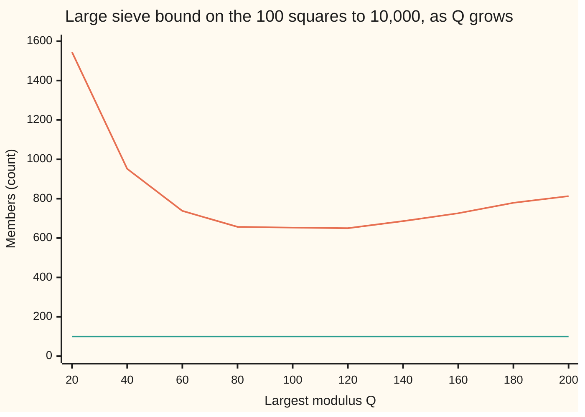

# The large sieve: how concentrated a set can be across many remainder classes at once

[Syllabus](../../../SYLLABUS.md) → [Algebraic and analytic number theory](../README.md) → [Sieves and Prime Gaps](../README.md#s04) → The large sieve

---

## General Overview

Take the perfect squares from 1 to 10,000. There are 100 of them. Divide each by 7 and keep the remainder: only 0, 1, 2 and 4 ever come out. The squares never land in the classes 3, 5 or 6. Mod any odd prime p, the squares miss (p − 1)/2 of the p remainder classes, just under half.

Now turn it round. Suppose all that is known about a set of whole numbers up to 10,000 is this: for every odd prime up to 100, it misses about half the classes. How big can the set be? Sieving prime by prime and multiplying the surviving shares guesses 0.002011 members, which is plainly false: the squares have 100. The **large sieve** gives an answer that is proved, not guessed: at most 652.558 members. The true count, made by the code, is exactly 100.

The large sieve works by listening for rhythm. A set that avoids classes mod p repeats a pattern every p steps. That pattern shows up as a large wave sum at the fractions a/p. Call the squared size of a wave sum its **energy**.

Let N be the length of the range (here 10,000) and Q the largest denominator used (here 100). The inequality says the total energy, over every fraction with denominator up to Q, is at most N − 1 + Q² per member. A set crowded into few classes uses up this budget fast, so it cannot have many members.

**The large sieve inequality caps the total energy of a sequence's wave sums at all fractions a/q with q up to Q by (N − 1 + Q²) times the sequence's own energy; a set that misses many classes mod many primes must spend a lot of that energy, so it has at most (N − 1 + Q²)/L members, where L is a score that grows with the share of classes missed.**

**What kind of fact this is:** a theorem. The step from the inequality to the set bound is proved on this card in Why it works. The inequality itself is proved in a fold with the weaker constant πN + Q² (Gallagher, 1967); the sharp constant N − 1 + Q² is stated with its source (Montgomery and Vaughan, 1973). The count of 100 to 10,000 is evidence about one range; the bound holds for every range.

### The picture: four answers to "how many members?"

```
independence guess   |                                              0.002011
true count           |███                                           100
large sieve, sharp   |███████████████████                           652.558
large sieve, πN + Q² |████████████████████████████████████████      1351.383
```

The set: numbers 1 to 10,000 that are a square mod every odd prime up to 100. The trivial bound is 10,000. The guess is wrong; both sieve bounds are proved.

---

## The formula

Notation first, in words. This card introduces two symbols for the rest of the wing:

- $`e(x) = e^{2\pi i x}`$ is the point a fraction x of the way round the unit circle, anticlockwise from 1. So e(1/4) = i and e(x + 1) = e(x).
- $`\lVert \alpha\rVert`$ is the distance from a real number α to the nearest whole number. So ‖0.3‖ = 0.3 and ‖0.9‖ = 0.1.

Take N whole numbers in a row, M + 1 to M + N, and a complex weight $`a_n`$ on each. The **exponential sum** at a real number α turns weight n by n times α of a full turn and adds:

```math
S(\alpha) = \sum_{n=M+1}^{M+N} a_n\, e(n\alpha)
```

**Read it aloud:** S of alpha adds every weight, each turned round the circle n times alpha of a full turn.

The **large sieve inequality** (analytic form) adds the squared size of S at every reduced fraction a/q with denominator q up to Q:

```math
\sum_{q \le Q}\ \sum_{\substack{0 \le a < q \\ \gcd(a,q) = 1}} \lvert S(a/q)\rvert^2 \le (N - 1 + Q^2) \sum_{n} \lvert a_n\rvert^2
```

**Read it aloud:** the wave energy at all fractions with denominator up to Q is at most N minus 1 plus Q squared, times the energy of the weights.

The **arithmetic form** is the sieve. Let A be a set of whole numbers in the same N-long range, and suppose that for each prime p up to Q it misses $`k_p`$ of the p classes mod p. Then

```math
\lvert A\rvert \le \frac{N - 1 + Q^2}{L}, \qquad L = \sum_{q \le Q} \mu^2(q) \prod_{p \mid q} \frac{k_p}{p - k_p}
```

**Read it aloud:** the set has at most N minus 1 plus Q squared, divided by L, members; L adds, over squarefree q up to Q, the product of the odds k over p minus k for the primes in q.

Here $`\mu^2(q)`$ is 1 if q is squarefree (no prime divides it twice) and 0 otherwise; μ is the Möbius function of [The Mobius function](../01-Arithmetic%20Functions%20Again/03-mobius-inversion.md). The ratio $`k_p/(p - k_p)`$ is the odds against a class: missed classes against allowed ones. This L is not Liouville's running total L(y) from [Sieving by inclusion-exclusion](01-the-legendre-sieve-and-the-parity-problem.md), and S(α) is not the sieve count S(x, z).

For the squares to 10,000: N = 10,000, M = 0, Q = 100. Mod 2 the squares miss nothing, so $`k_2 = 0`$ and every even q adds 0. For odd p, $`k_p = (p-1)/2`$ and the odds are (p − 1)/(p + 1). Then L = 30.647075 and the bound is 19,999 / 30.647075 = 652.558.

| Symbol | Plain meaning | In our example | Push it up and the answer… |
| --- | --- | --- | --- |
| $`N`$, $`M`$ | how many whole numbers in the range; where it starts | 10,000; M = 0 | the bound grows by about 1/L per extra number |
| $`n`$, $`a_n`$ | a whole number in the range; its weight | $`a_n`$ = 1 on members of A, 0 elsewhere | — |
| $`e(x)`$ | $`e^{2\pi i x}`$, a fraction x of a turn | e(1/4) = i | — |
| $`S(\alpha)`$ | the exponential sum at α | $`\lvert S(1/3)\rvert^2`$ = 3,367 | — |
| $`\alpha_r`$, $`\beta`$, $`\delta`$, $`\lVert \alpha\rVert`$ | points on the circle (β is a fixed turn, used in Step 3); their least spacing; distance to the nearest whole number | the 3,044 fractions; δ = 1/9,900 | closer points allow more total energy |
| $`Q`$ | the largest denominator, and the largest prime used | 100 | L grows, but Q² grows faster; best near the square root of N |
| $`q`$, $`a`$ | a denominator; a numerator with gcd(a, q) = 1 | q = 3: a = 1, 2 | — |
| $`p`$, $`k_p`$ | a prime; how many classes mod p the set misses | $`k_7`$ = 3, $`k_{97}`$ = 48 | more missed classes, a smaller bound |
| $`A`$, $`\lvert A\rvert`$ | the set; how many members it has | the numbers to 10,000 that are squares mod every odd p ≤ 100; 100 | — |
| $`\mu^2(q)`$ | 1 if q is squarefree, else 0 | $`\mu^2(9) = 0`$ | — |
| $`L`$ | the sum of products of odds | 30.647075 | the bound falls |
| $`Z(q, b)`$ | how many members leave remainder b mod q | Z(3, ·) = 33, 67, 0 | — |

### When it holds

- **Any complex weights, any start M.** The analytic form needs nothing about $`a_n`$. Only the length N of the range matters, not where it sits.
- **The points are spaced.** The fractions a/q with q ≤ Q are at least 1/(Q(Q − 1)) apart round the circle. Put 3,044 points all at 0 instead, and the left side for the squares is 30,440,000, far above the budget 1,999,900.
- **The Q² term stays.** One weight alone, N = 1, has $`\lvert S\rvert = 1`$ at all 3,044 fractions. The left side is 3,044, so a budget of N times the energy, 1, is false.
- **The set really misses those classes.** L for the squares, used on the primes up to 10,000, gives 652.558, below their true count of 1,229. Primes miss at most the class 0 mod each p, not half the classes.
- **It is an upper bound only.** No lower bound on |A| follows. A set missing those classes may even be empty.

---

## Why it works

### Step 0: the idea

A set that avoids classes mod p is unevenly spread mod p. Uneven spread mod p means a large wave sum at some fraction a/p, because the wave e(na/p) repeats every p steps and the set keeps landing on the same parts of it. So a set that misses classes for many primes forces large wave sums at many fractions.

The large sieve inequality says the fractions with denominator up to Q are spread out round the circle, and spread-out points cannot all catch a large wave sum. So the energy has a ceiling. Together, the floor and the ceiling squeeze |A|.

### Step 1: one modulus is Parseval

[The discrete Fourier transform](../../07-Complex%20analysis/08-Transforms%20in%20Outline/02-discrete-fourier-transform.md) proves Parseval's identity for q points. Group the members of A by remainder mod q: then S(a/q) is the q-point transform of the counts Z(q, b), and

```math
\sum_{a=0}^{q-1} \lvert S(a/q)\rvert^2 = q \sum_{b=0}^{q-1} Z(q,b)^2
```

**Read it aloud:** the wave energy at all q fractions with denominator q is q times the sum of the squared class counts.

This is the one-modulus case of the large sieve. Mod 3, the squares have Z = 33, 67, 0, and 3 × (33² + 67²) = 16,734. The term a = 0 is $`\lvert S(0)\rvert^2 = \lvert A\rvert^2`$ = 10,000, so the two other fractions carry 6,734. Mod 7, both sides are 18,634.

### Step 2: missing classes force energy at a/p

Let A miss $`k_p`$ classes mod p, so its |A| members sit in $`p - k_p`$ classes. By the Cauchy–Schwarz inequality (a sum of m numbers, squared, is at most m times the sum of their squares):

```math
\lvert A\rvert^2 = \Big(\sum_{b \text{ allowed}} Z(p,b)\Big)^2 \le (p - k_p) \sum_{b} Z(p,b)^2
```

**Read it aloud:** the members squared are at most the number of allowed classes times the sum of squared class counts.

Put this into Step 1 and take away the a = 0 term:

```math
\sum_{a=1}^{p-1} \lvert S(a/p)\rvert^2 = p\sum_b Z(p,b)^2 - \lvert A\rvert^2 \ge \lvert A\rvert^2 \Big(\frac{p}{p - k_p} - 1\Big) = \lvert A\rvert^2\, \frac{k_p}{p - k_p}
```

**Read it aloud:** the energy at the nonzero fractions over p is at least the members squared times the odds against a class.

Mod 3 the squares miss one class of three, so the odds are 1/2 and the floor is 10,000 × 1/2 = 5,000. The true energy is 6,734.

### Step 3: squarefree moduli multiply the floors

For a squarefree q, the reduced fractions a/q match, one to one, with lists of nonzero fractions $`a_i/p_i`$, one per prime of q: the Chinese remainder theorem adds them up to a/q mod 1. Step 2 also holds for the sequence turned by any fixed β, since turning does not move members between classes. Applied once per prime, this gives

```math
\sum_{\gcd(a,q)=1} \lvert S(a/q)\rvert^2 \ge \lvert A\rvert^2 \prod_{p \mid q} \frac{k_p}{p - k_p}
```

**Read it aloud:** the energy at the reduced fractions over q is at least the members squared times the product of the odds for each prime in q.

The code checks this floor for all 40 odd squarefree q from 3 to 100. The tightest case has energy 1.026800 times its floor.

<details>
<summary>Detailed proof: the floor for a squarefree modulus</summary>

Write q = $`p_1 p_2 \cdots p_m`$, distinct primes. By the Chinese remainder theorem, as each $`a_i`$ runs over 1 to $`p_i - 1`$, the sum $`a_1/p_1 + \cdots + a_m/p_m`$ runs, mod 1, over every a/q with gcd(a, q) = 1, each once.

Fix β, any real number. The weights $`a_n e(n\beta)`$ sit on the same members as $`a_n`$, so Step 2 applies to them. Their sum at a/p is S(β + a/p). For indicator weights on A, Step 2 then reads

$`\displaystyle \sum_{a=1}^{p-1} \lvert S(\beta + a/p)\rvert^2 \ge \frac{k_p}{p - k_p} \lvert S(\beta)\rvert^2 .`$

Strictly, Step 2 was proved for weights 1 on A. For general weights on A, the same Cauchy–Schwarz step works with $`Z(p, b)`$ replaced by the sum of the turned weights in class b: those sums still vanish on the missed classes, and the turned sum at 0 is S(β).

Now peel the primes one at a time. Take β = $`a_1/p_1 + \cdots + a_{m-1}/p_{m-1}`$, sum over $`a_m`$ first, then over the other $`a_i`$:

$`\displaystyle \sum_{\gcd(a,q)=1} \lvert S(a/q)\rvert^2 = \sum_{a_1, \dots, a_{m-1}}\ \sum_{a_m} \lvert S(\beta + a_m/p_m)\rvert^2 \ge \frac{k_{p_m}}{p_m - k_{p_m}} \sum_{a_1, \dots, a_{m-1}} \lvert S(\beta)\rvert^2 .`$

The last sum is the same expression for $`q/p_m`$. After m steps the sum is $`\lvert S(0)\rvert^2 = \lvert A\rvert^2`$ times the product of the m odds.

</details>

### Step 4: the fractions are spread out

Two different reduced fractions a/q and a′/q′ differ by $`\lvert aq' - a'q\rvert / (qq')`$. The top is a nonzero whole number, so the gap is at least 1/(qq′), which is at least 1/(Q(Q − 1)) for different denominators up to Q. For Q = 100 there are 3,044 fractions, and the closest pair is 1/9,900 apart, more than 1/Q² = 1/10,000.

### Step 5: spread-out points cannot all catch a large sum

This is the analytic heart. For any points $`\alpha_r`$ with $`\lVert \alpha_r - \alpha_s\rVert \ge \delta`$ when r ≠ s,

```math
\sum_r \lvert S(\alpha_r)\rvert^2 \le \big(N - 1 + \delta^{-1}\big) \sum_n \lvert a_n\rvert^2
```

**Read it aloud:** at points at least delta apart, the wave energy is at most N minus 1 plus one over delta, times the weights' energy.

Both terms are needed. All weights 1 give $`\lvert S(0)\rvert^2 = N^2`$ at the point 0: that needs the N. One weight alone gives $`\lvert S\rvert = 1`$ at each of about $`\delta^{-1}`$ points: that needs the $`\delta^{-1}`$. The theorem says these two extremes, added, are the worst case.

Selberg and, independently, Montgomery and Vaughan proved the constant N − 1 + δ⁻¹ (the source is listed below). The fold proves Gallagher's slightly weaker πN + δ⁻¹, which already gives a true bound here: 1,351.383 against 100.

<details>
<summary>Detailed proof: Gallagher's large sieve, with constant πN + 1/δ</summary>

**A one-point bound.** Let f be a smooth complex function and I an interval of length δ centred at $`\alpha_0`$. Write g = |f|², so g′ = 2 Re(f̄ f′) and |g′| ≤ 2|f||f′|. For each x in I,

$`\displaystyle g(\alpha_0) = g(x) + \int_x^{\alpha_0} g'(t)\, dt .`$

Average over x in I. The integral term counts each t in I with weight at most 1/2, since t lies between x and the centre for at most half of the x. So

$`\displaystyle \lvert f(\alpha_0)\rvert^2 \le \frac{1}{\delta}\int_I \lvert f\rvert^2 + \int_I \lvert f\rvert \lvert f'\rvert .`$

**Add over the points.** Intervals of length δ centred at points δ apart do not overlap round the circle. So, with f = S,

$`\displaystyle \sum_r \lvert S(\alpha_r)\rvert^2 \le \frac{1}{\delta}\int_0^1 \lvert S\rvert^2 + \int_0^1 \lvert S\rvert \lvert S'\rvert .`$

**Evaluate.** Different e(nα) are orthogonal on the circle, so the first integral is $`\sum_n \lvert a_n\rvert^2`$. For the second, first multiply S by e(−cα), with c the middle of the range, M + (N + 1)/2. That changes no size, and now every frequency n − c is at most (N − 1)/2 in size. The derivative brings down 2πi(n − c), at most π(N − 1) in size. By Cauchy–Schwarz and orthogonality again,

$`\displaystyle \int_0^1 \lvert S\rvert \lvert S'\rvert \le \Big(\sum_n \lvert a_n\rvert^2\Big)^{1/2} \Big(\sum_n 4\pi^2 (n - c)^2 \lvert a_n\rvert^2\Big)^{1/2} \le \pi N \sum_n \lvert a_n\rvert^2 .`$

Adding the two parts gives the constant πN + 1/δ. With δ = 1/Q² from Step 4, it reads πN + Q².

</details>

### Step 6: the floor meets the ceiling

Put $`a_n`$ = 1 on A and 0 elsewhere, so the energy of the weights is |A|. Add Step 3 over all q ≤ Q; q = 1 gives the term $`\lvert S(0)\rvert^2 = \lvert A\rvert^2`$, and q with a repeated prime factor gives nothing. Steps 4 and 5 give the ceiling:

```math
\lvert A\rvert^2 L \le \sum_{q \le Q}\ \sum_{\gcd(a,q)=1} \lvert S(a/q)\rvert^2 \le (N - 1 + Q^2)\, \lvert A\rvert
```

**Read it aloud:** the members squared times L is at most the total energy, which is at most the budget times the members.

Divide by |A| L. For the squares, the three numbers are 306,470.747, then 629,446.000 from the code's own sums, then 1,999,900.

---

## Worked numbers, by hand

The set is the 100 squares from 1 to 10,000, and Q = 100. The modulus 3 is small enough to do by hand. The point e(1/3) is $`-\tfrac12 + \tfrac{\sqrt3}{2}i`$, so $`\lvert x + y\,e(1/3)\rvert^2 = x^2 + y^2 - xy`$ for whole numbers x and y.

| Step | Arithmetic | Value |
| --- | --- | --- |
| members | 1², 2², …, 100² | 100 |
| class counts mod 3 | squares of 3, 6, …, 99 leave 0; the rest leave 1 | Z = 33, 67, 0 |
| energy at 1/3 | 33² + 67² − 33 × 67 = 1,089 + 4,489 − 2,211 | 3,367 |
| energy at 1/3 and 2/3 | twice 3,367, since 2/3 gives the conjugate | 6,734 |
| Parseval check | 3 × (1,089 + 4,489) = 16,734 = 10,000 + 6,734 | holds |
| floor from Step 2 | 100² × 1/(3 − 1) | 5,000 ≤ 6,734 |
| L, first terms | q = 1, 3, 5, 7, 11, 13: 1 + 0.5 + 0.666667 + 0.75 + 0.833333 + 0.857143; then 15 = 3 × 5, whose term is 0.5 × 0.666667 = 0.333333 | 4.940476 to q = 15 |
| L, all q ≤ 100 | the rest of the 40 odd squarefree q from 3 to 100 (code) | 30.647075 |
| bound | (10,000 − 1 + 100²) / 30.647075 = 19,999 / 30.647075 | **652.558** |
| true count | every member is a perfect square (code) | 100 |

The large sieve proves that at most 652 numbers up to 10,000 look like squares mod every odd prime to 100. In fact only the 100 real squares do.

### How the bound depends on Q



Orange line: the bound (N − 1 + Q²)/L, rounded, for N = 10,000. Green line: the 100 squares, which miss the same classes at every Q, so the bound covers them throughout. Small Q uses too few primes; large Q pays Q² in the budget. The best Q sits near the square root of N.

### What breaks if you drop a piece

| Mistake | Comes out at | What went wrong |
| --- | --- | --- |
| Multiply the surviving shares, 1 − $`k_p`$/p, as if primes were independent | 0.002011 members, against 100 | The squares are perfectly correlated across primes; a sieve this heavy has no main term |
| Use the squares' L on a set that does not miss those classes | 652.558, against 1,229 primes to 10,000 | The bound needs the missed classes; primes miss only 0 mod p |
| Drop the Q² from the budget | one weight, N = 1: left side 3,044, against 1 | A spike is flat in frequency and lights up every fraction |
| Use points that are not spaced | 3,044 copies of 0: 30,440,000, against 1,999,900 | The ceiling needs points at least δ apart |

---

## Code, from first principles, and it actually runs

The code imports only `math`. It takes four roads. Road one counts the set exactly: every number to 10,000 is tested by Euler's criterion against each odd prime to 100, and the survivors are compared with the perfect squares. Road two computes L and the bound, and computes L a second time from the classes the set really hits. Road three computes the wave sums at all 3,044 fractions and checks both the floor of Step 3, modulus by modulus, and the ceiling of Step 6; it also checks Parseval mod 7 against the class counts and the spacing 1/9,900. Road four finds, for a small case, the worst possible ratio exactly: the top eigenvalue of a 49 by 49 matrix, by Jacobi rotations, checked against its trace and against the same budget N − 1 + Q² that gives the bound. The house example, twin pairs below a million, is counted by a sieve.

### Python

```python
# The large sieve -- the check behind the card.  Standard library only.  The set A: whole numbers
# 1..10,000 that are a square mod every odd prime up to Q = 100.  Road one: count A exactly by
# Euler's criterion and compare with the perfect squares.  Road two: the large sieve bound
# (N - 1 + Q^2)/L.  Road three: the exponential sums S(a/q) themselves, between both sides of the
# inequality.  Road four: the worst-case ratio for a small case, by Jacobi rotations.
import math
N, Q = 10000, 100
def sieve(n):
    s = [True] * (n + 1); s[0] = s[1] = False
    for i in range(2, math.isqrt(n) + 1):
        if s[i]: s[i * i::i] = [False] * len(s[i * i::i])
    return s
isp = sieve(1000002)
P = [p for p in range(2, Q + 1) if isp[p]]
def L_of(Qm, h):                          # L = sum over squarefree q <= Qm of prod over p | q of h(p)
    tot = 0.0
    for q in range(1, Qm + 1):
        prod, m, p = 1.0, q, 2
        while m > 1:
            if m % p == 0:
                m //= p
                if m % p == 0: prod = None; break
                prod *= h(p)
            p += 1
        if prod is not None: tot += prod
    return tot
k_sq = lambda p: 0 if p == 2 else (p - 1) // 2          # k_p: classes a square never lands in, mod p
h_sq = lambda p: k_sq(p) / (p - k_sq(p))               # the odds k_p/(p - k_p)
# Road one: the exact count
A = [n for n in range(1, N + 1) if all(pow(n, (p - 1) // 2, p) in (0, 1) for p in P[1:])]
nsq = sum(1 for n in A if math.isqrt(n) ** 2 == n)
hit = {p: len({n % p for n in A}) for p in P}
print(f"A = n in 1..{N:,} that are a square mod every odd prime p <= {Q}: {len(A)} members, {nsq} of them perfect squares")
print(f"classes hit mod 3, 5, 7, 97: {hit[3]}, {hit[5]}, {hit[7]}, {hit[97]}; missed: {3 - hit[3]}, {5 - hit[5]}, {7 - hit[7]}, {97 - hit[97]}")
# Road two: the bound
budget = lambda n, q: n - 1 + q * q                  # the large sieve's constant N - 1 + Q^2, tested in road four
L = L_of(Q, h_sq)
L_seen = L_of(Q, lambda p: (p - hit[p]) / hit[p])   # second road: the odds from the classes A really hits
bound, gal = budget(N, Q) / L, (math.pi * N + Q * Q) / L
guess = N * math.prod(1 - k_sq(p) / p for p in P)
print(f"L = {L:.6f}; large sieve bound (N - 1 + Q^2)/L = {N - 1 + Q * Q:,}/{L:.6f} = {bound:.3f}")
print(f"Gallagher's constant (pi N + Q^2)/L = {gal:.3f}; independence guess N x prod(1 - k_p/p) = {guess:.6f}")
print(f"terms of L: q = 1: 1; q = 3: {h_sq(3):.6f}; q = 5: {h_sq(5):.6f}; q = 7: {h_sq(7):.6f}; q = 11: {h_sq(11):.6f}; q = 13: {h_sq(13):.6f}; q = 15: {h_sq(3) * h_sq(5):.6f}; total to 15: {L_of(15, h_sq):.6f}")
# Road three: the exponential sums at the Farey fractions a/q, q <= Q, gcd(a, q) = 1
def S(sq, a, q):                          # S(a/q) = sum over members n of e(n a/q), e(x) = exp(2 pi i x)
    re = im = 0.0
    for n in sq:
        t = 2 * math.pi * (n * a % q) / q; re += math.cos(t); im += math.sin(t)
    return re * re + im * im
farey = [(a, q) for q in range(1, Q + 1) for a in range(q) if math.gcd(a, q) == 1]
order = sorted(farey, key=lambda f: f[0] / f[1])
gaps = [(b * q - a * r, q * r) for (a, q), (b, r) in zip(order, order[1:])] + [(1 * order[-1][1] - order[-1][0], order[-1][1])]
mg = min(gaps, key=lambda g: g[0] / g[1])
print(f"Farey fractions with q <= {Q}: {len(farey):,}; closest pair {mg[0]}/{mg[1]:,}, at least 1/Q^2 = 1/{Q * Q:,}")
by_q = {}
for a, q in farey: by_q[q] = by_q.get(q, 0.0) + S(A, a, q)
T = sum(by_q.values())
print(f"left side, sum of |S(a/q)|^2: {T:,.3f}")
print(f"lower, |A|^2 L = {len(A) ** 2 * L:,.3f}; upper, (N - 1 + Q^2)|A| = {(N - 1 + Q * Q) * len(A):,}")
Z3 = [sum(1 for n in A if n % 3 == b) for b in range(3)]
print(f"q = 3: Z = {Z3}; |S(1/3)|^2 = {S(A, 1, 3):.3f}; sum over a = 1, 2: {by_q[3]:.3f}; lemma's floor |A|^2 x 1/2 = {len(A) ** 2 / 2:.3f}")
print(f"q = 3 Parseval: 3 x sum Z^2 = {3 * sum(z * z for z in Z3):,}; |S(0)|^2 + {by_q[3]:.3f} = {len(A) ** 2 + by_q[3]:,.3f}")
Z7 = [sum(1 for n in A if n % 7 == b) for b in range(7)]
par7 = sum(S(A, a, 7) for a in range(7))
print(f"q = 7: Z = {Z7}; sum over all a of |S(a/7)|^2 = {par7:,.3f}; 7 x sum Z^2 = {7 * sum(z * z for z in Z7):,}")
floors, worst = 0, 9.0
for q in range(2, Q + 1):
    f = L_of(q, h_sq) - L_of(q - 1, h_sq)        # the q-th term of L: 0 unless q is squarefree and odd
    if f > 0:
        floors += 1; worst = min(worst, by_q[q] / (len(A) ** 2 * f))
        assert by_q[q] >= len(A) ** 2 * f * (1 - 1e-9)   # Montgomery's lemma, modulus by modulus
print(f"odd squarefree q <= {Q} checked (q > 1) against the lemma's floor: {floors}; tightest ratio {worst:.6f}")
chart = [round((N - 1 + x * x) / L_of(x, h_sq)) for x in range(20, 201, 20)]
print("chart, bound at Q = 20, 40, ..., 200:", ", ".join(str(c) for c in chart))
# Road four: the worst sequence for a small case, N0 = 49 terms, Q0 = 7
N0, Q0 = 49, 7
F0 = [a / q for q in range(1, Q0 + 1) for a in range(q) if math.gcd(a, q) == 1]
c = [sum(math.cos(2 * math.pi * d * x) for x in F0) for d in range(N0)]
Kv = lambda v: [sum(c[abs(m - n)] * v[n] for n in range(N0)) for m in range(N0)]
M = [[c[abs(m - n)] for n in range(N0)] for m in range(N0)]   # the matrix whose top eigenvalue is the worst ratio
for sweep in range(12):                    # Jacobi rotations: zero each off-diagonal entry in turn
    for i in range(N0):
        for j in range(i + 1, N0):
            if abs(M[i][j]) < 1e-300: continue
            th = (M[j][j] - M[i][i]) / (2 * M[i][j]); t = (1 if th >= 0 else -1) / (abs(th) + math.sqrt(th * th + 1))
            cs = 1 / math.sqrt(t * t + 1); sn = t * cs
            for k in range(N0): M[k][i], M[k][j] = cs * M[k][i] - sn * M[k][j], sn * M[k][i] + cs * M[k][j]
            for k in range(N0): M[i][k], M[j][k] = cs * M[i][k] - sn * M[j][k], sn * M[i][k] + cs * M[j][k]
eig = sorted(M[i][i] for i in range(N0)); lam, off = eig[-1], max(abs(M[i][j]) for i in range(N0) for j in range(N0) if i != j)
st, worst_rand = 20261115, 0.0
for trial in range(20):                    # SplitMix64 signs: random +1/-1 sequences
    seq = []
    for _ in range(N0):
        st = (st + 0x9E3779B97F4A7C15) % 2 ** 64; z = st
        z = (z ^ (z >> 30)) * 0xBF58476D1CE4E5B9 % 2 ** 64; z = (z ^ (z >> 27)) * 0x94D049BB133111EB % 2 ** 64
        seq.append(1.0 if (z ^ (z >> 31)) & 1 else -1.0)
    worst_rand = max(worst_rand, sum(x * y for x, y in zip(seq, Kv(seq))) / N0)
print(f"small case N0 = {N0}, Q0 = {Q0}: {len(F0)} fractions; worst ratio = top eigenvalue {lam:.6f}; next {eig[-2]:.6f}")
print(f"  eigenvalues add to {sum(eig):.6f}; trace N0 x fractions = {N0 * len(F0)}")
print(f"  random signs, best of 20: {worst_rand:.6f}; floor max(N0, fractions) = {max(N0, len(F0))}; bound N0 - 1 + Q0^2 = {N0 - 1 + Q0 * Q0}")
# The house example: twin pairs below a million
X, Qt = 10 ** 6, 300
twins = sum(1 for n in range(3, X + 1) if isp[n] and isp[n + 2])
small = sum(1 for n in range(3, Qt + 1) if isp[n] and isp[n + 2])
Lt = L_of(Qt, lambda p: 1 if p == 2 else 2 / (p - 2))
th = {p: len({n % p for n in range(Qt + 1, X + 1) if isp[n] and isp[n + 2]}) for p in range(2, Qt + 1) if isp[p]}
Lt_seen = L_of(Qt, lambda p: (p - th[p]) / th[p])   # second road: the odds from the classes the twins really hit
bt = (X - Qt - 1 + Qt * Qt) / Lt
print(f"twin pairs (n, n + 2) with n <= {X:,}: {twins:,}; with n <= {Qt}: {small}; above: {twins - small:,}")
print(f"twins, Q = {Qt}: L = {Lt:.6f}; bound ({X - Qt:,} - 1 + {Qt * Qt:,})/L = {bt:,.3f}; plus {small} small pairs = {bt + small:,.3f}")
# What breaks
primes = sum(isp[1:N + 1])
print(f"mistake 1, independence guess: {guess:.6f} against {len(A)} true")
print(f"mistake 2, the squares' bound used on the primes up to {N:,}: {bound:.3f} against {primes:,} primes")
print(f"mistake 3, drop Q^2: one term a_1 = 1 gives left side {len(farey):,} against N|a_1|^2 = 1 for N = 1")
print(f"mistake 4, points not spaced: {len(farey):,} copies of a/q = 0 give {len(farey) * len(A) ** 2:,} against {(N - 1 + Q * Q) * len(A):,}")
allq = sum(S(A, a, q) for q in range(1, Q + 1) for a in range(q))
print(f"trap, every a mod q, not just gcd 1: {allq:,.3f} against {(N - 1 + Q * Q) * len(A):,}")
Ls = L_of(Q, lambda p: k_sq(p) / p)
print(f"trap, q = 1 left out of L: bound {(N - 1 + Q * Q) / (L - 1):.3f}; shares k_p/p for odds: L = {Ls:.6f}, bound {(N - 1 + Q * Q) / Ls:.3f}")
assert len(A) == nsq == math.isqrt(N)                        # the sieve count equals the count of squares
assert all(hit[p] == (p + 1) // 2 for p in P[1:])             # A misses exactly (p - 1)/2 classes mod each odd p
assert len(A) <= bound < N and gal > bound                    # the theorem against the count
assert abs(L_seen - L) < 1e-9 and abs(Lt_seen - Lt) < 1e-9     # L from k_p by formula against k_p counted
assert len(A) ** 2 * L <= T <= (N - 1 + Q * Q) * len(A)       # both sides of the inequality
assert abs(par7 - 7 * sum(z * z for z in Z7)) < 1e-6          # Parseval: exponential sums against residue counts
assert mg == (1, Q * (Q - 1))                                # Farey spacing: closest pair 1/(Q(Q - 1))
assert off < 1e-9 and abs(sum(eig) - N0 * len(F0)) < 1e-9     # eigenvalues against the trace
assert max(N0, len(F0)) <= lam <= budget(N0, Q0) and worst_rand <= lam   # the exact worst case under the budget
assert twins == 8169 and bt >= twins - small                  # the house example
assert primes > bound and allq > (N - 1 + Q * Q) * len(A)     # the broken versions really break
print("ALL CHECKS PASS")
```

**Ran 2026-11-15 on macOS, Python 3.14.10, standard library only. All checks passed. Output, pasted from the run:**

```
A = n in 1..10,000 that are a square mod every odd prime p <= 100: 100 members, 100 of them perfect squares
classes hit mod 3, 5, 7, 97: 2, 3, 4, 49; missed: 1, 2, 3, 48
L = 30.647075; large sieve bound (N - 1 + Q^2)/L = 19,999/30.647075 = 652.558
Gallagher's constant (pi N + Q^2)/L = 1351.383; independence guess N x prod(1 - k_p/p) = 0.002011
terms of L: q = 1: 1; q = 3: 0.500000; q = 5: 0.666667; q = 7: 0.750000; q = 11: 0.833333; q = 13: 0.857143; q = 15: 0.333333; total to 15: 4.940476
Farey fractions with q <= 100: 3,044; closest pair 1/9,900, at least 1/Q^2 = 1/10,000
left side, sum of |S(a/q)|^2: 629,446.000
lower, |A|^2 L = 306,470.747; upper, (N - 1 + Q^2)|A| = 1,999,900
q = 3: Z = [33, 67, 0]; |S(1/3)|^2 = 3367.000; sum over a = 1, 2: 6734.000; lemma's floor |A|^2 x 1/2 = 5000.000
q = 3 Parseval: 3 x sum Z^2 = 16,734; |S(0)|^2 + 6734.000 = 16,734.000
q = 7: Z = [14, 29, 28, 0, 29, 0, 0]; sum over all a of |S(a/7)|^2 = 18,634.000; 7 x sum Z^2 = 18,634
odd squarefree q <= 100 checked (q > 1) against the lemma's floor: 40; tightest ratio 1.026800
chart, bound at Q = 20, 40, ..., 200: 1545, 952, 738, 657, 653, 650, 686, 726, 779, 813
small case N0 = 49, Q0 = 7: 18 fractions; worst ratio = top eigenvalue 64.498222; next 64.253048
  eigenvalues add to 882.000000; trace N0 x fractions = 882
  random signs, best of 20: 33.469388; floor max(N0, fractions) = 49; bound N0 - 1 + Q0^2 = 97
twin pairs (n, n + 2) with n <= 1,000,000: 8,169; with n <= 300: 19; above: 8,150
twins, Q = 300: L = 25.737806; bound (999,700 - 1 + 90,000)/L = 42,338.457; plus 19 small pairs = 42,357.457
mistake 1, independence guess: 0.002011 against 100 true
mistake 2, the squares' bound used on the primes up to 10,000: 652.558 against 1,229 primes
mistake 3, drop Q^2: one term a_1 = 1 gives left side 3,044 against N|a_1|^2 = 1 for N = 1
mistake 4, points not spaced: 3,044 copies of a/q = 0 give 30,440,000 against 1,999,900
trap, every a mod q, not just gcd 1: 3,166,896.000 against 1,999,900
trap, q = 1 left out of L: bound 674.569; shares k_p/p for odds: L = 15.034709, bound 1330.189
ALL CHECKS PASS
```

### Rust

Same numbers, same labels, built with `rustc --edition 2021 -O`.

```rust
// The large sieve -- the same check as the Python, in Rust.  No crates.  The set A: whole numbers
// 1..10,000 that are a square mod every odd prime up to Q = 100.  Road one: count A exactly by
// Euler's criterion and compare with the perfect squares.  Road two: the large sieve bound
// (N - 1 + Q^2)/L.  Road three: the exponential sums S(a/q) themselves, between both sides of the
// inequality.  Road four: the worst-case ratio for a small case, by Jacobi rotations.
use std::f64::consts::PI;
fn commas(s: String) -> String {                       // 1234567.5 -> 1,234,567.5
    let (int, frac) = match s.find('.') { Some(i) => (s[..i].to_string(), s[i..].to_string()), None => (s.clone(), String::new()) };
    let b = int.as_bytes(); let mut out = String::new();
    for (i, ch) in b.iter().enumerate() { if i > 0 && (b.len() - i) % 3 == 0 { out.push(','); } out.push(*ch as char); }
    out + &frac
}
fn ci(v: u64) -> String { commas(v.to_string()) }
fn cf(v: f64) -> String { commas(format!("{:.3}", v)) }
fn gcd(a: u64, b: u64) -> u64 { if b == 0 { a } else { gcd(b, a % b) } }
fn isqrt(n: u64) -> u64 { let mut r = (n as f64).sqrt() as u64; while r * r > n { r -= 1; } while (r + 1) * (r + 1) <= n { r += 1; } r }
fn modpow(mut b: u64, mut e: u64, m: u64) -> u64 { let mut r = 1 % m; b %= m; while e > 0 { if e & 1 == 1 { r = r * b % m; } b = b * b % m; e >>= 1; } r }
fn l_of(qm: u64, h: &dyn Fn(u64) -> f64) -> f64 {     // L = sum over squarefree q <= qm of prod over p | q of h(p)
    let mut tot = 0.0;
    for q in 1..=qm {
        let (mut prod, mut m, mut p, mut ok) = (1.0, q, 2u64, true);
        while m > 1 {
            if m % p == 0 { m /= p; if m % p == 0 { ok = false; break; } prod *= h(p); }
            p += 1;
        }
        if ok { tot += prod; }
    }
    tot
}
fn k_sq(p: u64) -> u64 { if p == 2 { 0 } else { (p - 1) / 2 } }      // k_p: classes a square never lands in, mod p
fn h_sq(p: u64) -> f64 { k_sq(p) as f64 / (p - k_sq(p)) as f64 }      // the odds k_p/(p - k_p)
fn budget(n: u64, q: u64) -> u64 { n - 1 + q * q }                     // the large sieve's constant N - 1 + Q^2, tested in road four
fn s2(a_set: &[u64], a: u64, q: u64) -> f64 {          // |S(a/q)|^2, S = sum over members n of e(n a/q)
    let (mut re, mut im) = (0.0f64, 0.0f64);
    for &n in a_set { let t = 2.0 * PI * ((n * a % q) as f64) / q as f64; re += t.cos(); im += t.sin(); }
    re * re + im * im
}
fn main() {
    let (n, q) = (10000u64, 100u64); let lim = 1000002usize;
    let mut isp = vec![true; lim + 1]; isp[0] = false; isp[1] = false;
    let mut i = 2; while i * i <= lim { if isp[i] { let mut j = i * i; while j <= lim { isp[j] = false; j += i; } } i += 1; }
    let ps: Vec<u64> = (2..=q).filter(|&p| isp[p as usize]).collect();
    // Road one: the exact count
    let a_set: Vec<u64> = (1..=n).filter(|&m| ps[1..].iter().all(|&p| { let r = modpow(m, (p - 1) / 2, p); r == 0 || r == 1 })).collect();
    let nsq = a_set.iter().filter(|&&m| isqrt(m) * isqrt(m) == m).count();
    let hit = |p: u64| { let mut s = vec![false; p as usize]; for &m in &a_set { s[(m % p) as usize] = true; } s.iter().filter(|&&b| b).count() as u64 };
    let na = a_set.len() as u64; let naf = na as f64;
    println!("A = n in 1..{} that are a square mod every odd prime p <= {}: {} members, {} of them perfect squares", ci(n), q, na, nsq);
    println!("classes hit mod 3, 5, 7, 97: {}, {}, {}, {}; missed: {}, {}, {}, {}", hit(3), hit(5), hit(7), hit(97), 3 - hit(3), 5 - hit(5), 7 - hit(7), 97 - hit(97));
    // Road two: the bound
    let l = l_of(q, &h_sq); let top = budget(n, q);
    let l_seen = l_of(q, &|p| (p - hit(p)) as f64 / hit(p) as f64);   // second road: the odds from the classes A really hits
    let (bound, gal) = (top as f64 / l, (PI * n as f64 + (q * q) as f64) / l);
    let guess = n as f64 * ps.iter().fold(1.0, |acc, &p| acc * (1.0 - k_sq(p) as f64 / p as f64));
    println!("L = {:.6}; large sieve bound (N - 1 + Q^2)/L = {}/{:.6} = {:.3}", l, ci(top), l, bound);
    println!("Gallagher's constant (pi N + Q^2)/L = {:.3}; independence guess N x prod(1 - k_p/p) = {:.6}", gal, guess);
    println!("terms of L: q = 1: 1; q = 3: {:.6}; q = 5: {:.6}; q = 7: {:.6}; q = 11: {:.6}; q = 13: {:.6}; q = 15: {:.6}; total to 15: {:.6}", h_sq(3), h_sq(5), h_sq(7), h_sq(11), h_sq(13), h_sq(3) * h_sq(5), l_of(15, &h_sq));
    // Road three: the exponential sums at the Farey fractions a/q, q <= Q, gcd(a, q) = 1
    let farey: Vec<(u64, u64)> = (1..=q).flat_map(|d| (0..d).filter(move |&a| gcd(a, d) == 1).map(move |a| (a, d))).collect();
    let mut order = farey.clone(); order.sort_by(|x, y| (x.0 as f64 / x.1 as f64).partial_cmp(&(y.0 as f64 / y.1 as f64)).unwrap());
    let mut gaps: Vec<(u64, u64)> = order.windows(2).map(|w| (w[1].0 * w[0].1 - w[0].0 * w[1].1, w[0].1 * w[1].1)).collect();
    let last = order[order.len() - 1]; gaps.push((last.1 - last.0, last.1));
    let mg = *gaps.iter().min_by(|x, y| (x.0 as f64 / x.1 as f64).partial_cmp(&(y.0 as f64 / y.1 as f64)).unwrap()).unwrap();
    println!("Farey fractions with q <= {}: {}; closest pair {}/{}, at least 1/Q^2 = 1/{}", q, ci(farey.len() as u64), mg.0, ci(mg.1), ci(q * q));
    let mut by_q = vec![0.0f64; q as usize + 1];
    for &(a, d) in &farey { by_q[d as usize] = by_q[d as usize] + s2(&a_set, a, d); }
    let t = by_q[1..].iter().fold(0.0, |s, v| s + v);
    println!("left side, sum of |S(a/q)|^2: {}", cf(t));
    println!("lower, |A|^2 L = {}; upper, (N - 1 + Q^2)|A| = {}", cf(naf * naf * l), ci(top * na));
    let zc = |m: u64| (0..m).map(|b| a_set.iter().filter(|&&x| x % m == b).count() as u64).collect::<Vec<u64>>();
    let (z3, z7) = (zc(3), zc(7));
    println!("q = 3: Z = {:?}; |S(1/3)|^2 = {:.3}; sum over a = 1, 2: {:.3}; lemma's floor |A|^2 x 1/2 = {:.3}", z3, s2(&a_set, 1, 3), by_q[3], naf * naf / 2.0);
    println!("q = 3 Parseval: 3 x sum Z^2 = {}; |S(0)|^2 + {:.3} = {}", ci(3 * z3.iter().map(|z| z * z).sum::<u64>()), by_q[3], cf((na * na) as f64 + by_q[3]));
    let par7 = (0..7).fold(0.0, |s, a| s + s2(&a_set, a, 7)); let z7sq = 7 * z7.iter().map(|z| z * z).sum::<u64>();
    println!("q = 7: Z = {:?}; sum over all a of |S(a/7)|^2 = {}; 7 x sum Z^2 = {}", z7, cf(par7), ci(z7sq));
    let (mut floors, mut worst) = (0, 9.0f64);
    for d in 2..=q {
        let f = l_of(d, &h_sq) - l_of(d - 1, &h_sq);        // the q-th term of L: 0 unless q is squarefree and odd
        if f > 0.0 {
            floors += 1; worst = worst.min(by_q[d as usize] / (naf * naf * f));
            assert!(by_q[d as usize] >= naf * naf * f * (1.0 - 1e-9));   // Montgomery's lemma, modulus by modulus
        }
    }
    println!("odd squarefree q <= {} checked (q > 1) against the lemma's floor: {}; tightest ratio {:.6}", q, floors, worst);
    let chart: Vec<String> = (1..=10).map(|k| { let x = 20 * k as u64; format!("{}", ((n - 1 + x * x) as f64 / l_of(x, &h_sq)).round()) }).collect();
    println!("chart, bound at Q = 20, 40, ..., 200: {}", chart.join(", "));
    // Road four: the worst sequence for a small case, N0 = 49 terms, Q0 = 7
    let (n0, q0) = (49usize, 7u64);
    let f0: Vec<f64> = (1..=q0).flat_map(|d| (0..d).filter(move |&a| gcd(a, d) == 1).map(move |a| a as f64 / d as f64)).collect();
    let c: Vec<f64> = (0..n0).map(|d| f0.iter().fold(0.0, |s, &x| s + (2.0 * PI * d as f64 * x).cos())).collect();
    let kv = |v: &[f64]| -> Vec<f64> { (0..n0).map(|m| (0..n0).fold(0.0, |s, k| s + c[(m as i64 - k as i64).unsigned_abs() as usize] * v[k])).collect() };
    let mut mm: Vec<Vec<f64>> = (0..n0).map(|r| (0..n0).map(|k| c[(r as i64 - k as i64).unsigned_abs() as usize]).collect()).collect();
    for _sweep in 0..12 {                                 // Jacobi rotations: zero each off-diagonal entry in turn
        for i in 0..n0 { for j in i + 1..n0 {
            if mm[i][j].abs() < 1e-300 { continue; }
            let th = (mm[j][j] - mm[i][i]) / (2.0 * mm[i][j]);
            let t = (if th >= 0.0 { 1.0 } else { -1.0 }) / (th.abs() + (th * th + 1.0).sqrt());
            let cs = 1.0 / (t * t + 1.0).sqrt(); let sn = t * cs;
            for k in 0..n0 { let (a, b) = (mm[k][i], mm[k][j]); mm[k][i] = cs * a - sn * b; mm[k][j] = sn * a + cs * b; }
            for k in 0..n0 { let (a, b) = (mm[i][k], mm[j][k]); mm[i][k] = cs * a - sn * b; mm[j][k] = sn * a + cs * b; }
        } }
    }
    let mut eig: Vec<f64> = (0..n0).map(|i| mm[i][i]).collect(); eig.sort_by(|a, b| a.partial_cmp(b).unwrap());
    let lam = eig[n0 - 1]; let mut off = 0.0f64;
    for i in 0..n0 { for j in 0..n0 { if i != j { off = off.max(mm[i][j].abs()); } } }
    let eig_sum = eig.iter().fold(0.0, |s, v| s + v);
    let (mut st, mut worst_rand) = (20261115u64, 0.0f64);
    for _trial in 0..20 {                                 // SplitMix64 signs: random +1/-1 sequences
        let mut seq = Vec::new();
        for _ in 0..n0 {
            st = st.wrapping_add(0x9E3779B97F4A7C15); let mut z = st;
            z = (z ^ (z >> 30)).wrapping_mul(0xBF58476D1CE4E5B9); z = (z ^ (z >> 27)).wrapping_mul(0x94D049BB133111EB);
            seq.push(if (z ^ (z >> 31)) & 1 == 1 { 1.0 } else { -1.0 });
        }
        let kseq = kv(&seq);
        worst_rand = worst_rand.max(seq.iter().zip(&kseq).fold(0.0, |s, (x, y)| s + x * y) / n0 as f64);
    }
    println!("small case N0 = {}, Q0 = {}: {} fractions; worst ratio = top eigenvalue {:.6}; next {:.6}", n0, q0, f0.len(), lam, eig[n0 - 2]);
    println!("  eigenvalues add to {:.6}; trace N0 x fractions = {}", eig_sum, n0 * f0.len());
    println!("  random signs, best of 20: {:.6}; floor max(N0, fractions) = {}; bound N0 - 1 + Q0^2 = {}", worst_rand, n0.max(f0.len()), n0 as u64 - 1 + q0 * q0);
    // The house example: twin pairs below a million
    let (x, qt) = (1_000_000usize, 300u64);
    let twins = (3..=x).filter(|&m| isp[m] && isp[m + 2]).count() as u64;
    let small = (3..=qt as usize).filter(|&m| isp[m] && isp[m + 2]).count() as u64;
    let lt = l_of(qt, &|p| if p == 2 { 1.0 } else { 2.0 / (p - 2) as f64 });
    let tw: Vec<u64> = (qt as usize + 1..=x).filter(|&m| isp[m] && isp[m + 2]).map(|m| m as u64).collect();
    let th: Vec<u64> = (0..=qt).map(|p| if p >= 2 && isp[p as usize] { let mut s = vec![false; p as usize]; for &m in &tw { s[(m % p) as usize] = true; } s.iter().filter(|&&b| b).count() as u64 } else { 1 }).collect();
    let lt_seen = l_of(qt, &|p| (p - th[p as usize]) as f64 / th[p as usize] as f64);   // second road: the odds from the classes the twins really hit
    let bt = (x as u64 - qt - 1 + qt * qt) as f64 / lt;
    println!("twin pairs (n, n + 2) with n <= {}: {}; with n <= {}: {}; above: {}", ci(x as u64), ci(twins), qt, small, ci(twins - small));
    println!("twins, Q = {}: L = {:.6}; bound ({} - 1 + {})/L = {}; plus {} small pairs = {}", qt, lt, ci(x as u64 - qt), ci(qt * qt), cf(bt), small, cf(bt + small as f64));
    // What breaks
    let primes = (1..=n as usize).filter(|&m| isp[m]).count() as u64;
    println!("mistake 1, independence guess: {:.6} against {} true", guess, na);
    println!("mistake 2, the squares' bound used on the primes up to {}: {:.3} against {} primes", ci(n), bound, ci(primes));
    println!("mistake 3, drop Q^2: one term a_1 = 1 gives left side {} against N|a_1|^2 = 1 for N = 1", ci(farey.len() as u64));
    println!("mistake 4, points not spaced: {} copies of a/q = 0 give {} against {}", ci(farey.len() as u64), ci(farey.len() as u64 * na * na), ci(top * na));
    let allq = (1..=q).fold(0.0, |s, d| (0..d).fold(s, |s, a| s + s2(&a_set, a, d)));
    println!("trap, every a mod q, not just gcd 1: {} against {}", cf(allq), ci(top * na));
    let ls = l_of(q, &|p| k_sq(p) as f64 / p as f64);
    println!("trap, q = 1 left out of L: bound {:.3}; shares k_p/p for odds: L = {:.6}, bound {:.3}", top as f64 / (l - 1.0), ls, top as f64 / ls);
    assert!(na == nsq as u64 && na == isqrt(n));                                    // the sieve count equals the count of squares
    assert!(ps[1..].iter().all(|&p| hit(p) == (p + 1) / 2));                         // A misses exactly (p - 1)/2 classes mod each odd p
    assert!(naf <= bound && bound < n as f64 && gal > bound);                        // the theorem against the count
    assert!((l_seen - l).abs() < 1e-9 && (lt_seen - lt).abs() < 1e-9);              // L from k_p by formula against k_p counted
    assert!(naf * naf * l <= t && t <= (top * na) as f64);                          // both sides of the inequality
    assert!((par7 - z7sq as f64).abs() < 1e-6);                                       // Parseval: exponential sums against residue counts
    assert!(mg == (1, q * (q - 1)));                                                  // Farey spacing: closest pair 1/(Q(Q - 1))
    assert!(off < 1e-9 && (eig_sum - (n0 * f0.len()) as f64).abs() < 1e-9);          // eigenvalues against the trace
    assert!(n0.max(f0.len()) as f64 <= lam && lam <= budget(n0 as u64, q0) as f64 && worst_rand <= lam);   // the exact worst case under the budget
    assert!(twins == 8169 && bt >= (twins - small) as f64);                          // the house example
    assert!(primes as f64 > bound && allq > (top * na) as f64);                      // the broken versions really break
    println!("ALL CHECKS PASS");
}
```

**Ran 2026-11-15 on macOS, rustc 1.98.1, no crates. All checks passed. Output, pasted from the run:**

```
A = n in 1..10,000 that are a square mod every odd prime p <= 100: 100 members, 100 of them perfect squares
classes hit mod 3, 5, 7, 97: 2, 3, 4, 49; missed: 1, 2, 3, 48
L = 30.647075; large sieve bound (N - 1 + Q^2)/L = 19,999/30.647075 = 652.558
Gallagher's constant (pi N + Q^2)/L = 1351.383; independence guess N x prod(1 - k_p/p) = 0.002011
terms of L: q = 1: 1; q = 3: 0.500000; q = 5: 0.666667; q = 7: 0.750000; q = 11: 0.833333; q = 13: 0.857143; q = 15: 0.333333; total to 15: 4.940476
Farey fractions with q <= 100: 3,044; closest pair 1/9,900, at least 1/Q^2 = 1/10,000
left side, sum of |S(a/q)|^2: 629,446.000
lower, |A|^2 L = 306,470.747; upper, (N - 1 + Q^2)|A| = 1,999,900
q = 3: Z = [33, 67, 0]; |S(1/3)|^2 = 3367.000; sum over a = 1, 2: 6734.000; lemma's floor |A|^2 x 1/2 = 5000.000
q = 3 Parseval: 3 x sum Z^2 = 16,734; |S(0)|^2 + 6734.000 = 16,734.000
q = 7: Z = [14, 29, 28, 0, 29, 0, 0]; sum over all a of |S(a/7)|^2 = 18,634.000; 7 x sum Z^2 = 18,634
odd squarefree q <= 100 checked (q > 1) against the lemma's floor: 40; tightest ratio 1.026800
chart, bound at Q = 20, 40, ..., 200: 1545, 952, 738, 657, 653, 650, 686, 726, 779, 813
small case N0 = 49, Q0 = 7: 18 fractions; worst ratio = top eigenvalue 64.498222; next 64.253048
  eigenvalues add to 882.000000; trace N0 x fractions = 882
  random signs, best of 20: 33.469388; floor max(N0, fractions) = 49; bound N0 - 1 + Q0^2 = 97
twin pairs (n, n + 2) with n <= 1,000,000: 8,169; with n <= 300: 19; above: 8,150
twins, Q = 300: L = 25.737806; bound (999,700 - 1 + 90,000)/L = 42,338.457; plus 19 small pairs = 42,357.457
mistake 1, independence guess: 0.002011 against 100 true
mistake 2, the squares' bound used on the primes up to 10,000: 652.558 against 1,229 primes
mistake 3, drop Q^2: one term a_1 = 1 gives left side 3,044 against N|a_1|^2 = 1 for N = 1
mistake 4, points not spaced: 3,044 copies of a/q = 0 give 30,440,000 against 1,999,900
trap, every a mod q, not just gcd 1: 3,166,896.000 against 1,999,900
trap, q = 1 left out of L: bound 674.569; shares k_p/p for odds: L = 15.034709, bound 1330.189
ALL CHECKS PASS
```

The two outputs match line for line.

The small case shows how close the budget is. For 49 numbers and the 18 fractions with q ≤ 7, the worst sequence of weights reaches 64.498222 times its energy. It must reach at least 49, from all weights equal, and the theorem caps it at 97. Twenty random ±1 sequences reach only 33.469388.

### Lean

Lean proves the sharp large sieve inequality, the set bound and Step 3's floor for any weights, range and Q.

- Take any complex weights on N whole numbers in a row, M + 1 to M + N, and any Q. Then the wave energy at the reduced fractions a/q with q ≤ Q is at most N − 1 + Q² times the weights' energy.
- Suppose a set A sits in M + 1 to M + N, Q ≥ 1, and A misses exactly $`k_p`$ classes mod each prime p ≤ Q. Then A has at most (N − 1 + Q²)/L members.
- Suppose q is squarefree and A misses exactly $`k_p`$ classes mod each prime p of q. Then the energy at the reduced fractions over q is at least |A|² times the product of their odds.
- Mod 7 the squares land only in the classes 0, 1, 2 and 4.
- The squares 1² to 100² leave remainders 0, 1 and 2 mod 3 exactly 33, 67 and 0 times.
- The energy at 1/3 is 33² + 67² − 33 × 67 = 3,367.
- Parseval mod 3 holds: 3 × (33² + 67²) = 16,734 = 10,000 + 2 × 3,367.
- The floor from Step 2 mod 3 is 100² × 1/2 = 5,000, below the true energy 6,734.
- The terms of L up to q = 15 add to 415/84, about 4.940476.
- For N = 10,000 and Q = 100 the budget N − 1 + Q² is 19,999, and 100 members give 1,999,900.
- There are 3,044 reduced fractions with q ≤ 100, and 1/100 and 1/99 are 1/9,900 apart.
- 3,044 points all at 0 give 3,044 × 100² = 30,440,000, far above 1,999,900.

The count of 100, L = 30.647075, the bound 652.558 and the twin pairs are left to the Python and Rust checks.

```lean
-- The large sieve: for any complex weights on N whole numbers in a row, the wave energy at all reduced fractions a/q with q ≤ Q is at most (N − 1 + Q²) times the weights' energy, and so a set that misses k_p classes mod each prime p ≤ Q has at most (N − 1 + Q²)/L members.
import Mathlib.Analysis.SpecialFunctions.Trigonometric.Basic
import Mathlib.Analysis.Complex.Basic
import Mathlib.NumberTheory.ArithmeticFunction.Moebius
import Mathlib.Data.Nat.PrimeFin
import Mathlib.Tactic.NormNum
import Mathlib

open Complex Finset
open Real (pi)

/-- The cosecant kernel `1 / sin (π (x r - x s))`, zero on the diagonal. -/
noncomputable def lsC {ι : Type*} [DecidableEq ι] (x : ι → ℝ) (r s : ι) : ℝ :=
  if r = s then 0 else 1 / Real.sin (pi * (x r - x s))

/-- The cotangent kernel `cos / sin` at `π (x r - x s)`, zero on the diagonal. -/
noncomputable def lsK {ι : Type*} [DecidableEq ι] (x : ι → ℝ) (r s : ι) : ℝ :=
  if r = s then 0 else Real.cos (pi * (x r - x s)) / Real.sin (pi * (x r - x s))

lemma lsC_antisymm {ι : Type*} [DecidableEq ι] (x : ι → ℝ) (r s : ι) :
    lsC x s r = - lsC x r s := by
  unfold lsC
  by_cases h : r = s
  · subst h; simp
  · rw [ite_eq_right (Ne.symm h), ite_eq_right h]
    have : pi * (x s - x r) = -(pi * (x r - x s)) := by ring
    rw [this, Real.sin_neg, div_neg]

lemma lsK_antisymm {ι : Type*} [DecidableEq ι] (x : ι → ℝ) (r s : ι) :
    lsK x s r = - lsK x r s := by
  unfold lsK
  by_cases h : r = s
  · subst h; simp
  · rw [ite_eq_right (Ne.symm h), ite_eq_right h]
    have : pi * (x s - x r) = -(pi * (x r - x s)) := by ring
    rw [this, Real.sin_neg, Real.cos_neg, div_neg]

lemma lsK_abs_le {ι : Type*} [DecidableEq ι] (x : ι → ℝ) (r s : ι) :
    |lsK x r s| ≤ |lsC x r s| := by
  unfold lsK lsC
  split_ifs
  · simp
  · rw [abs_div, abs_div, abs_one]
    exact div_le_div_of_nonneg_right (Real.abs_cos_le_one _) (abs_nonneg _)

lemma lsC_mul_lsC {ι : Type*} [DecidableEq ι] (x : ι → ℝ)
    (hsin : ∀ r s, r ≠ s → Real.sin (pi * (x r - x s)) ≠ 0) (r s t : ι) :
    lsC x r s * lsC x r t = lsC x t s * (lsK x r t - lsK x r s)
      + (if s = t then lsC x r s ^ 2 else 0) - (if r = s then lsC x t r * lsK x r t else 0)
      + (if r = t then lsC x r s * lsK x r s else 0) := by
  by_cases hrs : r = s
  · subst hrs
    by_cases hrt : r = t
    · subst hrt; simp [lsC, lsK]
    · simp [lsC, lsK, hrt, Ne.symm hrt]
  by_cases hrt : r = t
  · subst hrt
    simp [lsC, lsK, hrs, Ne.symm hrs]
  by_cases hst : s = t
  · subst hst
    simp [lsC, lsK, hrs]
    ring
  simp only [lsC, lsK, ite_eq_right hrs, ite_eq_right hrt, ite_eq_right hst, ite_eq_right (Ne.symm hst)]
  have ha := hsin r s hrs
  have hb := hsin r t hrt
  have hab := hsin t s (Ne.symm hst)
  have e : pi * (x t - x s) = pi * (x r - x s) - pi * (x r - x t) := by ring
  rw [e] at hab ⊢
  rw [Real.sin_sub] at hab ⊢
  generalize Real.sin (pi * (x r - x s)) = sa at *
  generalize Real.sin (pi * (x r - x t)) = sb at *
  generalize Real.cos (pi * (x r - x s)) = ca at *
  generalize Real.cos (pi * (x r - x t)) = cb at *
  simp only [add_zero, sub_zero]
  have hab' : sa * cb - sb * ca ≠ 0 := by rwa [mul_comm sb ca]
  field_simp

lemma ls_energy_identity {ι : Type*} [Fintype ι] [DecidableEq ι] (x : ι → ℝ)
    (hsin : ∀ r s, r ≠ s → Real.sin (pi * (x r - x s)) ≠ 0) (v : ι → ℂ) (μ : ℂ)
    (hμ : μ + (starRingEnd ℂ) μ = 0) (hv : ∀ r, ∑ s, (lsC x r s : ℂ) * v s = μ * v r) :
    ∑ r, (∑ s, (lsC x r s : ℂ) * v s) * (starRingEnd ℂ) (∑ t, (lsC x r t : ℂ) * v t)
      = ∑ s, (v s * (starRingEnd ℂ) (v s)) * ∑ r, (lsC x r s : ℂ) ^ 2
        - 2 * ∑ r, ∑ t, (lsC x t r : ℂ) * (lsK x r t : ℂ) * (v r * (starRingEnd ℂ) (v t)) := by
  set c : ι → ι → ℂ := fun r s => (lsC x r s : ℂ) with hc
  set k : ι → ι → ℂ := fun r s => (lsK x r s : ℂ) with hk
  have hpt : ∀ r s t, c r s * c r t = c t s * (k r t - k r s)
      + (if s = t then c r s ^ 2 else 0) - (if r = s then c t r * k r t else 0)
      + (if r = t then c r s * k r s else 0) := by
    intro r s t
    have h := lsC_mul_lsC x hsin r s t
    simp only [hc, hk]
    split_ifs at h ⊢ <;> exact_mod_cast h
  have hcanti : ∀ r s, c s r = - c r s := fun r s => by
    simp only [hc, lsC_antisymm x r s]; push_cast; ring
  have hkanti : ∀ r s, k s r = - k r s := fun r s => by
    simp only [hk, lsK_antisymm x r s]; push_cast; ring
  have hcconj : ∀ r s, (starRingEnd ℂ) (c r s) = c r s := fun r s => Complex.conj_ofReal _
  -- expand the left side into a triple sum
  have hL : ∑ r, (∑ s, c r s * v s) * (starRingEnd ℂ) (∑ t, c r t * v t)
      = ∑ r, ∑ s, ∑ t, (c r s * c r t) * (v s * (starRingEnd ℂ) (v t)) := by
    refine Finset.sum_congr rfl fun r _ => ?_
    rw [map_sum, Finset.sum_mul_sum]
    refine Finset.sum_congr rfl fun s _ => Finset.sum_congr rfl fun t _ => ?_
    rw [map_mul, hcconj]; ring
  show ∑ r, (∑ s, c r s * v s) * (starRingEnd ℂ) (∑ t, c r t * v t)
      = ∑ s, (v s * (starRingEnd ℂ) (v s)) * ∑ r, c r s ^ 2
        - 2 * ∑ r, ∑ t, c t r * k r t * (v r * (starRingEnd ℂ) (v t))
  rw [hL]
  simp_rw [hpt]
  simp only [add_mul, sub_mul, Finset.sum_add_distrib, Finset.sum_sub_distrib]
  -- the cotangent-sum part vanishes
  have hA : ∑ r, ∑ s, ∑ t, c t s * (k r t - k r s) * (v s * (starRingEnd ℂ) (v t)) = 0 := by
    set C : ι → ℂ := fun t => ∑ r, k r t with hC
    have e1 : ∑ r, ∑ s, ∑ t, c t s * (k r t - k r s) * (v s * (starRingEnd ℂ) (v t))
        = ∑ s, ∑ t, c t s * (v s * (starRingEnd ℂ) (v t)) * C t
          - ∑ s, ∑ t, c t s * (v s * (starRingEnd ℂ) (v t)) * C s := by
      rw [Finset.sum_comm, ← Finset.sum_sub_distrib]
      refine Finset.sum_congr rfl fun s _ => ?_
      rw [Finset.sum_comm, ← Finset.sum_sub_distrib]
      refine Finset.sum_congr rfl fun t _ => ?_
      simp only [hC, Finset.mul_sum, ← Finset.sum_sub_distrib]
      refine Finset.sum_congr rfl fun r _ => ?_
      ring
    have e2 : ∑ s, ∑ t, c t s * (v s * (starRingEnd ℂ) (v t)) * C t
        = μ * ∑ t, (v t * (starRingEnd ℂ) (v t)) * C t := by
      rw [Finset.sum_comm, Finset.mul_sum]
      refine Finset.sum_congr rfl fun t _ => ?_
      have := hv t
      calc ∑ s, c t s * (v s * (starRingEnd ℂ) (v t)) * C t
          = (∑ s, c t s * v s) * ((starRingEnd ℂ) (v t) * C t) := by
            rw [Finset.sum_mul]; refine Finset.sum_congr rfl fun s _ => ?_; ring
        _ = μ * (v t * (starRingEnd ℂ) (v t) * C t) := by
            rw [show (∑ s, c t s * v s) = μ * v t from this]; ring
    have e3 : ∑ s, ∑ t, c t s * (v s * (starRingEnd ℂ) (v t)) * C s
        = - (starRingEnd ℂ) μ * ∑ s, (v s * (starRingEnd ℂ) (v s)) * C s := by
      rw [Finset.mul_sum]
      refine Finset.sum_congr rfl fun s _ => ?_
      have h1 : ∑ t, c s t * v t = μ * v s := hv s
      have h2 : ∑ t, c t s * (starRingEnd ℂ) (v t) = - (starRingEnd ℂ) (μ * v s) := by
        rw [← h1, map_sum, ← Finset.sum_neg_distrib]
        refine Finset.sum_congr rfl fun t _ => ?_
        rw [map_mul, hcconj, hcanti s t]; ring
      calc ∑ t, c t s * (v s * (starRingEnd ℂ) (v t)) * C s
          = (∑ t, c t s * (starRingEnd ℂ) (v t)) * (v s * C s) := by
            rw [Finset.sum_mul]; refine Finset.sum_congr rfl fun t _ => ?_; ring
        _ = _ := by rw [h2, map_mul]; ring
    rw [e1, e2, e3, neg_mul, sub_neg_eq_add, ← add_mul, hμ, zero_mul]
  have hB : ∑ r, ∑ s, ∑ t, (if s = t then c r s ^ 2 else 0) * (v s * (starRingEnd ℂ) (v t))
      = ∑ s, (v s * (starRingEnd ℂ) (v s)) * ∑ r, c r s ^ 2 := by
    simp only [ite_mul, zero_mul, Finset.sum_ite_eq, Finset.mem_univ, ite_true]
    rw [Finset.sum_comm]
    refine Finset.sum_congr rfl fun s _ => ?_
    rw [Finset.mul_sum]; refine Finset.sum_congr rfl fun r _ => ?_; ring
  have hC : ∑ r, ∑ s, ∑ t, (if r = s then c t r * k r t else 0) * (v s * (starRingEnd ℂ) (v t))
      = ∑ r, ∑ t, c t r * k r t * (v r * (starRingEnd ℂ) (v t)) := by
    simp only [ite_mul, zero_mul]
    refine Finset.sum_congr rfl fun r _ => ?_
    rw [Finset.sum_comm]
    simp only [Finset.sum_ite_eq, Finset.mem_univ, ite_true]
  have hD : ∑ r, ∑ s, ∑ t, (if r = t then c r s * k r s else 0) * (v s * (starRingEnd ℂ) (v t))
      = - ∑ r, ∑ t, c t r * k r t * (v r * (starRingEnd ℂ) (v t)) := by
    simp only [ite_mul, zero_mul, Finset.sum_ite_eq, Finset.mem_univ, ite_true]
    rw [Finset.sum_comm, ← Finset.sum_neg_distrib]
    refine Finset.sum_congr rfl fun r _ => ?_
    rw [← Finset.sum_neg_distrib]
    refine Finset.sum_congr rfl fun t _ => ?_
    rw [hkanti t r]; ring
  rw [hA, hB, hC, hD]
  ring

lemma ls_eig_bound {ι : Type*} [Fintype ι] [DecidableEq ι] (x : ι → ℝ)
    (hsin : ∀ r s, r ≠ s → Real.sin (pi * (x r - x s)) ≠ 0) (B : ℝ)
    (hB : ∀ s, ∑ r, lsC x r s ^ 2 ≤ B) (v : ι → ℂ) (hv0 : 0 < ∑ r, ‖v r‖ ^ 2) (μ : ℂ)
    (hμ : μ + (starRingEnd ℂ) μ = 0) (hv : ∀ r, ∑ s, (lsC x r s : ℂ) * v s = μ * v r) :
    ‖μ‖ ^ 2 ≤ 3 * B := by
  have hid := ls_energy_identity x hsin v μ hμ hv
  set X := ∑ r, ‖v r‖ ^ 2 with hX
  set P := ∑ s, ‖v s‖ ^ 2 * ∑ r, lsC x r s ^ 2 with hP
  have hvv : ∀ z : ℂ, z * (starRingEnd ℂ) z = ((‖z‖ ^ 2 : ℝ) : ℂ) := fun z => by
    rw [Complex.mul_conj, Complex.normSq_eq_norm_sq]
  have hlhs : ‖∑ r, (∑ s, (lsC x r s : ℂ) * v s) * (starRingEnd ℂ) (∑ t, (lsC x r t : ℂ) * v t)‖
      = ‖μ‖ ^ 2 * X := by
    simp_rw [hv, hvv, norm_mul]
    rw [← ofReal_sum, Complex.norm_real, Real.norm_eq_abs, abs_of_nonneg
      (Finset.sum_nonneg fun r _ => sq_nonneg _), hX, Finset.mul_sum]
    exact Finset.sum_congr rfl fun i _ => by ring
  have hT2 : ‖∑ s, (v s * (starRingEnd ℂ) (v s)) * ∑ r, (lsC x r s : ℂ) ^ 2‖ ≤ P := by
    refine (norm_sum_le _ _).trans (le_of_eq (Finset.sum_congr rfl fun s _ => ?_))
    rw [hvv, norm_mul, Complex.norm_real, Real.norm_eq_abs,
      abs_of_nonneg (sq_nonneg _)]
    congr 1
    simp_rw [← ofReal_pow]
    rw [← ofReal_sum, Complex.norm_real, Real.norm_eq_abs,
      abs_of_nonneg (Finset.sum_nonneg fun r _ => sq_nonneg _)]
  have hT3 : ‖∑ r, ∑ t, (lsC x t r : ℂ) * (lsK x r t : ℂ) * (v r * (starRingEnd ℂ) (v t))‖
      ≤ P := by
    have step : ∀ r t, ‖(lsC x t r : ℂ) * (lsK x r t : ℂ) * (v r * (starRingEnd ℂ) (v t))‖
        ≤ lsC x t r ^ 2 * ‖v r‖ ^ 2 / 2 + lsC x r t ^ 2 * ‖v t‖ ^ 2 / 2 := by
      intro r t
      rw [norm_mul, norm_mul, norm_mul, Complex.norm_conj, Complex.norm_real,
        Complex.norm_real, Real.norm_eq_abs, Real.norm_eq_abs]
      have h1 : |lsK x r t| ≤ |lsC x t r| := by
        rw [lsC_antisymm x r t, abs_neg]; exact lsK_abs_le x r t
      have h2 : lsC x r t ^ 2 = lsC x t r ^ 2 := by rw [lsC_antisymm x r t]; ring
      rw [h2]
      have h3 : |lsC x t r| * |lsK x r t| ≤ lsC x t r ^ 2 := by
        rw [← sq_abs (lsC x t r), sq]
        exact mul_le_mul_of_nonneg_left h1 (abs_nonneg _)
      have h4 : ‖v r‖ * ‖v t‖ ≤ ‖v r‖ ^ 2 / 2 + ‖v t‖ ^ 2 / 2 := by
        nlinarith [sq_nonneg (‖v r‖ - ‖v t‖)]
      calc |lsC x t r| * |lsK x r t| * (‖v r‖ * ‖v t‖)
          ≤ lsC x t r ^ 2 * (‖v r‖ ^ 2 / 2 + ‖v t‖ ^ 2 / 2) :=
            mul_le_mul h3 h4 (by positivity) (sq_nonneg _)
        _ = _ := by ring
    refine (norm_sum_le _ _).trans ?_
    refine (Finset.sum_le_sum fun r _ => norm_sum_le _ _).trans ?_
    refine (Finset.sum_le_sum fun r _ => Finset.sum_le_sum fun t _ => step r t).trans ?_
    simp only [Finset.sum_add_distrib]
    have e1 : ∑ r, ∑ t, lsC x t r ^ 2 * ‖v r‖ ^ 2 / 2 = P / 2 := by
      rw [hP, Finset.sum_div]
      refine Finset.sum_congr rfl fun r _ => ?_
      rw [Finset.mul_sum, Finset.sum_div]
      refine Finset.sum_congr rfl fun t _ => ?_
      ring
    have e2 : ∑ r, ∑ t, lsC x r t ^ 2 * ‖v t‖ ^ 2 / 2 = P / 2 := by
      rw [Finset.sum_comm, hP, Finset.sum_div]
      refine Finset.sum_congr rfl fun t _ => ?_
      rw [Finset.mul_sum, Finset.sum_div]
      refine Finset.sum_congr rfl fun r _ => ?_
      ring
    rw [e1, e2]; ring_nf; exact le_refl _
  have hPB : P ≤ B * X := by
    rw [hP, hX, Finset.mul_sum]
    refine Finset.sum_le_sum fun s _ => ?_
    rw [mul_comm B]
    exact mul_le_mul_of_nonneg_left (hB s) (sq_nonneg _)
  have key : ‖μ‖ ^ 2 * X ≤ 3 * B * X := by
    rw [← hlhs, hid]
    calc _ ≤ ‖∑ s, (v s * (starRingEnd ℂ) (v s)) * ∑ r, (lsC x r s : ℂ) ^ 2‖
          + ‖2 * ∑ r, ∑ t, (lsC x t r : ℂ) * (lsK x r t : ℂ) * (v r * (starRingEnd ℂ) (v t))‖ :=
          norm_sub_le _ _
      _ ≤ P + 2 * P := by
          rw [norm_mul, show ‖(2:ℂ)‖ = 2 by norm_num]
          linarith
      _ ≤ 3 * B * X := by linarith
  exact le_of_mul_le_mul_right key hv0

open Matrix in
lemma ls_quad_le {ι : Type*} [Fintype ι] [DecidableEq ι] (H : Matrix ι ι ℂ)
    (hH : H.IsHermitian) (c : ℝ) (hc : ∀ j, |hH.eigenvalues j| ≤ c) (w : ι → ℂ) :
    ‖star w ⬝ᵥ H *ᵥ w‖ ≤ c * ∑ i, ‖w i‖ ^ 2 := by
  set U : Matrix ι ι ℂ := (hH.eigenvectorUnitary : Matrix ι ι ℂ) with hU
  have hspec : H = U * Matrix.diagonal (RCLike.ofReal ∘ hH.eigenvalues) * star U := by
    have := hH.spectral_theorem
    rw [Unitary.conjStarAlgAut_apply] at this
    exact this
  set y := star U *ᵥ w with hy
  have h1 : star w ⬝ᵥ H *ᵥ w = ∑ j, star (y j) * ((hH.eigenvalues j : ℂ) * y j) := by
    conv_lhs => rw [hspec]
    rw [← Matrix.mulVec_mulVec, ← Matrix.mulVec_mulVec, Matrix.dotProduct_mulVec, ← hy]
    have : star w ᵥ* U = star y := by
      rw [hy, Matrix.star_mulVec, star_eq_conjTranspose, conjTranspose_conjTranspose]
    rw [this]
    simp [dotProduct, Matrix.mulVec_diagonal]
  have e : ∀ z : ι → ℂ, star z ⬝ᵥ z = ((∑ j, ‖z j‖ ^ 2 : ℝ) : ℂ) := by
    intro z
    simp only [dotProduct, Pi.star_apply, ofReal_sum]
    refine Finset.sum_congr rfl fun j _ => ?_
    rw [RCLike.star_def, mul_comm, Complex.mul_conj, Complex.normSq_eq_norm_sq]
  have h2 : ∑ j, ‖y j‖ ^ 2 = ∑ i, ‖w i‖ ^ 2 := by
    have hu : U * star U = 1 := Unitary.coe_mul_star_self _
    have : star y ⬝ᵥ y = star w ⬝ᵥ w := by
      rw [hy, Matrix.star_mulVec, star_eq_conjTranspose, conjTranspose_conjTranspose,
        ← Matrix.dotProduct_mulVec, Matrix.mulVec_mulVec, ← star_eq_conjTranspose, hu,
        Matrix.one_mulVec]
    rw [e, e] at this
    exact_mod_cast this
  rw [h1, ← h2, Finset.mul_sum]
  refine (norm_sum_le _ _).trans (Finset.sum_le_sum fun j _ => ?_)
  rw [norm_mul, norm_mul, norm_star]
  have : ‖(hH.eigenvalues j : ℂ)‖ = |hH.eigenvalues j| := by simp
  rw [this]
  have := hc j
  nlinarith [norm_nonneg (y j), abs_nonneg (hH.eigenvalues j)]

open Matrix in
lemma ls_hilbert {ι : Type*} [Fintype ι] [DecidableEq ι] (x : ι → ℝ)
    (hsin : ∀ r s, r ≠ s → Real.sin (pi * (x r - x s)) ≠ 0) (B : ℝ)
    (hB : ∀ s, ∑ r, lsC x r s ^ 2 ≤ B) (w : ι → ℂ) :
    ‖∑ r, ∑ s, w r * (starRingEnd ℂ) (w s) * (lsC x r s : ℂ)‖
      ≤ Real.sqrt (3 * B) * ∑ r, ‖w r‖ ^ 2 := by
  set H : Matrix ι ι ℂ := Matrix.of fun r s => I * (lsC x r s : ℂ) with hHdef
  have hH : H.IsHermitian := by
    ext r s
    simp only [hHdef, conjTranspose_apply, of_apply, star_mul', RCLike.star_def,
      Complex.conj_I, Complex.conj_ofReal, lsC_antisymm x s r]
    push_cast; ring
  have heig : ∀ j, |hH.eigenvalues j| ≤ Real.sqrt (3 * B) := by
    intro j
    set v : ι → ℂ := ⇑(hH.eigenvectorBasis j) with hvdef
    have hmul := hH.mulVec_eigenvectorBasis j
    have hv : ∀ r, ∑ s, (lsC x r s : ℂ) * v s = (-I * (hH.eigenvalues j : ℂ)) * v r := by
      intro r
      have := congrFun hmul r
      have hentry : ∀ r s, H r s = I * (lsC x r s : ℂ) := fun r s => rfl
      simp only [mulVec, dotProduct, hentry, Pi.smul_apply, Complex.real_smul] at this
      have e : ∑ s, (lsC x r s : ℂ) * v s = -I * ∑ s, I * (lsC x r s : ℂ) * v s := by
        rw [Finset.mul_sum]; refine Finset.sum_congr rfl fun s _ => ?_
        rw [← mul_assoc, ← mul_assoc, neg_mul, Complex.I_mul_I]; ring
      rw [e, this, hvdef]; ring
    have hv0 : 0 < ∑ r, ‖v r‖ ^ 2 := by
      have h1 : ‖hH.eigenvectorBasis j‖ = 1 := (hH.eigenvectorBasis.orthonormal.1 j)
      rw [EuclideanSpace.norm_eq] at h1
      have : ∑ r, ‖v r‖ ^ 2 = 1 := by
        rw [hvdef]
        have := Real.sqrt_eq_one.mp h1
        exact this
      rw [this]; norm_num
    have hμ : (-I * (hH.eigenvalues j : ℂ)) + (starRingEnd ℂ) (-I * (hH.eigenvalues j : ℂ)) = 0 := by
      simp [map_mul, Complex.conj_I, Complex.conj_ofReal]
    have := ls_eig_bound x hsin B hB v hv0 _ hμ hv
    have hn : ‖(-I * (hH.eigenvalues j : ℂ))‖ = |hH.eigenvalues j| := by simp
    rw [hn] at this
    rw [← Real.sqrt_sq_eq_abs]
    exact Real.sqrt_le_sqrt (by rw [sq_abs] at this; exact this)
  have hq := ls_quad_le H hH _ heig w
  have hrel : ∑ r, ∑ s, w r * (starRingEnd ℂ) (w s) * (lsC x r s : ℂ) = I * (star w ⬝ᵥ H *ᵥ w) := by
    simp only [dotProduct, mulVec, hHdef, of_apply, Pi.star_apply, RCLike.star_def, Finset.mul_sum]
    rw [Finset.sum_comm]
    refine Finset.sum_congr rfl fun s _ => Finset.sum_congr rfl fun r _ => ?_
    rw [lsC_antisymm x r s]
    push_cast
    ring_nf
    rw [Complex.I_sq]; ring
  rw [hrel, norm_mul, Complex.norm_I, one_mul]
  exact hq


lemma ls_geom (θ : ℂ) (M N : ℕ) :
    (∑ n ∈ Ioc M (M + N), Complex.exp (2 * pi * I * ((n : ℂ) * θ)))
      * (Complex.exp (pi * I * θ) - Complex.exp (-(pi * I * θ)))
      = Complex.exp (2 * pi * I * ((((M + N : ℕ) : ℂ) + 1 / 2) * θ))
        - Complex.exp (2 * pi * I * (((M : ℂ) + 1 / 2) * θ)) := by
  induction N with
  | zero => simp
  | succ N ih =>
    rw [show M + (N + 1) = (M + N) + 1 by ring, Finset.sum_Ioc_succ_top (by omega), add_mul, ih,
      mul_sub, ← Complex.exp_add, ← Complex.exp_add]
    have e1 : 2 * (pi : ℂ) * I * ((((M + N + 1 : ℕ) : ℂ) * θ)) + pi * I * θ
        = 2 * pi * I * ((((M + N + 1 : ℕ) : ℂ) + 1 / 2) * θ) := by ring
    have e2 : 2 * (pi : ℂ) * I * ((((M + N + 1 : ℕ) : ℂ) * θ)) + -(pi * I * θ)
        = 2 * pi * I * ((((M + N : ℕ) : ℂ) + 1 / 2) * θ) := by push_cast; ring
    rw [e1, e2]; ring

lemma ls_two_I_sin (t : ℝ) :
    Complex.exp (pi * I * (t : ℂ)) - Complex.exp (-(pi * I * (t : ℂ)))
      = 2 * I * (Real.sin (pi * t) : ℂ) := by
  rw [Complex.ofReal_sin, Complex.sin]
  have e1 : (pi : ℂ) * I * t = ((pi * t : ℝ) : ℂ) * I := by push_cast; ring
  have e2 : -(((pi * t : ℝ) : ℂ) * I) = -((pi * t : ℝ) : ℂ) * I := by ring
  rw [e1, e2]
  generalize Complex.exp (((pi * t : ℝ) : ℂ) * I) = a
  generalize Complex.exp (-((pi * t : ℝ) : ℂ) * I) = b
  linear_combination (a - b) * Complex.I_sq

lemma ls_dual {ι : Type*} [Fintype ι] [DecidableEq ι] (x : ι → ℝ)
    (hsin : ∀ r s, r ≠ s → Real.sin (pi * (x r - x s)) ≠ 0) (B : ℝ)
    (hB : ∀ s, ∑ r, lsC x r s ^ 2 ≤ B) (M N : ℕ) (y : ι → ℂ) :
    ∑ n ∈ Ioc M (M + N), ‖∑ r, y r * Complex.exp (2 * pi * I * ((n : ℂ) * (x r : ℂ)))‖ ^ 2
      ≤ ((N : ℝ) + Real.sqrt (3 * B)) * ∑ r, ‖y r‖ ^ 2 := by
  set e : ℂ → ℂ := fun t => Complex.exp (2 * pi * I * t) with he
  set E : ι → ℂ := fun r => e ((((M + N : ℕ) : ℂ) + 1 / 2) * (x r : ℂ)) with hE
  set E' : ι → ℂ := fun r => e (((M : ℂ) + 1 / 2) * (x r : ℂ)) with hE'
  have hconj : ∀ t : ℝ, (starRingEnd ℂ) (e (t : ℂ)) = e (-(t : ℂ)) := fun t => by
    simp only [he, ← Complex.exp_conj, map_mul, Complex.conj_ofReal, Complex.conj_I]
    congr 1
    rw [map_ofNat]; ring
  have hnormE : ∀ t : ℝ, ‖e (t : ℂ)‖ = 1 := fun t => by
    simp only [he]
    rw [show 2 * (pi : ℂ) * I * t = ((2 * pi * t : ℝ) : ℂ) * I by push_cast; ring]
    exact Complex.norm_exp_ofReal_mul_I _
  have hmul : ∀ a b : ℂ, e a * e b = e (a + b) := fun a b => by
    simp only [he, ← Complex.exp_add]; ring_nf
  -- the kernel identity
  have hker : ∀ r s, (∑ n ∈ Ioc M (M + N), e ((n : ℂ) * ((x r - x s : ℝ) : ℂ)))
      = (if r = s then (N : ℂ) else 0)
        + (E r * (starRingEnd ℂ) (E s) - E' r * (starRingEnd ℂ) (E' s)) * (lsC x r s : ℂ)
          / (2 * I) := by
    intro r s
    by_cases hrs : r = s
    · subst hrs
      simp [lsC, he]
    · have hs := hsin r s hrs
      rw [ite_eq_right hrs, zero_add]
      have hg := ls_geom ((x r - x s : ℝ) : ℂ) M N
      rw [ls_two_I_sin] at hg
      have hEE : E r * (starRingEnd ℂ) (E s) - E' r * (starRingEnd ℂ) (E' s)
          = e ((((M + N : ℕ) : ℂ) + 1 / 2) * ((x r - x s : ℝ) : ℂ))
            - e (((M : ℂ) + 1 / 2) * ((x r - x s : ℝ) : ℂ)) := by
        simp only [hE, hE']
        rw [show (((M + N : ℕ) : ℂ) + 1 / 2) * (x s : ℂ) = (((M + N + 1 / 2 : ℝ)) * x s : ℝ) by
          push_cast; ring]
        rw [show ((M : ℂ) + 1 / 2) * (x s : ℂ) = (((M + 1 / 2 : ℝ)) * x s : ℝ) by push_cast; ring]
        rw [hconj, hconj, hmul, hmul]
        congr 2 <;> push_cast <;> ring
      rw [hEE]
      simp only [he]
      rw [← hg]
      generalize (∑ n ∈ Ioc M (M + N),
        Complex.exp (2 * pi * I * ((n : ℂ) * ((x r - x s : ℝ) : ℂ)))) = G
      simp only [lsC, ite_eq_right hrs]
      have h2 : (2 : ℂ) * I ≠ 0 := by simp
      have h3 : ((Real.sin (pi * (x r - x s)) : ℝ) : ℂ) ≠ 0 := by exact_mod_cast hs
      rw [Complex.ofReal_div, Complex.ofReal_one]
      field_simp
  -- expand the left side
  have hexp : ((∑ n ∈ Ioc M (M + N), ‖∑ r, y r * e ((n : ℂ) * (x r : ℂ))‖ ^ 2 : ℝ) : ℂ)
      = (N : ℂ) * ((∑ r, ‖y r‖ ^ 2 : ℝ) : ℂ)
        + (∑ r, ∑ s, (y r * E r) * (starRingEnd ℂ) (y s * E s) * (lsC x r s : ℂ)
          - ∑ r, ∑ s, (y r * E' r) * (starRingEnd ℂ) (y s * E' s) * (lsC x r s : ℂ)) / (2 * I) := by
    push_cast
    have step1 : ∀ n : ℕ, ((‖∑ r, y r * e ((n : ℂ) * (x r : ℂ))‖ : ℝ) : ℂ) ^ 2
        = ∑ r, ∑ s, y r * (starRingEnd ℂ) (y s) * e ((n : ℂ) * ((x r - x s : ℝ) : ℂ)) := by
      intro n
      rw [← Complex.mul_conj', map_sum, Finset.sum_mul_sum]
      refine Finset.sum_congr rfl fun r _ => Finset.sum_congr rfl fun s _ => ?_
      rw [map_mul, show (n : ℂ) * (x s : ℂ) = ((n * x s : ℝ) : ℂ) by push_cast; ring, hconj,
        show (n : ℂ) * ((x r : ℝ) : ℂ) = ((n * x r : ℝ) : ℂ) by push_cast; ring]
      rw [show y r * e (((n * x r : ℝ) : ℂ)) * ((starRingEnd ℂ) (y s) * e (-((n * x s : ℝ) : ℂ)))
          = y r * (starRingEnd ℂ) (y s) * (e (((n * x r : ℝ) : ℂ)) * e (-((n * x s : ℝ) : ℂ))) by
          ring, hmul]
      congr 2; push_cast; ring
    simp_rw [step1]
    rw [Finset.sum_comm]
    have step2 : ∀ r, ∑ n ∈ Ioc M (M + N), ∑ s, y r * (starRingEnd ℂ) (y s)
        * e ((n : ℂ) * ((x r - x s : ℝ) : ℂ))
        = ∑ s, y r * (starRingEnd ℂ) (y s) * ∑ n ∈ Ioc M (M + N), e ((n : ℂ) * ((x r - x s : ℝ) : ℂ)) := by
      intro r
      rw [Finset.sum_comm]
      exact Finset.sum_congr rfl fun s _ => by rw [Finset.mul_sum]
    simp_rw [step2, hker]
    simp only [mul_add, Finset.sum_add_distrib, mul_ite, mul_zero, Finset.sum_ite_eq,
      Finset.mem_univ, ite_true]
    congr 1
    · rw [Finset.mul_sum]
      refine Finset.sum_congr rfl fun r _ => ?_
      rw [Complex.mul_conj', ← Complex.ofReal_pow]; push_cast; ring
    · rw [sub_div, Finset.sum_div, Finset.sum_div, ← Finset.sum_sub_distrib]
      refine Finset.sum_congr rfl fun r _ => ?_
      rw [Finset.sum_div, Finset.sum_div, ← Finset.sum_sub_distrib]
      refine Finset.sum_congr rfl fun s _ => ?_
      simp only [map_mul]
      ring
  have hnE : ∀ r, ‖y r * E r‖ = ‖y r‖ := fun r => by
    rw [norm_mul, hE]
    simp only
    rw [show (((M + N : ℕ) : ℂ) + 1 / 2) * (x r : ℂ) = (((M + N + 1 / 2 : ℝ)) * x r : ℝ) by
      push_cast; ring, hnormE, mul_one]
  have hnE' : ∀ r, ‖y r * E' r‖ = ‖y r‖ := fun r => by
    rw [norm_mul, hE']
    simp only
    rw [show ((M : ℂ) + 1 / 2) * (x r : ℂ) = (((M + 1 / 2 : ℝ)) * x r : ℝ) by
      push_cast; ring, hnormE, mul_one]
  have h1 := ls_hilbert x hsin B hB (fun r => y r * E r)
  have h2 := ls_hilbert x hsin B hB (fun r => y r * E' r)
  simp only [hnE, hnE'] at h1 h2
  have hL : ∑ n ∈ Ioc M (M + N), ‖∑ r, y r * Complex.exp (2 * pi * I * ((n : ℂ) * (x r : ℂ)))‖ ^ 2
      = ‖((∑ n ∈ Ioc M (M + N), ‖∑ r, y r * e ((n : ℂ) * (x r : ℂ))‖ ^ 2 : ℝ) : ℂ)‖ := by
    rw [Complex.norm_real, Real.norm_eq_abs, abs_of_nonneg (Finset.sum_nonneg fun n _ => sq_nonneg _)]
  rw [hL, hexp]
  refine (norm_add_le _ _).trans ?_
  rw [norm_mul, Complex.norm_natCast, Complex.norm_real, Real.norm_eq_abs,
    abs_of_nonneg (Finset.sum_nonneg fun n _ => sq_nonneg _), norm_div, norm_mul,
    Complex.norm_I, show ‖(2 : ℂ)‖ = 2 by norm_num, mul_one, add_mul]
  gcongr
  rw [div_le_iff₀ (by norm_num : (0:ℝ) < 2)]
  refine (norm_sub_le _ _).trans ?_
  linarith


lemma ls_primal {ι : Type*} [Fintype ι] [DecidableEq ι] (x : ι → ℝ)
    (hsin : ∀ r s, r ≠ s → Real.sin (pi * (x r - x s)) ≠ 0) (B : ℝ)
    (hB : ∀ s, ∑ r, lsC x r s ^ 2 ≤ B) (a : ℕ → ℂ) (M N : ℕ) :
    ∑ r, ‖∑ n ∈ Ioc M (M + N), a n * Complex.exp (2 * Real.pi * I * ((n : ℂ) * (x r : ℂ)))‖ ^ 2
      ≤ ((N : ℝ) + Real.sqrt (3 * B)) * ∑ n ∈ Ioc M (M + N), ‖a n‖ ^ 2 := by
  set Δ : ℝ := (N : ℝ) + Real.sqrt (3 * B) with hΔ
  have hΔ0 : 0 ≤ Δ := by positivity
  set e : ℕ → ι → ℂ := fun n r => Complex.exp (2 * Real.pi * I * ((n : ℂ) * (x r : ℂ))) with he
  set S : ι → ℂ := fun r => ∑ n ∈ Ioc M (M + N), a n * e n r with hS
  set X : ℝ := ∑ r, ‖S r‖ ^ 2 with hX
  set A : ℝ := ∑ n ∈ Ioc M (M + N), ‖a n‖ ^ 2 with hA
  set T : ℕ → ℂ := fun n => ∑ r, (starRingEnd ℂ) (S r) * e n r with hT
  have hdual := ls_dual x hsin B hB M N (fun r => (starRingEnd ℂ) (S r))
  have hdual' : ∑ n ∈ Ioc M (M + N), ‖T n‖ ^ 2 ≤ Δ * X := by
    simp only [Complex.norm_conj] at hdual
    exact hdual
  have hXeq : ((X : ℝ) : ℂ) = ∑ n ∈ Ioc M (M + N), a n * T n := by
    simp only [hX, hT, Finset.mul_sum]
    push_cast
    rw [Finset.sum_comm]
    refine Finset.sum_congr rfl fun r _ => ?_
    rw [← Complex.mul_conj', hS, Finset.sum_mul]
    refine Finset.sum_congr rfl fun n _ => ?_
    ring
  have hX0 : 0 ≤ X := Finset.sum_nonneg fun r _ => sq_nonneg _
  have hXle : X ≤ ∑ n ∈ Ioc M (M + N), ‖a n‖ * ‖T n‖ := by
    have : X = ‖((X : ℝ) : ℂ)‖ := by rw [Complex.norm_real, Real.norm_eq_abs, abs_of_nonneg hX0]
    rw [this, hXeq]
    refine (norm_sum_le _ _).trans (le_of_eq ?_)
    exact Finset.sum_congr rfl fun n _ => norm_mul _ _
  have hCS := Finset.sum_mul_sq_le_sq_mul_sq (Ioc M (M + N)) (fun n => ‖a n‖) (fun n => ‖T n‖)
  have hX2 : X ^ 2 ≤ A * (Δ * X) := by
    calc X ^ 2 ≤ (∑ n ∈ Ioc M (M + N), ‖a n‖ * ‖T n‖) ^ 2 := pow_le_pow_left₀ hX0 hXle 2
      _ ≤ A * ∑ n ∈ Ioc M (M + N), ‖T n‖ ^ 2 := hCS
      _ ≤ A * (Δ * X) := mul_le_mul_of_nonneg_left hdual'
          (Finset.sum_nonneg fun n _ => sq_nonneg _)
  show X ≤ Δ * A
  rcases hX0.lt_or_eq with hpos | hzero
  · nlinarith
  · rw [← hzero]; exact mul_nonneg hΔ0 (Finset.sum_nonneg fun n _ => sq_nonneg _)


lemma ls_sin_sq_fract (d : ℝ) :
    Real.sin (Real.pi * d) ^ 2 = Real.sin (Real.pi * Int.fract d) ^ 2 := by
  have : Real.pi * d = Real.pi * Int.fract d + (⌊d⌋ : ℤ) * Real.pi := by
    rw [Int.fract]; ring
  rw [this, Real.sin_add_int_mul_pi, mul_pow, ← zpow_natCast, ← zpow_mul]
  rw [show ((⌊d⌋ : ℤ) * ((2 : ℕ) : ℤ)) = 2 * ⌊d⌋ by push_cast; ring, zpow_mul]
  norm_num

lemma ls_csc_sum {ι : Type*} [Fintype ι] [DecidableEq ι] (x : ι → ℝ) (D : ℝ) (hD : 0 < D)
    (hsep : ∀ r s, r ≠ s → ∀ m : ℤ, 1 / D ≤ |x r - x s - m|) (s : ι) :
    ∑ r, lsC x r s ^ 2 ≤ 2 * ∑ k ∈ Icc 1 ⌊D / 2⌋₊, 1 / Real.sin (Real.pi * k / D) ^ 2 := by
  set y : ι → ℝ := fun r => Int.fract (x r - x s) with hy
  set u : ι → ℝ := fun r => min (y r) (1 - y r) with hu
  set φ : ι → ℕ × Bool := fun r => (⌊u r * D⌋₊, decide (y r ≤ 1 / 2)) with hφ
  set g : ℕ × Bool → ℝ := fun p => 1 / Real.sin (Real.pi * p.1 / D) ^ 2 with hg
  have hy_lo : ∀ r, r ≠ s → 1 / D ≤ y r := by
    intro r hr
    have := hsep r s hr ⌊x r - x s⌋
    rwa [show x r - x s - (⌊x r - x s⌋ : ℝ) = Int.fract (x r - x s) by rw [Int.fract],
      abs_of_nonneg (Int.fract_nonneg _)] at this
  have hy_hi : ∀ r, r ≠ s → 1 / D ≤ 1 - y r := by
    intro r hr
    have := hsep r s hr (⌊x r - x s⌋ + 1)
    rwa [show x r - x s - ((⌊x r - x s⌋ + 1 : ℤ) : ℝ) = Int.fract (x r - x s) - 1 by
      rw [Int.fract]; push_cast; ring, abs_sub_comm,
      abs_of_nonneg (by linarith [Int.fract_lt_one (x r - x s)])] at this
  have hu_lo : ∀ r, r ≠ s → 1 / D ≤ u r := fun r hr => le_min (hy_lo r hr) (hy_hi r hr)
  have hu_hi : ∀ r, u r ≤ 1 / 2 := by
    intro r; simp only [hu]
    rcases le_total (y r) (1 - y r) with h | h
    · rw [min_eq_left h]; linarith
    · rw [min_eq_right h]; linarith
  have hsin_u : ∀ r, Real.sin (Real.pi * (x r - x s)) ^ 2 = Real.sin (Real.pi * u r) ^ 2 := by
    intro r
    rw [ls_sin_sq_fract]
    simp only [hu]
    rcases le_total (y r) (1 - y r) with h | h
    · rw [min_eq_left h]
    · rw [min_eq_right h, show Real.pi * (1 - y r) = Real.pi - Real.pi * y r by ring,
        Real.sin_pi_sub]
  -- each term is at most g (φ r)
  have hterm : ∀ r ∈ univ.erase s, lsC x r s ^ 2 ≤ g (φ r) := by
    intro r hr
    have hrs : r ≠ s := Finset.ne_of_mem_erase hr
    simp only [lsC, ite_eq_right hrs, hg, hφ]
    rw [div_pow, one_pow, hsin_u r]
    have huD : 1 ≤ u r * D := by
      have := hu_lo r hrs; rw [div_le_iff₀ hD] at this; linarith
    have hk1 : 1 ≤ ⌊u r * D⌋₊ := Nat.le_floor (by exact_mod_cast huD)
    have hkle : (⌊u r * D⌋₊ : ℝ) ≤ u r * D := Nat.floor_le (by linarith)
    have hk0 : (0 : ℝ) < ⌊u r * D⌋₊ := by exact_mod_cast hk1
    have ha : 0 < Real.pi * (⌊u r * D⌋₊ : ℝ) / D := by positivity
    have hab : Real.pi * (⌊u r * D⌋₊ : ℝ) / D ≤ Real.pi * u r := by
      rw [div_le_iff₀ hD]; nlinarith [Real.pi_pos]
    have hb : Real.pi * u r ≤ Real.pi / 2 := by nlinarith [Real.pi_pos, hu_hi r]
    have hsa : 0 < Real.sin (Real.pi * (⌊u r * D⌋₊ : ℝ) / D) :=
      Real.sin_pos_of_pos_of_lt_pi ha (by linarith [Real.pi_pos])
    have hsab : Real.sin (Real.pi * (⌊u r * D⌋₊ : ℝ) / D) ≤ Real.sin (Real.pi * u r) :=
      Real.sin_le_sin_of_le_of_le_pi_div_two (by linarith) hb hab
    apply one_div_le_one_div_of_le (by positivity)
    exact pow_le_pow_left₀ hsa.le hsab 2
  -- φ is injective off s
  have hinj : Set.InjOn φ (univ.erase s : Finset ι) := by
    intro r hr r' hr' heq
    by_contra hne
    have hrs : r ≠ s := Finset.ne_of_mem_erase hr
    have hr's : r' ≠ s := Finset.ne_of_mem_erase hr'
    simp only [hφ, Prod.mk.injEq] at heq
    obtain ⟨hk, hside⟩ := heq
    have hclose : |u r - u r'| < 1 / D := by
      have h1 := Nat.floor_le (show 0 ≤ u r * D by nlinarith [hu_lo r hrs, hD, one_div_pos.2 hD])
      have h2 := Nat.lt_floor_add_one (u r * D)
      have h3 := Nat.floor_le (show 0 ≤ u r' * D by nlinarith [hu_lo r' hr's, hD, one_div_pos.2 hD])
      have h4 := Nat.lt_floor_add_one (u r' * D)
      rw [hk] at h1 h2
      have hlt : |u r * D - u r' * D| < 1 := by rw [abs_lt]; constructor <;> linarith
      rw [← sub_mul, abs_mul, abs_of_pos hD] at hlt
      rwa [lt_div_iff₀ hD]
    have hyy : |y r - y r'| < 1 / D := by
      simp only [hu] at hclose
      by_cases h : y r ≤ 1 / 2
      · have h' : y r' ≤ 1 / 2 := by
          have := hside; simp only [decide_eq_decide] at this; exact this.mp h
        rwa [min_eq_left (by linarith), min_eq_left (by linarith)] at hclose
      · have h' : ¬ y r' ≤ 1 / 2 := by
          have := hside; simp only [decide_eq_decide] at this; exact fun h2 => h (this.mpr h2)
        rw [min_eq_right (by linarith), min_eq_right (by linarith)] at hclose
        rwa [show 1 - y r - (1 - y r') = -(y r - y r') by ring, abs_neg] at hclose
    have := hsep r r' hne (⌊x r - x s⌋ - ⌊x r' - x s⌋)
    have e : x r - x r' - ((⌊x r - x s⌋ - ⌊x r' - x s⌋ : ℤ) : ℝ) = y r - y r' := by
      simp only [hy, Int.fract]; push_cast; ring
    rw [e] at this
    linarith
  -- assemble
  have hss : ∑ r, lsC x r s ^ 2 = ∑ r ∈ univ.erase s, lsC x r s ^ 2 := by
    rw [Finset.sum_erase]; simp [lsC]
  rw [hss]
  calc ∑ r ∈ univ.erase s, lsC x r s ^ 2 ≤ ∑ r ∈ univ.erase s, g (φ r) := Finset.sum_le_sum hterm
    _ = ∑ p ∈ (univ.erase s).image φ, g p := (Finset.sum_image hinj).symm
    _ ≤ ∑ p ∈ Icc 1 ⌊D / 2⌋₊ ×ˢ (univ : Finset Bool), g p := by
        apply Finset.sum_le_sum_of_subset_of_nonneg
        · intro p hp
          obtain ⟨r, hr, rfl⟩ := Finset.mem_image.mp hp
          have hrs : r ≠ s := Finset.ne_of_mem_erase hr
          simp only [Finset.mem_product, Finset.mem_Icc, Finset.mem_univ, and_true, hφ]
          have huD : 1 ≤ u r * D := by
            have := hu_lo r hrs; rw [div_le_iff₀ hD] at this; linarith
          refine ⟨Nat.le_floor (by exact_mod_cast huD), Nat.floor_le_floor ?_⟩
          nlinarith [hu_hi r]
        · intro p _ _
          simp only [hg]; positivity
    _ = 2 * ∑ k ∈ Icc 1 ⌊D / 2⌋₊, 1 / Real.sin (Real.pi * k / D) ^ 2 := by
        rw [Finset.sum_product, Finset.mul_sum]
        refine Finset.sum_congr rfl fun k _ => ?_
        simp [hg]


lemma ls_inv_sin_sq_le (y : ℝ) (h0 : 0 < y) (h1 : y ≤ Real.pi / 2) :
    1 / Real.sin y ^ 2 ≤ 1 / y ^ 2 + 1 := by
  have hpi := Real.pi_lt_d2
  have hy2 : y ^ 2 ≤ 3 := by nlinarith
  set t := y - y ^ 3 / 6 with ht
  have htpos : 0 < t := by
    rw [ht]; have : y ^ 3 / 6 < y := by nlinarith
    linarith
  have hst : t ≤ Real.sin y := Real.sin_ge_sub_cube h0.le
  have hkey : y ^ 2 ≤ t ^ 2 * (1 + y ^ 2) := by
    rw [ht]
    have hu : 0 ≤ (3 - y ^ 2) * (8 - y ^ 2) := mul_nonneg (by linarith) (by linarith)
    have : t ^ 2 * (1 + y ^ 2) - y ^ 2 = y ^ 4 * ((3 - y ^ 2) * (8 - y ^ 2)) / 36 := by
      rw [ht]; ring
    rw [← ht]
    nlinarith [pow_nonneg (sq_nonneg y) 2, this]
  calc 1 / Real.sin y ^ 2 ≤ 1 / t ^ 2 :=
        one_div_le_one_div_of_le (by positivity) (pow_le_pow_left₀ htpos.le hst 2)
    _ ≤ 1 / y ^ 2 + 1 := by
        rw [div_add_one (by positivity), div_le_div_iff₀ (by positivity) (by positivity)]
        linarith

lemma ls_csc_numeric (D : ℝ) (hD : 0 < D) :
    ∑ k ∈ Icc 1 ⌊D / 2⌋₊, 1 / Real.sin (Real.pi * k / D) ^ 2
      ≤ D ^ 2 / 6 + (⌊D / 2⌋₊ : ℝ) := by
  have hterm : ∀ k ∈ Icc 1 ⌊D / 2⌋₊, 1 / Real.sin (Real.pi * k / D) ^ 2
      ≤ D ^ 2 / Real.pi ^ 2 * (1 / (k : ℝ) ^ 2) + 1 := by
    intro k hk
    rw [Finset.mem_Icc] at hk
    have hk0 : (0 : ℝ) < k := by exact_mod_cast hk.1
    have hkD : (k : ℝ) ≤ D / 2 := by
      have := Nat.cast_le (α := ℝ) |>.mpr hk.2
      exact this.trans (Nat.floor_le (by positivity))
    have h := ls_inv_sin_sq_le (Real.pi * k / D) (by positivity) (by
      rw [div_le_div_iff₀ hD (by norm_num)]; nlinarith [Real.pi_pos])
    calc _ ≤ 1 / (Real.pi * k / D) ^ 2 + 1 := h
      _ = _ := by field_simp
  have hz : ∑ k ∈ Icc 1 ⌊D / 2⌋₊, 1 / (k : ℝ) ^ 2 ≤ Real.pi ^ 2 / 6 :=
    sum_le_hasSum _ (fun n _ => by positivity) hasSum_zeta_two
  calc _ ≤ ∑ k ∈ Icc 1 ⌊D / 2⌋₊, (D ^ 2 / Real.pi ^ 2 * (1 / (k : ℝ) ^ 2) + 1) :=
        Finset.sum_le_sum hterm
    _ = D ^ 2 / Real.pi ^ 2 * ∑ k ∈ Icc 1 ⌊D / 2⌋₊, 1 / (k : ℝ) ^ 2 + (⌊D / 2⌋₊ : ℝ) := by
        rw [Finset.sum_add_distrib, ← Finset.mul_sum]; simp
    _ ≤ D ^ 2 / Real.pi ^ 2 * (Real.pi ^ 2 / 6) + (⌊D / 2⌋₊ : ℝ) := by
        gcongr
    _ = D ^ 2 / 6 + (⌊D / 2⌋₊ : ℝ) := by
        have := Real.pi_pos
        field_simp


lemma ls_farey_sep (Q q b q' b' : ℕ) (hQ : 2 ≤ Q) (hq : 1 ≤ q) (hqQ : q ≤ Q) (hb : b < q)
    (hc : Nat.Coprime b q) (hq' : 1 ≤ q') (hq'Q : q' ≤ Q) (hb' : b' < q')
    (hc' : Nat.Coprime b' q') (hne : ¬ (q = q' ∧ b = b')) (m : ℤ) :
    1 / ((Q : ℝ) * (Q - 1)) ≤ |(b : ℝ) / q - (b' : ℝ) / q' - m| := by
  set z : ℤ := b * q' - b' * q - m * q * q' with hzdef
  have hqr : (0 : ℝ) < q := by exact_mod_cast hq
  have hq'r : (0 : ℝ) < q' := by exact_mod_cast hq'
  have hz : (b : ℝ) / q - (b' : ℝ) / q' - m = (z : ℝ) / (q * q') := by
    rw [hzdef]; push_cast; field_simp
  have hz0 : z ≠ 0 := by
    intro hz0
    have h1 : (b : ℤ) * q' < q * q' := by
      have : b * q' < q * q' := Nat.mul_lt_mul_of_pos_right hb (by omega)
      exact_mod_cast this
    have h2 : (b' : ℤ) * q < q' * q := by
      have : b' * q < q' * q := Nat.mul_lt_mul_of_pos_right hb' (by omega)
      exact_mod_cast this
    have hb0 : (0 : ℤ) ≤ b * q' := by positivity
    have hb0' : (0 : ℤ) ≤ b' * q := by positivity
    have hqq : (0 : ℤ) < q * q' := by positivity
    have hm : m = 0 := by
      by_contra hm
      rcases lt_or_gt_of_ne hm with h | h
      · have : m ≤ -1 := by omega
        nlinarith
      · have : 1 ≤ m := by omega
        nlinarith
    rw [hzdef, hm] at hz0
    have hnat : b * q' = b' * q := by
      have : (b : ℤ) * q' = b' * q := by linarith
      exact_mod_cast this
    have hd1 : q ∣ q' := Nat.Coprime.dvd_of_dvd_mul_left hc.symm
      (by rw [hnat]; exact dvd_mul_left _ _)
    have hd2 : q' ∣ q := Nat.Coprime.dvd_of_dvd_mul_left hc'.symm
      (by rw [← hnat]; exact dvd_mul_left _ _)
    have hqe : q = q' := Nat.dvd_antisymm hd1 hd2
    subst hqe
    exact hne ⟨rfl, Nat.eq_of_mul_eq_mul_right (by omega) hnat⟩
  have key : (q : ℤ) * q' ≤ |z| * ((Q : ℤ) * ((Q : ℤ) - 1)) := by
    have hQ1 : (1 : ℤ) ≤ (Q : ℤ) - 1 := by omega
    have hQQ : (Q : ℤ) ≤ Q * (Q - 1) := by nlinarith
    have hQQ0 : (0 : ℤ) ≤ Q * (Q - 1) := by nlinarith
    by_cases hqq : q = q'
    · subst hqq
      have hz' : z = q * (b - b' - m * q) := by rw [hzdef]; ring
      have hin : (b : ℤ) - b' - m * q ≠ 0 := by
        intro h; apply hz0; rw [hz', h, mul_zero]
      have h1 : 1 ≤ |(b : ℤ) - b' - m * q| := Int.one_le_abs hin
      rw [hz', abs_mul, abs_of_nonneg (by positivity : (0 : ℤ) ≤ q)]
      have hqQ' : (q : ℤ) ≤ Q := by exact_mod_cast hqQ
      have h2 := mul_le_mul_of_nonneg_right h1 hQQ0
      have : (q : ℤ) ≤ |(b : ℤ) - b' - m * q| * (Q * (Q - 1)) := by linarith
      have hq0 : (0 : ℤ) ≤ q := by positivity
      have := mul_le_mul_of_nonneg_left this hq0
      linarith
    · have h1 : 1 ≤ |z| := Int.one_le_abs hz0
      have hqQ' : (q : ℤ) ≤ Q := by exact_mod_cast hqQ
      have hq'Q' : (q' : ℤ) ≤ Q := by exact_mod_cast hq'Q
      have hprod : (q : ℤ) * q' ≤ Q * (Q - 1) := by
        rcases lt_or_gt_of_ne hqq with h | h
        · have : (q : ℤ) ≤ Q - 1 := by omega
          nlinarith
        · have : (q' : ℤ) ≤ Q - 1 := by omega
          nlinarith
      have h2 := mul_le_mul_of_nonneg_right h1 hQQ0
      linarith
  have keyR : (q : ℝ) * q' ≤ |(z : ℝ)| * ((Q : ℝ) * ((Q : ℝ) - 1)) := by
    have := key
    exact_mod_cast this
  have hQr : (0 : ℝ) < (Q : ℝ) * ((Q : ℝ) - 1) := by
    have : (2 : ℝ) ≤ Q := by exact_mod_cast hQ
    nlinarith
  rw [hz, abs_div, abs_of_pos (by positivity : (0 : ℝ) < q * q'),
    div_le_div_iff₀ hQr (by positivity)]
  linarith

lemma ls_sin_ne_of_sep {ι : Type*} (x : ι → ℝ) (D : ℝ) (hD : 0 < D)
    (hsep : ∀ r s, r ≠ s → ∀ m : ℤ, 1 / D ≤ |x r - x s - m|) :
    ∀ r s, r ≠ s → Real.sin (Real.pi * (x r - x s)) ≠ 0 := by
  intro r s hrs h
  obtain ⟨n, hn⟩ := Real.sin_eq_zero_iff.mp h
  have hx : x r - x s = n := by
    have := Real.pi_pos
    field_simp at hn
    linarith
  have := hsep r s hrs n
  rw [hx, sub_self, abs_zero] at this
  have : 0 < 1 / D := one_div_pos.2 hD
  linarith


lemma ls_char_sum (q n m : ℕ) (hq : 0 < q) :
    ∑ b ∈ range q, Complex.exp (2 * Real.pi * I * (((n : ℂ) - m) * ((b : ℂ) / q)))
      = if n % q = m % q then (q : ℂ) else 0 := by
  have hqC : (q : ℂ) ≠ 0 := by exact_mod_cast hq.ne'
  set ω := Complex.exp (2 * Real.pi * I * (((n : ℂ) - m) / q)) with hω
  have hpow : ∀ b : ℕ, Complex.exp (2 * Real.pi * I * (((n : ℂ) - m) * ((b : ℂ) / q))) = ω ^ b := by
    intro b
    rw [hω, ← Complex.exp_nat_mul]; congr 1; ring
  simp_rw [hpow]
  have hiff : ω = 1 ↔ n % q = m % q := by
    rw [hω, Complex.exp_eq_one_iff]
    constructor
    · rintro ⟨j, hj⟩
      have hj' : ((n : ℂ) - m) = j * q := by
        field_simp at hj; linear_combination hj
      have hz : ((n : ℤ) - m) = j * q := by exact_mod_cast hj'
      have : (n : ℤ) % q = (m : ℤ) % q := by
        rw [show (n : ℤ) = m + j * q by linarith, Int.add_mul_emod_self_right]
      exact_mod_cast this
    · intro h
      have hd : (q : ℤ) ∣ (n : ℤ) - m := by
        have := (Nat.modEq_iff_dvd (n := q) (a := m) (b := n)).mp h.symm
        exact this
      obtain ⟨j, hj⟩ := hd
      refine ⟨j, ?_⟩
      have : ((n : ℂ) - m) = q * j := by exact_mod_cast hj
      rw [this]; field_simp
  split_ifs with h
  · rw [hiff.mpr h]; simp
  · have hne : ω ≠ 1 := fun h' => h (hiff.mp h')
    rw [geom_sum_eq hne]
    have : ω ^ q = 1 := by
      rw [hω, ← Complex.exp_nat_mul, Complex.exp_eq_one_iff]
      refine ⟨(n : ℤ) - m, ?_⟩
      push_cast; field_simp
    rw [this, sub_self, zero_div]

lemma ls_parseval (q : ℕ) (hq : 0 < q) (A : Finset ℕ) (a : ℕ → ℂ) :
    ∑ b ∈ range q, ‖∑ n ∈ A, a n * Complex.exp (2 * Real.pi * I * ((n : ℂ) * ((b : ℂ) / q)))‖ ^ 2
      = q * ∑ c ∈ range q, ‖∑ n ∈ A with n % q = c, a n‖ ^ 2 := by
  apply Complex.ofReal_injective
  push_cast
  have hsq : ∀ z : ℂ, ((‖z‖ : ℝ) : ℂ) ^ 2 = z * (starRingEnd ℂ) z := fun z => by
    rw [Complex.mul_conj']
  simp_rw [hsq]
  have hconj : ∀ (n : ℕ) (b : ℕ), (starRingEnd ℂ) (Complex.exp (2 * Real.pi * I * ((n : ℂ) * ((b : ℂ) / q))))
      = Complex.exp (-(2 * Real.pi * I * ((n : ℂ) * ((b : ℂ) / q)))) := by
    intro n b
    rw [← Complex.exp_conj]; congr 1
    simp [map_mul, Complex.conj_ofReal, Complex.conj_I, map_div₀, map_natCast, map_ofNat]
  -- left side
  have hL : ∀ b ∈ range q,
      (∑ n ∈ A, a n * Complex.exp (2 * Real.pi * I * ((n : ℂ) * ((b : ℂ) / q))))
        * (starRingEnd ℂ) (∑ n ∈ A, a n * Complex.exp (2 * Real.pi * I * ((n : ℂ) * ((b : ℂ) / q))))
      = ∑ n ∈ A, ∑ m ∈ A, a n * (starRingEnd ℂ) (a m)
          * Complex.exp (2 * Real.pi * I * (((n : ℂ) - m) * ((b : ℂ) / q))) := by
    intro b _
    rw [map_sum, Finset.sum_mul_sum]
    refine Finset.sum_congr rfl fun n _ => Finset.sum_congr rfl fun m _ => ?_
    rw [map_mul, hconj, show a n * Complex.exp (2 * Real.pi * I * ((n : ℂ) * ((b : ℂ) / q)))
        * ((starRingEnd ℂ) (a m) * Complex.exp (-(2 * Real.pi * I * ((m : ℂ) * ((b : ℂ) / q)))))
        = a n * (starRingEnd ℂ) (a m) * (Complex.exp (2 * Real.pi * I * ((n : ℂ) * ((b : ℂ) / q)))
          * Complex.exp (-(2 * Real.pi * I * ((m : ℂ) * ((b : ℂ) / q))))) by ring,
      ← Complex.exp_add]
    congr 2; ring
  rw [Finset.sum_congr rfl hL, Finset.sum_comm]
  simp_rw [Finset.sum_comm (s := range q), ← Finset.mul_sum, ls_char_sum q _ _ hq]
  -- right side
  have hR : ∀ c ∈ range q, (∑ n ∈ A with n % q = c, a n) * (starRingEnd ℂ) (∑ n ∈ A with n % q = c, a n)
      = ∑ n ∈ A with n % q = c, ∑ m ∈ A with m % q = n % q, a n * (starRingEnd ℂ) (a m) := by
    intro c _
    rw [map_sum, Finset.sum_mul_sum]
    refine Finset.sum_congr rfl fun n hn => ?_
    rw [(Finset.mem_filter.mp hn).2]
  rw [Finset.sum_congr rfl hR, Finset.sum_fiberwise_of_maps_to (g := fun n => n % q)
    (fun n _ => Finset.mem_range.mpr (Nat.mod_lt _ hq)), Finset.mul_sum]
  refine Finset.sum_congr rfl fun n _ => ?_
  rw [Finset.sum_filter, Finset.mul_sum]
  refine Finset.sum_congr rfl fun m _ => ?_
  by_cases h : n % q = m % q
  · have h' : m % q = n % q := h.symm
    rw [ite_eq_left h, ite_eq_left h']; ring
  · have h' : ¬ m % q = n % q := fun e => h e.symm
    rw [ite_eq_right h, ite_eq_right h']; ring


lemma ls_floor_prime (p : ℕ) (hp : p.Prime) (A : Finset ℕ) (kp : ℕ)
    (hk : ((range p).filter (fun b => ∀ n ∈ A, n % p ≠ b)).card = kp) (a : ℕ → ℂ) :
    ‖∑ n ∈ A, a n‖ ^ 2 * ((kp : ℝ) / ((p : ℝ) - kp))
      ≤ ∑ b ∈ (range p).filter (fun b => Nat.Coprime b p),
          ‖∑ n ∈ A, a n * Complex.exp (2 * Real.pi * I * ((n : ℂ) * ((b : ℂ) / p)))‖ ^ 2 := by
  classical
  set Miss := (range p).filter (fun b => ∀ n ∈ A, n % p ≠ b) with hMiss
  set Z : ℕ → ℂ := fun c => ∑ n ∈ A with n % p = c, a n with hZ
  set X : ℝ := ∑ c ∈ range p, ‖Z c‖ ^ 2 with hX
  set s0 : ℝ := ‖∑ n ∈ A, a n‖ ^ 2 with hs0
  set S : ℕ → ℝ := fun b =>
    ‖∑ n ∈ A, a n * Complex.exp (2 * Real.pi * I * ((n : ℂ) * ((b : ℂ) / p)))‖ ^ 2 with hS
  have hpar : ∑ b ∈ range p, S b = p * X := ls_parseval p hp.pos A a
  have hR : (range p).filter (fun b => Nat.Coprime b p) = (range p).erase 0 := by
    ext b
    simp only [Finset.mem_filter, Finset.mem_range, Finset.mem_erase]
    constructor
    · rintro ⟨hb, hc⟩
      refine ⟨?_, hb⟩
      rintro rfl
      rw [Nat.coprime_zero_left] at hc
      exact hp.one_lt.ne' hc
    · rintro ⟨hb0, hb⟩
      refine ⟨hb, ?_⟩
      rw [Nat.coprime_comm, hp.coprime_iff_not_dvd]
      intro hd
      exact hb0 (Nat.eq_zero_of_dvd_of_lt hd hb)
  have hS0 : S 0 = s0 := by simp [hS, hs0]
  have hsplit : ∑ b ∈ range p, S b = s0 + ∑ b ∈ (range p).filter (fun b => Nat.Coprime b p), S b := by
    rw [hR, ← hS0, Finset.add_sum_erase _ _ (Finset.mem_range.mpr hp.pos)]
  have hfib : ∑ c ∈ range p, Z c = ∑ n ∈ A, a n :=
    Finset.sum_fiberwise_of_maps_to (g := fun n => n % p)
      (fun n _ => Finset.mem_range.mpr (Nat.mod_lt _ hp.pos)) a
  have hmissZ : ∀ c ∈ Miss, Z c = 0 := by
    intro c hc
    rw [hMiss, Finset.mem_filter] at hc
    apply Finset.sum_eq_zero
    intro n hn
    rw [Finset.mem_filter] at hn
    exact absurd hn.2 (hc.2 n hn.1)
  have hsub : Miss ⊆ range p := Finset.filter_subset _ _
  have hkp : kp ≤ p := by rw [← hk]; simpa using Finset.card_filter_le (range p) _
  have hcardT : ((range p \ Miss).card : ℝ) = (p : ℝ) - kp := by
    rw [Finset.card_sdiff_of_subset hsub, Finset.card_range, hk]
    push_cast [hkp]; ring
  have hCS : s0 ≤ ((p : ℝ) - kp) * X := by
    have hsumT : ∑ c ∈ range p, Z c = ∑ c ∈ range p \ Miss, Z c := by
      rw [← Finset.sum_sdiff hsub, Finset.sum_eq_zero hmissZ, add_zero]
    have h1 : s0 ≤ (∑ c ∈ range p \ Miss, ‖Z c‖) ^ 2 := by
      rw [hs0, ← hfib, hsumT]
      exact pow_le_pow_left₀ (norm_nonneg _) (norm_sum_le _ _) 2
    have h2 := Finset.sum_mul_sq_le_sq_mul_sq (range p \ Miss) (fun _ => (1 : ℝ)) (fun c => ‖Z c‖)
    simp only [one_mul, one_pow, Finset.sum_const, nsmul_eq_mul, mul_one] at h2
    have h3 : ∑ c ∈ range p \ Miss, ‖Z c‖ ^ 2 ≤ X :=
      Finset.sum_le_sum_of_subset_of_nonneg Finset.sdiff_subset (fun c _ _ => sq_nonneg _)
    rw [hcardT] at h2
    have hpk : 0 ≤ (p : ℝ) - kp := by
      have : (kp : ℝ) ≤ p := by exact_mod_cast hkp
      linarith
    calc s0 ≤ _ := h1
      _ ≤ ((p : ℝ) - kp) * ∑ c ∈ range p \ Miss, ‖Z c‖ ^ 2 := h2
      _ ≤ ((p : ℝ) - kp) * X := mul_le_mul_of_nonneg_left h3 hpk
  have hs0nn : 0 ≤ s0 := sq_nonneg _
  have hX0 : 0 ≤ X := Finset.sum_nonneg fun c _ => sq_nonneg _
  show s0 * ((kp : ℝ) / ((p : ℝ) - kp)) ≤ ∑ b ∈ (range p).filter (fun b => Nat.Coprime b p), S b
  have hgoal : ∑ b ∈ (range p).filter (fun b => Nat.Coprime b p), S b = p * X - s0 := by
    linarith [hsplit, hpar]
  rw [hgoal]
  have hkpR : (kp : ℝ) ≤ p := by exact_mod_cast hkp
  rcases (show (0 : ℝ) ≤ (p : ℝ) - kp by linarith).lt_or_eq with hpos | hzero
  · rw [mul_div_assoc', div_le_iff₀ hpos]
    nlinarith
  · rw [← hzero, div_zero, mul_zero]
    rw [← hzero, zero_mul] at hCS
    have : (0 : ℝ) ≤ p := by positivity
    nlinarith


lemma ls_exp_mod (n c Q : ℕ) (hQ : 0 < Q) :
    Complex.exp (2 * Real.pi * I * ((n : ℂ) * (((c % Q : ℕ) : ℂ) / (Q : ℂ))))
      = Complex.exp (2 * Real.pi * I * ((n : ℂ) * ((c : ℂ) / (Q : ℂ)))) := by
  have hQC : (Q : ℂ) ≠ 0 := by exact_mod_cast hQ.ne'
  have hc : (c : ℂ) = Q * ((c / Q : ℕ) : ℂ) + ((c % Q : ℕ) : ℂ) := by
    exact_mod_cast (Nat.div_add_mod c Q).symm
  rw [hc, show 2 * (Real.pi : ℂ) * I * ((n : ℂ) * ((Q * ((c / Q : ℕ) : ℂ) + ((c % Q : ℕ) : ℂ)) / Q))
      = 2 * Real.pi * I * ((n : ℂ) * (((c % Q : ℕ) : ℂ) / Q)) + ((n * (c / Q) : ℕ) : ℂ) * (2 * Real.pi * I) by
      push_cast; field_simp; ring, Complex.exp_add, Complex.exp_nat_mul_two_pi_mul_I, mul_one]

lemma ls_coprime_mod (c m : ℕ) : Nat.Coprime (c % m) m ↔ Nat.Coprime c m := by
  unfold Nat.Coprime
  rw [← Nat.gcd_rec, Nat.gcd_comm]

lemma ls_crt (q1 q2 : ℕ) (h1 : 0 < q1) (h2 : 0 < q2) (hc : Nat.Coprime q1 q2)
    (A : Finset ℕ) (a : ℕ → ℂ) :
    ∑ b ∈ (range (q1 * q2)).filter (fun b => Nat.Coprime b (q1 * q2)),
        ‖∑ n ∈ A, a n * Complex.exp (2 * Real.pi * I * ((n : ℂ) * ((b : ℂ) / ((q1 * q2 : ℕ) : ℂ))))‖ ^ 2
      = ∑ b1 ∈ (range q1).filter (fun b => Nat.Coprime b q1),
          ∑ b2 ∈ (range q2).filter (fun b => Nat.Coprime b q2),
            ‖∑ n ∈ A, (a n * Complex.exp (2 * Real.pi * I * ((n : ℂ) * ((b1 : ℂ) / q1))))
              * Complex.exp (2 * Real.pi * I * ((n : ℂ) * ((b2 : ℂ) / q2)))‖ ^ 2 := by
  classical
  set R1 := (range q1).filter (fun b => Nat.Coprime b q1) with hR1
  set R2 := (range q2).filter (fun b => Nat.Coprime b q2) with hR2
  set R := (range (q1 * q2)).filter (fun b => Nat.Coprime b (q1 * q2)) with hR
  set F : ℕ → ℝ := fun b =>
    ‖∑ n ∈ A, a n * Complex.exp (2 * Real.pi * I * ((n : ℂ) * ((b : ℂ) / ((q1 * q2 : ℕ) : ℂ))))‖ ^ 2
    with hF
  set φ : ℕ × ℕ → ℕ := fun p => (p.1 * q2 + p.2 * q1) % (q1 * q2) with hφ
  have hQ : 0 < q1 * q2 := Nat.mul_pos h1 h2
  have hq1C : (q1 : ℂ) ≠ 0 := by exact_mod_cast h1.ne'
  have hq2C : (q2 : ℂ) ≠ 0 := by exact_mod_cast h2.ne'
  -- each pair term equals F (φ p)
  have hpair : ∀ b1 b2 : ℕ,
      ‖∑ n ∈ A, (a n * Complex.exp (2 * Real.pi * I * ((n : ℂ) * ((b1 : ℂ) / q1))))
        * Complex.exp (2 * Real.pi * I * ((n : ℂ) * ((b2 : ℂ) / q2)))‖ ^ 2 = F (φ (b1, b2)) := by
    intro b1 b2
    simp only [hF, hφ]
    congr 2
    refine Finset.sum_congr rfl fun n _ => ?_
    rw [ls_exp_mod n _ _ hQ, mul_assoc, ← Complex.exp_add]
    congr 2
    push_cast
    field_simp
  simp_rw [hpair]
  rw [← Finset.sum_product' (f := fun b1 b2 => F (φ (b1, b2)))]
  -- φ is injective on R1 × R2 and its image is R
  have hmod1 : ∀ p : ℕ × ℕ, φ p % q1 = (p.1 * q2) % q1 := by
    intro p
    simp only [hφ]
    rw [Nat.mod_mod_of_dvd _ (dvd_mul_right q1 q2), Nat.add_mul_mod_self_right]
  have hmod2 : ∀ p : ℕ × ℕ, φ p % q2 = (p.2 * q1) % q2 := by
    intro p
    simp only [hφ]
    rw [Nat.mod_mod_of_dvd _ (dvd_mul_left q2 q1), add_comm, Nat.add_mul_mod_self_right]
  have hinj : Set.InjOn φ (R1 ×ˢ R2 : Finset (ℕ × ℕ)) := by
    intro p hp p' hp' heq
    simp only [Finset.coe_product, Set.mem_prod, Finset.mem_coe, hR1, hR2, Finset.mem_filter,
      Finset.mem_range] at hp hp'
    have e1 : (p.1 * q2) % q1 = (p'.1 * q2) % q1 := by rw [← hmod1, ← hmod1, heq]
    have e2 : (p.2 * q1) % q2 = (p'.2 * q1) % q2 := by rw [← hmod2, ← hmod2, heq]
    have m1 : p.1 ≡ p'.1 [MOD q1] := Nat.ModEq.cancel_right_of_coprime hc e1
    have m2 : p.2 ≡ p'.2 [MOD q2] := Nat.ModEq.cancel_right_of_coprime hc.symm e2
    unfold Nat.ModEq at m1 m2
    rw [Nat.mod_eq_of_lt hp.1.1, Nat.mod_eq_of_lt hp'.1.1] at m1
    rw [Nat.mod_eq_of_lt hp.2.1, Nat.mod_eq_of_lt hp'.2.1] at m2
    exact Prod.ext m1 m2
  have hmaps : ∀ p ∈ R1 ×ˢ R2, φ p ∈ R := by
    intro p hp
    simp only [Finset.mem_product, hR1, hR2, Finset.mem_filter, Finset.mem_range] at hp
    simp only [hR, Finset.mem_filter, Finset.mem_range]
    refine ⟨Nat.mod_lt _ hQ, ?_⟩
    simp only [hφ]
    rw [ls_coprime_mod]
    apply Nat.Coprime.mul_right
    · rw [← ls_coprime_mod, Nat.add_mul_mod_self_right, ls_coprime_mod]
      exact Nat.coprime_mul_iff_left.mpr ⟨hp.1.2, hc.symm⟩
    · rw [← ls_coprime_mod, add_comm, Nat.add_mul_mod_self_right, ls_coprime_mod]
      exact Nat.coprime_mul_iff_left.mpr ⟨hp.2.2, hc⟩
  have hcardR : ∀ q, ((range q).filter (fun b => Nat.Coprime b q)).card = Nat.totient q := by
    intro q
    rw [Nat.totient_eq_card_coprime]
    congr 1
    ext b
    simp [Nat.coprime_comm]
  have himage : (R1 ×ˢ R2).image φ = R := by
    apply Finset.eq_of_subset_of_card_le
    · intro b hb
      obtain ⟨p, hp, rfl⟩ := Finset.mem_image.mp hb
      exact hmaps p hp
    · rw [Finset.card_image_of_injOn hinj, Finset.card_product, hR, hR1, hR2, hcardR, hcardR,
        hcardR, Nat.totient_mul hc]
  rw [← himage, Finset.sum_image hinj]


lemma ls_floor_gen (A : Finset ℕ) (k : ℕ → ℕ) (q : ℕ) :
    Squarefree q → (∀ p ∈ q.primeFactors,
      ((range p).filter (fun b => ∀ n ∈ A, n % p ≠ b)).card = k p) → ∀ w : ℕ → ℂ,
    ‖∑ n ∈ A, w n‖ ^ 2 * ∏ p ∈ q.primeFactors, ((k p : ℝ) / ((p : ℝ) - k p))
      ≤ ∑ b ∈ (range q).filter (fun b => Nat.Coprime b q),
          ‖∑ n ∈ A, w n * Complex.exp (2 * Real.pi * I * ((n : ℂ) * ((b : ℂ) / q)))‖ ^ 2 := by
  induction q using Nat.recOnPosPrimePosCoprime with
  | prime_pow p n hp hn =>
    intro hsq hk w
    have hn1 : n = 1 := ((Nat.squarefree_pow_iff hp.ne_one hn.ne').mp hsq).2
    subst hn1
    rw [pow_one] at hk ⊢
    rw [hp.primeFactors, Finset.prod_singleton]
    exact ls_floor_prime p hp A (k p) (hk p (by rw [hp.primeFactors]; exact Finset.mem_singleton_self p)) w
  | zero => intro hsq; exact absurd hsq not_squarefree_zero
  | one =>
    intro _ _ w
    rw [Nat.primeFactors_one, Finset.prod_empty, mul_one]
    have : (range 1).filter (fun b => Nat.Coprime b 1) = {0} := by decide
    rw [this, Finset.sum_singleton]
    simp
  | coprime q1 q2 hq1 hq2 hc ih1 ih2 =>
    intro hsq hk w
    have hs1 : Squarefree q1 := hsq.of_mul_left
    have hs2 : Squarefree q2 := hsq.of_mul_right
    have hpf := Nat.Coprime.primeFactors_mul hc
    have hk1 : ∀ p ∈ q1.primeFactors, ((range p).filter (fun b => ∀ n ∈ A, n % p ≠ b)).card = k p :=
      fun p hp => hk p (by rw [hpf]; exact Finset.mem_union_left _ hp)
    have hk2 : ∀ p ∈ q2.primeFactors, ((range p).filter (fun b => ∀ n ∈ A, n % p ≠ b)).card = k p :=
      fun p hp => hk p (by rw [hpf]; exact Finset.mem_union_right _ hp)
    have hfac0 : ∀ p ∈ (q1 * q2).primeFactors, 0 ≤ (k p : ℝ) / ((p : ℝ) - k p) := by
      intro p hp
      have hkp : k p ≤ p := by
        rw [← hk p hp]; simpa using Finset.card_filter_le (range p) _
      have : (k p : ℝ) ≤ p := by exact_mod_cast hkp
      apply div_nonneg (by positivity) (by linarith)
    have h20 : 0 ≤ ∏ p ∈ q2.primeFactors, ((k p : ℝ) / ((p : ℝ) - k p)) :=
      Finset.prod_nonneg fun p hp => hfac0 p (by rw [hpf]; exact Finset.mem_union_right _ hp)
    rw [hpf, Finset.prod_union (Nat.Coprime.disjoint_primeFactors hc)]
    rw [ls_crt q1 q2 (by omega) (by omega) hc A w]
    set h1 := ∏ p ∈ q1.primeFactors, ((k p : ℝ) / ((p : ℝ) - k p))
    set h2 := ∏ p ∈ q2.primeFactors, ((k p : ℝ) / ((p : ℝ) - k p))
    calc ‖∑ n ∈ A, w n‖ ^ 2 * (h1 * h2) = h2 * (‖∑ n ∈ A, w n‖ ^ 2 * h1) := by ring
      _ ≤ h2 * ∑ b1 ∈ (range q1).filter (fun b => Nat.Coprime b q1),
            ‖∑ n ∈ A, w n * Complex.exp (2 * Real.pi * I * ((n : ℂ) * ((b1 : ℂ) / q1)))‖ ^ 2 :=
          mul_le_mul_of_nonneg_left (ih1 hs1 hk1 w) h20
      _ = ∑ b1 ∈ (range q1).filter (fun b => Nat.Coprime b q1),
            ‖∑ n ∈ A, w n * Complex.exp (2 * Real.pi * I * ((n : ℂ) * ((b1 : ℂ) / q1)))‖ ^ 2 * h2 := by
          rw [Finset.mul_sum]; exact Finset.sum_congr rfl fun _ _ => by ring
      _ ≤ _ := Finset.sum_le_sum fun b1 _ => ih2 hs2 hk2 _

/-- **The large sieve inequality.** Take N whole numbers in a row, M + 1 to M + N, with any start
M, and any complex weight a_n on each. Let S(α) = ∑ a_n e(nα), with e(x) = e^(2πix). Add the
squared size |S(a/q)|² over every reduced fraction a/q, 0 ≤ a < q, gcd(a, q) = 1, with
denominator q from 1 to Q. That total is at most (N − 1 + Q²) times ∑ |a_n|². -/
theorem large_sieve_inequality (a : ℕ → ℂ) (M N Q : ℕ) :
    ∑ q ∈ Icc 1 Q, ∑ b ∈ (range q).filter (fun b => Nat.Coprime b q),
        ‖∑ n ∈ Ioc M (M + N), a n * Complex.exp (2 * pi * I * ((n : ℂ) * ((b : ℂ) / q)))‖ ^ 2
      ≤ ((N : ℝ) - 1 + (Q : ℝ) ^ 2) * ∑ n ∈ Ioc M (M + N), ‖a n‖ ^ 2 := by
  classical
  set F : Finset (Σ _ : ℕ, ℕ) :=
    (Icc 1 Q).sigma (fun q => (range q).filter (fun b => Nat.Coprime b q)) with hF
  set x : F → ℝ := fun p => (p.1.2 : ℝ) / p.1.1 with hx
  have hLHS : (∑ q ∈ Icc 1 Q, ∑ b ∈ (range q).filter (fun b => Nat.Coprime b q),
        ‖∑ n ∈ Ioc M (M + N), a n * Complex.exp (2 * pi * I * ((n : ℂ) * ((b : ℂ) / q)))‖ ^ 2)
      = ∑ p : F, ‖∑ n ∈ Ioc M (M + N),
          a n * Complex.exp (2 * Real.pi * I * ((n : ℂ) * (x p : ℂ)))‖ ^ 2 := by
    rw [Finset.sum_coe_sort F (fun p => ‖∑ n ∈ Ioc M (M + N),
          a n * Complex.exp (2 * Real.pi * I * ((n : ℂ) * (((p.2 : ℝ) / p.1 : ℝ) : ℂ)))‖ ^ 2),
      hF, Finset.sum_sigma]
    push_cast
    rfl
  have mem : ∀ p : F, 1 ≤ p.1.1 ∧ p.1.1 ≤ Q ∧ p.1.2 < p.1.1 ∧ Nat.Coprime p.1.2 p.1.1 := by
    intro p
    have := p.2
    simp only [hF, Finset.mem_sigma, Finset.mem_Icc, Finset.mem_filter, Finset.mem_range] at this
    tauto
  have hsum0 : 0 ≤ ∑ n ∈ Ioc M (M + N), ‖a n‖ ^ 2 := Finset.sum_nonneg fun n _ => sq_nonneg _
  rw [hLHS]
  rcases Nat.lt_or_ge Q 2 with hQ | hQ
  · interval_cases Q
    · have : IsEmpty F := ⟨fun p => by have := mem p; omega⟩
      rw [Finset.univ_eq_empty, Finset.sum_empty]
      rcases Nat.eq_zero_or_pos N with hN | hN
      · subst hN; simp
      · have : (1 : ℝ) ≤ N := by exact_mod_cast hN
        apply mul_nonneg _ hsum0
        push_cast; linarith
    · have hsub : ∀ r s : F, r = s := by
        intro r s
        have hr := mem r
        have hs := mem s
        apply Subtype.ext
        apply Sigma.ext (by omega)
        exact heq_of_eq (by omega)
      have hB : ∀ s, ∑ r, lsC x r s ^ 2 ≤ 0 := by
        intro s
        apply le_of_eq
        apply Finset.sum_eq_zero
        intro r _
        simp [lsC, hsub r s]
      have := ls_primal x (fun r s h => absurd (hsub r s) h) 0 hB a M N
      simpa using this
  · set D : ℝ := (Q : ℝ) * ((Q : ℝ) - 1) with hDdef
    have hQr : (2 : ℝ) ≤ Q := by exact_mod_cast hQ
    have hD : 0 < D := by rw [hDdef]; nlinarith
    have hsep : ∀ r s : F, r ≠ s → ∀ m : ℤ, 1 / D ≤ |x r - x s - m| := by
      intro r s hrs m
      obtain ⟨h1, h2, h3, h4⟩ := mem r
      obtain ⟨h1', h2', h3', h4'⟩ := mem s
      exact ls_farey_sep Q _ _ _ _ hQ h1 h2 h3 h4 h1' h2' h3' h4'
        (fun ⟨e1, e2⟩ => hrs (Subtype.ext (Sigma.ext e1 (heq_of_eq e2)))) m
    have hsin := ls_sin_ne_of_sep x D hD hsep
    set B : ℝ := 2 * ∑ k ∈ Icc 1 ⌊D / 2⌋₊, 1 / Real.sin (Real.pi * k / D) ^ 2 with hBdef
    have hB : ∀ s, ∑ r, lsC x r s ^ 2 ≤ B := ls_csc_sum x D hD hsep
    have hmain := ls_primal x hsin B hB a M N
    have hroot : Real.sqrt (3 * B) ≤ (Q : ℝ) ^ 2 - 1 := by
      have hQ1 : 0 ≤ (Q : ℝ) ^ 2 - 1 := by nlinarith
      rw [← Real.sqrt_sq hQ1]
      apply Real.sqrt_le_sqrt
      rcases Nat.eq_or_lt_of_le hQ with h2 | h3
      · subst h2
        have hD2 : D = 2 := by rw [hDdef]; norm_num
        have hfl : ⌊D / 2⌋₊ = 1 := by rw [hD2]; norm_num
        rw [hBdef, hfl, hD2]
        norm_num
      · have hQ3 : (3 : ℝ) ≤ Q := by exact_mod_cast h3
        have hnum := ls_csc_numeric D hD
        have hfl : (⌊D / 2⌋₊ : ℝ) ≤ D / 2 := Nat.floor_le (by positivity)
        have h3B : 3 * B ≤ D ^ 2 + 3 * D := by rw [hBdef]; nlinarith
        have : D ^ 2 + 3 * D ≤ ((Q : ℝ) ^ 2 - 1) ^ 2 := by
          rw [hDdef]; nlinarith [mul_nonneg (by linarith : (0:ℝ) ≤ (Q:ℝ) - 3) (by linarith : (0:ℝ) ≤ (Q:ℝ) - 1)]
        linarith
    calc _ ≤ ((N : ℝ) + Real.sqrt (3 * B)) * ∑ n ∈ Ioc M (M + N), ‖a n‖ ^ 2 := hmain
      _ ≤ ((N : ℝ) - 1 + (Q : ℝ) ^ 2) * ∑ n ∈ Ioc M (M + N), ‖a n‖ ^ 2 := by
          apply mul_le_mul_of_nonneg_right _ hsum0
          linarith

/-- **The large sieve bound on a set.** Let A be a set of whole numbers in the range M + 1 to
M + N, and let Q be the largest denominator used (at least 1, so the term q = 1 is present).
Suppose that for each prime p ≤ Q the set misses exactly k_p of the p classes mod p. Put
L = ∑_{q ≤ Q} μ²(q) ∏_{p ∣ q} k_p/(p − k_p). Then A has at most (N − 1 + Q²)/L members. -/
theorem large_sieve_set_bound (A : Finset ℕ) (M N Q : ℕ) (k : ℕ → ℕ)
    (hA : A ⊆ Ioc M (M + N)) (hQ : 1 ≤ Q)
    (hk : ∀ p, p.Prime → p ≤ Q → ((range p).filter (fun b => ∀ n ∈ A, n % p ≠ b)).card = k p) :
    (A.card : ℝ) ≤ ((N : ℝ) - 1 + (Q : ℝ) ^ 2) /
      ∑ q ∈ Icc 1 Q, ((ArithmeticFunction.moebius q : ℤ) : ℝ) ^ 2 *
        ∏ p ∈ q.primeFactors, ((k p : ℝ) / ((p : ℝ) - k p)) := by
  classical
  set L := ∑ q ∈ Icc 1 Q, ((ArithmeticFunction.moebius q : ℤ) : ℝ) ^ 2 *
        ∏ p ∈ q.primeFactors, ((k p : ℝ) / ((p : ℝ) - k p)) with hL
  have hkq : ∀ q ∈ Icc 1 Q, ∀ p ∈ q.primeFactors,
      ((range p).filter (fun b => ∀ n ∈ A, n % p ≠ b)).card = k p :=
    fun q hq p hp => hk p (Nat.prime_of_mem_primeFactors hp)
      ((Nat.le_of_mem_primeFactors hp).trans (Finset.mem_Icc.mp hq).2)
  have hfac0 : ∀ q ∈ Icc 1 Q, 0 ≤ ∏ p ∈ q.primeFactors, ((k p : ℝ) / ((p : ℝ) - k p)) := by
    intro q hq
    apply Finset.prod_nonneg
    intro p hp
    have hkp : k p ≤ p := by
      rw [← hkq q hq p hp]; simpa using Finset.card_filter_le (range p) _
    have : (k p : ℝ) ≤ p := by exact_mod_cast hkp
    exact div_nonneg (by positivity) (by linarith)
  have hterm0 : ∀ q ∈ Icc 1 Q, 0 ≤ ((ArithmeticFunction.moebius q : ℤ) : ℝ) ^ 2 *
      ∏ p ∈ q.primeFactors, ((k p : ℝ) / ((p : ℝ) - k p)) :=
    fun q hq => mul_nonneg (sq_nonneg _) (hfac0 q hq)
  have hL1 : 1 ≤ L := by
    have h1mem : 1 ∈ Icc 1 Q := Finset.mem_Icc.mpr ⟨le_refl 1, hQ⟩
    calc (1 : ℝ) = ((ArithmeticFunction.moebius 1 : ℤ) : ℝ) ^ 2 *
          ∏ p ∈ (1 : ℕ).primeFactors, ((k p : ℝ) / ((p : ℝ) - k p)) := by simp
      _ ≤ L := Finset.single_le_sum hterm0 h1mem
  set E := ∑ q ∈ Icc 1 Q, ∑ b ∈ (range q).filter (fun b => Nat.Coprime b q),
      ‖∑ n ∈ A, Complex.exp (2 * Real.pi * I * ((n : ℂ) * ((b : ℂ) / q)))‖ ^ 2 with hE
  have hlow : (A.card : ℝ) ^ 2 * L ≤ E := by
    rw [hL, Finset.mul_sum]
    apply Finset.sum_le_sum
    intro q hq
    by_cases hsq : Squarefree q
    · have hmu : ((ArithmeticFunction.moebius q : ℤ) : ℝ) ^ 2 = 1 := by
        have := ArithmeticFunction.moebius_sq_eq_one_of_squarefree hsq
        exact_mod_cast this
      rw [hmu, one_mul]
      have := ls_floor_gen A k q hsq (hkq q hq) (fun _ => 1)
      simpa using this
    · rw [ArithmeticFunction.moebius_eq_zero_of_not_squarefree hsq]
      simp only [Int.cast_zero, ne_eq, OfNat.ofNat_ne_zero, not_false_eq_true, zero_pow,
        zero_mul, mul_zero]
      exact Finset.sum_nonneg fun b _ => sq_nonneg _
  have hup : E ≤ ((N : ℝ) - 1 + (Q : ℝ) ^ 2) * A.card := by
    have h := large_sieve_inequality (fun n => if n ∈ A then 1 else 0) M N Q
    have hS : ∀ t : ℂ, ∑ n ∈ Ioc M (M + N),
        (if n ∈ A then (1 : ℂ) else 0) * Complex.exp (2 * Real.pi * I * ((n : ℂ) * t))
        = ∑ n ∈ A, Complex.exp (2 * Real.pi * I * ((n : ℂ) * t)) := by
      intro t
      simp only [ite_mul, one_mul, zero_mul]
      rw [Finset.sum_ite_mem, Finset.inter_eq_right.mpr hA]
    have hN : ∑ n ∈ Ioc M (M + N), ‖(if n ∈ A then (1 : ℂ) else 0)‖ ^ 2 = A.card := by
      have : ∀ n, ‖(if n ∈ A then (1 : ℂ) else 0)‖ ^ 2 = if n ∈ A then (1 : ℝ) else 0 := by
        intro n; split_ifs <;> simp
      simp only [this]
      rw [Finset.sum_ite_mem, Finset.inter_eq_right.mpr hA]
      simp
    simp only [hS, hN] at h
    exact h
  have hL0 : 0 < L := by linarith
  have hQr : (1 : ℝ) ≤ Q := by exact_mod_cast hQ
  have hnum : 0 ≤ (N : ℝ) - 1 + (Q : ℝ) ^ 2 := by
    have : (0 : ℝ) ≤ N := by positivity
    nlinarith
  rcases Nat.eq_zero_or_pos A.card with h0 | hpos
  · rw [h0, Nat.cast_zero]
    exact div_nonneg hnum hL0.le
  · rw [le_div_iff₀ hL0]
    have hc : (0 : ℝ) < A.card := by exact_mod_cast hpos
    have h2 : (A.card : ℝ) * ((A.card : ℝ) * L) ≤ (A.card : ℝ) * ((N : ℝ) - 1 + (Q : ℝ) ^ 2) := by
      nlinarith [hlow, hup]
    exact le_of_mul_le_mul_left h2 hc

/-- **Missing classes force energy (Steps 2 and 3).** Let A be a finite set of whole numbers
and q a squarefree modulus. Suppose that for each prime p dividing q the set misses exactly k_p
of the p classes mod p. Then the wave energy of A at the reduced fractions a/q is at least
|A|² times the product, over the primes p of q, of the odds k_p/(p − k_p). -/
theorem large_sieve_energy_floor (A : Finset ℕ) (q : ℕ) (k : ℕ → ℕ) (hq : Squarefree q)
    (hk : ∀ p ∈ q.primeFactors,
      ((range p).filter (fun b => ∀ n ∈ A, n % p ≠ b)).card = k p) :
    (A.card : ℝ) ^ 2 * ∏ p ∈ q.primeFactors, ((k p : ℝ) / ((p : ℝ) - k p))
      ≤ ∑ b ∈ (range q).filter (fun b => Nat.Coprime b q),
          ‖∑ n ∈ A, Complex.exp (2 * pi * I * ((n : ℂ) * ((b : ℂ) / q)))‖ ^ 2 := by
  have := ls_floor_gen A k q hq hk (fun _ => 1)
  simpa using this

-- Mod 7 the squares land only in the classes 0, 1, 2 and 4, so they miss 3, 5 and 6.
example : (range 7).image (fun n => n ^ 2 % 7) = {0, 1, 2, 4} := by decide

-- The 100 squares 1², …, 100² leave remainders 0, 1, 2 mod 3 exactly 33, 67 and 0 times.
example : ((Icc 1 100).filter (fun m => m ^ 2 % 3 = 0)).card = 33 := by decide
example : ((Icc 1 100).filter (fun m => m ^ 2 % 3 = 1)).card = 67 := by decide
example : ((Icc 1 100).filter (fun m => m ^ 2 % 3 = 2)).card = 0 := by decide

-- By hand mod 3: |S(1/3)|² = 33² + 67² − 33 × 67 = 3,367, and Parseval: 3 × (33² + 67²) = 10,000 + 2 × 3,367.
example : 33 ^ 2 + 67 ^ 2 - 33 * 67 = 3367 := by norm_num
example : 3 * (33 ^ 2 + 67 ^ 2) = 16734 ∧ 16734 = 100 ^ 2 + 2 * 3367 := by norm_num

-- The floor from Step 2 mod 3: 100² × 1/(3 − 1) = 5,000, below the true energy 6,734.
example : (100 : ℚ) ^ 2 * (1 / (3 - 1)) = 5000 ∧ (5000 : ℚ) ≤ 6734 := by norm_num

-- L to q = 15 for the squares: 1 + 1/2 + 2/3 + 3/4 + 5/6 + 6/7 + (1/2)(2/3) = 415/84.
example : (1 : ℚ) + 1 / 2 + 2 / 3 + 3 / 4 + 5 / 6 + 6 / 7 + (1 / 2) * (2 / 3) = 415 / 84 := by
  norm_num

-- The budget for N = 10,000 and Q = 100: N − 1 + Q² = 19,999, times |A| = 100 gives 1,999,900.
example : 10000 - 1 + 100 ^ 2 = 19999 ∧ 19999 * 100 = 1999900 := by norm_num

-- There are 3,044 reduced fractions a/q with q ≤ 100, and the closest pair, 1/100 and 1/99, is 1/9,900 apart.
example : ∑ q ∈ Icc 1 100, ((range q).filter (fun b => Nat.Coprime b q)).card = 3044 := by
  decide +kernel
example : (1 : ℚ) / 99 - 1 / 100 = 1 / 9900 := by norm_num

-- What breaks: 3,044 points all at 0 give 3,044 × 100² = 30,440,000, far above the budget 1,999,900.
example : 3044 * 100 ^ 2 = 30440000 ∧ 1999900 < 30440000 := by norm_num

#print axioms lsC_antisymm
#print axioms lsK_antisymm
#print axioms lsK_abs_le
#print axioms lsC_mul_lsC
#print axioms ls_energy_identity
#print axioms ls_eig_bound
#print axioms ls_quad_le
#print axioms ls_hilbert
#print axioms ls_geom
#print axioms ls_two_I_sin
#print axioms ls_dual
#print axioms ls_primal
#print axioms ls_sin_sq_fract
#print axioms ls_csc_sum
#print axioms ls_inv_sin_sq_le
#print axioms ls_csc_numeric
#print axioms ls_farey_sep
#print axioms ls_sin_ne_of_sep
#print axioms ls_char_sum
#print axioms ls_parseval
#print axioms ls_floor_prime
#print axioms ls_exp_mod
#print axioms ls_coprime_mod
#print axioms ls_crt
#print axioms ls_floor_gen
#print axioms large_sieve_inequality
#print axioms large_sieve_set_bound
#print axioms large_sieve_energy_floor
```

**Checked 2026-11-15 on macOS, Lean 4.36.0-rc2, Mathlib v4.36.0-rc2. Every proof is complete and uses only Lean's standard axioms. Output, pasted from the run:**

```
'lsC_antisymm' depends on axioms: [propext, Classical.choice, Quot.sound]
'lsK_antisymm' depends on axioms: [propext, Classical.choice, Quot.sound]
'lsK_abs_le' depends on axioms: [propext, Classical.choice, Quot.sound]
'lsC_mul_lsC' depends on axioms: [propext, Classical.choice, Quot.sound]
'ls_energy_identity' depends on axioms: [propext, Classical.choice, Quot.sound]
'ls_eig_bound' depends on axioms: [propext, Classical.choice, Quot.sound]
'ls_quad_le' depends on axioms: [propext, Classical.choice, Quot.sound]
'ls_hilbert' depends on axioms: [propext, Classical.choice, Quot.sound]
'ls_geom' depends on axioms: [propext, Classical.choice, Quot.sound]
'ls_two_I_sin' depends on axioms: [propext, Classical.choice, Quot.sound]
'ls_dual' depends on axioms: [propext, Classical.choice, Quot.sound]
'ls_primal' depends on axioms: [propext, Classical.choice, Quot.sound]
'ls_sin_sq_fract' depends on axioms: [propext, Classical.choice, Quot.sound]
'ls_csc_sum' depends on axioms: [propext, Classical.choice, Quot.sound]
'ls_inv_sin_sq_le' depends on axioms: [propext, Classical.choice, Quot.sound]
'ls_csc_numeric' depends on axioms: [propext, Classical.choice, Quot.sound]
'ls_farey_sep' depends on axioms: [propext, Classical.choice, Quot.sound]
'ls_sin_ne_of_sep' depends on axioms: [propext, Classical.choice, Quot.sound]
'ls_char_sum' depends on axioms: [propext, Classical.choice, Quot.sound]
'ls_parseval' depends on axioms: [propext, Classical.choice, Quot.sound]
'ls_floor_prime' depends on axioms: [propext, Classical.choice, Quot.sound]
'ls_exp_mod' depends on axioms: [propext, Classical.choice, Quot.sound]
'ls_coprime_mod' depends on axioms: [propext, Quot.sound]
'ls_crt' depends on axioms: [propext, Classical.choice, Quot.sound]
'ls_floor_gen' depends on axioms: [propext, Classical.choice, Quot.sound]
'large_sieve_inequality' depends on axioms: [propext, Classical.choice, Quot.sound]
'large_sieve_set_bound' depends on axioms: [propext, Classical.choice, Quot.sound]
'large_sieve_energy_floor' depends on axioms: [propext, Classical.choice, Quot.sound]
```

> [!TIP]
> **Try changing**
>
> - **Guess first:** square the range and double Q. Change `N, Q = 10000, 100` to `N, Q = 40000, 200`. The answer: still exactly the squares, now 200 of them, and the bound 1300.810, about twice as big, like the square root of N.
> - **Guess first:** does a larger Q help the twin-prime bound? Change `X, Qt = 10 ** 6, 300` to `X, Qt = 10 ** 6, 1000`. The answer: no, the bound rises to 58,362.772, because Q² = 1,000,000 doubles the budget. The run then stops at the assert on the two roads to L: mod a prime near 1,000, the twins above 1,000 miss a third class, so the odds they show no longer match 2/(p − 2).
> - **Guess first:** fewer fractions, same 49 numbers. Change `N0, Q0 = 49, 7` to `N0, Q0 = 49, 5`. The answer: 10 fractions, worst ratio 59.555382, cap 73.

---

## The usual mistake

> [!warning]
> **Reading the large sieve as a count.** It gives an upper bound and nothing else. For the squares the bound is 652.558 and the truth is 100. Multiplying the surviving shares prime by prime, the way a light sieve estimates a main term, gives 0.002011, which is false. When half the classes go for every prime, no main term survives; only the ceiling does.
>
> - **Adding over every a mod q, not just gcd(a, q) = 1.** The fraction 0 then appears once per q, and other fractions repeat too. For the squares the total is 3,166,896.000, above the true budget 1,999,900, so the inequality looks broken.
> - **Leaving q = 1 out of L.** The term 1 is $`\lvert S(0)\rvert^2`$. Without it L falls by 1 and the bound weakens to 674.569.
> - **Using the share $`k_p/p`$ instead of the odds $`k_p/(p - k_p)`$.** L drops to 15.034709 and the bound doubles to 1330.189. Still true, but weaker than it should be.
> - **Dropping Q² from the budget.** One weight alone gives 3,044 against a budget of 1.

---

## Where you meet it in real life

- **Twin primes.** A twin pair (n, n + 2) with n above Q misses the classes 0 and −2 mod every odd prime p ≤ Q, and the class 0 mod 2. With Q = 300 the large sieve proves at most 42,338.457 such pairs with n from 301 to a million, and with the 19 smaller pairs at most 42,357.457. The true count is 8,169. The bound is the right size, a constant times N/(log N)², which is the shape [Brun's sieve and Selberg's](02-brun-and-selberg-sieves.md) also reach.
- **Primes in progressions on average.** The analytic form, with Dirichlet characters in place of the fractions a/q, controls the error in counting primes in every progression mod q at once. That is the engine of [Bombieri-Vinogradov](04-bombieri-vinogradov.md).
- **The least non-square mod p.** Linnik invented the large sieve in 1941 to show that, for almost all primes p, the smallest number that is not a square mod p is less than any fixed power of p. A number whose small prime factors are all squares mod p is itself a square mod p, so too many such p would build a set that misses half the classes for each one.
- **Fast square tests in factoring.** Programs that search for perfect squares, as in Fermat's factoring method, first reject a candidate if it is a non-square mod a few small moduli. This card shows why that works so well: mod every odd prime to 100, only real squares survive to 10,000.

> **Say it back**
> The large sieve caps the energy of a sequence's wave sums, added over all fractions a/q with q up to Q, at N − 1 + Q² times the sequence's own energy. The Q² comes from the fractions being at least about 1/Q² apart, and the N from the length of the range. A set that misses $`k_p`$ classes mod each prime must put at least its size squared times L into those sums, by Parseval and Cauchy–Schwarz. So its size is at most (N − 1 + Q²)/L. For numbers to 10,000 that look like squares mod every odd prime to 100, that is 652.558, and the true count is 100.

---

## What this builds on

- [Brun's sieve and Selberg's](02-brun-and-selberg-sieves.md): sieving by a few classes per prime, with a main term and an error; the large sieve takes over when many classes go.
- [The discrete Fourier transform](../../07-Complex%20analysis/08-Transforms%20in%20Outline/02-discrete-fourier-transform.md): Parseval's identity for q points, which is the one-modulus case in Step 1.

## Where this goes next

- [Bombieri-Vinogradov](04-bombieri-vinogradov.md): the large sieve with characters bounds the errors for primes in progressions, averaged over all moduli up to almost the square root of x.
- [The circle method](../08-Additive%20Combinatorics%20and%20Probabilistic%20Number%20Theory/09-hardy-littlewood-circle-method.md): count solutions as an integral round the circle, split into major and minor arcs.

On this shelf, [Sieving by inclusion-exclusion](01-the-legendre-sieve-and-the-parity-problem.md) sets up the sieve problem, and [Bounded gaps](05-bounded-gaps-zhang-maynard.md), [Large gaps](06-large-gaps-and-the-cramer-model.md), [Goldbach](07-goldbach-and-chens-theorem.md) and [Landau's four problems](08-landau-problems-and-legendre.md) use these sieve bounds.

The large sieve proves at most 652.558 numbers to 10,000 look like squares everywhere, while only the 100 squares do. Can any sieve that sees only remainders close that gap, or is the excess the price of knowing nothing else about the set?

---

## Sources

Verified 2026-11-15: every link below resolves to the publisher's page.

- Montgomery, H. L., and R. C. Vaughan. "The large sieve." *Mathematika* 20 (1973), 119–134. [DOI 10.1112/S0025579300004708](https://doi.org/10.1112/S0025579300004708). The sharp constant N − 1 + δ⁻¹ for well-spaced points.
- Gallagher, P. X. "The large sieve." *Mathematika* 14 (1967), 14–20. [DOI 10.1112/S0025579300007968](https://doi.org/10.1112/S0025579300007968). The short proof with constant πN + δ⁻¹, given in the fold.
- Montgomery, H. L. "A note on the large sieve." *Journal of the London Mathematical Society* s1-43 (1968), 93–98. [DOI 10.1112/jlms/s1-43.1.93](https://doi.org/10.1112/jlms/s1-43.1.93). The arithmetic form, with the floor of Steps 2 and 3.
- Montgomery, H. L. "The analytic principle of the large sieve." *Bulletin of the American Mathematical Society* 84 (1978), 547–567. [DOI 10.1090/S0002-9904-1978-14497-8](https://doi.org/10.1090/S0002-9904-1978-14497-8). A survey: Linnik's origin, the analytic and arithmetic forms, and the applications.
- Iwaniec, H., and E. Kowalski. *Analytic Number Theory*. American Mathematical Society Colloquium Publications 53, 2004. [DOI 10.1090/coll/053](https://doi.org/10.1090/coll/053). Chapter 7, "Bilinear forms and the large sieve": the textbook treatment.
