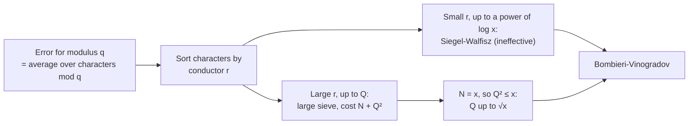

# Bombieri-Vinogradov: primes spread evenly across classes, on average over the moduli

[Syllabus](../../../SYLLABUS.md) → [Algebraic and analytic number theory](../README.md) → [Sieves and Prime Gaps](../README.md#s04) → Bombieri-Vinogradov

---

## General Overview

Take the 78,498 primes below a million. Pick a modulus q (the number we divide by) and sort the primes by their remainder. Each remainder class that shares no factor with q should hold its fair share. For q = 7 the six classes hold 13,063 to 13,105 primes, against a fair share of 13,104.59. The worst class misses by 41.59 primes.

Call that worst miss E(q). Now do it for every modulus from 1 to 1,000, which is the square root of a million, and add up the thousand worst misses. The total is 27,520.45. That is 0.3802 times $`x/\log x`$, which is 72,382.41 here, and 0.37 percent of the 7,485,471 that the crudest bound allows. The average modulus misses by 27.52 primes.

The Bombieri-Vinogradov theorem says this total stays small for every large x, for all moduli up to about $`\sqrt{x}`$ at once. It does not promise that each modulus behaves. It promises that the moduli behave on average. For most proofs about primes, the average is enough.

That average is exactly what the generalized Riemann hypothesis (GRH: every non-trivial zero of every Dirichlet L-function has real part 1/2) gives. GRH for these L-functions was proved only in 2026, with the Riemann hypothesis; for decades before, the theorem worked as a proved stand-in for it in sieve methods, and the sharper twin-prime bounds and the bounded-gap results on this shelf rest on it.

**For every power A there is a power B such that the worst class errors π(y; q, a) − li(y)/φ(q), added over all moduli q up to $`\sqrt{x}/(\log x)^B`$, total at most a constant times $`x/(\log x)^A`$: the primes have level of distribution 1/2, the same range GRH would give, proved without it.**

**What kind of fact this is:** a theorem, proved by Bombieri in 1965 (A. I. Vinogradov proved a slightly weaker form the same year, independently). This is an outline card: Why it works gives the proof's shape and quotes the two inputs, Siegel-Walfisz and the large sieve, with sources. The constant is ineffective. The counts at a million are evidence, never proof.

### The picture: the error total against x / ln x

```
q 1 to 10        #                                                   880.27
q 11 to 100      ##                                                 3740.98
q 101 to 1000    ###############                                   22899.20
all q to 1000    ##################                                27520.45
x / ln x         ################################################  72382.41
```

One mark per 1,500 primes, rounded. The total of the worst misses over a thousand moduli is well under the scale $`x/\log x`$ that the theorem divides by a power of log x.



The chain of the proof. The large sieve's cost $`N + Q^2`$ is what stops the range at $`\sqrt{x}`$.

---

## The formula

Notation, in words:

- π(y; q, a) counts the primes up to y with remainder a on division by q ([Siegel-Walfisz](../03-Characters%20and%20L-functions/05-siegel-walfisz-in-outline.md) uses the same count).
- φ(q), Euler's totient, counts the remainders from 1 to q that share no factor with q.
- li(y) is the logarithmic integral, the smooth estimate of the prime count: 78,627.55 at a million.
- f ≪ g means f is at most a constant times g; $`\ll_A`$ says the constant depends on A.
- log is the natural logarithm, written ln in the code output.

```math
\sum_{q \le Q} \; \max_{y \le x} \; \max_{\gcd(a,q)=1} \left| \pi(y; q, a) - \frac{\mathrm{li}(y)}{\varphi(q)} \right| \ll_A \frac{x}{(\log x)^A}, \qquad Q = \frac{\sqrt{x}}{(\log x)^{B}}
```

**Read it aloud:** for each modulus q up to root x over log x to the B, take the worst class and the worst stopping point y up to x; add those worst errors over all q; the total is at most a constant times x over log x to the A.

The theorem introduces one name. The primes have **level of distribution** θ if this bound holds with Q = $`x^{\theta - \varepsilon}`$ for every small ε > 0. Bombieri-Vinogradov gives θ = 1/2. The Elliott-Halberstam conjecture (1970) says θ = 1: the bound holds with Q = $`x^{1 - \varepsilon}`$. It is open as of 2026-11-15.

Why "a stand-in for GRH": GRH gives each modulus an error at most a constant times $`\sqrt{x}\log x`$. Added over q ≤ Q, that is $`Q\sqrt{x}\log x`$, which is below $`x/(\log x)^A`$ once Q ≤ $`\sqrt{x}/(\log x)^{A+1}`$. The theorem gives the same total over essentially the same range, with no hypothesis.

| Symbol | Plain meaning | In our example | Push it up and the answer… |
| --- | --- | --- | --- |
| $`x`$, $`y`$ | how far we count; a stopping point up to x | x = 10^6 (the code takes y = x only) | the total grows, slower than x/ln x |
| $`q`$, $`a`$ | the modulus; a remainder sharing no factor with q | q from 1 to 1,000 | q up: fewer primes per class, bigger relative misses |
| $`Q`$ | the largest modulus in the sum | 1,000 = √x | more moduli; past √x the proof fails |
| $`A`$, $`B`$ | the power of log x saved; the power given up in Q | none certified at 10^6 | A up: B must go up |
| $`\pi(y; q, a)`$ | primes up to y with remainder a mod q | 13,063 to 13,105 for q = 7 | — |
| $`\mathrm{li}(y)`$, $`\varphi(q)`$ | the smooth prime count; the number of classes coprime to q | 78,627.55; φ(7) = 6 | φ up: each class's share falls |
| $`E(q)`$, $`S`$ | the worst class miss for q; the total of E(q) over q ≤ Q | E(7) = 41.59; S = 27,520.45 | — |
| $`\theta`$ | the level of distribution: the theorem holds up to Q = $`x^{\theta - \varepsilon}`$ | θ = 1/2 proved | θ = 1 is Elliott-Halberstam |
| $`\chi`$, $`\chi_0`$, $`r`$ | a Dirichlet character (a pattern of values on remainders that multiplies like the numbers do); the principal one; the conductor, the smallest modulus χ really needs | — | — |
| $`\psi(y, \chi)`$, $`\Lambda(n)`$ | the sum of $`\chi(n)\Lambda(n)`$ for n ≤ y; von Mangoldt's weight, log p on powers of p | — | — |
| $`N`$, $`a_n`$ | the length and the terms of the sum the large sieve bounds | N = x = 10^6 | N + Q² is the cost |
| $`R`$, $`R_0`$, $`C`$ | a range of conductors; the cutoff below which Siegel-Walfisz takes over; its ineffective constant | — | R up: the √x R term grows |

### When it holds

- **Only classes coprime to q count.** Allowing every class, the total for q ≤ 1,000 jumps from 27,520.45 to 972,344.24: class 2 mod 1,000 holds the single prime 2.
- **The moduli must stay below about √x.** For q above x/2, each E(q) is at least 1/2, so those moduli alone add at least 250,000, which is 3.45 times x/ln x.
- **It is an average, not a bound for each q.** One modulus may miss badly; the theorem only caps the total. At a million the worst relative miss for q ≤ 1,000 is 25.38 percent, at q = 961.
- **The constant is ineffective.** It comes from Siegel-Walfisz, so the theorem never names an x from which the bound holds.
- **The worst stopping point y is part of the statement.** The code measures at y = x only, which is weaker evidence than the theorem's claim.

---

## Why it works

### Step 0: average over the moduli, and the large sieve pays for all of them at once

For one large modulus, the error comes from the zeros of the L-functions mod q, and controlling it needs GRH. Over many moduli, the errors are sums of the primes against many different characters. The large sieve says such sums cannot all be large together. Its price is $`N + Q^2`$, and with N = x that price is fair only while $`Q \le \sqrt{x}`$. At a million, Q = 1,000 costs 2,000,000; Q = 10,000 costs 101,000,000.

### Step 1: each error is an average over characters

For a coprime to q, the characters mod q pick out the class a ([Siegel-Walfisz](../03-Characters%20and%20L-functions/05-siegel-walfisz-in-outline.md), Step 1). The principal character, 1 on every class coprime to q, gives the fair share, up to the prime number theorem's error, which is small for all q at once. Every other character χ leaves a sum $`\psi(y, \chi)`$, weighted by $`\Lambda(n)`$ for convenience; weighting by log p and then removing the weight changes only powers of log x. So E(q) is at most about $`\frac{1}{\varphi(q)}\sum_{\chi \ne \chi_0} \max_{y \le x} |\psi(y, \chi)|`$.

### Step 2: sort the characters by conductor

A character mod q may really be a character of a smaller modulus r dividing q, its conductor, lifted up. Replacing it by that primitive character (one with conductor equal to its modulus, here r > 1 since χ is not principal) changes $`\psi(y, \chi)`$ by at most $`(\log qy)^2`$. Each primitive character mod r appears under every multiple of r up to Q, and the sum of $`1/\varphi(q)`$ over those multiples costs a factor about log Q. So the whole total is at most about

```math
\log Q \sum_{r \le Q} \frac{1}{\varphi(r)} \sum_{\chi \text{ primitive mod } r} \max_{y \le x} |\psi(y, \chi)|
```

### Step 3: small conductors go to Siegel-Walfisz

For r up to a power of log x, [Siegel-Walfisz](../03-Characters%20and%20L-functions/05-siegel-walfisz-in-outline.md) gives each $`|\psi(y, \chi)|`$ at most a constant times $`x e^{-C\sqrt{\log x}}`$. That beats every power of log x. There are at most $`r^2`$ characters to add, still a power of log x, so this part is small. This step brings in the ineffective constant.

### Step 4: large conductors go to the large sieve

[The large sieve](03-the-large-sieve.md), in its character form, bounds many character sums at once:

```math
\sum_{r \le R} \frac{r}{\varphi(r)} \sum_{\chi \text{ primitive mod } r} \Big| \sum_{n \le N} a_n \chi(n) \Big|^2 \le (N + R^2) \sum_{n \le N} |a_n|^2
```

**Read it aloud:** the squared character sums, added over all primitive characters of conductor up to R, are at most N plus R squared times the energy of the terms.

Applied to $`\Lambda`$ directly, the inequality gives too weak a bound. Vaughan's identity (1977) splits $`\Lambda(n)`$ into a few sums of products of two shorter sequences. For each product, the Cauchy-Schwarz inequality (a sum of products is at most the square root of the product of the two sums of squares) turns the character sum into two squared sums, and the large sieve bounds each.

### Step 5: the bound, and where √x comes from

For conductors between R and 2R the result has the shape (Davenport, chapter 28)

```math
\frac{1}{R}\sum_{R < r \le 2R} \frac{r}{\varphi(r)} \sum_{\chi \text{ primitive}} \max_{y \le x} |\psi(y, \chi)| \ll \Big( \frac{x}{R} + x^{5/6} + \sqrt{x}\,R \Big)(\log x)^4
```

The first term is small once R is past a power of log x, which is why Step 3 handles only the small conductors. The middle term is small always. The last term, $`\sqrt{x}R`$, is the large sieve's $`R^2`$ in disguise. It stays below $`x/(\log x)^A`$ only while R ≤ $`\sqrt{x}/(\log x)^{A+4}`$. That is the √x barrier, and it is a limit of the method, not a known fact about primes.

<details>
<summary>Detailed outline: adding the pieces</summary>

Fix A. Put $`R_0 = (\log x)^{A+6}`$ and Q = $`\sqrt{x}/(\log x)^{A+6}`$.

Conductors up to $`R_0`$: by Siegel-Walfisz each $`\max_y |\psi(y,\chi)| \ll x e^{-C\sqrt{\log x}}`$, and there are fewer than $`R_0^2`$ characters, so this part is $`\ll x e^{-C\sqrt{\log x}} (\log x)^{2A+12}`$, which is $`\ll x(\log x)^{-A-1}`$.

Conductors from $`R_0`$ to Q, in blocks R < r ≤ 2R: by Step 5 each block contributes, after the factor 1/φ(r) ≈ 1/R,

$`\displaystyle \ll \Big( \frac{x}{R} + x^{5/6} + \sqrt{x}\,R \Big)(\log x)^4.`$

There are about log x blocks. The first term adds up to $`\ll x R_0^{-1} (\log x)^5 = x(\log x)^{-A-1}`$. The second adds to $`x^{5/6}(\log x)^5`$, far smaller. The third is largest at R = Q and gives $`\sqrt{x}Q(\log x)^5 = x(\log x)^{-A-1}`$.

Step 2's factor log Q brings each part up to $`x(\log x)^{-A}`$. Going from ψ back to π by partial summation changes nothing but constants. So B = A + 6 works in this outline; the exact powers vary between textbooks and do not matter for uses.

</details>

---

## Worked numbers, by hand

The primes below a million, every modulus up to 1,000:

| Step | Arithmetic | Value |
| --- | --- | --- |
| 1. primes below 10^6 | sieve, and trial division | 78,498 |
| 2. smooth count | li(10^6), by series and by Simpson's rule | 78,627.55 |
| 3. modulus 1 | E(1) = li − π = 78,627.55 − 78,498 | 129.55 |
| 4. modulus 7 | fair share 78,627.55 / 6 = 13,104.59; worst class 13,063 | E(7) = 41.59 |
| 5. moduli 1 to 10 | add E(q) | 880.27 |
| 6. moduli 11 to 100 | add E(q) | 3,740.98 |
| 7. moduli 101 to 1,000 | add E(q) | 22,899.20 |
| 8. the total S | 880.27 + 3,740.98 + 22,899.20 | 27,520.45 |
| 9. against x / ln x | 27,520.45 / 72,382.41 | **0.3802** |

A thousand moduli together miss by 0.3802 times $`x/\log x`$, and the average modulus misses by 27.52 primes. GRH's bound for a single modulus is of size $`\sqrt{x}\log x`$ = 13,816, and even √x = 1,000 is far above 27.52.

The theorem is about how this ratio behaves as x grows. The code repeats the count at three sizes, always with Q = √x:

| x | Q = √x | S | x / ln x | Ratio | Mean E(q) |
| --- | ---: | ---: | ---: | ---: | ---: |
| 10^4 | 100 | 662.68 | 1,085.74 | 0.6104 | 6.63 |
| 10^5 | 316 | 4,174.38 | 8,685.89 | 0.4806 | 13.21 |
| 10^6 | 1,000 | 27,520.45 | 72,382.41 | 0.3802 | 27.52 |

The ratio falls, as the theorem predicts it must eventually. Three sizes cannot prove it; the theorem does.

### What breaks if you drop a piece

| Mistake | Comes out at | What went wrong |
| --- | --- | --- |
| Count every class, not only those coprime to q | S = 972,344.24 | class 2 mod 1,000 holds only the prime 2, far below its share |
| Share li(x)/q in place of li(x)/φ(q) | S = 484,873.12 | the classes sharing a factor with q are empty, so the others hold more |
| Moduli far past √x: q = 999,983 | share 0.079, classes hold 0 or 1; miss 1,171.8 percent | too few primes per class for any average to settle |
| Moduli up to x | the q above x/2 alone add at least 250,000, 3.45 times x/ln x | the sum cannot be small: each E(q) there is at least 1/2 |

The code prints all four.

---

## Code, from first principles, and it actually runs

The scripts sieve the primes below a million, then for every modulus up to √x read the sieve in steps of q to count each class, at x = 10^4, 10^5 and 10^6. Three cross-checks guard the work. Class counts come from the sieve and from residues of a separate trial-division prime list, matching on 102 moduli. Every modulus's class counts add up to π(x) minus the primes dividing q. li(10^6) comes from its series and from Simpson's rule. The scripts also print the twin-prime sieve's error sum, four large moduli, and the broken versions.

### Python

```python
# Bombieri-Vinogradov -- the check behind the card.  Standard library only.  For every modulus q up
# to root x it finds the worst class error E(q) = max over a of |pi(x; q, a) - li(x)/phi(q)| and adds
# them up, at x = 10^4, 10^5 and 10^6.  Class counts come from a sieve read in steps of q and, as a
# second road, from residues of a trial-division prime list; li(x) from its series and Simpson's rule.
import math
X = 10**6
flag = bytearray([1]) * (X + 1); flag[0] = flag[1] = 0          # road 1: sieve of Eratosthenes
for p in range(2, 1001):
    if flag[p]: flag[p * p::p] = bytearray(len(range(p * p, X + 1, p)))
primes = [p for p in range(X + 1) if flag[p]]
small = [p for p in range(2, 1001) if all(p % d for d in range(2, math.isqrt(p) + 1))]
def is_prime_td(n):                                              # road 2: trial division
    for d in small:
        if d * d > n: return True
        if n % d == 0: return False
    return True
td = [n for n in range(2, X + 1) if is_prime_td(n)]
print(f"primes below 10^6: sieve {len(primes)}; trial division {len(td)}")
GAMMA = 0.5772156649015329                                       # Euler's constant, quoted
def li_series(x):                                                # li(x) = gamma + ln ln x + sum (ln x)^n / (n n!)
    u, term, s, n = math.log(x), 1.0, 0.0, 0
    while True:
        n += 1; term *= u / n; s += term / n
        if term / n < 1e-17 * s: return GAMMA + math.log(u) + s
def simpson(f, a, b, m=20000):
    h = (b - a) / m
    return h / 3 * (f(a) + f(b) + sum((4 if k % 2 else 2) * f(a + k * h) for k in range(1, m)))
li_b = simpson(lambda u: math.exp(u) / u, math.log(2), math.log(X)) + li_series(2)
print(f"li(10^6): series {li_series(X):.2f}; Simpson from 2 plus li(2) {li_b:.2f}")
def coprime(q): return [a for a in range(1, q + 1) if math.gcd(a, q) == 1]
def counts_sieve(x, q):                                          # pi(x; q, a) for each coprime a, by stepping
    return [flag[a:x + 1:q].count(1) for a in coprime(q)]
def counts_res(ps, q):                                           # the same, by residues of a prime list
    c = {a: 0 for a in coprime(q)}
    for p in ps:
        if p % q in c or q == 1: c[p % q if q > 1 else 1] += 1
    return list(c.values())
check_q = list(range(1, 101)) + [997, 1000]
agree = all(counts_sieve(X, q) == counts_res(td, q) for q in check_q)
print(f"class counts, sieve against trial division: agree on all {len(check_q)} moduli tested: {agree}")
ratios, E6 = [], {}
for e in (4, 5, 6):
    x = 10**e; Q = math.isqrt(x); li = li_series(x); E = {}
    for q in range(1, Q + 1):
        c = counts_sieve(x, q); share = li / len(c)
        E[q] = max(abs(v - share) for v in c)
    S = sum(E.values()); ratios.append(S / (x / math.log(x)))
    wq = max(E, key=lambda q: E[q] * len(coprime(q)) / li)
    print(f"x = 10^{e}: Q = {Q}; S = sum of E(q) = {S:.2f}; x/ln x = {x / math.log(x):.2f}; ratio {ratios[-1]:.4f}; "
          f"mean E(q) {S / Q:.2f}; worst relative miss {100 * E[wq] * len(coprime(wq)) / li:.2f} percent at q = {wq}")
    if e == 6: E6 = E
LI, PI, Q = li_series(X), len(primes), 1000
S = sum(E6.values())
print(f"E(1) = {E6[1]:.2f} = li - pi; E(2) = {E6[2]:.2f}; E(7) = {E6[7]:.2f}; E(1000) = {E6[1000]:.2f}")
c7 = counts_sieve(X, 7); print(f"q = 7: share li/6 = {LI / 6:.2f}; classes hold {min(c7)} to {max(c7)}")
blocks = [(1, 10), (11, 100), (101, 1000)]
print("block sums: " + "; ".join(f"q {a} to {b}: {sum(E6[q] for q in range(a, b + 1)):.2f}" for a, b in blocks))
triv = sum(X / q for q in range(1, Q + 1))
print(f"trivial bound sum of x/q to 1000: {triv:.0f}; S is {100 * S / triv:.2f} percent of it")
print(f"mean E(q) {S / Q:.2f} against sqrt(x) = {math.sqrt(X):.0f} and sqrt(x) ln x = {math.sqrt(X) * math.log(X):.0f}")
print(f"large sieve size N + Q^2 with N = x: Q = 1000 gives {X + 1000**2}; Q = 10000 gives {X + 10000**2}")
sqf = [d for d in range(1, Q + 1, 2) if all(d % (p * p) for p in small if p * p <= d)]
rem = 0.0
for d in sqf:
    cnt = flag[(d - 2) % d if d > 1 else 0:X + 1:d].count(1) if d > 1 else PI
    rem += abs(cnt - LI / len(coprime(d)))
twins = sum(1 for p in primes if p + 2 <= X and flag[p + 2])
print(f"twin pairs below 10^6: {twins}; twin sieve: {len(sqf)} odd squarefree d up to 1000; sum of |pi(x; d, -2) - li(x)/phi(d)| = {rem:.2f}")
big = {}
for q in (1009, 10007, 99991, 999983):
    c = {}
    for p in primes:
        if q % p: c[p % q] = c.get(p % q, 0) + 1
    f = len(coprime(q)); share = LI / f
    lo = min(c.values()) if len(c) == f else 0; hi = max(c.values())
    big[q] = max(hi - share, share - lo) / share
    print(f"q = {q}: phi {f}; share {share:.3f}; classes hold {lo} to {hi}; relative miss {100 * big[q]:.1f} percent")
print(f"q from 500001 to 1000000: each E(q) >= 1/2, so they add at least {X // 4}; "
      f"that is {X / 4 / (X / math.log(X)):.2f} times x/ln x")
S_all = sum(max(abs(flag[a:X + 1:q].count(1) - LI / len(coprime(q))) for a in range(q)) for q in range(1, Q + 1))
S_q = sum(max(abs(v - LI / q) for v in counts_sieve(X, q)) for q in range(1, Q + 1))
print(f"breaks: all classes, not only coprime ones: S = {S_all:.2f}; share li/q in place of li/phi(q): S = {S_q:.2f}")
assert len(primes) == len(td) == 78498 and agree and twins == 8169       # two roads to every class count
assert all(sum(counts_sieve(X, q)) == PI - sum(1 for p in small if q % p == 0) for q in range(1, Q + 1))
assert abs(LI - li_b) < 1e-4 and abs(LI - 78627.55) < 0.001             # li two ways, and the house table
assert abs(E6[1] - (li_b - len(td))) < 1e-4                             # q = 1 against Simpson's li and trial division
res100 = sum(max(abs(v - LI / len(c)) for v in c) for c in (counts_res(td, q) for q in range(1, 101)))
assert abs(sum(E6[q] for q in range(1, 101)) - res100) < 1e-6             # E(q) to 100 by the second road
assert all(r < 1 for r in ratios) and ratios[0] > ratios[1] > ratios[2]  # S below x/ln x, and the ratio falls
assert S < 0.01 * triv and min(big.values()) > 0.2 and big[999983] > 1   # far below trivial; huge q fail
assert S_all > 2 * S and S_q > 2 * S                                     # the broken versions really break
print("ALL CHECKS PASS")
```

**Ran 2026-11-15 on macOS, Python 3.14.10, standard library only. All checks passed. Output, pasted from the run:**

```
primes below 10^6: sieve 78498; trial division 78498
li(10^6): series 78627.55; Simpson from 2 plus li(2) 78627.55
class counts, sieve against trial division: agree on all 102 moduli tested: True
x = 10^4: Q = 100; S = sum of E(q) = 662.68; x/ln x = 1085.74; ratio 0.6104; mean E(q) 6.63; worst relative miss 42.22 percent at q = 73
x = 10^5: Q = 316; S = sum of E(q) = 4174.38; x/ln x = 8685.89; ratio 0.4806; mean E(q) 13.21; worst relative miss 32.54 percent at q = 233
x = 10^6: Q = 1000; S = sum of E(q) = 27520.45; x/ln x = 72382.41; ratio 0.3802; mean E(q) 27.52; worst relative miss 25.38 percent at q = 961
E(1) = 129.55 = li - pi; E(2) = 130.55; E(7) = 41.59; E(1000) = 24.57
q = 7: share li/6 = 13104.59; classes hold 13063 to 13105
block sums: q 1 to 10: 880.27; q 11 to 100: 3740.98; q 101 to 1000: 22899.20
trivial bound sum of x/q to 1000: 7485471; S is 0.37 percent of it
mean E(q) 27.52 against sqrt(x) = 1000 and sqrt(x) ln x = 13816
large sieve size N + Q^2 with N = x: Q = 1000 gives 2000000; Q = 10000 gives 101000000
twin pairs below 10^6: 8169; twin sieve: 404 odd squarefree d up to 1000; sum of |pi(x; d, -2) - li(x)/phi(d)| = 2894.57
q = 1009: phi 1008; share 78.004; classes hold 57 to 93; relative miss 26.9 percent
q = 10007: phi 10006; share 7.858; classes hold 0 to 16; relative miss 103.6 percent
q = 99991: phi 99990; share 0.786; classes hold 0 to 4; relative miss 408.7 percent
q = 999983: phi 999982; share 0.079; classes hold 0 to 1; relative miss 1171.8 percent
q from 500001 to 1000000: each E(q) >= 1/2, so they add at least 250000; that is 3.45 times x/ln x
breaks: all classes, not only coprime ones: S = 972344.24; share li/q in place of li/phi(q): S = 484873.12
ALL CHECKS PASS
```

### Rust

Same numbers, same labels, built with `rustc --edition 2021 -O`.

```rust
// Bombieri-Vinogradov -- the check behind the card.  std only.  For every modulus q up to root x
// it finds the worst class error E(q) = max over a of |pi(x; q, a) - li(x)/phi(q)| and adds them
// up, at x = 10^4, 10^5 and 10^6.  Class counts come from a sieve read in steps of q and, as a
// second road, from residues of a trial-division prime list; li(x) from its series and Simpson's rule.
const X: usize = 1_000_000;
const GAMMA: f64 = 0.5772156649015329; // Euler's constant, quoted

fn gcd(a: usize, b: usize) -> usize { if b == 0 { a } else { gcd(b, a % b) } }
fn isqrt(n: usize) -> usize { let mut r = (n as f64).sqrt() as usize; while r * r > n { r -= 1; } while (r + 1) * (r + 1) <= n { r += 1; } r }
fn coprime(q: usize) -> Vec<usize> { (1..=q).filter(|&a| gcd(a, q) == 1).collect() }
fn li_series(x: f64) -> f64 { // li(x) = gamma + ln ln x + sum (ln x)^n / (n n!)
    let (u, mut term, mut s, mut n) = (x.ln(), 1.0f64, 0.0f64, 0.0f64);
    loop {
        n += 1.0; term *= u / n; s += term / n;
        if term / n < 1e-17 * s { return GAMMA + u.ln() + s; }
    }
}
fn simpson<F: Fn(f64) -> f64>(f: F, a: f64, b: f64, m: usize) -> f64 {
    let h = (b - a) / m as f64;
    let mut inner = 0.0;
    for k in 1..m { inner += (if k % 2 == 1 { 4.0 } else { 2.0 }) * f(a + k as f64 * h); }
    h / 3.0 * (f(a) + f(b) + inner)
}
fn step_count(flag: &[bool], start: usize, x: usize, q: usize) -> usize { (start..=x).step_by(q).filter(|&n| flag[n]).count() }
fn counts_sieve(flag: &[bool], x: usize, q: usize) -> Vec<usize> { coprime(q).iter().map(|&a| step_count(flag, a, x, q)).collect() }
fn counts_res(ps: &[usize], q: usize) -> Vec<usize> { // the same, by residues of a prime list
    let mut c = vec![0usize; q + 1];
    for &p in ps { let r = if q == 1 { 1 } else { p % q }; c[r] += 1; }
    coprime(q).iter().map(|&a| c[a]).collect()
}
fn worst(c: &[usize], share: f64) -> f64 { c.iter().map(|&v| (v as f64 - share).abs()).fold(0.0, f64::max) }

fn main() {
    let mut flag = vec![true; X + 1]; flag[0] = false; flag[1] = false; // road 1: sieve
    for p in 2..1001 { if flag[p] { let mut m = p * p; while m <= X { flag[m] = false; m += p; } } }
    let primes: Vec<usize> = (0..=X).filter(|&p| flag[p]).collect();
    let small: Vec<usize> = (2..1001).filter(|&p| (2..isqrt(p) + 1).all(|d| p % d != 0)).collect();
    let is_prime_td = |n: usize| -> bool { // road 2: trial division
        for &d in &small { if d * d > n { return true; } if n % d == 0 { return false; } }
        true
    };
    let td: Vec<usize> = (2..=X).filter(|&n| is_prime_td(n)).collect();
    println!("primes below 10^6: sieve {}; trial division {}", primes.len(), td.len());
    let li_b = simpson(|u: f64| u.exp() / u, 2f64.ln(), (X as f64).ln(), 20000) + li_series(2.0);
    println!("li(10^6): series {:.2}; Simpson from 2 plus li(2) {:.2}", li_series(X as f64), li_b);
    let check_q: Vec<usize> = (1..101).chain([997, 1000]).collect();
    let agree = check_q.iter().all(|&q| counts_sieve(&flag, X, q) == counts_res(&td, q));
    println!("class counts, sieve against trial division: agree on all {} moduli tested: {}", check_q.len(),
        if agree { "True" } else { "False" });
    let mut ratios = vec![]; let mut e6 = vec![0.0f64; 1001];
    for e in [4u32, 5, 6] {
        let x = 10usize.pow(e); let qmax = isqrt(x); let li = li_series(x as f64); let xf = x as f64;
        let mut ev = vec![0.0f64; qmax + 1];
        for q in 1..=qmax { let c = counts_sieve(&flag, x, q); ev[q] = worst(&c, li / c.len() as f64); }
        let s: f64 = ev[1..].iter().sum(); ratios.push(s / (xf / xf.ln()));
        let rel = |q: usize| ev[q] * coprime(q).len() as f64 / li;
        let mut wq = 1; for q in 1..=qmax { if rel(q) > rel(wq) { wq = q; } }
        println!("x = 10^{}: Q = {}; S = sum of E(q) = {:.2}; x/ln x = {:.2}; ratio {:.4}; mean E(q) {:.2}; worst relative miss {:.2} percent at q = {}",
            e, qmax, s, xf / xf.ln(), ratios[ratios.len() - 1], s / qmax as f64, 100.0 * rel(wq), wq);
        if e == 6 { e6 = ev; }
    }
    let (li, pi, xf) = (li_series(X as f64), primes.len(), X as f64);
    let s: f64 = e6[1..].iter().sum();
    println!("E(1) = {:.2} = li - pi; E(2) = {:.2}; E(7) = {:.2}; E(1000) = {:.2}", e6[1], e6[2], e6[7], e6[1000]);
    let c7 = counts_sieve(&flag, X, 7); println!("q = 7: share li/6 = {:.2}; classes hold {} to {}", li / 6.0, c7.iter().min().unwrap(), c7.iter().max().unwrap());
    let bl: Vec<String> = [(1, 10), (11, 100), (101, 1000)].iter()
        .map(|&(a, b)| format!("q {} to {}: {:.2}", a, b, e6[a..=b].iter().sum::<f64>())).collect();
    println!("block sums: {}", bl.join("; "));
    let triv: f64 = (1..=1000).map(|q| xf / q as f64).sum();
    println!("trivial bound sum of x/q to 1000: {:.0}; S is {:.2} percent of it", triv, 100.0 * s / triv);
    println!("mean E(q) {:.2} against sqrt(x) = {:.0} and sqrt(x) ln x = {:.0}", s / 1000.0, xf.sqrt(), xf.sqrt() * xf.ln());
    println!("large sieve size N + Q^2 with N = x: Q = 1000 gives {}; Q = 10000 gives {}", X + 1000 * 1000, X + 10000 * 10000);
    let sqf: Vec<usize> = (1..=1000).step_by(2).filter(|&d| small.iter().all(|&p| p * p > d || d % (p * p) != 0)).collect();
    let mut rem = 0.0;
    for &d in &sqf {
        let cnt = if d > 1 { step_count(&flag, d - 2, X, d) } else { pi };
        rem += (cnt as f64 - li / coprime(d).len() as f64).abs();
    }
    let twins = primes.iter().filter(|&&p| p + 2 <= X && flag[p + 2]).count();
    println!("twin pairs below 10^6: {}; twin sieve: {} odd squarefree d up to 1000; sum of |pi(x; d, -2) - li(x)/phi(d)| = {:.2}", twins, sqf.len(), rem);
    let mut big = vec![];
    for q in [1009usize, 10007, 99991, 999983] {
        let mut c = std::collections::HashMap::new();
        for &p in &primes { if q % p != 0 { *c.entry(p % q).or_insert(0usize) += 1; } }
        let f = coprime(q).len(); let share = li / f as f64;
        let lo = if c.len() == f { *c.values().min().unwrap() } else { 0 }; let hi = *c.values().max().unwrap();
        let r = (hi as f64 - share).max(share - lo as f64) / share; big.push(r);
        println!("q = {}: phi {}; share {:.3}; classes hold {} to {}; relative miss {:.1} percent", q, f, share, lo, hi, 100.0 * r);
    }
    println!("q from 500001 to 1000000: each E(q) >= 1/2, so they add at least {}; that is {:.2} times x/ln x", X / 4, xf / 4.0 / (xf / xf.ln()));
    let mut s_all = 0.0; let mut s_q = 0.0;
    for q in 1..=1000usize {
        let share = li / coprime(q).len() as f64;
        s_all += (0..q).map(|a| (step_count(&flag, a, X, q) as f64 - share).abs()).fold(0.0, f64::max);
        s_q += worst(&counts_sieve(&flag, X, q), li / q as f64);
    }
    println!("breaks: all classes, not only coprime ones: S = {:.2}; share li/q in place of li/phi(q): S = {:.2}", s_all, s_q);
    assert!(primes.len() == 78498 && td.len() == 78498 && agree && twins == 8169); // two roads to every class count
    assert!((1..=1000).all(|q| counts_sieve(&flag, X, q).iter().sum::<usize>() == pi - small.iter().filter(|&&p| q % p == 0).count()));
    assert!((li - li_b).abs() < 1e-4 && (li - 78627.55).abs() < 0.001); // li two ways, and the house table
    assert!((e6[1] - (li_b - td.len() as f64)).abs() < 1e-4); // q = 1 against Simpson's li and trial division
    let res100: f64 = (1..=100).map(|q| { let c = counts_res(&td, q); worst(&c, li / c.len() as f64) }).sum();
    assert!((e6[1..=100].iter().sum::<f64>() - res100).abs() < 1e-6); // E(q) to 100 by the second road
    assert!(ratios.iter().all(|&r| r < 1.0) && ratios[0] > ratios[1] && ratios[1] > ratios[2]); // S below x/ln x, falling
    assert!(s < 0.01 * triv && big.iter().cloned().fold(f64::INFINITY, f64::min) > 0.2 && big[3] > 1.0); // far below trivial
    assert!(s_all > 2.0 * s && s_q > 2.0 * s); // the broken versions really break
    println!("ALL CHECKS PASS");
}
```

**Ran 2026-11-15 on macOS, rustc 1.98.1, no crates. All checks passed. Output, pasted from the run:**

```
primes below 10^6: sieve 78498; trial division 78498
li(10^6): series 78627.55; Simpson from 2 plus li(2) 78627.55
class counts, sieve against trial division: agree on all 102 moduli tested: True
x = 10^4: Q = 100; S = sum of E(q) = 662.68; x/ln x = 1085.74; ratio 0.6104; mean E(q) 6.63; worst relative miss 42.22 percent at q = 73
x = 10^5: Q = 316; S = sum of E(q) = 4174.38; x/ln x = 8685.89; ratio 0.4806; mean E(q) 13.21; worst relative miss 32.54 percent at q = 233
x = 10^6: Q = 1000; S = sum of E(q) = 27520.45; x/ln x = 72382.41; ratio 0.3802; mean E(q) 27.52; worst relative miss 25.38 percent at q = 961
E(1) = 129.55 = li - pi; E(2) = 130.55; E(7) = 41.59; E(1000) = 24.57
q = 7: share li/6 = 13104.59; classes hold 13063 to 13105
block sums: q 1 to 10: 880.27; q 11 to 100: 3740.98; q 101 to 1000: 22899.20
trivial bound sum of x/q to 1000: 7485471; S is 0.37 percent of it
mean E(q) 27.52 against sqrt(x) = 1000 and sqrt(x) ln x = 13816
large sieve size N + Q^2 with N = x: Q = 1000 gives 2000000; Q = 10000 gives 101000000
twin pairs below 10^6: 8169; twin sieve: 404 odd squarefree d up to 1000; sum of |pi(x; d, -2) - li(x)/phi(d)| = 2894.57
q = 1009: phi 1008; share 78.004; classes hold 57 to 93; relative miss 26.9 percent
q = 10007: phi 10006; share 7.858; classes hold 0 to 16; relative miss 103.6 percent
q = 99991: phi 99990; share 0.786; classes hold 0 to 4; relative miss 408.7 percent
q = 999983: phi 999982; share 0.079; classes hold 0 to 1; relative miss 1171.8 percent
q from 500001 to 1000000: each E(q) >= 1/2, so they add at least 250000; that is 3.45 times x/ln x
breaks: all classes, not only coprime ones: S = 972344.24; share li/q in place of li/phi(q): S = 484873.12
ALL CHECKS PASS
```

> [!TIP]
> **Try changing**
> Guess first, then run it.
> - **Go to twice root x: `Q = 2 * math.isqrt(x)`.** The ratios become 1.0676, 0.8362 and 0.6391. They still fall, and at a million the total stays under x/ln x, which fits the Elliott-Halberstam conjecture but cannot prove it. At 10^4 the ratio passes 1 and the sixth assert stops it.
> - **Sieve for p − 2 instead of p + 2: replace `(d - 2) % d` by `2 % d`.** The twin sieve's error sum moves from 2,894.57 to 2,701.38. Both classes are as evenly filled as the theorem says.
> - **Swap the sample modulus 1009 for 4999.** Its classes hold 7 to 27 primes against a share of 15.732, a miss of 71.6 percent: past √x, single moduli scatter fast.

---

## The usual mistake

> [!warning]
> **Reading Bombieri-Vinogradov as a bound for every modulus.** It bounds a sum over q. Any single q may be bad, as long as the bad ones are rare. To use it, a proof must need the errors only on average over q, as a sieve does.
>
> - **Calling √x a fact about primes.** It is the limit of the large sieve. The data show nothing special there: doubling Q to 2,000, the first Try changing experiment, still gives a total of 0.6391 times x/ln x. Elliott-Halberstam conjectures θ up to 1.
> - **Forgetting the coprime condition.** Counting every class gives 972,344.24 instead of 27,520.45 at a million.
> - **Treating the theorem as GRH.** It matches GRH only on average and only up to √x. GRH would also control each single modulus, which the theorem never does.
> - **Quoting an explicit range.** The constant comes from Siegel-Walfisz and is ineffective, so the theorem certifies no particular x.

---

## Where you meet it in real life

- **Twin primes (the house example).** The 8,169 twin pairs below a million are counted by sieving the primes p by whether p + 2 has a small factor. That needs π(x; d, −2) for every squarefree odd d up to the sieve's level. For the 404 such d up to 1,000, the errors add to 2,894.57, small next to the 78,498 primes being sieved. Bombieri and Davenport (1966) used this level, √x, to bound the twin-prime count by about 4 times the Hardy-Littlewood prediction, for large x.
- **Bounded gaps between primes.** Maynard's 2015 method needs only level 1/2, which this theorem supplies, to show that infinitely many prime gaps are at most 600. Zhang (2013) first pushed the level a little past 1/2 for special moduli. See [Bounded gaps](05-bounded-gaps-zhang-maynard.md).
- **Goldbach and Chen.** Chen's theorem, that every large even number is a prime plus a number with at most two prime factors, uses the theorem in its sieve. See [Goldbach](07-goldbach-and-chens-theorem.md).
- **Divisors of p − 1.** The average number of divisors of p − 1, over primes p, settles to a constant times log p. Linnik proved this in 1961 by a harder method; Bombieri-Vinogradov gives a short proof.

> **Say it back**
> Sort the primes up to x by their remainder mod q, and take the worst class's miss from its fair share li(x)/φ(q). Bombieri-Vinogradov says these worst misses, added over every modulus up to about √x, total at most x divided by any power of log x. That is what GRH would give, proved without it, which makes it the standard stand-in for GRH in sieve methods. The proof sends small conductors to Siegel-Walfisz and large ones to the large sieve, whose cost N + Q² stops the range at √x. At a million the thousand moduli miss by 27,520.45 in total, 0.3802 times x/ln x.

---

## What this builds on

- [The large sieve](03-the-large-sieve.md): the inequality with cost N + Q² that bounds many character sums at once, and sets the √x range.
- [Siegel-Walfisz](../03-Characters%20and%20L-functions/05-siegel-walfisz-in-outline.md): the uniform prime count for moduli up to a power of log x, which handles the small conductors and brings the ineffective constant.

## Where this goes next

- [Bounded gaps](05-bounded-gaps-zhang-maynard.md): level 1/2, fed into a sieve with many weights, gives infinitely many prime gaps of bounded size.

The question this card leaves open: is the level of distribution of the primes really 1, as Elliott and Halberstam conjectured, or does something change past √x?

---

## Sources

Verified 2026-11-15: every link below resolves to the publisher's page.

- Bombieri, Enrico. "On the large sieve." *Mathematika* 12 (1965), 201–225. [DOI](https://doi.org/10.1112/S0025579300005313). The theorem itself, with the large sieve inequality for characters that it rests on.
- Bombieri, Enrico, and Harold Davenport. "Small differences between prime numbers." *Proceedings of the Royal Society A* 293 (1966), 1–18. [DOI](https://doi.org/10.1098/rspa.1966.0155). The theorem applied to small prime gaps and to twin-prime upper bounds.
- Gallagher, Patrick X. "Bombieri's mean value theorem." *Mathematika* 15 (1968), 1–6. [DOI](https://doi.org/10.1112/S002557930000231X). A short proof, close to the outline on this card.
- Davenport, Harold. *Multiplicative Number Theory*, 2nd edition. Springer, Graduate Texts in Mathematics 74, 1980. [DOI](https://doi.org/10.1007/978-1-4757-5927-3). The large sieve (chapter 27) and the theorem by Vaughan's identity (chapter 28).
- Montgomery, Hugh L., and Robert C. Vaughan. *Multiplicative Number Theory I: Classical Theory*. Cambridge University Press, 2006. [DOI](https://doi.org/10.1017/CBO9780511618314). Primes in progressions, the large sieve and Siegel's ineffective constant, in a modern account.
