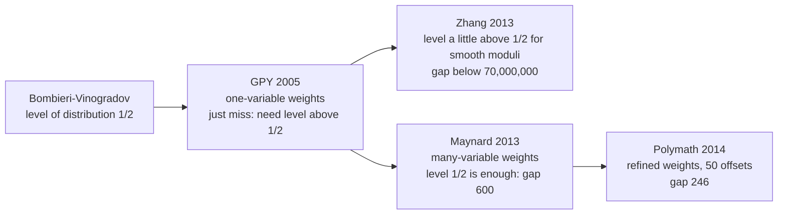

# Bounded gaps: from pairs within 70 million to pairs within 246

[Syllabus](../../../SYLLABUS.md) → [Algebraic and analytic number theory](../README.md) → [Sieves and Prime Gaps](../README.md#s04) → Bounded gaps

---

## General Overview

Below a million there are 78,498 primes and 8,169 twin pairs: primes two apart, such as 101 and 103. The widest gap between neighbouring primes in that range is 114, after 492,113. So every prime below a million has another prime within 114 of it.

That is evidence, not proof. Primes thin out: near a million the average gap is log 1,000,000 = 13.8155, and it keeps growing. Nothing in the counts says that close pairs keep coming forever.

In 2013 Yitang Zhang proved that they do. Some fixed gap below 70,000,000 occurs between primes infinitely often. Within a year James Maynard cut the bound to 600 with a simpler method, and the Polymath project (an open online collaboration) pushed it to 246.

The method does not find pairs. It picks a fixed pattern of offsets, such as n, n + 2, n + 6, and weighs every n by how likely its pattern is to be full of primes. If the weighted average number of primes in the pattern is above 1, some n must have two. This card follows those weights.

**For infinitely many n, the next prime after the n-th prime comes within 246 of it: some gap of at most 246 occurs between primes infinitely often.**

**What kind of fact this is:** a theorem, proved by Zhang (bound 70,000,000, 2013), Maynard (600, 2013) and Polymath (246, 2014). This is an outline card. Why it works proves the counting step in Step 0 and, in a fold, the sieve ratio for one-variable weights. It quotes the two inputs it rests on, with sources. The twin prime conjecture, gap 2, is open as of 2026-11-15. The counts below a million are evidence, never proof.

### The picture: how the bound came down



GPY is Goldston, Pintz and Yıldırım, whose 2005 method (published 2009) everything here refines. Zhang strengthened the input; Maynard strengthened the weights.

---

## The formula

Notation, in words:

- $`p_n`$ is the n-th prime: $`p_1 = 2`$, $`p_2 = 3`$, $`p_3 = 5`$. The gap after it is $`p_{n+1} - p_n`$.
- The **lim inf** (limit inferior) of a sequence is the smallest value it comes back to infinitely often. "lim inf of the gaps is at most 246" means: gaps of 246 or less never stop occurring.

```math
\liminf_{n \to \infty}\, (p_{n+1} - p_n) \le 246
```

**Read it aloud:** the gaps between consecutive primes drop to 246 or less infinitely often.

The engine behind it uses a fixed set of offsets $`h_1 < h_2 < \dots < h_k`$, a **k-tuple**. The tuple is **admissible** when, for every prime p, the offsets miss at least one remainder class mod p. Then no prime is forced to divide one of $`n + h_1, \dots, n + h_k`$ for every n. The tuple 0, 2, 6 is admissible. The tuple 0, 2, 4 is not: it meets all three classes mod 3, so one of n, n + 2, n + 4 is always a multiple of 3.

A **weight** $`w(n) \ge 0`$ is chosen for each n between N and 2N. It is built from a sieve cut-off R, the largest divisor it uses (Step 1), and a shape F, a function that sets how the weight is spread (Step 2). $`I_k(F)`$ and $`J_k(F)`$ are two integrals of F, also in Step 2. The engine compares the weighted number of primes in the tuple with 1:

```math
\frac{\sum_{N \le n < 2N} w(n) \cdot \#\{i : n + h_i \text{ is prime}\}}{\sum_{N \le n < 2N} w(n)} \;\longrightarrow\; \frac{\log R}{\log N} \cdot M(F), \qquad M(F) = \frac{k\, J_k(F)}{I_k(F)}
```

**Read it aloud:** the weighted average number of primes among n plus the offsets tends to log R over log N, times the sieve ratio of the weight's shape F.

If that average is above 1, some n in the range has at least two primes among $`n + h_1, \dots, n + h_k`$. Those two primes differ by at most $`h_k - h_1`$, the tuple's width.

Bombieri-Vinogradov lets R go up to about $`N^{1/4}`$, so $`\log R / \log N`$ is about 1/4. The average beats 1 exactly when the ratio beats 4.

| Symbol | Plain meaning | In our example | Push it up and the answer… |
| --- | --- | --- | --- |
| $`p_n`$ | the n-th prime | $`p_{40933} = 492113`$, followed by a gap of 114 | gaps grow on average |
| $`h_1, \dots, h_k`$ | the offsets of an admissible k-tuple | 0, 2, 6 | a wider tuple gives a weaker gap bound |
| $`k`$ | how many offsets | 3 here; 50 for the bound 246 | the ratio rises, the width too |
| $`n`$, $`N`$ | the start of the pattern; it runs from N to 2N | N = 100,000 | the prediction gets more accurate |
| $`\theta`$ | the level of distribution: how far primes are known to spread evenly over moduli | 1/2, from Bombieri-Vinogradov | lets R grow, lowers the ratio needed |
| $`R`$, $`d`$ | the cut-off R, and a sieve divisor d, which runs up to R | R = 18 or 316 | more primes in the weighted count |
| $`\lambda_d`$, $`\mu(d)`$ | the sieve coefficient for a divisor d, built from the Möbius sign μ(d) | $`\mu(d)\,(\log(R/d))^4`$ | — |
| $`w(n)`$ | the weight of n: the square of a sum of $`\lambda_d`$ | large when the tuple has no small factors | — |
| $`F`$, $`u`$, $`b`$ | the weight's shape, a function on the simplex; $`u = 1 - P_1`$; b is the power in the GPY shape $`u^b`$ | $`1 - P_1`$, so b = 1 | — |
| $`P_1`$, $`P_2`$ | $`t_1 + \dots + t_k`$ and $`t_1^2 + \dots + t_k^2`$ | — | — |
| $`I_k(F)`$, $`J_k(F)`$ | two integrals of F: its size, and its prime-detecting part | ratio 3/2 for k = 3 | — |
| $`M(F)`$, $`M_k`$ | the sieve ratio $`kJ_k/I_k`$ of one shape F, and its best value over all shapes | 3/2 for F = 1 − P_1, k = 3; $`M_{105} > 4`$ | more primes per tuple |

Here μ is the Möbius function ($`\mu(d) = (-1)^{\text{number of prime factors}}`$ for squarefree d), and the **simplex** is the set of points $`t_1, \dots, t_k \ge 0`$ with $`P_1 \le 1`$. $`P_1`$ is not the shelf's P(z), the product of primes below z. M(F) is not the Mertens function M(x) of shelf 02, and $`P_2`$ here is a sum of squares, not the $`P_2`$ of [Goldbach](07-goldbach-and-chens-theorem.md), a number with at most two prime factors.

### When it holds

- **The tuple must be admissible.** Drop that and the tuple 0, 1 has both n and n + 1 prime only at n = 2: one n below a million, not infinitely many.
- **The ratio must beat $`2/\theta`$.** With θ = 1/2 that is 4. The best one-variable weight reaches only 3.4872 at k = 105, so it proves nothing.
- **The level of distribution must be proved.** Bombieri-Vinogradov gives θ = 1/2. Under the Elliott-Halberstam conjecture (θ near 1) the target drops to 2 and the bound to 12. That is conditional.
- **"Two primes in the tuple" is not "twin primes".** The method cannot choose which two offsets succeed. Polymath showed that sieve methods of this kind cannot get below 6, even on the strongest conjecture (the parity problem).

---

## Why it works

### Step 0: count with weights, and one success is forced

Fix an admissible tuple. For each n, count how many of $`n + h_1, \dots, n + h_k`$ are prime, subtract 1, and multiply by $`w(n) \ge 0`$. Add over n from N to 2N.

If the total is positive, at least one term is positive. A term is positive only when its count is at least 2. So some n has two primes in its tuple, at most $`h_k - h_1`$ apart.

Plain counting fails: near 100,000 the tuple 0, 2, 6 holds 0.2518 primes per n. The weights must lift that average above 1.

### Step 1: the weights favour n with no small factors

A sieve weight asks one question: does the product $`(n + h_1)\cdots(n + h_k)`$ have small prime factors? The GPY weight is

```math
w(n) = \Big(\sum_{d \mid (n+h_1)\cdots(n+h_k),\; d \le R} \lambda_d\Big)^2, \qquad \lambda_d = \mu(d)\,\Big(\log \frac{R}{d}\Big)^{k+1}
```

**Read it aloud:** add the coefficient lambda d over every divisor d up to R of the product, then square.

This is the Selberg sieve's shape ([Brun's sieve and Selberg's](02-brun-and-selberg-sieves.md)). The square keeps every weight at least 0. When the product has no prime factor up to R, only d = 1 counts, and the weight is the largest value, $`(\log R)^{2(k+1)}`$. Each small factor cancels part of the sum.

In the code, with R = 316 and the tuple 0, 2, 6, the weighted average rises from 0.2518 to 0.6950 primes per n.

### Step 2: the average turns into two integrals

Maynard writes the weight through dual coefficients: the λ's after Möbius inversion. In the limit, the dual coefficients follow a function F on the simplex, with one variable $`t_i`$ for each offset, on the scale $`\log d / \log R`$. F is the weight's shape. It is not the shape of λ itself, which here is $`(1 - \log d / \log R)^{k+1}`$: the inversion takes away k of the powers. GPY's $`\lambda_d = \mu(d)\,(\log(R/d))^{k+b}`$ corresponds to $`F = (1 - P_1)^b`$, so the power k + 1 used here gives $`F = 1 - P_1`$.

Two integrals then decide everything:

```math
I_k(F) = \int F^2 \, dt_1 \cdots dt_k, \qquad J_k(F) = \int \Big(\int_0^1 F \, dt_k\Big)^2 dt_1 \cdots dt_{k-1}
```

**Read it aloud:** I is the integral of F squared over the simplex; J integrates F along the last direction first, then squares and integrates the rest.

The sum of the weights grows like $`I_k(F)`$. The weighted count of primes at one offset grows like $`J_k(F) \cdot \log R / \log N`$. The inner integral appears because a prime $`n + h_k`$ has no small factor, so its own variable drops out.

The deep input sits here. Counting primes $`n + h_k`$ with $`n`$ in a residue class mod $`d`$ needs primes to spread evenly over moduli up to $`R^2`$. Bombieri-Vinogradov ([Bombieri-Vinogradov](04-bombieri-vinogradov.md)) gives that for $`R^2`$ up to about $`N^{1/2}`$, on average over moduli. That is why $`\log R/\log N`$ reaches about θ/2 = 1/4.

### Step 3: one-variable weights stall just below 4

GPY used only shapes $`F = g(P_1)`$: a function of the sum of the variables. For $`g(u) = u^b`$, with $`u = 1 - P_1`$, the ratio has a closed form:

```math
\frac{k\,J_k}{I_k} = \frac{2k(2b+1)}{(b+1)(k+2b+1)}
```

**Read it aloud:** the ratio is 2k times (2b + 1), over (b + 1) times (k + 2b + 1).

Both factors $`2(2b+1)/(b+1)`$ and $`k/(k+2b+1)`$ stay below 4 and 1, so this ratio is always below 4.

The best g of any kind gives $`4k(k-1)/j_{k-2}^2`$, where $`j_{k-2}`$ is the first positive zero of the Bessel function $`J_{k-2}`$ (not the integral $`J_k`$ above; a standard solution of a second-order differential equation). At k = 105 that is 3.4872. GPY could prove bounded gaps only if θ were above 1/2. On θ near 1 they got 16.

<details>
<summary>Detailed proof: the closed form, and the Bessel bound for one-variable weights</summary>

On the simplex, the integral of $`t_1^{a_1}\cdots t_k^{a_k}(1-P_1)^b`$ is $`a_1!\cdots a_k!\,b!/(k + a_1 + \dots + a_k + b)!`$ (the Dirichlet integral). For $`F = (1-P_1)^b`$ this gives

$`\displaystyle I_k = \frac{(2b)!}{(k+2b)!}.`$

The inner integral of $`(1 - P_1' - t)^b`$ over t from 0 to $`1 - P_1'`$ is $`(1-P_1')^{b+1}/(b+1)`$, where $`P_1'`$ is the sum of the other k − 1 variables. Squaring and integrating over the (k − 1)-simplex:

$`\displaystyle J_k = \frac{(2b+2)!}{(b+1)^2\,(k+2b+1)!}.`$

Divide, and multiply by k: $`kJ_k/I_k = 2k(2b+1)/((b+1)(k+2b+1))`$.

For a general $`F = g(P_1)`$, put $`G(x) = \int_x^1 g`$, so $`G(1) = 0`$. Integrating over the simplex level by level gives

$`\displaystyle \frac{kJ_k}{I_k} = k(k-1)\,\frac{\int_0^1 G(x)^2 x^{k-2}\,dx}{\int_0^1 G'(x)^2 x^{k-1}\,dx}.`$

The largest value of this quotient comes from the equation $`xG'' + (k-1)G' + \kappa G = 0`$, where κ is a constant to be found. Its solution that stays finite at 0 is $`G(x) = x^{-(k-2)/2} J_{k-2}(2\sqrt{\kappa x})`$. The condition $`G(1) = 0`$ gives $`2\sqrt{\kappa} = j_{k-2}`$. Multiplying the equation by G and integrating shows the quotient equals $`k(k-1)/\kappa = 4k(k-1)/j_{k-2}^2`$. The code checks this against a cubic g at k = 5: 1.965262 from exact fractions, 1.965290 from the Bessel zero.

</details>

### Step 4: Maynard lets F depend on each variable

Maynard's change is small to state. Give each offset its own divisor: $`d_i`$ divides $`n + h_i`$, and the coefficient $`\lambda_{d_1,\dots,d_k}`$ depends on all k of them. In the limit, F becomes any function on the simplex, not only a function of $`P_1`$.

That freedom matters. At k = 5 the best one-variable shape gives 1.965290. The code takes

```math
F = 1 + 11u - 39u^2 - 22u^3 - 9P_2 - 81P_2\,u, \qquad u = 1 - P_1
```

**Read it aloud:** F is a cubic in u, the distance below the simplex's top face, plus two terms in the sum of squares.

It computes the ratio in exact fractions: 518071/258728 = 2.002377. That is above 2, so on θ near 1 the admissible 5-tuple 0, 2, 6, 8, 12 holds two primes infinitely often: gap at most 12, Maynard's conditional result.

Maynard also proved that $`M_k`$ grows like $`\log k`$, so it passes any target. With θ = 1/2 the target is 4, and he showed $`M_{105} > 4`$. He used an admissible 105-tuple of width 600, hence the gap 600; the code builds one by a greedy sieve and checks it. Larger m works too: the same argument puts m + 1 primes in the tuple once $`M_k > 4m`$.

### Step 5: from 600 to 246, and the wall at 6

Polymath enlarged the region where F may live, a little past the simplex, and optimised F by computer. That reached the target with k = 50, and they used an admissible 50-tuple of width 246. The code builds one and checks it: 0, 4, 6, 16, 28, 30, 34, 36, 46, 48, and on to 246.

Under the generalized Elliott-Halberstam conjecture, Polymath reached 6. They also showed that 6 is the limit for these methods. The parity problem ([Sieving by inclusion-exclusion](01-the-legendre-sieve-and-the-parity-problem.md)) says a sieve cannot tell a prime from a product of two primes. Twin primes need exactly that distinction.

Zhang's route was different. He kept GPY's weights and proved a level of distribution a little above 1/2 for moduli with no large prime factors. That is a new version of Bombieri-Vinogradov, and the bound 70,000,000 came from it.

---

## Worked numbers, by hand

Follow the GPY weight on the tuple 0, 2, 6, with n from 100,000 to 199,999.

| Step | Arithmetic | Value |
| --- | --- | --- |
| Shape | $`F = 1 - P_1`$, so b = 1, k = 3 | |
| Sieve ratio | $`2 \cdot 3 \cdot 3 / (2 \cdot 6)`$ | 3/2 |
| Cut-off allowed by Bombieri-Vinogradov | $`R = 18`$, about $`N^{1/4}`$; $`\log 18 / \log 100000 = 2.8904/11.5129`$ | 0.2511 |
| Predicted average | $`0.2511 \times 3/2`$ | 0.3766 |
| Counted average | weighted count from the code | 0.3831 |
| Cut-off as if θ = 1 | $`R = 316`$, about $`N^{1/2}`$; $`5.7557/11.5129`$ | 0.4999 |
| Predicted average | $`0.4999 \times 3/2`$ | 0.7499 |
| Counted average | weighted count from the code | 0.6950 |
| Target | the average must pass | **1** |

The weights nearly triple the plain average of 0.2518 primes per n. Still, with three offsets and a one-variable shape, the average stays below 1 even on θ = 1. Maynard's 105 offsets and many-variable shape give a ratio above 4. Times θ/2 = 1/4, that pushes the average past 1.

### What breaks if you drop a piece

| Mistake | Comes out at | What went wrong |
| --- | --- | --- |
| Using the tuple 0, 2, 4 | all three prime for 1 n below a million (n = 3) | it meets all 3 classes mod 3; 0, 2, 6 has all three prime for 1,393 n |
| One-variable weights at θ = 1/2 | best ratio 3.4872 at k = 105 | needs 4; this is why GPY stalled |
| The code's 5-variable F at θ = 1/2 | ratio 2.002377 | needs 4; the 12 holds only on Elliott-Halberstam |
| Reading 246 as twin primes | k = 2: best one-variable ratio 1.383321 | gap 2 needs a ratio of 4 from two offsets; the parity problem blocks it |

The code prints all four.

---

## Code, from first principles, and it actually runs

The code takes four roads. A sieve of Eratosthenes counts primes, twin pairs and tuple hits below a million. Admissible tuples are found by brute force for k up to 6 and by a greedy sieve for k = 50 and 105, and checked one prime at a time. The sieve ratio is computed in exact fractions, against the closed form and against the Bessel-zero formula. Finally, real GPY weights are summed over 100,000 values of n and compared with the predicted average.

### Python

```python
# Bounded gaps (Zhang, Maynard) -- the check behind the card.  Standard library only.
# Road 1: a sieve of Eratosthenes counts twin pairs, gaps and tuple hits below a million.
# Road 2: admissible tuples, by brute force and by a greedy sieve, checked residue by residue.
# Road 3: the sieve ratio k*J/I, exactly in fractions, against a closed form and against
# the Bessel-zero formula for the best one-variable weight.  Road 4: real GPY weights.
from fractions import Fraction as Fr
from math import factorial as fa, comb, log
from itertools import combinations
LIM = 1_000_100
s = bytearray([1]) * (LIM + 1); s[0] = s[1] = 0
for i in range(2, int(LIM ** 0.5) + 1):
    if s[i]: s[i * i::i] = bytearray(len(s[i * i::i]))
ps = [p for p in range(2, 1_000_000) if s[p]]
twins = sum(1 for p in ps if p + 2 < 1_000_000 and s[p + 2])
gap, at = max((q - p, p) for p, q in zip(ps, ps[1:]))
print(f"primes below 1,000,000: {len(ps)}; twin pairs: {twins}; widest gap: {gap}, after {at}")
print(f"{at} is prime number {ps.index(at) + 1}; average gap near 1,000,000 = log 1,000,000 = {log(1e6):.4f}")
def hits(H, need): return sum(1 for n in range(1, 1_000_000) if sum(s[n + h] for h in H) >= need)
print(f"n below 1,000,000 with 2+ primes among n, n+2, n+6: {hits([0, 2, 6], 2)}; all 3: {hits([0, 2, 6], 3)}")
print(f"all 3 of n, n+2, n+4 prime: {hits([0, 2, 4], 3)}; both n, n+1 prime: {hits([0, 1], 2)}")
print(f"n below 1,000,000 with 2+ primes in n + (0, 2, 6, 8, 12): {hits([0, 2, 6, 8, 12], 2)}")
def admissible(H):                         # no prime p <= k meets every remainder class mod p
    return all(len({h % p for h in H}) < p for p in range(2, len(H) + 1) if s[p])
def narrowest(k):                          # brute force: smallest width w with an admissible k-tuple
    w = 1
    while not any(admissible((0,) + c + (w,)) for c in combinations(range(1, w), k - 2)): w += 1
    return w
widths = [narrowest(k) for k in range(2, 7)]
print("narrowest admissible k-tuple, k = 2..6, by brute force:", widths)
def greedy(width, k, shift):               # sieve one class mod each prime p <= k from an interval
    S = list(range(shift, shift + width + 1))
    for p in [q for q in range(2, k + 1) if s[q]]:
        cnt = [0] * p
        for x in S: cnt[x % p] += 1
        r = cnt.index(min(cnt)); S = [x for x in S if x % p != r]
    return [x - S[0] for x in S[:k]]
T50, T105 = greedy(246, 50, 1), greedy(600, 105, 21)
print(f"greedy 50-tuple: width {T50[-1]}, admissible {admissible(T50)}; first ten {T50[:10]}")
print(f"greedy 105-tuple: width {T105[-1]}, admissible {admissible(T105)}")
print("inadmissible (0, 2, 4): classes mod 3 met:", len({h % 3 for h in (0, 2, 4)}))
def partitions(n, mx):
    if n == 0: yield []; return
    for p in range(min(n, mx), 0, -1):
        for rest in partitions(n - p, p): yield [p] + rest
def T(k, A, B):        # integral over the k-simplex of (1 - P1)^B * P2^A, exactly
    tot = Fr(0)
    for lam in partitions(A, A):
        if len(lam) > k: continue
        ways = Fr(fa(k), fa(k - len(lam))) * fa(A)
        for x in set(lam): ways /= fa(lam.count(x))
        for x in lam: ways = ways * fa(2 * x) / fa(x)
        tot += ways
    return tot * fa(B) / fa(k + B + 2 * A)
def ratio(k, basis, c):  # k * J / I for F = sum of c * P2^a * (1 - P1)^b
    I = J = Fr(0)
    for (a, b), u in zip(basis, c):
        for (a2, b2), v in zip(basis, c):
            I += u * v * T(k, a + a2, b + b2)
            for x in range(a + 1):
                for y in range(a2 + 1):
                    f = comb(a, x) * comb(a2, y) * Fr(fa(b) * fa(2 * x), fa(b + 2 * x + 1)) * Fr(fa(b2) * fa(2 * y), fa(b2 + 2 * y + 1))
                    J += u * v * f * T(k - 1, a - x + a2 - y, b + 2 * x + b2 + 2 * y + 2)
    return k * J / I
closed = lambda k, b: Fr(2 * k * (2 * b + 1), (b + 1) * (k + 2 * b + 1))
for b in range(4): assert ratio(5, [(0, b)], [1]) == closed(5, b)
print("GPY weight (1 - P1)^b, k = 5, b = 0..3:", ", ".join(f"{float(closed(5, b)):.6f}" for b in range(4)))
print(f"GPY weight 1 - P1 on k = 3 (used below): {closed(3, 1)}")
def bessel(nu, x):     # J_nu(x) by Miller's downward recurrence, normalised by J0 + 2(J2 + J4 + ...) = 1
    m = 2 * ((int(x) + nu + 40) // 2); jp, j, norm, out = 0.0, 1e-30, 0.0, 0.0
    for n in range(m, 0, -1):
        jp, j = j, 2 * n / x * j - jp
        if n - 1 == nu: out = j
        if (n - 1) % 2 == 0: norm += j if n - 1 == 0 else 2 * j
        if abs(j) > 1e200: jp, j, norm, out = jp * 1e-200, j * 1e-200, norm * 1e-200, out * 1e-200
    return out / norm
def first_zero(nu):
    lo = nu + 0.1
    while bessel(nu, lo + 0.1) > 0 and lo < nu + 99: lo += 0.1
    hi = lo + 0.1
    for _ in range(60):
        mid = (lo + hi) / 2
        if bessel(nu, mid) > 0: lo = mid
        else: hi = mid
    return lo
best1 = {k: 4 * k * (k - 1) / first_zero(k - 2) ** 2 for k in (2, 3, 5, 50, 105)}
print(f"first zero of the Bessel function J_3: {first_zero(3):.6f}")
print("best one-variable ratio 4k(k-1)/j^2:", ", ".join(f"k={k}: {v:.6f}" for k, v in best1.items()))
g = ratio(5, [(0, 0), (0, 1), (0, 2), (0, 3)], [1, 4, 4, 5])
B6, C6 = [(0, 0), (0, 1), (0, 2), (0, 3), (1, 0), (1, 1)], [1, 11, -39, -22, -9, -81]
M5 = ratio(5, B6, C6)
print(f"k = 5, one-variable g = 1 + 4u + 4u^2 + 5u^3: {float(g):.6f}")
print(f"k = 5, Maynard F with P2 terms: {M5.numerator}/{M5.denominator} = {float(M5):.6f}")
N = 100_000
sqf = [d for d in range(1, 317) if all(d % (p * p) for p in range(2, 18))]
mu = {d: (-1) ** sum(1 for p in range(2, d + 1) if s[p] and d % p == 0) for d in sqf}
for R in (18, 316):
    lam = {d: mu[d] * log(R / d) ** 4 for d in sqf if d <= R}
    W = P = 0.0
    for n in range(N, 2 * N):
        Pn = n * (n + 2) * (n + 6)
        w = sum(v for d, v in lam.items() if Pn % d == 0) ** 2
        W += w; P += w * (s[n] + s[n + 2] + s[n + 6])
    print(f"R = {R}: log R = {log(R):.4f}, log N = {log(N):.4f}, log R / log N = {log(R) / log(N):.4f}")
    print(f"R = {R}: weighted primes per n {P / W:.4f}; predicted (log R / log N) x 3/2 = {log(R) / log(N) * 1.5:.4f}")
    assert abs(P / W - log(R) / log(N) * 1.5) < 0.1
plain = sum(s[n] + s[n + 2] + s[n + 6] for n in range(N, 2 * N)) / N
print(f"unweighted primes per n in (n, n+2, n+6), n from 100,000 to 199,999: {plain:.4f}")
print("record bounds on the smallest gap that recurs forever: 70,000,000 (2013), 600 (2013), 246 (2014)")
print("quoted, not computed here: M_105 > 4 (Maynard); 16 on EH (GPY), 12 on EH, 6 on GEH")
assert len(ps) == 78498 and twins == 8169 and (gap, at) == (114, 492113)
assert widths == [2, 6, 8, 12, 16] and admissible((0, 2, 6, 8, 12)) and not admissible((0, 2, 4))
assert T50[-1] == 246 and len(T50) == 50 and admissible(T50) and T105[-1] == 600 and admissible(T105)
assert hits([0, 2, 4], 3) == 1 and hits([0, 1], 2) == 1 and 0.25 < plain < 0.26
assert M5 > 2 and float(g) <= best1[5] < 2 and abs(float(g) - best1[5]) < 1e-4
assert best1[105] < 4 and all(closed(k, b) < 4 for k in (5, 50, 105) for b in range(30))
assert abs(best1[2] - 8 / 2.404825557695773 ** 2) < 1e-9
print("ALL CHECKS PASS")
```

**Ran 2026-11-15 on macOS, Python 3.14.10, standard library only. All checks passed. Output, pasted from the run:**

```
primes below 1,000,000: 78498; twin pairs: 8169; widest gap: 114, after 492113
492113 is prime number 40933; average gap near 1,000,000 = log 1,000,000 = 13.8155
n below 1,000,000 with 2+ primes among n, n+2, n+6: 29913; all 3: 1393
all 3 of n, n+2, n+4 prime: 1; both n, n+1 prime: 1
n below 1,000,000 with 2+ primes in n + (0, 2, 6, 8, 12): 85819
narrowest admissible k-tuple, k = 2..6, by brute force: [2, 6, 8, 12, 16]
greedy 50-tuple: width 246, admissible True; first ten [0, 4, 6, 16, 28, 30, 34, 36, 46, 48]
greedy 105-tuple: width 600, admissible True
inadmissible (0, 2, 4): classes mod 3 met: 3
GPY weight (1 - P1)^b, k = 5, b = 0..3: 1.666667, 1.875000, 1.666667, 1.458333
GPY weight 1 - P1 on k = 3 (used below): 3/2
first zero of the Bessel function J_3: 6.380162
best one-variable ratio 4k(k-1)/j^2: k=2: 1.383321, k=3: 1.634658, k=5: 1.965290, k=50: 3.236335, k=105: 3.487168
k = 5, one-variable g = 1 + 4u + 4u^2 + 5u^3: 1.965262
k = 5, Maynard F with P2 terms: 518071/258728 = 2.002377
R = 18: log R = 2.8904, log N = 11.5129, log R / log N = 0.2511
R = 18: weighted primes per n 0.3831; predicted (log R / log N) x 3/2 = 0.3766
R = 316: log R = 5.7557, log N = 11.5129, log R / log N = 0.4999
R = 316: weighted primes per n 0.6950; predicted (log R / log N) x 3/2 = 0.7499
unweighted primes per n in (n, n+2, n+6), n from 100,000 to 199,999: 0.2518
record bounds on the smallest gap that recurs forever: 70,000,000 (2013), 600 (2013), 246 (2014)
quoted, not computed here: M_105 > 4 (Maynard); 16 on EH (GPY), 12 on EH, 6 on GEH
ALL CHECKS PASS
```

### Rust

```rust
// Bounded gaps (Zhang, Maynard) -- the same check as bounded_gaps_zhang_maynard_check.py, in Rust.
// No crates.  Road 1: a sieve counts twin pairs, gaps and tuple hits below a million.  Road 2:
// admissible tuples by brute force and by a greedy sieve.  Road 3: the sieve ratio k*J/I in exact
// fractions, against a closed form and the Bessel-zero formula.  Road 4: real GPY weights.
#[derive(Clone, Copy, PartialEq)]
struct Fr(i128, i128);
fn gcd(a: i128, b: i128) -> i128 { if b == 0 { a.abs() } else { gcd(b, a % b) } }
fn fr(n: i128, d: i128) -> Fr { let g = gcd(n, d) * d.signum(); Fr(n / g, d / g) }
fn add(a: Fr, b: Fr) -> Fr { fr(a.0.checked_mul(b.1).unwrap().checked_add(b.0.checked_mul(a.1).unwrap()).unwrap(), a.1.checked_mul(b.1).unwrap()) }
fn mul(a: Fr, b: Fr) -> Fr { let (g, h) = (gcd(a.0, b.1).max(1), gcd(b.0, a.1).max(1)); fr((a.0 / g).checked_mul(b.0 / h).unwrap(), (a.1 / h).checked_mul(b.1 / g).unwrap()) }
fn lt(a: Fr, b: Fr) -> bool { a.0 * b.1 < b.0 * a.1 } // denominators are positive
fn fa(n: usize) -> i128 { (1..=n as i128).product() }
fn comb(n: usize, k: usize) -> i128 { fa(n) / fa(k) / fa(n - k) }
fn partitions(n: usize, mx: usize) -> Vec<Vec<usize>> {
    if n == 0 { return vec![vec![]]; }
    let mut out = vec![];
    for p in (1..=n.min(mx)).rev() { for mut r in partitions(n - p, p) { r.insert(0, p); out.push(r); } }
    out
}
fn t(k: usize, a: usize, b: usize) -> Fr { // integral over the k-simplex of (1 - P1)^b * P2^a, exactly
    let mut tot = fr(0, 1);
    for lam in partitions(a, a) {
        if lam.len() > k { continue; }
        let mut ways = fr(fa(k) / fa(k - lam.len()) * fa(a), 1);
        let mut seen = vec![];
        for &x in &lam { if !seen.contains(&x) { seen.push(x); ways = mul(ways, fr(1, fa(lam.iter().filter(|&&y| y == x).count()))); } }
        for &x in &lam { ways = mul(ways, fr(fa(2 * x), fa(x))); }
        tot = add(tot, ways);
    }
    mul(tot, fr(fa(b), fa(k + b + 2 * a)))
}
fn ratio(k: usize, basis: &[(usize, usize)], c: &[i128]) -> Fr { // k * J / I for F = sum c * P2^a * (1 - P1)^b
    let (mut i, mut j) = (fr(0, 1), fr(0, 1));
    for (&(a, b), &u) in basis.iter().zip(c) { for (&(a2, b2), &v) in basis.iter().zip(c) {
        i = add(i, mul(fr(u * v, 1), t(k, a + a2, b + b2)));
        for x in 0..=a { for y in 0..=a2 {
            let f = mul(mul(fr(comb(a, x) * comb(a2, y), 1), fr(fa(b) * fa(2 * x), fa(b + 2 * x + 1))), fr(fa(b2) * fa(2 * y), fa(b2 + 2 * y + 1)));
            j = add(j, mul(mul(fr(u * v, 1), f), t(k - 1, a - x + a2 - y, b + 2 * x + b2 + 2 * y + 2)));
        } }
    } }
    mul(fr(k as i128, 1), mul(j, fr(i.1, i.0)))
}
fn closed(k: i128, b: i128) -> Fr { fr(2 * k * (2 * b + 1), (b + 1) * (k + 2 * b + 1)) }
fn fl(x: Fr) -> f64 { x.0 as f64 / x.1 as f64 }
fn bessel(nu: usize, x: f64) -> f64 { // J_nu(x) by Miller's downward recurrence
    let m = 2 * ((x as usize + nu + 40) / 2);
    let (mut jp, mut j, mut norm, mut out) = (0.0f64, 1e-30f64, 0.0f64, 0.0f64);
    for n in (1..=m).rev() {
        let nj = 2.0 * n as f64 / x * j - jp; jp = j; j = nj;
        if n - 1 == nu { out = j; }
        if (n - 1) % 2 == 0 { norm += if n == 1 { j } else { 2.0 * j }; }
        if j.abs() > 1e200 { jp *= 1e-200; j *= 1e-200; norm *= 1e-200; out *= 1e-200; }
    }
    out / norm
}
fn first_zero(nu: usize) -> f64 {
    let mut lo = nu as f64 + 0.1;
    while bessel(nu, lo + 0.1) > 0.0 && lo < nu as f64 + 99.0 { lo += 0.1; }
    let mut hi = lo + 0.1;
    for _ in 0..60 { let mid = (lo + hi) / 2.0; if bessel(nu, mid) > 0.0 { lo = mid } else { hi = mid } }
    lo
}
fn main() {
    const LIM: usize = 1_000_100;
    let mut s = vec![true; LIM + 1]; s[0] = false; s[1] = false;
    let mut i = 2;
    while i * i <= LIM { if s[i] { let mut m = i * i; while m <= LIM { s[m] = false; m += i; } } i += 1; }
    let ps: Vec<usize> = (2..1_000_000).filter(|&p| s[p]).collect();
    let twins = ps.iter().filter(|&&p| p + 2 < 1_000_000 && s[p + 2]).count();
    let (gap, at) = ps.windows(2).map(|w| (w[1] - w[0], w[0])).fold((0, 0), |b, x| if x.0 > b.0 { x } else { b });
    println!("primes below 1,000,000: {}; twin pairs: {}; widest gap: {}, after {}", ps.len(), twins, gap, at);
    println!("{} is prime number {}; average gap near 1,000,000 = log 1,000,000 = {:.4}", at, ps.iter().position(|&p| p == at).unwrap() + 1, 1e6f64.ln());
    let hits = |h: &[usize], need: usize| (1..1_000_000).filter(|&n| h.iter().filter(|&&x| s[n + x]).count() >= need).count();
    println!("n below 1,000,000 with 2+ primes among n, n+2, n+6: {}; all 3: {}", hits(&[0, 2, 6], 2), hits(&[0, 2, 6], 3));
    println!("all 3 of n, n+2, n+4 prime: {}; both n, n+1 prime: {}", hits(&[0, 2, 4], 3), hits(&[0, 1], 2));
    println!("n below 1,000,000 with 2+ primes in n + (0, 2, 6, 8, 12): {}", hits(&[0, 2, 6, 8, 12], 2));
    let admissible = |h: &[usize]| (2..=h.len()).filter(|&p| s[p]).all(|p| { let mut c = vec![false; p]; for &x in h { c[x % p] = true; } c.iter().any(|&y| !y) });
    fn combos(from: usize, to: usize, r: usize, cur: &mut Vec<usize>, f: &mut dyn FnMut(&[usize]) -> bool) -> bool {
        if r == 0 { return f(cur); }
        for x in from..to { cur.push(x); if combos(x + 1, to, r - 1, cur, f) { cur.pop(); return true; } cur.pop(); }
        false
    }
    let narrowest = |k: usize| { let mut w = 1; loop {
        if combos(1, w, k - 2, &mut vec![], &mut |c: &[usize]| { let mut h = vec![0]; h.extend_from_slice(c); h.push(w); admissible(&h) }) { return w; }
        w += 1; } };
    let widths: Vec<usize> = (2..7).map(narrowest).collect();
    println!("narrowest admissible k-tuple, k = 2..6, by brute force: {:?}", widths);
    let greedy = |width: usize, k: usize, shift: usize| {
        let mut v: Vec<usize> = (shift..=shift + width).collect();
        for p in (2..=k).filter(|&q| s[q]) {
            let mut cnt = vec![0; p]; for &x in &v { cnt[x % p] += 1; }
            let mn = *cnt.iter().min().unwrap(); let r = cnt.iter().position(|&c| c == mn).unwrap();
            v.retain(|&x| x % p != r);
        }
        v[..k].iter().map(|&x| x - v[0]).collect::<Vec<usize>>()
    };
    let (t50, t105) = (greedy(246, 50, 1), greedy(600, 105, 21));
    println!("greedy 50-tuple: width {}, admissible {}; first ten {:?}", t50[49], if admissible(&t50) { "True" } else { "False" }, &t50[..10]);
    println!("greedy 105-tuple: width {}, admissible {}", t105[104], if admissible(&t105) { "True" } else { "False" });
    let mut met = [0usize, 2, 4].map(|h| h % 3).to_vec(); met.sort(); met.dedup();
    println!("inadmissible (0, 2, 4): classes mod 3 met: {}", met.len());
    for b in 0..4 { assert!(ratio(5, &[(0, b)], &[1]) == closed(5, b as i128)); }
    println!("GPY weight (1 - P1)^b, k = 5, b = 0..3: {}", (0..4).map(|b| format!("{:.6}", fl(closed(5, b)))).collect::<Vec<_>>().join(", "));
    println!("GPY weight 1 - P1 on k = 3 (used below): {}/{}", closed(3, 1).0, closed(3, 1).1);
    let best1: Vec<(usize, f64)> = [2, 3, 5, 50, 105].iter().map(|&k| (k, 4.0 * (k * (k - 1)) as f64 / first_zero(k - 2).powi(2))).collect();
    println!("first zero of the Bessel function J_3: {:.6}", first_zero(3));
    println!("best one-variable ratio 4k(k-1)/j^2: {}", best1.iter().map(|(k, v)| format!("k={}: {:.6}", k, v)).collect::<Vec<_>>().join(", "));
    let g = ratio(5, &[(0, 0), (0, 1), (0, 2), (0, 3)], &[1, 4, 4, 5]);
    let m5 = ratio(5, &[(0, 0), (0, 1), (0, 2), (0, 3), (1, 0), (1, 1)], &[1, 11, -39, -22, -9, -81]);
    println!("k = 5, one-variable g = 1 + 4u + 4u^2 + 5u^3: {:.6}", fl(g));
    println!("k = 5, Maynard F with P2 terms: {}/{} = {:.6}", m5.0, m5.1, fl(m5));
    let n0: usize = 100_000;
    let sqf: Vec<usize> = (1..317).filter(|d| (2..18).all(|p| d % (p * p) != 0)).collect();
    let mu = |d: usize| if (2..=d).filter(|&p| s[p] && d % p == 0).count() % 2 == 0 { 1.0 } else { -1.0 };
    for r in [18usize, 316] {
        let lam: Vec<(usize, f64)> = sqf.iter().filter(|&&d| d <= r).map(|&d| (d, mu(d) * (r as f64 / d as f64).ln().powi(4))).collect();
        let (mut w, mut p) = (0.0f64, 0.0f64);
        for n in n0..2 * n0 {
            let pn = (n * (n + 2) * (n + 6)) as u128;
            let x: f64 = lam.iter().filter(|(d, _)| pn % *d as u128 == 0).map(|(_, v)| v).sum();
            w += x * x; p += x * x * [n, n + 2, n + 6].iter().filter(|&&m| s[m]).count() as f64;
        }
        let pred = (r as f64).ln() / (n0 as f64).ln() * 1.5;
        println!("R = {}: log R = {:.4}, log N = {:.4}, log R / log N = {:.4}", r, (r as f64).ln(), (n0 as f64).ln(), (r as f64).ln() / (n0 as f64).ln());
        println!("R = {}: weighted primes per n {:.4}; predicted (log R / log N) x 3/2 = {:.4}", r, p / w, pred);
        assert!((p / w - pred).abs() < 0.1);
    }
    let plain = (n0..2 * n0).map(|n| [n, n + 2, n + 6].iter().filter(|&&m| s[m]).count()).sum::<usize>() as f64 / n0 as f64;
    println!("unweighted primes per n in (n, n+2, n+6), n from 100,000 to 199,999: {:.4}", plain);
    println!("record bounds on the smallest gap that recurs forever: 70,000,000 (2013), 600 (2013), 246 (2014)");
    println!("quoted, not computed here: M_105 > 4 (Maynard); 16 on EH (GPY), 12 on EH, 6 on GEH");
    assert!(ps.len() == 78498 && twins == 8169 && (gap, at) == (114, 492113));
    assert!(widths == vec![2, 6, 8, 12, 16] && admissible(&[0, 2, 6, 8, 12]) && !admissible(&[0, 2, 4]));
    assert!(t50[49] == 246 && t50.len() == 50 && admissible(&t50) && t105[104] == 600 && admissible(&t105));
    assert!(hits(&[0, 2, 4], 3) == 1 && hits(&[0, 1], 2) == 1 && 0.25 < plain && plain < 0.26);
    assert!(lt(fr(2, 1), m5) && fl(g) <= best1[2].1 && best1[2].1 < 2.0 && (fl(g) - best1[2].1).abs() < 1e-4);
    assert!(best1[4].1 < 4.0 && [5i128, 50, 105].iter().all(|&k| (0..30).all(|b| lt(closed(k, b), fr(4, 1)))));
    assert!((best1[0].1 - 8.0 / 2.404825557695773f64.powi(2)).abs() < 1e-9);
    println!("ALL CHECKS PASS");
}
```

**Ran 2026-11-15 on macOS, rustc 1.98.1, no crates. All checks passed. Output, pasted from the run:**

```
primes below 1,000,000: 78498; twin pairs: 8169; widest gap: 114, after 492113
492113 is prime number 40933; average gap near 1,000,000 = log 1,000,000 = 13.8155
n below 1,000,000 with 2+ primes among n, n+2, n+6: 29913; all 3: 1393
all 3 of n, n+2, n+4 prime: 1; both n, n+1 prime: 1
n below 1,000,000 with 2+ primes in n + (0, 2, 6, 8, 12): 85819
narrowest admissible k-tuple, k = 2..6, by brute force: [2, 6, 8, 12, 16]
greedy 50-tuple: width 246, admissible True; first ten [0, 4, 6, 16, 28, 30, 34, 36, 46, 48]
greedy 105-tuple: width 600, admissible True
inadmissible (0, 2, 4): classes mod 3 met: 3
GPY weight (1 - P1)^b, k = 5, b = 0..3: 1.666667, 1.875000, 1.666667, 1.458333
GPY weight 1 - P1 on k = 3 (used below): 3/2
first zero of the Bessel function J_3: 6.380162
best one-variable ratio 4k(k-1)/j^2: k=2: 1.383321, k=3: 1.634658, k=5: 1.965290, k=50: 3.236335, k=105: 3.487168
k = 5, one-variable g = 1 + 4u + 4u^2 + 5u^3: 1.965262
k = 5, Maynard F with P2 terms: 518071/258728 = 2.002377
R = 18: log R = 2.8904, log N = 11.5129, log R / log N = 0.2511
R = 18: weighted primes per n 0.3831; predicted (log R / log N) x 3/2 = 0.3766
R = 316: log R = 5.7557, log N = 11.5129, log R / log N = 0.4999
R = 316: weighted primes per n 0.6950; predicted (log R / log N) x 3/2 = 0.7499
unweighted primes per n in (n, n+2, n+6), n from 100,000 to 199,999: 0.2518
record bounds on the smallest gap that recurs forever: 70,000,000 (2013), 600 (2013), 246 (2014)
quoted, not computed here: M_105 > 4 (Maynard); 16 on EH (GPY), 12 on EH, 6 on GEH
ALL CHECKS PASS
```

> [!TIP]
> **Try changing**
> - Guess first: does a larger cut-off help? Set the loop to `for R in (18, 316, 1000)`. The predicted average at R = 1,000 is 0.9000 (log 1000 / log 100000 = 0.6, times 3/2): still below 1, and the prediction is far past anything proved.
> - Guess first: is the k = 5 weight fragile? Drop the two $`P_2`$ terms: `C6 = [1, 11, -39, -22, 0, 0]`. The ratio falls to 415/482 = 0.860996 and the assert fails: the coefficients were tuned with the $`P_2`$ terms in place.
> - Guess first: how wide is the narrowest admissible 7-tuple? Change `range(2, 7)` to `range(2, 8)`. The brute force finds 20.
> - Guess first: what does a 50-offset one-variable weight give? Read k = 50 in the output: 3.236335, short of 4.

---

## The usual mistake

> [!warning]
> **"Zhang proved infinitely many twin primes."** He did not. The theorem says some gap of at most 246 recurs forever. It does not say which gap. Gap 2 is open, and sieve methods alone cannot reach it (the parity problem).
>
> Smaller traps:
> - **Taking the tuple's width for the gap.** The two primes may be any two of the k offsets. The width, 246, is only the worst case.
> - **Forgetting admissibility.** The tuple 0, 2, 4 has all three entries prime at n = 3 and never again.
> - **Calling the bound 12 proved.** It needs θ near 1, the Elliott-Halberstam conjecture. Proved θ is 1/2, and the code's 5-variable F gives 2.002377, short of 4.
> - **Reading the million-range counts as proof.** The widest gap below a million is 114, which says nothing about all n.

---

## Where you meet it in real life

- **Records in mathematics.** Prime-gap bounds are tracked by year: 70,000,000 in 2013, then 600, then 246 in 2014.
- **Sieve methods elsewhere.** The many-variable weights are now a standard tool. The same argument finds m + 1 primes inside one short window, for every m, once $`M_k > 4m`$.
- **Prime searches.** Computer searches hunt prime constellations: admissible tuples, such as 0, 2, 6, with every entry prime. Below a million, 0, 2, 6 is full 1,393 times. Admissibility is the first test any such pattern must pass.
- **Open collaboration.** Polymath ran in public blog threads. Its write-up gives a model for large projects in mathematics.

> **Say it back**
> Some gap of at most 246 occurs between primes infinitely often. The proof weights each n by whether its tuple of offsets is free of small factors. If the weighted average number of primes in the tuple is above 1, some n has two. The average equals log R over log N times a sieve ratio, and Bombieri-Vinogradov makes log R over log N about 1/4. Maynard's many-variable weights push the ratio above 4, which GPY's one-variable weights cannot.

---

## What this builds on

- [Bombieri-Vinogradov](04-bombieri-vinogradov.md): the level of distribution 1/2, which sets $`\log R / \log N`$ to about 1/4 and the target ratio to 4.
- [How primes thin out](../../02-Number%20theory/07-For%20the%20Curious/03-how-primes-thin-out.md): the x over log x rule, and why the average gap, 13.8155 at a million, keeps growing.
- [Goldbach, twin primes and friends](../../02-Number%20theory/07-For%20the%20Curious/04-goldbach-and-open-problems.md): already reports Zhang's 2013 bounded gap and its reduction to 246; this card shows the machinery behind both.

## Where this goes next

- [Large gaps](06-large-gaps-and-the-cramer-model.md): the opposite question, how wide gaps can grow, and the random model that predicts them.
- [Landau's four problems](08-landau-problems-and-legendre.md): twin primes beside three other simple questions about primes that are still open.
- Twin primes (planned): the conjecture at gap 2 and its status.
- Reading a paper (planned): how to follow a research article such as Maynard's.

Sibling cards: [Sieving by inclusion-exclusion](01-the-legendre-sieve-and-the-parity-problem.md), [Brun's sieve and Selberg's](02-brun-and-selberg-sieves.md), [The large sieve](03-the-large-sieve.md) and [Goldbach](07-goldbach-and-chens-theorem.md).

The question this card leaves open: can any method that is not a pure sieve break the parity barrier and bring the gap down from 246 to 2?

---

## Sources

Verified 2026-11-15: every link below resolves to the publisher's page.

- Goldston, Daniel A., János Pintz, and Cem Y. Yıldırım. "Primes in tuples I." *Annals of Mathematics* 170 (2009): 819–862. [doi:10.4007/annals.2009.170.819](https://doi.org/10.4007/annals.2009.170.819). The weighted count, the gap 16 on Elliott-Halberstam, and why θ = 1/2 just misses.
- Zhang, Yitang. "Bounded gaps between primes." *Annals of Mathematics* 179 (2014): 1121–1174. [doi:10.4007/annals.2014.179.3.7](https://doi.org/10.4007/annals.2014.179.3.7). The first bound, 70,000,000, from a stronger Bombieri-Vinogradov for smooth moduli.
- Maynard, James. "Small gaps between primes." *Annals of Mathematics* 181 (2015): 383–413. [doi:10.4007/annals.2015.181.1.7](https://doi.org/10.4007/annals.2015.181.1.7). The many-variable sieve, $`M_{105} > 4`$, the gap 600, and 12 on Elliott-Halberstam.
- Polymath, D. H. J. "Variants of the Selberg sieve, and bounded intervals containing many primes." *Research in the Mathematical Sciences* 1 (2014): article 12. [doi:10.1186/s40687-014-0012-7](https://doi.org/10.1186/s40687-014-0012-7). The bound 246, the conditional 6, and the parity limit.
- Granville, Andrew. "Primes in intervals of bounded length." *Bulletin of the American Mathematical Society* 52 (2015): 171–222. [doi:10.1090/S0273-0979-2015-01480-1](https://doi.org/10.1090/S0273-0979-2015-01480-1). A survey of the whole story, with the weights explained.
