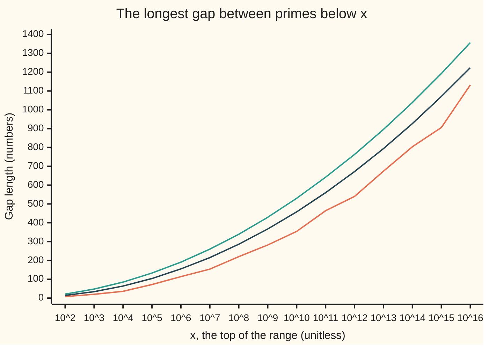

# Large gaps: the longest prime-free run, and the coin-flip model that predicts it

[Syllabus](../../../SYLLABUS.md) → [Algebraic and analytic number theory](../README.md) → [Sieves and Prime Gaps](../README.md#s04) → Large gaps

---

## General Overview

The number 1,693,182,318,746,371 is prime. The next prime is 1,693,182,318,747,503. The 1,131 whole numbers in between are all composite. That is a **gap** of 1,132: the distance from one prime to the next. It was first found in 1999, and no gap below it is as long.

Near this 16-digit prime p, the primes are on average about 35 apart: the average gap is log p = 35.07, by the prime number theorem (log is the natural log throughout). So this run without primes is 32 times the average. How long can such a run get?

In 1936 Harald Cramér gave a model that answers this. Pretend each whole number n is prime with chance 1/log n, decided by its own coin flip, independent of every other number. In that **coin-flip model** a long gap is a long run of failed flips. Long runs are exponentially rare, and there are about 4.8 × 10^13 primes below p to start one from. The model's prediction for the longest gap there is 1,104.8. The record is 1,132.

Write G(x) for the longest gap between primes up to x. The model predicts that G(x) grows like $`(\log x)^2`$: 1,229.58 at p. At every x checked, G(x) sits below it, but no one can prove that it always will. The proved bounds are far weaker.

**The longest gap between primes below x is predicted, by treating each n as prime with independent chance 1/log n, to be about $`(\log x)^2`$; every record to 4 × 10^18 agrees, yet the proved bounds are a little more than log x from below and a power of x from above.**

**What kind of fact this is:** a model and a conjecture beside proved bounds. The model is an assumption that fits well, not a law, and it is provably wrong in detail (Step 4). Cramér's conjecture, $`G(x) \ll (\log x)^2`$, is open as of 2026-11-15. Two lower bounds are proved on this card in Why it works. The 2018 lower bound and the $`x^{0.525}`$ upper bound are theorems stated with sources. The records are computation: evidence, not proof.

### The picture: record gaps against the coin-flip prediction



Orange: the true longest gap G(x), computed to 10^8 and quoted from the published table above that. Green: Cramér's $`(\log x)^2`$. Dark: the model's sharper prediction, $`\log x\,(\log x - \log\log x)`$. The true line stays below the green one everywhere. It jumps to 1,132 at 10^16, with our example.

---

## The formula

Notation first, in words. As on [Bounded gaps](05-bounded-gaps-zhang-maynard.md), $`p_n`$ is the n-th prime: $`p_1 = 2`$, $`p_2 = 3`$. The **gap** after $`p_n`$ is $`g_n = p_{n+1} - p_n`$. This card introduces one symbol:

- $`G(x)`$ is the longest gap among primes up to x: the largest $`g_n`$ with $`p_{n+1} \le x`$. For x = 100 it is 8, from 89 to 97.

The log is the natural log, as everywhere in the wing. The **merit** of a gap is $`g/\log p`$: how many average gaps it spans.

The model in one line. Each n ≥ 3 is "prime" with chance $`1/\log n`$, independently. After a prime near p, the gap is at least g when the next g − 1 numbers all fail. The chance of that is

```math
\Pr(\text{gap after } p \ge g) \approx \left(1 - \frac{1}{\log p}\right)^{g-1} \approx e^{-g/\log p}
```

**Read it aloud:** in the coin-flip model, the chance that a gap after p is at least g falls off like e to the minus g over log p.

There are about $`x/\log x`$ primes up to x. Set that count times the chance equal to 1, and solve for g. That is the model's longest gap, and Cramér's conjecture:

```math
G(x) \approx \log x\,(\log x - \log\log x) \sim (\log x)^2, \qquad \limsup_{x \to \infty} \frac{G(x)}{(\log x)^2} = 1 \;\;\text{(conjectured)}
```

**Read it aloud:** the longest gap below x is about log x times the quantity log x minus log log x, which grows like log x squared; Cramér conjectured that the largest values of G(x) over log x squared approach 1.

What is proved, for all large enough x and some fixed constant c > 0:

```math
c\,\frac{\log x\,\log\log x\,\log\log\log\log x}{\log\log\log x} \le G(x) \ll x^{0.525}
```

**Read it aloud:** the longest gap is at least a constant times log x times log log x times the fourth iterated log, divided by the triple log; and at most a fixed multiple of x to the power 0.525.

| Symbol | Plain meaning | In our example | Push it up and the answer… |
| --- | --- | --- | --- |
| $`p`$, $`p_n`$ | a prime; the n-th prime | p = 1,693,182,318,746,371 | log p grows, so gaps grow |
| $`g`$, $`g_n`$ | a gap: the next prime minus this one | 1,132 | the model's chance of it falls like $`e^{-g/\log p}`$ |
| $`x`$ | the top of the range searched | 10^16 | G(x) grows |
| $`G(x)`$ | the longest gap with both ends up to x | G(10^16) = 1,132; G(10^8) = 220 | — |
| $`\log p`$ | the average gap near p | 35.0654 | — |
| $`g/\log p`$ | the merit: the gap in average gaps | 32.28 | — |
| $`g/(\log p)^2`$ | the gap against Cramér's yardstick | 0.9206 | Cramér: never far above 1 |
| $`\Pr(\ldots)`$ | a chance in the coin-flip model | $`e^{-32.28} = 9.547 \times 10^{-15}`$ | — |
| $`t`$ | a gap size in average gaps, $`g/\log p`$ | 1 to 5 | the model's share above it is $`e^{-t}`$ |
| $`c`$ | a fixed positive constant from the 2018 proof | value not given on this card | — |
| $`\gamma`$ | Euler's constant | $`2e^{-\gamma} = 1.1229`$; times $`(\log p)^2`$, 1,380.7 | — |
| $`C_2`$ | the twin-prime constant | 0.660162 | — |

$`\limsup`$ means the largest value approached again and again as x grows. $`\ll`$ means "at most a fixed multiple of" ([Big O and twiddle](../01-Arithmetic%20Functions%20Again/01-asymptotic-notation-and-error-terms.md)).

### When it holds

- **The density 1/log n is right on average.** That is the prime number theorem. The model's count of primes to 10^6 averages 78,613.4 over 20 runs, against 78,498 true. Drop it and the model predicts nothing.
- **Independence is the model's weak point.** Real primes are not independent: if n > 2 is prime, n + 1 is even. Treating n and n + 2 as independent gives 6,247.0 twin pairs below a million, against 8,169 true (Step 4).
- **Small primes push gaps longer.** The model ignores that every prime above 2 is odd and that small primes divide in fixed patterns. Granville's correction raises the prediction to at least $`2e^{-\gamma}(\log x)^2`$, 1,380.7 at p.
- **The fit is at the sizes a computer reaches.** Every maximal gap below 4 × 10^18 has been found. That is evidence. A model that fits there can still fail later, as Maier's theorem on short intervals shows the model does (Step 4).
- **The proved bounds hold only for large enough x,** and their constants are not given on this card, so they say nothing exact at p.

---

## Why it works

### Step 0: a long gap is a long run of failures

Flip a fair coin many times. A run of k tails in a row has chance $`2^{-k}`$, so each extra tail halves the chance. Long runs do appear, but only once there are enough starting points: about $`2^{k}`$ of them for a run of k.

Primes behave the same way in Cramér's model. A gap is a run of numbers that "fail" to be prime. Each failure has chance about $`1 - 1/\log p`$. The longest run among many starts is where the number of starts times the chance of the run reaches 1.

### Step 1: the average gap is log x, so G(x) is at least that (proved)

The gaps telescope: $`g_1 + g_2 + \cdots + g_{N-1} = p_N - 2`$. So the average of the first N − 1 gaps is $`(p_N - 2)/(N - 1)`$.

By [The prime number theorem](../02-The%20Zeta%20Function%20and%20the%20Prime%20Number%20Theorem/05-prime-number-theorem-proved.md), there are about $`x/\log x`$ primes up to x. So the average gap is about log x. The longest gap is at least the average, so $`G(x) \ge (1 + o(1))\log x`$, where $`o(1)`$ shrinks to 0.

The code checks this to 10^8: there are 5,761,455 primes, the average gap is 17.357, and log 10^8 = 18.421. The longest gap is 220.

### Step 2: the model's chance of a long gap

Fix a prime p and a length g. In the model, the next g − 1 numbers must all fail. Each fails with chance close to $`1 - 1/\log p`$, since log changes very little across the gap. Independent chances multiply:

```math
\left(1 - \frac{1}{\log p}\right)^{g-1} \approx e^{-g/\log p}
```

The step uses $`(1 - 1/L)^{L} \approx e^{-1}`$ for large L. Write the gap as $`t`$ average gaps, $`g = t\log p`$. Then the chance is $`e^{-t}`$: a gap of at least 3 average gaps has chance 0.04979.

The primes below 10^8 roughly follow this:

| t | share of real gaps above t log p | model $`e^{-t}`$ |
| ---: | ---: | ---: |
| 1 | 0.38265 | 0.36788 |
| 2 | 0.11445 | 0.13534 |
| 3 | 0.03398 | 0.04979 |
| 4 | 0.00956 | 0.01832 |
| 5 | 0.00270 | 0.00674 |

The shape is right: each step down cuts the share by a similar factor. But at these sizes long real gaps are rarer than the model says: 0.00270 against 0.00674 at t = 5. Assuming a uniform form of the Hardy-Littlewood prime-tuples conjecture, Gallagher showed in 1976 that the shares do tend to $`e^{-t}`$ (Granville's survey, in Sources, gives the statement).

The model also gets the count of primes right. Its count is a sum of independent coin flips, so by the [Law of large numbers](../../09-Probability%20and%20statistics/06-Limit%20Theorems%20in%20Practice/01-law-of-large-numbers.md) it settles near its expected value, $`1 + \sum_{3 \le n \le x} 1/\log n`$. To 10^6 that value is 78,626.9. Twenty simulated runs average 78,613.4. The true count is 78,498.

### Step 3: the model's longest gap

Below x there are about $`x/\log x`$ primes, and each starts a gap. The expected number of gaps of length at least g is about

```math
\frac{x}{\log x}\, e^{-g/\log x}
```

This is 1 when $`g = \log x\,(\log x - \log\log x)`$. Gaps much longer are unlikely to appear at all. Gaps much shorter appear many times. So that g is the model's longest gap.

At our p: log p = 35.0654 and log log p = 3.557. The prediction is 35.0654 × (35.0654 − 3.557) = 1,104.8. The expected number of gaps of at least 1,132 below p is 0.46: fewer than one, so in the model a gap this long by this point is lucky, but not rare. The real one appeared.

Cramér proved more inside his model. With probability 1, the model's longest gap satisfies $`\limsup G(x)/(\log x)^2 = 1`$. That is where the conjecture comes from.

<details>
<summary>Detailed derivation: the model's longest gap, and why the limit is 1</summary>

Count the expected number of model primes $`q \le x`$ followed by at least g failures. Each such q contributes chance about $`e^{-g/\log q}`$, and there are about $`x/\log x`$ of them near x, so the expected count is about

$`\displaystyle E_g(x) \approx \frac{x}{\log x}\, e^{-g/\log x}.`$

Take logs: $`\log E_g(x) = \log x - \log\log x - g/\log x`$. This is zero exactly when

$`\displaystyle g = \log x\,(\log x - \log\log x).`$

For the limit, take any $`\varepsilon > 0`$ and $`g = (1 + \varepsilon)(\log x)^2`$. Then $`E_g(x) \approx x^{-\varepsilon}/\log x`$, which adds up to a finite total over $`x = 2^k`$. By the Borel-Cantelli lemma (a finite total of chances means only finitely many of the events happen), only finitely many such long gaps occur. With $`g = (1 - \varepsilon)(\log x)^2`$, $`E_g(x) \approx x^{\varepsilon}/\log x`$ grows. The gaps in disjoint stretches are independent, so the second Borel-Cantelli lemma makes such gaps occur infinitely often. Together, $`\limsup G(x)/(\log x)^2 = 1`$ with probability 1.

</details>

The code also runs the model to 10^6 twenty times, with a written-out random generator (SplitMix64, seeds 1 to 20). The longest gaps range from 126 to 172, with mean 149.6, near the formula's 154.6. The true G(10^6) is 114, below all twenty runs.

### Step 4: where the model is wrong

**Independence fails for twins.** In the model, n and n + 2 are both prime with chance about $`1/(\log n)^2`$. Adding this up to a million gives 6,247.0 twin pairs. The truth is 8,169. Hardy and Littlewood's conjecture multiplies by $`2C_2`$, with $`C_2 = 0.660162`$ built from the patterns of small primes, and gives 8,248.0. The model misses the factor 2 completely: if n is an odd prime, n + 2 is odd too, so its chance is doubled, not independent.

**The same patterns stretch the longest gaps.** Granville (1995) fixed the model so that it respects divisibility by small primes. The fixed model predicts $`\limsup G(x)/(\log x)^2 \ge 2e^{-\gamma} = 1.1229`$, not 1. This is the same constant as the sieve's overshoot on [Sieving by inclusion-exclusion](01-the-legendre-sieve-and-the-parity-problem.md). At the size of p that ratio means a gap of about 1,380.7.

**Short intervals fluctuate more than the model allows.** Maier (1985) proved that intervals of length $`(\log x)^{\lambda}`$, for any fixed λ > 1, sometimes hold clearly more and sometimes clearly fewer primes than the model predicts. So the model fails in a proved way.

The records so far: $`G(x)/(\log x)^2`$ is 0.377 at 10^2 and climbs slowly to 0.834 at 10^16. For record gaps after primes above 7, the highest known value of $`g/(\log p)^2`$ is our example's 0.9206.

### Step 5: what is actually proved

**From below, by building a gap.** The numbers $`n! + 2, n! + 3, \ldots, n! + n`$ are all composite: k divides $`n! + k`$. So there is a gap of at least n just after $`n!`$. Smaller starting points come from the **primorial** $`q\#`$, the product of the primes up to q. Each of $`q\# + 2, \ldots, q\# + k`$ is composite as long as every number from 2 to k has a prime factor up to q.

These proofs come far too late. A gap of 1,132 by the factorial needs $`1{,}132! \approx 10^{2967.3}`$. By the primorial it needs $`1129\# \approx 10^{478.9}`$. The real gap appears below 10^16.

Choosing the remainders cleverly, so small primes cover a longer stretch, gives more. Westzynthius (1931) proved that G(x)/log x is unbounded. Erdős (1935) and Rankin (1938) sharpened the rate. Ford, Green, Konyagin, Maynard and Tao (2018) proved the lower bound in The formula. Without its constant, its shape at p is only 23.4. That is below Step 1's floor of about log p = 35.07: at this size the iterated logs in the shape are small, and it overtakes log x only for far larger x. The 2018 bound wins by its growth, not at any size where gaps have been computed.

**From above, by counting primes in short intervals.** Baker, Harman and Pintz (2001) proved that every interval $`[x - x^{0.525}, x]`$ holds a prime for all large enough x, so $`G(x) \ll x^{0.525}`$. At p the shape $`x^{0.525}`$ is 9.887 × 10^7. Assuming the Riemann hypothesis ([The Riemann hypothesis](../02-The%20Zeta%20Function%20and%20the%20Prime%20Number%20Theorem/09-riemann-hypothesis-statement-and-equivalents.md)), Cramér proved $`G(x) \ll \sqrt{x}\log x`$, whose shape at p is 1.443 × 10^9. That is larger here, but it wins for large x.

The truth, about 1,132, sits between a proved floor of about log p = 35.07 (Step 1) and a proved 10^8-shaped ceiling.

---

## Worked numbers, by hand

The example: the gap of 1,132 after p = 1,693,182,318,746,371.

| Step | Arithmetic | Value |
| --- | --- | --- |
| average gap near p | log p | 35.0654 |
| merit | 1,132 ÷ 35.0654 | 32.28 |
| Cramér's yardstick | (log p)^2 = 35.0654 × 35.0654 | 1,229.58 |
| the gap against it | 1,132 ÷ 1,229.58 | **0.9206** |
| model chance for one gap | $`e^{-32.28}`$ | 9.547 × 10^−15 |
| primes below p | p ÷ log p | about 4.829 × 10^13 |
| expected gaps this long | 4.829 × 10^13 × 9.547 × 10^−15 | 0.46 |
| model's longest gap | 35.0654 × (35.0654 − 3.557) | 1,104.8 |

The record gap is 0.9206 of Cramér's yardstick, and a little above the model's typical longest gap: the model expects about half of one such gap by p, and one is there.

### What breaks if you drop a piece

| Mistake | Comes out at | What went wrong |
| --- | --- | --- |
| Expect the longest gap to be near the average gap | 35.07, against 1,132 | The longest of 4.8 × 10^13 gaps sits in the tail, near $`(\log p)^2`$ |
| Use log base 10 | $`(\log_{10} p)^2 = 231.9`$, so the gap is 4.88 times the yardstick | The density of primes is 1 over the natural log; base 10 shrinks the yardstick |
| Use the factorial gap as the estimate | 1,132! ≈ 10^2967.3 | The construction proves a gap exists, but thousands of digits too late |
| Treat n and n + 2 as independent | 6,247.0 twin pairs, against 8,169 true | The hypothesis that fails: odd primes make n + 2 odd, doubling its chance; Hardy-Littlewood's 8,248.0 corrects it |

The last row is the independence hypothesis failing on a count the code makes exactly. The code prints every row.

---

## Code, from first principles, and it actually runs

The code takes three roads. Road one sieves every prime up to 10^8, finds all 25 record gaps, and matches them against the published table. Road two checks the example twice: a Miller-Rabin test (a fast primality test, exact for numbers this size with the bases used) on every number from p to p + 1,132, and a separate sieve of that stretch by every prime up to its square root, 41,148,296. Road three is the coin-flip model: by formula, and by 20 simulated runs to 10^6. Records above 10^8 are quoted from the 2014 table, labelled "quoted".

### Python

```python
# Large prime gaps and the Cramer model -- the check behind the card.
# Standard library only.  Road one sieves every prime up to 10^8 and finds the record
# gaps.  Road two tests the endpoints with Miller-Rabin and re-sieves the 1,132-gap
# by every prime up to its square root.  Road three is the coin-flip model, by formula
# and by simulation.  Gaps above 10^8 are quoted from the table of Oliveira e Silva,
# Herzog and Pardi (2014), labelled so.
import math, itertools
def add(xs):                                      # plain left-to-right float sum
    t = 0.0
    for v in xs: t += v
    return t
def sci(v):                                       # 4.829 x 10^13
    m, e = f"{v:.3e}".split("e")
    return f"{m} x 10^{int(e)}"
N = 10**8
s = bytearray([1]) * (N + 1); s[0] = s[1] = 0
for i in range(2, int(N**0.5) + 1):
    if s[i]:
        s[i * i::i] = bytes(len(range(i * i, N + 1, i)))
primes = list(itertools.compress(range(N + 1), s))
def is_prime(n):                                  # Miller-Rabin, exact below 3.3 x 10^24
    if n < 2: return False
    B = (2, 3, 5, 7, 11, 13, 17, 19, 23, 29, 31, 37)
    for b in B:
        if n % b == 0: return n == b
    d, r = n - 1, 0
    while d % 2 == 0: d //= 2; r += 1
    for b in B:
        x = pow(b, d, n)
        if x in (1, n - 1): continue
        for _ in range(r - 1):
            x = x * x % n
            if x == n - 1: break
        else: return False
    return True
P, g = 1693182318746371, 1132
mr = [n for n in range(P, P + g + 1) if is_prime(n)]
seg = bytearray([1]) * (g + 1)                    # road two: sieve [P, P + g]
root = math.isqrt(P + g)
for q in primes:
    if q > root: break
    seg[(-P) % q::q] = bytes(len(range((-P) % q, g + 1, q)))
sv = [P + i for i in range(g + 1) if seg[i]]
L = math.log(P)
print(f"p = {P:,}: primes in [p, p + {g:,}] by Miller-Rabin: {', '.join(f'{v:,}' for v in mr)}; by sieve to {root:,}: {len(sv)} found; composites between {g-1:,}")
print(f"log p = {L:.4f}; (log p)^2 = {L*L:.2f}; merit g / log p = {g/L:.2f}; g / (log p)^2 = {g/(L*L):.4f}")
gstar = L * (L - math.log(L))
print(f"model: chance a gap is >= {g:,} = e^-{g/L:.2f} = {sci(math.exp(-g/L))}; primes below p about {sci(P/L)};"
      f" expected such gaps {P/L*math.exp(-g/L):.2f}; predicted largest gap log p (log p - log log p) = {gstar:.1f}")
eg = 2 * math.exp(-0.5772156649015329)
print(f"Granville 2e^-gamma = {eg:.4f}; 2e^-gamma (log p)^2 = {eg*L*L:.1f}")
print(f"base-10 slip: (log10 p)^2 = {math.log10(P)**2:.1f}; g / (log10 p)^2 = {g/math.log10(P)**2:.2f}")
print("quoted from the table: every maximal gap below 4 x 10^18 checked (2014); the gap of 1,132 first found in 1999")
rec, best = [], 0                                 # road one: record gaps to 10^8
for a, b in zip(primes, primes[1:]):
    if b - a > best: best = b - a; rec.append((b - a, a))
print(f"record gaps below 10^8 ({len(rec)}), gap@prime:")
for k in range(0, len(rec), 7):
    print("  " + ", ".join(f"{d}@{a:,}" for d, a in rec[k:k + 7]))
known = [1, 2, 4, 6, 8, 14, 18, 20, 22, 34, 36, 44, 52, 72, 86, 96, 112, 114, 118, 132, 148, 154, 180, 210, 220]
mr_ok = all(is_prime(a) and is_prime(a + d) and not any(is_prime(n) for n in range(a + 1, a + d)) for d, a in rec)
yn = lambda b: "yes" if b else "no"
print(f"records match the quoted table: {yn([d for d, a in rec] == known)}; every endpoint and gap confirmed by Miller-Rabin: {yn(mr_ok)}")
quoted = {9: 282, 10: 354, 11: 464, 12: 540, 13: 674, 14: 804, 15: 906, 16: 1132}
Gx = {}
print("x | G(x) | (log x)^2 | G / (log x)^2 | model log x (log x - log log x)")
for e in range(2, 17):
    x = 10**e
    G = quoted[e] if e > 8 else max(d for d, a in rec if a + d <= x)
    Gx[e] = G; lx = math.log(x)
    print(f"10^{e} | {G:,}{' (quoted)' if e > 8 else ''} | {lx*lx:.1f} | {G/(lx*lx):.3f} | {lx*(lx-math.log(lx)):.1f}")
n8 = len(primes)
print(f"pi(10^8) = {n8:,}; average gap (p_last - 2) / (count - 1) = {(primes[-1]-2)/(n8-1):.3f}; log 10^8 = {math.log(N):.3f}; largest gap {rec[-1][0]}")
tail = [0] * 6                                    # share of gaps above t log p
for a, b in zip(primes[1:], primes[2:]):
    r = (b - a) / math.log(a)
    for t in range(1, 6):
        if r > t: tail[t] += 1
m = n8 - 2
print("t | share of gaps after p above t log p, p < 10^8 | model e^-t")
for t in range(1, 6):
    print(f"{t} | {tail[t]/m:.5f} | {math.exp(-t):.5f}")
M64 = (1 << 64) - 1
def splitmix(state):
    state = (state + 0x9E3779B97F4A7C15) & M64
    z = state; z = ((z ^ (z >> 30)) * 0xBF58476D1CE4E5B9) & M64
    z = ((z ^ (z >> 27)) * 0x94D049BB133111EB) & M64
    return state, z ^ (z >> 31)
X = 10**6
inv = [0.0, 0.0, 0.0] + [1 / math.log(n) for n in range(3, X + 1)]
runs = []
for seed in range(1, 21):                         # road three: the coin-flip model
    st, last, mx, cnt = seed, 2, 0, 1
    for n in range(3, X + 1):
        st, z = splitmix(st)
        if (z >> 11) / 9007199254740992 < inv[n]:
            mx = max(mx, n - last); last = n; cnt += 1
    runs.append((mx, cnt))
mxs = [r[0] for r in runs]; mean_cnt = sum(r[1] for r in runs) / 20
expect = 1 + add(inv)
print(f"model to 10^6, 20 runs (SplitMix64, seeds 1-20): largest gaps {', '.join(map(str, mxs))}")
print(f"  mean largest gap {sum(mxs)/20:.1f}; runs above the true 114: {sum(1 for v in mxs if v > 114)}; mean count {mean_cnt:,.1f};"
      f" expected 1 + sum 1/log n = {expect:,.1f}; true pi(10^6) = {primes.index(999983)+1:,}")
twins = sum(1 for a, b in zip(primes, primes[1:]) if b - a == 2 and b <= X)
cram = add(1 / (math.log(n) * math.log(n + 2)) for n in range(3, X - 1))
u0, u1 = math.log(2), math.log(X)                 # Simpson in u = log t: dt / log^2 t = e^u du / u^2
h = (u1 - u0) / X; simp = math.exp(u0) / u0**2 + math.exp(u1) / u1**2
for i in range(1, X): simp += (4 if i % 2 else 2) * math.exp(u0 + i * h) / (u0 + i * h)**2
simp *= h / 3
C2 = math.prod(1 - 1 / (p - 1)**2 for p in primes[1:primes.index(999983) + 1])
print(f"twin pairs below 10^6: true {twins:,}; Cramer model: integral of 1/log^2 t = {simp:,.1f}, sum 1/(log n log(n+2)) = {cram:,.1f}")
print(f"twin constant C2 = {C2:.6f}; Hardy-Littlewood 2 C2 x integral = {2*C2*simp:,.1f}")
l2, l3 = math.log(L), math.log(math.log(L)); l4 = math.log(l3)
lf = add(math.log10(k) for k in range(2, g + 1))
lp = add(math.log10(q) for q in primes if q <= 1129)
print(f"at p: log log p = {l2:.3f}; 2018 lower-bound shape (log p)(log2 p)(log4 p) / (log3 p) = {L*l2*l4/l3:.1f}; x^0.525 = {sci(math.exp(0.525*L))};"
      f" sqrt(p) log p = {sci(math.sqrt(P)*L)}")
print(f"factorial road: gap of {g:,} needs {g:,}! = 10^{lf:.1f}; primorial road: 1129# = 10^{lp:.1f}")
kb = 1024 * math.log(2)
print(f"1024-bit primes: log 2^1024 = {kb:.2f}; odd numbers tested on average about {kb/2:.1f}; (log 2^1024)^2 = {kb*kb:,.0f}")
chart = [Gx[e] for e in range(2, 17)]
print("chart G(x):", ", ".join(str(v) for v in chart))
print("chart (log x)^2:", ", ".join(f"{math.log(10**e)**2:.0f}" for e in range(2, 17)))
print("chart model:", ", ".join(f"{math.log(10**e)*(math.log(10**e)-math.log(math.log(10**e))):.0f}" for e in range(2, 17)))
assert mr == sv == [P, P + g]                     # two roads agree on the example
assert [d for d, a in rec] == known and mr_ok and rec[-1] == (220, 47326693)
assert n8 == 5761455 and twins == 8169 and round(simp) == 6247 and round(2 * C2 * simp) == 8248            # known tables
assert all(Gx[e] < math.log(10**e)**2 for e in range(2, 9)) and abs(cram - simp) < 0.001 * simp
assert abs(mean_cnt - expect) < 3 * math.sqrt(expect) / math.sqrt(20)
assert all(abs(tail[t] / m - math.exp(-t)) < 0.6 * math.exp(-t) for t in range(1, 4))
assert 0.8 < (primes[-1] - 2) / (n8 - 1) / math.log(N) < 1.0 and abs(gstar - g) < 0.05 * g
print("ALL CHECKS PASS")
```

**Ran 2026-11-15 on macOS, Python 3.14.10, standard library only. All checks passed. Output, pasted from the run:**

```
p = 1,693,182,318,746,371: primes in [p, p + 1,132] by Miller-Rabin: 1,693,182,318,746,371, 1,693,182,318,747,503; by sieve to 41,148,296: 2 found; composites between 1,131
log p = 35.0654; (log p)^2 = 1229.58; merit g / log p = 32.28; g / (log p)^2 = 0.9206
model: chance a gap is >= 1,132 = e^-32.28 = 9.547 x 10^-15; primes below p about 4.829 x 10^13; expected such gaps 0.46; predicted largest gap log p (log p - log log p) = 1104.8
Granville 2e^-gamma = 1.1229; 2e^-gamma (log p)^2 = 1380.7
base-10 slip: (log10 p)^2 = 231.9; g / (log10 p)^2 = 4.88
quoted from the table: every maximal gap below 4 x 10^18 checked (2014); the gap of 1,132 first found in 1999
record gaps below 10^8 (25), gap@prime:
  1@2, 2@3, 4@7, 6@23, 8@89, 14@113, 18@523
  20@887, 22@1,129, 34@1,327, 36@9,551, 44@15,683, 52@19,609, 72@31,397
  86@155,921, 96@360,653, 112@370,261, 114@492,113, 118@1,349,533, 132@1,357,201, 148@2,010,733
  154@4,652,353, 180@17,051,707, 210@20,831,323, 220@47,326,693
records match the quoted table: yes; every endpoint and gap confirmed by Miller-Rabin: yes
x | G(x) | (log x)^2 | G / (log x)^2 | model log x (log x - log log x)
10^2 | 8 | 21.2 | 0.377 | 14.2
10^3 | 20 | 47.7 | 0.419 | 34.4
10^4 | 36 | 84.8 | 0.424 | 64.4
10^5 | 72 | 132.5 | 0.543 | 104.4
10^6 | 114 | 190.9 | 0.597 | 154.6
10^7 | 154 | 259.8 | 0.593 | 215.0
10^8 | 220 | 339.3 | 0.648 | 285.7
10^9 | 282 (quoted) | 429.5 | 0.657 | 366.6
10^10 | 354 (quoted) | 530.2 | 0.668 | 458.0
10^11 | 464 (quoted) | 641.5 | 0.723 | 559.7
10^12 | 540 (quoted) | 763.5 | 0.707 | 671.8
10^13 | 674 (quoted) | 896.0 | 0.752 | 794.3
10^14 | 804 (quoted) | 1039.2 | 0.774 | 927.2
10^15 | 906 (quoted) | 1192.9 | 0.759 | 1070.6
10^16 | 1,132 (quoted) | 1357.3 | 0.834 | 1224.4
pi(10^8) = 5,761,455; average gap (p_last - 2) / (count - 1) = 17.357; log 10^8 = 18.421; largest gap 220
t | share of gaps after p above t log p, p < 10^8 | model e^-t
1 | 0.38265 | 0.36788
2 | 0.11445 | 0.13534
3 | 0.03398 | 0.04979
4 | 0.00956 | 0.01832
5 | 0.00270 | 0.00674
model to 10^6, 20 runs (SplitMix64, seeds 1-20): largest gaps 155, 172, 158, 132, 153, 129, 137, 157, 159, 156, 141, 135, 142, 148, 126, 164, 166, 160, 141, 160
  mean largest gap 149.6; runs above the true 114: 20; mean count 78,613.4; expected 1 + sum 1/log n = 78,626.9; true pi(10^6) = 78,498
twin pairs below 10^6: true 8,169; Cramer model: integral of 1/log^2 t = 6,247.0, sum 1/(log n log(n+2)) = 6,245.4
twin constant C2 = 0.660162; Hardy-Littlewood 2 C2 x integral = 8,248.0
at p: log log p = 3.557; 2018 lower-bound shape (log p)(log2 p)(log4 p) / (log3 p) = 23.4; x^0.525 = 9.887 x 10^7; sqrt(p) log p = 1.443 x 10^9
factorial road: gap of 1,132 needs 1,132! = 10^2967.3; primorial road: 1129# = 10^478.9
1024-bit primes: log 2^1024 = 709.78; odd numbers tested on average about 354.9; (log 2^1024)^2 = 503,791
chart G(x): 8, 20, 36, 72, 114, 154, 220, 282, 354, 464, 540, 674, 804, 906, 1132
chart (log x)^2: 21, 48, 85, 133, 191, 260, 339, 429, 530, 642, 763, 896, 1039, 1193, 1357
chart model: 14, 34, 64, 104, 155, 215, 286, 367, 458, 560, 672, 794, 927, 1071, 1224
ALL CHECKS PASS
```

### Rust

Same numbers, same labels, built with `rustc --edition 2021 -O`.

```rust
// Large prime gaps and the Cramer model -- the same check as the Python, in Rust.
// No crates.  Road one sieves every prime up to 10^8 and finds the record gaps.
// Road two tests the endpoints with Miller-Rabin and re-sieves the 1,132-gap by
// every prime up to its square root.  Road three is the coin-flip model, by formula
// and by simulation.  Gaps above 10^8 are quoted from the table of Oliveira e Silva,
// Herzog and Pardi (2014), labelled so.
fn com(v: f64, d: usize) -> String {                  // thousands commas, d decimals
    let s = format!("{:.*}", d, v.abs());
    let (int, frac) = match s.find('.') { Some(i) => (&s[..i], &s[i..]), None => (&s[..], "") };
    let mut out = String::new();
    for (i, ch) in int.chars().enumerate() {
        if i > 0 && (int.len() - i) % 3 == 0 { out.push(',') }
        out.push(ch);
    }
    format!("{}{}{}", if v < 0.0 { "-" } else { "" }, out, frac)
}
fn ci(v: u64) -> String { com(v as f64, 0) }
fn sci(v: f64) -> String {                            // 4.829 x 10^13
    let s = format!("{:.3e}", v);
    let (m, e) = s.split_at(s.find('e').unwrap());
    format!("{} x 10^{}", m, &e[1..])
}
fn yn(b: bool) -> &'static str { if b { "yes" } else { "no" } }
fn mulmod(a: u64, b: u64, n: u64) -> u64 { ((a as u128 * b as u128) % n as u128) as u64 }
fn powmod(mut b: u64, mut e: u64, n: u64) -> u64 {
    let mut r = 1u64; b %= n;
    while e > 0 { if e & 1 == 1 { r = mulmod(r, b, n) } b = mulmod(b, b, n); e >>= 1 }
    r
}
fn is_prime(n: u64) -> bool {                         // Miller-Rabin, exact below 3.3 x 10^24
    if n < 2 { return false }
    let bs = [2u64, 3, 5, 7, 11, 13, 17, 19, 23, 29, 31, 37];
    for &b in &bs { if n % b == 0 { return n == b } }
    let (mut d, mut r) = (n - 1, 0);
    while d % 2 == 0 { d /= 2; r += 1 }
    'outer: for &b in &bs {
        let mut x = powmod(b, d, n);
        if x == 1 || x == n - 1 { continue }
        for _ in 0..r - 1 { x = mulmod(x, x, n); if x == n - 1 { continue 'outer } }
        return false;
    }
    true
}
fn splitmix(state: u64) -> (u64, u64) {
    let st = state.wrapping_add(0x9E3779B97F4A7C15);
    let mut z = st;
    z = (z ^ (z >> 30)).wrapping_mul(0xBF58476D1CE4E5B9);
    z = (z ^ (z >> 27)).wrapping_mul(0x94D049BB133111EB);
    (st, z ^ (z >> 31))
}

fn main() {
    const N: usize = 100_000_000;
    let mut s = vec![true; N + 1]; s[0] = false; s[1] = false;
    let mut i = 2;
    while i * i <= N { if s[i] { let mut j = i * i; while j <= N { s[j] = false; j += i } } i += 1 }
    let primes: Vec<u64> = (0..=N).filter(|&k| s[k]).map(|k| k as u64).collect();
    let (p, g) = (1693182318746371u64, 1132u64);
    let mr: Vec<u64> = (p..=p + g).filter(|&n| is_prime(n)).collect();
    let mut seg = vec![true; g as usize + 1];         // road two: sieve [P, P + g]
    let root = ((p + g) as f64).sqrt() as u64;
    let root = (root.saturating_sub(2)..root + 3).filter(|r| r * r <= p + g).max().unwrap();
    for &q in &primes {
        if q > root { break }
        let mut j = ((q - p % q) % q) as usize;
        while j <= g as usize { seg[j] = false; j += q as usize }
    }
    let sv: Vec<u64> = (0..=g).filter(|&k| seg[k as usize]).map(|k| p + k).collect();
    let l = (p as f64).ln();
    let shown: Vec<String> = mr.iter().map(|&v| ci(v)).collect();
    println!("p = {}: primes in [p, p + {}] by Miller-Rabin: {}; by sieve to {}: {} found; composites between {}", ci(p), ci(g), shown.join(", "), ci(root), sv.len(), ci(g - 1));
    let gf = g as f64;
    println!("log p = {:.4}; (log p)^2 = {:.2}; merit g / log p = {:.2}; g / (log p)^2 = {:.4}", l, l * l, gf / l, gf / (l * l));
    let gstar = l * (l - l.ln());
    println!("model: chance a gap is >= {} = e^-{:.2} = {}; primes below p about {}; expected such gaps {:.2}; predicted largest gap log p (log p - log log p) = {:.1}",
             ci(g), gf / l, sci((-gf / l).exp()), sci(p as f64 / l), p as f64 / l * (-gf / l).exp(), gstar);
    let eg = 2.0 * (-0.5772156649015329f64).exp();
    println!("Granville 2e^-gamma = {:.4}; 2e^-gamma (log p)^2 = {:.1}", eg, eg * l * l);
    let l10 = (p as f64).log10();
    println!("base-10 slip: (log10 p)^2 = {:.1}; g / (log10 p)^2 = {:.2}", l10 * l10, gf / (l10 * l10));
    println!("quoted from the table: every maximal gap below 4 x 10^18 checked (2014); the gap of 1,132 first found in 1999");
    let (mut rec, mut best): (Vec<(u64, u64)>, u64) = (Vec::new(), 0); // road one: record gaps to 10^8
    for w in primes.windows(2) { if w[1] - w[0] > best { best = w[1] - w[0]; rec.push((best, w[0])) } }
    println!("record gaps below 10^8 ({}), gap@prime:", rec.len());
    for c in rec.chunks(7) {
        let row: Vec<String> = c.iter().map(|&(d, a)| format!("{}@{}", d, ci(a))).collect();
        println!("  {}", row.join(", "));
    }
    let known = [1u64, 2, 4, 6, 8, 14, 18, 20, 22, 34, 36, 44, 52, 72, 86, 96, 112, 114, 118, 132, 148, 154, 180, 210, 220];
    let rec_d: Vec<u64> = rec.iter().map(|r| r.0).collect();
    let mr_ok = rec.iter().all(|&(d, a)| is_prime(a) && is_prime(a + d) && !(a + 1..a + d).any(is_prime));
    println!("records match the quoted table: {}; every endpoint and gap confirmed by Miller-Rabin: {}", yn(rec_d == known), yn(mr_ok));
    let quoted = [282u64, 354, 464, 540, 674, 804, 906, 1132];
    let mut gx = vec![0u64; 17];
    println!("x | G(x) | (log x)^2 | G / (log x)^2 | model log x (log x - log log x)");
    for e in 2..17u32 {
        let x = 10u64.pow(e);
        let gg = if e > 8 { quoted[e as usize - 9] } else { rec.iter().filter(|&&(d, a)| a + d <= x).map(|r| r.0).max().unwrap() };
        gx[e as usize] = gg;
        let lx = (x as f64).ln();
        println!("10^{} | {}{} | {:.1} | {:.3} | {:.1}", e, ci(gg), if e > 8 { " (quoted)" } else { "" }, lx * lx, gg as f64 / (lx * lx), lx * (lx - lx.ln()));
    }
    let n8 = primes.len();
    let avg = (primes[n8 - 1] - 2) as f64 / (n8 - 1) as f64;
    println!("pi(10^8) = {}; average gap (p_last - 2) / (count - 1) = {:.3}; log 10^8 = {:.3}; largest gap {}", ci(n8 as u64), avg, (N as f64).ln(), rec[rec.len() - 1].0);
    let mut tail = [0u64; 6];                         // share of gaps above t log p
    for w in primes[1..].windows(2) {
        let r = (w[1] - w[0]) as f64 / (w[0] as f64).ln();
        for t in 1..6 { if r > t as f64 { tail[t] += 1 } }
    }
    let m = (n8 - 2) as f64;
    println!("t | share of gaps after p above t log p, p < 10^8 | model e^-t");
    for t in 1..6 { println!("{} | {:.5} | {:.5}", t, tail[t] as f64 / m, (-(t as f64)).exp()) }
    const X: usize = 1_000_000;
    let mut inv = vec![0.0f64; X + 1];
    for n in 3..=X { inv[n] = 1.0 / (n as f64).ln() }
    let mut runs: Vec<(usize, u64)> = Vec::new();
    for seed in 1..=20u64 {                           // road three: the coin-flip model
        let (mut st, mut last, mut mx, mut cnt) = (seed, 2usize, 0usize, 1u64);
        for n in 3..=X {
            let (s2, z) = splitmix(st); st = s2;
            if (z >> 11) as f64 / 9007199254740992.0 < inv[n] { mx = mx.max(n - last); last = n; cnt += 1 }
        }
        runs.push((mx, cnt));
    }
    let mxs: Vec<String> = runs.iter().map(|r| r.0.to_string()).collect();
    let mean_cnt = runs.iter().map(|r| r.1).sum::<u64>() as f64 / 20.0;
    let mut expect = 0.0; for v in &inv { expect += v } expect += 1.0;
    let mean_mx = runs.iter().map(|r| r.0).sum::<usize>() as f64 / 20.0;
    let pi6 = primes.partition_point(|&q| q <= X as u64);
    println!("model to 10^6, 20 runs (SplitMix64, seeds 1-20): largest gaps {}", mxs.join(", "));
    println!("  mean largest gap {:.1}; runs above the true 114: {}; mean count {}; expected 1 + sum 1/log n = {}; true pi(10^6) = {}",
             mean_mx, runs.iter().filter(|r| r.0 > 114).count(), com(mean_cnt, 1), com(expect, 1), ci(pi6 as u64));
    let twins = primes.windows(2).filter(|w| w[1] - w[0] == 2 && w[1] <= X as u64).count();
    let mut cram = 0.0; for n in 3..X - 1 { cram += 1.0 / ((n as f64).ln() * ((n + 2) as f64).ln()) }
    let (u0, u1) = (2f64.ln(), (X as f64).ln());     // Simpson in u = log t: dt / log^2 t = e^u du / u^2
    let h = (u1 - u0) / X as f64; let mut simp = u0.exp() / u0.powi(2) + u1.exp() / u1.powi(2);
    for i in 1..X { let u = u0 + i as f64 * h; simp += (if i % 2 == 1 { 4.0 } else { 2.0 }) * u.exp() / u.powi(2) }
    simp *= h / 3.0;
    let mut c2 = 1.0; for &q in &primes[1..pi6] { c2 *= 1.0 - 1.0 / ((q - 1) as f64).powi(2) }
    println!("twin pairs below 10^6: true {}; Cramer model: integral of 1/log^2 t = {}, sum 1/(log n log(n+2)) = {}", ci(twins as u64), com(simp, 1), com(cram, 1));
    println!("twin constant C2 = {:.6}; Hardy-Littlewood 2 C2 x integral = {}", c2, com(2.0 * c2 * simp, 1));
    let (l2, l3) = (l.ln(), l.ln().ln()); let l4 = l3.ln();
    let mut lf = 0.0; for k in 2..g + 1 { lf += (k as f64).log10() }
    let mut lp = 0.0; for &q in primes.iter().filter(|&&q| q <= 1129) { lp += (q as f64).log10() }
    println!("at p: log log p = {:.3}; 2018 lower-bound shape (log p)(log2 p)(log4 p) / (log3 p) = {:.1}; x^0.525 = {}; sqrt(p) log p = {}",
             l2, l * l2 * l4 / l3, sci((0.525 * l).exp()), sci((p as f64).sqrt() * l));
    println!("factorial road: gap of {} needs {}! = 10^{:.1}; primorial road: 1129# = 10^{:.1}", ci(g), ci(g), lf, lp);
    let kb = 1024.0 * 2f64.ln();
    println!("1024-bit primes: log 2^1024 = {:.2}; odd numbers tested on average about {:.1}; (log 2^1024)^2 = {}", kb, kb / 2.0, com(kb * kb, 0));
    let lxs: Vec<f64> = (2..17).map(|e| (10f64.powi(e)).ln()).collect();
    println!("chart G(x): {}", gx[2..].iter().map(|v| v.to_string()).collect::<Vec<_>>().join(", "));
    println!("chart (log x)^2: {}", lxs.iter().map(|lx| format!("{:.0}", lx * lx)).collect::<Vec<_>>().join(", "));
    println!("chart model: {}", lxs.iter().map(|lx| format!("{:.0}", lx * (lx - lx.ln()))).collect::<Vec<_>>().join(", "));
    assert!(mr == sv && mr == vec![p, p + g]);        // two roads agree on the example
    assert!(rec_d == known && mr_ok && rec[rec.len() - 1] == (220, 47326693));
    assert!(n8 == 5761455 && twins == 8169 && simp.round() == 6247.0 && (2.0 * c2 * simp).round() == 8248.0); // known tables
    assert!((2..9).all(|e| (gx[e] as f64) < lxs[e - 2] * lxs[e - 2]) && (cram - simp).abs() < 0.001 * simp);
    assert!((mean_cnt - expect).abs() < 3.0 * expect.sqrt() / 20f64.sqrt());
    assert!((1..4).all(|t| (tail[t] as f64 / m - (-(t as f64)).exp()).abs() < 0.6 * (-(t as f64)).exp()));
    assert!(0.8 < avg / (N as f64).ln() && avg / (N as f64).ln() < 1.0 && (gstar - gf).abs() < 0.05 * gf);
    println!("ALL CHECKS PASS");
}
```

**Ran 2026-11-15 on macOS, rustc 1.98.1, no crates. All checks passed. Output, pasted from the run:**

```
p = 1,693,182,318,746,371: primes in [p, p + 1,132] by Miller-Rabin: 1,693,182,318,746,371, 1,693,182,318,747,503; by sieve to 41,148,296: 2 found; composites between 1,131
log p = 35.0654; (log p)^2 = 1229.58; merit g / log p = 32.28; g / (log p)^2 = 0.9206
model: chance a gap is >= 1,132 = e^-32.28 = 9.547 x 10^-15; primes below p about 4.829 x 10^13; expected such gaps 0.46; predicted largest gap log p (log p - log log p) = 1104.8
Granville 2e^-gamma = 1.1229; 2e^-gamma (log p)^2 = 1380.7
base-10 slip: (log10 p)^2 = 231.9; g / (log10 p)^2 = 4.88
quoted from the table: every maximal gap below 4 x 10^18 checked (2014); the gap of 1,132 first found in 1999
record gaps below 10^8 (25), gap@prime:
  1@2, 2@3, 4@7, 6@23, 8@89, 14@113, 18@523
  20@887, 22@1,129, 34@1,327, 36@9,551, 44@15,683, 52@19,609, 72@31,397
  86@155,921, 96@360,653, 112@370,261, 114@492,113, 118@1,349,533, 132@1,357,201, 148@2,010,733
  154@4,652,353, 180@17,051,707, 210@20,831,323, 220@47,326,693
records match the quoted table: yes; every endpoint and gap confirmed by Miller-Rabin: yes
x | G(x) | (log x)^2 | G / (log x)^2 | model log x (log x - log log x)
10^2 | 8 | 21.2 | 0.377 | 14.2
10^3 | 20 | 47.7 | 0.419 | 34.4
10^4 | 36 | 84.8 | 0.424 | 64.4
10^5 | 72 | 132.5 | 0.543 | 104.4
10^6 | 114 | 190.9 | 0.597 | 154.6
10^7 | 154 | 259.8 | 0.593 | 215.0
10^8 | 220 | 339.3 | 0.648 | 285.7
10^9 | 282 (quoted) | 429.5 | 0.657 | 366.6
10^10 | 354 (quoted) | 530.2 | 0.668 | 458.0
10^11 | 464 (quoted) | 641.5 | 0.723 | 559.7
10^12 | 540 (quoted) | 763.5 | 0.707 | 671.8
10^13 | 674 (quoted) | 896.0 | 0.752 | 794.3
10^14 | 804 (quoted) | 1039.2 | 0.774 | 927.2
10^15 | 906 (quoted) | 1192.9 | 0.759 | 1070.6
10^16 | 1,132 (quoted) | 1357.3 | 0.834 | 1224.4
pi(10^8) = 5,761,455; average gap (p_last - 2) / (count - 1) = 17.357; log 10^8 = 18.421; largest gap 220
t | share of gaps after p above t log p, p < 10^8 | model e^-t
1 | 0.38265 | 0.36788
2 | 0.11445 | 0.13534
3 | 0.03398 | 0.04979
4 | 0.00956 | 0.01832
5 | 0.00270 | 0.00674
model to 10^6, 20 runs (SplitMix64, seeds 1-20): largest gaps 155, 172, 158, 132, 153, 129, 137, 157, 159, 156, 141, 135, 142, 148, 126, 164, 166, 160, 141, 160
  mean largest gap 149.6; runs above the true 114: 20; mean count 78,613.4; expected 1 + sum 1/log n = 78,626.9; true pi(10^6) = 78,498
twin pairs below 10^6: true 8,169; Cramer model: integral of 1/log^2 t = 6,247.0, sum 1/(log n log(n+2)) = 6,245.4
twin constant C2 = 0.660162; Hardy-Littlewood 2 C2 x integral = 8,248.0
at p: log log p = 3.557; 2018 lower-bound shape (log p)(log2 p)(log4 p) / (log3 p) = 23.4; x^0.525 = 9.887 x 10^7; sqrt(p) log p = 1.443 x 10^9
factorial road: gap of 1,132 needs 1,132! = 10^2967.3; primorial road: 1129# = 10^478.9
1024-bit primes: log 2^1024 = 709.78; odd numbers tested on average about 354.9; (log 2^1024)^2 = 503,791
chart G(x): 8, 20, 36, 72, 114, 154, 220, 282, 354, 464, 540, 674, 804, 906, 1132
chart (log x)^2: 21, 48, 85, 133, 191, 260, 339, 429, 530, 642, 763, 896, 1039, 1193, 1357
chart model: 14, 34, 64, 104, 155, 215, 286, 367, 458, 560, 672, 794, 927, 1071, 1224
ALL CHECKS PASS
```

The two outputs match line for line.

### Lean

Lean proves the factorial and primorial gaps for every n and q, the sum of the gaps with its longest-gap bound, and G(100) = 8.

- Take $`2 \le k \le n`$. Then $`n! + k`$ is composite, since k divides it.
- Suppose every number from 2 to k has a prime factor up to q. Then each of $`q\# + 2, \ldots, q\# + k`$ is composite.
- Take any $`N \ge 2`$. Then $`g_1 + \cdots + g_{N-1} = p_N - 2`$.
- Take the same N. Then some gap $`g_n`$ with $`n < N`$ is at least the average, $`(p_N - 2)/(N - 1)`$.
- The primes 89 and 97 have only composites between them, and no gap between primes up to 100 is longer. So G(100) = 8.

The average gap near log x, the coin-flip model, the records and the twin counts are left to the Python and Rust checks.

```lean
-- Large gaps: the proved lower-bound roads to long prime gaps (n! + 2 to n! + n and the primorial run are all composite) and the fact that the longest gap is at least the average gap.
import Mathlib.Data.Nat.Factorial.Basic
import Mathlib.NumberTheory.Primorial
import Mathlib.NumberTheory.PrimeCounting
import Mathlib.Tactic.IntervalCases
import Mathlib.Tactic.NormNum.Prime

open Finset

/-- Below 92, every number has a prime within the next 8 numbers. -/
theorem prime_within_nine : ∀ p, p < 92 → ∃ m, p < m ∧ m < p + 9 ∧ m.Prime := by
  intro p hp
  interval_cases p <;>
    first
    | exact ⟨2, by omega, by omega, by norm_num⟩
    | exact ⟨3, by omega, by omega, by norm_num⟩
    | exact ⟨5, by omega, by omega, by norm_num⟩
    | exact ⟨7, by omega, by omega, by norm_num⟩
    | exact ⟨11, by omega, by omega, by norm_num⟩
    | exact ⟨13, by omega, by omega, by norm_num⟩
    | exact ⟨17, by omega, by omega, by norm_num⟩
    | exact ⟨19, by omega, by omega, by norm_num⟩
    | exact ⟨23, by omega, by omega, by norm_num⟩
    | exact ⟨29, by omega, by omega, by norm_num⟩
    | exact ⟨31, by omega, by omega, by norm_num⟩
    | exact ⟨37, by omega, by omega, by norm_num⟩
    | exact ⟨41, by omega, by omega, by norm_num⟩
    | exact ⟨43, by omega, by omega, by norm_num⟩
    | exact ⟨47, by omega, by omega, by norm_num⟩
    | exact ⟨53, by omega, by omega, by norm_num⟩
    | exact ⟨59, by omega, by omega, by norm_num⟩
    | exact ⟨61, by omega, by omega, by norm_num⟩
    | exact ⟨67, by omega, by omega, by norm_num⟩
    | exact ⟨71, by omega, by omega, by norm_num⟩
    | exact ⟨73, by omega, by omega, by norm_num⟩
    | exact ⟨79, by omega, by omega, by norm_num⟩
    | exact ⟨83, by omega, by omega, by norm_num⟩
    | exact ⟨89, by omega, by omega, by norm_num⟩
    | exact ⟨97, by omega, by omega, by norm_num⟩

#print axioms prime_within_nine

/-- The factorial road: for every n, the numbers n! + 2, n! + 3, ..., n! + n are all composite,
since k divides n! + k. So there is a gap of at least n just after n!. -/
theorem factorial_plus_k_composite (n k : ℕ) (hk2 : 2 ≤ k) (hkn : k ≤ n) :
    1 < Nat.factorial n + k ∧ ¬ (Nat.factorial n + k).Prime := by
  have hk0 : 0 < k := by omega
  have hdvd : k ∣ Nat.factorial n := Nat.dvd_factorial hk0 hkn
  have hf : 0 < Nat.factorial n := Nat.factorial_pos n
  refine ⟨by omega, fun hp => ?_⟩
  have hk : k ∣ Nat.factorial n + k := dvd_add hdvd dvd_rfl
  rcases hp.eq_one_or_self_of_dvd k hk with h | h <;> omega

/-- The primorial road: if every number from 2 to k has a prime factor at most q, then each of
q# + 2, ..., q# + k is composite, where q# is the product of the primes up to q. -/
theorem primorial_plus_j_composite (q k : ℕ)
    (hcover : ∀ j, 2 ≤ j → j ≤ k → ∃ r, r.Prime ∧ r ≤ q ∧ r ∣ j) :
    ∀ j, 2 ≤ j → j ≤ k → 1 < primorial q + j ∧ ¬ (primorial q + j).Prime := by
  intro j hj2 hjk
  obtain ⟨r, hr, hrq, hrj⟩ := hcover j hj2 hjk
  have hpos : 0 < primorial q := primorial_pos q
  have hrP : r ∣ primorial q := hr.dvd_primorial_iff.2 hrq
  have hrle : r ≤ j := Nat.le_of_dvd (by omega) hrj
  have hr2 : 2 ≤ r := hr.two_le
  refine ⟨by omega, fun hp => ?_⟩
  rcases hp.eq_one_or_self_of_dvd r (dvd_add hrP hrj) with h | h <;> omega

/-- The gaps telescope and the longest is at least the average: with p_0 = 2, p_1 = 3, ... the
primes in order, the first N gaps add up to p_N − 2, and one of them is at least (p_N − 2)/N. -/
theorem longest_gap_ge_average_gap (N : ℕ) (hN : 1 ≤ N) :
    (∑ i ∈ range N, (Nat.nth Nat.Prime (i + 1) - Nat.nth Nat.Prime i) = Nat.nth Nat.Prime N - 2) ∧
    ∃ i < N, Nat.nth Nat.Prime N - 2 ≤ N * (Nat.nth Nat.Prime (i + 1) - Nat.nth Nat.Prime i) := by
  have hmono : StrictMono (Nat.nth Nat.Prime) := Nat.nth_strictMono Nat.infinite_setOfPred_prime
  have hsum : ∑ i ∈ range N, (Nat.nth Nat.Prime (i + 1) - Nat.nth Nat.Prime i)
      = Nat.nth Nat.Prime N - 2 := by
    rw [Finset.sum_range_tsub hmono.monotone, Nat.nth_prime_zero_eq_two]
  refine ⟨hsum, ?_⟩
  by_contra hcon
  push Not at hcon
  have hne : (range N).Nonempty := ⟨0, by simp; omega⟩
  have hlt := Finset.sum_lt_sum_of_nonempty hne (fun i hi => hcon i (Finset.mem_range.1 hi))
  rw [← Finset.mul_sum, hsum, Finset.sum_const, Finset.card_range, smul_eq_mul] at hlt
  exact lt_irrefl _ hlt

-- The card's example G(100) = 8: the gap from 89 to 97 has seven composites inside it ...
example : Nat.Prime 89 ∧ Nat.Prime 97 ∧ ∀ m, 89 < m → m < 97 → ¬ Nat.Prime m := by
  refine ⟨by norm_num, by norm_num, fun m h1 h2 => ?_⟩
  interval_cases m <;> norm_num

-- ... and no gap between consecutive primes up to 100 is longer than 8.
example : ∀ p q, p < q → q ≤ 100 → p.Prime → q.Prime → (∀ m, p < m → m < q → ¬ m.Prime) →
    q - p ≤ 8 := by
  intro p q hpq hq hp hqp hgap
  by_contra hcon
  obtain ⟨m, hm1, hm2, hm⟩ := prime_within_nine p (by omega)
  exact hgap m hm1 (by omega) hm

#print axioms factorial_plus_k_composite
#print axioms primorial_plus_j_composite
#print axioms longest_gap_ge_average_gap
```

**Checked 2026-11-15 on macOS, Lean 4.36.0-rc2, Mathlib v4.36.0-rc2. Every proof is complete and uses only Lean's standard axioms. Output, pasted from the run:**

```
'prime_within_nine' depends on axioms: [propext, Classical.choice, Quot.sound]
'factorial_plus_k_composite' depends on axioms: [propext, Quot.sound]
'primorial_plus_j_composite' depends on axioms: [propext, Classical.choice, Quot.sound]
'longest_gap_ge_average_gap' depends on axioms: [propext, Classical.choice, Quot.sound]
```

> [!TIP]
> **Try changing**
> - **Guess first:** does the model's longest gap at 10^6 depend much on luck? Change `range(1, 21)` to `range(21, 41)`. The new mean is 146.9, against 149.6, and all 20 runs still beat the true 114. The checks still pass.
> - **Guess first:** does the model fit the previous record as well? Set `P, g = 218209405436543, 906`. The ratio to $`(\log p)^2`$ is 0.8311, but the model now expects 7.99 such gaps below p and a longest gap of 974.6. The assert that the model lands within 5 percent of the gap stops the run.
> - **Guess first:** what is the record below 10^7? Set `N = 10**7`. The last record is 154, after 4,652,353, among 664,579 primes. The first assert stops the run: the sieve of the example's stretch now has primes only up to 10^7, short of its square root 41,148,296, so it lets 10 numbers through, not 2.

---

## The usual mistake

> [!warning]
> **Taking the model's fit as proof.** The model predicted 1,104.8 for a record of 1,132, and every record sits below $`(\log x)^2`$. That proves nothing. The model is wrong in detail: 6,247.0 twin pairs below a million against 8,169, and Maier's theorem breaks it on short intervals.
>
> - **Using log base 10.** The yardstick becomes 231.9 and the record looks 4.88 times too big.
> - **Reading G(x) as the gap after a typical prime.** The average gap near p is 35.07. Below 10^8, only a share of 0.00270 of gaps exceed 5 average gaps.
> - **Reading the shape of a bound as its value.** The 2018 bound and the $`x^{0.525}`$ bound hide constants. 23.4 and 9.887 × 10^7 show their growth, not proved numbers at p.

---

## Where you meet it in real life

- **Record searches.** Large computer searches have found every maximal gap below 4 × 10^18. They sieve the numbers in long blocks and test each survivor. The records measure how well the model fits.
- **Prime generation in cryptography.** A common way to make a 1,024-bit prime picks a random odd start and tests upward until it hits a prime. The average gap there is log 2^1024 = 709.78, so it tests about 354.9 odd numbers on average. Primes after long gaps are found more often, a known bias of the method. A search loop with a fixed limit must allow gaps far longer than average; Cramér's scale there is 503,791.
- **Prime tables and segmented sieves.** Code that steps from prime to prime needs to know how far it may have to look. Below 10^8 the answer is 220.

> **Say it back**
> A gap is the distance from one prime to the next, and G(x) is the longest one below x. The average gap near x is log x, so G(x) is at least about log x; that is proved. Cramér's model makes each n prime with independent chance 1/log n, so a gap of g has chance about $`e^{-g/\log p}`$, and the longest gap below x comes out near $`(\log x)^2`$. The record of 1,132 after 1,693,182,318,746,371 is 0.9206 of that, close to the model's 1,104.8. But the model is wrong on twins and on short intervals, and the proved bounds are far apart: a little more than log x from below, $`x^{0.525}`$ from above.

---

## What this builds on

- [Bounded gaps](05-bounded-gaps-zhang-maynard.md): the other end of the problem. It shows that gaps below a fixed bound occur infinitely often; this card asks how large gaps get.
- [Law of large numbers](../../09-Probability%20and%20statistics/06-Limit%20Theorems%20in%20Practice/01-law-of-large-numbers.md): why the model's prime count, a sum of independent coin flips, settles near its expected value.

The card also uses [The prime number theorem](../02-The%20Zeta%20Function%20and%20the%20Prime%20Number%20Theorem/05-prime-number-theorem-proved.md) for the average gap log x, [Sieving by inclusion-exclusion](01-the-legendre-sieve-and-the-parity-problem.md) for the constant $`2e^{-\gamma}`$, and [The Riemann hypothesis](../02-The%20Zeta%20Function%20and%20the%20Prime%20Number%20Theorem/09-riemann-hypothesis-statement-and-equivalents.md) for Cramér's conditional upper bound.

## Where this goes next

- [Goldbach](07-goldbach-and-chens-theorem.md): the next card. Gaps decide how far apart primes can be; Goldbach asks whether two of them always add to a given even number.
- [Landau's four problems](08-landau-problems-and-legendre.md): Legendre's conjecture, a prime between every pair of consecutive squares, would follow from gaps below $`2\sqrt{x}`$. Cramér's model predicts that easily; no one has proved it.

The rest of the shelf: [Brun's sieve and Selberg's](02-brun-and-selberg-sieves.md), [The large sieve](03-the-large-sieve.md) and [Bombieri-Vinogradov](04-bombieri-vinogradov.md) supply the tools that both gap problems use.

The question this card leaves open: is G(x) really of size $`(\log x)^2`$, or at least below a fixed power of log x, as every record suggests?

---

## Sources

Verified 2026-11-15: every link below resolves to the publisher's page.

- Cramér, Harald. "On the order of magnitude of the difference between consecutive prime numbers." *Acta Arithmetica* 2 (1936): 23–46. [DOI 10.4064/aa-2-1-23-46](https://doi.org/10.4064/aa-2-1-23-46). The coin-flip model, its $`(\log x)^2`$ prediction, and the bound $`\sqrt{x}\log x`$ assuming the Riemann hypothesis.
- Granville, Andrew. "Harald Cramér and the distribution of prime numbers." *Scandinavian Actuarial Journal* 1995 (1995): 12–28. [DOI 10.1080/03461238.1995.10413946](https://doi.org/10.1080/03461238.1995.10413946). Where the model fails, Maier's and Gallagher's results, and the corrected constant $`2e^{-\gamma}`$.
- Ford, Kevin, Ben Green, Sergei Konyagin, James Maynard, and Terence Tao. "Long gaps between primes." *Journal of the American Mathematical Society* 31 (2018): 65–105. [DOI 10.1090/jams/876](https://doi.org/10.1090/jams/876). The best proved lower bound for G(x).
- Baker, R. C., G. Harman, and J. Pintz. "The difference between consecutive primes, II." *Proceedings of the London Mathematical Society* 83 (2001): 532–562. [DOI 10.1112/plms/83.3.532](https://doi.org/10.1112/plms/83.3.532). A prime in every interval of length $`x^{0.525}`$, the best unconditional upper bound.
- Oliveira e Silva, Tomás, Siegfried Herzog, and Silvio Pardi. "Empirical verification of the even Goldbach conjecture and computation of prime gaps up to 4·10^18." *Mathematics of Computation* 83 (2014): 2033–2060. [DOI 10.1090/S0025-5718-2013-02787-1](https://doi.org/10.1090/S0025-5718-2013-02787-1). The table of maximal gaps quoted by the checks, including 1,132.
