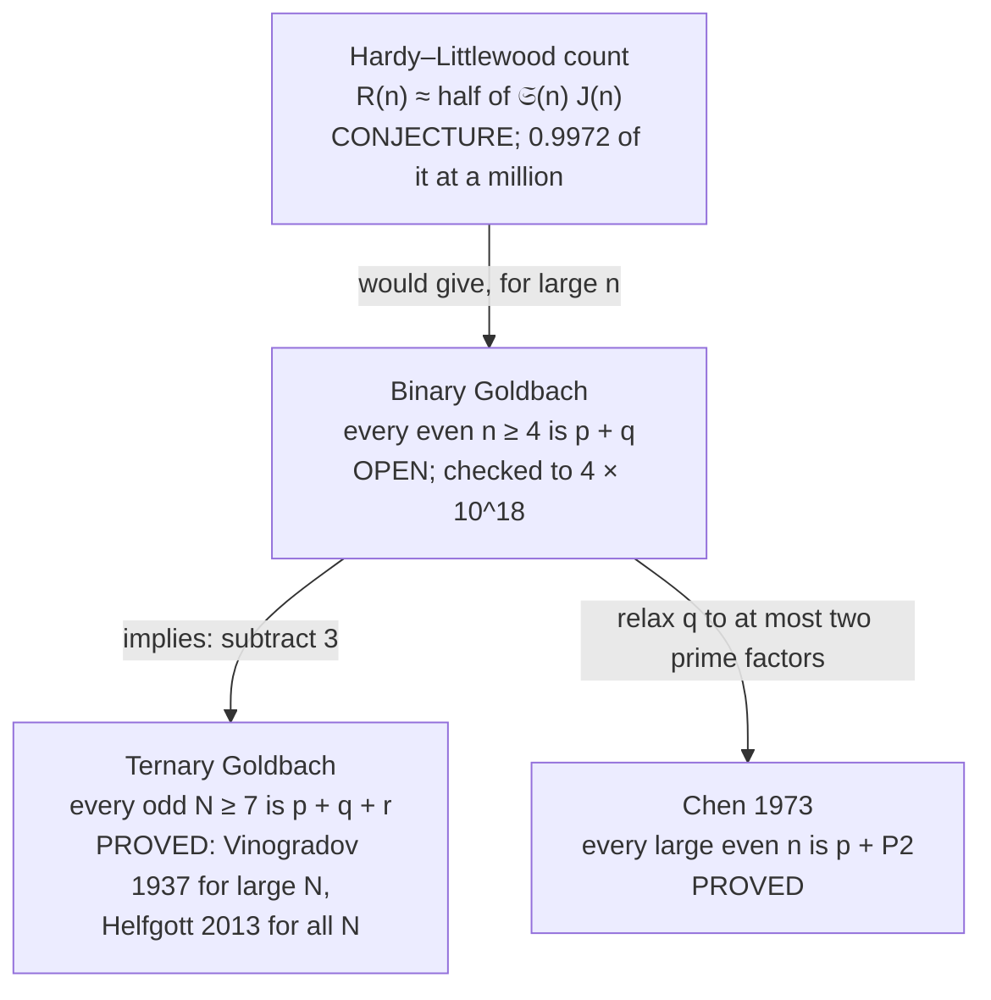

# Goldbach: every even number as two primes, and how far that is actually proved

[Syllabus](../../../SYLLABUS.md) → [Algebraic and analytic number theory](../README.md) → [Sieves and Prime Gaps](../README.md#s04) → Goldbach

---

## General Overview

One million is the sum of two primes in exactly **5,402** ways. The first is 17 + 999,983. The counting rule is the one [Goldbach, twin primes and friends](../../02-Number%20theory/07-For%20the%20Curious/04-goldbach-and-open-problems.md) uses for 100 = 3 + 97 = 11 + 89 = 17 + 83 = 29 + 71 and two more: each pair once, smaller prime first.

Goldbach's conjecture says every even number from 4 up has at least one such pair. A check of every even number up to a million finds a pair each time. The hardest case is 503,222, whose smallest working prime is 523. Published computer searches go much further, to 4 × 10^18, and find no failure. That is evidence, not proof.

So what is proved? Three results, each a step short of the full claim:

- **Vinogradov, 1937.** Every large enough odd number is the sum of three primes.
- **Helfgott, 2013.** "Large enough" removed: every odd number above 5 is the sum of three primes. For example, 1,000,001 = 3 + 19 + 999,979.
- **Chen, 1973.** Every large enough even number is a prime plus a number with at most two prime factors. For a million, 36,389 primes p leave a remainder 1,000,000 − p of that kind; only 10,804 leave a prime, which is each of the 5,402 pairs counted from both ends.

**Goldbach's two-prime claim is open; the three-prime version is a theorem, and so is the two-prime version with one prime relaxed to a product of at most two primes, for every large enough even number.**

**What kind of fact this is:** the binary (two-prime) conjecture is open as of 2026-11-15, checked by computer to 4 × 10^18 (Oliveira e Silva, Herzog and Pardi, 2014). The ternary (three-prime) theorem and Chen's theorem are proved, and quoted here with sources. Two smaller facts are proved on this card: binary implies ternary, and the local factor in the pair-count formula is a count of remainders. The Hardy–Littlewood pair count is a conjecture. The counts to a million are evidence.

### The picture: what is proved and what is not



Each arrow points from a stronger claim to a weaker one it gives. The two proved boxes, ternary and Chen, sit below the open binary claim. The Hardy–Littlewood count, also unproved, would give the binary claim for large n.

---

## The formula

Notation first, in words. This card introduces **R(n)**: the number of ways to write an even n as p + q with p and q prime and p ≤ q. So R(100) = 6 and R(1,000,000) = 5,402. The letters p, q and r always mean primes, and log is the natural logarithm. The sign ~ means the ratio of the two sides tends to 1 ([Big O and twiddle](../01-Arithmetic%20Functions%20Again/01-asymptotic-notation-and-error-terms.md)).

The quantitative form of Goldbach's conjecture is Hardy and Littlewood's 1923 prediction:

```math
R(n) \sim \tfrac{1}{2}\, \mathfrak{S}(n)\, J(n), \qquad \mathfrak{S}(n) = 2C_2 \prod_{p \mid n,\ p > 2} \frac{p - 1}{p - 2}, \qquad J(n) = \int_2^{n-2} \frac{dt}{\log t \, \log(n - t)}
```

**Read it aloud:** the number of prime pairs adding to n is about half of a local factor $`\mathfrak{S}(n)`$ times the integral J(n), where J(n) adds up the chance that t and n − t are both prime, and $`\mathfrak{S}(n)`$ corrects that chance for the small primes that divide n.

The twin-prime constant is $`C_2 = \prod_{p > 2} \bigl(1 - 1/(p-1)^2\bigr)`$. The product over the primes up to a million gives 0.660162.

The proved results have the same shape. Vinogradov's theorem counts three-prime sums with weights log p, which makes the main term clean:

```math
\sum_{p + q + r = N} \log p \, \log q \, \log r \sim \mathfrak{S}_3(N)\, \frac{N^2}{2}, \qquad \mathfrak{S}_3(N) = \prod_{p \mid N}\Bigl(1 - \frac{1}{(p-1)^2}\Bigr) \prod_{p \nmid N}\Bigl(1 + \frac{1}{(p-1)^3}\Bigr)
```

**Read it aloud:** for odd N, the ordered triples of primes adding to N, each weighted by its three logs, add up to about a local factor times N squared over 2.

Chen's theorem says that for every large enough even n,

```math
n = p + P_2, \qquad \#\{p \le n : n - p = P_2\} \gg \mathfrak{S}(n)\, \frac{n}{(\log n)^2}
```

**Read it aloud:** n is a prime plus a number $`P_2`$ that has at most two prime factors, counted with repeats, and the number of such primes p is at least a fixed fraction of the Hardy–Littlewood size.

| Symbol | Plain meaning | In our example | Push it up and the answer… |
| --- | --- | --- | --- |
| $`n`$, $`N`$ | the even target; the odd target | n = 1,000,000; N = 1,000,001 | more pairs, more triples |
| $`p, q, r`$ | primes in a sum | 17 + 999,983 | — |
| $`R(n)`$ | pairs p ≤ q of primes with p + q = n | 5,402 | grows like n/(log n)² |
| $`\#\{\ldots\}`$ | the number of elements in a set | 11,596,623 ordered triples of primes add to 100,001 | — |
| $`C_2`$ | the twin-prime constant | 0.660162 | — |
| $`\mathfrak{S}(n)`$, $`\mathfrak{S}_3(N)`$ | the binary and ternary local factors | 1.7604, from the 5 in a million; 2.2757 for N = 100,001 | larger when n has small odd prime factors |
| $`t`$, $`J(n)`$ | a point between 2 and n − 2; the integral of 1/(log t log(n − t)) | half of $`\mathfrak{S}(n)`$ J(n) is 5,417.1 | grows like n/(log n)² |
| $`P_2`$ | a number with at most two prime factors, counted with repeats | 999,983, or 6 = 2 × 3 | — |
| $`a`$ | a remainder after division by p, from 0 to p − 1 | for p = 3: 0, 1, 2 | — |
| $`\alpha`$, $`e(x)`$, $`F(\alpha)`$ | a point on the circle from 0 to 1; $`e^{2\pi i x}`$; the sum of e(pα) over primes p up to n | mean of $`\lvert F \rvert^2`$ is 168 for n = 1,000 | — |
| $`\pi(N)`$ | the number of primes up to N | 78,498 up to a million | — |
| $`\sim`$, $`\gg`$ | the ratio tends to 1; at least a fixed positive multiple of | R(n) against its prediction; Chen's lower bound | — |

The symbol e(x) is the one from [The large sieve](03-the-large-sieve.md). $`P_2`$ is not the $`P_2`$ of [Bounded gaps](05-bounded-gaps-zhang-maynard.md), which is a sum of squares there.

### When it holds

- **The binary statement needs n even.** For odd n, one prime must be 2. So 1,000,001 has 0 pairs, because 999,999 = 3³ × 7 × 11 × 13 × 37.
- **The ternary statement needs N odd and at least 7.** Three odd primes add to an odd number. An even N needs a 2, which reduces it to the binary problem.
- **Vinogradov's and Chen's theorems say "large enough".** Vinogradov's first proof gave no size at all: it rests on Siegel's ineffective constant ([Siegel-Walfisz](../03-Characters%20and%20L-functions/05-siegel-walfisz-in-outline.md)). Helfgott's proof makes every constant explicit and closes the gap with a computer check. Chen's theorem is quoted here only for large n.
- **The Hardy–Littlewood count needs the part of the local factor that depends on n.** With the single constant 2C₂ in its place, the formula predicts 4,062.8 pairs for both 999,998 and 1,000,002. The true counts are 4,206 and 8,200.
- **A count to a million is evidence, not proof.** One even number with no pair would end the conjecture.

---

## Why it works

This is an outline card. Two short facts are proved in full. The three big theorems are stated with their key idea and a source; Nathanson's book in Sources proves Vinogradov's and Chen's theorems completely.

### Step 0: the idea, a chance for each half

By the prime number theorem, a number near t is prime with chance about 1/log t ([The prime number theorem](../02-The%20Zeta%20Function%20and%20the%20Prime%20Number%20Theorem/05-prime-number-theorem-proved.md)). If t and n − t were prime independently, the pairs adding to n would number about the integral J(n). Half of it counts each pair once.

Primes are not independent near small primes. If n is even and t is an odd prime, n − t is odd for free. Whether n − t also avoids the multiples of 3 depends on n. The local factor $`\mathfrak{S}(n)`$ collects these corrections, one prime at a time. The circle method (Steps 3 to 5) and the sieve (Step 6) are two ways to make this picture rigorous.

### Step 1: the local factor is a count of remainders

Take a prime p above 2. Ask how many remainders a, from 0 to p − 1, leave both a and n − a off the multiples of p.

- **If p divides n**, then n − a has remainder −a. Both are nonzero exactly when a is: p − 1 remainders.
- **If p does not divide n**, the remainder a must avoid 0 and n: p − 2 remainders.

So an n divisible by p has (p − 1)/(p − 2) times as many good remainders: twice as many for p = 3.

The data shows it. 1,000,002 is divisible by 3 and 999,998 is not. Their pair counts are 8,200 and 4,206, and their local factors are 2.6407 and 1.3768. The formula, local factor included, lands at 8,125.7 and 4,236.5.

<details>
<summary>Detailed proof: where 2C₂ and the product come from</summary>

Compare the share of good remainders with what independence would give. Independently, a and n − a would each avoid 0 mod p with chance (p − 1)/p, so both with chance (p − 1)²/p².

If p does not divide n, the true share is (p − 2)/p. The correction is

$`\displaystyle \frac{(p-2)/p}{(p-1)^2/p^2} = \frac{p(p-2)}{(p-1)^2} = 1 - \frac{1}{(p-1)^2}.`$

If p divides n, the true share is (p − 1)/p, and the correction is p/(p − 1). That equals the previous factor times (p − 1)/(p − 2).

For p = 2 and n even, a odd forces n − a odd: share 1/2 against an independent 1/4, a factor 2. Multiply over all primes:

$`\displaystyle 2 \prod_{p > 2}\Bigl(1 - \frac{1}{(p-1)^2}\Bigr) \prod_{p \mid n,\ p > 2} \frac{p-1}{p-2} = \mathfrak{S}(n).`$

This proves the factor is the right correction for each prime alone. That the corrections then combine across all primes, with no further error, is exactly what nobody can prove.

</details>

### Step 2: two primes would give three

**If every even number from 4 up is a sum of two primes, every odd number from 7 up is a sum of three.** Proof: 7 = 2 + 2 + 3. An odd N from 9 up has N − 3 even and at least 6, so N − 3 = p + q and N = 3 + p + q.

The same step carries a finite check across. Every even number up to a million has a pair, so every odd number from 7 to 1,000,003 is three primes. For 1,000,001, the smallest pair of 999,998 is 19 + 999,979, giving 3 + 19 + 999,979.

The reverse fails. Three primes for every odd number say nothing about two primes for every even one.

### Step 3: the circle method counts with waves

Write e(x) for one full turn of the unit circle per unit of x. Over one full turn, e(mα) averages to 1 when m = 0 and to 0 for any other whole number m. That is the filter.

Let F(α) be the sum of e(pα) over the primes p up to n. Squaring gives a sum of e((p + q)α) over ordered pairs. Average it against e(−nα) and only the pairs with p + q = n survive:

```math
\int_0^1 F(\alpha)^2\, e(-n\alpha)\, d\alpha = \#\{(p, q) : p + q = n\}
```

That is 2R(n) whenever n/2 is not prime. With F cubed, the same average counts ordered triples. The code does this with 4,096 equally spaced values of α, which is exact here because no sum reaches 4,096. It gets 56 ordered pairs for 1,000, twice R(1,000) = 28, and 6,468 ordered triples for 1,001, the same as direct counting.

Hardy and Littlewood split the circle into two parts:

- **Major arcs**: α close to a fraction with a small denominator. There F(α) is large, and primes in progressions ([Siegel-Walfisz](../03-Characters%20and%20L-functions/05-siegel-walfisz-in-outline.md)) give its size. Adding these pieces produces the local factor and the main term.
- **Minor arcs**: the rest. There the waves should cancel, and the whole problem is to prove that they do.

### Step 4: why three primes are within reach and two are not

The size of F on average is known exactly. Averaging |F|² over the circle keeps only p = q, so the mean of |F|² is the number of primes up to n. The code gets 168 for n = 1,000, which is π(1,000).

**Three primes.** On the minor arcs, bound one factor of F by its largest value and the other two by the mean square:

```math
\Bigl| \int_{\text{minor}} F(\alpha)^3 e(-N\alpha)\, d\alpha \Bigr| \le \max_{\text{minor}} \lvert F \rvert \cdot \pi(N)
```

Vinogradov proved that on the minor arcs |F| is smaller than N divided by any fixed power of log N, once N is large. So the error is smaller than N² divided by any fixed power of log N. The main term has size N²/(log N)³, so it wins. The weighted count settles towards the prediction: its ratio to the main term is 0.8527, 0.9601 and 0.9889 at N = 1,001, 10,001 and 100,001.

**Two primes.** No factor is left over to bound by a maximum. The only general bound left for the minor arcs is the mean square itself. At a million that allowance is 78,498, and the count it must leave visible is 10,804 ordered pairs. The error room is far larger than the answer. No known estimate closes that gap.

### Step 5: Helfgott removes "large enough"

Vinogradov's first proof gave no size at all for "large enough": its major arcs used Siegel's theorem, whose constant cannot be computed. Later work made the size explicit, but far beyond any computer.

Helfgott redid both arcs with every constant explicit and sharp. The major arcs used a rigorous computer check that the zeros of the needed L-functions lie on the critical line up to a large height. The minor arcs used a sharpened large sieve ([The large sieve](03-the-large-sieve.md)). The threshold fell low enough for a direct computer check below it. His 2013 preprint proves that **every odd number above 5 is the sum of three primes.**

### Step 6: Chen gets within one prime factor

Chen sieved the numbers n − p, for primes p up to n, by the small primes ([Brun's sieve and Selberg's](02-brun-and-selberg-sieves.md)). Two inputs make it work:

- **Level of distribution.** The sieve needs the numbers n − p to spread evenly over the multiples of each d, for d up to about √n, on average. That is the Bombieri–Vinogradov theorem ([Bombieri-Vinogradov](04-bombieri-vinogradov.md)).
- **The parity barrier.** A sieve cannot tell an odd count of prime factors from an even one ([Sieving by inclusion-exclusion](01-the-legendre-sieve-and-the-parity-problem.md)). So it can never certify that n − p is prime. It can certify "at most two prime factors".

Chen's weighted count starts from the n − p with no prime factor below n^(1/10). It subtracts one half for each prime factor of n − p between n^(1/10) and n^(1/3), and a further half when n − p = p₁p₂p₃ with p₁ in that range and p₂, p₃ above n^(1/3). Two or more factors in that range leave a weight of 0 or less, and so does one there beside two above n^(1/3); three factors above n^(1/3) would multiply past n. So whatever keeps a positive weight has at most two prime factors. The few n − p with a repeated prime factor are counted apart, as a negligible error.

He bounded the last subtracted part by a "switching" trick: he counted it as a sieve problem on a different set, built from the products p₁p₂p₃ themselves. The lower bound stays positive.

At a million, 36,389 primes p make n − p prime or a product of two primes, and 10,804 of them make it prime. Chen's method proves the same for twins: infinitely many primes p have p + 2 prime or a product of two primes. Below a million there are 29,949 such p, including the 8,169 twin pairs of the shelf's house example.

### Step 7: almost every even number works

Averaging over n is easier than fixing one n, because averages need only mean squares. Montgomery and Vaughan proved in 1975 that, below any bound, the even numbers with no pair number at most a fixed power of the bound, with the power below 1. So almost all even numbers are sums of two primes. Whether every one is remains open.

---

## Worked numbers, by hand

The example: the Hardy–Littlewood prediction for one million, against the count.

| Step | Arithmetic | Value |
| --- | --- | --- |
| log of a million | natural log of 1,000,000 | 13.8155 |
| squared | 13.8155 × 13.8155 | 190.868 |
| crude density of pairs | 1,000,000 ÷ 190.868 | 5,239.2 |
| local factor | 2 × 0.660162 × (5 − 1)/(5 − 2), since 5 is the only odd prime dividing a million | 1.760432 |
| crude prediction | half of 1.760432 × 5,239.2 | 4,611.6 |
| with J(n) in place of n/(log n)² | half of 1.7604 × J(1,000,000) | 5,417.1 |
| true count | sieve, and again by Miller–Rabin | **5,402** |
| ratio | 5,402 ÷ 5,417.1 | 0.9972 |

The crude form is low because log t is below log n for most t, so 1/(log n)² understates each term.

The ratio settles as n grows, though not steadily:

| n | R(n) | prediction | ratio |
| --- | ---: | ---: | ---: |
| 100 | 6 | 7.1 | 0.8478 |
| 1,000 | 28 | 26.7 | 1.0474 |
| 10,000 | 127 | 134.8 | 0.9425 |
| 100,000 | 810 | 810.3 | 0.9996 |
| 1,000,000 | 5,402 | 5,417.1 | 0.9972 |

This is evidence for the conjecture, not proof of it.

### What breaks if you drop a piece

| Mistake | Comes out at | What went wrong |
| --- | --- | --- |
| Asking for two primes adding to the odd 1,000,001 | 0 pairs | An odd sum needs the prime 2, and 999,999 = 3³ × 7 × 11 × 13 × 37 |
| Using the constant 2C₂ in place of the local factor | 4,062.8 for both 999,998 and 1,000,002; true 4,206 and 8,200 | 3 divides 1,000,002, which doubles its good remainders mod 3 |
| Reading Chen's theorem as Goldbach | 36,389 splits, against 10,804 ordered prime pairs | Most of Chen's splits have n − p a product of two primes |
| Running Vinogradov's argument with two primes | error room 78,498, against 10,804 ordered pairs | With two factors of F, no maximum is left to save on |

The last row is the hypothesis that fails: three primes, not two. The code prints every row.

---

## Code, from first principles, and it actually runs

The code builds the smallest prime factor of every number up to 1,000,002, and from it the primes. It reaches R(1,000,000) by two roads: the sieve, and a Miller–Rabin test written out, which shares no step with it. It checks every even number up to a million for a pair. It computes the circle-method integral with complex waves for 1,000 and 1,001, and checks it against direct counts. It compares the counts with the Hardy–Littlewood prediction, using Simpson's rule for J(n), and the three-prime weighted counts with Vinogradov's main term. The twin-prime constant is a product over the primes up to a million.

### Python

```python
# Goldbach and Chen's theorem -- the check behind the card.  Standard library
# only: math supplies log, cos and sin.  Every prime, count and constant is
# computed here.  Roads to each answer: a smallest-factor sieve against a
# Miller-Rabin test written out; direct counts against the circle-method
# integral; counts against the Hardy-Littlewood and Vinogradov predictions.
import math

N = 1_000_002
spf = list(range(N + 1))                          # smallest prime factor of m
for i in range(2, 1001):
    if spf[i] == i:
        for k in range(i * i, N + 1, i):
            if spf[k] == k:
                spf[k] = i
P = [m for m in range(2, N + 1) if spf[m] == m]

def is_p(m): return m > 1 and spf[m] == m

def factors(m):                                   # prime factors, with repeats
    out = []
    while m > 1:
        out.append(spf[m]); m //= spf[m]
    return out

def miller_rabin(m):                              # road two; bases 2, 3, 5, 7 are exact below 3.2e9
    for a in (2, 3, 5, 7):
        if m % a == 0: return m == a
    d, s = m - 1, 0
    while d % 2 == 0: d, s = d // 2, s + 1
    for a in (2, 3, 5, 7):
        x = pow(a, d, m)
        if x == 1 or x == m - 1: continue
        for _ in range(s - 1):
            x = x * x % m
            if x == m - 1: break
        else: return False
    return m > 1

def pairs(n):                                     # smaller prime p of each p + q = n
    out = []
    for p in P:
        if p > n // 2: break
        if is_p(n - p): out.append(p)
    return out

C2 = 1.0                                          # twin-prime constant, primes to 10^6
for p in P[1:]: C2 *= 1 - 1 / (p - 1) ** 2

def sing(n):                                      # Hardy-Littlewood local factor sing(n)
    s = 2 * C2
    for p in set(factors(n)):
        if p > 2: s *= (p - 1) / (p - 2)
    return s

def j_int(n, steps=2_000_000):                      # Simpson's rule for the integral J(n)
    a, h = 2.0, (n - 4.0) / steps
    f = lambda t: 1 / (math.log(t) * math.log(n - t))
    s = f(a) + f(n - 2.0)
    for i in range(1, steps): s += (4 if i % 2 else 2) * f(a + i * h)
    return s * h / 3

def circle(n, k, M=4096):                         # (1/M) sum of F(a)^k e(-n a) over a = j/M
    tot, sq, ps = 0.0, 0.0, [p for p in P if p <= n]
    for j in range(M):
        re = sum(math.cos(2 * math.pi * p * j / M) for p in ps)
        im = sum(math.sin(2 * math.pi * p * j / M) for p in ps)
        z = complex(re, im) ** k * complex(math.cos(2 * math.pi * n * j / M), -math.sin(2 * math.pi * n * j / M))
        tot += z.real; sq += re * re + im * im
    return tot / M, sq / M

n = 10 ** 6
first = pairs(100)[:4]
print("100 = " + " = ".join(f"{p} + {100 - p}" for p in first) + f" (4 of {len(pairs(100))})")
R = pairs(n)
R_mr = sum(1 for p in range(2, n // 2 + 1) if miller_rabin(p) and miller_rabin(n - p))
print(f"primes up to 1000000: {sum(1 for p in P if p <= n)}")
print(f"R(1000000) = {len(R)} by the sieve, {R_mr} by Miller-Rabin; smallest pair {R[0]} + {n - R[0]}")
worst, where, ok = 0, 0, True
for m in range(4, n + 1, 2):
    p = next((p for p in P if is_p(m - p)), None)
    if p is None: ok = False; break
    if p > worst: worst, where = p, m
print(f"every even n from 4 to 1000000 has a pair: {'yes' if ok else 'no'}; largest smallest prime {worst}, at n = {where}")
w = pairs(999998)[0]
print(f"so every odd N from 7 to 1000003 is three primes; 1000001 = 3 + {w} + {999998 - w}")
print(f"twin-prime constant C2, primes to a million: {C2:.6f}")
print("n | factors | sing(n) | R(n) | sing n/(2 log^2 n) | sing J/2 | R/(sing J/2)")
hl = {}
for m in (100, 1000, 10 ** 4, 10 ** 5, 10 ** 6, 999998, 1000002):
    pred = sing(m) * j_int(m) / 2
    hl[m] = len(pairs(m)) / pred
    print(f"{m} | {factors(m)} | {sing(m):.4f} | {len(pairs(m))} | {sing(m) * m / math.log(m) ** 2 / 2:.1f} | {pred:.1f} | {hl[m]:.4f}")
L = math.log(n)
print(f"by hand, n = 1000000: log n = {L:.4f}, squared {L * L:.3f}, n over that {n / (L * L):.1f}; "
      f"sing = 2 x {C2:.6f} x 4/3 = {sing(n):.6f}; half the product {sing(n) * n / (L * L) / 2:.1f}")
print("N | sing3(N) | ordered triples | sum log p log q log r | sing3 N^2/2 | ratio")
vin = []
for T in (1001, 10001, 100001):
    s3 = 1.0
    for p in P: s3 *= (1 - 1 / (p - 1) ** 2) if T % p == 0 else (1 + 1 / (p - 1) ** 3)
    ps, cnt, wt = [p for p in P if p < T], 0, 0.0
    for p in ps:
        for q in ps:
            r = T - p - q
            if r < 2: break
            if is_p(r): cnt += 1; wt += math.log(p) * math.log(q) * math.log(r)
    vin.append((cnt, wt / (s3 * T * T / 2)))
    print(f"{T} | {s3:.4f} | {cnt} | {wt:.0f} | {s3 * T * T / 2:.0f} | {vin[-1][1]:.4f}")
c2, pars = circle(1000, 2)
c3, _ = circle(1001, 3)
print(f"circle method, 4096 points: ordered pairs of 1000 = {c2:.3f}, ordered triples of 1001 = {c3:.3f}, mean |F|^2 = {pars:.3f}")
chen = sum(1 for p in P if p <= n - 2 and len(factors(n - p)) <= 2)
twin_chen = sum(1 for p in P if p < n and len(factors(p + 2)) <= 2)
twins = sum(1 for p in P if p < n and is_p(p + 2))
print(f"Chen: p from 2 to n - 2 with n - p prime or two primes: {chen}, of which {2 * len(R)} have n - p prime")
print(f"Chen's twin form: p below a million with p + 2 prime or two primes: {twin_chen}, of which {twins} are twins")
print(f"mistake 1, two primes for odd 1000001: {len(pairs(1000001))} ways, since 999999 = {factors(999999)}")
print(f"mistake 2, no local factor: predicts {C2 * j_int(999998):.1f} for 999998 and {C2 * j_int(1000002):.1f} for 1000002; "
      f"true {len(pairs(999998))} and {len(pairs(1000002))}")
print(f"mistake 3, Chen read as Goldbach: {chen} against {2 * len(R)} ordered prime pairs")
print(f"mistake 4, two primes in Vinogradov's budget: error room {sum(1 for p in P if p <= n)} against {2 * len(R)} ordered pairs")
assert len(R) == R_mr == 5402                                 # sieve against Miller-Rabin
assert round(c2) == 2 * len(pairs(1000)) and round(c3) == vin[0][0]   # circle method against counting
assert round(pars) == sum(1 for p in P if p <= 1000)          # Parseval: mean |F|^2 is pi(1000)
assert abs(hl[10 ** 6] - 1) < 0.01 and abs(hl[999998] - 1) < 0.01 and abs(hl[1000002] - 1) < 0.01
assert vin[0][1] < vin[1][1] < vin[2][1] < 1 and vin[2][1] > 0.98
assert ok and miller_rabin(w) and miller_rabin(999998 - w) and chen > 2 * len(R) and twin_chen > twins
print("ALL CHECKS PASS")
```

**Ran 2026-11-15 on macOS, Python 3.14.10, standard library only. All checks passed. Output, pasted from the run:**

```
100 = 3 + 97 = 11 + 89 = 17 + 83 = 29 + 71 (4 of 6)
primes up to 1000000: 78498
R(1000000) = 5402 by the sieve, 5402 by Miller-Rabin; smallest pair 17 + 999983
every even n from 4 to 1000000 has a pair: yes; largest smallest prime 523, at n = 503222
so every odd N from 7 to 1000003 is three primes; 1000001 = 3 + 19 + 999979
twin-prime constant C2, primes to a million: 0.660162
n | factors | sing(n) | R(n) | sing n/(2 log^2 n) | sing J/2 | R/(sing J/2)
100 | [2, 2, 5, 5] | 1.7604 | 6 | 4.2 | 7.1 | 0.8478
1000 | [2, 2, 2, 5, 5, 5] | 1.7604 | 28 | 18.4 | 26.7 | 1.0474
10000 | [2, 2, 2, 2, 5, 5, 5, 5] | 1.7604 | 127 | 103.8 | 134.8 | 0.9425
100000 | [2, 2, 2, 2, 2, 5, 5, 5, 5, 5] | 1.7604 | 810 | 664.1 | 810.3 | 0.9996
1000000 | [2, 2, 2, 2, 2, 2, 5, 5, 5, 5, 5, 5] | 1.7604 | 5402 | 4611.6 | 5417.1 | 0.9972
999998 | [2, 31, 127, 127] | 1.3768 | 4206 | 3606.6 | 4236.5 | 0.9928
1000002 | [2, 3, 166667] | 2.6407 | 8200 | 6917.5 | 8125.7 | 1.0091
by hand, n = 1000000: log n = 13.8155, squared 190.868, n over that 5239.2; sing = 2 x 0.660162 x 4/3 = 1.760432; half the product 4611.6
N | sing3(N) | ordered triples | sum log p log q log r | sing3 N^2/2 | ratio
1001 | 2.1857 | 6468 | 933720 | 1095041 | 0.8527
10001 | 2.3004 | 255348 | 110447536 | 115042316 | 0.9601
100001 | 2.2757 | 11596623 | 11252862526 | 11378608696 | 0.9889
circle method, 4096 points: ordered pairs of 1000 = 56.000, ordered triples of 1001 = 6468.000, mean |F|^2 = 168.000
Chen: p from 2 to n - 2 with n - p prime or two primes: 36389, of which 10804 have n - p prime
Chen's twin form: p below a million with p + 2 prime or two primes: 29949, of which 8169 are twins
mistake 1, two primes for odd 1000001: 0 ways, since 999999 = [3, 3, 3, 7, 11, 13, 37]
mistake 2, no local factor: predicts 4062.8 for 999998 and 4062.8 for 1000002; true 4206 and 8200
mistake 3, Chen read as Goldbach: 36389 against 10804 ordered prime pairs
mistake 4, two primes in Vinogradov's budget: error room 78498 against 10804 ordered pairs
ALL CHECKS PASS
```

### Rust

Same numbers, same labels, built with `rustc --edition 2021 -O`.

```rust
// Goldbach and Chen's theorem -- the same check as the Python, in Rust.  No
// crates.  Every prime, count and constant is computed here.  Roads to each
// answer: a smallest-factor sieve against a Miller-Rabin test written out;
// direct counts against the circle-method integral; counts against the
// Hardy-Littlewood and Vinogradov predictions.
use std::f64::consts::PI;

struct Sieve { spf: Vec<usize>, p: Vec<usize> }

impl Sieve {
    fn is_p(&self, m: usize) -> bool { m > 1 && self.spf[m] == m }
    fn factors(&self, mut m: usize) -> Vec<usize> {      // prime factors, with repeats
        let mut out = Vec::new();
        while m > 1 { out.push(self.spf[m]); m /= self.spf[m]; }
        out
    }
    fn pairs(&self, n: usize) -> Vec<usize> {             // smaller prime p of each p + q = n
        self.p.iter().copied().take_while(|&p| p <= n / 2).filter(|&p| self.is_p(n - p)).collect()
    }
    fn pi(&self, x: usize) -> usize { self.p.iter().filter(|&&p| p <= x).count() }
}

fn pow_mod(mut a: u128, mut e: u128, m: u128) -> u128 {
    let mut r = 1u128;
    a %= m;
    while e > 0 {
        if e & 1 == 1 { r = r * a % m; }
        a = a * a % m;
        e >>= 1;
    }
    r
}

fn miller_rabin(m: u128) -> bool {                        // road two; bases 2, 3, 5, 7 are exact below 3.2e9
    for a in [2u128, 3, 5, 7] { if m % a == 0 { return m == a; } }
    let (mut d, mut s) = (m - 1, 0);
    while d % 2 == 0 { d /= 2; s += 1; }
    'base: for a in [2u128, 3, 5, 7] {
        let mut x = pow_mod(a, d, m);
        if x == 1 || x == m - 1 { continue; }
        for _ in 0..s - 1 {
            x = x * x % m;
            if x == m - 1 { continue 'base; }
        }
        return false;
    }
    m > 1
}

fn j_int(n: f64) -> f64 {                                   // Simpson's rule for the integral
    let steps = 2_000_000;
    let (a, h) = (2.0, (n - 4.0) / steps as f64);
    let f = |t: f64| 1.0 / (t.ln() * (n - t).ln());
    let mut s = f(a) + f(n - 2.0);
    for i in 1..steps { s += (if i % 2 == 1 { 4.0 } else { 2.0 }) * f(a + i as f64 * h); }
    s * h / 3.0
}

fn circle(sv: &Sieve, n: usize, k: i32) -> (f64, f64) {   // (1/M) sum of F(a)^k e(-n a) over a = j/M
    let m = 4096usize;
    let ps: Vec<usize> = sv.p.iter().copied().filter(|&p| p <= n).collect();
    let (mut tot, mut sq) = (0.0, 0.0);
    for j in 0..m {
        let re: f64 = ps.iter().map(|&p| (2.0 * PI * p as f64 * j as f64 / m as f64).cos()).sum();
        let im: f64 = ps.iter().map(|&p| (2.0 * PI * p as f64 * j as f64 / m as f64).sin()).sum();
        let (mut zr, mut zi) = (1.0, 0.0);
        for _ in 0..k { let t = zr * re - zi * im; zi = zr * im + zi * re; zr = t; }
        let ang = 2.0 * PI * n as f64 * j as f64 / m as f64;
        let (cr, ci) = (ang.cos(), -ang.sin());
        tot += zr * cr - zi * ci;
        sq += re * re + im * im;
    }
    (tot / m as f64, sq / m as f64)
}

fn main() {
    let big = 1_000_002usize;
    let mut spf: Vec<usize> = (0..=big).collect();
    for i in 2..1001 {
        if spf[i] == i { let mut k = i * i; while k <= big { if spf[k] == k { spf[k] = i; } k += i; } }
    }
    let p: Vec<usize> = (2..=big).filter(|&m| spf[m] == m).collect();
    let sv = Sieve { spf, p };
    let c2: f64 = sv.p[1..].iter().fold(1.0, |c, &q| c * (1.0 - 1.0 / ((q - 1) as f64).powi(2)));
    let sing = |n: usize| {
        let mut f = sv.factors(n);
        f.dedup();
        f.iter().filter(|&&q| q > 2).fold(2.0 * c2, |s, &q| s * (q - 1) as f64 / (q - 2) as f64)
    };
    let n = 1_000_000usize;
    let h: Vec<String> = sv.pairs(100)[..4].iter().map(|q| format!("{} + {}", q, 100 - q)).collect();
    println!("100 = {} (4 of {})", h.join(" = "), sv.pairs(100).len());
    let r = sv.pairs(n);
    let r_mr = (2..=n / 2).filter(|&q| miller_rabin(q as u128) && miller_rabin((n - q) as u128)).count();
    println!("primes up to 1000000: {}", sv.pi(n));
    println!("R(1000000) = {} by the sieve, {} by Miller-Rabin; smallest pair {} + {}", r.len(), r_mr, r[0], n - r[0]);
    let (mut worst, mut at, mut ok) = (0, 0, true);
    for m in (4..=n).step_by(2) {
        match sv.p.iter().copied().find(|&q| sv.is_p(m - q)) {
            None => { ok = false; break; }
            Some(q) => if q > worst { worst = q; at = m; },
        }
    }
    println!("every even n from 4 to 1000000 has a pair: {}; largest smallest prime {}, at n = {}", if ok { "yes" } else { "no" }, worst, at);
    let w = sv.pairs(999998)[0];
    println!("so every odd N from 7 to 1000003 is three primes; 1000001 = 3 + {} + {}", w, 999998 - w);
    println!("twin-prime constant C2, primes to a million: {:.6}", c2);
    println!("n | factors | sing(n) | R(n) | sing n/(2 log^2 n) | sing J/2 | R/(sing J/2)");
    let mut hl = std::collections::HashMap::new();
    for m in [100usize, 1000, 10000, 100000, 1000000, 999998, 1000002] {
        let pred = sing(m) * j_int(m as f64) / 2.0;
        let rm = sv.pairs(m).len();
        hl.insert(m, rm as f64 / pred);
        println!("{} | {:?} | {:.4} | {} | {:.1} | {:.1} | {:.4}", m, sv.factors(m), sing(m), rm,
                 sing(m) * m as f64 / (m as f64).ln().powi(2) / 2.0, pred, hl[&m]);
    }
    let l = (n as f64).ln();
    println!("by hand, n = 1000000: log n = {:.4}, squared {:.3}, n over that {:.1}; sing = 2 x {:.6} x 4/3 = {:.6}; half the product {:.1}",
             l, l * l, n as f64 / (l * l), c2, sing(n), sing(n) * n as f64 / (l * l) / 2.0);
    println!("N | sing3(N) | ordered triples | sum log p log q log r | sing3 N^2/2 | ratio");
    let mut vin: Vec<(usize, f64)> = Vec::new();
    for t in [1001usize, 10001, 100001] {
        let s3 = sv.p.iter().fold(1.0, |s, &q| {
            let d = (q - 1) as f64;
            if t % q == 0 { s * (1.0 - 1.0 / d.powi(2)) } else { s * (1.0 + 1.0 / d.powi(3)) }
        });
        let ps: Vec<usize> = sv.p.iter().copied().filter(|&q| q < t).collect();
        let (mut cnt, mut wt) = (0usize, 0.0f64);
        for &a in &ps {
            for &b in &ps {
                if a + b + 2 > t { break; }
                let c = t - a - b;
                if sv.is_p(c) { cnt += 1; wt += (a as f64).ln() * (b as f64).ln() * (c as f64).ln(); }
            }
        }
        let main = s3 * (t * t) as f64 / 2.0;
        vin.push((cnt, wt / main));
        println!("{} | {:.4} | {} | {:.0} | {:.0} | {:.4}", t, s3, cnt, wt, main, wt / main);
    }
    let (cp, pars) = circle(&sv, 1000, 2);
    let (ct, _) = circle(&sv, 1001, 3);
    println!("circle method, 4096 points: ordered pairs of 1000 = {:.3}, ordered triples of 1001 = {:.3}, mean |F|^2 = {:.3}", cp, ct, pars);
    let chen = sv.p.iter().filter(|&&q| q <= n - 2 && sv.factors(n - q).len() <= 2).count();
    let twin_chen = sv.p.iter().filter(|&&q| q < n && sv.factors(q + 2).len() <= 2).count();
    let twins = sv.p.iter().filter(|&&q| q < n && sv.is_p(q + 2)).count();
    println!("Chen: p from 2 to n - 2 with n - p prime or two primes: {}, of which {} have n - p prime", chen, 2 * r.len());
    println!("Chen's twin form: p below a million with p + 2 prime or two primes: {}, of which {} are twins", twin_chen, twins);
    println!("mistake 1, two primes for odd 1000001: {} ways, since 999999 = {:?}", sv.pairs(1000001).len(), sv.factors(999999));
    println!("mistake 2, no local factor: predicts {:.1} for 999998 and {:.1} for 1000002; true {} and {}",
             c2 * j_int(999998.0), c2 * j_int(1000002.0), sv.pairs(999998).len(), sv.pairs(1000002).len());
    println!("mistake 3, Chen read as Goldbach: {} against {} ordered prime pairs", chen, 2 * r.len());
    println!("mistake 4, two primes in Vinogradov's budget: error room {} against {} ordered pairs", sv.pi(n), 2 * r.len());
    assert!(r.len() == r_mr && r_mr == 5402);                                     // sieve against Miller-Rabin
    assert!(cp.round() as usize == 2 * sv.pairs(1000).len() && ct.round() as usize == vin[0].0);
    assert!(pars.round() as usize == sv.pi(1000));                                 // Parseval: mean |F|^2 is pi(1000)
    assert!((hl[&1000000] - 1.0).abs() < 0.01 && (hl[&999998] - 1.0).abs() < 0.01 && (hl[&1000002] - 1.0).abs() < 0.01);
    assert!(vin[0].1 < vin[1].1 && vin[1].1 < vin[2].1 && vin[2].1 < 1.0 && vin[2].1 > 0.98);
    assert!(ok && miller_rabin(w as u128) && miller_rabin((999998 - w) as u128) && chen > 2 * r.len() && twin_chen > twins);
    println!("ALL CHECKS PASS");
}
```

**Ran 2026-11-15 on macOS, rustc 1.98.1, no crates. All checks passed. Output, pasted from the run:**

```
100 = 3 + 97 = 11 + 89 = 17 + 83 = 29 + 71 (4 of 6)
primes up to 1000000: 78498
R(1000000) = 5402 by the sieve, 5402 by Miller-Rabin; smallest pair 17 + 999983
every even n from 4 to 1000000 has a pair: yes; largest smallest prime 523, at n = 503222
so every odd N from 7 to 1000003 is three primes; 1000001 = 3 + 19 + 999979
twin-prime constant C2, primes to a million: 0.660162
n | factors | sing(n) | R(n) | sing n/(2 log^2 n) | sing J/2 | R/(sing J/2)
100 | [2, 2, 5, 5] | 1.7604 | 6 | 4.2 | 7.1 | 0.8478
1000 | [2, 2, 2, 5, 5, 5] | 1.7604 | 28 | 18.4 | 26.7 | 1.0474
10000 | [2, 2, 2, 2, 5, 5, 5, 5] | 1.7604 | 127 | 103.8 | 134.8 | 0.9425
100000 | [2, 2, 2, 2, 2, 5, 5, 5, 5, 5] | 1.7604 | 810 | 664.1 | 810.3 | 0.9996
1000000 | [2, 2, 2, 2, 2, 2, 5, 5, 5, 5, 5, 5] | 1.7604 | 5402 | 4611.6 | 5417.1 | 0.9972
999998 | [2, 31, 127, 127] | 1.3768 | 4206 | 3606.6 | 4236.5 | 0.9928
1000002 | [2, 3, 166667] | 2.6407 | 8200 | 6917.5 | 8125.7 | 1.0091
by hand, n = 1000000: log n = 13.8155, squared 190.868, n over that 5239.2; sing = 2 x 0.660162 x 4/3 = 1.760432; half the product 4611.6
N | sing3(N) | ordered triples | sum log p log q log r | sing3 N^2/2 | ratio
1001 | 2.1857 | 6468 | 933720 | 1095041 | 0.8527
10001 | 2.3004 | 255348 | 110447536 | 115042316 | 0.9601
100001 | 2.2757 | 11596623 | 11252862526 | 11378608696 | 0.9889
circle method, 4096 points: ordered pairs of 1000 = 56.000, ordered triples of 1001 = 6468.000, mean |F|^2 = 168.000
Chen: p from 2 to n - 2 with n - p prime or two primes: 36389, of which 10804 have n - p prime
Chen's twin form: p below a million with p + 2 prime or two primes: 29949, of which 8169 are twins
mistake 1, two primes for odd 1000001: 0 ways, since 999999 = [3, 3, 3, 7, 11, 13, 37]
mistake 2, no local factor: predicts 4062.8 for 999998 and 4062.8 for 1000002; true 4206 and 8200
mistake 3, Chen read as Goldbach: 36389 against 10804 ordered prime pairs
mistake 4, two primes in Vinogradov's budget: error room 78498 against 10804 ordered pairs
ALL CHECKS PASS
```

The two outputs match line for line.

### Lean

Lean proves the card's two short facts and the circle-method count in general, and checks the worked numbers exactly.

- Suppose every even number from 4 up is a sum of two primes. Then every odd number from 7 up is a sum of three primes.
- Take a prime p above 2 and a whole number n. Count the remainders a, from 0 to p − 1, that leave both a and n − a off the multiples of p. Then the count is p − 1 when p divides n, and p − 2 when it does not.
- Take a whole number n, and let F(α) be the sum of e(pα) over the primes p up to n. Then the integral of F(α)² e(−nα) from 0 to 1 counts the ordered pairs of primes adding to n.
- The worked sums are exact: four pairs for 100, R(100) = 6, 17 + 999,983, 7 = 2 + 2 + 3 and 3 + 19 + 999,979.
- The factors of 999,999, 999,998 and 1,000,002 are exact, and so are the remainder counts 2 and 1 at p = 3.

The counts to a million, the circle-method sums at 4,096 points and the Hardy–Littlewood and Vinogradov ratios are left to the Python and Rust checks.

```lean
-- Goldbach: if every even number from 4 up is two primes then every odd number from 7 up is three primes, the local factor counts p - 1 or p - 2 good remainders mod p, the circle-method integral counts the ordered prime pairs exactly, and the card's whole-number examples are exact.
import Mathlib.Analysis.SpecialFunctions.Integrals.Basic
import Mathlib.Analysis.SpecialFunctions.Complex.Circle
import Mathlib.Data.ZMod.Basic
import Mathlib.Tactic.NormNum.Prime
import Mathlib.Tactic.Simproc.Factors

open Complex

theorem integral_exp_two_pi_int (k : ℤ) :
    ∫ α in (0 : ℝ)..1, exp (2 * Real.pi * I * (k : ℂ) * (α : ℂ)) = if k = 0 then 1 else 0 := by
  split_ifs with hk
  · subst hk; simp
  · have hc : (2 * Real.pi * I * (k : ℂ)) ≠ 0 := by
      have : (k : ℂ) ≠ 0 := by exact_mod_cast hk
      have hpi : (Real.pi : ℂ) ≠ 0 := by exact_mod_cast Real.pi_ne_zero
      simp [hpi, I_ne_zero, this]
    rw [integral_exp_mul_complex hc]
    have h1 : exp (2 * Real.pi * I * (k : ℂ)) = 1 := by
      rw [← exp_int_mul_two_pi_mul_I k]; congr 1; ring
    simp [h1]

#print axioms integral_exp_two_pi_int

/-- Two primes would give three: if every even number from 4 up is the sum of two primes
(binary Goldbach), then every odd number from 7 up is the sum of three primes
(ternary Goldbach). The binary claim is open; this implication is proved on the card. -/
theorem binary_goldbach_implies_ternary
    (hbin : ∀ n : ℕ, Even n → 4 ≤ n → ∃ p q : ℕ, p.Prime ∧ q.Prime ∧ p + q = n) :
    ∀ N : ℕ, Odd N → 7 ≤ N → ∃ p q r : ℕ, p.Prime ∧ q.Prime ∧ r.Prime ∧ p + q + r = N := by
  intro N hN h7
  obtain ⟨p, q, hp, hq, hpq⟩ := hbin (N - 3) (by
    obtain ⟨k, hk⟩ := hN; exact ⟨k - 1, by omega⟩) (by omega)
  exact ⟨p, q, 3, hp, hq, Nat.prime_three, by omega⟩

/-- The local factor is a count of remainders: for a prime p above 2, the remainders a mod p
with both a and n - a off the multiples of p number p - 1 when p divides n, and p - 2 when
it does not. -/
theorem local_factor_good_remainders (p n : ℕ) [Fact p.Prime] (hp : 2 < p) :
    (Finset.univ.filter (fun a : ZMod p => a ≠ 0 ∧ (n : ZMod p) - a ≠ 0)).card =
      if p ∣ n then p - 1 else p - 2 := by
  have hset : Finset.univ.filter (fun a : ZMod p => a ≠ 0 ∧ (n : ZMod p) - a ≠ 0) =
      ((Finset.univ.erase (0 : ZMod p)).erase (n : ZMod p)) := by
    ext a; simp [sub_ne_zero, and_comm, eq_comm]
  rw [hset]
  split_ifs with h
  · have h0 : (n : ZMod p) = 0 := (ZMod.natCast_eq_zero_iff n p).2 h
    rw [h0, Finset.erase_eq_of_notMem (by simp), Finset.card_erase_of_mem (by simp),
      Finset.card_univ, ZMod.card]
  · have h0 : (n : ZMod p) ≠ 0 := fun e => h ((ZMod.natCast_eq_zero_iff n p).1 e)
    rw [Finset.card_erase_of_mem (by simp [h0]), Finset.card_erase_of_mem (by simp),
      Finset.card_univ, ZMod.card]
    omega

/-- The circle method counts with waves: with F(α) the sum of e(pα) = exp(2πipα) over the
primes p up to n, the integral of F(α)² e(-nα) over one turn 0 ≤ α ≤ 1 is exactly the number
of ordered pairs (p, q) of primes with p + q = n. -/
theorem circle_method_counts_ordered_pairs (n : ℕ) :
    ∫ α in (0 : ℝ)..1,
        (∑ p ∈ (Finset.range (n + 1)).filter Nat.Prime,
            exp (2 * Real.pi * I * (p : ℂ) * (α : ℂ))) ^ 2 *
          exp (-(2 * Real.pi * I * (n : ℂ) * (α : ℂ))) =
      ((((Finset.range (n + 1)) ×ˢ (Finset.range (n + 1))).filter
          (fun x : ℕ × ℕ => x.1.Prime ∧ x.2.Prime ∧ x.1 + x.2 = n)).card : ℂ) := by
  set S := (Finset.range (n + 1)).filter Nat.Prime with hS
  have hfun : (fun α : ℝ => (∑ p ∈ S, exp (2 * Real.pi * I * (p : ℂ) * (α : ℂ))) ^ 2 *
          exp (-(2 * Real.pi * I * (n : ℂ) * (α : ℂ)))) =
      fun α : ℝ => ∑ x ∈ S ×ˢ S,
        exp (2 * Real.pi * I * (((x.1 + x.2 : ℕ) : ℤ) - (n : ℤ) : ℤ) * (α : ℂ)) := by
    funext α
    rw [sq, Finset.sum_mul_sum, Finset.sum_mul, Finset.sum_product]
    refine Finset.sum_congr rfl fun i _ => ?_
    rw [Finset.sum_mul]
    refine Finset.sum_congr rfl fun j _ => ?_
    rw [← exp_add, ← exp_add]; congr 1; push_cast; ring
  rw [hfun, intervalIntegral.integral_finsetSum]
  · simp_rw [integral_exp_two_pi_int]
    rw [Finset.sum_ite, Finset.sum_const_zero, add_zero, Finset.sum_const, nsmul_eq_mul, mul_one]
    congr 1
    norm_cast
    congr 1
    ext x
    simp [hS, Finset.mem_product]
    tauto
  · intro x _
    exact (Continuous.intervalIntegrable (by fun_prop) _ _)

/-! The card's whole-number examples. -/

-- 100 = 3 + 97 = 11 + 89 = 17 + 83 = 29 + 71, four of its six pairs.
example : (3 : ℕ).Prime ∧ (97 : ℕ).Prime ∧ 3 + 97 = 100 := by norm_num
example : (11 : ℕ).Prime ∧ (89 : ℕ).Prime ∧ 11 + 89 = 100 := by norm_num
example : (17 : ℕ).Prime ∧ (83 : ℕ).Prime ∧ 17 + 83 = 100 := by norm_num
example : (29 : ℕ).Prime ∧ (71 : ℕ).Prime ∧ 29 + 71 = 100 := by norm_num
-- R(100) = 6: pairs p ≤ q of primes adding to 100.
example : ((Finset.Icc 2 50).filter (fun p => p.Prime ∧ (100 - p).Prime)).card = 6 := by decide
-- The smallest pair of a million: 17 + 999,983.
example : (17 : ℕ).Prime ∧ (999983 : ℕ).Prime ∧ 17 + 999983 = 1000000 := by norm_num
-- Ternary: 7 = 2 + 2 + 3, and 1,000,001 = 3 + 19 + 999,979.
example : (2 : ℕ).Prime ∧ (3 : ℕ).Prime ∧ 2 + 2 + 3 = 7 := by norm_num
example : (3 : ℕ).Prime ∧ (19 : ℕ).Prime ∧ (999979 : ℕ).Prime ∧ 3 + 19 + 999979 = 1000001 := by
  norm_num
-- 1,000,001 has no pair: one prime would be 2, and 999,999 = 3³ × 7 × 11 × 13 × 37.
example : 999999 = 3 ^ 3 * 7 * 11 * 13 * 37 ∧ 1000001 - 2 = 999999 ∧ ¬ (999999 : ℕ).Prime := by
  norm_num
-- Step 1 at p = 3: 1,000,002 (divisible by 3) has 2 good remainders, 999,998 (not) has 1.
example : (Finset.univ.filter
    (fun a : ZMod 3 => a ≠ 0 ∧ ((1000002 : ℕ) : ZMod 3) - a ≠ 0)).card = 2 := by decide
example : (Finset.univ.filter
    (fun a : ZMod 3 => a ≠ 0 ∧ ((999998 : ℕ) : ZMod 3) - a ≠ 0)).card = 1 := by decide
-- The factorizations of the card's table: 999,998 = 2 × 31 × 127², 1,000,002 = 2 × 3 × 166,667.
example : 999998 = 2 * 31 * 127 ^ 2 ∧ 1000002 = 2 * 3 * 166667 ∧ (166667 : ℕ).Prime := by norm_num
-- A P₂: 6 = 2 × 3 has two prime factors, counted with repeats.
example : Nat.primeFactorsList 6 = [2, 3] ∧ (Nat.primeFactorsList 6).length = 2 := by
  simp [Nat.primeFactorsList_ofNat]

#print axioms binary_goldbach_implies_ternary
#print axioms local_factor_good_remainders
#print axioms circle_method_counts_ordered_pairs
```

**Checked 2026-11-15 on macOS, Lean 4.36.0-rc2, Mathlib v4.36.0-rc2. Every proof is complete and uses only Lean's standard axioms. Output, pasted from the run:**

```
'integral_exp_two_pi_int' depends on axioms: [propext, Classical.choice, Quot.sound]
'binary_goldbach_implies_ternary' depends on axioms: [propext, Classical.choice, Quot.sound]
'local_factor_good_remainders' depends on axioms: [propext, Classical.choice, Quot.sound]
'circle_method_counts_ordered_pairs' depends on axioms: [propext, Classical.choice, Quot.sound]
```

> [!TIP]
> **Try changing**
> Guess first, then run it. The asserts are pinned to the card's numbers, so most changes stop the program.
> - **Move the target.** Set `n = 999998` in place of `n = 10 ** 6`. Guess: more pairs or fewer? Fewer: 4,206, since 3 does not divide it. The first assert stops the run.
> - **Drop the product over n's odd prime factors.** Make `sing` return `2 * C2` at once. The ratio for 1,000,002 rises far above 1, since 8,200 sits against 4,062.8, and the fourth assert stops the run.
> - **Shrink the circle.** Set `M=1024` in `circle`. Guess which count breaks. Pairs of 1,000 stay exact, because their sums stop at 2,000. Triples of 1,001 reach 3,000, so triples whose sum is 1,024 above 1,001 also pass the filter. The triple count grows and the second assert stops the run.

---

## The usual mistake

> [!warning]
> **Reading "Goldbach is proved" from Helfgott's theorem.** Helfgott proved the three-prime statement for odd numbers. The two-prime statement for even numbers would imply it, not follow from it. Three primes leave one factor of F to bound by its maximum; two primes leave none, and the error room at a million is 78,498 against 10,804 ordered pairs.
>
> - **Chen's theorem as Goldbach.** At a million, 36,389 primes p make n − p prime or a product of two primes, but only 10,804 make it prime. A product of two primes is the most a sieve can certify.
> - **The crude prediction as the conjecture.** Half of 1.7604 times n/(log n)² gives 4,611.6 at a million, against 5,402. The integral J(n) gives 5,417.1.
> - **One constant for every n.** Without the local factor, 999,998 and 1,000,002 both get 4,062.8; the truth is 4,206 and 8,200.

---

## Where you meet it in real life

- **Record computations.** The verification to 4 × 10^18 ran a segmented sieve over every even number and computed record prime gaps on the same pass.
- **Waring's problem.** The same waves count ways to write a number as a sum of a fixed number of cubes or higher powers. Nathanson's book treats both problems side by side.
- **Twin primes.** The same constant C₂ sets the predicted count of twin pairs, and Chen's sieve gives the twin version of his theorem: 29,949 primes below a million have p + 2 prime or a product of two primes, against the 8,169 twin pairs.

> **Say it back**
> Goldbach's claim, that every even number from 4 up is two primes, is open, though checked to 4 × 10^18; one million has 5,402 pairs. Hardy and Littlewood predict the count as half a local factor times an integral, and at a million that lands at 5,417.1. The three-prime version for odd numbers is a theorem: Vinogradov proved it for large numbers with the circle method, and Helfgott for all numbers above 5. Three primes work because one factor of the wave sum can be bounded by its maximum; two primes leave nothing to bound. Chen's sieve proves every large even number is a prime plus a product of at most two primes, the best the parity barrier allows.

---

## What this builds on

- [Brun's sieve and Selberg's](02-brun-and-selberg-sieves.md): the upper-bound and weighted sieves that Chen's argument runs on.
- [Goldbach, twin primes and friends](../../02-Number%20theory/07-For%20the%20Curious/04-goldbach-and-open-problems.md): the conjecture itself, the six pairs of 100, the check to 4 × 10^18 and the first statement of Helfgott's theorem.

The card also uses [Sieving by inclusion-exclusion](01-the-legendre-sieve-and-the-parity-problem.md) for the parity barrier, [The large sieve](03-the-large-sieve.md) for e(x) and Helfgott's minor arcs, [Bombieri-Vinogradov](04-bombieri-vinogradov.md) for Chen's level of distribution, and [Siegel-Walfisz](../03-Characters%20and%20L-functions/05-siegel-walfisz-in-outline.md) for the major arcs.

## Where this goes next

- [Landau's four problems](08-landau-problems-and-legendre.md): the next card. Goldbach is the first of Landau's four; the card sets it beside twin primes, Legendre's question and primes of the form n² + 1.
- [Goldbach](../../25-Frontier/03-Primes%20and%20Numbers/02-goldbach-conjecture.md), on the frontier wing: the current status of the binary problem and the newest partial results.
- [The circle method](../08-Additive%20Combinatorics%20and%20Probabilistic%20Number%20Theory/09-hardy-littlewood-circle-method.md): count solutions as an integral round the circle, split into major and minor arcs.

The shelf's gap cards, [Bounded gaps](05-bounded-gaps-zhang-maynard.md) and [Large gaps](06-large-gaps-and-the-cramer-model.md), use the same sieves for the spacing of primes rather than their sums.

The question this card leaves open: can the minor arcs for two primes be bounded below the main term, or the parity barrier be broken, for the sums p + q?

---

## Sources

Verified 2026-11-15: every link below resolves to the publisher's page.

- Hardy, G. H., and J. E. Littlewood. "Some problems of 'Partitio numerorum'; III: On the expression of a number as a sum of primes." *Acta Mathematica* 44 (1923): 1–70. [DOI 10.1007/BF02403921](https://doi.org/10.1007/BF02403921). The circle method for primes, the local factor, and the conjectured pair count.
- Nathanson, Melvyn B. *Additive Number Theory: The Classical Bases*. Springer, Graduate Texts in Mathematics 164, 1996. [DOI 10.1007/978-1-4757-3845-2](https://doi.org/10.1007/978-1-4757-3845-2). Complete proofs of Vinogradov's three-prime theorem and of Chen's theorem.
- Helfgott, H. A. "The ternary Goldbach conjecture is true." Preprint, 2013. [arXiv:1312.7748](https://arxiv.org/abs/1312.7748). Every odd number above 5 is the sum of three primes.
- Oliveira e Silva, Tomás, Siegfried Herzog and Silvio Pardi. "Empirical verification of the even Goldbach conjecture and computation of prime gaps up to 4·10¹⁸." *Mathematics of Computation* 83 (2014): 2033–2060. [DOI 10.1090/S0025-5718-2013-02787-1](https://doi.org/10.1090/S0025-5718-2013-02787-1). The checked range.
- Montgomery, H. L., and R. C. Vaughan. "The exceptional set of Goldbach's problem." *Acta Arithmetica* 27 (1975): 353–370. [DOI 10.4064/aa-27-1-353-370](https://doi.org/10.4064/aa-27-1-353-370). Almost every even number is a sum of two primes.
