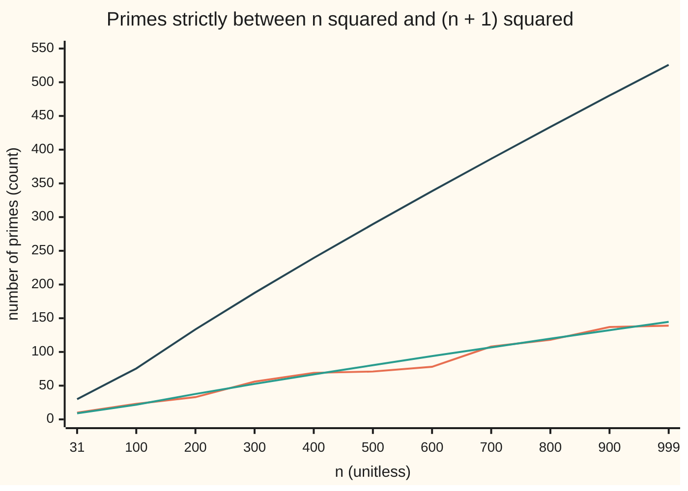

# Landau's four problems: the questions about primes that are all still open

[Syllabus](../../../SYLLABUS.md) → [Algebraic and analytic number theory](../README.md) → [Sieves and Prime Gaps](../README.md#s04) → Landau's four problems

---

## General Overview

961 is 31 × 31 and 1,024 is 32 × 32. Between these two squares lie 62 whole numbers, from 962 to 1,023. The first prime among them is **967**. Ten of the 62 are prime, from 967 to 1,021.

Adrien-Marie Legendre guessed that this always happens: between any two neighbouring squares there is at least one prime. Every case anyone has tested agrees, as far as about 4 × 10^18. Nobody has a proof.

In 1912, at the International Congress of Mathematicians in Cambridge, Edmund Landau named four questions about primes that the methods of his day could not touch:

1. **Goldbach.** Every even number from 4 up is a sum of two primes.
2. **Twin primes.** There are infinitely many primes p with p + 2 also prime.
3. **Legendre.** There is a prime between n² and (n + 1)² for every n from 1 up.
4. **n² + 1.** There are infinitely many primes of the form n² + 1, such as 5 = 2² + 1 and 17 = 4² + 1.

All four are still open. A **sieve** (a method that counts what is left after crossing out the multiples of small primes, as in [Sieving by inclusion-exclusion](01-the-legendre-sieve-and-the-parity-problem.md)) gets close on each. It proves upper bounds of the right size. It finds numbers with at most two prime factors where a prime is wanted. It never finds the prime itself.

**Each of Landau's four problems asks a sieve for a prime; sieves give upper bounds of the right size and numbers with at most two prime factors, but the parity problem (counts of multiples cannot tell one prime factor from two) stops them one step short of a prime, so all four remain open.**

**What kind of fact this is:** four conjectures, open as of 2026-11-15. Beside each, the card states the best proved results: Chen's theorems, Brun's and Selberg's bounds, Iwaniec's theorem, the 0.525 gap theorem and the bounded-gaps theorem. Each has a source here or on the card it links to, except Chen's 1975 theorem on intervals between squares, which is quoted without one. The gap argument in Step 3 is proved on this card. This is an outline card: the deep theorems are stated, not proved. The counts to a million and the published checks to 4 × 10^18 are evidence, never proof.

### The picture: primes between neighbouring squares



Orange: the primes counted in each interval. Green: the expected number, the sum of 1/log m over the interval. Dark blue: the Brun-Titchmarsh ceiling, the best upper bound a sieve proves. The count tracks the expectation and grows like n / log n, so a prime-free interval looks hopeless. But the sieve's proved floor is 0 for every n: nothing in the picture is a proof.

---

## The formula

The four conjectures, with p and q always primes:

```math
\begin{aligned} &\text{Goldbach:} && \text{every even } m \ge 4 \text{ is } p + q \\ &\text{Twin primes:} && \pi_2(x) \to \infty \\ &\text{Legendre:} && \pi\big((n+1)^2\big) - \pi\big(n^2\big) \ge 1 \text{ for every } n \ge 1 \\ &n^2 + 1: && n^2 + 1 \text{ is prime for infinitely many } n \end{aligned}
```

**Read it aloud:** every even number from 4 up is two primes added; the count of twin pairs grows without end; the prime count jumps by at least one between any two neighbouring squares; and n squared plus one is prime infinitely often.

Here π(x) counts the primes up to x, and π₂(x) counts the twin pairs p, p + 2 below x, as on [Brun's sieve and Selberg's](02-brun-and-selberg-sieves.md). An almost-prime is a number with at most two prime factors, counted with repeats, such as 965 = 5 × 193.

| Symbol | Plain meaning | In our example | Push it up and the answer… |
| --- | --- | --- | --- |
| $`n`$ | the base of the square; the interval is n² to (n + 1)² | 31, giving 961 to 1,024 | the interval has 2n numbers, and more primes |
| $`p`$, $`q`$ | primes | 967 | — |
| $`m`$ | a whole number: an even number in Goldbach, a number in the interval in a sum | 962 to 1,023 | — |
| $`x`$ | a size: the top of a count, or a point on the number line | 10^6; 10^18 | — |
| $`\pi(x)`$ | the number of primes up to x | π(1,024) − π(961) = 10 | — |
| $`\pi_2(x)`$ | the number of twin pairs p, p + 2 below x | π₂(10^6) = 8,169 | grows, as far as anyone has counted |
| $`C_2`$ | the twin-prime constant, a product over odd primes | 0.660162 | — |
| $`C`$, $`\chi(p)`$ | the constant for n² + 1, a product over odd primes; the sign +1 or −1 inside it | 1.3728; χ(5) = +1, χ(7) = −1 | — |
| $`y`$ | the length of an interval in the Brun-Titchmarsh bound | 62 | the ceiling 2y / log y grows |
| $`g`$ | the largest gap between consecutive primes below a limit | 114 below 10^6; 1,476 below 4 × 10^18 | Legendre is cleared for fewer n |

### When it holds

- **Goldbach needs "even" and "from 4 up".** Drop "even" and 11 fails: 11 − 2 = 9 is not prime. Every even number from 4 to 1,000,000 passes. The hardest is 503,222: the smallest prime p with 503,222 − p also prime is 523.
- **Twin primes need the gap 2.** Gap 1 has only the pair 2, 3, since one of two neighbours is even.
- **Legendre needs n ≥ 1.** At n = 0 the squares are 0 and 1, and no whole number lies strictly between them, so there is no prime. From n = 1 it holds: between 1 and 4 lie the primes 2 and 3.
- **n² + 1 must have no fixed prime divisor** (a prime that divides every value). For n² + n + 2 the answer is always even, so from n = 1 to 999 it is prime 0 times. n² + 1 escapes this: it is odd for even n and never divisible by 3.

---

## Why it works

Nothing below proves a Landau problem. The steps show what a sieve proves for each, and why it stops.

### Step 0: each problem is a sieve problem

Each problem asks for a prime inside a list: the numbers m − p for Goldbach, the pairs n, n + 2 for twins, 962 to 1,023 for Legendre, the values n² + 1 for the fourth.

A sieve crosses out the multiples of each small prime and counts what is left. It can prove an upper bound of the right size, and that some survivor has at most two prime factors. It cannot prove that a survivor is prime. That is the parity problem of [Sieving by inclusion-exclusion](01-the-legendre-sieve-and-the-parity-problem.md): a sieve sees counts of multiples, and those look the same for numbers with an odd and an even count of prime factors.

### Step 1: Goldbach and twin primes, on other cards

[Goldbach, twin primes and friends](../../02-Number%20theory/07-For%20the%20Curious/04-goldbach-and-open-problems.md) states both as claims about every case and checks small ones. [Goldbach](07-goldbach-and-chens-theorem.md) states the sieve side of the first: Chen Jingrun showed in 1973 that every large even number is a prime plus an almost-prime. [Brun's sieve and Selberg's](02-brun-and-selberg-sieves.md) proves π₂(x) is at most a fixed multiple of x / (log x)², and [Bounded gaps](05-bounded-gaps-zhang-maynard.md) states that some gap of at most 246 repeats for ever. The same Chen argument shows that p + 2 is an almost-prime for infinitely many primes p. Hardy and Littlewood's prediction, 2C₂ times the integral of 1/(log t)² from 2 to x, gives 8,248 twin pairs below a million; the true count is 8,169.

### Step 2: Legendre, and why the best theorem falls short

The interval from n² to (n + 1)² has 2n numbers, about 2√x long near x = n². A prime near x turns up about once in log x numbers. So the expected count is about 2n / log(n²) = n / log n, which grows. At n = 31 the expected count is 8.99; the true count is 10.

The proved results are about gaps. Baker, Harman and Pintz proved in 2001 that for every large enough x, the interval from x − x^0.525 to x holds a prime. Legendre needs a prime within about 2√x = 2x^0.5, a smaller exponent.

The two windows cross where x^0.525 = 2x^0.5, that is x^0.025 = 2, so x = 2^40 = 1,099,511,627,776. Above that, the proved window is wider than the gap between squares. At x = 10^18 the window is 2.818 × 10^9 numbers and the square gap 2.000 × 10^9.

Even the Riemann hypothesis does not settle it. Harald Cramér showed in 1920 that the hypothesis gives a prime within a fixed multiple of √x log x below x ([The Riemann hypothesis](../02-The%20Zeta%20Function%20and%20the%20Prime%20Number%20Theorem/09-riemann-hypothesis-statement-and-equivalents.md)). The extra factor log x still makes the window too wide.

What sieves give:

- **An upper bound.** The Brun-Titchmarsh inequality, in the form Montgomery and Vaughan proved with [The large sieve](03-the-large-sieve.md), says an interval of length y holds fewer than 2y / log y primes. For 961 to 1,024, with y = 62, that is 30.05. The true count is 10.
- **An almost-prime.** Chen showed in 1975 that for every large n the interval holds a prime or a product of two primes. This card quotes that result without a source.

### Step 3: a proof that Legendre holds as far as the gaps are known

The gap argument turns a table of prime gaps into a check of Legendre.

Suppose no prime lies strictly between n² and (n + 1)². Neither square is prime. So the last prime before the interval is at most n² − 1, and the next one is at least (n + 1)² + 1. Their gap is at least (n + 1)² + 1 − (n² − 1) = 2n + 3.

So if every gap below some limit is at most g, Legendre can fail below that limit only for n with 2n + 3 ≤ g. Those few n are checked by hand.

- **Below a million**, the largest gap is 114, after the prime 492,113. Here 2n + 3 ≤ 114 means n ≤ 55. So every n from 56 up passes, and trial division clears n = 1 to 55.
- **Below 4 × 10^18**, the largest gap is 1,476 (Oliveira e Silva, Herzog and Pardi). Here 2n + 3 ≤ 1,476 means n ≤ 736. So every n from 737 up passes, until (n + 1)² reaches 4 × 10^18, at n + 1 = 2,000,000,000. The code clears every n below 1,000 directly.

So Legendre holds for every n up to about 2 × 10^9. Past that it is open.

### Step 4: n² + 1, and why half the primes never sieve

A prime p divides n² + 1 exactly when n² leaves remainder −1 on division by p. So −1 must be a quadratic residue mod p: a remainder that some square leaves. For an odd prime that happens exactly when p leaves remainder 1 on division by 4 ([Quadratic residues](../03-Characters%20and%20L-functions/02-quadratic-residues-and-the-legendre-symbol.md)).

So 3, 7, 11, 19 and every prime that leaves remainder 3 on division by 4 never divide n² + 1. Up to 1,000, only 81 of the 168 primes ever do: 2 and the primes that leave remainder 1. Each odd one crosses out two remainder classes of n, one the negative of the other: for p = 5 they are n ≡ 2 and n ≡ 3.

Fewer primes doing the crossing out means more survivors. Hardy and Littlewood turned this into a prediction with the constant

```math
C = \prod_{p \ge 3} \left( 1 - \frac{\chi(p)}{p - 1} \right) = 1.3728, \qquad \chi(p) = \begin{cases} +1 & p \equiv 1 \pmod 4 \\ -1 & p \equiv 3 \pmod 4 \end{cases}
```

where χ(p) is the Legendre symbol (−1/p). The expected number of n up to x with n² + 1 prime is C times the sum of 1/log(n² + 1). For x = 1,000 that is 123.6; the true count is 112.

What sieves give:

- **An upper bound.** The count up to x is at most a fixed multiple of x / log x, the predicted size.
- **An almost-prime.** Henryk Iwaniec proved in 1978 that n² + 1 is a product of at most two primes for infinitely many n. This is the parity barrier's exact edge: two prime factors, not one.

### Step 5: the four side by side

| Problem | Sieve upper bound | Sieve almost-prime result | Best other result | Checked so far |
| --- | --- | --- | --- | --- |
| Goldbach | the number of ways is at most a fixed multiple of the prediction | Chen 1973: prime + almost-prime | odd numbers from 7 are three primes (Helfgott 2013) | to 4 × 10^18 |
| Twin primes | π₂(x) ≪ x / (log x)² (Brun, Selberg) | Chen: p + 2 almost-prime infinitely often | a gap of at most 246 repeats for ever (Polymath 2014) | 8,169 pairs below 10^6 |
| Legendre | Brun-Titchmarsh: fewer than 2y / log y | Chen 1975: an almost-prime in each interval, n large | a prime within x^0.525 below x (2001) | every n up to about 2 × 10^9 |
| n² + 1 | ≪ x / log x | Iwaniec 1978: almost-prime infinitely often | — | 112 primes for n ≤ 1,000 |

Here f ≪ g means f is at most a fixed multiple of g. Every sieve column stops at "at most two prime factors".

---

## Worked numbers, by hand

The example: the numbers between 961 = 31² and 1,024 = 32².

| Step | Arithmetic | Value |
| --- | --- | --- |
| 962, 964, 966 | even | not prime |
| 963 | 3 × 321 | not prime |
| 965 | 5 × 193 | not prime |
| 967: which divisors to try | √967 is below 32, since 32² = 1,024 | primes up to 31 |
| 967 divided by 2, 3, 5, 7, 11, 13 | remainders 1, 1, 2, 1, 10, 5 | none zero |
| 967 divided by 17, 19, 23, 29, 31 | remainders 15, 17, 1, 10, 6 | none zero |
| 967 | no prime up to 31 divides it | **prime** |
| all primes from 962 to 1,023 | 967, 971, 977, 983, 991, 997, 1,009, 1,013, 1,019, 1,021 | 10 |
| expected count | sum of 1/log m for m = 962 to 1,023 | 8.99 |

Legendre's conjecture holds at n = 31 with room to spare: 10 primes where one is enough. The test of 967 stops at 31 because two factors of 32 or more multiply past 1,024.

### What breaks if you drop a piece

| Mistake | Comes out at | What went wrong |
| --- | --- | --- |
| Read the 0.525 gap theorem as a proof of Legendre | window 2.818 × 10^9 against a square gap of 2.000 × 10^9 at x = 10^18 | Past x = 2^40 the proved window is wider than the gap between squares |
| Replace n² + 1 by n² + n + 2 | 0 primes for n = 1 to 999 | Every value is even: the fixed divisor 2 breaks the hypothesis |
| Read the Brun-Titchmarsh bound as the count | 30.05 primes between 961 and 1,024, against 10 | It is a ceiling; a sieve's floor here is 0 |

The code prints every row.

---

## Code, from first principles, and it actually runs

The code builds one sieve of Eratosthenes up to 1,000,003, the first prime past a million, so the gap argument sees the gap that crosses 10^6. It reaches each count a second, independent way: trial division for the primes near 967, the gap argument for Legendre to n = 999, a two-class sieve for the 8,169 twin pairs, and a sieve on the values n² + 1 for the 112. The constants C₂ and C are products over the odd primes up to a million. The figures 4 × 10^18 and 1,476 are quoted from the published record, not computed.

### Python

```python
# Landau's four problems -- the check behind the card.  Standard library only.
# One sieve of Eratosthenes to 1,000,003 gives every count below; each count is
# reached a second, independent way: trial division, a gap argument, a twin
# sieve on two classes, or a sieve on the values n^2 + 1.
import math
X = 1_000_003                                      # 1,000,003: the first prime past 10^6
flag = bytearray([1]) * (X + 1); flag[0] = flag[1] = 0
for p in range(2, 1001):
    if flag[p]:
        flag[p * p::p] = bytearray(len(range(p * p, X + 1, p)))
primes = [p for p in range(2, X + 1) if flag[p]]
small = [p for p in primes if p <= 1000]
def by_division(n):                                # road two: trial division
    d = 2
    while d * d <= n and n % d: d += 1
    return n > 1 and d * d > n
# Legendre: a prime strictly between n^2 and (n+1)^2, for n = 1 to 999
cnt = [sum(flag[n * n + 1:(n + 1) ** 2]) for n in range(1000)]
inside = [m for m in range(962, 1024) if flag[m]]
print("primes between 961 and 1024:", ", ".join(map(str, inside)), f"({len(inside)} of them)")
print("trial division of 967 by 2 to 31: remainders", [967 % p for p in small if p <= 31])
print("962 to 966:", ", ".join(f"{m} = {min(p for p in small if m % p == 0)} x {m // min(p for p in small if m % p == 0)}" for m in range(962, 967)))
expect = sum(1 / math.log(m) for m in range(962, 1024))
print(f"n = 31: expected {expect:.2f}; Brun-Titchmarsh ceiling 2y/log y with y = 62: {124 / math.log(62):.2f}")
low = min(range(1, 1000), key=lambda n: (cnt[n], n))
print(f"n = 1 to 999: every interval has a prime: {all(cnt[n] for n in range(1, 1000))};"
      f" fewest {cnt[low]}, at n = {low}; most {max(cnt[1:])}")
gap = max((b - a, a) for a, b in zip(primes, primes[1:]) if a < 10**6)
start = gap[0] // 2 - 1                            # n >= start: 2n + 3 > largest gap
print(f"largest gap below 10^6: {gap[0]}, after {gap[1]:,}; so n >= {start} cannot fail below 10^6")
hold = all(any(by_division(m) for m in range(n * n + 1, (n + 1) ** 2)) for n in range(1, start))
print(f"n = 1 to {start - 1} by trial division: all hold: {hold}")
print(f"gap record 1476 below 4 x 10^18 covers n >= {1476 // 2 - 1} up to (n+1)^2 = 4 x 10^18, n + 1 = {math.isqrt(4 * 10**18):,}")
pts = (31, 100, 200, 300, 400, 500, 600, 700, 800, 900, 999)
print("chart n:", ", ".join(map(str, pts)))
print("chart, primes counted:", ", ".join(str(cnt[n]) for n in pts))
print("chart, expected:", ", ".join(f"{sum(1 / math.log(m) for m in range(n * n + 1, (n + 1) ** 2)):.1f}" for n in pts))
print("chart, Brun-Titchmarsh ceiling:", ", ".join(f"{4 * n / math.log(2 * n):.1f}" for n in pts))
print(f"proved window x^0.525 against square gap 2 sqrt x: equal at x = 2^40 = {2**40:,};"
      f" at 10^18: {10**(18 * 0.525) / 1e9:.3f} x 10^9 against 2.000 x 10^9")
# Twin primes: road one from the sieve, road two sieving n and n + 2 together
twins = [p for p in primes if p + 2 < 10**6 and flag[p + 2]]
two = bytearray([1]) * (10**6 + 1)
for p in small:
    two[0::p] = bytearray(len(range(0, 10**6 + 1, p)))
    two[p - 2::p] = bytearray(len(range(p - 2, 10**6 + 1, p)))
above = sum(two[1001:10**6 - 1]); below = sum(1 for p in twins if p < 1000)
c2 = math.prod(1 - 1 / (p - 1) ** 2 for p in primes[1:] if p <= 10**6)
a, b, N = math.log(2), math.log(10**6), 20000
h = (b - a) / N
f = lambda u: math.exp(u) / (u * u)
simp = h / 3 * (f(a) + f(b) + sum((4 if i % 2 else 2) * f(a + i * h) for i in range(1, N)))
brun = sum(1 / p + 1 / (p + 2) for p in twins)
print(f"twin pairs below 10^6: {len(twins):,}; twin sieve: {below} below 1000 + {above:,} above = {below + above:,}")
print(f"C2 = {c2:.6f}; Hardy-Littlewood 2 C2 integral of 1/log^2 t: {2 * c2 * simp:,.0f}; Brun's sum to 10^6: {brun:.4f}")
# Goldbach: the smallest prime p with n - p prime, for every even n to 10^6
worst = max((next(p for p in primes if p <= n // 2 and flag[n - p]), n) for n in range(4, 10**6 + 1, 2))
print(f"Goldbach, every even n from 4 to 1,000,000 has a pair; the hardest needs p = {worst[0]}, at n = {worst[1]:,}")
# n^2 + 1: road one reads the sieve, road two sieves the values n^2 + 1 directly
hits = [n for n in range(1, 1001) if flag[n * n + 1]]
val = bytearray([1]) * 1001
for p in small:
    for r in [r for r in range(p) if (r * r + 1) % p == 0]:
        for n in range(r, 1001, p):
            if n * n + 1 != p: val[n] = 0
hits2 = [n for n in range(1, 1001) if val[n]]
roots = sum(1 for p in small if any((r * r + 1) % p == 0 for r in range(p)))
cpoly = math.prod(1 - (1 if p % 4 == 1 else -1) / (p - 1) for p in primes[1:] if p <= 10**6)
pred = cpoly * sum(1 / math.log(n * n + 1) for n in range(1, 1001))
print(f"n^2 + 1 prime for n = 1 to 1000: {len(hits)}; first: {', '.join(str(n) for n in hits[:8])}; by the value sieve: {len(hits2)}")
print(f"primes up to 1000 that ever divide n^2 + 1: {roots} of {len(small)}; constant C = {cpoly:.4f}; predicted {pred:.1f}")
bad = [n * n + n + 2 for n in range(1, 1000)]
print(f"n^2 + n + 2 prime for n = 1 to 999: {sum(flag[v] for v in bad)}; all even: {all(v % 2 == 0 for v in bad)}")
assert inside[0] == 967 and len(inside) == 10 and all(by_division(m) for m in inside)
assert all(cnt[n] for n in range(1, 1000)) and hold and gap == (114, 492113) and sum(p < 10**6 for p in primes) == 78498
assert len(twins) == 8169 == below + above and round(2 * c2 * simp) == 8248
assert worst == (523, 503222) and roots == 1 + sum(p % 4 == 1 for p in small)
assert hits == hits2 and all(by_division(n * n + 1) for n in hits)
assert 124 / math.log(62) > len(inside) > expect
print("ALL CHECKS PASS")
```

**Ran 2026-11-15 on macOS, Python 3.14.10, standard library only. All checks passed. Output, pasted from the run:**

```
primes between 961 and 1024: 967, 971, 977, 983, 991, 997, 1009, 1013, 1019, 1021 (10 of them)
trial division of 967 by 2 to 31: remainders [1, 1, 2, 1, 10, 5, 15, 17, 1, 10, 6]
962 to 966: 962 = 2 x 481, 963 = 3 x 321, 964 = 2 x 482, 965 = 5 x 193, 966 = 2 x 483
n = 31: expected 8.99; Brun-Titchmarsh ceiling 2y/log y with y = 62: 30.05
n = 1 to 999: every interval has a prime: True; fewest 2, at n = 1; most 156
largest gap below 10^6: 114, after 492,113; so n >= 56 cannot fail below 10^6
n = 1 to 55 by trial division: all hold: True
gap record 1476 below 4 x 10^18 covers n >= 737 up to (n+1)^2 = 4 x 10^18, n + 1 = 2,000,000,000
chart n: 31, 100, 200, 300, 400, 500, 600, 700, 800, 900, 999
chart, primes counted: 10, 23, 33, 56, 69, 71, 78, 108, 118, 137, 139
chart, expected: 9.0, 21.7, 37.7, 52.6, 66.7, 80.4, 93.8, 106.8, 119.7, 132.3, 144.6
chart, Brun-Titchmarsh ceiling: 30.0, 75.5, 133.5, 187.6, 239.4, 289.5, 338.5, 386.5, 433.7, 480.3, 525.8
proved window x^0.525 against square gap 2 sqrt x: equal at x = 2^40 = 1,099,511,627,776; at 10^18: 2.818 x 10^9 against 2.000 x 10^9
twin pairs below 10^6: 8,169; twin sieve: 35 below 1000 + 8,134 above = 8,169
C2 = 0.660162; Hardy-Littlewood 2 C2 integral of 1/log^2 t: 8,248; Brun's sum to 10^6: 1.7108
Goldbach, every even n from 4 to 1,000,000 has a pair; the hardest needs p = 523, at n = 503,222
n^2 + 1 prime for n = 1 to 1000: 112; first: 1, 2, 4, 6, 10, 14, 16, 20; by the value sieve: 112
primes up to 1000 that ever divide n^2 + 1: 81 of 168; constant C = 1.3728; predicted 123.6
n^2 + n + 2 prime for n = 1 to 999: 0; all even: True
ALL CHECKS PASS
```

### Rust

```rust
// Landau's four problems -- the same check as landau_problems_and_legendre_check.py,
// in Rust.  No crates.  One sieve of Eratosthenes to 1,000,003 gives every count;
// each count is reached a second, independent way: trial division, a gap argument,
// a twin sieve on two classes, or a sieve on the values n^2 + 1.
fn by_division(n: u64) -> bool {                  // road two: trial division
    let mut d = 2;
    while d * d <= n && n % d != 0 { d += 1; }
    n > 1 && d * d > n
}
fn commas(n: u64) -> String {
    let s = n.to_string();
    let mut out = String::new();
    for (i, c) in s.chars().enumerate() {
        if i > 0 && (s.len() - i) % 3 == 0 { out.push(','); }
        out.push(c);
    }
    out
}
fn join<T: ToString>(v: &[T]) -> String { v.iter().map(|x| x.to_string()).collect::<Vec<_>>().join(", ") }
fn main() {
    const X: usize = 1_000_003;                  // 1,000,003: the first prime past 10^6
    let mut flag = vec![true; X + 1];
    flag[0] = false; flag[1] = false;
    for p in 2..1001 {
        if flag[p] { let mut k = p * p; while k <= X { flag[k] = false; k += p; } }
    }
    let primes: Vec<usize> = (2..=X).filter(|&p| flag[p]).collect();
    let small: Vec<usize> = primes.iter().cloned().filter(|&p| p <= 1000).collect();
    let ln = |m: usize| (m as f64).ln();
    // Legendre: a prime strictly between n^2 and (n+1)^2, for n = 1 to 999
    let cnt: Vec<usize> = (0..1000).map(|n| (n * n + 1..(n + 1) * (n + 1)).filter(|&m| flag[m]).count()).collect();
    let inside: Vec<usize> = (962..1024).filter(|&m| flag[m]).collect();
    println!("primes between 961 and 1024: {} ({} of them)", join(&inside), inside.len());
    let rems: Vec<usize> = small.iter().filter(|&&p| p <= 31).map(|&p| 967 % p).collect();
    println!("trial division of 967 by 2 to 31: remainders {:?}", rems);
    let facs: Vec<String> = (962..967).map(|m| { let q = *small.iter().find(|&&p| m % p == 0).unwrap(); format!("{} = {} x {}", m, q, m / q) }).collect();
    println!("962 to 966: {}", facs.join(", "));
    let expect: f64 = (962..1024).map(|m| 1.0 / ln(m)).sum();
    println!("n = 31: expected {:.2}; Brun-Titchmarsh ceiling 2y/log y with y = 62: {:.2}", expect, 124.0 / ln(62));
    let low = (1..1000).min_by_key(|&n| (cnt[n], n)).unwrap();
    println!("n = 1 to 999: every interval has a prime: {}; fewest {}, at n = {}; most {}",
             if (1..1000).all(|n| cnt[n] > 0) { "True" } else { "False" }, cnt[low], low, cnt[1..].iter().max().unwrap());
    let gap = primes.windows(2).filter(|w| w[0] < 1_000_000).map(|w| (w[1] - w[0], w[0])).max().unwrap();
    let start = gap.0 / 2 - 1;                     // n >= start: 2n + 3 > largest gap
    println!("largest gap below 10^6: {}, after {}; so n >= {} cannot fail below 10^6", gap.0, commas(gap.1 as u64), start);
    let hold = (1..start as u64).all(|n| (n * n + 1..(n + 1) * (n + 1)).any(by_division));
    println!("n = 1 to {} by trial division: all hold: {}", start - 1, if hold { "True" } else { "False" });
    println!("gap record 1476 below 4 x 10^18 covers n >= {} up to (n+1)^2 = 4 x 10^18, n + 1 = {}",
             1476 / 2 - 1, commas((4e18f64).sqrt() as u64));
    let pts = [31usize, 100, 200, 300, 400, 500, 600, 700, 800, 900, 999];
    println!("chart n: {}", join(&pts));
    println!("chart, primes counted: {}", join(&pts.iter().map(|&n| cnt[n]).collect::<Vec<_>>()));
    let ex: Vec<String> = pts.iter().map(|&n| format!("{:.1}", (n * n + 1..(n + 1) * (n + 1)).map(|m| 1.0 / ln(m)).sum::<f64>())).collect();
    println!("chart, expected: {}", ex.join(", "));
    let bt: Vec<String> = pts.iter().map(|&n| format!("{:.1}", 4.0 * n as f64 / ln(2 * n))).collect();
    println!("chart, Brun-Titchmarsh ceiling: {}", bt.join(", "));
    let win = 10f64.powf(18.0 * 0.525);
    println!("proved window x^0.525 against square gap 2 sqrt x: equal at x = 2^40 = {}; at 10^18: {:.3} x 10^9 against 2.000 x 10^9",
             commas(1u64 << 40), win / 1e9);
    // Twin primes: road one from the sieve, road two sieving n and n + 2 together
    let twins: Vec<usize> = primes.iter().cloned().filter(|&p| p + 2 < 1_000_000 && flag[p + 2]).collect();
    let mut two = vec![true; 1_000_001];
    for &p in &small {
        let mut k = 0; while k <= 1_000_000 { two[k] = false; k += p; }
        let mut k = p - 2; while k <= 1_000_000 { two[k] = false; k += p; }
    }
    let above = (1001..999_999).filter(|&n| two[n]).count();
    let below = twins.iter().filter(|&&p| p < 1000).count();
    let c2 = primes[1..].iter().filter(|&&p| p <= 1_000_000).fold(1.0, |a, &p| a * (1.0 - 1.0 / (((p - 1) * (p - 1)) as f64)));
    let (a, b, nn) = (2f64.ln(), 1e6f64.ln(), 20000);
    let h = (b - a) / nn as f64;
    let f = |u: f64| u.exp() / (u * u);
    let mut inner = 0.0;
    for i in 1..nn { inner += (if i % 2 == 1 { 4.0 } else { 2.0 }) * f(a + i as f64 * h); }
    let simp = h / 3.0 * (f(a) + f(b) + inner);
    let brun: f64 = twins.iter().fold(0.0, |s, &p| s + (1.0 / p as f64 + 1.0 / (p + 2) as f64));
    println!("twin pairs below 10^6: {}; twin sieve: {} below 1000 + {} above = {}",
             commas(twins.len() as u64), below, commas(above as u64), commas((below + above) as u64));
    let hl = 2.0 * c2 * simp;
    println!("C2 = {:.6}; Hardy-Littlewood 2 C2 integral of 1/log^2 t: {}; Brun's sum to 10^6: {:.4}",
             c2, commas(format!("{:.0}", hl).parse().unwrap()), brun);
    // Goldbach: the smallest prime p with n - p prime, for every even n to 10^6
    let worst = (4..=1_000_000).step_by(2).map(|n: usize| (*primes.iter().find(|&&p| p <= n / 2 && flag[n - p]).unwrap(), n)).max().unwrap();
    println!("Goldbach, every even n from 4 to 1,000,000 has a pair; the hardest needs p = {}, at n = {}", worst.0, commas(worst.1 as u64));
    // n^2 + 1: road one reads the sieve, road two sieves the values n^2 + 1 directly
    let hits: Vec<usize> = (1..1001).filter(|&n| flag[n * n + 1]).collect();
    let mut val = vec![true; 1001];
    for &p in &small {
        for r in (0..p).filter(|&r| (r * r + 1) % p == 0) {
            let mut n = r; while n <= 1000 { if n * n + 1 != p { val[n] = false; } n += p; }
        }
    }
    let hits2: Vec<usize> = (1..1001).filter(|&n| val[n]).collect();
    let roots = small.iter().filter(|&&p| (0..p).any(|r| (r * r + 1) % p == 0)).count();
    let cpoly = primes[1..].iter().filter(|&&p| p <= 1_000_000)
        .fold(1.0, |a, &p| a * (1.0 - (if p % 4 == 1 { 1.0 } else { -1.0 }) / (p - 1) as f64));
    let pred = cpoly * (1..1001).map(|n| 1.0 / ln(n * n + 1)).sum::<f64>();
    println!("n^2 + 1 prime for n = 1 to 1000: {}; first: {}; by the value sieve: {}", hits.len(), join(&hits[..8]), hits2.len());
    println!("primes up to 1000 that ever divide n^2 + 1: {} of {}; constant C = {:.4}; predicted {:.1}", roots, small.len(), cpoly, pred);
    let bad: Vec<usize> = (1..1000).map(|n| n * n + n + 2).collect();
    println!("n^2 + n + 2 prime for n = 1 to 999: {}; all even: {}", bad.iter().filter(|&&v| flag[v]).count(),
             if bad.iter().all(|v| v % 2 == 0) { "True" } else { "False" });
    assert!(inside[0] == 967 && inside.len() == 10 && inside.iter().all(|&m| by_division(m as u64)));
    assert!((1..1000).all(|n| cnt[n] > 0) && hold && gap == (114, 492113) && primes.iter().filter(|&&p| p < 1_000_000).count() == 78498);
    assert!(twins.len() == 8169 && below + above == 8169 && hl.round() == 8248.0);
    assert!(worst == (523, 503222) && roots == 1 + small.iter().filter(|&&p| p % 4 == 1).count());
    assert!(hits == hits2 && hits.iter().all(|&n| by_division((n * n + 1) as u64)));
    assert!(124.0 / ln(62) > inside.len() as f64 && inside.len() as f64 > expect);
    println!("ALL CHECKS PASS");
}
```

**Ran 2026-11-15 on macOS, rustc 1.98.1, no crates. All checks passed. Output, pasted from the run:**

```
primes between 961 and 1024: 967, 971, 977, 983, 991, 997, 1009, 1013, 1019, 1021 (10 of them)
trial division of 967 by 2 to 31: remainders [1, 1, 2, 1, 10, 5, 15, 17, 1, 10, 6]
962 to 966: 962 = 2 x 481, 963 = 3 x 321, 964 = 2 x 482, 965 = 5 x 193, 966 = 2 x 483
n = 31: expected 8.99; Brun-Titchmarsh ceiling 2y/log y with y = 62: 30.05
n = 1 to 999: every interval has a prime: True; fewest 2, at n = 1; most 156
largest gap below 10^6: 114, after 492,113; so n >= 56 cannot fail below 10^6
n = 1 to 55 by trial division: all hold: True
gap record 1476 below 4 x 10^18 covers n >= 737 up to (n+1)^2 = 4 x 10^18, n + 1 = 2,000,000,000
chart n: 31, 100, 200, 300, 400, 500, 600, 700, 800, 900, 999
chart, primes counted: 10, 23, 33, 56, 69, 71, 78, 108, 118, 137, 139
chart, expected: 9.0, 21.7, 37.7, 52.6, 66.7, 80.4, 93.8, 106.8, 119.7, 132.3, 144.6
chart, Brun-Titchmarsh ceiling: 30.0, 75.5, 133.5, 187.6, 239.4, 289.5, 338.5, 386.5, 433.7, 480.3, 525.8
proved window x^0.525 against square gap 2 sqrt x: equal at x = 2^40 = 1,099,511,627,776; at 10^18: 2.818 x 10^9 against 2.000 x 10^9
twin pairs below 10^6: 8,169; twin sieve: 35 below 1000 + 8,134 above = 8,169
C2 = 0.660162; Hardy-Littlewood 2 C2 integral of 1/log^2 t: 8,248; Brun's sum to 10^6: 1.7108
Goldbach, every even n from 4 to 1,000,000 has a pair; the hardest needs p = 523, at n = 503,222
n^2 + 1 prime for n = 1 to 1000: 112; first: 1, 2, 4, 6, 10, 14, 16, 20; by the value sieve: 112
primes up to 1000 that ever divide n^2 + 1: 81 of 168; constant C = 1.3728; predicted 123.6
n^2 + n + 2 prime for n = 1 to 999: 0; all even: True
ALL CHECKS PASS
```

The two outputs match line for line.

### Lean

Lean proves Step 3's gap argument for every n from 1 up, Step 4's rule for every odd prime, and the worked numbers.

- Suppose n ≥ 1 and no prime lies strictly between n² and (n + 1)². Then a prime at or below n² and a prime above n² are at least 2n + 3 apart.
- Suppose n ≥ 1, every prime gap below some limit is at most g, and g < 2n + 3. Then a prime lies strictly between n² and (n + 1)², if (n + 1)² is at most that limit.
- Take an odd prime p. Then p divides n² + 1 for some whole number n exactly when p leaves remainder 1 on division by 4.
- 962 to 966 are not prime, and 967 is: its remainders on division by 2 to 31 are the ones in the table.
- The primes strictly between 961 and 1,024 are exactly the ten from 967 to 1,021.
- The next prime after 492,113 is 492,227, a gap of 114, and 2n + 3 ≤ 114 exactly for n ≤ 55.
- 523 and 502,699 are both prime and add up to 503,222.

Finding the largest gap below a million, and every count to a million, is left to the Python and Rust checks.

```lean
-- Landau's four problems: a table of prime gaps proves Legendre's conjecture for every n it reaches, since a prime-free interval between n squared and (n + 1) squared forces a gap of at least 2n + 3, and an odd prime divides some n squared plus one exactly when it leaves remainder 1 on division by 4.
import Mathlib.Data.Nat.Prime.Basic
import Mathlib.NumberTheory.LegendreSymbol.Basic
import Mathlib.Tactic.NormNum.Prime
import Mathlib.Tactic.IntervalCases

/-- Helper: the square of a positive whole number is never prime. -/
theorem sq_not_prime_of_one_le (k : ℕ) (hk : 1 ≤ k) : ¬ (k ^ 2).Prime := by
  intro hpk
  rw [sq] at hpk
  rcases Nat.prime_mul_iff.mp hpk with ⟨h, rfl⟩ | ⟨h, rfl⟩ <;> exact Nat.not_prime_one h

/-- The card's proved claim (Step 3, the gap argument). Let `n ≥ 1`. Suppose that after
every prime p below a limit `L` the next prime comes within `g`: some prime q has
`p < q ≤ p + g`. If the limit reaches `(n + 1)^2` and `g < 2n + 3`, then Legendre's
conjecture holds at n: some prime lies strictly between `n^2` and `(n + 1)^2`.
(Below a million `g = 114`, which clears every n from 56 up; below `4 × 10^18`
`g = 1476`, which clears every n from 737 up to `n + 1 = 2 × 10^9`.) -/
theorem legendre_of_prime_gaps_lt_two_n_add_three (L g n : ℕ) (hn : 1 ≤ n)
    (hgap : ∀ p : ℕ, p.Prime → p < L → ∃ q : ℕ, q.Prime ∧ p < q ∧ q ≤ p + g)
    (hL : (n + 1) ^ 2 ≤ L) (hg : g < 2 * n + 3) :
    ∃ p : ℕ, p.Prime ∧ n ^ 2 < p ∧ p < (n + 1) ^ 2 := by
  -- n = 1: the prime 2 lies between 1 and 4.
  rcases Nat.lt_or_ge n 2 with h1 | h2
  · obtain rfl : n = 1 := by omega
    exact ⟨2, Nat.prime_two, by norm_num, by norm_num⟩
  by_contra hcon
  push Not at hcon
  have hnone : ∀ m : ℕ, n ^ 2 < m → m < (n + 1) ^ 2 → ¬ m.Prime :=
    fun m h1 h2 hm => absurd h2 (not_lt.mpr (hcon m hm h1))
  have h2le : 2 ≤ n ^ 2 := by nlinarith
  set p := Nat.findGreatest Nat.Prime (n ^ 2) with hpdef
  have hp : p.Prime := Nat.findGreatest_spec h2le Nat.prime_two
  have hpn : p ≤ n ^ 2 := Nat.findGreatest_le _
  have hpL : p < L := by
    have : n ^ 2 < (n + 1) ^ 2 := by nlinarith
    omega
  obtain ⟨q, hq, hpq, hqg⟩ := hgap p hp hpL
  have hqn : n ^ 2 < q := by
    by_contra hle
    push Not at hle
    have := Nat.le_findGreatest hle hq
    omega
  have hpne : p ≠ n ^ 2 := by
    intro h
    rw [h] at hp
    exact sq_not_prime_of_one_le n hn hp
  have hqge : (n + 1) ^ 2 ≤ q := hcon q hq hqn
  have hqne : q ≠ (n + 1) ^ 2 := by
    rintro rfl
    exact sq_not_prime_of_one_le (n + 1) (by omega) hq
  have hexp : (n + 1) ^ 2 = n ^ 2 + 2 * n + 1 := by ring
  omega

/-- Step 3, the key step: if `n ≥ 1` and no prime lies strictly between `n^2` and
`(n + 1)^2`, then any prime p at or below `n^2` and any prime q above `n^2` are at
least `2n + 3` apart, since p is at most `n^2 - 1` and q at least `(n + 1)^2 + 1`. -/
theorem prime_gap_ge_two_n_add_three_of_no_prime_between_squares (n : ℕ) (hn : 1 ≤ n)
    (hnone : ∀ m : ℕ, n ^ 2 < m → m < (n + 1) ^ 2 → ¬ m.Prime)
    (p q : ℕ) (hp : p.Prime) (hq : q.Prime) (hpn : p ≤ n ^ 2) (hqn : n ^ 2 < q) :
    2 * n + 3 ≤ q - p := by
  have hsq := sq_not_prime_of_one_le
  have hpne : p ≠ n ^ 2 := by
    rintro rfl
    exact hsq n hn hp
  have hqge : (n + 1) ^ 2 ≤ q := by
    by_contra hlt
    push Not at hlt
    exact hnone q hqn hlt hq
  have hqne : q ≠ (n + 1) ^ 2 := by
    rintro rfl
    exact hsq (n + 1) (by omega) hq
  have hexp : (n + 1) ^ 2 = n ^ 2 + 2 * n + 1 := by ring
  omega

/-- Step 4: an odd prime p divides `n^2 + 1` for some whole number n exactly when p
leaves remainder 1 on division by 4. So 3, 7, 11, 19 and every prime that leaves
remainder 3 never divide `n^2 + 1`. -/
theorem odd_prime_dvd_sq_add_one_iff_mod_four_eq_one (p : ℕ) (hp : p.Prime) (hp2 : p ≠ 2) :
    (∃ n : ℕ, p ∣ n ^ 2 + 1) ↔ p % 4 = 1 := by
  have := Fact.mk hp
  have hodd : p % 2 = 1 := hp.mod_two_eq_one_iff_ne_two.mpr hp2
  constructor
  · rintro ⟨n, hn⟩
    have h0 : ((n ^ 2 + 1 : ℕ) : ZMod p) = 0 := (ZMod.natCast_eq_zero_iff _ _).mpr hn
    have hsq : IsSquare (-1 : ZMod p) := by
      refine ⟨(n : ZMod p), ?_⟩
      push_cast at h0
      linear_combination -h0
    have := ZMod.exists_sq_eq_neg_one_iff.mp hsq
    omega
  · intro h
    obtain ⟨y, hy⟩ := (ZMod.exists_sq_eq_neg_one_iff (p := p)).mpr (by omega)
    refine ⟨y.val, ?_⟩
    rw [← ZMod.natCast_eq_zero_iff]
    push_cast
    rw [ZMod.natCast_zmod_val]
    linear_combination -hy

-- The card's worked whole-number examples.

-- The two squares: 961 = 31^2 and 1,024 = 32^2, with 62 whole numbers strictly between.
example : (31 : ℕ) ^ 2 = 961 ∧ (32 : ℕ) ^ 2 = 1024 ∧ 1023 - 962 + 1 = 62 := by norm_num
-- 962 to 966 are not prime: 963 = 3 × 321 and 965 = 5 × 193.
example : 963 = 3 * 321 ∧ 965 = 5 * 193 := by norm_num
example : ∀ m : ℕ, 961 < m → m < 967 → ¬ m.Prime := by
  intro m h1 h2
  interval_cases m <;> norm_num
-- 967 is prime, and leaves remainders 1, 1, 2, 1, 10, 5, 15, 17, 1, 10, 6 on division by
-- the primes 2 to 31.
example : Nat.Prime 967 := by norm_num
example : [2, 3, 5, 7, 11, 13, 17, 19, 23, 29, 31].map (967 % ·) =
    [1, 1, 2, 1, 10, 5, 15, 17, 1, 10, 6] := by decide
-- The primes strictly between 961 and 1,024 are exactly these ten, from 967 to 1,021.
example : ∀ m : ℕ, 961 < m → m < 1024 →
    (m.Prime ↔ m ∈ [967, 971, 977, 983, 991, 997, 1009, 1013, 1019, 1021]) := by
  intro m h1 h2
  interval_cases m <;> norm_num
-- Legendre at n = 1: 2 and 3 lie between 1 and 4. At n = 0 nothing lies strictly
-- between 0 and 1.
example : Nat.Prime 2 ∧ Nat.Prime 3 ∧ 1 ^ 2 < 2 ∧ 3 < (1 + 1) ^ 2 := by norm_num
example : ∀ m : ℕ, 0 ^ 2 < m → m < (0 + 1) ^ 2 → False := by
  intro m h1 h2
  norm_num at h1 h2
  omega
-- The gap after 492,113 is 114, and 2n + 3 ≤ 114 exactly for n ≤ 55.
example : Nat.Prime 492113 ∧ Nat.Prime 492227 ∧ 492227 - 492113 = 114 := by norm_num
example : ∀ m : ℕ, 492113 < m → m < 492227 → ¬ m.Prime := by
  intro m h1 h2
  interval_cases m <;> norm_num
example : 2 * 55 + 3 ≤ 114 ∧ 114 < 2 * 56 + 3 := by norm_num
-- The record gap 1,476 below 4 × 10^18: 2n + 3 ≤ 1,476 exactly for n ≤ 736, and
-- (n + 1)^2 reaches 4 × 10^18 at n + 1 = 2,000,000,000.
example : 2 * 736 + 3 ≤ 1476 ∧ 1476 < 2 * 737 + 3 := by norm_num
example : (2000000000 : ℕ) ^ 2 = 4 * 10 ^ 18 := by norm_num
-- The windows x^0.525 and 2 x^0.5 cross at x = 2^40.
example : (2 : ℕ) ^ 40 = 1099511627776 := by norm_num
-- Goldbach: 11 - 2 = 9 is not prime; the hardest even number below a million,
-- 503,222, is 523 + 502,699.
example : ¬ Nat.Prime (11 - 2) := by norm_num
example : Nat.Prime 523 ∧ Nat.Prime 502699 ∧ 523 + 502699 = 503222 := by norm_num
-- n^2 + 1: 5 = 2^2 + 1 and 17 = 4^2 + 1 are prime; 5 divides n^2 + 1 for n = 2 and 3.
example : Nat.Prime (2 ^ 2 + 1) ∧ Nat.Prime (4 ^ 2 + 1) := by norm_num
example : 5 ∣ 2 ^ 2 + 1 ∧ 5 ∣ 3 ^ 2 + 1 := by norm_num

#print axioms sq_not_prime_of_one_le
#print axioms legendre_of_prime_gaps_lt_two_n_add_three
#print axioms prime_gap_ge_two_n_add_three_of_no_prime_between_squares
#print axioms odd_prime_dvd_sq_add_one_iff_mod_four_eq_one
```

**Checked 2026-11-15 on macOS, Lean 4.36.0-rc2, Mathlib v4.36.0-rc2. Every proof is complete and uses only Lean's standard axioms. Output, pasted from the run:**

```
'sq_not_prime_of_one_le' depends on axioms: [propext]
'legendre_of_prime_gaps_lt_two_n_add_three' depends on axioms: [propext, Classical.choice, Quot.sound]
'prime_gap_ge_two_n_add_three_of_no_prime_between_squares' depends on axioms: [propext, Quot.sound]
'odd_prime_dvd_sq_add_one_iff_mod_four_eq_one' depends on axioms: [propext, Classical.choice, Quot.sound]
```

> [!TIP]
> **Try changing**
> - **Guess first:** does the next interval, from 1,024 to 1,089, hold more primes or fewer? Change `range(962, 1024)` to `range(1025, 1089)` in the `inside` and `expect` lines. It holds 9, starting at 1,031, against 9.19 expected; the first assert fires, since it expects 967.
> - **Guess first:** are cousin primes, p and p + 4, rarer than twins? In the `twins` line change both `p + 2` to `p + 4`. There are 8,144 pairs below a million; the assert fires, because the two-class sieve still counts twins.
> - **Guess first:** does removing the fixed divisor bring primes back? Change `n * n + n + 2` to `n * n + n + 1` in the `bad` line. The values are now always odd, and 189 of them are prime for n = 1 to 999. No assert fires.

---

## The usual mistake

> [!warning]
> **Reading a sieve result as nearly a proof.** "Every large even number is a prime plus an almost-prime" sounds one step from Goldbach. It is not one step: the gap between two prime factors and one is the parity problem, and no sieve crosses it alone. The same holds for Chen's 1975 almost-prime between squares and Iwaniec's n² + 1.
>
> - **"The Riemann hypothesis would prove Legendre."** It gives a prime within a multiple of √x log x, wider than the square gap of 2√x.
> - **"The 0.525 theorem covers Legendre for large n."** At 10^18 its window is 2.818 × 10^9, wider than the 2.000 × 10^9 between squares.
> - **"Brun's sum converges, so twins run out."** The sum of 1/p + 1/(p + 2) over twin pairs converges whether or not the pairs run out. Below a million it is 1.7108.
> - **"The expected count is a lower bound."** At n = 500 the interval holds 71 primes against 80.4 expected. The expectation is an average, not a floor.

---

## Where you meet it in real life

- **Generating cryptographic keys.** Key generators pick a random large number and step forward to the next prime. That they never step far rests on the observed gaps, not on a theorem: the proved bound is x^0.525.
- **Prime gap records.** Searches that tabulate every gap below 4 × 10^18 turn directly into checks of Legendre, through the argument of Step 3.

> **Say it back**
> Landau's four problems ask for primes: in Goldbach's sums, in twin pairs, between neighbouring squares, and among the values n² + 1. Between 961 and 1,024 there are 10 primes, the first 967, and the gap record shows Legendre holds for every n up to about 2 × 10^9. A sieve gives upper bounds of the right size and finds numbers with at most two prime factors in each setting. It cannot find the prime itself, because counts of multiples cannot tell one prime factor from two. The best gap theorem reaches x^0.525, and Legendre needs about 2x^0.5, so all four remain open.

---

## What this builds on

- [Goldbach](07-goldbach-and-chens-theorem.md): Chen's theorem, the sieve's best result on Goldbach, and the model for every almost-prime result here.
- [Bounded gaps](05-bounded-gaps-zhang-maynard.md): the gap of 246 that repeats for ever, the closest anyone has come to twin primes.
- [Goldbach, twin primes and friends](../../02-Number%20theory/07-For%20the%20Curious/04-goldbach-and-open-problems.md): Goldbach and the twin-prime conjecture as claims about every case, with small cases checked.

The card also uses [Sieving by inclusion-exclusion](01-the-legendre-sieve-and-the-parity-problem.md) for the parity problem, [Brun's sieve and Selberg's](02-brun-and-selberg-sieves.md) for the twin-prime upper bound, [The large sieve](03-the-large-sieve.md) for the Brun-Titchmarsh inequality, [Quadratic residues](../03-Characters%20and%20L-functions/02-quadratic-residues-and-the-legendre-symbol.md) for the primes that divide n² + 1, and [Bombieri-Vinogradov](04-bombieri-vinogradov.md) for the level of distribution behind Chen's theorem.

## Where this goes next

- [Landau's four problems](../../25-Frontier/03-Primes%20and%20Numbers/03-landau-problems.md): the frontier wing's card, with the status of each problem as research stands.
- [Large gaps](06-large-gaps-and-the-cramer-model.md): the other end of the gap question, how far apart consecutive primes can be, with the Cramér model's predictions.

The question this card leaves open: is there a method, beyond counting multiples, that can tell a number with one prime factor from a number with two?

---

## Sources

Verified 2026-11-15: every link below resolves to the publisher's page.

- Oliveira e Silva, Tomás, Siegfried Herzog and Silvio Pardi. "Empirical verification of the even Goldbach conjecture and computation of prime gaps up to 4·10<sup>18</sup>." *Mathematics of Computation* 83 (2014), 2033–2060. [doi:10.1090/S0025-5718-2013-02787-1](https://doi.org/10.1090/S0025-5718-2013-02787-1). Goldbach checked to 4 × 10^18, and the gap table whose largest gap, 1,476, drives Step 3.
- Baker, R. C., G. Harman and J. Pintz. "The difference between consecutive primes, II." *Proceedings of the London Mathematical Society* 83 (2001), 532–562. [doi:10.1112/plms/83.3.532](https://doi.org/10.1112/plms/83.3.532). A prime between x − x^0.525 and x for every large x.
- Montgomery, H. L., and R. C. Vaughan. "The large sieve." *Mathematika* 20 (1973), 119–134. [doi:10.1112/S0025579300004708](https://doi.org/10.1112/S0025579300004708). The Brun-Titchmarsh inequality with the constant 2: fewer than 2y / log y primes in an interval of length y.
- Iwaniec, Henryk. "Almost-primes represented by quadratic polynomials." *Inventiones Mathematicae* 47 (1978), 171–188. [doi:10.1007/BF01578070](https://doi.org/10.1007/BF01578070). n² + 1 has at most two prime factors for infinitely many n.
- Polymath, D. H. J. "Variants of the Selberg sieve, and bounded intervals containing many primes." *Research in the Mathematical Sciences* 1, article 12 (2014). [doi:10.1186/s40687-014-0012-7](https://doi.org/10.1186/s40687-014-0012-7). The gap of 246 that repeats infinitely often.
