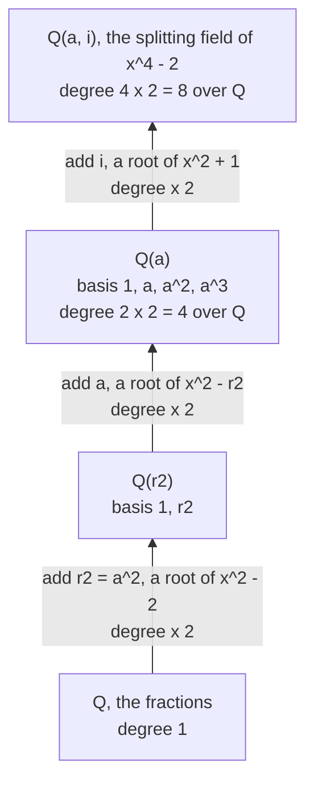

# Field extensions: adding a number to a field, and measuring the result as a dimension

[Syllabus](../../../SYLLABUS.md) → [Algebraic and analytic number theory](../README.md) → [Fields and Galois Theory](../README.md#s05) → Field extensions

---

## General Overview

The fractions cannot solve $`x^4 = 2`$. Its positive real solution is the fourth root of 2, about 1.18920711500, and no fraction equals it. Call it $`\alpha`$ (Greek "alpha"; the code writes `a`).

So add it. Take the fractions, put $`\alpha`$ in, and keep everything that adding, subtracting, multiplying and dividing can make. The result is a new field: a number system where every nonzero number has a reciprocal ([Fields](../../03-Algebra/09-Rings%20and%20Fields/02-fields.md)). It holds numbers such as $`3 - \alpha^2`$ and $`1/(1 + \alpha)`$.

How big is this new field? Every number in it turns out to be one list of four fractions, the amounts of $`1`$, $`\alpha`$, $`\alpha^2`$ and $`\alpha^3`$. Four coordinates, like a point in four-dimensional space. That count, 4, is the **degree** of the new field over the fractions.

The degree can also be reached in two steps. Adding $`\alpha^2 = \sqrt 2`$ first gives a field of degree 2. Adding $`\alpha`$ on top of that doubles it again. Degrees multiply up such a tower: 2 × 2 = 4.

This polynomial, $`x^4 - 2`$, is the house example of this shelf. Its four roots, and the eight symmetries that shuffle them, return on the later cards. This card measures the first field it builds.

**A field extension is a bigger field holding a smaller one; its degree is its dimension as a vector space over the smaller field; adding one root of an irreducible polynomial of degree n gives degree n; and degrees multiply up a tower.**

**What kind of fact this is:** two theorems, both proved on this card in Why it works. Degree, extension and $`K(\alpha)`$ are definitions. The code's factor searches are finite and complete, so they are proofs too, not samples.

### The picture: the tower over the fractions



Each arrow adds one number and multiplies the degree by 2. The top box is where the later cards of this shelf work.

---

## The formula

Notation first, in words. $`\mathbb{Q}`$ is the field of fractions. When a field $`L`$ contains a field $`K`$, $`L`$ is an **extension** of $`K`$, written $`L/K`$ and read "L over K". It is not a division.

The bigger field is a vector space over the smaller one: its numbers can be added, and scaled by numbers of $`K`$ ([Basis and dimension](../../03-Algebra/03-Vectors/05-basis-and-dimension.md)). The **degree** $`[L:K]`$ is the dimension of that space: the length of any basis.

$`K(\alpha)`$, read "K adjoin alpha", is the smallest field that holds $`K`$ and the number $`\alpha`$. It is a **simple extension**: one number added. The **degree of a number** $`\beta`$ over $`K`$ is $`[K(\beta):K]`$, the degree of the field it generates.

A polynomial is **irreducible** over $`K`$ when it is not a product of two polynomials of lower degree with coefficients in $`K`$. If $`\alpha`$ is a root of such an $`f`$ of degree $`n`$, then

```math
[K(\alpha):K] = n, \qquad \text{with basis } 1,\ \alpha,\ \alpha^2,\ \dots,\ \alpha^{n-1}
```

**Read it aloud:** adding one root of an irreducible polynomial of degree n gives a field of dimension n, and the first n powers of the root are a basis.

For fields $`K \subseteq L \subseteq M`$, each inside the next, the **tower law** says

```math
[M:K] = [M:L]\,[L:K]
```

**Read it aloud:** the degree from the bottom to the top is the degree of the top step times the degree of the bottom step.

With our numbers: $`[\mathbb{Q}(\sqrt 2):\mathbb{Q}] = 2`$, $`[\mathbb{Q}(\alpha):\mathbb{Q}(\sqrt 2)] = 2`$, and $`[\mathbb{Q}(\alpha):\mathbb{Q}] = 2 \times 2 = 4`$.

| Symbol | Plain meaning | In our example | Push it up and the answer… |
| --- | --- | --- | --- |
| $`K`$, $`\mathbb{Q}`$ | the base field: the numbers allowed as coefficients; $`\mathbb{Q}`$ is the fractions | $`\mathbb{Q}`$, the fractions | a bigger base leaves less to add: the degree falls |
| $`L`$, $`M`$ | larger fields, each holding the one below | $`\mathbb{Q}(\sqrt 2)`$, $`\mathbb{Q}(\alpha)`$ | — |
| $`L/K`$ | "L over K": L, seen as an extension of K | $`\mathbb{Q}(\alpha)/\mathbb{Q}`$ | — |
| $`[L:K]`$ | the degree: dimension of L as a vector space over K | 4 | more coordinates per number |
| $`\alpha`$ | the added number (the code's `a`) | $`2^{1/4}`$ = 1.18920711500 | — |
| $`K(\alpha)`$ | the smallest field holding K and $`\alpha`$ | $`\mathbb{Q}(\alpha)`$ | — |
| $`f`$ | an irreducible polynomial over K with root $`\alpha`$ | $`x^4 - 2`$ | — |
| $`n`$ | the degree of $`f`$ | 4 | the degree of the extension, one for one |
| $`\sqrt 2`$ | $`\alpha^2`$, the middle of the tower (the code's `r2`) | basis $`1, \sqrt 2`$ of $`\mathbb{Q}(\sqrt 2)`$ | — |
| $`\beta`$ | any number of $`\mathbb{Q}(\alpha)`$ | $`\alpha + \alpha^2`$, degree 4 | its degree still divides 4 |
| $`i`$ | a square root of −1, not a real number | added at the top of the tower | — |
| $`\mathrm{GF}(p^k)`$ | the finite field of $`p^k`$ elements, p a prime, k its degree over $`\mathrm{GF}(p)`$ | $`\mathrm{GF}(8)`$, $`\mathrm{GF}(16)`$, $`\mathrm{GF}(256)`$ | bigger k: $`p^k`$ elements |

Letters used inside a single proof step, such as g, A, B, t and z, are defined where they appear.

### When it holds

- **The polynomial must be irreducible over K.** If it factors, the root obeys a shorter equation and the degree is smaller. A root of $`x^4 + 4`$ has degree 2, not 4.
- **The degree depends on the base field.** $`\alpha`$ has degree 4 over $`\mathbb{Q}`$, degree 2 over $`\mathbb{Q}(\sqrt 2)`$, and degree 1 over the real numbers, which already hold it.
- **The tower law needs each field inside the next.** Two fields side by side, neither inside the other, form no tower. The law then says only that each degree divides the degree of a field holding both.
- **The degree must be finite for a count.** Over $`\mathbb{Q}`$, the number $`\pi`$ obeys no polynomial equation, so $`\mathbb{Q}(\pi)`$ has infinite degree and the formula gives no number.

---

## Why it works

### Step 0: a field over a field is a vector space

Numbers of $`\mathbb{Q}(\alpha)`$ can be added to each other and multiplied by fractions, and all the vector-space rules hold. So the language of [Basis and dimension](../../03-Algebra/03-Vectors/05-basis-and-dimension.md) applies: span, independence, basis, dimension. The degree is that dimension, and the whole card follows from counting a basis.

Every field is an extension of something. Add 1 to itself over and over: either a sum reaches 0, after a prime number p of steps, or it never does. In the first case the field holds $`\mathrm{GF}(p)`$, the p-hour clock; in the second it holds $`\mathbb{Q}`$. That p, or 0, is the field's **characteristic**.

### Step 1: the first n powers reach everything

In $`\mathbb{Q}(\alpha)`$ the rule $`\alpha^4 = 2`$ trades any high power for a lower one: $`\alpha^5 = 2\alpha`$, $`\alpha^6 = 2\alpha^2`$. So every sum of powers is a combination of $`1, \alpha, \alpha^2, \alpha^3`$.

Reciprocals land there too. Multiply $`1 + \alpha`$ by $`1 - \alpha + \alpha^2 - \alpha^3`$: the middle terms cancel and $`1 - \alpha^4 = 1 - 2 = -1`$ is left. So

```math
\frac{1}{1+\alpha} = -1 + \alpha - \alpha^2 + \alpha^3
```

In coordinates that is `[-1, 1, -1, 1]`. In decimals, both sides are 0.456786383137.

That every nonzero combination has such a reciprocal is the construction on [Finite fields](../../03-Algebra/09-Rings%20and%20Fields/05-finite-fields.md): polynomials wrapped at an irreducible f of degree n form a field whose numbers are lists of n coefficients. With fractions as coefficients, that field is $`\mathbb{Q}(\alpha) = \mathbb{Q}[x]/(f)`$.

### Step 2: no shorter list will do

Suppose some combination of $`1, \alpha, \dots, \alpha^{n-1}`$ with fractions, not all zero, gave 0. Then $`\alpha`$ is a root of a nonzero polynomial g of degree below n.

Now f is irreducible, so f and g share no factor. Euclid's algorithm for polynomials then writes $`1 = A f + B g`$ for some polynomials A and B ([Polynomials behave like integers](../../03-Algebra/09-Rings%20and%20Fields/03-polynomials-behave-like-integers.md)). Put $`x = \alpha`$: both f and g give 0, so 1 = 0, which is false.

So the n powers are independent as well as spanning: they are a basis, and $`[K(\alpha):K] = n`$.

### Step 3: degrees multiply up a tower

Take a basis $`u_1, \dots, u_r`$ of L over K and a basis $`v_1, \dots, v_s`$ of M over L. The claim is that the $`r \times s`$ products $`u_i v_j`$ are a basis of M over K.

For our tower, $`1, \sqrt 2`$ times $`1, \alpha`$ gives $`1, \alpha, \sqrt 2, \sqrt 2\,\alpha`$, which is $`1, \alpha, \alpha^2, \alpha^3`$. The code multiplies them out and gets the four coordinate lists `[1, 0, 0, 0]` to `[0, 0, 0, 1]`, rank 4.

<details>
<summary>Detailed proof: the products of two bases are a basis</summary>

**They span.** Any m in M is a combination of the $`v_j`$ with coefficients $`c_j`$ in L. Each $`c_j`$ is a combination of the $`u_i`$ with coefficients $`q_{ij}`$ in K. Substitute:

$`\displaystyle m = \sum_j c_j v_j = \sum_j \Big(\sum_i q_{ij} u_i\Big) v_j = \sum_{i,j} q_{ij}\, u_i v_j`$

**They are independent.** Suppose $`\sum_{i,j} q_{ij} u_i v_j = 0`$ with every $`q_{ij}`$ in K. Group by j: the coefficient of $`v_j`$ is $`\sum_i q_{ij} u_i`$, a number of L. The $`v_j`$ are independent over L, so each of these is 0. The $`u_i`$ are independent over K, so every $`q_{ij}`$ is 0.

So M has a basis of $`r s`$ numbers over K, and $`[M:K] = [M:L]\,[L:K]`$. If either degree is infinite, so is $`[M:K]`$.

</details>

### Step 4: the tower proves that x⁴ − 2 does not factor

The degree 4 rests on $`x^4 - 2`$ being irreducible. The tower law proves it, one step of 2 at a time.

1. **Bottom step.** A rational root of $`x^2 - 2`$ would be one of 1, −1, 2, −2 (the rational root test), and none works. A degree-2 polynomial with no root has no factor, so $`[\mathbb{Q}(\sqrt 2):\mathbb{Q}] = 2`$.
2. **Top step.** $`\alpha`$ is a root of $`x^2 - \sqrt 2`$, a polynomial over $`\mathbb{Q}(\sqrt 2)`$. Suppose it had a root $`t + z\sqrt 2`$ there, with t and z fractions. Squaring gives $`t^2 + 2z^2 + 2tz\sqrt 2 = \sqrt 2`$. Since $`1, \sqrt 2`$ is a basis, $`t^2 + 2z^2 = 0`$ and $`2tz = 1`$. Put $`z = 1/(2t)`$ into the first: $`2t^4 + 1 = 0`$. Its rational root test finds nothing, so $`[\mathbb{Q}(\alpha):\mathbb{Q}(\sqrt 2)] = 2`$.
3. **Multiply.** $`[\mathbb{Q}(\alpha):\mathbb{Q}] = 2 \times 2 = 4`$.

If $`x^4 - 2`$ had a factor of lower degree, $`\alpha`$ would be a root of one of those factors, and its degree would be below 4. So the polynomial is irreducible.

Two more roads reach the same fact, and the code runs both:

- **A complete factor search.** By Gauss's lemma, a monic polynomial with whole-number coefficients that factors over the fractions factors into monic whole-number pieces. Every root of $`x^4 - 2`$ is under 3 in size. The middle coefficient of a quadratic factor is minus the sum of two roots, so it is under 6, and the constant divides −2. The search covers every such case and finds no factor.
- **Eisenstein's criterion at 2.** If a prime p divides every coefficient except the leading one, and $`p^2`$ does not divide the constant, the polynomial is irreducible over $`\mathbb{Q}`$. Here 2 divides 0, 0, 0 and −2, and 4 does not divide −2. This is stated with a source (Stewart), not proved here.

### Step 5: what the tower law forbids

Any number $`\beta`$ in $`\mathbb{Q}(\alpha)`$ gives a tower $`\mathbb{Q} \subseteq \mathbb{Q}(\beta) \subseteq \mathbb{Q}(\alpha)`$. So the degree of $`\beta`$ divides 4.

The code checks six numbers by a direct search: the first power of $`\beta`$ that depends on the earlier ones. The degrees of $`3, \alpha, \alpha^2, \alpha^3, \alpha + \alpha^2, 1 + \alpha^2`$ come out as 1, 4, 2, 4, 4, 2, as the law requires. Six samples prove nothing about the rest; the tower law does. Since 3 does not divide 4, the cube root of 2, of degree 3, is not in $`\mathbb{Q}(\alpha)`$.

The same law counts finite fields. A field of degree k over $`\mathrm{GF}(p)`$ has k coordinates, each with p choices, so $`p^k`$ elements. And $`\mathrm{GF}(4)`$ can sit inside $`\mathrm{GF}(2^k)`$ only if 2 divides k. The code confirms it by count: $`w^2 + w + 1 = 0`$, the equation that makes $`\mathrm{GF}(4)`$, has 0 solutions in $`\mathrm{GF}(8)`$ and 2 in $`\mathrm{GF}(16)`$.

---

## Worked numbers, by hand

| Step | Arithmetic | Value |
| --- | --- | --- |
| the added number | the real root of $`x^4 = 2`$ | $`\alpha`$ = 1.18920711500 |
| bottom step | $`x^2 - 2`$: test 1, −1, 2, −2; none is a root | $`[\mathbb{Q}(\sqrt 2):\mathbb{Q}] = 2`$ |
| top step | $`(t + z\sqrt 2)^2 = \sqrt 2`$ forces $`2t^4 + 1 = 0`$; test 1, −1, 1/2, −1/2; none | $`[\mathbb{Q}(\alpha):\mathbb{Q}(\sqrt 2)] = 2`$ |
| tower law | 2 × 2 | **4** |
| the basis | $`1, \sqrt 2`$ times $`1, \alpha`$ | $`1, \alpha, \alpha^2, \alpha^3`$ |
| one reciprocal | $`(1 + \alpha)(1 - \alpha + \alpha^2 - \alpha^3) = 1 - 2`$ | $`1/(1+\alpha) = -1 + \alpha - \alpha^2 + \alpha^3`$ = 0.456786383137 |

**Every number in $`\mathbb{Q}(2^{1/4})`$ is exactly one list of four fractions, so the extension has degree 4 over $`\mathbb{Q}`$.**

### What breaks if you drop a piece

| Mistake | Comes out at | What went wrong |
| --- | --- | --- |
| Reading the degree off $`x^4 + 4`$, which has no rational root | 4, but the true degree of its root $`1 + i`$ is 2 | $`x^4 + 4 = (x^2 - 2x + 2)(x^2 + 2x + 2)`$: no root is not the same as no factor, past degree 3 |
| Adding degrees up the tower $`\mathbb{Q} \subseteq \mathbb{Q}(2^{1/3}) \subseteq \mathbb{Q}(2^{1/6})`$ | 3 + 2 = 5 | Bases multiply: the true degree is 3 × 2 = 6 |
| Dropping the base field | $`\alpha`$ "has degree 4" over $`\mathbb{Q}(\sqrt 2)`$ | Over $`\mathbb{Q}(\sqrt 2)`$ it obeys $`x^2 - \sqrt 2`$: degree 2 |

The first row is the case where a hypothesis fails. The polynomial has degree 4 but is not irreducible, so the formula does not apply. The code prints all three.

---

## Code, from first principles, and it actually runs

The code stores $`\mathbb{Q}(\alpha)`$ as lists of four exact fractions, with the rule $`\alpha^4 = 2`$ applied after every product. It reaches the degree 4 by three independent roads: a complete factor search (rational roots, then every quadratic split allowed by the root-size bound), Eisenstein's test at 2, and the tower of two steps of 2, each settled by a rational root test. Each test also runs once where it must give the other answer: $`x^2 - 4`$ and $`x^4 - 1`$ have rational roots, and Eisenstein at 2 does not apply to $`x^4 + 4`$. A test stuck on one answer would fail an assert. A fourth computation, the dependence search, finds the degree of any element by row reduction. On $`\alpha`$ itself it proves nothing: the stored $`\alpha`$ has 4 independent powers whatever quartic it is stored with, factored or not, so it is not counted as a road. The code finds the reciprocal of $`1 + \alpha`$ by solving a 4 × 4 system and compares it with the hand formula. Finite fields are built as bit patterns, and the count of solutions of $`w^2 + w + 1 = 0`$ tests the tower law in $`\mathrm{GF}(8)`$ and $`\mathrm{GF}(16)`$. Sign changes count the real roots of $`x^4 - 2`$: the real field $`\mathbb{Q}(\alpha)`$ holds those 2 and no others, so it has 2 symmetries.

### Python

```python
# Field extensions and degree -- the check behind the card.  Standard library
# only.  The field Q(a), a = 2^(1/4), is stored as Q[x]/(x^4 - 2): a number is
# four rational coordinates on the basis 1, a, a^2, a^3.  The degree 4 comes by
# three roads: a complete factor search, Eisenstein's test at 2, and the tower
# Q < Q(r2) < Q(a), whose two steps of 2 multiply.  r2 is the square root of 2.
from fractions import Fraction as F
import math

def mul(u, v, f):                      # multiply, then trade x^n for -(f - x^n)
    n = len(f) - 1                     # f: integer coefficients, constant first, monic
    prod = [F(0)] * (2 * n - 1)
    for i, x in enumerate(u):
        for j, y in enumerate(v):
            prod[i + j] += x * y
    for k in range(2 * n - 2, n - 1, -1):
        c, prod[k] = prod[k], F(0)
        for i in range(n):
            prod[k - n + i] -= c * f[i]
    return prod[:n]

def reduce(rows):                      # Gauss-Jordan over Q: (reduced rows, rank)
    rows, r = [[F(x) for x in row] for row in rows], 0
    for col in range(len(rows[0])):
        piv = next((i for i in range(r, len(rows)) if rows[i][col] != 0), None)
        if piv is None:
            continue
        rows[r], rows[piv] = rows[piv], rows[r]
        rows[r] = [x / rows[r][col] for x in rows[r]]
        for i in range(len(rows)):
            if i != r and rows[i][col] != 0:
                t = rows[i][col]
                rows[i] = [x - t * y for x, y in zip(rows[i], rows[r])]
        r += 1
    return rows, r

def degree(beta, f):                   # first n with 1, beta, ..., beta^n dependent
    powers = [[F(1)] + [F(0)] * (len(f) - 2)]
    while True:
        nxt = mul(powers[-1], beta, f)
        if reduce(powers + [nxt])[1] == len(powers):
            return len(powers)
        powers.append(nxt)

def divisors(n):
    return [d for d in range(1, abs(n) + 1) if n % d == 0]

def rational_roots(c):                 # every candidate p/q, p | constant, q | leading
    cands = {F(s * p, q) for p in divisors(c[0]) for q in divisors(c[-1]) for s in (1, -1)}
    return sorted(r for r in cands if sum(ci * r ** i for i, ci in enumerate(c)) == 0)

def quadratic_factors(c):              # monic integer quartic = (x^2+ax+b)(x^2+gx+d)?
    bound = 2 * (1 + max(abs(x) for x in c[:4]))   # every root is smaller than 1 + max|c_i|
    found = []
    for b in [s * d for d in divisors(c[0]) for s in (1, -1)]:
        d = c[0] // b
        for a in range(-bound, bound + 1):
            g = c[3] - a
            if (b + d + a * g, a * d + b * g) == (c[2], c[1]) and (a, b) <= (g, d):
                found.append((a, b, g, d))
    return found

def eisenstein(c, p):
    return all(x % p == 0 for x in c[:-1]) and c[0] % (p * p) != 0 and c[-1] % p != 0

def gf2_mul(u, v, f, n):               # GF(2) polynomials as bit masks, wrapped at f
    out = 0
    while v:
        if v & 1:
            out ^= u
        v, u = v >> 1, u << 1
        if u >> n & 1:
            u ^= f
    return out

def show(v):
    return "[" + ", ".join(str(x) for x in v) + "]"

f4, f6, g4 = [-2, 0, 0, 0, 1], [-2, 0, 0, 0, 0, 0, 1], [4, 0, 0, 0, 1]
e = lambda k, n=4: [F(int(i == k)) for i in range(n)]
one, a, r2 = e(0), e(1), e(2)
rr4, qf4 = rational_roots(f4), quadratic_factors(f4)
step1, step2 = rational_roots([-2, 0, 1]), rational_roots([1, 0, 0, 0, 2])
deg_r2 = degree(r2, f4)
tower = (2 if not step1 else 1) * (2 if not step2 else 1)
products = [mul(x, y, f4) for x in (one, r2) for y in (one, a)]
names = ["3", "a", "a^2", "a^3", "a + a^2", "1 + a^2"]
elems = [[F(3), 0, 0, 0], a, r2, e(3), [0, 1, 1, 0], [1, 0, 1, 0]]
degs = [degree([F(x) for x in v], f4) for v in elems]
outside = reduce([one, r2, a])[1]
one_plus_a = [F(1), F(1), F(0), F(0)]
cols = [mul(one_plus_a, e(j), f4) for j in range(4)]
rows, _ = reduce([[cols[j][i] for j in range(4)] + [one[i]] for i in range(4)])
inv = [row[4] for row in rows]
series = [F(-1), F(1), F(-1), F(1)]    # (1 + a)(1 - a + a^2 - a^3) = 1 - a^4 = -1
x = math.sqrt(math.sqrt(2))
d6 = [degree(e(k, 6), f6) for k in (3, 2, 1)]
qg4, rg4, rg2 = quadratic_factors(g4), rational_roots(g4), rational_roots([2, -2, 1])
pos = rational_roots([-4, 0, 1]), rational_roots([-1, 0, 0, 0, 1]), eisenstein(g4, 2)
real = sum(1 for k in range(-300, 300) if ((k / 100) ** 4 - 2) * (((k + 1) / 100) ** 4 - 2) < 0)
gf8_ok = all(any(gf2_mul(u, v, 0b1011, 3) == 1 for v in range(1, 8)) for u in range(1, 8))
w8 = sum(1 for w in range(8) if gf2_mul(w, w, 0b1011, 3) ^ w ^ 1 == 0)
w16 = sum(1 for w in range(16) if gf2_mul(w, w, 0b10011, 4) ^ w ^ 1 == 0)
aes = 0b100011011                      # x^8 + x^4 + x^3 + x + 1
aes_units = sum(1 for u in range(1, 256) if any(gf2_mul(u, v, aes, 8) == 1 for v in range(1, 256)))
aes_ex = gf2_mul(0x57, 0x83, aes, 8)
print(f"a = 2^(1/4) = {x:.11f}; Q(a) stored on the basis 1, a, a^2, a^3")
print(f"road 1, factor search on x^4 - 2, roots under {1 + max(abs(c) for c in f4[:4])}: rational roots {rr4}, quadratic factors {qf4}: {'irreducible' if not rr4 + qf4 else 'factors'}")
print(f"road 2, Eisenstein at 2 on x^4 - 2: {'yes' if eisenstein(f4, 2) else 'no'}")
print(f"road 3, x^2 - 2 rational roots {step1}: [Q(r2):Q] = 2; dependence search on r2 = a^2: {deg_r2}")
print(f"        x^2 - r2 has a root in Q(r2) only if 2t^4 + 1 has a rational root: {step2}: [Q(a):Q(r2)] = 2")
print(f"        tower: [Q(a):Q] = 2 x 2 = {tower}")
print(f"other answers: rational roots of x^2 - 4 {show(pos[0])}, of x^4 - 1 {show(pos[1])}; Eisenstein at 2 on x^4 + 4: {'yes' if pos[2] else 'no'}")
print(f"basis products 1, a, r2, r2 a as coordinates: {' '.join(show(p) for p in products)}; rank {reduce(products)[1]}")
print(f"a outside Q(r2): rank of 1, r2, a is {outside}")
print(f"degrees over Q of {', '.join(names)}: {degs}")
print(f"every degree divides 4: {'yes' if all(4 % d == 0 for d in degs) else 'no'}; so no element has degree 3")
print(f"1/(1 + a) by solving the 4 x 4 system: {show(inv)}")
print(f"1/(1 + a) by the geometric series:    {show(series)}; product {show(mul(one_plus_a, inv, f4))}")
print(f"as decimals: 1/(1 + a) = {1 / (1 + x):.12f}; -1 + a - a^2 + a^3 = {-1 + x - x * x + x * x * x:.12f}")
print(f"x^6 - 2: Eisenstein at 2 {'yes' if eisenstein(f6, 2) else 'no'}; degrees of r2, 2^(1/3), 2^(1/6): {d6}")
print(f"tower law on Q < Q(2^(1/3)) < Q(2^(1/6)): top step = {d6[2]} / {d6[1]} = {d6[2] // d6[1]}")
print(f"splitting field Q(a, i): i is not real and Q(a) is, so the top step is 2; tower law 4 x 2 = {tower * 2}")
print(f"GF(8) = GF(2)[x]/(x^3 + x + 1): {2 ** 3} elements, all nonzero invertible: {'yes' if gf8_ok else 'no'}")
print(f"roots of w^2 + w + 1: in GF(8) {w8}, in GF(16) {w16}")
print(f"GF(256) with x^8 + x^4 + x^3 + x + 1: {aes_units} of 255 nonzero bytes invertible; 57 x 83 = {aes_ex:02x}")
print(f"mistake 1, x^4 + 4: rational roots {rg4}, yet quadratic factors {qg4}")
print(f"           its root 1 + i solves x^2 - 2x + 2, rational roots {rg2}: degree 2, not 4")
print(f"mistake 2, adding up the tower: 3 + 2 = {d6[1] + 2}, true degree {d6[2]}")
print(f"mistake 3, base field dropped: a has degree {degree(a, f4) // deg_r2} over Q(r2), {degree(a, f4)} over Q")
print(f"symmetries: x^4 - 2 changes sign {real} times on [-3, 3], so the real field Q(a) holds {real} of its roots: {real} symmetries, not 4")
assert rr4 == [] and qf4 == [] and eisenstein(f4, 2)           # roads 1 and 2
assert tower == 4 and deg_r2 == 2                               # road 3
assert pos == ([-2, 2], [-1, 1], False) and real == 2          # the tests can say the other thing
assert reduce(products)[1] == 4 and outside == 3
assert degs == [1, 4, 2, 4, 4, 2]
assert inv == series and mul(one_plus_a, inv, f4) == one
assert abs((-1 + x - x * x + x * x * x) - 1 / (1 + x)) < 1e-12
assert d6 == [2, 3, 6] and qg4 == [(-2, 2, 2, 2)] and rg4 == rg2 == []
assert gf8_ok and (w8, w16) == (0, 2) and aes_units == 255 and aes_ex == 0xC1
print("ALL CHECKS PASS")
```

**Ran 2026-11-15 on macOS, Python 3.14.10, standard library only. All checks passed. Output, pasted from the run:**

```
a = 2^(1/4) = 1.18920711500; Q(a) stored on the basis 1, a, a^2, a^3
road 1, factor search on x^4 - 2, roots under 3: rational roots [], quadratic factors []: irreducible
road 2, Eisenstein at 2 on x^4 - 2: yes
road 3, x^2 - 2 rational roots []: [Q(r2):Q] = 2; dependence search on r2 = a^2: 2
        x^2 - r2 has a root in Q(r2) only if 2t^4 + 1 has a rational root: []: [Q(a):Q(r2)] = 2
        tower: [Q(a):Q] = 2 x 2 = 4
other answers: rational roots of x^2 - 4 [-2, 2], of x^4 - 1 [-1, 1]; Eisenstein at 2 on x^4 + 4: no
basis products 1, a, r2, r2 a as coordinates: [1, 0, 0, 0] [0, 1, 0, 0] [0, 0, 1, 0] [0, 0, 0, 1]; rank 4
a outside Q(r2): rank of 1, r2, a is 3
degrees over Q of 3, a, a^2, a^3, a + a^2, 1 + a^2: [1, 4, 2, 4, 4, 2]
every degree divides 4: yes; so no element has degree 3
1/(1 + a) by solving the 4 x 4 system: [-1, 1, -1, 1]
1/(1 + a) by the geometric series:    [-1, 1, -1, 1]; product [1, 0, 0, 0]
as decimals: 1/(1 + a) = 0.456786383137; -1 + a - a^2 + a^3 = 0.456786383137
x^6 - 2: Eisenstein at 2 yes; degrees of r2, 2^(1/3), 2^(1/6): [2, 3, 6]
tower law on Q < Q(2^(1/3)) < Q(2^(1/6)): top step = 6 / 3 = 2
splitting field Q(a, i): i is not real and Q(a) is, so the top step is 2; tower law 4 x 2 = 8
GF(8) = GF(2)[x]/(x^3 + x + 1): 8 elements, all nonzero invertible: yes
roots of w^2 + w + 1: in GF(8) 0, in GF(16) 2
GF(256) with x^8 + x^4 + x^3 + x + 1: 255 of 255 nonzero bytes invertible; 57 x 83 = c1
mistake 1, x^4 + 4: rational roots [], yet quadratic factors [(-2, 2, 2, 2)]
           its root 1 + i solves x^2 - 2x + 2, rational roots []: degree 2, not 4
mistake 2, adding up the tower: 3 + 2 = 5, true degree 6
mistake 3, base field dropped: a has degree 2 over Q(r2), 4 over Q
symmetries: x^4 - 2 changes sign 2 times on [-3, 3], so the real field Q(a) holds 2 of its roots: 2 symmetries, not 4
ALL CHECKS PASS
```

### Rust

Same numbers, same labels, built with `rustc --edition 2021 -O`. Fractions use 128-bit integers with checked overflow.

```rust
// Field extensions and degree -- the same check as the Python, in Rust.  No
// crates.  The field Q(a), a = 2^(1/4), is stored as Q[x]/(x^4 - 2): a number is
// four rational coordinates on the basis 1, a, a^2, a^3.  The degree 4 comes by
// three roads: a complete factor search, Eisenstein's test at 2, and the tower
// Q < Q(r2) < Q(a), whose two steps of 2 multiply.  r2 is the square root of 2.
#[derive(Clone, Copy, PartialEq, Eq, PartialOrd, Ord, Hash, Debug)]
struct Q { n: i128, d: i128 }              // a fraction in lowest terms, d > 0

fn gcd(a: i128, b: i128) -> i128 { if b == 0 { a.abs() } else { gcd(b, a % b) } }
fn q(n: i128, d: i128) -> Q {
    let g = gcd(n, d).max(1) * d.signum();
    Q { n: n / g, d: d / g }
}
fn add(x: Q, y: Q) -> Q { q(x.n.checked_mul(y.d).unwrap().checked_add(y.n.checked_mul(x.d).unwrap()).unwrap(), x.d.checked_mul(y.d).unwrap()) }
fn sub(x: Q, y: Q) -> Q { add(x, Q { n: y.n.checked_neg().unwrap(), d: y.d }) }
fn mulq(x: Q, y: Q) -> Q { q(x.n.checked_mul(y.n).unwrap(), x.d.checked_mul(y.d).unwrap()) }
fn divq(x: Q, y: Q) -> Q { q(x.n.checked_mul(y.d).unwrap(), x.d.checked_mul(y.n).unwrap()) }
fn z(k: i128) -> Q { Q { n: k, d: 1 } }
fn cmpq(x: Q, y: Q) -> std::cmp::Ordering { x.n.checked_mul(y.d).unwrap().cmp(&y.n.checked_mul(x.d).unwrap()) }

fn mul(u: &[Q], v: &[Q], f: &[i128]) -> Vec<Q> {     // multiply, then trade x^n for -(f - x^n)
    let n = f.len() - 1;
    let mut prod = vec![z(0); 2 * n - 1];
    for (i, &x) in u.iter().enumerate() { for (j, &y) in v.iter().enumerate() { prod[i + j] = add(prod[i + j], mulq(x, y)) } }
    for k in (n..=2 * n - 2).rev() {
        let c = std::mem::replace(&mut prod[k], z(0));
        for i in 0..n { prod[k - n + i] = sub(prod[k - n + i], mulq(c, z(f[i]))) }
    }
    prod[..n].to_vec()
}
fn reduce(rows: &[Vec<Q>]) -> (Vec<Vec<Q>>, usize) {  // Gauss-Jordan over Q: (reduced rows, rank)
    let mut rows = rows.to_vec();
    let mut r = 0;
    for col in 0..rows[0].len() {
        let piv = match (r..rows.len()).find(|&i| rows[i][col].n != 0) { Some(p) => p, None => continue };
        rows.swap(r, piv);
        let p = rows[r][col];
        rows[r] = rows[r].iter().map(|&x| divq(x, p)).collect();
        for i in 0..rows.len() {
            if i != r && rows[i][col].n != 0 {
                let t = rows[i][col];
                let pr = rows[r].clone();
                rows[i] = rows[i].iter().zip(pr.iter()).map(|(&x, &y)| sub(x, mulq(t, y))).collect();
            }
        }
        r += 1;
    }
    (rows, r)
}
fn degree(beta: &[Q], f: &[i128]) -> usize {         // first n with 1, beta, ..., beta^n dependent
    let mut powers = vec![e(0, f.len() - 1)];
    loop {
        let nxt = mul(powers.last().unwrap(), beta, f);
        let all = [powers.clone(), vec![nxt.clone()]].concat();
        if reduce(&all).1 == powers.len() { return powers.len() }
        powers.push(nxt);
    }
}

fn e(k: usize, n: usize) -> Vec<Q> { (0..n).map(|i| z((i == k) as i128)).collect() }
fn divisors(n: i128) -> Vec<i128> { (1..=n.abs()).filter(|d| n % d == 0).collect() }

fn rational_roots(c: &[i128]) -> Vec<Q> {             // every candidate p/q, p | constant, q | leading
    let mut cands: Vec<Q> = Vec::new();
    for p in divisors(c[0]) { for qq in divisors(*c.last().unwrap()) { for s in [1, -1] { cands.push(q(s * p, qq)) } } }
    cands.sort_by(|x, y| cmpq(*x, *y));
    cands.dedup();
    cands.into_iter().filter(|&r| {
        let (mut val, mut pw) = (z(0), z(1));
        for &ci in c { val = add(val, mulq(z(ci), pw)); pw = mulq(pw, r) }
        val.n == 0
    }).collect()
}
fn quadratic_factors(c: &[i128]) -> Vec<(i128, i128, i128, i128)> {   // (x^2+ax+b)(x^2+gx+d)?
    let bound = 2 * (1 + c[..4].iter().map(|x| x.abs()).max().unwrap());
    let mut found = Vec::new();
    for dv in divisors(c[0]) { for s in [1, -1] {
        let b = s * dv;
        let d = c[0] / b;
        for a in -bound..=bound {
            let g = c[3] - a;
            if (b + d + a * g, a * d + b * g) == (c[2], c[1]) && (a, b) <= (g, d) { found.push((a, b, g, d)) }
        }
    } }
    found
}
fn eisenstein(c: &[i128], p: i128) -> bool {
    let k = c.len() - 1;
    c[..k].iter().all(|x| x % p == 0) && c[0] % (p * p) != 0 && c[k] % p != 0
}
fn gf2_mul(mut u: u32, mut v: u32, f: u32, n: u32) -> u32 {   // GF(2) polynomials as bit masks
    let mut out = 0;
    while v != 0 {
        if v & 1 == 1 { out ^= u }
        v >>= 1; u <<= 1;
        if (u >> n) & 1 == 1 { u ^= f }
    }
    out
}
fn fq(x: &Q) -> String { if x.d == 1 { format!("{}", x.n) } else { format!("{}/{}", x.n, x.d) } }
fn show(v: &[Q]) -> String { format!("[{}]", v.iter().map(fq).collect::<Vec<_>>().join(", ")) }
fn yn(b: bool) -> &'static str { if b { "yes" } else { "no" } }

fn main() {
    let (f4, f6, g4): (Vec<i128>, Vec<i128>, Vec<i128>) = (vec![-2, 0, 0, 0, 1], vec![-2, 0, 0, 0, 0, 0, 1], vec![4, 0, 0, 0, 1]);
    let (one, a, r2) = (e(0, 4), e(1, 4), e(2, 4));
    let (rr4, qf4) = (rational_roots(&f4), quadratic_factors(&f4));
    let (step1, step2) = (rational_roots(&[-2, 0, 1]), rational_roots(&[1, 0, 0, 0, 2]));
    let deg_r2 = degree(&r2, &f4);
    let tower = (if step1.is_empty() { 2 } else { 1 }) * (if step2.is_empty() { 2 } else { 1 });
    let products: Vec<Vec<Q>> = [&one, &r2].iter().flat_map(|x| [&one, &a].map(|y| mul(x, y, &f4))).collect();
    let names = ["3", "a", "a^2", "a^3", "a + a^2", "1 + a^2"];
    let elems: Vec<Vec<Q>> = [[3, 0, 0, 0], [0, 1, 0, 0], [0, 0, 1, 0], [0, 0, 0, 1], [0, 1, 1, 0], [1, 0, 1, 0]]
        .iter().map(|v| v.iter().map(|&k| z(k)).collect()).collect();
    let degs: Vec<usize> = elems.iter().map(|v| degree(v, &f4)).collect();
    let outside = reduce(&[one.clone(), r2.clone(), a.clone()]).1;
    let one_plus_a = vec![z(1), z(1), z(0), z(0)];
    let cols: Vec<Vec<Q>> = (0..4).map(|j| mul(&one_plus_a, &e(j, 4), &f4)).collect();
    let aug: Vec<Vec<Q>> = (0..4).map(|i| { let mut r: Vec<Q> = (0..4).map(|j| cols[j][i]).collect(); r.push(one[i]); r }).collect();
    let inv: Vec<Q> = reduce(&aug).0.iter().map(|r| r[4]).collect();
    let series = vec![z(-1), z(1), z(-1), z(1)];          // (1 + a)(1 - a + a^2 - a^3) = 1 - a^4 = -1
    let x = 2f64.sqrt().sqrt();
    let d6: Vec<usize> = [3, 2, 1].iter().map(|&k| degree(&e(k, 6), &f6)).collect();
    let (qg4, rg4, rg2) = (quadratic_factors(&g4), rational_roots(&g4), rational_roots(&[2, -2, 1]));
    let pos = (rational_roots(&[-4, 0, 1]), rational_roots(&[-1, 0, 0, 0, 1]), eisenstein(&g4, 2));
    let real = (-300..300).filter(|&k| ((k as f64 / 100.0).powi(4) - 2.0) * (((k + 1) as f64 / 100.0).powi(4) - 2.0) < 0.0).count();
    let gf8_ok = (1..8).all(|u| (1..8).any(|v| gf2_mul(u, v, 0b1011, 3) == 1));
    let w8 = (0..8).filter(|&w| gf2_mul(w, w, 0b1011, 3) ^ w ^ 1 == 0).count();
    let w16 = (0..16).filter(|&w| gf2_mul(w, w, 0b10011, 4) ^ w ^ 1 == 0).count();
    let aes = 0b100011011;                                // x^8 + x^4 + x^3 + x + 1
    let aes_units = (1..256).filter(|&u| (1..256).any(|v| gf2_mul(u, v, aes, 8) == 1)).count();
    let aes_ex = gf2_mul(0x57, 0x83, aes, 8);
    let (prods, da): (Vec<String>, usize) = (products.iter().map(|p| show(p)).collect(), degree(&a, &f4));
    println!("a = 2^(1/4) = {:.11}; Q(a) stored on the basis 1, a, a^2, a^3", x);
    println!("road 1, factor search on x^4 - 2, roots under {}: rational roots {}, quadratic factors {:?}: {}",
             1 + f4[..4].iter().map(|c| c.abs()).max().unwrap(), show(&rr4), qf4, if rr4.is_empty() && qf4.is_empty() { "irreducible" } else { "factors" });
    println!("road 2, Eisenstein at 2 on x^4 - 2: {}", yn(eisenstein(&f4, 2)));
    println!("road 3, x^2 - 2 rational roots {}: [Q(r2):Q] = 2; dependence search on r2 = a^2: {}", show(&step1), deg_r2);
    println!("        x^2 - r2 has a root in Q(r2) only if 2t^4 + 1 has a rational root: {}: [Q(a):Q(r2)] = 2", show(&step2));
    println!("        tower: [Q(a):Q] = 2 x 2 = {}", tower);
    println!("other answers: rational roots of x^2 - 4 {}, of x^4 - 1 {}; Eisenstein at 2 on x^4 + 4: {}", show(&pos.0), show(&pos.1), yn(pos.2));
    println!("basis products 1, a, r2, r2 a as coordinates: {}; rank {}", prods.join(" "), reduce(&products).1);
    println!("a outside Q(r2): rank of 1, r2, a is {}", outside);
    println!("degrees over Q of {}: {:?}", names.join(", "), degs);
    println!("every degree divides 4: {}; so no element has degree 3", yn(degs.iter().all(|d| 4 % d == 0)));
    println!("1/(1 + a) by solving the 4 x 4 system: {}", show(&inv));
    println!("1/(1 + a) by the geometric series:    {}; product {}", show(&series), show(&mul(&one_plus_a, &inv, &f4)));
    println!("as decimals: 1/(1 + a) = {:.12}; -1 + a - a^2 + a^3 = {:.12}", 1.0 / (1.0 + x), -1.0 + x - x * x + x * x * x);
    println!("x^6 - 2: Eisenstein at 2 {}; degrees of r2, 2^(1/3), 2^(1/6): {:?}", yn(eisenstein(&f6, 2)), d6);
    println!("tower law on Q < Q(2^(1/3)) < Q(2^(1/6)): top step = {} / {} = {}", d6[2], d6[1], d6[2] / d6[1]);
    println!("splitting field Q(a, i): i is not real and Q(a) is, so the top step is 2; tower law 4 x 2 = {}", tower * 2);
    println!("GF(8) = GF(2)[x]/(x^3 + x + 1): {} elements, all nonzero invertible: {}", 2u32.pow(3), yn(gf8_ok));
    println!("roots of w^2 + w + 1: in GF(8) {}, in GF(16) {}", w8, w16);
    println!("GF(256) with x^8 + x^4 + x^3 + x + 1: {} of 255 nonzero bytes invertible; 57 x 83 = {:02x}", aes_units, aes_ex);
    println!("mistake 1, x^4 + 4: rational roots {}, yet quadratic factors {:?}", show(&rg4), qg4);
    println!("           its root 1 + i solves x^2 - 2x + 2, rational roots {}: degree 2, not 4", show(&rg2));
    println!("mistake 2, adding up the tower: 3 + 2 = {}, true degree {}", d6[1] + 2, d6[2]);
    println!("mistake 3, base field dropped: a has degree {} over Q(r2), {} over Q", da / deg_r2, da);
    println!("symmetries: x^4 - 2 changes sign {} times on [-3, 3], so the real field Q(a) holds {} of its roots: {} symmetries, not 4", real, real, real);
    assert!(rr4.is_empty() && qf4.is_empty() && eisenstein(&f4, 2));     // roads 1 and 2
    assert!(tower == 4 && deg_r2 == 2);                                  // road 3
    assert!(pos.0 == vec![z(-2), z(2)] && pos.1 == vec![z(-1), z(1)] && !pos.2 && real == 2);   // the tests can say the other thing
    assert!(reduce(&products).1 == 4 && outside == 3);
    assert!(degs == vec![1, 4, 2, 4, 4, 2]);
    assert!(inv == series && mul(&one_plus_a, &inv, &f4) == one);
    assert!(((-1.0 + x - x * x + x * x * x) - 1.0 / (1.0 + x)).abs() < 1e-12);
    assert!(d6 == vec![2, 3, 6] && qg4 == vec![(-2, 2, 2, 2)] && rg4.is_empty() && rg2.is_empty());
    assert!(gf8_ok && (w8, w16) == (0, 2) && aes_units == 255 && aes_ex == 0xC1);
    println!("ALL CHECKS PASS");
}
```

**Ran 2026-11-15 on macOS, rustc 1.98.1, no crates. All checks passed. Output, pasted from the run:**

```
a = 2^(1/4) = 1.18920711500; Q(a) stored on the basis 1, a, a^2, a^3
road 1, factor search on x^4 - 2, roots under 3: rational roots [], quadratic factors []: irreducible
road 2, Eisenstein at 2 on x^4 - 2: yes
road 3, x^2 - 2 rational roots []: [Q(r2):Q] = 2; dependence search on r2 = a^2: 2
        x^2 - r2 has a root in Q(r2) only if 2t^4 + 1 has a rational root: []: [Q(a):Q(r2)] = 2
        tower: [Q(a):Q] = 2 x 2 = 4
other answers: rational roots of x^2 - 4 [-2, 2], of x^4 - 1 [-1, 1]; Eisenstein at 2 on x^4 + 4: no
basis products 1, a, r2, r2 a as coordinates: [1, 0, 0, 0] [0, 1, 0, 0] [0, 0, 1, 0] [0, 0, 0, 1]; rank 4
a outside Q(r2): rank of 1, r2, a is 3
degrees over Q of 3, a, a^2, a^3, a + a^2, 1 + a^2: [1, 4, 2, 4, 4, 2]
every degree divides 4: yes; so no element has degree 3
1/(1 + a) by solving the 4 x 4 system: [-1, 1, -1, 1]
1/(1 + a) by the geometric series:    [-1, 1, -1, 1]; product [1, 0, 0, 0]
as decimals: 1/(1 + a) = 0.456786383137; -1 + a - a^2 + a^3 = 0.456786383137
x^6 - 2: Eisenstein at 2 yes; degrees of r2, 2^(1/3), 2^(1/6): [2, 3, 6]
tower law on Q < Q(2^(1/3)) < Q(2^(1/6)): top step = 6 / 3 = 2
splitting field Q(a, i): i is not real and Q(a) is, so the top step is 2; tower law 4 x 2 = 8
GF(8) = GF(2)[x]/(x^3 + x + 1): 8 elements, all nonzero invertible: yes
roots of w^2 + w + 1: in GF(8) 0, in GF(16) 2
GF(256) with x^8 + x^4 + x^3 + x + 1: 255 of 255 nonzero bytes invertible; 57 x 83 = c1
mistake 1, x^4 + 4: rational roots [], yet quadratic factors [(-2, 2, 2, 2)]
           its root 1 + i solves x^2 - 2x + 2, rational roots []: degree 2, not 4
mistake 2, adding up the tower: 3 + 2 = 5, true degree 6
mistake 3, base field dropped: a has degree 2 over Q(r2), 4 over Q
symmetries: x^4 - 2 changes sign 2 times on [-3, 3], so the real field Q(a) holds 2 of its roots: 2 symmetries, not 4
ALL CHECKS PASS
```

The two outputs match line for line.

### Lean

Lean proves the degree formula and the tower law for all fields, and the degree 4 of the fourth root of 2.

- Suppose $`f`$ is irreducible over $`K`$, of degree $`n`$, with root $`\alpha`$. Then $`[K(\alpha):K] = n`$, and $`1, \alpha, \dots, \alpha^{n-1}`$ is a basis.
- Take fields $`K \subseteq L \subseteq M`$, each inside the next. Then $`[M:K] = [M:L]\,[L:K]`$, also when a degree is infinite.
- Take any whole number $`n \ge 1`$. Then $`x^n - 2`$ is irreducible over $`\mathbb{Q}`$, by Eisenstein's criterion at 2.
- Take a real $`\alpha`$ with $`\alpha^4 = 2`$. Then $`[\mathbb{Q}(\sqrt 2):\mathbb{Q}] = 2`$, $`[\mathbb{Q}(\alpha):\mathbb{Q}(\sqrt 2)] = 2`$ and $`[\mathbb{Q}(\alpha):\mathbb{Q}] = 4`$.
- The worked numbers are checked: both root tests, Eisenstein's divisibilities at 2, and the product behind $`1/(1 + \alpha)`$.
- What breaks is checked too: $`x^4 + 4`$ has no rational root, yet it factors into two quadratics.
- Adding degrees up the tower gives 3 + 2 = 5, against the true 3 × 2 = 6.
- The tower products 2 × 2 = 4 and 4 × 2 = 8 are checked.
- The sizes 8, 16 and 256 of $`\mathrm{GF}(8)`$, $`\mathrm{GF}(16)`$ and $`\mathrm{GF}(256)`$ are checked.
- The code's six degrees 1, 4, 2, 4, 4, 2 each divide 4, and 3 does not.

The factor search, the six degree searches, the splitting field's degree 8 and the finite-field counts are left to the Python and Rust checks.

```lean
-- Field extensions: adding one root of an irreducible polynomial of degree n to a field gives an extension of degree n with basis 1, α, …, α^(n−1), degrees multiply up a tower, and so the fourth root of 2 has degree 4 over the fractions, reached in two steps of 2 through √2.
import Mathlib.FieldTheory.IntermediateField.Adjoin.Basic
import Mathlib.FieldTheory.Minpoly.Field
import Mathlib.LinearAlgebra.Dimension.Free
import Mathlib.Basic.Real.Basic
import Mathlib.Tactic.NormNum
import Mathlib.Tactic.Ring
import Mathlib.RingTheory.Polynomial.Eisenstein.Basic
import Mathlib.RingTheory.Polynomial.GaussLemma
import Mathlib.FieldTheory.IntermediateField.Algebraic
import Mathlib.RingTheory.Int.Basic

universe u

open Polynomial IntermediateField

/-- Helper: `X^n − 2` is irreducible over `ℚ` for `n ≥ 1` (Eisenstein at 2, then Gauss's lemma). -/
theorem X_pow_sub_two_irreducible_rat {n : ℕ} (hn : 0 < n) :
    Irreducible (X ^ n - C (2 : ℚ)) := by
  have hm : (X ^ n - C (2 : ℤ)).Monic := monic_X_pow_sub_C _ hn.ne'
  have hdeg : (X ^ n - C (2 : ℤ)).natDegree = n := natDegree_X_pow_sub_C _
  have hE : (X ^ n - C (2 : ℤ)).IsEisensteinAt (Ideal.span {2}) := by
    refine hm.isEisensteinAt_of_mem_of_notMem ?_ ?_ ?_
    · rw [Ne, Ideal.span_singleton_eq_top]; decide
    · intro k hk
      rw [hdeg] at hk
      rw [Ideal.mem_span_singleton, coeff_sub, coeff_X_pow, coeff_C]
      split_ifs <;> simp_all
    · rw [Ideal.span_singleton_pow, Ideal.mem_span_singleton, coeff_sub, coeff_X_pow, coeff_C]
      simp only [hn.ne, ite_false, ite_true, zero_sub]
      decide
  have h2p : Prime (2 : ℤ) := Int.prime_iff_natAbs_prime.mpr Nat.prime_two
  have hirr := hE.irreducible ((Ideal.span_singleton_prime (by norm_num)).mpr h2p)
    hm.isPrimitive (by rw [hdeg]; exact hn)
  have := (IsPrimitive.Int.irreducible_iff_irreducible_map_cast hm.isPrimitive).mp hirr
  have e : (X ^ n - C (2 : ℤ)).map (Int.castRingHom ℚ) = X ^ n - C (2 : ℚ) := by
    rw [Polynomial.map_sub, Polynomial.map_pow, map_X, map_C]
    norm_num
  rwa [e] at this

#print axioms X_pow_sub_two_irreducible_rat

/-- The degree of a simple extension. Let `α` be a root of a polynomial `f` that is irreducible
over the field `K`, and let `n` be the degree of `f`. Then the field `K(α)`, the smallest field
holding `K` and `α`, has degree `[K(α) : K] = n` over `K`, and the first `n` powers
`1, α, α², …, α^(n−1)` are a basis of it as a vector space over `K`. -/
theorem degree_adjoin_root_of_irreducible {K L : Type*} [Field K] [Field L] [Algebra K L]
    {f : K[X]} (hf : Irreducible f) {α : L} (hα : aeval α f = 0) :
    Module.finrank K K⟮α⟯ = f.natDegree ∧
      ∃ b : Module.Basis (Fin f.natDegree) K K⟮α⟯, ∀ i, (b i : L) = α ^ (i : ℕ) := by
  have hint : IsIntegral K α := (show IsAlgebraic K α from ⟨f, hf.ne_zero, hα⟩).isIntegral
  have hd : (minpoly K α).natDegree = f.natDegree := by
    rw [← minpoly.eq_of_irreducible hf hα,
      natDegree_mul_C (inv_ne_zero (leadingCoeff_ne_zero.mpr hf.ne_zero))]
  refine ⟨by rw [adjoin.finrank hint, hd], (adjoin.powerBasis hint).basis.reindex (finCongr hd),
    fun i => ?_⟩
  simp [Module.Basis.reindex_apply, PowerBasis.basis_eq_pow]
  rfl

/-- The tower law. For fields `K ⊆ L ⊆ M`, each inside the next, the degree from the bottom to
the top is the degree of the top step times the degree of the bottom step:
`[M : K] = [M : L] · [L : K]`. Degrees are dimensions (cardinals here), so if either step has
infinite degree, so does `M` over `K`. -/
theorem tower_law {K L M : Type u} [Field K] [Field L] [Field M] [Algebra K L] [Algebra L M]
    [Algebra K M] [IsScalarTower K L M] :
    Module.rank K M = Module.rank L M * Module.rank K L := by
  rw [mul_comm, rank_mul_rank]

/-- The card's house example. Let `α` be a real fourth root of 2 (the card's `α = 2^(1/4)`), so
`α² = √2`. Then `[ℚ(√2) : ℚ] = 2`, `α` has degree 2 over `ℚ(√2)`, and `[ℚ(α) : ℚ] = 2 × 2 = 4`. -/
theorem fourth_root_two_degree_four {α : ℝ} (hα : α ^ 4 = 2) :
    Module.finrank ℚ ℚ⟮α ^ 2⟯ = 2 ∧
      Module.finrank ℚ⟮α ^ 2⟯ ℚ⟮α ^ 2⟯⟮α⟯ = 2 ∧
      Module.finrank ℚ ℚ⟮α⟯ = 4 := by
  have h4 : Module.finrank ℚ ℚ⟮α⟯ = 4 := by
    have := (degree_adjoin_root_of_irreducible (X_pow_sub_two_irreducible_rat (n := 4)
      (by norm_num)) (α := α) (by simp [hα])).1
    rwa [natDegree_X_pow_sub_C] at this
  have h2 : Module.finrank ℚ ℚ⟮α ^ 2⟯ = 2 := by
    have := (degree_adjoin_root_of_irreducible (X_pow_sub_two_irreducible_rat (n := 2)
      (by norm_num)) (α := α ^ 2) (by simp [← pow_mul, hα])).1
    rwa [natDegree_X_pow_sub_C] at this
  refine ⟨h2, ?_, h4⟩
  set E := ℚ⟮α ^ 2⟯ with hEdef
  have hintQ : IsIntegral ℚ α :=
    ⟨X ^ 4 - C 2, monic_X_pow_sub_C _ (by norm_num), by simp [hα]⟩
  have hint : IsIntegral E α := hintQ.tower_top
  have hfinE : FiniteDimensional ℚ E := adjoin.finiteDimensional (hintQ.pow 2)
  have hnot : α ∉ E := by
    intro h
    have hle : ℚ⟮α⟯ ≤ E := adjoin_simple_le_iff.mpr h
    have := finrank_le_of_le_right hle
    rw [h4, h2] at this
    norm_num at this
  have hle2 : Module.finrank E E⟮α⟯ ≤ 2 := by
    rw [adjoin.finrank hint]
    have hp : (X ^ 2 - C (AdjoinSimple.gen ℚ (α ^ 2)) : E[X]) ≠ 0 :=
      X_pow_sub_C_ne_zero (by norm_num) _
    have := minpoly.degree_le_of_ne_zero E α hp (by simp)
    rw [degree_X_pow_sub_C (by norm_num)] at this
    exact natDegree_le_iff_degree_le.mpr this
  have hne1 : Module.finrank E E⟮α⟯ ≠ 1 := by
    intro h1
    rw [IntermediateField.finrank_eq_one_iff, adjoin_simple_eq_bot_iff, mem_bot] at h1
    obtain ⟨y, hy⟩ := h1
    exact hnot (hy ▸ y.2)
  have hpos : 0 < Module.finrank E E⟮α⟯ := by
    have := adjoin.finiteDimensional hint
    exact Module.finrank_pos
  omega

-- The tower over ℚ: 2 × 2 = 4, and adding i on top gives 4 × 2 = 8.
example : 2 * 2 = 4 ∧ 4 * 2 = 8 := by norm_num

-- Bottom step: no candidate 1, −1, 2, −2 of the rational root test is a root of x² − 2.
example : ∀ t ∈ ([1, -1, 2, -2] : List ℤ), t ^ 2 - 2 ≠ 0 := by decide

-- Top step: no candidate 1, −1, 1/2, −1/2 is a root of 2t⁴ + 1.
example : ∀ t ∈ ([1, -1, 1/2, -1/2] : List ℚ), 2 * t ^ 4 + 1 ≠ 0 := by norm_num

-- Eisenstein at 2 on x⁴ − 2: 2 divides 0 and −2, and 4 does not divide −2.
example : (2 : ℤ) ∣ 0 ∧ (2 : ℤ) ∣ -2 ∧ ¬ (4 : ℤ) ∣ -2 := by decide

-- The reciprocal: (1 + x)(1 − x + x² − x³) = 1 − x⁴, which is 1 − 2 = −1 when x⁴ = 2,
-- so 1/(1 + α) = −1 + α − α² + α³, coordinates [−1, 1, −1, 1].
example : ((1 + X) * (1 - X + X ^ 2 - X ^ 3) : ℤ[X]) = 1 - X ^ 4 := by ring
example : (1 : ℤ) - 2 = -1 := by norm_num

-- What breaks: x⁴ + 4 has no rational root, yet it splits into two quadratics.
example : (X ^ 4 + 4 : ℤ[X]) = (X ^ 2 - 2 * X + 2) * (X ^ 2 + 2 * X + 2) := by ring
example : ∀ t ∈ ([1, -1, 2, -2, 4, -4] : List ℤ), t ^ 4 + 4 ≠ 0 := by decide

-- Adding degrees up ℚ ⊆ ℚ(2^(1/3)) ⊆ ℚ(2^(1/6)) gives 3 + 2 = 5; the true degree is 3 × 2 = 6.
example : 3 + 2 = 5 ∧ 3 * 2 = 6 := by norm_num

-- Finite fields: degree k over GF(2) gives 2^k elements: GF(8), GF(16), GF(256).
example : 2 ^ 3 = 8 ∧ 2 ^ 4 = 16 ∧ 2 ^ 8 = 256 := by norm_num

-- Every degree of a number of ℚ(α) divides 4: the card's degrees 1, 4, 2, 4, 4, 2 do, and 3 does not.
example : ∀ d ∈ ([1, 4, 2, 4, 4, 2] : List ℕ), d ∣ 4 := by decide
example : ¬ (3 : ℕ) ∣ 4 := by decide

#print axioms degree_adjoin_root_of_irreducible
#print axioms tower_law
#print axioms fourth_root_two_degree_four
```

**Checked 2026-11-15 on macOS, Lean 4.36.0-rc2, Mathlib v4.36.0-rc2. Every proof is complete and uses only Lean's standard axioms. Output, pasted from the run:**

```
'X_pow_sub_two_irreducible_rat' depends on axioms: [propext, Classical.choice, Quot.sound]
'degree_adjoin_root_of_irreducible' depends on axioms: [propext, Classical.choice, Quot.sound]
'tower_law' depends on axioms: [propext, Classical.choice, Quot.sound]
'fourth_root_two_degree_four' depends on axioms: [propext, Classical.choice, Quot.sound]
```

> [!TIP]
> **Try changing**
> Guess first, then run it. The asserts are pinned to the card's numbers, so expect the first, second and fourth to stop the program.
> - **Guess first: the degree of $`1 + \alpha`$.** In `elems`, change the last entry `[1, 0, 1, 0]` to `[1, 1, 0, 0]`. Its degree is 4, not 2, since $`1 + \alpha`$ generates the whole field; the label still reads `1 + a^2`, and the assert on `degs` stops the run.
> - **Guess first: a polynomial that factors.** Set `f4` to `[4, 0, 0, 0, 1]`, $`x^4 + 4`$. The rational root test still finds nothing, but the quadratic search finds `(-2, 2, 2, 2)`, and the first assert stops the run.
> - **Guess first: a different GF(16).** Change `0b10011` to `0b11001`, $`x^4 + x^3 + 1`$, also irreducible. Still 2 solutions of $`w^2 + w + 1 = 0`$: every field of 16 elements holds $`\mathrm{GF}(4)`$.
> - **Guess first: break the reduction rule.** In `mul`, change `-=` to `+=`, which makes $`\alpha^4 = -2`$. The reciprocal of $`1 + \alpha`$ becomes `[1/3, -1/3, 1/3, -1/3]` and the assert on it stops the run.

---

## The usual mistake

> [!warning]
> **Taking the degree of the polynomial as the degree of the extension.** The formula needs an irreducible polynomial. $`x^4 + 4`$ has degree 4 and no rational root, yet it splits as $`(x^2 - 2x + 2)(x^2 + 2x + 2)`$. Its root $`1 + i`$ has degree 2, not 4. Check irreducibility first: a factor search, Eisenstein, or a tower.
>
> - **Adding degrees.** Up $`\mathbb{Q} \subseteq \mathbb{Q}(2^{1/3}) \subseteq \mathbb{Q}(2^{1/6})`$, adding gives 5. Bases multiply, so the degree is 6.
> - **Forgetting the base field.** $`\alpha`$ has degree 4 over $`\mathbb{Q}`$ but 2 over $`\mathbb{Q}(\sqrt 2)`$. A degree without its base field means nothing.
> - **Counting symmetries as the degree.** $`\mathbb{Q}(\alpha)`$ has degree 4, but it holds only the real roots $`\pm\alpha`$ of $`x^4 - 2`$, not $`\pm i\alpha`$, so only 2 symmetries fit inside it ($`\alpha`$ to $`\alpha`$ or to $`-\alpha`$), not 4. Symmetries are counted on [The Galois correspondence](05-galois-groups-and-the-fundamental-theorem.md).

---

## Where you meet it in real life

- **Encryption.** The AES block cipher (the Advanced Encryption Standard) treats each byte as a number of $`\mathrm{GF}(256)`$, a degree-8 extension of $`\mathrm{GF}(2)`$ built with $`x^8 + x^4 + x^3 + x + 1`$. The 8 bits of a byte are its 8 coordinates. The code confirms that all 255 nonzero bytes have reciprocals and reproduces the standard's worked product: {57} times {83} is {c1}.
- **Error-correcting codes.** QR symbols and storage systems correct errors with arithmetic in a field of 256 elements too, built with a different degree-8 polynomial; every field of that size has the same structure. See [Finite fields](09-finite-fields-and-frobenius.md).
- **Straightedge and compass.** Each new point a construction makes needs at most a square root, a step of degree 2. So every constructible length has degree a power of 2. The cube root of 2 has degree 3, so no construction doubles a cube. See [Straightedge and compass](10-constructibility-and-the-classical-problems.md).
- **Exact computer algebra.** A program stores $`1/(1 + \alpha)`$ as `[-1, 1, -1, 1]`, not as 0.456786383137. The four exact coordinates never round.

> **Say it back**
> An extension is a bigger field holding a smaller one, and its degree is its dimension over the smaller field. Adding one root of an irreducible polynomial of degree n gives degree n, with the first n powers of the root as a basis. Up a tower, bases multiply, so degrees multiply. The fourth root of 2 is reached through the square root of 2 in two steps of 2, so its field has degree 4. Because degrees multiply, every number in that field has degree 1, 2 or 4, never 3.

---

## What this builds on

- [Fields](../../03-Algebra/09-Rings%20and%20Fields/02-fields.md): the number systems where every nonzero number has a reciprocal; every extension is one.
- [Basis and dimension](../../03-Algebra/03-Vectors/05-basis-and-dimension.md): the dimension that this card calls the degree.
- [Polynomials behave like integers](../../03-Algebra/09-Rings%20and%20Fields/03-polynomials-behave-like-integers.md): Euclid's algorithm for polynomials, which proves the powers are independent.
- [Finite fields](../../03-Algebra/09-Rings%20and%20Fields/05-finite-fields.md): the construction of a field as polynomials wrapped at an irreducible one, used here for $`\mathbb{Q}(\alpha) = \mathbb{Q}[x]/(f)`$.

## Where this goes next

- [Minimal polynomials](02-minimal-polynomials-and-conjugates.md): the one irreducible polynomial of each number, whose degree is the number's degree, and its other roots.
- [Finite fields](09-finite-fields-and-frobenius.md): exactly one field of each size $`p^k`$, and the tower law deciding which sits inside which.
- [Straightedge and compass](10-constructibility-and-the-classical-problems.md): towers of degree-2 steps, and the problems they cannot solve.

$`\mathbb{Q}(\alpha)`$ holds the roots $`\pm\alpha`$ of $`x^4 - 2`$ but not $`\pm i\alpha`$; the smallest field holding all four, of degree 8, is built on [Splitting fields](03-splitting-fields-and-algebraic-closure.md), and how its eight symmetries match its subfields is the question this card leaves open.

---

## Sources

Verified 2026-11-15: every link below resolves to the publisher's page.

- Stewart, Ian. *Galois Theory*, 5th ed. Chapman & Hall/CRC, 2023. [Publisher page](https://www.routledge.com/Galois-Theory/Stewart/p/book/9781032101590). Simple extensions (chapter 5), the degree and the tower law (sections 6.1 and 6.2), Eisenstein's criterion (section 3.4).
- Judson, Thomas W. *Abstract Algebra: Theory and Applications*, 2020. [Publisher page and full text](https://scholarworks.sfasu.edu/ebooks/23/). Free and complete; its chapter on fields proves the degree formula and the tower law.
- Dummit, David S., and Richard M. Foote. *Abstract Algebra*, 3rd ed. Wiley, 2003. [Publisher page](https://www.wiley.com/en-us/Abstract+Algebra%2C+3rd+Edition-p-9780471433347). Gauss's lemma, irreducibility tests, and field extensions in its field theory part.
- National Institute of Standards and Technology. *Advanced Encryption Standard (AES)*, FIPS 197, updated 2023. [doi:10.6028/NIST.FIPS.197-upd1](https://doi.org/10.6028/NIST.FIPS.197-upd1). The byte field $`\mathrm{GF}(2^8)`$, its polynomial, and the product {57} times {83} = {c1}.
