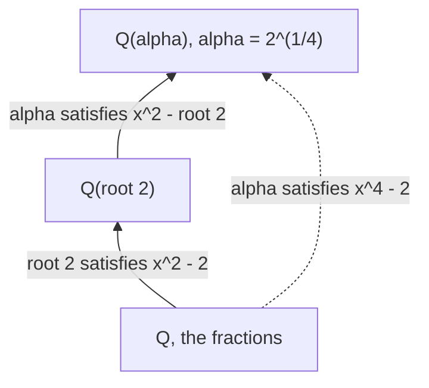

# Minimal polynomials: the simplest equation a new number satisfies, and its other roots

[Syllabus](../../../SYLLABUS.md) → [Algebraic and analytic number theory](../README.md) → [Fields and Galois Theory](../README.md#s05) → Minimal polynomials

---

## General Overview

An A0 sheet of paper has an area of one square metre, and halving it keeps its shape. Those two rules force its long side to be the fourth root of 2 metres: 1189 mm. The short side is 841 mm.

Call that number $`\alpha = 2^{1/4} = 1.18920711500\ldots`$ ($`\alpha`$ is "alpha"). It is not a fraction. But it satisfies an equation with whole-number coefficients: $`x^4 - 2 = 0`$.

It satisfies many others too: $`x^8 - 4 = 0`$, $`x^5 - 2x = 0`$, and endless more. Among them one is the simplest. It has the least degree, it is **monic** (top coefficient 1), and it is **irreducible** (not a product of two polynomials of lower degree with fraction coefficients). Every other equation is a multiple of it. That simplest equation is the number's **minimal polynomial**.

The minimal polynomial has other roots besides $`\alpha`$. For $`x^4 - 2`$ they are $`-\alpha`$, $`i\alpha`$ and $`-i\alpha`$, where $`i`$ is the square root of $`-1`$. These four are the **conjugates** of $`\alpha`$. No equation with rational coefficients can tell them apart: any such equation that $`\alpha`$ satisfies, all four satisfy.

This card does three jobs on that example:

- **find** a minimal polynomial, by exact algebra and by a second, numerical road;
- **list** the conjugates, of $`\alpha`$ and of a number built from it, $`\beta = \alpha + \alpha^2`$ ("beta");
- **tell** an algebraic number from a transcendental one, a number that satisfies no such equation at all, such as $`\pi`$.

A **field** is a number system where you can add, subtract, multiply and divide by anything except zero, such as the fractions.

**An algebraic number has one simplest equation over a field: monic, irreducible, and dividing every other equation the number satisfies. Its other roots, the conjugates, satisfy every equation the number does.**

**What kind of fact this is:** a theorem, proved on this card in Why it works. That $`\pi`$ is transcendental is a theorem proved elsewhere (Lindemann, 1882), stated here with its source; the code's search for an equation for $`\pi`$ is evidence, never proof.

### The picture: one number, three fields, three minimal polynomials

A field can be widened by adding a new number. Each step up the chain below adds one square root, and each arrow carries the minimal polynomial of the new number over the field below it.



Over the fractions alone, $`\alpha`$ needs degree 4. Once $`\sqrt 2`$ is allowed as a coefficient, degree 2 is enough: $`\alpha^2 - \sqrt 2 = 0`$. The minimal polynomial depends on which coefficients are allowed.

---

## The formula

Notation from [Field extensions](01-field-extensions-and-degree.md), in one line each: $`K`$ is the base field, $`K(\alpha)`$ is the smallest field holding $`K`$ and $`\alpha`$, and the degree $`[K(\alpha) : K]`$ is its dimension: how many numbers you need to write every element as a combination with coefficients in $`K`$.

This card introduces $`m_\alpha`$, the minimal polynomial. It is the monic polynomial (top coefficient 1) of least degree, with coefficients in $`K`$, that has $`\alpha`$ as a root. Three facts make it useful:

```math
f(\alpha) = 0 \iff m_\alpha \mid f, \qquad \deg m_\alpha = [K(\alpha) : K], \qquad m_\alpha(x) = (x - \alpha_1)(x - \alpha_2)\cdots(x - \alpha_d)
```

**Read it aloud:** "A polynomial over $`K`$ kills $`\alpha`$ (has it as a root) exactly when the minimal polynomial divides it. Its degree is the size of the field that $`\alpha`$ generates. It factors over the complex numbers into one bracket per conjugate, each conjugate appearing once."

For the A0 number over the fractions: $`m_\alpha = x^4 - 2`$, degree 4, and

```math
x^4 - 2 = (x - \alpha)(x - i\alpha)(x + \alpha)(x + i\alpha)
```

| Symbol | Plain meaning | In our example | Push it up and the answer… |
| --- | --- | --- | --- |
| $`\mathbb{Q}`$, $`\mathbb{C}`$, $`i`$ | the fractions; the complex numbers; $`i^2 = -1`$ | — | — |
| $`K`$ | the base field: which coefficients are allowed | $`\mathbb{Q}`$ | a bigger field can only lower the degree: 2 over $`\mathbb{Q}(\sqrt 2)`$ |
| $`\alpha`$ | the new number | $`2^{1/4} = 1.18920711500`$ | $`\alpha^2 = \sqrt 2`$ drops to degree 2 |
| $`K(\alpha)`$ | the smallest field holding $`K`$ and $`\alpha`$ | $`\mathbb{Q}(2^{1/4})`$ | — |
| $`[K(\alpha) : K]`$ | the degree: its dimension over $`K`$ | 4 | equals $`d`$, always |
| $`m_\alpha`$, $`d`$ | the minimal polynomial of $`\alpha`$ over $`K`$; its degree | $`x^4 - 2`$; 4 | — |
| $`f`$; $`q`$, $`r`$ | any polynomial over $`K`$; the quotient and remainder when it is divided by $`m_\alpha`$ | $`x^8 - 4`$; $`x^4 + 2`$, 0 | a higher degree $`f`$ still has $`r = 0`$ if $`f(\alpha) = 0`$ |
| $`m_\alpha \mid f`$ | $`m_\alpha`$ divides $`f`$ with remainder zero | $`x^8 - 4 = (x^4 - 2)(x^4 + 2)`$ | — |
| $`g`$, $`h`$; $`p`$ | two would-be factors of a polynomial; a prime (Eisenstein's test) | none exist; $`p = 2`$ | — |
| $`\alpha_1, \ldots, \alpha_d`$, $`\alpha'`$ | the conjugates: the roots of $`m_\alpha`$ in $`\mathbb{C}`$; $`\alpha'`$ is any one of them | $`\alpha, i\alpha, -\alpha, -i\alpha`$ | there are always $`d`$ of them |
| $`\beta`$, $`\beta_1, \ldots, \beta_4`$ | a second number, built from $`\alpha`$; its conjugates | $`\alpha + \alpha^2 = 2.60342067738`$ | — |
| $`\gamma`$; $`\pi`$, $`e`$ | any second algebraic number; two transcendental numbers | — | — |

A number is **algebraic** over $`K`$ when some nonzero polynomial over $`K`$ has it as a root. Otherwise it is **transcendental**. Only algebraic numbers have a minimal polynomial.

### When it holds

- **The number must be algebraic.** For $`\pi`$ no nonzero polynomial over $`\mathbb{Q}`$ works, so the set of polynomials that kill it holds only zero and there is no least degree to pick.
- **The base field is part of the answer.** Over $`\mathbb{Q}`$, $`m_\alpha = x^4 - 2`$. Over $`\mathbb{Q}(\sqrt 2)`$, $`m_\alpha = x^2 - \sqrt 2`$, with conjugates $`\alpha`$ and $`-\alpha`$ only. Over the real numbers, $`m_\alpha = x - \alpha`$.
- **Monic pins it down.** $`3x^4 - 6`$ also has least degree. Requiring top coefficient 1 picks one polynomial out of all the constant multiples.
- **Distinct conjugates need a field like the fractions.** In every field inside $`\mathbb{C}`$ the $`d`$ conjugates are $`d`$ different numbers. Some fields of prime characteristic (where adding 1 to itself a prime number of times gives 0) break this, and [Normal and separable](04-normal-and-separable-extensions.md) shows how.

---

## Why it works

### Step 0: the simplest equation divides all the others

Collect every polynomial over $`K`$ that has $`\alpha`$ as a root. Adding two of them, or multiplying one by any polynomial, gives another. Pick a nonzero one of least degree and divide by its top coefficient. Call it $`m`$.

Now take any $`f`$ in the collection and divide it by $`m`$, as [Polynomials behave like integers](../../03-Algebra/09-Rings%20and%20Fields/03-polynomials-behave-like-integers.md) allows over a field:

```math
f = q\,m + r, \qquad r = 0 \ \text{ or } \ \deg r < \deg m
```

Put in $`\alpha`$: $`0 = q(\alpha) \cdot 0 + r(\alpha)`$, so $`r`$ also has $`\alpha`$ as a root. But $`r`$ has lower degree than the least degree. So $`r = 0`$, and $`m`$ divides $`f`$.

Uniqueness follows. Two monic polynomials of least degree would differ by a polynomial of lower degree that still kills $`\alpha`$. That difference must be zero.

For the A0 number, $`x^8 - 4 = (x^4 - 2)(x^4 + 2)`$, so it is a multiple, as Step 0 says it must be.

### Step 1: the simplest equation cannot be factored

Suppose $`m = g\,h`$ with both factors of lower degree. Then $`g(\alpha)\,h(\alpha) = m(\alpha) = 0`$, and in a field a product is zero only when a factor is. So $`g`$ or $`h`$ kills $`\alpha`$ with lower degree than $`m`$. That is impossible, so $`m`$ is **irreducible**: not a product of two polynomials of lower degree over $`K`$.

The converse is how minimal polynomials are found in practice. If a monic irreducible polynomial over $`K`$ has $`\alpha`$ as a root, it is $`m_\alpha`$. By Step 0, $`m_\alpha`$ divides it; an irreducible polynomial has no divisors except constants and constant multiples of itself; both are monic, so they are equal.

So proving $`m_\alpha = x^4 - 2`$ means proving $`x^4 - 2`$ irreducible over $`\mathbb{Q}`$. [Field extensions](01-field-extensions-and-degree.md) already does, by a factor search, Eisenstein's criterion and the tower law. This card adds a proof of Eisenstein's criterion and a second search, over pairs of conjugates:

1. **Eisenstein's criterion.** If a prime $`p`$ divides every coefficient of a monic whole-number polynomial except the top one, and $`p^2`$ does not divide the constant term, the polynomial is irreducible over $`\mathbb{Q}`$. For $`x^4 - 2`$ with $`p = 2`$: 2 divides 0, 0, 0 and $`-2`$; 4 does not divide $`-2`$. Done.
2. **Try every factorisation.** A monic factor over $`\mathbb{Q}`$ of a monic whole-number polynomial has whole-number coefficients (Gauss's lemma, named on the polynomials card). A linear factor means a root, and the only candidates are $`\pm 1`$ and $`\pm 2`$: the polynomial is $`-1, -1, 14, 14`$ there. A quadratic factor is $`(x - r)(x - s)`$ for two of the four roots. The six pairs give coefficients such as $`\pm\sqrt 2`$ and $`\pm(1 \pm i)\alpha`$, never all whole numbers. Done again.

<details>
<summary>Detailed proof: Eisenstein's criterion</summary>

Let $`f = x^n + c_{n-1}x^{n-1} + \cdots + c_0`$ with whole-number coefficients, the prime $`p`$ dividing every $`c_k`$ and $`p^2`$ not dividing $`c_0`$. By Gauss's lemma, a factorisation over $`\mathbb{Q}`$ gives one with whole-number coefficients, $`f = g\,h`$, both monic of degree at least 1.

Reduce every coefficient mod $`p`$. The left side becomes $`x^n`$. Polynomials over the field $`\mathbb{Z}`$ mod $`p`$ factor uniquely, so $`g`$ and $`h`$ reduce to $`x^a`$ and $`x^b`$ with $`a, b \ge 1`$. Hence $`p`$ divides the constant terms of both $`g`$ and $`h`$.

Then $`p^2`$ divides their product, which is $`c_0`$. That contradicts the hypothesis, so no factorisation exists.

</details>

### Step 2: the degree is the dimension, and it gives an algorithm

Field extensions shows that $`1, \alpha, \ldots, \alpha^{d-1}`$ is a basis of $`K(\alpha)`$ when $`m_\alpha`$ has degree $`d`$. Read backwards, that is an algorithm for any element $`\beta`$ of $`K(\alpha)`$:

1. Write $`1, \beta, \beta^2, \ldots`$ in the basis $`1, \alpha, \alpha^2, \alpha^3`$, using $`\alpha^4 = 2`$.
2. Stop at the first power that is a combination of the lower ones.
3. That combination, moved to one side, is $`m_\beta`$.

The search always stops by $`\beta^4`$, because the five vectors $`1, \beta, \ldots, \beta^4`$ in a four-dimensional space are dependent. So the degree of every element of $`\mathbb{Q}(\alpha)`$ is at most 4, and in fact divides 4 (the tower law on Field extensions). For $`\alpha^2 = \sqrt 2`$ it stops at the second power: $`(\alpha^2)^2 = 2`$, degree 2.

### Step 3: conjugates cannot be told apart

Let $`\alpha'`$ be any conjugate of $`\alpha`$, and let $`f`$ be any polynomial over $`K`$ with $`f(\alpha) = 0`$. By Step 0, $`f = q\,m_\alpha`$. So $`f(\alpha') = q(\alpha') \cdot 0 = 0`$.

It carries over to numbers built from $`\alpha`$. Each conjugate $`\alpha'`$ gives a field map $`K(\alpha) \to \mathbb{C}`$ that sends $`\alpha`$ to $`\alpha'`$ and respects adding and multiplying. It is well defined: two expressions for the same element differ by a multiple of $`m_\alpha`$, and that multiple vanishes at $`\alpha'`$ too. So the conjugates of $`\beta = \alpha + \alpha^2`$ come from substituting:

| Conjugate of $`\alpha`$ | $`\alpha' + \alpha'^2`$ | Value |
| --- | --- | --- |
| $`\alpha`$ | $`\alpha + \sqrt 2`$ | $`2.603421`$ |
| $`i\alpha`$ | $`i\alpha - \sqrt 2`$ | $`-1.414214 + 1.189207i`$ |
| $`-\alpha`$ | $`-\alpha + \sqrt 2`$ | $`0.225006`$ |
| $`-i\alpha`$ | $`-i\alpha - \sqrt 2`$ | $`-1.414214 - 1.189207i`$ |

Multiplying out $`(x - \beta_1)\cdots(x - \beta_4)`$ gives $`x^4 - 4x^2 - 8x + 2`$. That is the second road to $`m_\beta`$.

When substituting gives repeated values, keep each value once. For $`\alpha^2`$ the four substitutions give $`\sqrt 2, -\sqrt 2, \sqrt 2, -\sqrt 2`$: two conjugates, degree 2.

<details>
<summary>Why the conjugates are distinct, and why the product has rational coefficients</summary>

**Distinct.** A repeated root of $`m`$ is also a root of its derivative $`m'`$. Over a field inside $`\mathbb{C}`$, $`m'`$ is nonzero with lower degree. If $`m`$ and $`m'`$ shared a root, $`m`$ would be that root's minimal polynomial too (Step 1), so Step 0 would make $`m`$ divide $`m'`$, which a lower degree forbids.

**Rational coefficients.** Multiplying by $`\beta`$ is a linear map on $`\mathbb{Q}(\alpha)`$, so in the basis $`1, \alpha, \alpha^2, \alpha^3`$ it is a 4 by 4 matrix of fractions. Its characteristic polynomial has rational coefficients. Apply the four field maps of Step 3 to the equation that defines the matrix. Each turns it into the same equation with $`\beta_k`$ in place of $`\beta`$, so each $`\beta_k`$ is an eigenvalue. The four eigenvectors $`(1, \alpha_k, \alpha_k^2, \alpha_k^3)`$ are independent because the $`\alpha_k`$ are distinct. So the characteristic polynomial equals the product of the four brackets $`(x - \beta_k)`$, and its coefficients are rational.

</details>

### Step 4: algebraic and transcendental

**Algebraic numbers form a field.** If $`\alpha`$ and $`\gamma`$ ("gamma") are algebraic over $`\mathbb{Q}`$, then $`\mathbb{Q}(\alpha, \gamma)`$ has finite dimension $`n`$: by the tower law on [Field extensions](01-field-extensions-and-degree.md), at most the degree of $`\alpha`$ times the degree of $`\gamma`$. The sum $`\alpha + \gamma`$ lies in it, so the $`n + 1`$ powers $`1, (\alpha + \gamma), \ldots, (\alpha + \gamma)^n`$ are dependent. A dependence is a polynomial equation, so $`\alpha + \gamma`$ is algebraic. The same works for products and quotients. The number $`\beta = \alpha + \alpha^2`$ is one instance, with its equation found by Step 2.

**Transcendental numbers exist, and most numbers are transcendental.** Cantor (1874) proved this by counting: there are only countably many (listable one by one) whole-number polynomials, each with finitely many roots, but uncountably many real numbers.

<details>
<summary>Detailed proof: countably many algebraic numbers</summary>

Give a whole-number polynomial the height $`H`$ = its degree plus the sum of the absolute values of its coefficients. Only finitely many polynomials have a given height, since the degree and every coefficient are bounded by $`H`$. Each nonzero one has at most as many roots as its degree.

So list the roots of the polynomials of height 1, then height 2, and so on. Every algebraic number appears in this list. The real numbers cannot be listed (Cantor's diagonal argument), so some real number is missing: it is transcendental. Clearing denominators turns any polynomial over $`\mathbb{Q}`$ into a whole-number one with the same roots, so the list holds every number algebraic over $`\mathbb{Q}`$.

</details>

Naming a particular transcendental number is much harder. Hermite proved $`e`$ transcendental in 1873. Lindemann proved $`\pi`$ transcendental in 1882. Neither proof is on this card; [Transcendence of e and pi](../07-Diophantine%20and%20Modular/13-transcendence-of-e-and-pi.md) takes them up. Liouville's explicit construction is on the Liouville to Roth card, later in this wing.

The code shows what a search can and cannot do. Among all 161,050 nonzero whole-number polynomials of degree at most 4 with coefficients from $`-5`$ to $`5`$, the smallest value at $`\pi`$ is $`5.147275 \times 10^{-3}`$, at $`-2x^4 + 5x^3 + 5x^2 - 4x + 3`$. Not zero, but a bigger search could always find something smaller. The search is evidence. Lindemann's theorem is the proof.

---

## Worked numbers, by hand

Find $`m_\beta`$ for $`\beta = \alpha + \alpha^2`$ by Step 2. Each power is written as $`[c_0, c_1, c_2, c_3]`$, meaning $`c_0 + c_1\alpha + c_2\alpha^2 + c_3\alpha^3`$. Every $`\alpha^4`$ becomes 2 and every $`\alpha^5`$ becomes $`2\alpha`$.

| Step | Arithmetic | Value |
| --- | --- | --- |
| $`\beta^0`$ | $`1`$ | `[1, 0, 0, 0]` |
| $`\beta^1`$ | $`\alpha + \alpha^2`$ | `[0, 1, 1, 0]` |
| $`\beta^2`$ | $`\alpha^2 + 2\alpha^3 + \alpha^4`$ | `[2, 0, 1, 2]` |
| $`\beta^3`$ | $`\beta \cdot \beta^2`$, then reduce | `[6, 6, 2, 1]` |
| $`\beta^4`$ | $`\beta \cdot \beta^3`$, then reduce | `[6, 8, 12, 8]` |
| Seek $`\beta^4 = c_0 + c_1\beta + c_2\beta^2 + c_3\beta^3`$: the $`\alpha^3`$ column | $`2c_2 + c_3 = 8`$ | — |
| The $`\alpha`$ column | $`c_1 + 6c_3 = 8`$ | — |
| The $`\alpha^2`$ column, with the row above | $`c_1 + c_2 + 2c_3 = 12`$ gives $`c_2 = 4 + 4c_3`$; then $`8 + 9c_3 = 8`$ | $`c_3 = 0`$, $`c_2 = 4`$, $`c_1 = 8`$ |
| The constant column | $`c_0 + 2c_2 + 6c_3 = 6`$ | $`c_0 = -2`$ |
| Move to one side | $`\beta^4 - 4\beta^2 - 8\beta + 2 = 0`$ | **$`m_\beta = x^4 - 4x^2 - 8x + 2`$** |

So $`\beta^4 = -2 + 8\beta + 4\beta^2`$, and

```math
m_\beta(x) = x^4 - 4x^2 - 8x + 2
```

No lower power gave a dependence, so the degree is 4. Eisenstein at 2 confirms irreducibility: 2 divides $`-4`$, $`-8`$ and $`2`$, and 4 does not divide 2.

Read the answer back. The four conjugates add to 0, which is minus the $`x^3`$ coefficient. They multiply to 2, the constant term. Numerically, $`\beta = 2.60342067738`$, and $`\beta^4 - 4\beta^2 - 8\beta + 2`$ is 0 to nine decimal places.

### What breaks if you drop a piece

| Mistake | Comes out at | What went wrong |
| --- | --- | --- |
| Drop irreducible | $`x^8 - 4`$, which also kills $`\alpha`$ | its root $`e^{i\pi/4}\alpha`$ gives $`-4`$ in $`x^4 - 2`$: not a conjugate, though it shares an equation with $`\alpha`$ |
| Drop monic | $`3x^4 - 6`$ | same roots, but no longer one answer |
| Forget the base field | over $`\mathbb{Q}(\sqrt 2)`$, $`x^2 - \sqrt 2`$ | it gives 0 at $`\alpha`$ and $`-\alpha`$ but $`-2.828427`$ at $`i\alpha`$: two conjugates, not four |
| Test only for rational roots | "no rational root" for $`x^4 + 4`$ | values $`5, 5, 20, 20, 260, 260`$ at $`\pm 1, \pm 2, \pm 4`$, yet $`x^4 + 4 = (x^2 + 2x + 2)(x^2 - 2x + 2)`$ |

The code prints every row.

---

## Code, from first principles, and it actually runs

A number in $`\mathbb{Q}(\alpha)`$ is a list of four exact fractions. Road one is Step 2: powers in the basis, then exact elimination until a power depends on the lower ones. Road two is Step 3: substitute the four conjugates as complex numbers, keep the distinct values, multiply out the brackets and round.

Both roads run on $`\alpha`$, $`\alpha^2`$ and $`\beta`$. For $`\alpha`$ itself they agree automatically: the code stores $`\alpha`$ by the rule $`\alpha^4 = 2`$, and Road 2 multiplies out the brackets of the roots of $`x^4 - 2`$. The comparison is a real test for $`\alpha^2`$ and $`\beta`$. For $`\alpha`$, what makes $`x^4 - 2`$ minimal is that it does not factor. The code tests that twice, by Eisenstein and by the pair search, and runs both tests on $`x^4 + 4`$ as a control: there Eisenstein must not apply, and the pair search must find the two quadratic factors. The other asserts check the degree drop for $`\alpha^2`$, multiply out the factors of $`x^4 + 4`$, and pin the $`\pi`$ search: all 161,050 polynomials, with the smallest value at the polynomial named in Step 4.

### Python

```python
# Minimal polynomials -- the check behind the card.  Standard library only.
# A number in Q(a), a = 2^(1/4), is four fractions [c0, c1, c2, c3], meaning
# c0 + c1 a + c2 a^2 + c3 a^3; multiplying uses a^4 = 2.  Road 1 finds a minimal
# polynomial exactly, as the first power that is a mix of lower powers.  Road 2
# multiplies (x - c) over the conjugates c as complex numbers and rounds.
from fractions import Fraction as F
import math

def mul(u, v):
    w = [F(0)] * 7
    for i in range(4):
        for j in range(4):
            w[i + j] += u[i] * v[j]
    return [w[k] + (2 * w[k + 4] if k < 3 else 0) for k in range(4)]

def solve(cols, t):  # coefficients c with sum c[j] cols[j] = t, or None
    k = len(cols)
    m = [[cols[j][r] for j in range(k)] + [t[r]] for r in range(4)]
    piv, row = [], 0
    for c in range(k):
        p = next((r for r in range(row, 4) if m[r][c] != 0), None)
        if p is None:
            continue
        m[row], m[p] = m[p], m[row]
        m[row] = [x / m[row][c] for x in m[row]]
        for r in range(4):
            if r != row and m[r][c] != 0:
                m[r] = [x - m[r][c] * y for x, y in zip(m[r], m[row])]
        piv.append(c); row += 1
    if any(m[r][k] != 0 for r in range(row, 4)):
        return None
    sol = [F(0)] * k
    for r, c in enumerate(piv):
        sol[c] = m[r][k]
    return sol

def minpoly(v):  # monic coefficients, constant term first
    pw = [[F(1), F(0), F(0), F(0)]]
    while True:
        nxt = mul(pw[-1], v)
        c = solve(pw, nxt)
        if c is not None:
            return [-x for x in c] + [F(1)]
        pw.append(nxt)

def from_roots(rs):
    p = [complex(1)]
    for r in rs:
        p = [(p[k - 1] if k > 0 else 0) - r * (p[k] if k < len(p) else 0) for k in range(len(p) + 1)]
    return p

def show(p):
    t = [(c, ("" if abs(c) == 1 and k else str(abs(c))) + ("x" if k else "") + (f"^{k}" if k > 1 else ""))
         for k, c in reversed(list(enumerate(p))) if c]
    return ("-" if t[0][0] < 0 else "") + t[0][1] + "".join((" - " if c < 0 else " + ") + w for c, w in t[1:])

def horner(p, x):
    y = 0
    for c in reversed(p):
        y = y * x + c
    return y

def eisenstein(p, q):
    return p[-1] % q != 0 and all(c % q == 0 for c in p[:-1]) and p[0] % (q * q) != 0

al = math.sqrt(math.sqrt(2))
conj = [al, 1j * al, -al, -1j * al]
cl = lambda x: 0.0 if abs(x) < 5e-10 else x
fmt = lambda z: f"{cl(z.real):+.6f} {cl(z.imag):+.6f}i"
print(f"a = 2^(1/4) = {al:.11f}")
print(f"A0 paper: long side 2^(1/4) m = {1000 * al:.0f} mm, short side 2^(-1/4) m = {1000 / al:.0f} mm")
A = [F(0), F(1), F(0), F(0)]
elems = [("a", A, lambda t: t), ("a^2", mul(A, A), lambda t: t * t),
         ("b = a + a^2", [F(0), F(1), F(1), F(0)], lambda t: t + t * t)]
pw = [[F(1), F(0), F(0), F(0)]]
for _ in range(4):
    pw.append(mul(pw[-1], elems[2][1]))
print("powers of b over 1, a, a^2, a^3: " + "; ".join(f"b^{k} {[int(c) for c in v]}" for k, v in enumerate(pw)))
polys = {}
for name, v, f in elems:
    m = [int(c) for c in minpoly(v)]
    vals = [f(c) for c in conj]
    distinct = []
    for z in vals:
        if all(abs(z - d) > 1e-9 for d in distinct):
            distinct.append(z)
    q = from_roots(distinct)
    road2 = [round(c.real) for c in q]
    err = max(abs(c - r) for c, r in zip(q, road2))
    print(f"{name}: road 1 {show(m)}, degree {len(m) - 1}; road 2 {show(road2)}, within 1e-9: {err < 1e-9}")
    print("  conjugates: " + ", ".join(fmt(z) for z in distinct))
    assert m == road2 and err < 1e-9, "the two roads must agree"
    polys[name] = (m, distinct)
b = al + al * al
mb = polys["b = a + a^2"][0]
print(f"b = {b:.11f}; b^4 - 4b^2 - 8b + 2 = {cl(horner(mb, b)):.9f}")
print(f"sum of b's conjugates {cl(sum(polys['b = a + a^2'][1]).real):+.6f}, product {from_roots(polys['b = a + a^2'][1])[0].real:+.6f}")
m3 = [3 * c for c in polys["a"][0]]
print(f"drop monic: {show(m3)} at a: {cl(horner(m3, al)):.9f}; made monic: {show([c // m3[-1] for c in m3])}")
f4 = [-2, 0, 0, 0, 1]
print("rational root test, x^4 - 2 at 1, -1, 2, -2:", [horner(f4, r) for r in (1, -1, 2, -2)])
def pair_search(rs, loud):  # how many pairs of roots give a whole-number quadratic factor
    ints = 0
    for i, j in [(i, j) for i in range(4) for j in range(i + 1, 4)]:
        s, p = -(rs[i] + rs[j]), rs[i] * rs[j]
        whole = all(abs(z - round(z.real)) < 1e-9 for z in (s, p))
        ints += whole
        if loud: print(f"  roots {i},{j}: x^2 + ({fmt(s)})x + ({fmt(p)})  whole: {whole}")
    return ints
ints = pair_search(conj, True)
e4, eb = eisenstein(f4, 2), eisenstein(mb, 2)
print(f"Eisenstein at 2: x^4 - 2 {e4}, {show(mb)} {eb}; whole-number quadratic factors found: {ints}")
g4, r44 = [4, 0, 0, 0, 1], [1 + 1j, 1 - 1j, -1 + 1j, -1 - 1j]
e44, i44 = eisenstein(g4, 2), pair_search(r44, False)
print(f"control, x^4 + 4: Eisenstein at 2 {e44}; whole-number quadratic factors found: {i44}")
assert (e4, eb, ints) == (True, True, 0) and (e44, i44) == (False, 2), "both tests must say yes and no"
assert len(polys["a^2"][1]) == 2 and polys["a^2"][0] == [-2, 0, 1], "a^2 has degree 2, two conjugates"
z8 = complex(math.cos(math.pi / 4), math.sin(math.pi / 4)) * al
print(f"x^8 - 4 at a: {cl(horner([-4, 0, 0, 0, 0, 0, 0, 0, 1], al)):.9f}; its root e^(i pi/4) a into x^4 - 2: {fmt(horner(f4, z8))}")
fac = [round(c.real) for c in from_roots(r44)]
print("x^4 + 4 at 1, -1, 2, -2, 4, -4:", [horner(g4, r) for r in (1, -1, 2, -2, 4, -4)],
      f"yet (x^2 + 2x + 2)(x^2 - 2x + 2) = {show(fac)}")
assert fac == g4, "x^4 + 4 factors with no rational root"
r2 = math.sqrt(2)
print("over Q(root 2), x^2 - root 2 at a, -a, ia:", ", ".join(fmt(complex(z * z - r2)) for z in (al, -al, 1j * al)))
best, arg, n = 1e9, None, 0
for c in range(11 ** 5):
    p = [(c // 11 ** k) % 11 - 5 for k in range(5)]
    if any(p):
        n += 1
        v = abs(horner(p, math.pi))
        if v < best:
            best, arg = v, p
print(f"pi: {n} integer polynomials, degree <= 4, coefficients -5..5; smallest |p(pi)| = {best:.6e} at {show(arg)}")
direct = abs(3 - 4 * math.pi + 5 * math.pi ** 2 + 5 * math.pi ** 3 - 2 * math.pi ** 4)
assert n == 11 ** 5 - 1 and arg == [3, -4, 5, 5, -2] and abs(best - direct) < 1e-12, "the search must cover the box"
assert best > 1e-6, "no small polynomial vanishes at pi"
print("ALL CHECKS PASS")
```

**Ran 2026-11-15 on macOS, Python 3.14.10, standard library only. All checks passed. Output, pasted from the run:**

```
a = 2^(1/4) = 1.18920711500
A0 paper: long side 2^(1/4) m = 1189 mm, short side 2^(-1/4) m = 841 mm
powers of b over 1, a, a^2, a^3: b^0 [1, 0, 0, 0]; b^1 [0, 1, 1, 0]; b^2 [2, 0, 1, 2]; b^3 [6, 6, 2, 1]; b^4 [6, 8, 12, 8]
a: road 1 x^4 - 2, degree 4; road 2 x^4 - 2, within 1e-9: True
  conjugates: +1.189207 +0.000000i, +0.000000 +1.189207i, -1.189207 +0.000000i, +0.000000 -1.189207i
a^2: road 1 x^2 - 2, degree 2; road 2 x^2 - 2, within 1e-9: True
  conjugates: +1.414214 +0.000000i, -1.414214 +0.000000i
b = a + a^2: road 1 x^4 - 4x^2 - 8x + 2, degree 4; road 2 x^4 - 4x^2 - 8x + 2, within 1e-9: True
  conjugates: +2.603421 +0.000000i, -1.414214 +1.189207i, +0.225006 +0.000000i, -1.414214 -1.189207i
b = 2.60342067738; b^4 - 4b^2 - 8b + 2 = 0.000000000
sum of b's conjugates +0.000000, product +2.000000
drop monic: 3x^4 - 6 at a: 0.000000000; made monic: x^4 - 2
rational root test, x^4 - 2 at 1, -1, 2, -2: [-1, -1, 14, 14]
  roots 0,1: x^2 + (-1.189207 -1.189207i)x + (+0.000000 +1.414214i)  whole: False
  roots 0,2: x^2 + (+0.000000 +0.000000i)x + (-1.414214 +0.000000i)  whole: False
  roots 0,3: x^2 + (-1.189207 +1.189207i)x + (+0.000000 -1.414214i)  whole: False
  roots 1,2: x^2 + (+1.189207 -1.189207i)x + (+0.000000 -1.414214i)  whole: False
  roots 1,3: x^2 + (+0.000000 +0.000000i)x + (+1.414214 +0.000000i)  whole: False
  roots 2,3: x^2 + (+1.189207 +1.189207i)x + (+0.000000 +1.414214i)  whole: False
Eisenstein at 2: x^4 - 2 True, x^4 - 4x^2 - 8x + 2 True; whole-number quadratic factors found: 0
control, x^4 + 4: Eisenstein at 2 False; whole-number quadratic factors found: 2
x^8 - 4 at a: 0.000000000; its root e^(i pi/4) a into x^4 - 2: -4.000000 +0.000000i
x^4 + 4 at 1, -1, 2, -2, 4, -4: [5, 5, 20, 20, 260, 260] yet (x^2 + 2x + 2)(x^2 - 2x + 2) = x^4 + 4
over Q(root 2), x^2 - root 2 at a, -a, ia: +0.000000 +0.000000i, +0.000000 +0.000000i, -2.828427 +0.000000i
pi: 161050 integer polynomials, degree <= 4, coefficients -5..5; smallest |p(pi)| = 5.147275e-03 at -2x^4 + 5x^3 + 5x^2 - 4x + 3
ALL CHECKS PASS
```

### Rust

Same numbers, same labels, from `rustc --edition 2021 -O`. Fractions use `i128` with checked arithmetic.

```rust
// Minimal polynomials -- the same check as the Python, in Rust.  No crates.
// A number in Q(a), a = 2^(1/4), is four fractions [c0, c1, c2, c3], meaning
// c0 + c1 a + c2 a^2 + c3 a^3; multiplying uses a^4 = 2.  Road 1 finds a minimal
// polynomial exactly, as the first power that is a mix of lower powers.  Road 2
// multiplies (x - c) over the conjugates c as complex numbers and rounds.
use std::ops::{Add, Mul, Neg, Sub};

#[derive(Clone, Copy, PartialEq)]
struct Q(i128, i128); // numerator, denominator > 0, lowest terms
fn gcd(a: i128, b: i128) -> i128 { if b == 0 { a.abs() } else { gcd(b, a % b) } }
fn q(n: i128, d: i128) -> Q { let g = gcd(n, d).max(1) * d.signum(); Q(n / g, d / g) }
impl Add for Q { type Output = Q; fn add(self, o: Q) -> Q { q(self.0.checked_mul(o.1).unwrap().checked_add(o.0.checked_mul(self.1).unwrap()).unwrap(), self.1.checked_mul(o.1).unwrap()) } }
impl Sub for Q { type Output = Q; fn sub(self, o: Q) -> Q { self + (-o) } }
impl Neg for Q { type Output = Q; fn neg(self) -> Q { Q(self.0.checked_neg().unwrap(), self.1) } }
impl Mul for Q { type Output = Q; fn mul(self, o: Q) -> Q { q(self.0.checked_mul(o.0).unwrap(), self.1.checked_mul(o.1).unwrap()) } }
fn div(a: Q, b: Q) -> Q { q(a.0.checked_mul(b.1).unwrap(), a.1.checked_mul(b.0).unwrap()) }
const Z: Q = Q(0, 1);

#[derive(Clone, Copy)]
struct C(f64, f64);
impl Add for C { type Output = C; fn add(self, o: C) -> C { C(self.0 + o.0, self.1 + o.1) } }
impl Sub for C { type Output = C; fn sub(self, o: C) -> C { C(self.0 - o.0, self.1 - o.1) } }
impl Mul for C { type Output = C; fn mul(self, o: C) -> C { C(self.0 * o.0 - self.1 * o.1, self.0 * o.1 + self.1 * o.0) } }
fn ab(z: C) -> f64 { z.0.hypot(z.1) }
fn cl(x: f64) -> f64 { if x.abs() < 5e-10 { 0.0 } else { x } }
fn fmt(z: C) -> String { format!("{:+.6} {:+.6}i", cl(z.0), cl(z.1)) }

fn mul(u: &[Q; 4], v: &[Q; 4]) -> [Q; 4] {
    let mut w = [Z; 7];
    for i in 0..4 { for j in 0..4 { w[i + j] = w[i + j] + u[i] * v[j]; } }
    let mut r = [Z; 4];
    for k in 0..4 { r[k] = if k < 3 { w[k] + Q(2, 1) * w[k + 4] } else { w[k] }; }
    r
}
fn solve(cols: &[[Q; 4]], t: &[Q; 4]) -> Option<Vec<Q>> {
    let k = cols.len();
    let mut m: Vec<Vec<Q>> = (0..4).map(|r| { let mut v: Vec<Q> = cols.iter().map(|c| c[r]).collect(); v.push(t[r]); v }).collect();
    let (mut piv, mut row) = (vec![], 0);
    for c in 0..k {
        let p = match (row..4).find(|&r| m[r][c] != Z) { Some(p) => p, None => continue };
        m.swap(row, p);
        let h = m[row][c];
        m[row] = m[row].iter().map(|&x| div(x, h)).collect();
        for r in 0..4 {
            if r != row && m[r][c] != Z {
                let f = m[r][c];
                m[r] = (0..=k).map(|j| m[r][j] - f * m[row][j]).collect();
            }
        }
        piv.push(c); row += 1;
    }
    if (row..4).any(|r| m[r][k] != Z) { return None; }
    let mut sol = vec![Z; k];
    for (r, &c) in piv.iter().enumerate() { sol[c] = m[r][k]; }
    Some(sol)
}
fn minpoly(v: &[Q; 4]) -> Vec<i64> {
    let mut pw = vec![[Q(1, 1), Z, Z, Z]];
    loop {
        let nxt = mul(pw.last().unwrap(), v);
        if let Some(c) = solve(&pw, &nxt) {
            let mut m: Vec<i64> = c.iter().map(|x| { assert!(x.1 == 1); -x.0 as i64 }).collect();
            m.push(1);
            return m;
        }
        pw.push(nxt);
    }
}
fn from_roots(rs: &[C]) -> Vec<C> {
    let mut p = vec![C(1.0, 0.0)];
    for &r in rs {
        p = (0..=p.len()).map(|k| (if k > 0 { p[k - 1] } else { C(0.0, 0.0) }) - r * (if k < p.len() { p[k] } else { C(0.0, 0.0) })).collect();
    }
    p
}
fn show(p: &[i64]) -> String {
    let t: Vec<(i64, String)> = (0..p.len()).rev().filter(|&k| p[k] != 0).map(|k| {
        let c = p[k];
        let co = if c.abs() == 1 && k > 0 { String::new() } else { c.abs().to_string() };
        (c, co + if k > 0 { "x" } else { "" } + &if k > 1 { format!("^{}", k) } else { String::new() })
    }).collect();
    let mut s = format!("{}{}", if t[0].0 < 0 { "-" } else { "" }, t[0].1);
    for (c, w) in &t[1..] { s += if *c < 0 { " - " } else { " + " }; s += w; }
    s
}
fn pair_search(rs: &[C], loud: bool) -> i32 {   // how many pairs of roots give a whole-number quadratic factor
    let mut ints = 0;
    for i in 0..4 { for j in i + 1..4 {
        let (s, p) = (C(0.0, 0.0) - (rs[i] + rs[j]), rs[i] * rs[j]);
        let whole = [s, p].iter().all(|&z| ab(z - C(z.0.round(), 0.0)) < 1e-9);
        ints += whole as i32;
        if loud { println!("  roots {},{}: x^2 + ({})x + ({})  whole: {}", i, j, fmt(s), fmt(p), tf(whole)); }
    } }
    ints
}
fn horner(p: &[i64], x: i64) -> i64 { p.iter().rev().fold(0, |y, &c| y * x + c) }
fn hf(p: &[i64], x: f64) -> f64 { p.iter().rev().fold(0.0, |y, &c| y * x + c as f64) }
fn hc(p: &[i64], x: C) -> C { p.iter().rev().fold(C(0.0, 0.0), |y, &c| y * x + C(c as f64, 0.0)) }
fn eis(p: &[i64], r: i64) -> bool { p[p.len() - 1] % r != 0 && p[..p.len() - 1].iter().all(|c| c % r == 0) && p[0] % (r * r) != 0 }
fn tf(b: bool) -> &'static str { if b { "True" } else { "False" } }
fn sci(x: f64) -> String { let e = x.log10().floor() as i32; format!("{:.6}e{}{:02}", x / 10f64.powi(e), if e < 0 { '-' } else { '+' }, e.abs()) }

fn main() {
    let al = 2f64.sqrt().sqrt();
    let conj = [C(al, 0.0), C(0.0, al), C(-al, 0.0), C(0.0, -al)];
    println!("a = 2^(1/4) = {:.11}", al);
    println!("A0 paper: long side 2^(1/4) m = {:.0} mm, short side 2^(-1/4) m = {:.0} mm", 1000.0 * al, 1000.0 / al);
    let a = [Z, Q(1, 1), Z, Z];
    let elems: [(&str, [Q; 4], fn(C) -> C); 3] = [("a", a, |t| t), ("a^2", mul(&a, &a), |t| t * t), ("b = a + a^2", [Z, Q(1, 1), Q(1, 1), Z], |t| t + t * t)];
    let mut pw = vec![[Q(1, 1), Z, Z, Z]];
    for _ in 0..4 { let nx = mul(pw.last().unwrap(), &elems[2].1); pw.push(nx); }
    println!("powers of b over 1, a, a^2, a^3: {}", pw.iter().enumerate().map(|(k, v)| format!("b^{} {:?}", k, v.map(|c| c.0))).collect::<Vec<_>>().join("; "));
    let mut polys = vec![];
    for (name, v, f) in elems.iter() {
        let m = minpoly(v);
        let mut distinct: Vec<C> = vec![];
        for z in conj.iter().map(|&c| f(c)) { if distinct.iter().all(|&d| ab(z - d) > 1e-9) { distinct.push(z); } }
        let qq = from_roots(&distinct);
        let road2: Vec<i64> = qq.iter().map(|c| c.0.round() as i64).collect();
        let err = qq.iter().zip(&road2).map(|(c, &r)| ab(*c - C(r as f64, 0.0))).fold(0.0, f64::max);
        println!("{}: road 1 {}, degree {}; road 2 {}, within 1e-9: {}", name, show(&m), m.len() - 1, show(&road2), tf(err < 1e-9));
        println!("  conjugates: {}", distinct.iter().map(|&z| fmt(z)).collect::<Vec<_>>().join(", "));
        assert!(m == road2 && err < 1e-9, "the two roads must agree");
        polys.push((m, distinct));
    }
    let b = al + al * al;
    let mb = polys[2].0.clone();
    println!("b = {:.11}; b^4 - 4b^2 - 8b + 2 = {:.9}", b, cl(hf(&mb, b)));
    let sb = polys[2].1.iter().fold(C(0.0, 0.0), |s, &z| s + z);
    println!("sum of b's conjugates {:+.6}, product {:+.6}", cl(sb.0), from_roots(&polys[2].1)[0].0);
    let m3: Vec<i64> = polys[0].0.iter().map(|c| 3 * c).collect();
    println!("drop monic: {} at a: {:.9}; made monic: {}", show(&m3), cl(hf(&m3, al)), show(&m3.iter().map(|c| c / m3[4]).collect::<Vec<i64>>()));
    let f4 = [-2i64, 0, 0, 0, 1];
    println!("rational root test, x^4 - 2 at 1, -1, 2, -2: {:?}", [1, -1, 2, -2].map(|r| horner(&f4, r)));
    let ints = pair_search(&conj, true);
    let (e4, eb) = (eis(&f4, 2), eis(&mb, 2));
    println!("Eisenstein at 2: x^4 - 2 {}, {} {}; whole-number quadratic factors found: {}", tf(e4), show(&mb), tf(eb), ints);
    let (g4, r44) = (vec![4i64, 0, 0, 0, 1], [C(1.0, 1.0), C(1.0, -1.0), C(-1.0, 1.0), C(-1.0, -1.0)]);
    let (e44, i44) = (eis(&g4, 2), pair_search(&r44, false));
    println!("control, x^4 + 4: Eisenstein at 2 {}; whole-number quadratic factors found: {}", tf(e44), i44);
    assert!(e4 && eb && ints == 0 && !e44 && i44 == 2, "both tests must say yes and no");
    assert!(polys[1].1.len() == 2 && polys[1].0 == vec![-2, 0, 1], "a^2 has degree 2, two conjugates");
    let pi4 = std::f64::consts::PI / 4.0;
    let z8 = C(pi4.cos(), pi4.sin()) * C(al, 0.0);
    println!("x^8 - 4 at a: {:.9}; its root e^(i pi/4) a into x^4 - 2: {}", cl(hf(&[-4, 0, 0, 0, 0, 0, 0, 0, 1], al)), fmt(hc(&f4, z8)));
    let fac: Vec<i64> = from_roots(&r44).iter().map(|c| c.0.round() as i64).collect();
    println!("x^4 + 4 at 1, -1, 2, -2, 4, -4: {:?} yet (x^2 + 2x + 2)(x^2 - 2x + 2) = {}", [1, -1, 2, -2, 4, -4].map(|r| horner(&g4, r)), show(&fac));
    assert!(fac == g4, "x^4 + 4 factors with no rational root");
    let r2 = C(2f64.sqrt(), 0.0);
    println!("over Q(root 2), x^2 - root 2 at a, -a, ia: {}", [C(al, 0.0), C(-al, 0.0), C(0.0, al)].iter().map(|&z| fmt(z * z - r2)).collect::<Vec<_>>().join(", "));
    let (mut best, mut arg, mut n) = (1e9, vec![], 0);
    for c in 0..11i64.pow(5) {
        let p: Vec<i64> = (0..5).map(|k| (c / 11i64.pow(k)) % 11 - 5).collect();
        if p.iter().any(|&x| x != 0) {
            n += 1;
            let v = hf(&p, std::f64::consts::PI).abs();
            if v < best { best = v; arg = p; }
        }
    }
    println!("pi: {} integer polynomials, degree <= 4, coefficients -5..5; smallest |p(pi)| = {} at {}", n, sci(best), show(&arg));
    let pi = std::f64::consts::PI;
    let direct = (3.0 - 4.0 * pi + 5.0 * pi.powi(2) + 5.0 * pi.powi(3) - 2.0 * pi.powi(4)).abs();
    assert!(n == 11i64.pow(5) - 1 && arg == vec![3, -4, 5, 5, -2] && (best - direct).abs() < 1e-12, "the search must cover the box");
    assert!(best > 1e-6, "no small polynomial vanishes at pi");
    println!("ALL CHECKS PASS");
}
```

**Ran 2026-11-15 on macOS, rustc 1.98.1, no crates. All checks passed. Output, pasted from the run:**

```
a = 2^(1/4) = 1.18920711500
A0 paper: long side 2^(1/4) m = 1189 mm, short side 2^(-1/4) m = 841 mm
powers of b over 1, a, a^2, a^3: b^0 [1, 0, 0, 0]; b^1 [0, 1, 1, 0]; b^2 [2, 0, 1, 2]; b^3 [6, 6, 2, 1]; b^4 [6, 8, 12, 8]
a: road 1 x^4 - 2, degree 4; road 2 x^4 - 2, within 1e-9: True
  conjugates: +1.189207 +0.000000i, +0.000000 +1.189207i, -1.189207 +0.000000i, +0.000000 -1.189207i
a^2: road 1 x^2 - 2, degree 2; road 2 x^2 - 2, within 1e-9: True
  conjugates: +1.414214 +0.000000i, -1.414214 +0.000000i
b = a + a^2: road 1 x^4 - 4x^2 - 8x + 2, degree 4; road 2 x^4 - 4x^2 - 8x + 2, within 1e-9: True
  conjugates: +2.603421 +0.000000i, -1.414214 +1.189207i, +0.225006 +0.000000i, -1.414214 -1.189207i
b = 2.60342067738; b^4 - 4b^2 - 8b + 2 = 0.000000000
sum of b's conjugates +0.000000, product +2.000000
drop monic: 3x^4 - 6 at a: 0.000000000; made monic: x^4 - 2
rational root test, x^4 - 2 at 1, -1, 2, -2: [-1, -1, 14, 14]
  roots 0,1: x^2 + (-1.189207 -1.189207i)x + (+0.000000 +1.414214i)  whole: False
  roots 0,2: x^2 + (+0.000000 +0.000000i)x + (-1.414214 +0.000000i)  whole: False
  roots 0,3: x^2 + (-1.189207 +1.189207i)x + (+0.000000 -1.414214i)  whole: False
  roots 1,2: x^2 + (+1.189207 -1.189207i)x + (+0.000000 -1.414214i)  whole: False
  roots 1,3: x^2 + (+0.000000 +0.000000i)x + (+1.414214 +0.000000i)  whole: False
  roots 2,3: x^2 + (+1.189207 +1.189207i)x + (+0.000000 +1.414214i)  whole: False
Eisenstein at 2: x^4 - 2 True, x^4 - 4x^2 - 8x + 2 True; whole-number quadratic factors found: 0
control, x^4 + 4: Eisenstein at 2 False; whole-number quadratic factors found: 2
x^8 - 4 at a: 0.000000000; its root e^(i pi/4) a into x^4 - 2: -4.000000 +0.000000i
x^4 + 4 at 1, -1, 2, -2, 4, -4: [5, 5, 20, 20, 260, 260] yet (x^2 + 2x + 2)(x^2 - 2x + 2) = x^4 + 4
over Q(root 2), x^2 - root 2 at a, -a, ia: +0.000000 +0.000000i, +0.000000 +0.000000i, -2.828427 +0.000000i
pi: 161050 integer polynomials, degree <= 4, coefficients -5..5; smallest |p(pi)| = 5.147275e-03 at -2x^4 + 5x^3 + 5x^2 - 4x + 3
ALL CHECKS PASS
```

The two outputs match line for line.

### Lean

Lean proves the main claim over every field, the formula for fields inside $`\mathbb{C}`$, and the A0 example.

- Take any field $`K`$ and a number $`\alpha`$ algebraic over it. Then $`m_\alpha`$ is monic and irreducible, and no nonzero polynomial over $`K`$ killing $`\alpha`$ has lower degree.
- Take the same $`K`$ and $`\alpha`$. Then a polynomial $`f`$ over $`K`$ has $`\alpha`$ as a root exactly when $`m_\alpha \mid f`$.
- Take the same $`K`$ and $`\alpha`$. Then every monic irreducible polynomial over $`K`$ with $`\alpha`$ as a root is $`m_\alpha`$.
- Take the same $`K`$ and $`\alpha`$, and any conjugate $`\alpha'`$. Then every polynomial over $`K`$ that $`\alpha`$ satisfies, $`\alpha'`$ satisfies too.
- Take $`K`$ inside $`\mathbb{C}`$ and $`\alpha`$ algebraic over it. Then $`\deg m_\alpha = [K(\alpha) : K]`$.
- Take the same $`K`$ and $`\alpha`$. Then the conjugates are all different, and $`m_\alpha`$ is the product of one bracket $`(x - \alpha_k)`$ per conjugate.
- Take $`\alpha = 2^{1/4}`$ over $`\mathbb{Q}`$. Then $`m_\alpha = x^4 - 2`$, by Eisenstein's criterion at 2.
- Take $`\beta = \alpha + \alpha^2`$ over $`\mathbb{Q}`$. Then $`m_\beta = x^4 - 4x^2 - 8x + 2`$, again by Eisenstein at 2.
- Lean also checks the by-hand numbers: Step 0's multiple $`x^8 - 4`$, the powers of $`\beta`$ and the elimination.
- Lean also checks the $`x^4 + 4`$ row of What breaks: no rational root, yet two quadratic factors.

The numerical road through the conjugates and the search for an equation for $`\pi`$ are left to the Python and Rust checks.

```lean
-- Minimal polynomials: an algebraic number has exactly one monic irreducible polynomial of least degree that it satisfies, that polynomial divides every other equation it satisfies, its conjugates satisfy all the same equations, and its degree is the dimension of the field the number generates.
import Mathlib.FieldTheory.Minpoly.Field
import Mathlib.FieldTheory.IntermediateField.Adjoin.Basic
import Mathlib.FieldTheory.Separable
import Mathlib.Algebra.Polynomial.Roots
import Mathlib.Analysis.SpecialFunctions.Pow.Real
import Mathlib.Analysis.Complex.Basic
import Mathlib.Tactic.NormNum
import Mathlib.Tactic.Ring
import Mathlib.Analysis.Complex.Polynomial.Basic
import Mathlib.RingTheory.Polynomial.Eisenstein.Criterion
import Mathlib.RingTheory.Polynomial.GaussLemma
import Mathlib.Tactic.ComputeDegree
import Mathlib.Tactic.LinearCombination
import Mathlib.Tactic.IntervalCases
import Mathlib.RingTheory.Int.Basic

open Polynomial IntermediateField

/-- Eisenstein at 2 for a monic integer quartic, read over the rationals. -/
theorem quartic_eisenstein_two_irreducible (p : ℤ[X]) (hm : p.Monic) (hd : p.natDegree = 4)
    (hc : ∀ n < 4, (2 : ℤ) ∣ p.coeff n) (h0 : ¬ (4 : ℤ) ∣ p.coeff 0) :
    Irreducible (p.map (Int.castRingHom ℚ)) := by
  have hP : (Ideal.span {(2 : ℤ)}).IsPrime :=
    (Ideal.span_singleton_prime (by norm_num)).2 (Int.prime_iff_natAbs_prime.2 Nat.prime_two)
  refine (IsPrimitive.Int.irreducible_iff_irreducible_map_cast hm.isPrimitive).1 ?_
  refine irreducible_of_eisenstein_criterion hP ?_ ?_ ?_ ?_ hm.isPrimitive
  · rw [hm.leadingCoeff, Ideal.mem_span_singleton]; norm_num
  · intro n hn
    rw [Ideal.mem_span_singleton]
    apply hc
    have := (degree_eq_natDegree hm.ne_zero) ▸ hn
    rw [hd] at this
    exact_mod_cast this
  · rw [degree_eq_natDegree hm.ne_zero, hd]; norm_num
  · rw [Ideal.span_singleton_pow, Ideal.mem_span_singleton]; norm_num; exact h0
#print axioms quartic_eisenstein_two_irreducible

/-- The card's main claim. Let `K` be a field, `L` a bigger field, and `α` a number of `L`
that is algebraic over `K` (a root of some nonzero polynomial with coefficients in `K`).
Then its minimal polynomial `m_α` (Mathlib's `minpoly K α`)
* is monic (top coefficient 1) and irreducible over `K`;
* has least degree: every nonzero polynomial over `K` with `α` as a root has degree at least
  that of `m_α`;
* divides every other equation: a polynomial `f` over `K` has `α` as a root exactly when
  `m_α` divides `f`;
* is the only one: any monic irreducible polynomial over `K` with `α` as a root equals `m_α`;
* and its other roots, the conjugates `α'` of `α`, satisfy every equation over `K` that `α`
  satisfies, so no such equation can tell them apart. -/
theorem minimal_polynomial_divides_every_equation {K L : Type*} [Field K] [Field L]
    [Algebra K L] {α : L} (hα : IsIntegral K α) :
    (minpoly K α).Monic ∧ Irreducible (minpoly K α) ∧
      (∀ f : K[X], f ≠ 0 → aeval α f = 0 → (minpoly K α).natDegree ≤ f.natDegree) ∧
      (∀ f : K[X], aeval α f = 0 ↔ minpoly K α ∣ f) ∧
      (∀ p : K[X], p.Monic → Irreducible p → aeval α p = 0 → p = minpoly K α) ∧
      (∀ α' : L, aeval α' (minpoly K α) = 0 → ∀ f : K[X], aeval α f = 0 → aeval α' f = 0) := by
  refine ⟨minpoly.monic hα, minpoly.irreducible hα, ?_, ?_, ?_, ?_⟩
  · intro f hf h
    exact natDegree_le_natDegree (minpoly.degree_le_of_ne_zero K α hf h)
  · intro f
    exact (minpoly.dvd_iff).symm
  · intro p hp hi h
    exact minpoly.eq_of_irreducible_of_monic hi h hp
  · intro α' h' f hf
    obtain ⟨q, rfl⟩ := minpoly.dvd K α hf
    simp [map_mul, h']

/-- The card's formula, in a field inside the complex numbers. Let `K` be a subfield of `ℂ`
and `α` a complex number algebraic over `K`, with minimal polynomial `m_α` of degree `d`.
Then `d` is the degree `[K(α) : K]`, the dimension of the smallest field holding `K` and `α`;
the roots of `m_α` in `ℂ` (the conjugates of `α`) are all different; and `m_α` factors over
`ℂ` as `(x - α₁)(x - α₂)⋯(x - α_d)`, one bracket per conjugate. -/
theorem minpoly_degree_eq_finrank_and_distinct_conjugates (K : Subfield ℂ) {α : ℂ}
    (hα : IsIntegral K α) :
    (minpoly K α).natDegree = Module.finrank K K⟮α⟯ ∧
      ((minpoly K α).map (algebraMap K ℂ)).roots.Nodup ∧
      (minpoly K α).map (algebraMap K ℂ) =
        (((minpoly K α).map (algebraMap K ℂ)).roots.map (fun a => X - C a)).prod := by
  refine ⟨(IntermediateField.adjoin.finrank hα).symm, ?_, ?_⟩
  · exact nodup_roots ((minpoly.irreducible hα).separable.map)
  · exact (IsAlgClosed.splits _).eq_prod_roots_of_monic ((minpoly.monic hα).map _)

/-- The card's example. For the A0 number `α = 2^(1/4)`, the minimal polynomial over the
fractions is `x⁴ - 2`, and for `β = α + α²` it is `x⁴ - 4x² - 8x + 2`. -/
theorem minpoly_fourth_root_two_and_beta :
    minpoly ℚ ((2 : ℝ) ^ ((1 : ℝ) / 4)) = X ^ 4 - C 2 ∧
      minpoly ℚ ((2 : ℝ) ^ ((1 : ℝ) / 4) + ((2 : ℝ) ^ ((1 : ℝ) / 4)) ^ 2) =
        X ^ 4 - C 4 * X ^ 2 - C 8 * X + C 2 := by
  set α : ℝ := (2 : ℝ) ^ ((1 : ℝ) / 4) with hαdef
  have h4 : α ^ 4 = 2 := by
    rw [hαdef, ← Real.rpow_natCast, ← Real.rpow_mul (by norm_num)]
    norm_num
  constructor
  · have hmap : (X ^ 4 - C 2 : ℚ[X]) = (X ^ 4 - C 2 : ℤ[X]).map (Int.castRingHom ℚ) := by
      simp only [Polynomial.map_sub, Polynomial.map_pow,
        map_X, map_C]
      rfl
    have hmon : (X ^ 4 - C 2 : ℤ[X]).Monic := by monicity!
    have hdeg : (X ^ 4 - C 2 : ℤ[X]).natDegree = 4 := by compute_degree!
    symm
    apply minpoly.eq_of_irreducible_of_monic
    · rw [hmap]
      refine quartic_eisenstein_two_irreducible _ hmon hdeg ?_ ?_
      · intro n hn
        interval_cases n <;> simp [coeff_X_pow]
      · simp [coeff_X_pow]
    · simp [h4]
    · monicity!
  · have hmap : (X ^ 4 - C 4 * X ^ 2 - C 8 * X + C 2 : ℚ[X]) =
        (X ^ 4 - C 4 * X ^ 2 - C 8 * X + C 2 : ℤ[X]).map (Int.castRingHom ℚ) := by
      simp only [Polynomial.map_sub, Polynomial.map_add, Polynomial.map_mul, Polynomial.map_pow,
        map_X, map_C]
      rfl
    have hmon : (X ^ 4 - C 4 * X ^ 2 - C 8 * X + C 2 : ℤ[X]).Monic := by monicity!
    have hdeg : (X ^ 4 - C 4 * X ^ 2 - C 8 * X + C 2 : ℤ[X]).natDegree = 4 := by
      compute_degree!
    symm
    apply minpoly.eq_of_irreducible_of_monic
    · rw [hmap]
      refine quartic_eisenstein_two_irreducible _ hmon hdeg ?_ ?_
      · intro n hn
        interval_cases n <;> simp [coeff_X_pow, coeff_X]
      · simp [coeff_X_pow, coeff_X]
    · simp
      linear_combination (-1 + 4 * α + 6 * α ^ 2 + 4 * α ^ 3 + α ^ 4) * h4
    · monicity!

-- Step 0: x⁸ - 4 also kills α, and it is a multiple of x⁴ - 2: x⁸ - 4 = (x⁴ - 2)(x⁴ + 2).
example : (X ^ 8 - 4 : ℤ[X]) = (X ^ 4 - 2) * (X ^ 4 + 2) := by ring

-- Rational root test: x⁴ - 2 at 1, -1, 2, -2 is -1, -1, 14, 14, never 0.
example : ([1, -1, 2, -2] : List ℤ).map (fun x => x ^ 4 - 2) = [-1, -1, 14, 14] := by decide

-- Eisenstein at 2 for x⁴ - 2: 2 divides 0, 0, 0 and -2; 4 does not divide -2.
example : (2 : ℤ) ∣ -2 ∧ ¬ (4 : ℤ) ∣ -2 := by decide

-- Worked numbers: the powers of β = α + α² in the basis 1, α, α², α³, using α⁴ = 2,
-- written as polynomial identities in α: β² = [2, 0, 1, 2], β³ = [6, 6, 2, 1], β⁴ = [6, 8, 12, 8].
example : ((X + X ^ 2) ^ 2 : ℤ[X]) = (2 + X ^ 2 + 2 * X ^ 3) + (X ^ 4 - 2) * 1 := by ring
example : ((X + X ^ 2) ^ 3 : ℤ[X]) =
    (6 + 6 * X + 2 * X ^ 2 + X ^ 3) + (X ^ 4 - 2) * (3 + 3 * X + X ^ 2) := by ring
example : ((X + X ^ 2) ^ 4 : ℤ[X]) =
    (6 + 8 * X + 12 * X ^ 2 + 8 * X ^ 3) + (X ^ 4 - 2) * (3 + 4 * X + 6 * X ^ 2 + 4 * X ^ 3 + X ^ 4) := by
  ring

-- The elimination: c₀ = -2, c₁ = 8, c₂ = 4, c₃ = 0 solve the four column equations,
-- so β⁴ = -2 + 8β + 4β².
example : (-2 : ℤ) + 2 * 4 + 6 * 0 = 6 ∧ (8 : ℤ) + 6 * 0 = 8 ∧ (8 : ℤ) + 4 + 2 * 0 = 12 ∧
    (2 : ℤ) * 4 + 0 = 8 := by norm_num

-- So β⁴ - 4β² - 8β + 2 = 0: substituting α + α² into it leaves a multiple of α⁴ - 2.
example : ((X + X ^ 2) ^ 4 - 4 * (X + X ^ 2) ^ 2 - 8 * (X + X ^ 2) + 2 : ℤ[X]) =
    (X ^ 4 - 2) * (-1 + 4 * X + 6 * X ^ 2 + 4 * X ^ 3 + X ^ 4) := by ring

-- Eisenstein at 2 for x⁴ - 4x² - 8x + 2: 2 divides -4, -8 and 2; 4 does not divide 2.
example : (2 : ℤ) ∣ -4 ∧ (2 : ℤ) ∣ -8 ∧ (2 : ℤ) ∣ 2 ∧ ¬ (4 : ℤ) ∣ 2 := by decide

-- What breaks: x⁴ + 4 has no rational root (values 5, 5, 20, 20, 260, 260 at ±1, ±2, ±4),
-- yet it factors as (x² + 2x + 2)(x² - 2x + 2).
example : ([1, -1, 2, -2, 4, -4] : List ℤ).map (fun x => x ^ 4 + 4) = [5, 5, 20, 20, 260, 260] := by
  decide
example : (X ^ 4 + 4 : ℤ[X]) = (X ^ 2 + 2 * X + 2) * (X ^ 2 - 2 * X + 2) := by ring

-- The π search covers 11⁵ - 1 = 161,050 nonzero polynomials of degree at most 4
-- with coefficients from -5 to 5.
example : 11 ^ 5 - 1 = 161050 := by norm_num

#print axioms minimal_polynomial_divides_every_equation
#print axioms minpoly_degree_eq_finrank_and_distinct_conjugates
#print axioms minpoly_fourth_root_two_and_beta
```

**Checked 2026-11-15 on macOS, Lean 4.36.0-rc2, Mathlib v4.36.0-rc2. Every proof is complete and uses only Lean's standard axioms. Output, pasted from the run:**

```
'quartic_eisenstein_two_irreducible' depends on axioms: [propext, Classical.choice, Quot.sound]
'minimal_polynomial_divides_every_equation' depends on axioms: [propext, Classical.choice, Quot.sound]
'minpoly_degree_eq_finrank_and_distinct_conjugates' depends on axioms: [propext, Classical.choice, Quot.sound]
'minpoly_fourth_root_two_and_beta' depends on axioms: [propext, Classical.choice, Quot.sound]
```

> [!TIP]
> **Try changing**
> - Guess first: what is the minimal polynomial of $`\alpha^3`$? Add `("a^3", mul(mul(A, A), A), lambda t: t ** 3)` to `elems`. Both roads give $`x^4 - 8`$, degree 4, with conjugates $`\pm 1.681793`$ and $`\pm 1.681793i`$.
> - Guess first: what happens if the field is wrong? In `mul`, change `2 * w[k + 4]` to `3 * w[k + 4]`, so $`\alpha^4 = 3`$. Road 1 now finds the equations for $`3^{1/4}`$, Road 2 still uses $`2^{1/4}`$, and the first assert stops the run.
> - Guess first: does Eisenstein still work without the $`p^2`$ test? Delete `and p[0] % (q * q) != 0` in `eisenstein` and print `eisenstein([-4, 0, 0, 0, 1], 2)` just after the function. It prints `True`, yet $`x^4 - 4 = (x^2 - 2)(x^2 + 2)`$: the weakened test calls a reducible polynomial irreducible. The control on $`x^4 + 4`$ catches the same fault, and its assert stops the run.
> - Guess first: does a wider search find an equation for $`\pi`$? Use coefficients from $`-9`$ to $`9`$: change every `11` to `19` and `% 11 - 5` to `% 19 - 9`. It checks 2,476,098 polynomials; the smallest value falls to $`1.712461 \times 10^{-3}`$, at $`-2x^4 + 9x^3 - 8x^2 - 2x + 1`$, still above zero. The assert pinned to the old smallest polynomial then stops the run. A wider search is still not a proof.

---

## The usual mistake

> [!warning]
> **Confusing conjugates with the complex conjugate.** The complex conjugate of $`i\alpha`$ is $`-i\alpha`$, one number. Its conjugates over $`\mathbb{Q}`$ are all four roots of $`x^4 - 2`$, including the real numbers $`\alpha`$ and $`-\alpha`$. A real number is its own complex conjugate, yet $`\alpha`$ still shares its minimal polynomial with $`-\alpha`$ and $`\pm i\alpha`$. Conjugates come from the minimal polynomial, not from changing the sign of $`i`$.
>
> Four smaller traps:
> - **"No rational root, so it cannot be factored."** That test only rules out factors of degree 1. $`x^4 + 4`$ has no rational root (its values at $`\pm 1, \pm 2, \pm 4`$ are 5, 20 and 260), yet it splits into two quadratics; [Field extensions](01-field-extensions-and-degree.md) leads with this trap. Use Eisenstein or check every factorisation.
> - **Forgetting the base field.** "The minimal polynomial of $`2^{1/4}`$" means nothing until the field is named. Over $`\mathbb{Q}(\sqrt 2)`$ it has degree 2, not 4.
> - **Assuming every element has the full degree.** Inside $`\mathbb{Q}(\alpha)`$, the element $`\alpha^2 = \sqrt 2`$ has degree 2, with two conjugates, not 4.
> - **Taking a search for a proof.** The best small polynomial at $`\pi`$ gives $`5.147275 \times 10^{-3}`$, not 0. That is evidence only; Lindemann's theorem is the proof.

---

## Where you meet it in real life

- **Paper sizes.** The A series uses $`2^{1/4}`$ m for the long side of A0. Because $`x^4 - 2`$ is irreducible, that length is not a fraction and not $`a + b\sqrt 2`$ for any fractions $`a`$ and $`b`$. An exact form must reach degree 4, such as the square root of $`\sqrt 2`$.
- **Error-correcting codes.** A BCH code, used in storage and broadcast, builds its generator polynomial from minimal polynomials of elements of a finite field ([Finite fields](09-finite-fields-and-frobenius.md)).
- **Algebraic number theory.** The product of the conjugates is the norm of a number, and their sum is its trace. For $`\beta`$ they are 2 and 0. [Algebraic integers](../06-Algebraic%20Numbers/01-algebraic-integers-and-number-fields.md) starts from exactly these.

> **Say it back**
> A number that satisfies some polynomial equation over a field satisfies one simplest one: monic, irreducible, dividing all the others, and of degree equal to the dimension of the field the number generates. Its other roots are the conjugates, and they satisfy every equation the number does. For $`2^{1/4}`$ over the fractions it is $`x^4 - 2`$, with conjugates $`\pm 2^{1/4}`$ and $`\pm i\,2^{1/4}`$. For $`\beta = \alpha + \alpha^2`$ it is $`x^4 - 4x^2 - 8x + 2`$, found exactly and confirmed by the conjugates. Numbers with no such equation, like $`\pi`$, are transcendental.

---

## What this builds on

- [Field extensions](01-field-extensions-and-degree.md): the notation $`K(\alpha)`$ and $`[L : K]`$, the basis $`1, \alpha, \ldots, \alpha^{d-1}`$, and the tower law.
- [Polynomials behave like integers](../../03-Algebra/09-Rings%20and%20Fields/03-polynomials-behave-like-integers.md): division with remainder and irreducible polynomials, the tools of Steps 0 and 1.

## Where this goes next

- [Splitting fields](03-splitting-fields-and-algebraic-closure.md): put all four conjugates of $`\alpha`$ into one field, $`\mathbb{Q}(\alpha, i)`$.
- [Algebraic integers](../06-Algebraic%20Numbers/01-algebraic-integers-and-number-fields.md): numbers whose minimal polynomial has whole-number coefficients, like $`\alpha`$ and $`\beta`$, and the norm and trace built from conjugates.
- [Dimension and tangent space](../../22-Algebraic%20geometry/02-Affine%20and%20Projective%20Varieties/07-dimension-and-tangent-spaces.md): the transcendental side of this card; the dimension of a curve or surface counts how many independent transcendental coordinates its functions need.
- [Transcendence of e and pi](../07-Diophantine%20and%20Modular/13-transcendence-of-e-and-pi.md): Hermite's integral trick, and Lindemann's step from e to pi.

The other cards on this shelf use these tools: [Normal and separable](04-normal-and-separable-extensions.md), [The Galois correspondence](05-galois-groups-and-the-fundamental-theorem.md), [Computing a Galois group](06-computing-a-galois-group.md), [Solvable by radicals](07-solvability-by-radicals-and-the-quintic.md), [Cyclotomic fields](08-cyclotomic-extensions-and-roots-of-unity.md), [Finite fields](09-finite-fields-and-frobenius.md) and [Straightedge and compass](10-constructibility-and-the-classical-problems.md).

This card leaves one question open: the field maps of Step 3 send $`\alpha`$ to a conjugate, but which shuffles of all the roots of $`x^4 - 2`$ are allowed at once? [The Galois correspondence](05-galois-groups-and-the-fundamental-theorem.md) counts them.

---

## Sources

Verified 2026-11-15: every link below resolves to the publisher's page.

- Judson, Thomas W. *Abstract Algebra: Theory and Applications*. Stephen F. Austin State University, 2020. [Publisher page and full text](https://scholarworks.sfasu.edu/ebooks/23/). Free. Section 21.1, Extension Fields: algebraic and transcendental elements, the minimal polynomial (it exists, is unique and irreducible), and algebraic elements forming a field.
- Eisenstein, Gotthold. "Über die Irreductibilität und einige andere Eigenschaften der Gleichung, von welcher die Theilung der ganzen Lemniscate abhängt." *Journal für die reine und angewandte Mathematik* 39 (1850). The irreducibility criterion used in Step 1: [doi:10.1515/crll.1850.39.160](https://doi.org/10.1515/crll.1850.39.160).
- Cantor, Georg. "Ueber eine Eigenschaft des Inbegriffs aller reellen algebraischen Zahlen." *Journal für die reine und angewandte Mathematik* 77 (1874). The algebraic numbers are countable, so transcendental numbers exist: [doi:10.1515/crll.1874.77.258](https://doi.org/10.1515/crll.1874.77.258).
- Lindemann, Ferdinand. "Ueber die Zahl π." *Mathematische Annalen* 20 (1882). The proof that $`\pi`$ is transcendental: [doi:10.1007/BF01446522](https://doi.org/10.1007/BF01446522).
