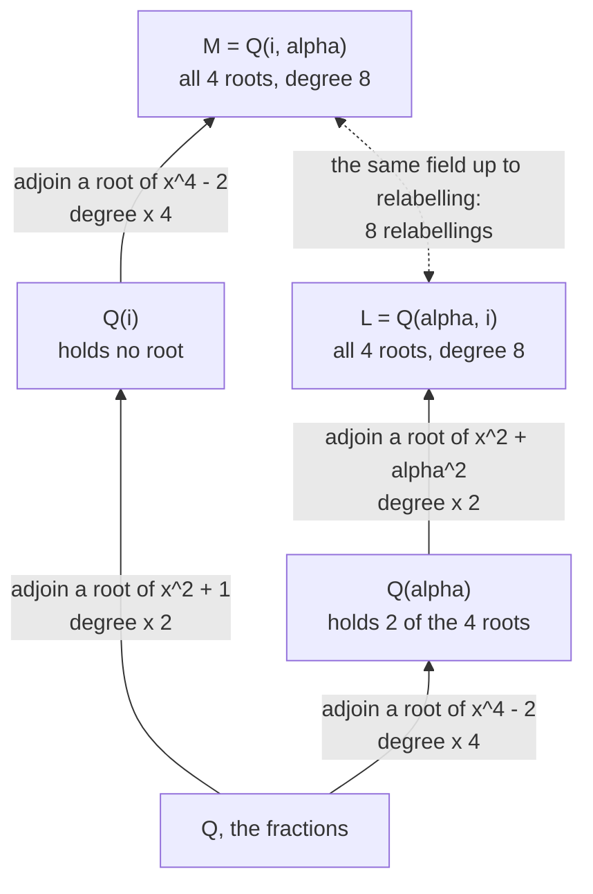

# Splitting fields: the smallest field where a polynomial factors all the way down

[Syllabus](../../../SYLLABUS.md) → [Algebraic and analytic number theory](../README.md) → [Fields and Galois Theory](../README.md#s05) → Splitting fields

---

## General Overview

The long side of an A0 sheet of paper is the fourth root of 2 metres, about 1.189207115 m. Call that number $`\alpha`$ ("alpha"). It solves $`x^4 = 2`$, and so do three other numbers: $`-\alpha`$, $`i\alpha`$ and $`-i\alpha`$, where $`i`$ is the square root of $`-1`$.

Add $`\alpha`$ to the fractions ($`\mathbb{Q}`$) and you get the field $`\mathbb{Q}(\alpha)`$ of [Field extensions](01-field-extensions-and-degree.md). It holds two of the four roots, $`\alpha`$ and $`-\alpha`$. In it, $`x^4 - 2`$ breaks only part of the way: $`(x - \alpha)(x + \alpha)(x^2 + \alpha^2)`$. The last bracket will not split, because every number in $`\mathbb{Q}(\alpha)`$ is real and $`-\alpha^2`$ has no real square root.

Add $`i`$ as well and every root is present. Now the polynomial factors all the way down into four brackets, one per root. The field $`\mathbb{Q}(\alpha, i)`$ is the **splitting field** of $`x^4 - 2`$: the smallest field where that happens. Its degree (its dimension as a vector space over the fractions, as on [Field extensions](01-field-extensions-and-degree.md)) is 4 × 2 = 8.

This card does three things with that field:

- **builds** it with no complex numbers at all, by remainder arithmetic;
- **proves** that every such build gives the same field up to relabelling, and counts the relabellings: 8;
- **states** what an algebraic closure adds: one field where every polynomial splits at once.

**For any polynomial over any field, a splitting field exists, can be built by adjoining one root at a time as remainders modulo an irreducible factor, has degree at most n! for degree n, and is unique up to a relabelling that fixes the base field.**

**What kind of fact this is:** theorems, proved on this card in Why it works: existence (Kronecker's construction) and uniqueness. That every field has an algebraic closure is a theorem stated here with its source, Steinitz 1910. The prime counts in the code are evidence for the degree 8, never proof; the proof is the tower argument.

### The picture: two roads to one field



The left road adjoins the real root first. The right road adjoins $`i`$ first. The code builds both and finds exactly 8 ways to match them.

---

## The formula

Notation from the earlier cards, one line each. $`K`$ is the base field. $`K(r)`$ is the smallest field holding $`K`$ and the number $`r`$. $`[L:K]`$ is the degree of $`L`$ over $`K`$: its dimension as a vector space over $`K`$ ([Field extensions](01-field-extensions-and-degree.md)).

Take a polynomial $`f`$ of degree $`n \ge 1`$ with coefficients in $`K`$, and with top coefficient 1 (monic). A field $`L`$ holding $`K`$ is a **splitting field** of $`f`$ over $`K`$ when both of these hold:

```math
f(x) = (x - r_1)(x - r_2)\cdots(x - r_n) \ \text{ with every } r_k \text{ in } L, \qquad L = K(r_1, r_2, \dots, r_n)
```

**Read it aloud:** in L the polynomial breaks into one bracket per root, and L is made of nothing but K and those roots.

The first half says "factors all the way down". The second half says "smallest": no proper subfield holding $`K`$ contains all the roots. Two facts about it come next.

```math
K(r) \cong K[x]/(g) \quad \text{for } g \text{ irreducible with root } r, \qquad [L:K] \le n!
```

**Read it aloud:** adjoining a root of an irreducible polynomial g is the same as doing arithmetic with remainders modulo g; and the splitting field's degree is at most n factorial.

For $`x^4 - 2`$ over the fractions: $`L = \mathbb{Q}(\alpha, i)`$, $`[L:\mathbb{Q}] = 4 \times 2 = 8`$, well under the bound $`4! = 24`$.

The symbol $`\cong`$ means "the same field under new names": a one-to-one match that keeps every sum and product. $`K[x]/(g)`$ is the polynomials over $`K`$ with $`g`$ treated as zero ([Ideals and quotient rings](../../03-Algebra/09-Rings%20and%20Fields/04-ideals-and-quotient-rings.md)).

| Symbol | Plain meaning | In our example | Push it up and the answer… |
| --- | --- | --- | --- |
| $`K`$; $`\mathbb{Q}`$, $`\mathbb{C}`$ | the base field: the allowed coefficients; the fractions; the complex numbers | $`K = \mathbb{Q}`$ | a bigger base leaves less to add: the degree falls |
| $`f`$, $`n`$ | the polynomial to split, and its degree | $`x^4 - 2`$, 4 | the bound n! grows fast |
| $`r_1, \dots, r_n`$; $`K_1`$ | the roots of $`f`$; $`K_1 = K(r_1)`$, the field after round 1 | $`\alpha, -\alpha, i\alpha, -i\alpha`$; $`\mathbb{Q}(\alpha)`$ | — |
| $`\alpha`$ | the real fourth root of 2 (the code's `a`) | 1.189207115 | — |
| $`i`$ | a square root of $`-1`$; $`i\alpha`$ is the code's `b` | $`(i\alpha)^2 = -\alpha^2 = -1.414213562`$ | — |
| $`L`$, $`M`$ | the splitting field, built two ways | $`\mathbb{Q}(\alpha, i)`$ and $`\mathbb{Q}(i, \alpha)`$ | — |
| $`[L:K]`$ | the degree: coordinates per element of $`L`$ | 8 | more relabellings, up to the same count |
| $`g`$, $`d`$ | an irreducible factor being adjoined, and its degree | $`x^4 - 2`$, then $`x^2 + \alpha^2`$ | its degree multiplies $`[L:K]`$ |
| $`K[x]/(g)`$; $`\cong`$ | remainder arithmetic modulo $`g`$; "the same field under new names" | $`\mathbb{Q}[x]/(x^4 - 2)`$ | — |
| $`\sigma`$, $`\tau`$; $`s`$ | relabellings: field matches ($`\sigma`$ fixes every element of $`K`$); $`s`$, the root that $`r_1`$ is sent to | 8 of them from $`L`$ to $`M`$; $`s`$ is one of 4 roots | — |
| $`\bar K`$ | the algebraic closure of $`K`$, read "K bar" | $`\bar{\mathbb{Q}}`$, the algebraic numbers in $`\mathbb{C}`$ | — |

### When it holds

- **The factor must be irreducible.** Kronecker's step (remainders modulo the factor, Step 1) on a reducible polynomial gives zero divisors (two nonzero elements whose product is 0), not a field: modulo $`x^4 - 1`$, $`(x - 1)(x^3 + x^2 + x + 1)`$ is 0 though neither factor is.
- **Degree at least 1.** A nonzero constant has no roots, and its splitting field is $`K`$ itself. There is nothing to build.
- **Unique means unique up to relabelling.** Two builds are matched by a $`\sigma`$, not equal as sets, and the match is not unique: here there are 8.
- **The relabelling count equals the degree when each irreducible factor has distinct roots.** That always holds over the fractions, and $`x^4 - 2`$ has four distinct roots. A repeated factor such as $`(x^2 - 2)^2`$ does no harm. An irreducible factor with a repeated root, possible over some fields of prime characteristic, gives fewer relabellings than the degree: [Normal and separable](04-normal-and-separable-extensions.md).
- **An algebraic closure of an arbitrary field rests on a weak form of the axiom of choice.** For $`\mathbb{Q}`$ one sits inside $`\mathbb{C}`$, ready-made. In general, Steinitz's proof uses the well-ordering theorem; modern proofs use Zorn's lemma (an axiom-of-choice tool for building maximal objects).

---

## Why it works

### Step 0: the idea, make a root by declaring one

The fractions contain no root of $`x^4 - 2`$. Kronecker's idea (1887) is to stop looking for one and to make one.

Do arithmetic with polynomials in a letter $`x`$, and throw away every multiple of $`x^4 - 2`$. In the remainder world, $`x^4`$ equals 2. So the letter $`x`$ itself is a root. No real number, no picture, no limit is needed.

### Step 1: one root at a time, by remainders

Let $`g`$ be an irreducible factor of $`f`$ over $`K`$. Its multiples form an ideal $`(g)`$, and an ideal is maximal (no ideal fits between it and the whole ring) exactly when $`g`$ is irreducible. Collapsing a ring by a maximal ideal gives a field ([Ideals and quotient rings](../../03-Algebra/09-Rings%20and%20Fields/04-ideals-and-quotient-rings.md)).

So $`K[x]/(g)`$ is a field. It holds $`K`$ as the constants. The class of $`x`$ is a root of $`g`$, hence of $`f`$. Each element has one name $`c_0 + c_1 x + \dots + c_{d-1}x^{d-1}`$, with $`d`$ the degree of $`g`$, so the new field has degree $`d`$ over $`K`$.

If a field already holds a root $`r`$ of $`g`$, then $`K(r)`$ and $`K[x]/(g)`$ are the same field, via "send $`x`$ to $`r`$". That is the first isomorphism theorem from the ideals card, with $`(g)`$ as the kernel ([Minimal polynomials](02-minimal-polynomials-and-conjugates.md) shows $`g`$ is then the minimal polynomial of $`r`$).

### Step 2: repeat until the polynomial splits

Over $`K_1 = K(r_1)`$, divide $`f`$ by $`(x - r_1)`$. What is left has degree $`n - 1`$. Pick an irreducible factor of it over $`K_1`$ and repeat Step 1.

Each round removes at least one bracket, so at most $`n`$ rounds finish the job. The round-$`k`$ factor has degree at most $`n - k + 1`$. By the tower law, degrees multiply ([Field extensions](01-field-extensions-and-degree.md)), so

```math
[L:K] \le n \times (n - 1) \times \cdots \times 2 \times 1 = n!
```

The result is generated by the roots and nothing else, so it is a splitting field. Any field holding $`K`$ and all the roots holds every sum, product and quotient of them, so no smaller field can work.

### Step 3: the house example, degree 8

**Round 1.** $`x^4 - 2`$ is irreducible over $`\mathbb{Q}`$. [Field extensions](01-field-extensions-and-degree.md) proves it three ways, one of them Eisenstein's test at the prime 2, which [Minimal polynomials](02-minimal-polynomials-and-conjugates.md) proves. A new road, by machine: it has no root and no factorisation into two quadratics modulo 5, and a factorisation over the fractions would give one over the integers (Gauss's lemma), which would survive reduction mod 5. So $`[\mathbb{Q}(\alpha):\mathbb{Q}] = 4`$.

**Round 2.** Over $`\mathbb{Q}(\alpha)`$, $`x^4 - 2 = (x - \alpha)(x + \alpha)(x^2 + \alpha^2)`$. The quadratic has no root in $`\mathbb{Q}(\alpha)`$: that field sits inside the real numbers, and a real square is never $`-\alpha^2 = -1.414213562`$. A quadratic with no root is irreducible, so this round has degree 2.

**Total.** $`[L:\mathbb{Q}] = 4 \times 2 = 8`$. A basis is the eight products $`\alpha^j (i\alpha)^k`$ with $`j = 0, 1, 2, 3`$ and $`k = 0, 1`$. The code multiplies out the four brackets in those eight coordinates and gets back exactly $`x^4 - 2`$.

### Step 4: unique up to relabelling

The claim: if $`L`$ and $`M`$ are both splitting fields of $`f`$ over $`K`$, there is a relabelling $`\sigma: L \to M`$ that fixes every element of $`K`$. Moreover the number of such relabellings is at most $`[L:K]`$, with equality when the roots are distinct.

The proof shape: follow Kronecker's build of $`L`$ round by round, and copy each round inside $`M`$. In round 1, $`r_1`$ has minimal polynomial $`g`$. $`M`$ holds all the roots of $`f`$, so it holds some root $`s`$ of $`g`$. Step 1 gives $`K(r_1) \cong K[x]/(g) \cong K(s)`$, sending $`r_1`$ to $`s`$. Then repeat with $`f/(x - r_1)`$.

At each round the choices for $`s`$ are the roots of $`g`$ in $`M`$: at most $`\deg g`$, the degree of that round. Multiply up the tower and the count is at most $`[L:K]`$.

For $`x^4 - 2`$: $`\alpha`$ may go to any of the 4 roots in $`M`$, then $`i\alpha`$ to either root of $`x^2 + \sigma(\alpha)^2`$. That is $`4 \times 2 = 8`$, and the code finds exactly 8 by search.

<details>
<summary>Detailed proof: a relabelling of the base extends, in at most [L:K] ways</summary>

Prove a stronger statement, by induction on $`[L:K]`$. Let $`\tau: K \to K'`$ be a field match. Let $`L`$ split $`f`$ over $`K`$, and let $`M`$ split $`\tau f`$ over $`K'`$, where $`\tau f`$ applies $`\tau`$ to each coefficient. Then $`\tau`$ extends to a match $`L \to M`$, in at most $`[L:K]`$ ways.

If $`[L:K] = 1`$, all roots lie in $`K`$, so $`L = K`$ and $`M = K'`$. The only extension is $`\tau`$.

Otherwise pick a root $`r`$ of $`f`$ outside $`K`$, with minimal polynomial $`g`$ of degree $`d \ge 2`$. $`\tau g`$ is irreducible over $`K'`$ and divides $`\tau f`$, so its roots lie in $`M`$. There are at most $`d`$ of them.

For each such root $`s`$, the chain

$`\displaystyle K(r) \cong K[x]/(g) \cong K'[x]/(\tau g) \cong K'(s)`$

extends $`\tau`$ by sending $`r`$ to $`s`$. Any extension must send $`r`$ to a root of $`\tau g`$, so these are all the choices.

Now $`L`$ splits $`f`$ over $`K(r)`$, and $`M`$ splits $`\tau f`$ over $`K'(s)`$. The degree $`[L:K(r)] = [L:K]/d`$ is smaller, so by induction each choice extends in at most $`[L:K]/d`$ ways. In all: at most $`d \times [L:K]/d = [L:K]`$.

If the roots of $`f`$ are distinct, then $`\tau g`$ has exactly $`d`$ distinct roots at every stage, every inequality is an equality, and the count is exactly $`[L:K]`$. Take $`K' = K`$ and $`\tau`$ the identity for the theorem as stated.

</details>

### Step 5: what an algebraic closure adds

A splitting field serves one polynomial. An **algebraic closure** $`\bar K`$ of $`K`$ serves all of them at once. It is a field holding $`K`$ in which:

- every element is a root of some nonzero polynomial over $`K`$ (it is algebraic over $`K`$), and
- every polynomial of degree at least 1 over $`\bar K`$ splits into brackets in $`\bar K`$.

For the fractions it can be named. $`\bar{\mathbb{Q}}`$ is the set of complex numbers that are roots of some nonzero polynomial with rational coefficients: the algebraic numbers.

- **It is a field.** Sums, products and quotients of algebraic numbers are algebraic, by the tower law: Step 4 of [Minimal polynomials](02-minimal-polynomials-and-conjugates.md) proves it.
- **Every polynomial splits in it.** Take a polynomial with algebraic coefficients. [The fundamental theorem of algebra](../../03-Algebra/10-For%20the%20Curious/01-fundamental-theorem-of-algebra.md) gives it a root in $`\mathbb{C}`$. That root has finite degree over the field of the coefficients, which has finite degree over $`\mathbb{Q}`$, so the root is algebraic too.

What the closure adds is one shared home. Every splitting field over $`\mathbb{Q}`$ is a subfield of $`\bar{\mathbb{Q}}`$: inside it, $`L`$ is just $`\mathbb{Q}`$ with the four roots $`\pm 1.189207115`$, $`\pm 1.189207115\,i`$ adjoined. The relabelling question becomes "which subfield, and which symmetries of it".

$`\bar{\mathbb{Q}}`$ is much smaller than $`\mathbb{C}`$. It is countable (its elements can be listed one by one, since there are countably many polynomials), and it misses every transcendental number (one that is a root of no nonzero polynomial over $`\mathbb{Q}`$), such as $`\pi`$.

For an arbitrary field, Steinitz (1910) proved that an algebraic closure exists and is unique up to a relabelling that fixes $`K`$. The proof glues splitting fields of all polynomials together. Steinitz used the well-ordering theorem; modern proofs use Zorn's lemma; both rest on a weak form of the axiom of choice. This card states the theorem with its source and does not prove it.

---

## Worked numbers, by hand

| Step | Arithmetic | Value |
| --- | --- | --- |
| the real root | $`\alpha = 2^{1/4}`$ | 1.189207115 |
| its square | $`\alpha^2 = \sqrt 2`$ | 1.414213562 |
| round 1: adjoin $`\alpha`$ | $`x^4 - 2`$ irreducible: Eisenstein at 2; mod 5, 0 roots and 0 quadratic factorisations | degree 4 |
| what $`\mathbb{Q}(\alpha)`$ holds | real roots of $`x^4 - 2`$ | 2 of 4 |
| what is left over | $`x^4 - 2 = (x - \alpha)(x + \alpha)(x^2 + \alpha^2)`$; $`-\alpha^2 = -1.414213562 < 0`$ | no real root |
| round 2: adjoin $`i\alpha`$ | a root of $`x^2 + \alpha^2`$ | degree 2 |
| the tower | $`[L:\mathbb{Q}] = 4 \times 2`$ | **8** |
| check against the bound | $`4! = 4 \times 3 \times 2 \times 1`$ | 24 |
| relabellings $`L \to M`$ | 4 choices for $`\sigma(\alpha)`$, then 2 for $`\sigma(i\alpha)`$ | 8 |

The splitting field of $`x^4 - 2`$ is an 8-dimensional number system over the fractions, and it can be matched to any other build of it in exactly 8 ways.

Those 8 self-matches of $`L`$ are the eight symmetries shuffling the roots. They become the Galois group of [The Galois correspondence](05-galois-groups-and-the-fundamental-theorem.md).

### The count beside the proof

Reduce $`x^4 - 2`$ modulo a prime $`p`$ and count its roots. Chebotarev's density theorem (1926) says the share of primes where it has all 4 roots tends to $`1/[L:\mathbb{Q}]`$. For degree 8 that is 0.1250. Had the splitting field been $`\mathbb{Q}(\alpha)`$, of degree 4, the share would tend to 0.2500.

| Primes up to | Odd primes | 4 roots | 2 roots | 0 roots |
| --- | ---: | ---: | ---: | ---: |
| 1,000 | 167 | 0.0838 | 0.2575 | 0.6587 |
| 10,000 | 1,228 | 0.1164 | 0.2508 | 0.6327 |
| 100,000 | 9,591 | 0.1232 | 0.2501 | 0.6266 |
| 1,000,000 | 78,497 | 0.1245 | 0.2506 | 0.6250 |
| Chebotarev, degree 8 | | 0.1250 | 0.2500 | 0.6250 |

The share with all 4 roots climbs to 0.1245, close to 0.1250 and far from 0.2500. That is evidence, not proof: the degree 8 is proved in Step 3. The 2-root and 0-root shares come from how the 8 symmetries move the roots; [Computing a Galois group](06-computing-a-galois-group.md) reads them.

### What breaks if you drop a piece

| Mistake | Comes out at | What went wrong |
| --- | --- | --- |
| Stop after one root: take $`\mathbb{Q}(2^{1/4})`$ | degree 4, 2 of 4 roots, 2 symmetries | $`x^2 + \alpha^2`$ is still unsplit; the field is too small |
| Read the bound $`n!`$ as the degree | 24 | $`n!`$ is a ceiling; round 2 had degree 2, not 3 |
| Kronecker's step on reducible $`x^4 - 1`$ | $`(x - 1)(x^3 + x^2 + x + 1) = 0`$ | zero divisors: a ring, not a field |
| Relabel $`i\alpha`$ as $`i`$ | products broken on 16 of 64 basis pairs | a relabelling must send each root to a root of the same polynomial |

---

## Code, from first principles, and it actually runs

The code builds the splitting field as a tower of remainder arithmetic with integer coordinates, twice: $`L`$ adjoins $`\alpha`$ (the code's `a`, with `a^4 = 2`) and then $`i\alpha`$ (`b`, with `b^2 = -a^2`). $`M`$ adjoins $`i`$ (`i^2 = -1`) and then a fourth root of 2 (`c`, with `c^4 = 2`). It takes three independent roads:

- **the factorisation**: multiply out the four brackets in $`L`$ and recover $`x^4 - 2`$;
- **the relabelling count**: search every element with coordinates $`-1`$, $`0`$ or $`1`$ for images of `a` and `b`, keep those that preserve all 64 basis products and are one-to-one, and count 8;
- **the prime count**: sieve the primes to a million, count the roots of $`x^4 - 2`$ mod $`p`$ by a formula checked against brute force below 2,000, and compare the shares with 1/8.

The degree 8 itself is printed as the tower law of Step 3, 4 × 2; the relabelling count and the prime shares are the computed checks on it.

### Python

```python
# Splitting fields -- the check behind the card.  Standard library only.  The roots of
# x^4 - 2 are a, -a, ia, -ia, with a = 2^(1/4).  The field is built twice as remainder
# arithmetic, Q(a) then b = ia, and Q(i) then c = a; a search counts the relabellings
# between the builds; primes where x^4 - 2 splits mod p are counted against 1/8.
from fractions import Fraction
from itertools import product
from math import gcd

def add(x, y): return [u + v for u, v in zip(x, y)]
def bmul(x, y, d, r):                  # bottom field: g^d = r[0] + r[1] g + ...
    c = [0] * (2 * d - 1)
    for i in range(d):
        for j in range(d): c[i + j] += x[i] * y[j]
    for e in range(2 * d - 2, d - 1, -1):
        t, c[e] = c[e], 0
        for i in range(d): c[e - d + i] += t * r[i]
    return c[:d]
def mul(F, X, Y):                      # top: h^d2 = r2[0] + r2[1] h + ..., r2 in bottom
    d1, r1, d2, r2 = F
    c = [[0] * d1 for _ in range(2 * d2 - 1)]
    for i in range(d2):
        for j in range(d2): c[i + j] = add(c[i + j], bmul(X[i], Y[j], d1, r1))
    for e in range(2 * d2 - 2, d2 - 1, -1):
        t, c[e] = c[e], [0] * d1
        for i in range(d2): c[e - d2 + i] = add(c[e - d2 + i], bmul(t, r2[i], d1, r1))
    return c[:d2]
def nest(F, flat): return [list(flat[k * F[0]:(k + 1) * F[0]]) for k in range(F[2])]
def flat(X): return tuple(v for row in X for v in row)
def const(F, n): return nest(F, [n] + [0] * (F[0] * F[2] - 1))
def gen(F, k): return nest(F, [1 if k == s else 0 for s in range(F[0] * F[2])])
def pw(F, X, k):
    out = const(F, 1)
    for _ in range(k): out = mul(F, out, X)
    return out
def lin(G, coeffs, elts):               # sum of integer coefficients times elements
    out = const(G, 0)
    for c, e in zip(coeffs, elts): out = add_e(out, [[c * v for v in row] for row in e])
    return out
def add_e(X, Y): return [add(x, y) for x, y in zip(X, Y)]
def rank(rows):                         # exact Gaussian elimination over Q
    m, r = [[Fraction(v) for v in row] for row in rows], 0
    for col in range(len(m[0])):
        piv = next((i for i in range(r, len(m)) if m[i][col] != 0), None)
        if piv is None: continue
        m[r], m[piv] = m[piv], m[r]
        for i in range(len(m)):
            if i != r and m[i][col] != 0:
                f = m[i][col] / m[r][col]; m[i] = [u - f * w for u, w in zip(m[i], m[r])]
        r += 1
    return r
def phi(F, G, A, B, X):                 # the map sending g -> A, h -> B
    imgs = [mul(G, pw(G, A, j), pw(G, B, k)) for k in range(F[2]) for j in range(F[0])]
    return lin(G, flat(X), imgs)
def is_iso(F, G, A, B):                 # products kept on every basis pair, and one-to-one
    n = F[0] * F[2]; basis = [nest(F, [int(s == t) for s in range(n)]) for t in range(n)]
    bad = sum(phi(F, G, A, B, mul(F, e, f)) != mul(G, phi(F, G, A, B, e), phi(F, G, A, B, f))
              for e in basis for f in basis)
    return bad, rank([flat(phi(F, G, A, B, e)) for e in basis]) == n
def maps(F, G):                         # search coordinates -1, 0, 1 for images of g, h
    pool = [nest(G, t) for t in product((-1, 0, 1), repeat=G[0] * G[2])]
    ev = lambda A, co: lin(G, co, [pw(G, A, j) for j in range(F[0])])
    As = [A for A in pool if pw(G, A, F[0]) == ev(A, F[1])]
    found = [(A, B) for A in As for B in pool if pw(G, B, F[2]) ==
             lin_top(G, [ev(A, r) for r in F[3]], B)]
    return As, [ab for ab in found if is_iso(F, G, *ab) == (0, True)]
def lin_top(G, cs, B):
    out = const(G, 0)
    for k, c in enumerate(cs): out = add_e(out, mul(G, c, pw(G, B, k)))
    return out
L = (4, [2, 0, 0, 0], 2, [[0, 0, -1, 0], [0, 0, 0, 0]])   # a^4 = 2, then b^2 = -a^2
M = (2, [-1, 0], 4, [[2, 0], [0, 0], [0, 0], [0, 0]])     # i^2 = -1, then c^4 = 2
Qa = (4, [2, 0, 0, 0], 1, [[0, 0, 0, 0]])                 # a^4 = 2 and nothing more
a, b = gen(L, 1), gen(L, 4)
roots = [a, [[-v for v in r] for r in a], b, [[-v for v in r] for r in b]]
poly = [const(L, 1)]                   # multiply out (x - r1)(x - r2)(x - r3)(x - r4)
for r in roots:
    neg = [[-v for v in row] for row in r]
    poly = [add_e(p, q) for p, q in zip([const(L, 0)] + poly, [mul(L, neg, c) for c in poly] + [const(L, 0)])]
coef = [flat(c) for c in poly]
mod5 = sum(((u + w) % 5, (v + z + u * w) % 5, (u * z + v * w) % 5, (v * z) % 5) == (0, 0, 0, 3)
           for u, v, w, z in product(range(5), repeat=4))
root5 = sum(pow(x, 4, 5) == 2 for x in range(5))
Rq = (4, [1, 0, 0, 0], 1, [[0, 0, 0, 0]])                 # x^4 = 1: reducible
zd = mul(Rq, nest(Rq, [-1, 1, 0, 0]), nest(Rq, [1, 1, 1, 1]))
As_LM, iso_LM = maps(L, M)
_, aut_L = maps(L, L)
As_Qa, aut_Qa = maps(Qa, Qa)
wrong, _ = is_iso(L, M, gen(M, 2), gen(M, 1))             # a -> c but b -> i
N = 10 ** 6
sieve = bytearray([1]) * (N + 1); sieve[0:2] = b"\x00\x00"
for p in range(2, int(N ** 0.5) + 1):
    if sieve[p]: sieve[p * p::p] = bytearray(len(range(p * p, N + 1, p)))
def nroots(p):
    g = gcd(4, p - 1)
    return g if pow(2, (p - 1) // g, p) == 1 else 0
brute = all(nroots(p) == sum(pow(x, 4, p) == 2 for x in range(p)) for p in range(3, 2000) if sieve[p])
al = 2 ** 0.25
print(f"a = 2^(1/4) = {al:.9f}; a^2 = {al * al:.9f}; roots +-{al:.9f}, +-{al:.9f}i")
print(f"x^4 - 2 mod 5: roots {root5}, monic quadratic factorisations {mod5}")
print(f"degree by the tower law (Step 3): [Q(a):Q] = 4, [L:Q(a)] = 2, [L:Q] = 4 x 2 = {4 * 2}; the bound 4! = {1 * 2 * 3 * 4}")
print(f"(x - a)(x + a)(x - ia)(x + ia) in L: rational parts of x^0..x^4 "
      f"{', '.join(str(c[0]) for c in coef)}; other 35 coordinates all 0: {all(not any(c[1:]) for c in coef)}")
print(f"Kronecker on x^4 - 1: (x - 1)(x^3 + x^2 + x + 1) = {flat(zd)}")
print(f"fourth roots of 2 found: in M {len(As_LM)}, in Q(a) {len(As_Qa)}")
print(f"relabellings L -> M {len(iso_LM)}; symmetries of L {len(aut_L)}; of Q(a) {len(aut_Qa)}")
print(f"a -> c, b -> i: products broken on {wrong} of 64 basis pairs")
print(f"brute force agrees with the root formula for every prime below 2000: {brute}")
print("primes p up to N (p > 2): count, share with 4 roots, 2 roots, 0 roots mod p")
shares = []
for top in (10 ** 3, 10 ** 4, 10 ** 5, 10 ** 6):
    cnt = {0: 0, 2: 0, 4: 0}
    for p in range(3, top + 1):
        if sieve[p]: cnt[nroots(p)] += 1
    tot = sum(cnt.values()); shares.append(cnt[4] / tot)
    print(f"  N = {top}: {tot}, {cnt[4] / tot:.4f}, {cnt[2] / tot:.4f}, {cnt[0] / tot:.4f}")
print(f"Chebotarev for degree 8: {1 / 8:.4f}, {2 / 8:.4f}, {5 / 8:.4f}; for degree 4: {1 / 4:.4f}")
assert coef == [(-2,) + (0,) * 7] + [(0,) * 8] * 3 + [(1,) + (0,) * 7]
assert mod5 == 0 and root5 == 0 and flat(zd) == (0, 0, 0, 0)
assert len(As_LM) == 4 and len(iso_LM) == 8 and len(aut_L) == 8 and len(aut_Qa) == 2
assert len(As_Qa) == 2 and wrong > 0 and brute
assert abs(shares[-1] - 1 / 8) < 0.005 and abs(shares[-1] - 1 / 4) > 0.1
print("ALL CHECKS PASS")
```

**Ran 2026-11-15 on macOS, Python 3.14.10, standard library only. All checks passed. Output, pasted from the run:**

```
a = 2^(1/4) = 1.189207115; a^2 = 1.414213562; roots +-1.189207115, +-1.189207115i
x^4 - 2 mod 5: roots 0, monic quadratic factorisations 0
degree by the tower law (Step 3): [Q(a):Q] = 4, [L:Q(a)] = 2, [L:Q] = 4 x 2 = 8; the bound 4! = 24
(x - a)(x + a)(x - ia)(x + ia) in L: rational parts of x^0..x^4 -2, 0, 0, 0, 1; other 35 coordinates all 0: True
Kronecker on x^4 - 1: (x - 1)(x^3 + x^2 + x + 1) = (0, 0, 0, 0)
fourth roots of 2 found: in M 4, in Q(a) 2
relabellings L -> M 8; symmetries of L 8; of Q(a) 2
a -> c, b -> i: products broken on 16 of 64 basis pairs
brute force agrees with the root formula for every prime below 2000: True
primes p up to N (p > 2): count, share with 4 roots, 2 roots, 0 roots mod p
  N = 1000: 167, 0.0838, 0.2575, 0.6587
  N = 10000: 1228, 0.1164, 0.2508, 0.6327
  N = 100000: 9591, 0.1232, 0.2501, 0.6266
  N = 1000000: 78497, 0.1245, 0.2506, 0.6250
Chebotarev for degree 8: 0.1250, 0.2500, 0.6250; for degree 4: 0.2500
ALL CHECKS PASS
```

### Rust

Same labels, same numbers, built with `rustc -O`. Field arithmetic uses 64-bit integers with checked overflow, so an overflow would stop the run instead of wrapping.

```rust
// Splitting fields -- the same check as the Python, in Rust.  No crates.  The roots of
// x^4 - 2 are a, -a, ia, -ia, with a = 2^(1/4).  The field is built twice as remainder
// arithmetic, Q(a) then b = ia, and Q(i) then c = a; a search counts the relabellings
// between the builds; primes where x^4 - 2 splits mod p are counted against 1/8.
type E = Vec<Vec<i64>>;
fn cm(a: i64, b: i64) -> i64 { a.checked_mul(b).expect("overflow") }   // checked: an overflow stops the run
fn ca(a: i64, b: i64) -> i64 { a.checked_add(b).expect("overflow") }
struct F { d1: usize, r1: Vec<i64>, d2: usize, r2: Vec<Vec<i64>> }
fn add(x: &[i64], y: &[i64]) -> Vec<i64> { x.iter().zip(y).map(|(u, v)| ca(*u, *v)).collect() }
fn add_e(x: &E, y: &E) -> E { x.iter().zip(y).map(|(u, v)| add(u, v)).collect() }
fn neg(x: &E) -> E { x.iter().map(|r| r.iter().map(|v| cm(-1, *v)).collect()).collect() }
fn bmul(x: &[i64], y: &[i64], d: usize, r: &[i64]) -> Vec<i64> {   // g^d = r[0] + r[1] g + ...
    let mut c = vec![0i64; 2 * d - 1];
    for i in 0..d { for j in 0..d { c[i + j] = ca(c[i + j], cm(x[i], y[j])); } }
    for e in (d..2 * d - 1).rev() {
        let t = c[e]; c[e] = 0;
        for i in 0..d { c[e - d + i] = ca(c[e - d + i], cm(t, r[i])); }
    }
    c.truncate(d); c
}
fn mul(f: &F, x: &E, y: &E) -> E {      // top: h^d2 = r2[0] + r2[1] h + ..., r2 in bottom
    let mut c: E = vec![vec![0; f.d1]; 2 * f.d2 - 1];
    for i in 0..f.d2 { for j in 0..f.d2 { c[i + j] = add(&c[i + j], &bmul(&x[i], &y[j], f.d1, &f.r1)); } }
    for e in (f.d2..2 * f.d2 - 1).rev() {
        let t = std::mem::replace(&mut c[e], vec![0; f.d1]);
        for i in 0..f.d2 { c[e - f.d2 + i] = add(&c[e - f.d2 + i], &bmul(&t, &f.r2[i], f.d1, &f.r1)); }
    }
    c.truncate(f.d2); c
}
fn nest(f: &F, fl: &[i64]) -> E { (0..f.d2).map(|k| fl[k * f.d1..(k + 1) * f.d1].to_vec()).collect() }
fn flat(x: &E) -> Vec<i64> { x.iter().flatten().cloned().collect() }
fn konst(f: &F, n: i64) -> E { let mut v = vec![0; f.d1 * f.d2]; v[0] = n; nest(f, &v) }
fn gen(f: &F, k: usize) -> E { let mut v = vec![0; f.d1 * f.d2]; v[k] = 1; nest(f, &v) }
fn pw(f: &F, x: &E, k: usize) -> E { let mut o = konst(f, 1); for _ in 0..k { o = mul(f, &o, x); } o }
fn lin(g: &F, co: &[i64], elts: &[E]) -> E {   // sum of integer coefficients times elements
    let mut o = konst(g, 0);
    for (c, e) in co.iter().zip(elts) { o = add_e(&o, &e.iter().map(|r| r.iter().map(|v| cm(*c, *v)).collect()).collect()); }
    o
}
fn gcd(a: i64, b: i64) -> i64 { if b == 0 { a } else { gcd(b, a % b) } }
fn rank(rows: Vec<Vec<i64>>) -> usize {   // exact elimination: fractions as (num, den) pairs
    let mut m: Vec<Vec<(i64, i64)>> = rows.iter().map(|r| r.iter().map(|&v| (v, 1)).collect()).collect();
    let red = |(n, d): (i64, i64)| { let g = gcd(n.abs(), d.abs()).max(1) * d.signum(); (n / g, d / g) };
    let mut r = 0;
    for col in 0..m[0].len() {
        let piv = match (r..m.len()).find(|&i| m[i][col].0 != 0) { Some(p) => p, None => continue };
        m.swap(r, piv);
        for i in 0..m.len() {
            if i != r && m[i][col].0 != 0 {
                let f = red((cm(m[i][col].0, m[r][col].1), cm(m[i][col].1, m[r][col].0)));
                for k in 0..m[0].len() {
                    let (a, b) = (m[i][k], red((cm(f.0, m[r][k].0), cm(f.1, m[r][k].1))));
                    m[i][k] = red((ca(cm(a.0, b.1), cm(-1, cm(b.0, a.1))), cm(a.1, b.1)));
                }
            }
        }
        r += 1;
    }
    r
}
fn phi(f: &F, g: &F, a: &E, b: &E, x: &E) -> E {   // the map sending g -> A, h -> B
    let mut imgs = Vec::new();
    for k in 0..f.d2 { for j in 0..f.d1 { imgs.push(mul(g, &pw(g, a, j), &pw(g, b, k))); } }
    lin(g, &flat(x), &imgs)
}
fn is_iso(f: &F, g: &F, a: &E, b: &E) -> (usize, bool) {   // products kept, and one-to-one
    let n = f.d1 * f.d2;
    let basis: Vec<E> = (0..n).map(|t| gen(f, t)).collect();
    let mut bad = 0;
    for e in &basis { for h in &basis {
        if phi(f, g, a, b, &mul(f, e, h)) != mul(g, &phi(f, g, a, b, e), &phi(f, g, a, b, h)) { bad += 1; }
    } }
    (bad, rank(basis.iter().map(|e| flat(&phi(f, g, a, b, e))).collect()) == n)
}
fn maps(f: &F, g: &F) -> (usize, usize) {   // search coordinates -1, 0, 1 for images of g, h
    let n = g.d1 * g.d2;
    let pool: Vec<E> = (0..3usize.pow(n as u32)).map(|mut t| {
        let mut v = vec![0i64; n];
        for s in (0..n).rev() { v[s] = (t % 3) as i64 - 1; t /= 3; }
        nest(g, &v) }).collect();
    let ev = |a: &E, co: &[i64]| lin(g, co, &(0..f.d1).map(|j| pw(g, a, j)).collect::<Vec<E>>());
    let roots: Vec<&E> = pool.iter().filter(|a| pw(g, a, f.d1) == ev(a, &f.r1)).collect();
    let mut count = 0;
    for a in &roots {
        let cs: Vec<E> = f.r2.iter().map(|r| ev(a, r)).collect();
        for b in &pool {
            let mut rhs = konst(g, 0);
            for (k, c) in cs.iter().enumerate() { rhs = add_e(&rhs, &mul(g, c, &pw(g, b, k))); }
            if pw(g, b, f.d2) == rhs && is_iso(f, g, a, b) == (0, true) { count += 1; }
        }
    }
    (roots.len(), count)
}
fn modpow(mut b: u64, mut e: u64, m: u64) -> u64 {
    let mut r = 1 % m; b %= m;
    while e > 0 { if e & 1 == 1 { r = r * b % m; } b = b * b % m; e >>= 1; }
    r
}
fn nroots(p: u64) -> usize {
    let g = gcd(4, (p - 1) as i64) as u64;
    if modpow(2, (p - 1) / g, p) == 1 { g as usize } else { 0 }
}
fn main() {
    let l = F { d1: 4, r1: vec![2, 0, 0, 0], d2: 2, r2: vec![vec![0, 0, -1, 0], vec![0, 0, 0, 0]] };
    let m = F { d1: 2, r1: vec![-1, 0], d2: 4, r2: vec![vec![2, 0], vec![0, 0], vec![0, 0], vec![0, 0]] };
    let qa = F { d1: 4, r1: vec![2, 0, 0, 0], d2: 1, r2: vec![vec![0, 0, 0, 0]] };
    let (a, b) = (gen(&l, 1), gen(&l, 4));
    let roots = [a.clone(), neg(&a), b.clone(), neg(&b)];
    let mut poly: Vec<E> = vec![konst(&l, 1)];   // multiply out (x - r1)(x - r2)(x - r3)(x - r4)
    for r in &roots {
        let mut sh = vec![konst(&l, 0)]; sh.extend(poly.iter().cloned());
        let mut tm: Vec<E> = poly.iter().map(|c| mul(&l, &neg(r), c)).collect(); tm.push(konst(&l, 0));
        poly = sh.iter().zip(&tm).map(|(p, q)| add_e(p, q)).collect();
    }
    let coef: Vec<Vec<i64>> = poly.iter().map(flat).collect();
    let mut mod5 = 0;
    for u in 0..5 { for v in 0..5 { for w in 0..5 { for z in 0..5 {
        if ((u + w) % 5, (v + z + u * w) % 5, (u * z + v * w) % 5, (v * z) % 5) == (0, 0, 0, 3) { mod5 += 1; }
    } } } }
    let root5 = (0..5u64).filter(|&x| modpow(x, 4, 5) == 2).count();
    let rq = F { d1: 4, r1: vec![1, 0, 0, 0], d2: 1, r2: vec![vec![0, 0, 0, 0]] };   // x^4 = 1
    let zd = flat(&mul(&rq, &nest(&rq, &[-1, 1, 0, 0]), &nest(&rq, &[1, 1, 1, 1])));
    let (as_lm, iso_lm) = maps(&l, &m);
    let (_, aut_l) = maps(&l, &l);
    let (as_qa, aut_qa) = maps(&qa, &qa);
    let (wrong, _) = is_iso(&l, &m, &gen(&m, 2), &gen(&m, 1));   // a -> c but b -> i
    const N: usize = 1_000_000;
    let mut sieve = vec![true; N + 1]; sieve[0] = false; sieve[1] = false;
    let mut p = 2;
    while p * p <= N { if sieve[p] { let mut q = p * p; while q <= N { sieve[q] = false; q += p; } } p += 1; }
    let brute = (3..2000u64).filter(|&p| sieve[p as usize])
        .all(|p| nroots(p) == (0..p).filter(|&x| modpow(x, 4, p) == 2).count());
    let al = 2f64.powf(0.25);
    println!("a = 2^(1/4) = {:.9}; a^2 = {:.9}; roots +-{:.9}, +-{:.9}i", al, al * al, al, al);
    println!("x^4 - 2 mod 5: roots {}, monic quadratic factorisations {}", root5, mod5);
    println!("degree by the tower law (Step 3): [Q(a):Q] = 4, [L:Q(a)] = 2, [L:Q] = 4 x 2 = {}; the bound 4! = {}", 4 * 2, 1 * 2 * 3 * 4);
    let firsts: Vec<String> = coef.iter().map(|c| c[0].to_string()).collect();
    let rest = coef.iter().all(|c| c[1..].iter().all(|&v| v == 0));
    println!("(x - a)(x + a)(x - ia)(x + ia) in L: rational parts of x^0..x^4 {}; other 35 coordinates all 0: {}",
             firsts.join(", "), if rest { "True" } else { "False" });
    println!("Kronecker on x^4 - 1: (x - 1)(x^3 + x^2 + x + 1) = ({}, {}, {}, {})", zd[0], zd[1], zd[2], zd[3]);
    println!("fourth roots of 2 found: in M {}, in Q(a) {}", as_lm, as_qa);
    println!("relabellings L -> M {}; symmetries of L {}; of Q(a) {}", iso_lm, aut_l, aut_qa);
    println!("a -> c, b -> i: products broken on {} of 64 basis pairs", wrong);
    println!("brute force agrees with the root formula for every prime below 2000: {}", if brute { "True" } else { "False" });
    println!("primes p up to N (p > 2): count, share with 4 roots, 2 roots, 0 roots mod p");
    let mut last = 0.0;
    for top in [1_000usize, 10_000, 100_000, 1_000_000] {
        let mut cnt = [0usize; 5];
        for p in 3..=top { if sieve[p] { cnt[nroots(p as u64)] += 1; } }
        let tot = (cnt[0] + cnt[2] + cnt[4]) as f64;
        last = cnt[4] as f64 / tot;
        println!("  N = {}: {}, {:.4}, {:.4}, {:.4}", top, tot as usize, cnt[4] as f64 / tot, cnt[2] as f64 / tot, cnt[0] as f64 / tot);
    }
    println!("Chebotarev for degree 8: {:.4}, {:.4}, {:.4}; for degree 4: {:.4}", 1.0 / 8.0, 2.0 / 8.0, 5.0 / 8.0, 1.0 / 4.0);
    assert!(coef[0] == [-2, 0, 0, 0, 0, 0, 0, 0] && coef[4] == [1, 0, 0, 0, 0, 0, 0, 0] && rest);
    assert!(coef[1..4].iter().all(|c| c.iter().all(|&v| v == 0)));
    assert!(mod5 == 0 && root5 == 0 && zd == [0, 0, 0, 0]);
    assert!(as_lm == 4 && iso_lm == 8 && aut_l == 8 && aut_qa == 2 && as_qa == 2 && wrong > 0 && brute);
    assert!((last - 0.125).abs() < 0.005 && (last - 0.25).abs() > 0.1);
    println!("ALL CHECKS PASS");
}
```

**Ran 2026-11-15 on macOS, rustc 1.98.1, no crates. All checks passed. Output, pasted from the run:**

```
a = 2^(1/4) = 1.189207115; a^2 = 1.414213562; roots +-1.189207115, +-1.189207115i
x^4 - 2 mod 5: roots 0, monic quadratic factorisations 0
degree by the tower law (Step 3): [Q(a):Q] = 4, [L:Q(a)] = 2, [L:Q] = 4 x 2 = 8; the bound 4! = 24
(x - a)(x + a)(x - ia)(x + ia) in L: rational parts of x^0..x^4 -2, 0, 0, 0, 1; other 35 coordinates all 0: True
Kronecker on x^4 - 1: (x - 1)(x^3 + x^2 + x + 1) = (0, 0, 0, 0)
fourth roots of 2 found: in M 4, in Q(a) 2
relabellings L -> M 8; symmetries of L 8; of Q(a) 2
a -> c, b -> i: products broken on 16 of 64 basis pairs
brute force agrees with the root formula for every prime below 2000: True
primes p up to N (p > 2): count, share with 4 roots, 2 roots, 0 roots mod p
  N = 1000: 167, 0.0838, 0.2575, 0.6587
  N = 10000: 1228, 0.1164, 0.2508, 0.6327
  N = 100000: 9591, 0.1232, 0.2501, 0.6266
  N = 1000000: 78497, 0.1245, 0.2506, 0.6250
Chebotarev for degree 8: 0.1250, 0.2500, 0.6250; for degree 4: 0.2500
ALL CHECKS PASS
```

The two outputs match line for line.

### Lean

Lean proves Steps 1, 2 and 4 for every polynomial over every field, and the degree 8 of $`x^4 - 2`$.

- Take an irreducible $`g`$ over $`K`$. Then $`K[x]/(g)`$ is a field of degree $`\deg g`$ over $`K`$, and the class of $`x`$ is a root of $`g`$.
- Take an irreducible $`g`$ over $`K`$ with a root $`r`$ in a field holding $`K`$. Then $`K(r)`$ and $`K[x]/(g)`$ are the same field under new names.
- Take a polynomial $`f`$ of degree $`n`$ over $`K`$. Then a splitting field $`L`$ of $`f`$ exists, with $`[L:K] \le n!`$.
- Take two splitting fields $`L`$ and $`M`$ of $`f`$ over $`K`$. Then some relabelling $`\sigma: L \to M`$ fixes every element of $`K`$.
- Take two splitting fields $`L`$ and $`M`$ of $`f`$ over $`K`$. Then at most $`[L:K]`$ relabellings $`L \to M`$ fix every element of $`K`$.
- Suppose also that each irreducible factor of $`f`$ has distinct roots. Then exactly $`[L:K]`$ such relabellings exist.
- The splitting field of $`x^4 - 2`$ over the fractions has degree 8.
- $`x^4 - 2`$ is irreducible over the fractions, by Eisenstein's test at the prime 2.
- Modulo 5, $`x^4 - 2`$ has no root and no factorisation into two monic quadratics.
- $`(x - 1)(x^3 + x^2 + x + 1) = x^4 - 1`$, so Kronecker's step on $`x^4 - 1`$ gives zero divisors.
- The tower counts: 4 × 2 = 8, and 8 is under the bound 4! = 24.

The search that finds 8 relabellings, the builds of $`L`$ and $`M`$ and the prime counts are left to the Python and Rust checks.

```lean
-- Splitting fields: every polynomial over a field has a splitting field, built one root at a time by remainder arithmetic, of degree at most n! and unique up to relabelling, with at most [L:K] relabellings and exactly that many when the roots are distinct; for x^4 - 2 over the fractions the degree is 8.
import Mathlib.FieldTheory.SplittingField.Construction
import Mathlib.FieldTheory.Galois.Basic
import Mathlib.FieldTheory.SeparableDegree
import Mathlib.RingTheory.AdjoinRoot
import Mathlib.Data.ZMod.Basic
import Mathlib.Tactic.Ring
import Mathlib.FieldTheory.SeparableClosure
import Mathlib.RingTheory.Polynomial.Eisenstein.Basic
import Mathlib.RingTheory.Polynomial.GaussLemma
import Mathlib.Data.Nat.Prime.Int
import Mathlib.Analysis.SpecialFunctions.Pow.Real
import Mathlib.Analysis.Complex.Polynomial.Basic

open Polynomial
open scoped IntermediateField

universe u v w

theorem splittingFieldAux_finrank_le_factorial (n : ℕ) :
    ∀ {K : Type u} [Field K] (f : K[X]), f.natDegree = n →
      Module.finrank K (SplittingFieldAux n f) ≤ n.factorial := by
  induction n with
  | zero =>
    intro K _ f _
    show Module.finrank K K ≤ 1
    simp
  | succ n ih =>
    intro K _ f hf
    have hf0 : f ≠ 0 := by rintro rfl; simp at hf
    have hnd : f.natDegree ≠ 0 := by omega
    have := Polynomial.fact_irreducible_factor f
    have h1 := ih f.removeFactor (natDegree_removeFactor' hf)
    have h2 : Module.finrank K (AdjoinRoot f.factor) ≤ n + 1 := by
      rw [(AdjoinRoot.powerBasis (irreducible_factor f).ne_zero).finrank, AdjoinRoot.powerBasis_dim,
        ← hf]
      exact natDegree_le_of_dvd (factor_dvd_of_natDegree_ne_zero hnd) hf0
    have h3 := Module.finrank_mul_finrank K (AdjoinRoot f.factor)
      (SplittingFieldAux n f.removeFactor)
    change Module.finrank K (SplittingFieldAux n f.removeFactor) ≤ (n+1).factorial
    rw [← h3, Nat.factorial_succ]
    exact Nat.mul_le_mul h2 h1

#print axioms splittingFieldAux_finrank_le_factorial

theorem irreducible_X_pow_four_sub_two_rat : Irreducible (X ^ 4 - C 2 : ℚ[X]) := by
  have hm : (X ^ 4 - C 2 : ℤ[X]).Monic := monic_X_pow_sub_C 2 (by norm_num)
  have hnd : (X ^ 4 - C 2 : ℤ[X]).natDegree = 4 := natDegree_X_pow_sub_C (2 : ℤ)
  have he : (X ^ 4 - C 2 : ℤ[X]).IsEisensteinAt (Ideal.span {(2 : ℤ)}) := by
    refine ⟨?_, ?_, ?_⟩
    · rw [hm.leadingCoeff, Ideal.mem_span_singleton]; norm_num
    · intro n hn
      rw [hnd] at hn
      rw [Ideal.mem_span_singleton]
      interval_cases n <;> simp
    · rw [Ideal.span_singleton_pow, Ideal.mem_span_singleton]
      simp
  have hi : Irreducible (X ^ 4 - C 2 : ℤ[X]) :=
    he.irreducible ((Ideal.span_singleton_prime (by norm_num)).mpr (Nat.prime_iff_prime_int.mp Nat.prime_two))
      hm.isPrimitive (by rw [hnd]; norm_num)
  have := (IsPrimitive.Int.irreducible_iff_irreducible_map_cast hm.isPrimitive).mp hi
  rw [show (C 2 : ℚ[X]) = 2 from map_ofNat C 2]
  simpa using this

#print axioms irreducible_X_pow_four_sub_two_rat

/-- Splitting fields exist, are built by Kronecker's step, have degree at most n!, and are unique.
For any polynomial f over any field K:
(1) Kronecker's step: for an irreducible g over K, remainder arithmetic modulo g, K[x]/(g), is a
field; the class of x is a root of g; its degree over K is the degree of g; and for any root r
of g in any field, K(r) is the same field as K[x]/(g) under new names;
(2) a splitting field L of f over K exists, with degree [L:K] at most n!, where n is the degree of f;
(3) any two splitting fields of f over K are matched by a relabelling that fixes every element of K. -/
theorem splitting_field_exists_degree_le_factorial_and_unique {K : Type u} [Field K] (f : K[X]) :
    (∀ g : K[X], Irreducible g →
      IsField (AdjoinRoot g) ∧ aeval (AdjoinRoot.root g) g = 0 ∧
      Module.finrank K (AdjoinRoot g) = g.natDegree ∧
      ∀ (E : Type w) [Field E] [Algebra K E] (r : E), aeval r g = 0 →
        Nonempty (K⟮r⟯ ≃ₐ[K] AdjoinRoot g)) ∧
    (∃ (L : Type u) (_ : Field L) (_ : Algebra K L),
      IsSplittingField K L f ∧ Module.finrank K L ≤ f.natDegree.factorial) ∧
    (∀ (L : Type v) (M : Type w) [Field L] [Field M] [Algebra K L] [Algebra K M],
      IsSplittingField K L f → IsSplittingField K M f → Nonempty (L ≃ₐ[K] M)) := by
  refine ⟨fun g hg => ?_, ⟨f.SplittingField, inferInstance, inferInstance, inferInstance, ?_⟩,
    fun L M _ _ _ _ hL hM => ⟨(IsSplittingField.algEquiv L f).trans
      (IsSplittingField.algEquiv M f).symm⟩⟩
  · have := Fact.mk hg
    refine ⟨Field.toIsField _, by rw [AdjoinRoot.aeval_eq, AdjoinRoot.mk_self], ?_, ?_⟩
    · rw [(AdjoinRoot.powerBasis hg.ne_zero).finrank, AdjoinRoot.powerBasis_dim]
    · intro E _ _ r hr
      have hi : IsIntegral K r := (show IsAlgebraic K r from ⟨g, hg.ne_zero, hr⟩).isIntegral
      have ha : Associated (minpoly K r) g :=
        (minpoly.irreducible hi).associated_of_dvd hg (minpoly.dvd K r hr)
      exact ⟨(IntermediateField.adjoinRootEquivAdjoin K hi).symm.trans
        (AdjoinRoot.algEquivOfAssociated K _ _ ha)⟩
  · rw [(SplittingField.algEquivSplittingFieldAux f).toLinearEquiv.finrank_eq]
    exact splittingFieldAux_finrank_le_factorial _ f rfl

/-- Counting the relabellings: if L and M are both splitting fields of f over K, the number of
relabellings L → M fixing K is at most the degree [L:K], and equals [L:K] when every irreducible
factor of f has distinct roots (is separable). -/
theorem card_relabellings_le_degree_and_eq_of_distinct_roots {K : Type u} {L : Type v}
    {M : Type w} [Field K] [Field L] [Field M] [Algebra K L] [Algebra K M] (f : K[X])
    [IsSplittingField K L f] [IsSplittingField K M f] :
    Nat.card (L ≃ₐ[K] M) ≤ Module.finrank K L ∧
    ((∀ g : K[X], Irreducible g → g ∣ f → g.Separable) →
      Nat.card (L ≃ₐ[K] M) = Module.finrank K L) := by
  have := IsSplittingField.finiteDimensional L f
  let e : L ≃ₐ[K] M := (IsSplittingField.algEquiv L f).trans (IsSplittingField.algEquiv M f).symm
  have hc : Nat.card (L ≃ₐ[K] M) = Nat.card (L ≃ₐ[K] L) := Nat.card_congr
    { toFun := fun σ => σ.trans e.symm
      invFun := fun τ => τ.trans e
      left_inv := fun σ => by ext x; simp
      right_inv := fun τ => by ext x; simp }
  rw [hc]
  refine ⟨by rw [Nat.card_eq_fintype_card]; exact AlgEquiv.card_le, fun hsep => ?_⟩
  have : Normal K L := Normal.of_isSplittingField f
  have : Algebra.IsSeparable K L := by
    rw [← separableClosure.eq_top_iff, eq_top_iff]
    have h1 : IntermediateField.adjoin K (f.rootSet L) ≤ separableClosure K L := by
      rw [IntermediateField.adjoin_le_iff]
      intro x hx
      rw [mem_rootSet] at hx
      rw [SetLike.mem_coe, mem_separableClosure_iff]
      have hi : IsIntegral K x := (show IsAlgebraic K x from ⟨f, hx.1, hx.2⟩).isIntegral
      exact hsep _ (minpoly.irreducible hi) (minpoly.dvd K x hx.2)
    refine le_trans ?_ h1
    rw [← IntermediateField.toSubalgebra_le_toSubalgebra, IntermediateField.top_toSubalgebra,
      ← IsSplittingField.adjoin_rootSet L f]
    exact IntermediateField.algebra_adjoin_le_adjoin K _
  have : IsGalois K L := ⟨⟩
  exact IsGalois.card_aut_eq_finrank K L

/-- The house example: the splitting field of x^4 - 2 over the fractions has degree 8. -/
theorem finrank_splittingField_X_pow_four_sub_two :
    Module.finrank ℚ (X ^ 4 - C 2 : ℚ[X]).SplittingField = 8 := by
  set f : ℚ[X] := X ^ 4 - C 2 with hf
  have hf0 : f ≠ 0 := (monic_X_pow_sub_C 2 (by norm_num)).ne_zero
  let E : IntermediateField ℚ ℂ := IntermediateField.adjoin ℚ (f.rootSet ℂ)
  have : IsSplittingField ℚ E f :=
    IntermediateField.adjoin_rootSet_isSplittingField (IsAlgClosed.splits _)
  rw [← (IsSplittingField.algEquiv E f).toLinearEquiv.finrank_eq]
  set a : ℝ := (2 : ℝ) ^ ((1 : ℝ) / 4) with ha
  have ha4 : a ^ 4 = 2 := by
    rw [ha, ← Real.rpow_natCast, ← Real.rpow_mul (by norm_num)]; norm_num
  set α : ℂ := (a : ℂ) with hα
  have hα4 : α ^ 4 = 2 := by rw [hα, ← Complex.ofReal_pow, ha4]; norm_num
  have hα0 : α ≠ 0 := by rintro h; rw [h] at hα4; norm_num at hα4
  have hroot : ∀ r : ℂ, r ∈ f.rootSet ℂ ↔ r ^ 4 = 2 := by
    intro r
    rw [mem_rootSet_of_ne hf0, hf]
    simp [sub_eq_zero]
  have hE : E = ℚ⟮α, Complex.I⟯ := by
    apply le_antisymm
    · rw [IntermediateField.adjoin_le_iff]
      intro r hr
      rw [hroot] at hr
      have hIα : α ∈ ℚ⟮α, Complex.I⟯ := IntermediateField.subset_adjoin _ _ (by simp)
      have hII : Complex.I ∈ ℚ⟮α, Complex.I⟯ := IntermediateField.subset_adjoin _ _ (by simp)
      have hprod : (r - α) * (r + α) * (r - Complex.I * α) * (r + Complex.I * α) = 0 := by
        linear_combination hr - hα4 - (r ^ 2 - α ^ 2) * α ^ 2 * Complex.I_sq
      rcases mul_eq_zero.mp hprod with h | h
      · rcases mul_eq_zero.mp h with h | h
        · rcases mul_eq_zero.mp h with h | h
          · rw [sub_eq_zero.mp h]; exact hIα
          · rw [eq_neg_of_add_eq_zero_left h]; exact neg_mem hIα
        · rw [sub_eq_zero.mp h]; exact mul_mem hII hIα
      · rw [eq_neg_of_add_eq_zero_left h]; exact neg_mem (mul_mem hII hIα)
    · rw [IntermediateField.adjoin_le_iff]
      have h1 : α ∈ E := IntermediateField.subset_adjoin _ _ ((hroot α).mpr hα4)
      have h2 : Complex.I * α ∈ E := IntermediateField.subset_adjoin _ _ ((hroot _).mpr (by
        rw [mul_pow, hα4]; simp [show Complex.I ^ 4 = 1 from by rw [show 4 = 2 * 2 from rfl, pow_mul]; simp]))
      intro x hx
      simp only [Set.mem_insert_iff, Set.mem_singleton_iff] at hx
      rcases hx with rfl | rfl
      · exact h1
      · have : Complex.I = (Complex.I * α) / α := by field_simp
        rw [this]; exact div_mem h2 h1
  rw [hE, ← IntermediateField.adjoin_simple_adjoin_simple]
  have hmin : minpoly ℚ α = f := by
    refine (minpoly.eq_of_irreducible_of_monic irreducible_X_pow_four_sub_two_rat ?_
      (monic_X_pow_sub_C 2 (by norm_num))).symm
    simp [hα4]
  have hαi : IsIntegral ℚ α := by
    refine ⟨f, monic_X_pow_sub_C 2 (by norm_num), ?_⟩
    simp [hf, hα4, eval₂_sub]
  have h4 : Module.finrank ℚ ℚ⟮α⟯ = 4 := by
    rw [IntermediateField.adjoin.finrank hαi, hmin, hf, natDegree_X_pow_sub_C]
  have hreal : ∀ z ∈ ℚ⟮α⟯, z.im = 0 := by
    have hle : ℚ⟮α⟯ ≤ (Complex.ofRealAm.restrictScalars ℚ).fieldRange := by
      rw [IntermediateField.adjoin_simple_le_iff]
      exact ⟨a, rfl⟩
    intro z hz
    obtain ⟨x, rfl⟩ := hle hz
    simp
  have hIi : IsIntegral ℚ⟮α⟯ Complex.I := by
    refine ⟨X ^ 2 + 1, by monicity!, ?_⟩
    simp
  have h2 : Module.finrank ℚ⟮α⟯ ℚ⟮α⟯⟮Complex.I⟯ = 2 := by
    have hle : Module.finrank ℚ⟮α⟯ ℚ⟮α⟯⟮Complex.I⟯ ≤ 2 := by
      rw [IntermediateField.adjoin.finrank hIi]
      have hp0 : (X ^ 2 + 1 : (ℚ⟮α⟯)[X]) ≠ 0 := (by monicity! : (X ^ 2 + 1 : (ℚ⟮α⟯)[X]).Monic).ne_zero
      have := minpoly.degree_le_of_ne_zero (A := ℚ⟮α⟯) (x := Complex.I) hp0 (by simp)
      have h22 : (X ^ 2 + 1 : (ℚ⟮α⟯)[X]).natDegree = 2 := by compute_degree!
      rw [← h22]
      exact natDegree_le_natDegree this
    have hne : Module.finrank ℚ⟮α⟯ ℚ⟮α⟯⟮Complex.I⟯ ≠ 1 := by
      rw [Ne, IntermediateField.finrank_eq_one_iff, IntermediateField.adjoin_simple_eq_bot_iff,
        IntermediateField.mem_bot]
      rintro ⟨y, hy⟩
      have := hreal y y.2
      rw [show (y : ℂ) = Complex.I from hy] at this
      simp at this
    have := IntermediateField.adjoin.finiteDimensional hIi
    have hpos : 0 < Module.finrank ℚ⟮α⟯ ℚ⟮α⟯⟮Complex.I⟯ := Module.finrank_pos
    omega
  have key := Module.finrank_mul_finrank ℚ ℚ⟮α⟯ ℚ⟮α⟯⟮Complex.I⟯
  rw [h4, h2] at key
  exact key.symm

-- The tower: [L:Q] = 4 × 2 = 8, well under the bound 4! = 24; relabellings 4 × 2 = 8.
example : 4 * 2 = 8 ∧ Nat.factorial 4 = 24 ∧ 4 * 2 ≤ Nat.factorial 4 := by decide

-- x^4 - 2 has no root modulo 5.
example : ∀ x : ZMod 5, x ^ 4 - 2 ≠ 0 := by decide

-- x^4 - 2 has no factorisation into two monic quadratics modulo 5:
-- (x^2 + a x + b)(x^2 + c x + d) = x^4 - 2 would need these four coefficient equations.
example : ∀ a b c d : ZMod 5,
    ¬ (a + c = 0 ∧ b + d + a * c = 0 ∧ a * d + b * c = 0 ∧ b * d = -2) := by decide

-- Kronecker's step on the reducible x^4 - 1 gives zero divisors: (x - 1)(x^3 + x^2 + x + 1) is x^4 - 1.
example : (X - 1) * (X ^ 3 + X ^ 2 + X + 1) = (X ^ 4 - 1 : ℤ[X]) := by ring

#print axioms splitting_field_exists_degree_le_factorial_and_unique
#print axioms card_relabellings_le_degree_and_eq_of_distinct_roots
#print axioms finrank_splittingField_X_pow_four_sub_two
```

**Checked 2026-11-15 on macOS, Lean 4.36.0-rc2, Mathlib v4.36.0-rc2. Every proof is complete and uses only Lean's standard axioms. Output, pasted from the run:**

```
'splittingFieldAux_finrank_le_factorial' depends on axioms: [propext, Classical.choice, Quot.sound]
'irreducible_X_pow_four_sub_two_rat' depends on axioms: [propext, Classical.choice, Quot.sound]
'splitting_field_exists_degree_le_factorial_and_unique' depends on axioms: [propext, Classical.choice, Quot.sound]
'card_relabellings_le_degree_and_eq_of_distinct_roots' depends on axioms: [propext, Classical.choice, Quot.sound]
'finrank_splittingField_X_pow_four_sub_two' depends on axioms: [propext, Classical.choice, Quot.sound]
```

> [!TIP]
> **Try changing**
> Guess first, then run it. Each change stops the program at an assert.
> - **Drop the minus sign.** In `L`, change `[0, 0, -1, 0]` to `[0, 0, 1, 0]`, so `b^2 = a^2`. Guess: does the product of brackets still give back $`x^4 - 2`$? No: the remainder ring now has zero divisors, $`(b - a)(b + a) = 0`$, the middle coefficient is no longer 0, and the first assert stops it.
> - **Build $`M`$ on $`i^2 = +1`$.** In `M`, change `[-1, 0]` to `[1, 0]`. Guess the relabelling count. It falls from 8 to 0, since that ring is not a field and holds no copy of $`L`$.
> - **Make the polynomial reducible mod 5.** Change the target `(0, 0, 0, 3)` to `(0, 0, 0, 1)`, which tests $`x^4 - 4 = (x^2 - 2)(x^2 + 2)`$. Guess: the factorisation count is no longer 0.
> - **Break the root formula.** In `nroots`, replace `(p - 1) // g` by `(p - 1) // 2`. Guess: the brute-force comparison below 2,000 fails.

---

## The usual mistake

> [!warning]
> **Adjoining one root and calling it the splitting field.** $`\mathbb{Q}(2^{1/4})`$ holds a root of $`x^4 - 2`$, but only 2 of the 4 roots, and the polynomial still carries the unsplit factor $`x^2 + \alpha^2`$. Its degree is 4, not 8, and it has only 2 symmetries, fewer than its degree. A splitting field needs every root.
>
> - **Unique read as "one relabelling".** The splitting field is unique up to relabelling, and here there are 8 relabellings, not 1. That freedom is the Galois group.
> - **The bound read as the answer.** $`4! = 24`$ is a ceiling. The true degree is 8, because the second round had degree 2.
> - **The closure of $`\mathbb{Q}`$ taken to be $`\mathbb{C}`$.** $`\mathbb{C}`$ is algebraically closed but holds $`\pi`$, which satisfies no polynomial over $`\mathbb{Q}`$. $`\bar{\mathbb{Q}}`$ is the algebraic numbers only, a countable field.
> - **A prime count read as proof.** At a million primes the share with 4 roots is 0.1245. That supports degree 8; the proof is the tower in Step 3.

---

## Where you meet it in real life

- **Encryption.** The byte arithmetic of the AES cipher is Kronecker's construction: remainders modulo one irreducible polynomial over the two-element field. See [Finite fields](09-finite-fields-and-frobenius.md).
- **Error-correcting codes.** Reed–Solomon codes, used in QR codes and data storage, need a field where a chosen polynomial has all its roots. That field is a splitting field over a finite field.
- **Exact computer algebra.** Programs that keep $`\sqrt 2`$ or $`2^{1/4}`$ exact store a number as remainder coordinates, the way this card's code stores elements of $`L`$.
- **How primes factor.** The prime table above is the start of Chebotarev's theorem: the splitting field controls how a polynomial breaks modulo each prime.

> **Say it back**
> A splitting field is the smallest field where a polynomial breaks into one bracket per root. It always exists: adjoin one root at a time as remainders modulo an irreducible factor, at most n! in degree. For $`x^4 - 2`$ the rounds have degree 4 and 2, so the field has degree 8. Any two builds are the same field under a relabelling, and here there are exactly 8 relabellings. An algebraic closure is one field where every polynomial splits at once; for the fractions it is the algebraic numbers inside the complex numbers.

---

## What this builds on

- [Minimal polynomials](02-minimal-polynomials-and-conjugates.md): the irreducible polynomial behind each round, and the four conjugates $`\pm\alpha`$, $`\pm i\alpha`$.
- [The fundamental theorem of algebra](../../03-Algebra/10-For%20the%20Curious/01-fundamental-theorem-of-algebra.md): every polynomial has a root in $`\mathbb{C}`$, which makes the algebraic numbers algebraically closed.
- [Ideals and quotient rings](../../03-Algebra/09-Rings%20and%20Fields/04-ideals-and-quotient-rings.md): collapsing by the multiples of an irreducible polynomial gives a field, and the first isomorphism theorem.

## Where this goes next

- [Normal and separable](04-normal-and-separable-extensions.md): fields that are splitting fields, and polynomials with no repeated roots, the two conditions under which the relabelling count equals the degree.
- [The Galois correspondence](05-galois-groups-and-the-fundamental-theorem.md): the 8 self-relabellings of $`L`$ as a group, and its subgroups matched with the subfields.
- [Computing a Galois group](06-computing-a-galois-group.md): reading the 2-root and 0-root shares in the prime table.
- [Chebotarev](../06-Algebraic%20Numbers/09-chebotarev-density-and-splitting-statistics.md): why the share with all roots tends to one over the degree.

The card leaves one question open: which subfields lie between $`\mathbb{Q}`$ and $`L`$, and how do the 8 relabellings see them?

---

## Sources

Verified 2026-11-15: every link below resolves to the publisher's page.

- Kronecker, L. "Ein Fundamentalsatz der allgemeinen Arithmetik." *Journal für die reine und angewandte Mathematik* 100 (1887), 490–510. [doi:10.1515/crll.1887.100.490](https://doi.org/10.1515/crll.1887.100.490). Adjoining a root as remainders modulo an irreducible polynomial.
- Steinitz, E. "Algebraische Theorie der Körper." *Journal für die reine und angewandte Mathematik* 137 (1910), 167–309. [doi:10.1515/crll.1910.137.167](https://doi.org/10.1515/crll.1910.137.167). Existence and uniqueness of the algebraic closure of any field.
- Tschebotareff, N. "Die Bestimmung der Dichtigkeit einer Menge von Primzahlen, welche zu einer gegebenen Substitutionsklasse gehören." *Mathematische Annalen* 95 (1926), 191–228. [doi:10.1007/BF01206606](https://doi.org/10.1007/BF01206606). The density theorem behind the prime table.
- Judson, Thomas W. *Abstract Algebra: Theory and Applications*. Stephen F. Austin State University, 2020. [Publisher page and full text](https://scholarworks.sfasu.edu/ebooks/23/). Free; the chapter on fields builds extension fields, splitting fields and algebraic closure.
- Milne, J. S. *Fields and Galois Theory*, course notes. [Author's page](https://www.jmilne.org/math/CourseNotes/ft.html). Free; full proofs of uniqueness of splitting fields and existence of algebraic closures.
