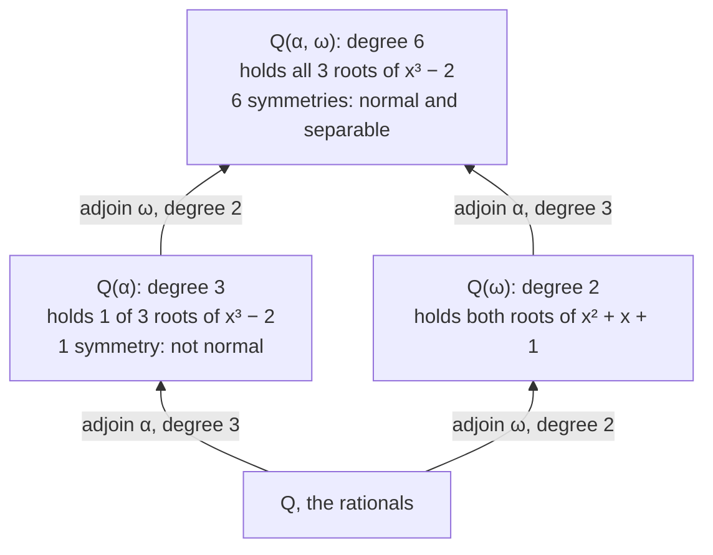

# Normal and separable: holding every conjugate, and having no repeated roots

[Syllabus](../../../SYLLABUS.md) → [Algebraic and analytic number theory](../README.md) → [Fields and Galois Theory](../README.md#s05) → Normal and separable

---

## General Overview

The equation $`x^3 = 2`$ has one real solution: the cube root of 2, about 1.259921. Call it $`\alpha`$ (alpha). The other two solutions are not real: they are $`-0.629961 \pm 1.091124\,i`$. These three numbers are the **conjugates** of $`\alpha`$: the roots of its minimal polynomial $`x^3 - 2`$ ([Minimal polynomials](02-minimal-polynomials-and-conjugates.md)).

Now build the smallest field that holds the rationals and $`\alpha`$. It is $`\mathbb{Q}(\alpha)`$: every number $`a + b\alpha + c\alpha^2`$ with rational $`a, b, c`$. Every one of these numbers is real. So $`\mathbb{Q}(\alpha)`$ holds one conjugate of $`\alpha`$ and misses the other two.

That matters for symmetry. A symmetry of a field (an **automorphism**) must send $`\alpha`$ to a conjugate that is inside the field. $`\mathbb{Q}(\alpha)`$ has only one to offer, so its only symmetry is "change nothing". The field has degree 3 and one symmetry.

Add $`\omega`$ (omega), a cube root of one that is not 1. The bigger field $`\mathbb{Q}(\alpha, \omega)`$ holds all three conjugates, $`\alpha`$, $`\alpha\omega`$ and $`\alpha\omega^2`$. Now there are three places to send $`\alpha`$ and two places to send $`\omega`$: six symmetries, and the degree is 6.

This card names the two properties that make the count come out right. A field is **normal** when it holds every conjugate of each of its members. It is **separable** when no minimal polynomial has a repeated root. Each property can be tested, and the card shows both tests.

**A field extension has as many symmetries as its degree exactly when it is normal (it holds every conjugate) and separable (no conjugate is repeated); drop either and symmetries go missing.**

**What kind of fact this is:** a theorem, proved on this card in Why it works for an extension made by one new number. For any finite separable extension the primitive element theorem reduces to that case; the fully general statement is quoted from the sources, not proved here.

### The picture: the field that is missing two roots



Each arrow adjoins one number. Degrees multiply up the tower: 3 × 2 = 6 ([Field extensions](01-field-extensions-and-degree.md)).

---

## The formula

Notation first, in words. $`K`$ is the field we start from and $`L`$ a bigger field that contains it; $`L/K`$ is read "$`L`$ over $`K`$". The **degree** $`[L:K]`$ is the dimension of $`L`$ as a vector space over $`K`$. $`\mathrm{Aut}(L/K)`$ is the set of automorphisms of $`L`$ that fix every member of $`K`$. Bars around it count its members.

For a field made by adjoining one number $`\alpha`$ with minimal polynomial $`m_\alpha`$:

```math
\lvert \mathrm{Aut}(K(\alpha)/K) \rvert \;=\; \#\{\text{roots of } m_\alpha \text{ inside } K(\alpha)\} \;\le\; \#\{\text{distinct roots of } m_\alpha\} \;\le\; \deg m_\alpha \;=\; [K(\alpha):K]
```

**Read it aloud:** the symmetries are counted by the conjugates the field actually holds; that is at most the number of different conjugates, which is at most the degree.

The first $`\le`$ is an equality exactly when the field is **normal**. The second is an equality exactly when $`m_\alpha`$ is **separable**. For a field made by one number, that one polynomial decides it: if $`m_\alpha`$ is separable, so is the minimal polynomial of every member of $`K(\alpha)`$, a standard theorem (Dummit and Foote, in Sources). The two tests:

```math
\text{normal: } m_\alpha \text{ splits into linear factors in } K(\alpha) \qquad \text{separable: } \gcd(m_\alpha, m_\alpha') = 1
```

Here $`m_\alpha'`$ is the derivative, worked out by the usual power rule on each term. The derivative is pure algebra, so it makes sense over any field.

On the example: $`x^3 - 2`$ has 3 roots, all different, but $`\mathbb{Q}(\alpha)`$ holds only 1. So $`1 < 3 = 3`$: separable, not normal.

| Symbol | Plain meaning | In our example | Push it up and the answer… |
| --- | --- | --- | --- |
| $`K`$ | the base field, whose members every symmetry must fix | $`\mathbb{Q}`$, the rationals | a bigger base leaves fewer symmetries |
| $`L`$, $`K(\alpha)`$ | the bigger field; $`K(\alpha)`$ is $`K`$ with $`\alpha`$ adjoined | $`\mathbb{Q}(\alpha)`$ and $`\mathbb{Q}(\alpha, \omega)`$ | — |
| $`[L:K]`$ | the degree: dimension of $`L`$ over $`K`$ | 3, then 6 | the ceiling on symmetries rises |
| $`\alpha`$, $`\beta`$, $`r`$ | adjoined numbers: cube root of 2, fourth root of 2, a root of $`x^3 - 3x + 1`$ | $`\alpha`$ = 1.259921 | — |
| $`\omega`$, $`i`$ | a cube root of one other than 1; a square root of −1 | $`\omega^2 + \omega + 1 = 0`$ | — |
| $`m_\alpha`$, $`f`$ | the minimal polynomial of $`\alpha`$; any polynomial | $`x^3 - 2`$ | more roots, more possible symmetries |
| $`f'`$ | the derivative of $`f`$ | $`3x^2`$ | — |
| $`\gcd(f, f')`$ | the largest polynomial dividing both | 1 | degree above 0 means a repeated root |
| $`\lvert \mathrm{Aut}(L/K) \rvert`$, $`G`$ | how many symmetries of $`L`$ fix $`K`$; $`G`$ is a group of them | 1, then 6 | a bigger group fixes a smaller field |
| $`a`$, $`b`$ in $`x^3 + ax + b`$ | coefficients of a cubic, for its discriminant $`-4a^3 - 27b^2`$ | 0 and −2, giving −108 | discriminant 0 means a repeated root |
| $`p`$, $`t`$, $`s`$ | a prime characteristic; a free variable; $`s`$ with $`s^p = t`$ | 2, for $`x^2 - t`$ | — |
| $`\gamma`$, $`g`$, $`c_k`$, $`c`$, $`n`$ | letters in the proofs: a root that $`\alpha`$ is sent to; a leftover factor; coefficients from $`K`$, with $`c`$ the leading one; a degree | $`\gamma = \alpha\omega`$ | — |

### When it holds

- **A finite extension.** The degree must be a whole number. For infinite extensions the count needs a topology, which this wing leaves out.
- **Every conjugate inside the field.** Drop normality and symmetries vanish: $`\mathbb{Q}(\alpha)`$ has degree 3 and 1 symmetry.
- **No repeated roots.** Drop separability and two conjugates merge into one: $`x^2 - t`$ over the field of fractions in $`t`$ with 2 = 0 has degree 2 and 1 symmetry.
- **Characteristic 0 or a finite field.** Characteristic 0 means no whole number except 0 becomes 0 in the field, as in $`\mathbb{Q}`$. There every irreducible polynomial is separable, so only normality needs checking. Separability can fail only in characteristic $`p`$ over an infinite field.

---

## Why it works

### Step 0: a symmetry is decided by where it sends α

Every member of $`K(\alpha)`$ is a combination $`c_0 + c_1\alpha + c_2\alpha^2 + \dots`$ with $`c_k`$ in $`K`$. A symmetry fixes each $`c_k`$ and respects sums and products. So once you know where $`\alpha`$ goes, you know where everything goes.

And $`\alpha`$ cannot go just anywhere. Apply the symmetry to $`m_\alpha(\alpha) = 0`$. The coefficients are in $`K`$ and stay put, so the image of $`\alpha`$ is again a root of $`m_\alpha`$, and it lies in $`K(\alpha)`$.

### Step 1: every root inside the field gives a symmetry

Conversely, pick any root $`\gamma`$ of $`m_\alpha`$ that lies in $`K(\alpha)`$. Send $`\alpha`$ to $`\gamma`$ and each combination of powers of $`\alpha`$ to the same combination of powers of $`\gamma`$. This respects products, because $`\alpha`$ and $`\gamma`$ obey the same rule $`m_\alpha = 0`$ when powers are reduced. The map is one-to-one and $`K(\alpha)`$ has finite dimension, so it is onto as well.

Steps 0 and 1 give the equality in the formula: symmetries match roots of $`m_\alpha`$ inside the field, one for one. The code checks this by brute force: it tests that each candidate map respects the product of every pair of basis vectors.

### Step 2: the first inequality is normality

The roots of $`m_\alpha`$ inside $`K(\alpha)`$ are at most all of its distinct roots. Equality means $`K(\alpha)`$ holds every conjugate of $`\alpha`$: $`m_\alpha`$ splits there, so $`K(\alpha)`$ is the splitting field of $`m_\alpha`$.

That is the test. The definition asks more: every irreducible polynomial over $`K`$ with one root in $`L`$ has all its roots in $`L`$. A splitting field always passes, a standard theorem (Dummit and Foote, in Sources; splitting fields themselves are built on [Splitting fields](03-splitting-fields-and-algebraic-closure.md)), so for a finite extension "normal" and "a splitting field of some polynomial" mean the same thing.

$`\mathbb{Q}(\alpha)`$ fails. It sits inside the real numbers, and $`\alpha\omega`$ has imaginary part 1.091124. Adjoining $`\omega`$ repairs it: $`\alpha\omega^2 = -\alpha - \alpha\omega`$ is then a member too.

### Step 3: the second inequality is separability, tested by a gcd

A polynomial of degree $`n`$ has at most $`n`$ roots, with equality in its splitting field when none repeats. A repeated root shows up in the derivative. If $`f = (x - \gamma)^2 g`$, the product rule gives $`f' = 2(x - \gamma)g + (x - \gamma)^2 g'`$, so $`x - \gamma`$ divides both. Euclid's algorithm finds $`\gcd(f, f')`$ without knowing any root.

<details>
<summary>Detailed proof: a common factor with the derivative means a repeated root</summary>

Work in a splitting field of $`f`$, where $`f = c(x - \gamma_1)(x - \gamma_2)\cdots(x - \gamma_n)`$.

By the product rule, $`f'`$ is $`c`$ times the sum over $`k`$ of the same product with the factor $`x - \gamma_k`$ left out.

Put $`x = \gamma_1`$. Every term that still contains $`x - \gamma_1`$ vanishes, leaving

$`\displaystyle f'(\gamma_1) = c\,(\gamma_1 - \gamma_2)(\gamma_1 - \gamma_3)\cdots(\gamma_1 - \gamma_n).`$

This is zero exactly when $`\gamma_1`$ equals another root. So $`f`$ and $`f'`$ share a root exactly when $`f`$ has a repeated root, and sharing a root is the same as a gcd of degree above 0. The gcd is computed by division alone, so its degree is the same over $`K`$ as over the splitting field.

</details>

For $`x^3 - 2`$: dividing by $`f' = 3x^2`$ leaves remainder −2, a nonzero constant, so the gcd is 1. The discriminant gives a second road: for $`x^3 + ax + b`$ it is $`-4a^3 - 27b^2`$, the product of the squared differences of the roots. It is −108, not 0.

### Step 4: in characteristic 0 nothing is ever repeated

Take $`f`$ irreducible over $`\mathbb{Q}`$ of degree $`n \ge 1`$, with leading term $`c x^n`$. Its derivative has leading term $`n c x^{n-1}`$, which is not zero. So $`f'`$ is nonzero and of lower degree. Any common factor of $`f`$ and $`f'`$ divides the irreducible $`f`$, so it is 1 or $`f`$ itself, and $`f`$ is too big to divide $`f'`$. The gcd is 1.

That argument breaks only if $`n c = 0`$, which needs a field where some whole number is 0: characteristic $`p`$. Take $`K`$ to be fractions of polynomials in a variable $`t`$ with coefficients mod 2, and $`f = x^2 - t`$. It is irreducible, since $`t`$ has no square root in $`K`$. Its derivative is $`2x = 0`$. In the field with $`s^2 = t`$, $`(x - s)^2 = x^2 - 2sx + s^2 = x^2 - t`$: one root, counted twice. Degree 2, 1 symmetry.

A field where this cannot happen is called **perfect**: characteristic 0, or characteristic $`p`$ with every member a $`p`$-th power. Every finite field is perfect ([Finite fields](09-finite-fields-and-frobenius.md)).

### Step 5: why Galois theory needs both

When symmetries go missing, they also stop pinning down the base field. The members of $`L`$ fixed by a group $`G`$ of symmetries form a field, the **fixed field**. Artin's theorem says $`L`$ has degree $`\lvert G \rvert`$ over it.

- In $`\mathbb{Q}(\alpha, \omega)`$ the 6 symmetries fix a field of dimension 1 over $`\mathbb{Q}`$: exactly $`\mathbb{Q}`$.
- In $`\mathbb{Q}(\alpha)`$ the 1 symmetry fixes all 3 dimensions. It cannot tell $`\mathbb{Q}`$ apart from $`\mathbb{Q}(\alpha)`$.

The Galois correspondence matches subgroups to fields between $`K`$ and $`L`$ through fixed fields. It only works when the whole group fixes exactly $`K`$, which happens exactly when the count is full ([The Galois correspondence](05-galois-groups-and-the-fundamental-theorem.md)). Such an extension, normal and separable, is called **Galois**.

One gap remains: the proof above used a single adjoined number. The **primitive element theorem** says a finite separable extension always has one generator. Here $`\alpha + \omega`$ has 6 different images under the 6 symmetries, so its minimal polynomial has degree 6 and $`\mathbb{Q}(\alpha, \omega) = \mathbb{Q}(\alpha + \omega)`$.

---

## Worked numbers, by hand

| Step | Arithmetic | Value |
| --- | --- | --- |
| the real root | $`1.259921^3 \approx 2`$ | $`\alpha`$ = 1.259921 |
| the other roots | $`\alpha\omega`$, $`\alpha\omega^2`$ = $`-\alpha/2 \pm (\alpha\sqrt{3}/2)\,i`$ | −0.629961 ± 1.091124 i |
| separable? | $`x^3 - 2 = \tfrac{x}{3} \cdot 3x^2 - 2`$, remainder −2 | gcd 1 |
| discriminant | $`-4 \cdot 0^3 - 27 \cdot (-2)^2`$ | −108 |
| roots inside $`\mathbb{Q}(\alpha)`$ | only the real one; the field is real | 1 |
| symmetries of $`\mathbb{Q}(\alpha)`$ | one per root inside | **1, against degree 3** |
| degree of $`\mathbb{Q}(\alpha, \omega)`$ | 3 × 2 up the tower | 6 |
| roots inside it | $`\alpha`$, $`\alpha\omega`$, $`-\alpha - \alpha\omega`$ for $`\alpha`$; $`\omega`$, $`-1 - \omega`$ for $`\omega`$ | 3 and 2 |
| symmetries of $`\mathbb{Q}(\alpha, \omega)`$ | 3 choices × 2 choices | **6, against degree 6** |

$`\mathbb{Q}(\alpha)`$ is separable but not normal, so it has a third of the symmetries its degree allows; adjoining $`\omega`$ makes it normal and fills the count.

The same test on two more fields, from the code:

```
field        degree             symmetries
Q(α, ω)      6  ██████          6  ██████     Galois
Q(α)         3  ███             1  █          not normal
Q(r)         3  ███             3  ███        Galois
Q(β, i)      8  ████████        8  ████████   Galois
Q(β)         4  ████            2  ██         not normal
x² − t       2  ██              1  █          not separable
```

$`\mathbb{Q}(r)`$, with $`r^3 - 3r + 1 = 0`$, is a cubic field that *is* normal. Its other roots are $`r^2 - 2`$ and $`2 - r - r^2`$, both written in powers of $`r`$. $`\mathbb{Q}(\beta, i)`$ is the shelf's house example: the splitting field of $`x^4 - 2`$, with its eight symmetries.

### What breaks if you drop a piece

| Mistake | Comes out at | What went wrong |
| --- | --- | --- |
| Count complex roots as symmetries of $`\mathbb{Q}(\alpha)`$ | 3 claimed, 1 actual | Two roots lie outside the field |
| Treat $`\mathbb{Q}(\beta)`$, $`\beta^4 = 2`$, as Galois | 4 claimed, 2 actual; fixed dimension 2 | $`\pm i\beta`$ are not real; the symmetries fix $`\mathbb{Q}(\sqrt{2})`$, not $`\mathbb{Q}`$ |
| Read the fixed field of $`\mathbb{Q}(\alpha)`$ as $`\mathbb{Q}`$ | dimension 3, not 1 | One symmetry fixes everything |
| Assume irreducible means separable in characteristic 2 | $`x^2 - t`$: degree 2, 1 symmetry | Derivative 0; the root is doubled |

The code prints every one of these numbers.

### Evidence from primes

A second, independent view of normality comes from reducing a polynomial mod primes $`p`$. Two facts combine. Dedekind's theorem, the basis of the cycle-type method on [Computing a Galois group](06-computing-a-galois-group.md), says that at each prime not dividing the discriminant, the degrees of the irreducible pieces mod $`p`$ are the cycle lengths of one symmetry of the splitting field acting on the roots. And in a normal field made by one root, every symmetry moves the roots in cycles of one length. So for a normal extension the pieces all have one degree. So a cubic generating a normal field has 0 or 3 roots mod such a prime, never exactly 1.

| Polynomial | Primes below 1,000 tested | 0 roots | 1 root | 3 roots |
| --- | ---: | ---: | ---: | ---: |
| $`x^3 - 2`$ | 166 | 56 | 86 | 24 |
| $`x^3 - 3x + 1`$ | 167 | 111 | 0 | 56 |

$`x^3 - 2`$ has exactly 1 root mod 86 of these primes: a linear piece and a quadratic piece, so it is not normal. In fact it has exactly 1 root for every prime $`p`$ that leaves remainder 2 on division by 3, since cubing is then one-to-one mod $`p`$. $`x^3 - 3x + 1`$ never shows a single root. The table is evidence that agrees with the exact algebra above; the table alone proves nothing about primes beyond 1,000.

---

## Code, from first principles, and it actually runs

The code builds each field as pairs of polynomials with integer coordinates, so all arithmetic is exact. It takes three roads. Road 1 searches a box of coordinates for every root of each defining polynomial inside the field; a degree-$`n`$ polynomial has at most $`n`$ roots, so finding $`n`$ means finding all. It then keeps the candidate maps that respect every product, and counts them. Road 2 measures the fixed field of those symmetries by the rank of a matrix, which is Artin's count. In most of these groups the fixed field is spanned by basis vectors, which a plain count would also find, so one test uses a group where it is not: in $`\mathbb{Q}(\beta, i)`$, the identity with the symmetry $`\beta \mapsto i\beta`$, $`i \mapsto -i`$ fixes only 2 of the 8 basis vectors, yet the rank finds dimension 4, which is 8 / 2, as Artin's theorem requires. Road 3 is the mod-$`p`$ evidence. Separability is tested twice, by Euclid's algorithm on $`f`$ and $`f'`$ and by the discriminant. In the code `a`, `w`, `b` stand for $`\alpha`$, $`\omega`$, $`\beta`$.

### Python

```python
# Normal and separable extensions -- the check behind the card.  Nothing is imported.
# A field is Q[x, y]/(f(x), g(y)), basis x^i y^j.  Road 1 searches for every root of f and g
# in it (degree n allows at most n roots) and counts automorphisms.  Road 2 measures what each
# automorphism group fixes, by rank.  Road 3 is evidence: how two cubics factor mod primes.
def field(f, g): return (f, g, len(f) - 1, len(g) - 1)
def const(F, c): return [c] + [0] * (F[2] * F[3] - 1)
def add(a, b): return [u + v for u, v in zip(a, b)]

def mul(F, a, b):
    f, g, n, m = F
    w = [[0] * (2 * m - 1) for _ in range(2 * n - 1)]
    for i in range(n * m):
        for k in range(n * m):
            w[i // m + k // m][i % m + k % m] += a[i] * b[k]
    for i in range(2 * n - 2, n - 1, -1):              # x^n = -(f_0 + ... + f_(n-1) x^(n-1))
        for j in range(2 * m - 1):
            c, w[i][j] = w[i][j], 0
            for t in range(n): w[i - n + t][j] -= c * f[t]
    for row in w[:n]:                                   # the same for y^m, using g
        for j in range(2 * m - 2, m - 1, -1):
            c, row[j] = row[j], 0
            for t in range(m): row[j - m + t] -= c * g[t]
    return [w[i][j] for i in range(n) for j in range(m)]
def ev(F, p, a):                                        # p(a) by Horner's rule
    r = const(F, p[-1])
    for c in reversed(p[:-1]): r = add(mul(F, r, a), const(F, c))
    return r
def box(d, lo, hi):                                     # every coordinate vector in a box
    out = [[]]
    for _ in range(d): out = [v + [c] for v in out for c in range(lo, hi + 1)]
    return out
def roots(F, p, lo, hi): return [v for v in box(F[2] * F[3], lo, hi) if not any(ev(F, p, v))]
def image(F, A, B, e):                                  # sum of e_ij A^i B^j
    n, m = F[2], F[3]
    out, pa = const(F, 0), const(F, 1)
    for i in range(n):
        pb = pa
        for j in range(m):
            out = add(out, [e[i * m + j] * c for c in pb])
            pb = mul(F, pb, B)
        pa = mul(F, pa, A)
    return out

def is_hom(F, A, B):                                    # respects every product of basis vectors
    d = F[2] * F[3]
    basis = [[int(i == k) for i in range(d)] for k in range(d)]
    return all(image(F, A, B, mul(F, u, v)) == mul(F, image(F, A, B, u), image(F, A, B, v))
               for u in basis for v in basis)
def autos(F, rf, rg): return [(A, B) for A in rf for B in rg if is_hom(F, A, B)]
def gcd(a, b): return gcd(b, a % b) if b else abs(a)
def binom(n, k): return 1 if k in (0, n) else binom(n - 1, k - 1) + binom(n - 1, k)
def rank(rows):                                         # integer elimination, no fractions
    rows, r = [row[:] for row in rows if any(row)], 0
    for col in range(len(rows[0]) if rows else 0):
        piv = next((i for i in range(r, len(rows)) if rows[i][col]), None)
        if piv is None: continue
        rows[r], rows[piv] = rows[piv], rows[r]
        for i in [i for i in range(len(rows)) if i != r and rows[i][col]]:
            c, p = rows[i][col], rows[r][col]
            rows[i] = [p * x - c * y for x, y in zip(rows[i], rows[r])]
            g = 0
            for x in rows[i]: g = gcd(g, x)
            rows[i] = [x // g for x in rows[i]] if g else rows[i]
        r += 1
    return r
def fixed_dim(F, G):                                    # dimension of what every map in G fixes
    d, rows = F[2] * F[3], []
    for A, B in G:
        cols = [image(F, A, B, [int(i == k) for i in range(d)]) for k in range(d)]
        rows += [[cols[k][i] - int(i == k) for k in range(d)] for i in range(d)]
    return d - rank(rows)

def name(v, s):                                         # coordinates as a readable sum
    t = [f"{c}" if k == 0 else {1: "", -1: "-"}.get(c, f"{c}") + s[k] for k, c in enumerate(v) if c]
    return " + ".join(t).replace("+ -", "- ") or "0"
def prem(a, b):                                         # pseudo-remainder over the integers
    while len(a) >= len(b):
        c, s = a[-1], len(a) - len(b)
        a = [x * b[-1] for x in a]
        for i, x in enumerate(b): a[i + s] -= c * x
        while a and a[-1] == 0: a.pop()
    return a
def gcd_deg(a, b):                                      # degree of gcd(a, b), Euclid's algorithm
    while b: a, b = b, prem(a, b)
    return len(a) - 1
def deriv(f, p=0):
    d = [k * c % p if p else k * c for k, c in enumerate(f)][1:]
    while d and d[-1] == 0: d.pop()
    return d

lo, hi = 1.0, 2.0                                       # the real cube root of 2, by bisection
for _ in range(60): lo, hi = ((lo + hi) / 2, hi) if ((lo + hi) / 2) ** 3 < 2 else (lo, (lo + hi) / 2)
print(f"cube root of 2 = {lo:.6f}; other roots {-lo / 2:.6f} +/- {lo * 3 ** 0.5 / 2:.6f} i")
L6, Q3 = field([-2, 0, 0, 1], [1, 1, 1]), field([-2, 0, 0, 1], [0, 1])
L8, Q4 = field([-2, 0, 0, 0, 1], [1, 0, 1]), field([-2, 0, 0, 0, 1], [0, 1])
C3 = field([1, -3, 0, 1], [0, 1])
s6, s8 = ["", "w", "a", "aw", "a^2", "a^2w"], ["", "i", "b", "bi", "b^2", "b^2i", "b^3", "b^3i"]
r6, w6 = roots(L6, L6[0], -1, 1), roots(L6, L6[1], -1, 1)
r8, i8 = roots(L8, L8[0], -1, 1), roots(L8, L8[1], -1, 1)
G6, G8 = autos(L6, r6, w6), autos(L8, r8, i8)
inQ3, inQ4 = ([[v[2 * i] for i in range(n)] for v in r if not any(v[1::2])] for r, n in ((r6, 3), (r8, 4)))
GQ3, GQ4 = autos(Q3, inQ3, [const(Q3, 0)]), autos(Q4, inQ4, [const(Q4, 0)])
GC = autos(C3, (rc := roots(C3, C3[0], -2, 2)), [const(C3, 0)])
orbit = {tuple(image(L6, A, B, [0, 1, 1, 0, 0, 0])) for A, B in G6}   # images of a + w
print("L = Q(a, w), a^3 = 2, w^2 + w + 1 = 0; roots of x^3 - 2 in L:", ", ".join(name(v, s6) for v in r6))
print("  roots of x^2 + x + 1 in L:", ", ".join(name(v, s6) for v in w6) + f"; a + w has {len(orbit)} images")
for lab, F, rs, G, s in [("L = Q(a, w)", L6, [], G6, s6), ("Q(a), x^3 - 2", Q3, inQ3, GQ3, s6[::2]),
                         ("M = Q(b, i)", L8, [], G8, s8), ("Q(b), x^4 - 2", Q4, inQ4, GQ4, s8[::2]),
                         ("Q(r), x^3 - 3x + 1", C3, rc, GC, ["", "r", "r^2"])]:
    inside = f"; roots inside: {', '.join(name(v, s) for v in rs)}" if rs else ""
    print(f"{lab}: degree {F[2] * F[3]}{inside}; automorphisms {len(G)}; fixed dimension {fixed_dim(F, G)}")
sig = ([0, 0, 0, 1, 0, 0, 0, 0], [0, -1, 0, 0, 0, 0, 0, 0])                # b -> bi, i -> -i, order 2
nb = sum(image(L8, *sig, e) == e for e in ([int(i == k) for i in range(8)] for k in range(8)))
print(f"M, the pair id and b -> bi, i -> -i (one of the 8: {sig in G8}): basis vectors fixed {nb}; fixed dimension {fixed_dim(L8, [sig])} = 8 / 2")
sep, tally = [], {}
for lab, (a, b) in [("x^3 - 2", (0, -2)), ("x^3 - 3x + 1", (-3, 1)), ("x^3 - 3x + 2", (-3, 2))]:
    sep.append((gcd_deg([b, a, 0, 1], deriv([b, a, 0, 1])), -4 * a ** 3 - 27 * b ** 2))
    print(f"{lab}: gcd(f, f') degree {sep[-1][0]}; discriminant -4a^3 - 27b^2 = {sep[-1][1]}")
for p in (2, 3):
    print(f"char {p}: x^{p} - t has derivative {deriv([0] * p + [1], p) or 0}; "
          f"(x - s)^{p} middle binomials mod {p}: {(m := [binom(p, k) % p for k in range(1, p)])}; "
          f"degree {p}, distinct roots {1 if not any(m) else p}, automorphisms {1 if not any(m) else p}")
P = [p for p in range(2, 1000) if all(p % q for q in range(2, int(p ** 0.5) + 1))]
for lab, f, bad in [("x^3 - 2", [-2, 0, 0, 1], (2, 3)), ("x^3 - 3x + 1", [1, -3, 0, 1], (3,))]:
    cnt = [sum(1 for x in range(p) if (f[0] + f[1] * x + x ** 3) % p == 0) for p in P if p not in bad]
    tally[lab] = [cnt.count(k) for k in (0, 1, 3)]
    print(f"{lab}, {len(cnt)} primes below 1,000 (p not dividing the discriminant): "
          f"0 roots {tally[lab][0]}, 1 root {tally[lab][1]}, 3 roots {tally[lab][2]}")
one2 = all(sum(1 for x in range(p) if (x ** 3 - 2) % p == 0) == 1 for p in P if p % 3 == 2 and p > 2)
print("x^3 - 2 has exactly one root mod every prime p = 2 mod 3 above 2:", "yes" if one2 else "no")
print(f"mistake, complex roots counted as automorphisms: Q(a) {len(r6)} against {len(GQ3)}; "
      f"Q(b) {len(r8)} against {len(GQ4)}; Q(a) fixes dimension {fixed_dim(Q3, GQ3)}, not 1")
assert len(r6) == 3 and len(w6) == 2 and len(G6) == 6 and fixed_dim(L6, G6) == 1  # normal, separable
assert len(GQ3) == 1 and fixed_dim(Q3, GQ3) == 3 and len(orbit) == 6             # not normal; primitive
assert len(G8) == 8 and fixed_dim(L8, G8) == 1 and len(GQ4) == 2 == fixed_dim(Q4, GQ4)
assert sig in G8 and nb == 2 and fixed_dim(L8, [sig]) == 4                        # a fixed field off the basis
assert len(GC) == 3 and fixed_dim(C3, GC) == 1 and tally["x^3 - 3x + 1"][1] == 0 and one2
assert [g == 0 for g, d in sep] == [d != 0 for g, d in sep] == [True, True, False]  # two roads agree
assert deriv([0, 0, 1], 2) == [] and deriv([0, 0, 0, 1], 3) == []
print("ALL CHECKS PASS")
```

**Ran 2026-11-15 on macOS, Python 3.14.10, standard library only. All checks passed. Output, pasted from the run:**

```
cube root of 2 = 1.259921; other roots -0.629961 +/- 1.091124 i
L = Q(a, w), a^3 = 2, w^2 + w + 1 = 0; roots of x^3 - 2 in L: -a - aw, aw, a
  roots of x^2 + x + 1 in L: -1 - w, w; a + w has 6 images
L = Q(a, w): degree 6; automorphisms 6; fixed dimension 1
Q(a), x^3 - 2: degree 3; roots inside: a; automorphisms 1; fixed dimension 3
M = Q(b, i): degree 8; automorphisms 8; fixed dimension 1
Q(b), x^4 - 2: degree 4; roots inside: -b, b; automorphisms 2; fixed dimension 2
Q(r), x^3 - 3x + 1: degree 3; roots inside: -2 + r^2, r, 2 - r - r^2; automorphisms 3; fixed dimension 1
M, the pair id and b -> bi, i -> -i (one of the 8: True): basis vectors fixed 2; fixed dimension 4 = 8 / 2
x^3 - 2: gcd(f, f') degree 0; discriminant -4a^3 - 27b^2 = -108
x^3 - 3x + 1: gcd(f, f') degree 0; discriminant -4a^3 - 27b^2 = 81
x^3 - 3x + 2: gcd(f, f') degree 1; discriminant -4a^3 - 27b^2 = 0
char 2: x^2 - t has derivative 0; (x - s)^2 middle binomials mod 2: [0]; degree 2, distinct roots 1, automorphisms 1
char 3: x^3 - t has derivative 0; (x - s)^3 middle binomials mod 3: [0, 0]; degree 3, distinct roots 1, automorphisms 1
x^3 - 2, 166 primes below 1,000 (p not dividing the discriminant): 0 roots 56, 1 root 86, 3 roots 24
x^3 - 3x + 1, 167 primes below 1,000 (p not dividing the discriminant): 0 roots 111, 1 root 0, 3 roots 56
x^3 - 2 has exactly one root mod every prime p = 2 mod 3 above 2: yes
mistake, complex roots counted as automorphisms: Q(a) 3 against 1; Q(b) 4 against 2; Q(a) fixes dimension 3, not 1
ALL CHECKS PASS
```

### Rust

Same numbers, same labels, built with `rustc --edition 2021 -O`. Field arithmetic uses 128-bit integers with checked overflow, so an overflow would stop the run instead of wrapping.

```rust
// Normal and separable extensions -- the same check as the Python, in Rust.  No crates.
// A field is Q[x, y]/(f(x), g(y)), basis x^i y^j.  Road 1 searches for every root of f and g
// in it (degree n allows at most n roots) and counts automorphisms.  Road 2 measures what each
// automorphism group fixes, by rank.  Road 3 is evidence: how two cubics factor mod primes.
type V = Vec<i128>;
struct F { f: V, g: V, n: usize, m: usize }
fn cm(a: i128, b: i128) -> i128 { a.checked_mul(b).expect("overflow") }   // checked: an overflow stops the run
fn ca(a: i128, b: i128) -> i128 { a.checked_add(b).expect("overflow") }
fn field(f: &[i128], g: &[i128]) -> F { F { f: f.to_vec(), g: g.to_vec(), n: f.len() - 1, m: g.len() - 1 } }
fn cst(k: &F, c: i128) -> V { let mut v = vec![0; k.n * k.m]; v[0] = c; v }
fn add(a: &V, b: &V) -> V { a.iter().zip(b).map(|(u, v)| ca(*u, *v)).collect() }
fn mul(k: &F, a: &V, b: &V) -> V {
    let (n, m) = (k.n, k.m);
    let mut w = vec![vec![0i128; 2 * m - 1]; 2 * n - 1];
    for i in 0..n * m { for j in 0..n * m { w[i / m + j / m][i % m + j % m] = ca(w[i / m + j / m][i % m + j % m], cm(a[i], b[j])); } }
    for i in (n..2 * n - 1).rev() {             // x^n = -(f_0 + ... + f_(n-1) x^(n-1))
        for j in 0..2 * m - 1 { let c = w[i][j]; w[i][j] = 0; for t in 0..n { w[i - n + t][j] = ca(w[i - n + t][j], cm(c, -k.f[t])); } }
    }
    for row in w.iter_mut().take(n) {           // the same for y^m, using g
        for j in (m..2 * m - 1).rev() { let c = row[j]; row[j] = 0; for t in 0..m { row[j - m + t] = ca(row[j - m + t], cm(c, -k.g[t])); } }
    }
    (0..n * m).map(|i| w[i / m][i % m]).collect()
}
fn ev(k: &F, p: &[i128], a: &V) -> V {          // p(a) by Horner's rule
    let mut r = cst(k, p[p.len() - 1]);
    for c in p[..p.len() - 1].iter().rev() { r = add(&mul(k, &r, a), &cst(k, *c)); }
    r
}
fn roots(k: &F, p: &[i128], lo: i128, hi: i128) -> Vec<V> {
    let mut out: Vec<V> = vec![vec![]];         // every coordinate vector in a box
    for _ in 0..k.n * k.m { out = out.iter().flat_map(|v| (lo..=hi).map(move |c| { let mut w = v.clone(); w.push(c); w })).collect(); }
    out.into_iter().filter(|v| ev(k, p, v).iter().all(|&c| c == 0)).collect()
}
fn image(k: &F, a: &V, b: &V, e: &V) -> V {    // sum of e_ij A^i B^j
    let (mut out, mut pa) = (cst(k, 0), cst(k, 1));
    for i in 0..k.n {
        let mut pb = pa.clone();
        for j in 0..k.m {
            out = add(&out, &pb.iter().map(|c| cm(e[i * k.m + j], *c)).collect());
            pb = mul(k, &pb, b);
        }
        pa = mul(k, &pa, a);
    }
    out
}
fn unit(d: usize, k: usize) -> V { (0..d).map(|i| (i == k) as i128).collect() }
fn is_hom(k: &F, a: &V, b: &V) -> bool {      // respects every product of basis vectors
    let d = k.n * k.m; (0..d).all(|u| (0..d).all(|v| {
        let (eu, evv) = (unit(d, u), unit(d, v));
        image(k, a, b, &mul(k, &eu, &evv)) == mul(k, &image(k, a, b, &eu), &image(k, a, b, &evv))
    }))
}
fn autos(k: &F, rf: &[V], rg: &[V]) -> Vec<(V, V)> {
    rf.iter().flat_map(|a| rg.iter().map(move |b| (a.clone(), b.clone()))).filter(|(a, b)| is_hom(k, a, b)).collect()
}
fn gcd(a: i128, b: i128) -> i128 { if b != 0 { gcd(b, a % b) } else { a.abs() } }
fn binom(n: i128, k: i128) -> i128 { if k == 0 || k == n { 1 } else { ca(binom(n - 1, k - 1), binom(n - 1, k)) } }
fn rank(rows: Vec<V>) -> usize {                // integer elimination, no fractions
    let (mut rows, mut r): (Vec<V>, usize) = (rows.into_iter().filter(|r| r.iter().any(|&x| x != 0)).collect(), 0);
    for col in 0..if rows.is_empty() { 0 } else { rows[0].len() } {
        let piv = match (r..rows.len()).find(|&i| rows[i][col] != 0) { Some(p) => p, None => continue };
        rows.swap(r, piv);
        for i in 0..rows.len() {
            if i == r || rows[i][col] == 0 { continue; }
            let (c, p) = (rows[i][col], rows[r][col]);
            let new: V = rows[i].iter().zip(&rows[r]).map(|(x, y)| ca(cm(p, *x), cm(-1, cm(c, *y)))).collect();
            let g = new.iter().fold(0, |g, &x| gcd(g, x)).max(1);
            rows[i] = new.iter().map(|x| x / g).collect();
        }
        r += 1;
    }
    r
}
fn fixed_dim(k: &F, gr: &[(V, V)]) -> usize {  // dimension of what every map in G fixes
    let (d, mut rows) = (k.n * k.m, vec![]);
    for (a, b) in gr {
        let cols: Vec<V> = (0..d).map(|j| image(k, a, b, &unit(d, j))).collect();
        for i in 0..d { rows.push((0..d).map(|j| ca(cols[j][i], -((i == j) as i128))).collect()); }
    }
    d - rank(rows)
}
fn name(v: &V, s: &[&str]) -> String {         // coordinates as a readable sum
    let t: Vec<String> = v.iter().enumerate().filter(|(_, &c)| c != 0).map(|(k, &c)| if k == 0 { format!("{}", c) }
        else { format!("{}{}", match c { 1 => "".to_string(), -1 => "-".to_string(), _ => c.to_string() }, s[k]) }).collect();
    let j = t.join(" + ").replace("+ -", "- ");
    if j.is_empty() { "0".to_string() } else { j }
}
fn names(vs: &[V], s: &[&str]) -> String { vs.iter().map(|v| name(v, s)).collect::<Vec<_>>().join(", ") }
fn prem(mut a: V, b: &V) -> V {                 // pseudo-remainder over the integers
    while a.len() >= b.len() {
        let (c, s) = (a[a.len() - 1], a.len() - b.len());
        a = a.iter().map(|x| cm(*x, b[b.len() - 1])).collect();
        for (i, x) in b.iter().enumerate() { a[i + s] = ca(a[i + s], cm(-1, cm(c, *x))); }
        while a.last() == Some(&0) { a.pop(); }
    }
    a
}
fn gcd_deg(mut a: V, mut b: V) -> i64 {         // degree of gcd(a, b), Euclid's algorithm
    while !b.is_empty() { let r = prem(a, &b); a = b; b = r; }
    a.len() as i64 - 1
}
fn deriv(f: &[i128], p: i128) -> V {
    let mut d: V = f.iter().enumerate().skip(1).map(|(k, c)| if p > 0 { k as i128 * c % p } else { k as i128 * c }).collect();
    while d.last() == Some(&0) { d.pop(); }
    d
}
fn mod_roots(f: &[i128], p: i128) -> usize { (0..p).filter(|x| (f[0] + f[1] * x + x * x * x) % p == 0).count() }
fn main() {
    let (mut lo, mut hi) = (1.0f64, 2.0f64);    // the real cube root of 2, by bisection
    for _ in 0..60 { let mid = (lo + hi) / 2.0; if mid * mid * mid < 2.0 { lo = mid } else { hi = mid } }
    println!("cube root of 2 = {:.6}; other roots {:.6} +/- {:.6} i", lo, -lo / 2.0, lo * 3f64.sqrt() / 2.0);
    let (l6, q3) = (field(&[-2, 0, 0, 1], &[1, 1, 1]), field(&[-2, 0, 0, 1], &[0, 1]));
    let (l8, q4) = (field(&[-2, 0, 0, 0, 1], &[1, 0, 1]), field(&[-2, 0, 0, 0, 1], &[0, 1]));
    let c3 = field(&[1, -3, 0, 1], &[0, 1]);
    let (s6, s8) = (["", "w", "a", "aw", "a^2", "a^2w"], ["", "i", "b", "bi", "b^2", "b^2i", "b^3", "b^3i"]);
    let (r6, w6) = (roots(&l6, &l6.f, -1, 1), roots(&l6, &l6.g, -1, 1));
    let (r8, i8) = (roots(&l8, &l8.f, -1, 1), roots(&l8, &l8.g, -1, 1));
    let (g6, g8) = (autos(&l6, &r6, &w6), autos(&l8, &r8, &i8));
    let restrict = |rs: &[V], n: usize| -> Vec<V> {
        rs.iter().filter(|v| (0..n).all(|i| v[2 * i + 1] == 0)).map(|v| (0..n).map(|i| v[2 * i]).collect()).collect() };
    let (in_q3, in_q4) = (restrict(&r6, 3), restrict(&r8, 4));
    let (gq3, gq4) = (autos(&q3, &in_q3, &[cst(&q3, 0)]), autos(&q4, &in_q4, &[cst(&q4, 0)]));
    let rc = roots(&c3, &c3.f, -2, 2);
    let gc = autos(&c3, &rc, &[cst(&c3, 0)]);
    let orbit: std::collections::BTreeSet<V> = g6.iter().map(|(a, b)| image(&l6, a, b, &vec![0, 1, 1, 0, 0, 0])).collect();   // images of a + w
    println!("L = Q(a, w), a^3 = 2, w^2 + w + 1 = 0; roots of x^3 - 2 in L: {}", names(&r6, &s6));
    println!("  roots of x^2 + x + 1 in L: {}; a + w has {} images", names(&w6, &s6), orbit.len());
    let (h3, h4, none) = (["", "a", "a^2"], ["", "b", "b^2", "b^3"], vec![]);
    let cases: [(&str, &F, &Vec<V>, &Vec<(V, V)>, &[&str]); 5] = [("L = Q(a, w)", &l6, &none, &g6, &s6),
        ("Q(a), x^3 - 2", &q3, &in_q3, &gq3, &h3), ("M = Q(b, i)", &l8, &none, &g8, &s8),
        ("Q(b), x^4 - 2", &q4, &in_q4, &gq4, &h4), ("Q(r), x^3 - 3x + 1", &c3, &rc, &gc, &["", "r", "r^2"])];
    for (lab, k, rs, gr, s) in cases.iter() {
        let inside = if rs.is_empty() { String::new() } else { format!("; roots inside: {}", names(rs, s)) };
        println!("{}: degree {}{}; automorphisms {}; fixed dimension {}", lab, k.n * k.m, inside, gr.len(), fixed_dim(k, gr));
    }
    let sig: (V, V) = (vec![0, 0, 0, 1, 0, 0, 0, 0], vec![0, -1, 0, 0, 0, 0, 0, 0]);   // b -> bi, i -> -i, order 2
    let nb = (0..8).filter(|&k| image(&l8, &sig.0, &sig.1, &unit(8, k)) == unit(8, k)).count();
    println!("M, the pair id and b -> bi, i -> -i (one of the 8: {}): basis vectors fixed {}; fixed dimension {} = 8 / 2", if g8.contains(&sig) { "True" } else { "False" }, nb, fixed_dim(&l8, &[sig.clone()]));
    let (mut sep, mut tally) = (vec![], vec![]);
    for (lab, a, b) in [("x^3 - 2", 0i128, -2i128), ("x^3 - 3x + 1", -3, 1), ("x^3 - 3x + 2", -3, 2)] {
        sep.push((gcd_deg(vec![b, a, 0, 1], deriv(&[b, a, 0, 1], 0)), -4 * a * a * a - 27 * b * b));
        println!("{}: gcd(f, f') degree {}; discriminant -4a^3 - 27b^2 = {}", lab, sep[sep.len() - 1].0, sep[sep.len() - 1].1);
    }
    for p in [2usize, 3] {
        let mut f = vec![0i128; p + 1]; f[p] = 1; let d = deriv(&f, p as i128);
        let mid: Vec<i128> = (1..p as i128).map(|k| binom(p as i128, k) % p as i128).collect();
        let k = if mid.iter().all(|&c| c == 0) { 1 } else { p };
        println!("char {}: x^{} - t has derivative {}; (x - s)^{} middle binomials mod {}: {:?}; degree {}, distinct roots {}, automorphisms {}",
                 p, p, if d.is_empty() { "0".to_string() } else { format!("{:?}", d) }, p, p, mid, p, k, k);
    }
    let primes: Vec<i128> = (2..1000).filter(|&p| (2..).take_while(|q| q * q <= p).all(|q| p % q != 0)).collect();
    for (lab, f, bad) in [("x^3 - 2", [-2i128, 0], vec![2i128, 3]), ("x^3 - 3x + 1", [1, -3], vec![3])] {
        let cnt: Vec<usize> = primes.iter().filter(|p| !bad.contains(p)).map(|&p| mod_roots(&f, p)).collect();
        let t: Vec<usize> = [0, 1, 3].iter().map(|k| cnt.iter().filter(|&&c| c == *k).count()).collect();
        println!("{}, {} primes below 1,000 (p not dividing the discriminant): 0 roots {}, 1 root {}, 3 roots {}", lab, cnt.len(), t[0], t[1], t[2]);
        tally.push(t);
    }
    let one2 = primes.iter().filter(|&&p| p % 3 == 2 && p > 2).all(|&p| mod_roots(&[-2, 0], p) == 1);
    println!("x^3 - 2 has exactly one root mod every prime p = 2 mod 3 above 2: {}", if one2 { "yes" } else { "no" });
    println!("mistake, complex roots counted as automorphisms: Q(a) {} against {}; Q(b) {} against {}; Q(a) fixes dimension {}, not 1",
             r6.len(), gq3.len(), r8.len(), gq4.len(), fixed_dim(&q3, &gq3));
    assert!(r6.len() == 3 && w6.len() == 2 && g6.len() == 6 && fixed_dim(&l6, &g6) == 1); // normal, separable
    assert!(gq3.len() == 1 && fixed_dim(&q3, &gq3) == 3 && orbit.len() == 6);           // not normal; primitive
    assert!(g8.len() == 8 && fixed_dim(&l8, &g8) == 1 && gq4.len() == 2 && fixed_dim(&q4, &gq4) == 2);
    assert!(g8.contains(&sig) && nb == 2 && fixed_dim(&l8, &[sig.clone()]) == 4);   // a fixed field off the basis
    assert!(gc.len() == 3 && fixed_dim(&c3, &gc) == 1 && tally[1][1] == 0 && one2);
    assert!(sep.iter().map(|&(g, d)| (g == 0, d != 0)).collect::<Vec<_>>() == [(true, true), (true, true), (false, false)]);  // two roads agree
    assert!(deriv(&[0, 0, 1], 2).is_empty() && deriv(&[0, 0, 0, 1], 3).is_empty());
    println!("ALL CHECKS PASS");
}
```

**Ran 2026-11-15 on macOS, rustc 1.98.1, no crates. All checks passed. Output, pasted from the run:**

```
cube root of 2 = 1.259921; other roots -0.629961 +/- 1.091124 i
L = Q(a, w), a^3 = 2, w^2 + w + 1 = 0; roots of x^3 - 2 in L: -a - aw, aw, a
  roots of x^2 + x + 1 in L: -1 - w, w; a + w has 6 images
L = Q(a, w): degree 6; automorphisms 6; fixed dimension 1
Q(a), x^3 - 2: degree 3; roots inside: a; automorphisms 1; fixed dimension 3
M = Q(b, i): degree 8; automorphisms 8; fixed dimension 1
Q(b), x^4 - 2: degree 4; roots inside: -b, b; automorphisms 2; fixed dimension 2
Q(r), x^3 - 3x + 1: degree 3; roots inside: -2 + r^2, r, 2 - r - r^2; automorphisms 3; fixed dimension 1
M, the pair id and b -> bi, i -> -i (one of the 8: True): basis vectors fixed 2; fixed dimension 4 = 8 / 2
x^3 - 2: gcd(f, f') degree 0; discriminant -4a^3 - 27b^2 = -108
x^3 - 3x + 1: gcd(f, f') degree 0; discriminant -4a^3 - 27b^2 = 81
x^3 - 3x + 2: gcd(f, f') degree 1; discriminant -4a^3 - 27b^2 = 0
char 2: x^2 - t has derivative 0; (x - s)^2 middle binomials mod 2: [0]; degree 2, distinct roots 1, automorphisms 1
char 3: x^3 - t has derivative 0; (x - s)^3 middle binomials mod 3: [0, 0]; degree 3, distinct roots 1, automorphisms 1
x^3 - 2, 166 primes below 1,000 (p not dividing the discriminant): 0 roots 56, 1 root 86, 3 roots 24
x^3 - 3x + 1, 167 primes below 1,000 (p not dividing the discriminant): 0 roots 111, 1 root 0, 3 roots 56
x^3 - 2 has exactly one root mod every prime p = 2 mod 3 above 2: yes
mistake, complex roots counted as automorphisms: Q(a) 3 against 1; Q(b) 4 against 2; Q(a) fixes dimension 3, not 1
ALL CHECKS PASS
```

The two outputs match line for line.

### Lean

Lean proves the count theorem for every finite extension, the root count for every field made by one number, and some arithmetic.

- Take a finite extension $`L/K`$. Then $`\lvert \mathrm{Aut}(L/K) \rvert = [L:K]`$ exactly when $`L/K`$ is normal and separable.
- Take $`\alpha`$ with a minimal polynomial $`m_\alpha`$ over $`K`$. Then the symmetries of $`K(\alpha)`$ match, one for one, the roots of $`m_\alpha`$ inside $`K(\alpha)`$.
- Take a field of characteristic 0, or a finite field. Then every irreducible polynomial over it is separable.
- Take the cubic $`x^3 + ax + b`$ and its discriminant $`-4a^3 - 27b^2`$. Then $`x^3 - 2`$ gives −108, $`x^3 - 3x + 1`$ gives 81, and $`x^3 - 3x + 2`$ gives 0.
- $`x^3 - 3x + 2 = (x - 1)^2(x + 2)`$, so 1 is a repeated root.
- Degrees multiply up the tower: 3 × 2 = 6.
- The middle coefficients of $`(x - s)^2`$ vanish mod 2, and those of $`(x - s)^3`$ vanish mod 3.
- $`x^3 - 2`$ has exactly 1 root mod 5 and exactly 1 root mod 11.

The symmetry counts for the six fields, the gcd tests and the prime table are left to the Python and Rust checks.

```lean
-- Normal and separable: a finite field extension has as many automorphisms as its degree exactly when it is normal and separable.
import Mathlib.FieldTheory.Galois.Basic
import Mathlib.FieldTheory.Perfect

open Polynomial IntermediateField

/-- A finite field extension `L/K` has as many symmetries (automorphisms of `L` fixing `K`)
as its degree `[L : K]` exactly when it is normal (it holds every conjugate of its members)
and separable (no minimal polynomial has a repeated root). Drop either and symmetries go
missing. -/
theorem card_aut_eq_degree_iff_normal_and_separable
    {K L : Type*} [Field K] [Field L] [Algebra K L] [FiniteDimensional K L] :
    Nat.card (L ≃ₐ[K] L) = Module.finrank K L ↔ Normal K L ∧ Algebra.IsSeparable K L := by
  constructor
  · intro h
    have := IsGalois.of_card_aut_eq_finrank K L h
    exact ⟨inferInstance, inferInstance⟩
  · rintro ⟨hn, hs⟩
    have : IsGalois K L := ⟨⟩
    exact IsGalois.card_aut_eq_finrank K L

/-- For a field `K(α)` made by adjoining one number `α`, the symmetries of `K(α)` fixing `K`
match, one for one, the roots of the minimal polynomial `m_α` that lie inside `K(α)`. -/
theorem card_aut_adjoin_eq_roots_inside
    {K L : Type*} [Field K] [Field L] [Algebra K L] {α : L} (hα : IsIntegral K α) :
    Nat.card (K⟮α⟯ ≃ₐ[K] K⟮α⟯) = {γ : K⟮α⟯ | aeval γ (minpoly K α) = 0}.ncard := by
  have : FiniteDimensional K K⟮α⟯ := adjoin.finiteDimensional hα
  rw [Nat.card_congr (Algebra.IsAlgebraic.algEquivEquivAlgHom K K⟮α⟯).toEquiv,
    Nat.card_congr (algHomAdjoinIntegralEquiv K (K := K⟮α⟯) hα), ← Nat.card_coe_set_eq]
  apply Nat.card_congr
  apply Equiv.subtypeEquivRight
  intro γ
  rw [mem_aroots]
  simp only [Set.mem_ofPred_eq, and_iff_right_iff_imp]
  intro _
  exact minpoly.ne_zero hα

/-- In characteristic 0, or over a finite field, every irreducible polynomial is separable:
it has no repeated root, so only normality needs checking. -/
theorem irreducible_separable_of_charZero_or_finite
    {K : Type*} [Field K] (hK : CharZero K ∨ Finite K) {f : K[X]} (hf : Irreducible f) :
    f.Separable := by
  rcases hK with hK | hK
  · exact PerfectField.separable_of_irreducible hf
  · exact PerfectField.separable_of_irreducible hf

-- Discriminant -4a^3 - 27b^2 of x^3 + ax + b: x^3 - 2 gives -108, x^3 - 3x + 1 gives 81,
-- x^3 - 3x + 2 gives 0 (a repeated root).
example : -4 * (0 : ℤ) ^ 3 - 27 * (-2) ^ 2 = -108 := by norm_num
example : -4 * (-3 : ℤ) ^ 3 - 27 * 1 ^ 2 = 81 := by norm_num
example : -4 * (-3 : ℤ) ^ 3 - 27 * 2 ^ 2 = 0 := by norm_num

-- x^3 - 3x + 2 = (x - 1)^2 (x + 2): the repeated root 1.
example : ∀ x : ℤ, x ^ 3 - 3 * x + 2 = (x - 1) ^ 2 * (x + 2) := by intro x; ring

-- Degrees multiply up the tower Q ⊂ Q(α) ⊂ Q(α, ω): 3 × 2 = 6.
example : 3 * 2 = 6 := by norm_num

-- In characteristic p the middle binomial coefficients of (x - s)^p vanish: p = 2 and p = 3.
example : Nat.choose 2 1 % 2 = 0 := by decide
example : (List.range 2).map (fun k => Nat.choose 3 (k + 1) % 3) = [0, 0] := by decide

-- x^3 - 2 has exactly one root mod 5 and mod 11 (primes leaving remainder 2 on division by 3).
example : (Finset.univ.filter (fun x : ZMod 5 => x ^ 3 = 2)).card = 1 := by decide
example : (Finset.univ.filter (fun x : ZMod 11 => x ^ 3 = 2)).card = 1 := by decide

#print axioms card_aut_eq_degree_iff_normal_and_separable
#print axioms card_aut_adjoin_eq_roots_inside
#print axioms irreducible_separable_of_charZero_or_finite
```

**Checked 2026-11-15 on macOS, Lean 4.36.0-rc2, Mathlib v4.36.0-rc2. Every proof is complete and uses only Lean's standard axioms. Output, pasted from the run:**

```
'card_aut_eq_degree_iff_normal_and_separable' depends on axioms: [propext, Classical.choice, Quot.sound]
'card_aut_adjoin_eq_roots_inside' depends on axioms: [propext, Classical.choice, Quot.sound]
'irreducible_separable_of_charZero_or_finite' depends on axioms: [propext, Classical.choice, Quot.sound]
```

> [!TIP]
> **Try changing**
> Guess first, then run it. The first two change a count the asserts pin down, so expect an assert to stop the program.
> - **Swap ω for √2.** Set the second polynomial of `L6` to `[-2, 0, 1]`, so `w` becomes $`\sqrt{2}`$. Guess first: how many symmetries? The field still has degree 6, but it is real and holds only 1 root of $`x^3 - 2`$: 2 symmetries, fixed dimension 3.
> - **Shrink a search box.** In `roots(C3, C3[0], -2, 2)` change `-2, 2` to `-1, 1`. Guess first: is $`\mathbb{Q}(r)`$ still normal? The search finds only $`r`$ and reports 1 symmetry, because the other roots have a coordinate of ±2. Finding fewer than $`n`$ roots proves nothing; finding $`n`$ proves all.
> - **Primes up to 10,000.** Change `range(2, 1000)` to `range(2, 10000)` (the label still says 1,000). Guess first: will $`x^3 - 3x + 1`$ ever show exactly 1 root? It never does across 1,228 primes, and $`x^3 - 2`$ shows 1 root at 616 of 1,227, still near a half.

---

## The usual mistake

> [!warning]
> **Counting roots in the complex numbers instead of in the field.** $`x^3 - 2`$ has 3 complex roots, but a symmetry of $`\mathbb{Q}(\alpha)`$ must land inside $`\mathbb{Q}(\alpha)`$, which holds 1. The count is 1, not 3. The symmetries see only the conjugates the field holds.
>
> - **Taking a field of degree 4 with 2 symmetries as Galois.** $`\mathbb{Q}(\beta)`$, $`\beta^4 = 2`$, has symmetries $`\beta \mapsto \pm\beta`$ only, and they fix $`\mathbb{Q}(\sqrt{2})`$: fixed dimension 2, not 1.
> - **Confusing a repeated factor with inseparability.** $`x^3 - 3x + 2`$ has gcd degree 1 with its derivative, but it is reducible, $`(x - 1)^2(x + 2)`$. Separability is a question about irreducible polynomials; over $`\mathbb{Q}`$ they never fail it.
> - **Assuming irreducible means separable everywhere.** In characteristic 2, $`x^2 - t`$ is irreducible with derivative 0: degree 2, 1 symmetry.
> - **Thinking normality is about the polynomial alone.** It is about the pair. $`x^3 - 2`$ generates a non-normal $`\mathbb{Q}(\alpha)`$ but splits completely in $`\mathbb{Q}(\alpha, \omega)`$.

---

## Where you meet it in real life

- **Computer algebra.** Every polynomial factoring routine first removes repeated factors with $`\gcd(f, f')`$, the square-free step. Factoring mod a prime, as Berlekamp's method does, needs a square-free input.
- **Solving equations by radicals.** Galois's test for whether a quintic has a formula needs a Galois extension: the splitting field, which is normal, over a field of characteristic 0, which is separable. See [Solvable by radicals](07-solvability-by-radicals-and-the-quintic.md).
- **Codes and cryptography.** Finite fields are perfect, and each finite extension of one is a splitting field. So every extension of $`\mathrm{GF}(p)`$ is Galois, with a cyclic group of symmetries generated by Frobenius ([Finite fields](09-finite-fields-and-frobenius.md)).
- **How primes split.** The mod-$`p`$ table above is the start of Chebotarev's density theorem, on [Chebotarev](../06-Algebraic%20Numbers/09-chebotarev-density-and-splitting-statistics.md): the shares of 0, 1 and 3 roots are fixed by the symmetry group of the splitting field.
- **Geometry in characteristic p.** Inseparable extensions such as $`x^2 - t`$ are real objects in the algebraic geometry of curves mod $`p`$, where the Frobenius map $`x \mapsto x^p`$ produces them.

> **Say it back**
> A symmetry of $`K(\alpha)`$ is decided by where it sends $`\alpha`$, and it must send it to a conjugate inside the field. So the symmetries count the conjugates present, which is at most the distinct conjugates, which is at most the degree. Normal means every conjugate is present; separable means no conjugate is repeated, tested by $`\gcd(f, f') = 1`$. $`\mathbb{Q}(\alpha)`$ holds 1 of the 3 cube roots of 2 and has 1 symmetry; adding $`\omega`$ gives degree 6 and 6 symmetries. Galois theory needs the full count, so that the symmetries fix exactly the base field.

---

## What this builds on

- [Splitting fields](03-splitting-fields-and-algebraic-closure.md): the smallest field holding every root of a polynomial; a finite extension is normal exactly when it is one.
- [Minimal polynomials](02-minimal-polynomials-and-conjugates.md): the polynomial $`m_\alpha`$ and the conjugates it defines.
- [Field extensions](01-field-extensions-and-degree.md): the degree $`[L:K]`$ and the tower rule 3 × 2 = 6.

## Where this goes next

- [The Galois correspondence](05-galois-groups-and-the-fundamental-theorem.md): for a normal, separable extension, subgroups of the symmetries match the fields in between.
- [Computing a Galois group](06-computing-a-galois-group.md): reads the symmetry group from discriminants and from how the polynomial factors mod primes.
- [Finite fields](09-finite-fields-and-frobenius.md): where every extension is automatically normal and separable.
- [Kummer and Artin-Schreier](11-kummer-theory-and-hilbert-90.md): every cyclic extension is a root extraction, once the roots of unity are there.

The question this card leaves open: once the count is full, which group are the six symmetries of $`\mathbb{Q}(\alpha, \omega)`$, and what do its subgroups say about the fields in between?

---

## Sources

Verified 2026-11-15: every link below resolves to the publisher's page.

- Artin, Emil. *Galois Theory*. Dover, 1997, a reprint of the second, revised edition of the Notre Dame lectures (Notre Dame Press, 1944). [Publisher page](https://store.doverpublications.com/products/9780486623429). The fixed-field count used in Step 5, in the author's own words.
- Dummit, David S., and Richard M. Foote. *Abstract Algebra*, 3rd ed. Wiley, 2003. [Publisher page](https://www.wiley.com/en-us/Abstract+Algebra%2C+3rd+Edition-p-9780471433347). Normal and separable extensions, the derivative test, perfect fields and the primitive element theorem.
- Stewart, Ian. *Galois Theory*, 5th ed. Chapman & Hall, 2023. [Publisher page](https://www.routledge.com/Galois-Theory/Stewart/p/book/9781032101590). A gentle route through normality, separability and the $`x^3 - 2`$ example.
- Milne, J. S. *Fields and Galois Theory*, version 5.10, 2022. [Author's page](https://www.jmilne.org/math/CourseNotes/ft.html). Multiple roots, splitting fields and Galois extensions, free to read.
- Yun, David Y. Y. "On square-free decomposition algorithms." *Proceedings of the Third ACM Symposium on Symbolic and Algebraic Computation*, 1976: 26–35. [doi:10.1145/800205.806320](https://doi.org/10.1145/800205.806320). The gcd-with-derivative method as computer algebra uses it.
