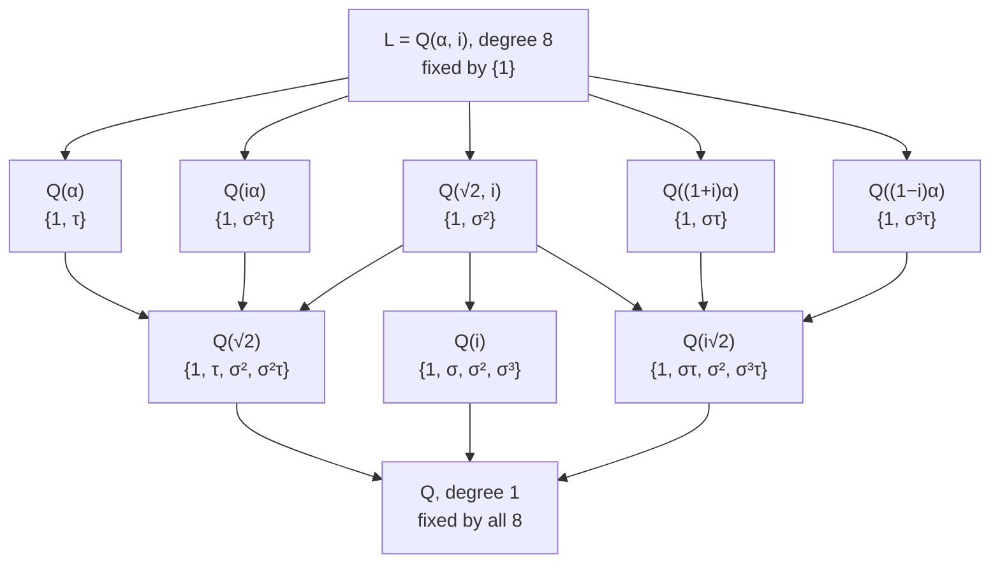

# The Galois correspondence: subfields on one side, subgroups of symmetries on the other

[Syllabus](../../../SYLLABUS.md) → [Algebraic and analytic number theory](../README.md) → [Fields and Galois Theory](../README.md#s05) → The Galois correspondence

---

## General Overview

The equation $`x^4 = 2`$ has four solutions. One is $`\alpha = 2^{1/4} \approx 1.189207`$, the positive fourth root of 2. The others are $`-\alpha`$, $`i\alpha`$ and $`-i\alpha`$, where $`i`$ is the square root of $`-1`$. Drawn in the complex plane, the four roots sit at the corners of a square.

The smallest field holding all four roots is $`L = \mathbb{Q}(\alpha, i)`$, the splitting field of $`x^4 - 2`$ ([Splitting fields](03-splitting-fields-and-algebraic-closure.md)). A field is a set of numbers closed under adding, subtracting, multiplying and dividing. Every number in $`L`$ is a mix, with rational weights, of eight basic numbers: $`1, \alpha, \alpha^2, \alpha^3, i, i\alpha, i\alpha^2, i\alpha^3`$.

A **symmetry** of $`L`$ (an **automorphism**) is a reshuffle of its numbers that respects addition and multiplication. It must send each root of $`x^4 - 2`$ to a root. There are exactly eight such symmetries, and they move the four roots the way the eight moves of a square tile move its corners ([Group actions](../../03-Algebra/08-Groups/08-group-actions-and-counting.md)).

The card builds a dictionary between two lists. One list is the fields between $`\mathbb{Q}`$ and $`L`$. The other is the subgroups of the eight symmetries. Each subgroup fixes a field: the numbers none of its members moves. Each field is fixed by a subgroup: the symmetries that leave it alone. Here there are 10 of each, matched one to one.

The dictionary turns a question about infinitely many numbers into a finite question about eight symmetries. "How many fields lie between $`\mathbb{Q}`$ and $`L`$?" becomes "how many subgroups has a group of 8?", and a computer answers that by checking 256 subsets.

**In a Galois extension (finite, normal and separable, defined under When it holds), the symmetries that fix a middle field form a subgroup, the numbers a subgroup fixes form a middle field, and these two rules undo each other, with sizes turned upside down: a subgroup of $`\lvert H\rvert`$ members fixes a field of degree $`8 / \lvert H\rvert`$ here.**

**What kind of fact this is:** a theorem, the fundamental theorem of Galois theory, proved on this card in Why it works. The code checks all 10 pairs for $`x^4 - 2`$ exactly. That no other middle field exists is the theorem's part, not the code's; the proof covers every finite Galois extension.

### The picture: ten fields and the subgroups that fix them



Each box names a field and, below it, the subgroup that fixes it. An arrow runs from a field down to a smaller field inside it. Read the same picture with the boxes standing for subgroups and every arrow points from a smaller group up to a larger one: the dictionary reverses inclusion.

---

## The formula

Notation first, in words.

- $`L/K`$, read "L over K", is a field $`L`$ containing a smaller field $`K`$. Its **degree** $`[L : K]`$ is how many basic numbers it takes to write every number of $`L`$ with weights from $`K`$ ([Field extensions](01-field-extensions-and-degree.md)). Here $`[L : \mathbb{Q}] = 8`$.
- $`\mathrm{Gal}(L/K)`$, the **Galois group**, is the set of symmetries of $`L`$ that leave every number of $`K`$ in place. Write $`G = \mathrm{Gal}(L/\mathbb{Q})`$, the eight symmetries.
- For a subgroup $`H`$ of $`G`$, the **fixed field** $`L^H`$ is the set of numbers in $`L`$ that every member of $`H`$ leaves in place.
- $`\lvert H\rvert`$ counts the members of $`H`$; the **index** $`[G : H]`$ counts its cosets, $`\lvert G\rvert / \lvert H\rvert`$ ([Cosets and Lagrange's theorem](../../03-Algebra/08-Groups/04-cosets-and-lagranges-theorem.md)).

The correspondence is two rules and a size law:

```math
H \longmapsto L^H, \qquad K \longmapsto \mathrm{Gal}(L/K), \qquad [L^H : \mathbb{Q}] = [G : H] = \frac{\lvert G\rvert}{\lvert H\rvert}
```

**Read it aloud:** send a subgroup to the numbers it fixes, send a field to the symmetries that fix it; the field fixed by a subgroup has degree equal to the subgroup's index.

The two rules undo each other, and a larger subgroup fixes a smaller field. One more line matches the special subgroups to the special fields:

```math
H \text{ normal in } G \iff L^H \text{ normal over } \mathbb{Q}, \quad\text{and then}\quad \mathrm{Gal}(L^H/\mathbb{Q}) \cong G/H
```

**Read it aloud:** a subgroup that looks the same from every position in the group fixes a field that contains all the conjugates of its numbers (the other roots of their minimal polynomials), and that field's own symmetries are the quotient group.

A **normal subgroup** satisfies $`gHg^{-1} = H`$ for every $`g`$ ([Normal subgroups and quotient groups](../../03-Algebra/08-Groups/06-normal-subgroups-and-quotient-groups.md)). A **normal extension** contains every root of each irreducible polynomial over the base that it has one root of ([Normal and separable](04-normal-and-separable-extensions.md)).

| Symbol | Plain meaning | In our example | Push it up and the answer… |
| --- | --- | --- | --- |
| $`\alpha`$, $`i`$ | the positive fourth root of 2; a square root of $`-1`$ | $`\alpha \approx 1.189207`$ | — |
| $`L`$ | the splitting field of $`x^4 - 2`$ | $`\mathbb{Q}(\alpha, i)`$, degree 8 | — |
| $`K`$ | a field between $`\mathbb{Q}`$ and $`L`$ | $`\mathbb{Q}(\sqrt{2})`$ | a larger $`K`$ has fewer symmetries |
| $`[L : K]`$ | the degree: basic numbers needed | $`[L : \mathbb{Q}(\sqrt 2)] = 4`$ | — |
| $`\sigma`$, $`\tau`$ | $`\alpha \mapsto i\alpha`$ keeping $`i`$; $`i \mapsto -i`$ keeping $`\alpha`$ | a quarter turn; complex conjugation, a flip | — |
| $`G`$, $`D_4`$ | all symmetries of $`L`$; the square's group | 8 members | — |
| $`H`$, $`\langle\sigma\rangle`$ | a subgroup of $`G`$; the one $`\sigma`$ generates | $`\{1, \tau\}`$; $`\{1, \sigma, \sigma^2, \sigma^3\}`$ | a larger $`H`$ fixes a smaller field |
| $`\lvert H\rvert`$, $`[G : H]`$ | members; index $`8/\lvert H\rvert`$ | 2 and 4 for $`\{1, \tau\}`$ | the degree of $`L^H`$ falls |
| $`L^H`$ | the numbers every member of $`H`$ fixes | $`\mathbb{Q}(\alpha)`$ | — |
| $`\mathrm{Gal}(L/K)`$ | the symmetries fixing all of $`K`$ | $`\{1, \tau, \sigma^2, \sigma^2\tau\}`$ for $`K = \mathbb{Q}(\sqrt 2)`$ | — |
| $`g`$, $`h`$ | members of $`G`$; $`h`$ from $`H`$ | $`\sigma`$, $`\tau`$ | — |
| $`p`$ | an odd prime, used in the code's count | every odd prime below 10,000 | — |

$`D_4`$, said "the dihedral group of order 8", is the group of a square's four turns and four flips. A product such as $`\sigma\tau`$ means "do $`\tau`$ first, then $`\sigma`$", as with functions.

### When it holds

- **The top field is normal over the base.** $`\mathbb{Q}(\alpha)`$ alone is not: it holds $`\alpha`$ but not $`i\alpha`$. It has only 2 symmetries for degree 4, so its 2 subgroups cannot match its 3 fields from $`\mathbb{Q}`$ up to $`\mathbb{Q}(\alpha)`$.
- **The top field is separable over the base:** no irreducible polynomial has a repeated root. Over $`\mathbb{Q}`$ this is automatic. Over a field of prime characteristic it can fail, and then the extension has fewer symmetries than its degree ([Normal and separable](04-normal-and-separable-extensions.md)).
- **The extension is finite.** Infinite extensions need a topology on the group to say which subgroups count; that is beyond this shelf.
- **Everything is measured from one base.** Over $`K = \mathbb{Q}(\sqrt 2)`$ the group is $`\mathrm{Gal}(L/K)`$ of order 4, and only fields containing $`K`$ appear. Mixing bases mixes up the sizes.

A **Galois extension** is one that is finite, normal and separable. All three hold for $`L`$ over $`\mathbb{Q}`$, and over every $`K`$ between them.

---

## Why it works

### Step 0: a symmetry is pinned down by where it sends the roots

Every number in $`L`$ is built from $`\alpha`$ and $`i`$ by adding and multiplying. A symmetry respects both operations, so once $`\alpha`$ and $`i`$ have destinations, every number has one.

A symmetry also respects equations with rational coefficients. Since $`\alpha^4 - 2 = 0`$, the image of $`\alpha`$ is a root of $`x^4 - 2`$: 4 choices. Since $`i^2 + 1 = 0`$, the image of $`i`$ is $`i`$ or $`-i`$: 2 choices. So there are at most 8 symmetries, and in general never more than the degree.

### Step 1: compute the group

The degree is 8. The polynomial $`x^4 - 2`$ is irreducible over $`\mathbb{Q}`$ ([Minimal polynomials](02-minimal-polynomials-and-conjugates.md)), so $`[\mathbb{Q}(\alpha) : \mathbb{Q}] = 4`$. The field $`\mathbb{Q}(\alpha)`$ is inside the real numbers and $`i`$ is not, so adding $`i`$ doubles the degree: $`4 \times 2 = 8`$.

A Galois extension has exactly as many symmetries as its degree ([Normal and separable](04-normal-and-separable-extensions.md)). So all 8 choices are real symmetries. Two of them generate the rest:

| Symmetry | $`\alpha \mapsto`$ | $`i \mapsto`$ | On the square of roots |
| --- | --- | --- | --- |
| $`1`$ | $`\alpha`$ | $`i`$ | stays put |
| $`\sigma`$, $`\sigma^2`$, $`\sigma^3`$ | $`i\alpha`$, $`-\alpha`$, $`-i\alpha`$ | $`i`$ | quarter, half, three-quarter turn |
| $`\tau`$ | $`\alpha`$ | $`-i`$ | flip across the real axis |
| $`\sigma\tau`$, $`\sigma^2\tau`$, $`\sigma^3\tau`$ | $`i\alpha`$, $`-\alpha`$, $`-i\alpha`$ | $`-i`$ | the other three flips |

Order matters. $`\tau\sigma`$ sends $`\alpha`$ to $`i\alpha`$ and then to $`-i\alpha`$, so $`\tau\sigma = \sigma^3\tau`$, not $`\sigma\tau`$. That is the multiplication rule of $`D_4`$.

### Step 2: a subgroup fixes a field of exactly the right size

The fixed field $`L^H`$ is a field: if two numbers are left in place by every member of $`H`$, so are their sum, product and quotient.

Its size is the core of the theorem, due to Emil Artin:

```math
[L : L^H] = \lvert H\rvert, \qquad\text{so}\qquad [L^H : \mathbb{Q}] = \frac{8}{\lvert H\rvert}
```

**Read it aloud:** over its own fixed field, $`L`$ has degree equal to the number of symmetries in $`H`$; the tower law (degrees multiply up a tower: $`[L : \mathbb{Q}] = [L : L^H]\,[L^H : \mathbb{Q}]`$, see [Field extensions](01-field-extensions-and-degree.md)) turns that into the degree of $`L^H`$ over $`\mathbb{Q}`$.

Why: the members of $`H`$ are $`\lvert H\rvert`$ symmetries of $`L`$ that fix $`L^H`$, and Step 0's bound says $`[L : L^H]`$ is at least that many. The other direction is linear algebra: any $`\lvert H\rvert + 1`$ numbers of $`L`$ are tied together by a linear relation with weights in $`L^H`$. The fold has the proof.

<details>
<summary>Detailed proof: the fixed field of H has index exactly the size of H</summary>

Write $`n = \lvert H\rvert`$ and $`F = L^H`$.

**At most n.** Take any $`n + 1`$ numbers $`x_1, \dots, x_{n+1}`$ in $`L`$. For each $`h`$ in $`H`$ write one equation in unknowns $`c_1, \dots, c_{n+1}`$ from $`L`$:

$`\displaystyle \sum_{j=1}^{n+1} h(x_j)\, c_j = 0.`$

That is $`n`$ equations in $`n + 1`$ unknowns, so a solution with some $`c_j \ne 0`$ exists. Pick one with the fewest nonzero entries and scale it so one entry equals 1. Apply any $`g`$ in $`H`$ to every equation. Since $`gh`$ runs over all of $`H`$ as $`h`$ does, the numbers $`g(c_j)`$ solve the same system. Subtract: the difference has the scaled entry equal to 0, so it has fewer nonzero entries, so it is zero. Hence $`g(c_j) = c_j`$ for every $`g`$: each $`c_j`$ lies in $`F`$. The equation for $`h = 1`$ is now a relation among the $`x_j`$ with weights in $`F`$. So $`[L : F] \le n`$.

**At least n.** Distinct symmetries $`h_1, \dots, h_n`$ are linearly independent over $`L`$ (Dedekind's lemma): no weights $`a_k`$ in $`L`$, not all zero, make $`\sum a_k h_k(x) = 0`$ for every $`x`$. Proof: take a shortest such relation, pick $`y`$ with $`h_1(y) \ne h_2(y)`$, and compare the relation at $`yx`$ with $`h_1(y)`$ times the relation at $`x`$. The difference is a shorter relation that is not all zero, a contradiction. Now suppose $`[L : F] = m < n`$, with basis $`y_1, \dots, y_m`$. The $`m`$ equations $`\sum_k a_k h_k(y_i) = 0`$ in $`n`$ unknowns have a solution that is not all zero. Every $`x`$ in $`L`$ is a mix of the $`y_i`$ with weights in $`F`$, which every $`h_k`$ leaves alone, so $`\sum_k a_k h_k(x) = 0`$ for all $`x`$. That contradicts Dedekind's lemma, so $`[L : F] \ge n`$.

</details>

### Step 3: the two rules undo each other

Start from a subgroup $`H`$. Every member of $`H`$ fixes $`L^H`$, so $`H`$ sits inside $`\mathrm{Gal}(L/L^H)`$. That group has at most $`[L : L^H] = \lvert H\rvert`$ members by Step 0. So it is exactly $`H`$.

Start from a field $`K`$. The field $`L`$ is still the splitting field of $`x^4 - 2`$ over $`K`$, so it is Galois over $`K`$, and $`\lvert \mathrm{Gal}(L/K)\rvert = [L : K]`$. The fixed field of that group contains $`K`$ and, by Step 2, has the same degree below $`L`$. Two nested fields of equal degree are equal, so it is $`K`$.

Inclusion reverses because more conditions leave fewer solutions. Each member of $`H`$ is a condition "this number must not move", so a larger $`H`$ fixes fewer numbers.

### Step 4: normal subgroups match normal fields

If $`h`$ fixes a number $`x`$, then $`ghg^{-1}`$ fixes $`g(x)`$. So a symmetry $`g`$ carries the field $`L^H`$ onto $`L^{gHg^{-1}}`$.

A field between $`\mathbb{Q}`$ and $`L`$ is normal exactly when every symmetry carries it onto itself, since the symmetries carry each of its numbers to all its conjugates. By the line above, that happens exactly when $`gHg^{-1} = H`$ for every $`g`$: when $`H`$ is normal.

Then each symmetry of $`L`$, cut down to $`L^H`$, is a symmetry of $`L^H`$. The members that act as nothing on $`L^H`$ are exactly $`H`$, and the counts match: $`[G : H] = [L^H : \mathbb{Q}] = \lvert \mathrm{Gal}(L^H/\mathbb{Q})\rvert`$. The first isomorphism theorem gives $`\mathrm{Gal}(L^H/\mathbb{Q}) \cong G/H`$.

The failure is visible here. The subgroup $`\{1, \tau\}`$ is not normal: $`\sigma\tau\sigma^{-1} = \sigma^2\tau`$. So $`\sigma`$ carries $`\mathbb{Q}(\alpha)`$ to $`\mathbb{Q}(i\alpha)`$, a different field, and $`\mathbb{Q}(\alpha)`$ is not normal.

---

## Worked numbers, by hand

| Step | Arithmetic | Value |
| --- | --- | --- |
| degree of $`L`$ | $`[\mathbb{Q}(\alpha):\mathbb{Q}] \times [L:\mathbb{Q}(\alpha)] = 4 \times 2`$ | 8 |
| symmetries | 4 places for $`\alpha`$ times 2 for $`i`$; all 8 work | $`\lvert G\rvert = 8`$ |
| $`\tau\sigma`$ on $`\alpha`$ | $`\alpha \mapsto i\alpha \mapsto (-i)\alpha`$ | $`\sigma^3\tau`$ |
| fixed field of $`\{1, \tau\}`$ | $`\tau`$ fixes $`1, \alpha, \alpha^2, \alpha^3`$; $`8/2`$ | $`\mathbb{Q}(\alpha)`$, degree 4 |
| $`\sigma\tau`$ on $`(1+i)\alpha`$ | $`(1 - i)\, i\alpha = i\alpha + \alpha`$ | fixed |
| its minimal polynomial | $`((1+i)\alpha)^4 = (1+i)^4 \cdot 2 = -4 \cdot 2`$ | $`x^4 + 8`$ |
| symmetries fixing $`\sqrt 2 = \alpha^2`$ | $`\sigma(\alpha^2) = (i\alpha)^2 = -\alpha^2`$ moves it; $`\tau`$, $`\sigma^2`$, $`\sigma^2\tau`$ fix it | $`\{1, \tau, \sigma^2, \sigma^2\tau\}`$ |
| fixed field of those 4 | $`8/4 = 2`$; it contains $`\sqrt 2`$ | $`\mathbb{Q}(\sqrt 2)`$ |
| totals | subgroups, fields, normal pairs | **10, 10 and 6** |

So $`x^4 - 2`$ has exactly 10 fields between $`\mathbb{Q}`$ and its splitting field, and $`\mathbb{Q}(\sqrt 2)`$ comes back as the field fixed by its own Galois group.

### All ten pairs

Each field is named by one number that generates it. The minimal polynomial is the product of $`x - c`$ over that number's distinct images $`c`$; its degree equals the index, as Step 2 says.

| Subgroup $`H`$ | $`\lvert H\rvert`$ | $`L^H`$ | Degree | Minimal polynomial of the generator | Normal |
| --- | ---: | --- | ---: | --- | --- |
| $`\{1\}`$ | 1 | $`\mathbb{Q}(\alpha + i) = L`$ | 8 | $`x^8 + 4x^6 + 2x^4 + 28x^2 + 1`$ | yes |
| $`\{1, \sigma^2\}`$ | 2 | $`\mathbb{Q}(\sqrt 2 + i) = \mathbb{Q}(\sqrt 2, i)`$ | 4 | $`x^4 - 2x^2 + 9`$ | yes |
| $`\{1, \tau\}`$ | 2 | $`\mathbb{Q}(\alpha)`$ | 4 | $`x^4 - 2`$ | no |
| $`\{1, \sigma^2\tau\}`$ | 2 | $`\mathbb{Q}(i\alpha)`$ | 4 | $`x^4 - 2`$ | no |
| $`\{1, \sigma\tau\}`$ | 2 | $`\mathbb{Q}((1+i)\alpha)`$ | 4 | $`x^4 + 8`$ | no |
| $`\{1, \sigma^3\tau\}`$ | 2 | $`\mathbb{Q}((1-i)\alpha)`$ | 4 | $`x^4 + 8`$ | no |
| $`\{1, \sigma, \sigma^2, \sigma^3\}`$ | 4 | $`\mathbb{Q}(i)`$ | 2 | $`x^2 + 1`$ | yes |
| $`\{1, \tau, \sigma^2, \sigma^2\tau\}`$ | 4 | $`\mathbb{Q}(\sqrt 2)`$ | 2 | $`x^2 - 2`$ | yes |
| $`\{1, \sigma\tau, \sigma^2, \sigma^3\tau\}`$ | 4 | $`\mathbb{Q}(i\sqrt 2)`$ | 2 | $`x^2 + 2`$ | yes |
| all 8 | 8 | $`\mathbb{Q}`$ | 1 | $`x - 1`$ | yes |

The six normal subgroups fix the six normal fields. For example $`\mathbb{Q}(\sqrt 2, i)`$ has $`G/\{1, \sigma^2\}`$ as its group: 4 symmetries, each of order 1 or 2.

### What breaks if you drop a piece

| Mistake | Comes out at | What went wrong |
| --- | --- | --- |
| Use $`\mathbb{Q}(\alpha)`$ alone as the top field | 2 symmetries for degree 4; 2 subgroups against 3 fields from $`\mathbb{Q}`$ up | not normal: $`i\alpha`$ is missing, so $`\alpha`$ has only 2 places to go |
| Take the degree of $`L^H`$ to be $`\lvert H\rvert`$ | 2 for $`\{1, \tau\}`$; the truth is 4 | $`\lvert H\rvert`$ is the degree of $`L`$ over $`L^H`$, not of $`L^H`$ over $`\mathbb{Q}`$ |
| Expect a bigger group to fix a bigger field | $`\{1,\sigma^2\}`$, order 2, fixes degree 4; $`\langle\sigma\rangle`$, order 4, fixes degree 2 | inclusion reverses |
| Form $`G/\{1, \tau\}`$ as if it were a group | the symmetries carry $`\mathbb{Q}(\alpha)`$ to 2 fields, $`\mathbb{Q}(\alpha)`$ and $`\mathbb{Q}(i\alpha)`$ | $`\{1, \tau\}`$ is not normal, so there is no quotient group to be $`\mathrm{Gal}(\mathbb{Q}(\alpha)/\mathbb{Q})`$ |

The code prints every number in this table.

---

## Code, from first principles, and it actually runs

The code stores a number of $`L`$ as its 8 integer weights on $`1, \alpha, \dots, i\alpha^3`$ and multiplies using $`\alpha^4 = 2`$ and $`i^2 = -1`$. In the printout, α is $`\alpha`$ and the symmetries are named as on the card. The group is pinned down **two independent ways**, one from below and one from above, and its size is confirmed a third way:

1. Try all 16 ways to send $`\alpha`$ to $`i^r\alpha`$ and $`i`$ to $`i^s`$, and keep the maps that respect all 64 products of basic numbers: 8 survive, so there are at least 8 symmetries.
2. Shuffle the four roots as complex numbers in all 24 ways, and keep the shuffles that send $`-r`$ to minus the image of $`r`$: 8 survive. Every symmetry must be one of them, so this caps the group at 8. The code checks that road 1's 8 maps move the roots in exactly these 8 ways.
3. Find the 8 distinct images of $`\alpha + i`$; their product polynomial has integer coefficients, so $`[L : \mathbb{Q}] = 8`$. As a float check, $`\alpha + i`$ computed as a complex number is a root of it.

Then it lists all 10 subgroups out of 256 subsets. For each, it finds the fixed field's dimension two ways: as the solutions of $`h(x) = x`$, and as the span of averages over $`H`$. It compares both to the index and to the generator's number of images. It tests normality two ways: by conjugating the subgroup, and by checking that every symmetry maps the fixed field into itself.

Last comes a count against the group. For each odd prime $`p`$ below 10,000 it counts the solutions of $`x^4 \equiv 2`$ mod $`p`$. Chebotarev's density theorem (published by Chebotarev in 1926; stated on the card linked under Where this goes next) predicts the shares from how many roots each symmetry fixes: 5 of the 8 fix none, 2 fix two, and 1 fixes all four. The count is evidence for that prediction, not a proof.

### Python

```python
# The Galois correspondence -- the check behind the card.  Fraction and permutations are tools.
# L is the splitting field of x^4 - 2: every number in it is a rational mix of the 8 basis
# numbers α^j i^k (j = 0..3, k = 0..1), where α = 2^(1/4).  A vector of 8 integers is one number.
from fractions import Fraction
from itertools import permutations
A4 = 2                                 # the polynomial is x^4 - A4
def mul(u, v):                         # multiply two numbers of L, using α^4 = 2 and i^2 = -1
    w = [0] * 8
    for p in range(8):
        for q in range(8):
            j, k, c = p % 4 + q % 4, p // 4 + q // 4, u[p] * v[q]
            if j >= 4: j, c = j - 4, A4 * c
            if k == 2: k, c = 0, -c
            w[j + 4 * k] += c
    return tuple(w)
def apply(g, u):                       # g = (r, s): α -> i^r α, i -> i^s, extended to all of L
    w = [0] * 8
    for p in range(8):
        m = (g[0] * (p % 4) + g[1] * (p // 4)) % 4
        w[p % 4 + 4 * (m % 2)] += -u[p] if m >= 2 else u[p]
    return tuple(w)
def compose(g, h):                     # do h first, then g
    return ((g[0] + g[1] * h[0]) % 4, (g[1] * h[1]) % 4)
def name(g): return (["", "σ", "σ²", "σ³"][g[0]] + ("τ" if g[1] == 3 else "")) or "1"
def show(c):                           # integer coefficients, constant first -> "x^4 - 2"
    t = [(f"{abs(a) if abs(a) != 1 or n == 0 else ''}" + ("x" if n else "") + (f"^{n}" if n > 1
          else ""), a) for n, a in enumerate(c) if a]
    return "".join((" - " if a < 0 else " + ") * (i > 0) + ("-" if a < 0 and i == 0 else "") + m
                   for i, (m, a) in enumerate(reversed(t)))
def e(*ps): return tuple(sum(c for p, c in ps if p == q) for q in range(8))
def rank(rows):                        # rank over Q by elimination with fractions
    m, r = [[Fraction(x) for x in row] for row in rows], 0
    for c in range(8):
        piv = next((i for i in range(r, len(m)) if m[i][c] != 0), None)
        if piv is None: continue
        m[r], m[piv] = m[piv], m[r]
        for i in range(len(m)):
            if i != r and m[i][c] != 0:
                f = m[i][c] / m[r][c]
                m[i] = [x - f * y for x, y in zip(m[i], m[r])]
        r += 1
    return r
BASIS = [e((p, 1)) for p in range(8)]
# ---- road 1: try all 16 ways to send α to a root i^r α and i to a power i^s; keep the ring maps
tried = [(r, s) for r in range(4) for s in range(4)]
G = [g for g in tried if all(apply(g, mul(u, v)) == mul(apply(g, u), apply(g, v))
                             for u in BASIS for v in BASIS)]
print(f"maps tried {len(tried)}, respect all {len(BASIS) ** 2} basis products {len(G)}: {[name(g) for g in G]}")
def order(g, x=(0, 1), n=0):
    while n == 0 or x != (0, 1): x, n = compose(g, x), n + 1
    return n
print(f"element orders: {[order(g) for g in G]}; τσ = {name(compose((0, 3), (1, 1)))}, not στ: "
      f"order matters; D4, the square's 8 symmetries")
# ---- road 2: the 4 roots as complex numbers; a symmetry must send -r to minus the image of r
a = A4 ** 0.25
ROOTS = [(a, 0.0), (0.0, a), (-a, 0.0), (0.0, -a)]                   # α, iα, -α, -iα
neg = lambda z: (-z[0], -z[1])
keep = [p for p in permutations(range(4))
        if all(ROOTS[p[(k + 2) % 4]] == neg(ROOTS[p[k]]) for k in range(4))]
on_roots = sorted(tuple((g[1] * k + g[0]) % 4 for k in range(4)) for g in G)  # road 1's maps on the 4 roots
print(f"α = {ROOTS[0][0]:.6f}; root shuffles 24, keeping r -> -r pairs {len(keep)}; failing {24 - len(keep)}; "
      f"same as road 1's maps on the roots {on_roots == keep}")
theta = e((1, 1), (4, 1))                                            # α + i
conj = sorted({apply(g, theta) for g in G})
poly = [e((0, 1))]                                                   # product of (x - c)
for c in conj:
    poly = [tuple(a - b for a, b in zip(lo, mul(c, hi)))
            for lo, hi in zip([e()] + poly, poly + [e()])]
print(f"α + i has {len(conj)} distinct conjugates; min poly coefficients rational "
      f"{all(c[1:] == (0,) * 7 for c in poly)}: {show([c[0] for c in poly])}, so [L:Q] = {len(conj)}")
assert abs(sum(c[0] * complex(a, 1) ** n for n, c in enumerate(poly))) < 1e-9   # α + i, as a float, is a root
# ---- every subgroup, by brute force over the 256 subsets of the 8 symmetries
subs = [H for H in ([g for b, g in enumerate(G) if m >> b & 1] for m in range(256))
        if (0, 1) in H and all(compose(x, y) in H for x in H for y in H)]
subs.sort(key=lambda H: (len(H), [name(g) for g in H]))
CANDIDATES = [("1", e((0, 1))), ("i", e((4, 1))), ("√2", e((2, 1))), ("i√2", e((6, 1))),
              ("α", e((1, 1))), ("iα", e((5, 1))), ("(1+i)α", e((1, 1), (5, 1))),
              ("(1-i)α", e((1, 1), (5, -1))), ("√2 + i", e((2, 1), (4, 1))), ("α + i", theta)]
print("H | order | index | dim of fixed field: kernel, average | field | min poly | normal: H, field")
fields = {}
for H in subs:
    by_kernel = 8 - rank([tuple(a - b for a, b in zip(apply(h, u), u)) for h in H for u in BASIS])
    avg = [tuple(sum(c) for c in zip(*(apply(h, u) for h in H))) for u in BASIS]
    by_average = rank(avg)
    lab, gen = next((l, v) for l, v in CANDIDATES
                    if [g for g in G if apply(g, v) == v] == sorted(H))
    orbit = sorted({apply(g, gen) for g in G})
    mp = [e((0, 1))]
    for c in orbit:
        mp = [tuple(a - b for a, b in zip(lo, mul(c, hi))) for lo, hi in zip([e()] + mp, mp + [e()])]
    grp_normal = all(compose(compose(g, h), (-g[1] * g[0] % 4, g[1])) in H for g in G for h in H)
    fld_normal = all(rank(avg + [apply(g, w) for w in avg]) == by_average for g in G)
    fields[tuple(sorted(H))] = lab
    print(f"{'{' + ','.join(name(g) for g in H) + '}' if len(H) < 8 else 'all 8':14} {len(H)} "
          f"{8 // len(H)} {by_kernel} {by_average}  {'Q(' + lab + ')' if len(H) < 8 else 'Q':10} "
          f"{show([c[0] for c in mp]):26} {grp_normal} {fld_normal}")
    assert by_kernel == by_average == 8 // len(H) == len(orbit)      # [L^H:Q] = [G:H]
    assert grp_normal == fld_normal and all(c[1:] == (0,) * 7 for c in mp)
normals = sum(all(compose(compose(g, h), (-g[1] * g[0] % 4, g[1])) in H for g in G for h in H)
              for H in subs)
print(f"subgroups {len(subs)} of 256 subsets, fields {len(set(fields.values()))}, normal {normals}")
# ---- recover a field: start from Q(√2), find the symmetries fixing it, take their fixed field
fix_r2 = sorted(g for g in G if apply(g, e((2, 1))) == e((2, 1)))
print(f"Gal(L/Q(√2)) = {[name(g) for g in fix_r2]}, order {len(fix_r2)}; its fixed field is "
      f"Q({fields[tuple(fix_r2)]}), degree {8 // len(fix_r2)}")
# ---- what breaks
real_roots = [k for k in range(4) if apply((0, 3), e((1 + 4 * (k % 2), (-1) ** (k // 2)))) ==
              e((1 + 4 * (k % 2), (-1) ** (k // 2)))]
above_a = [H for H in subs if (0, 3) in H]
print(f"Q(α) alone: degree 4, roots of x^4 - 2 inside it {len(real_roots)}, so automorphisms "
      f"{len(real_roots)}; its subgroups 2, but fields between Q and Q(α) {len(above_a)}")
print(f"sizes swapped: H = {{1,τ}} would give degree {len(above_a[0])}, true degree "
      f"{8 // len(above_a[0])}")
s2, s = [H for H in subs if len(H) == 2 and (2, 1) in H][0], [H for H in subs if (1, 1) in H][0]
print(f"bigger group, smaller field: {{1,σ²}} of order 2 fixes Q({fields[tuple(sorted(s2))]}), degree "
      f"4; <σ> of order 4 fixes Q({fields[tuple(sorted(s))]}) of degree 2")
moved = sorted({fields[tuple(sorted(compose(compose(g, h), (-g[1] * g[0] % 4, g[1])) for h in
                                     above_a[0]))] for g in G})
print(f"non-normal {{1,τ}}: the symmetries carry Q(α) to {len(moved)} fields {moved}")
# ---- a count against the group: roots of x^4 - 2 mod p, odd primes below 10,000
N = 10000
sieve = [True] * N
for p in range(2, 100):
    if sieve[p]: sieve[p * p::p] = [False] * len(range(p * p, N, p))
tally = [0] * 5
for p in range(3, N):
    if sieve[p]:
        sq = [x * x % p for x in range(p)]
        tally[sum(1 for x in range(p) if sq[sq[x]] == 2 % p)] += 1
fixed = [sum(1 for k in range(4) if (g[1] * k + g[0]) % 4 == k) for g in G]
pred = [fixed.count(n) for n in range(5)]
print(f"roots fixed by each symmetry {fixed}: shares 0,1,2,3,4 roots = {pred} out of 8")
print(f"odd primes below {N:,}: {sum(tally):,}; with 0,1,2,3,4 roots of x^4 - 2: {tally}")
print("shares found " + ", ".join(f"{t / sum(tally):.4f}" for t in tally) +
      "; predicted " + ", ".join(f"{q / 8:.4f}" for q in pred))
assert len(G) == len(keep) == len(conj) == 8 and on_roots == keep and len(subs) == 10 and normals == 6
assert len(fix_r2) == 4 and fields[tuple(fix_r2)] == "√2" and len(real_roots) == 2
assert all(abs(t / sum(tally) - q / 8) < 0.03 for t, q in zip(tally, pred))
print("ALL CHECKS PASS")
```

**Ran 2026-11-15 on macOS, Python 3.14.10, standard library only. All checks passed. Output, pasted from the run:**

```
maps tried 16, respect all 64 basis products 8: ['1', 'τ', 'σ', 'στ', 'σ²', 'σ²τ', 'σ³', 'σ³τ']
element orders: [1, 2, 4, 2, 2, 2, 4, 2]; τσ = σ³τ, not στ: order matters; D4, the square's 8 symmetries
α = 1.189207; root shuffles 24, keeping r -> -r pairs 8; failing 16; same as road 1's maps on the roots True
α + i has 8 distinct conjugates; min poly coefficients rational True: x^8 + 4x^6 + 2x^4 + 28x^2 + 1, so [L:Q] = 8
H | order | index | dim of fixed field: kernel, average | field | min poly | normal: H, field
{1}            1 8 8 8  Q(α + i)   x^8 + 4x^6 + 2x^4 + 28x^2 + 1 True True
{1,σ²}         2 4 4 4  Q(√2 + i)  x^4 - 2x^2 + 9             True True
{1,σ²τ}        2 4 4 4  Q(iα)      x^4 - 2                    False False
{1,σ³τ}        2 4 4 4  Q((1-i)α)  x^4 + 8                    False False
{1,στ}         2 4 4 4  Q((1+i)α)  x^4 + 8                    False False
{1,τ}          2 4 4 4  Q(α)       x^4 - 2                    False False
{1,σ,σ²,σ³}    4 2 2 2  Q(i)       x^2 + 1                    True True
{1,στ,σ²,σ³τ}  4 2 2 2  Q(i√2)     x^2 + 2                    True True
{1,τ,σ²,σ²τ}   4 2 2 2  Q(√2)      x^2 - 2                    True True
all 8          8 1 1 1  Q          x - 1                      True True
subgroups 10 of 256 subsets, fields 10, normal 6
Gal(L/Q(√2)) = ['1', 'τ', 'σ²', 'σ²τ'], order 4; its fixed field is Q(√2), degree 2
Q(α) alone: degree 4, roots of x^4 - 2 inside it 2, so automorphisms 2; its subgroups 2, but fields between Q and Q(α) 3
sizes swapped: H = {1,τ} would give degree 2, true degree 4
bigger group, smaller field: {1,σ²} of order 2 fixes Q(√2 + i), degree 4; <σ> of order 4 fixes Q(i) of degree 2
non-normal {1,τ}: the symmetries carry Q(α) to 2 fields ['iα', 'α']
roots fixed by each symmetry [4, 2, 0, 0, 0, 2, 0, 0]: shares 0,1,2,3,4 roots = [5, 0, 2, 0, 1] out of 8
odd primes below 10,000: 1,228; with 0,1,2,3,4 roots of x^4 - 2: [777, 0, 308, 0, 143]
shares found 0.6327, 0.0000, 0.2508, 0.0000, 0.1164; predicted 0.6250, 0.0000, 0.2500, 0.0000, 0.1250
ALL CHECKS PASS
```

### Rust

```rust
// The Galois correspondence -- the check behind the card.  std only.
// L is the splitting field of x^4 - 2: every number in it is a rational mix of the 8 basis
// numbers α^j i^k (j = 0..3, k = 0..1), where α = 2^(1/4).  An array of 8 integers is one number.
use std::collections::BTreeSet;
type V = [i64; 8]; type Gp = (i64, i64);
const A4: i64 = 2; // the polynomial is x^4 - A4
fn mul(u: &V, v: &V) -> V { // multiply two numbers of L, using α^4 = 2 and i^2 = -1
    let mut w = [0i64; 8];
    for p in 0..8 { for q in 0..8 {
        let (mut j, mut k, mut c) = (p % 4 + q % 4, p / 4 + q / 4, u[p] * v[q]);
        if j >= 4 { j -= 4; c *= A4; }
        if k == 2 { k = 0; c = -c; }
        w[j + 4 * k] += c; } }
    w
}
fn apply(g: Gp, u: &V) -> V { // g = (r, s): α -> i^r α, i -> i^s, extended to all of L
    let mut w = [0i64; 8]; for p in 0..8 {
        let m = (g.0 * (p as i64 % 4) + g.1 * (p as i64 / 4)).rem_euclid(4);
        w[p % 4 + 4 * (m as usize % 2)] += if m >= 2 { -u[p] } else { u[p] };
    }
    w
}
fn compose(g: Gp, h: Gp) -> Gp { ((g.0 + g.1 * h.0).rem_euclid(4), (g.1 * h.1).rem_euclid(4)) }
fn inv(g: Gp) -> Gp { ((-g.1 * g.0).rem_euclid(4), g.1) }
fn name(g: Gp) -> String { let s = format!("{}{}", ["", "σ", "σ²", "σ³"][g.0 as usize],
    if g.1 == 3 { "τ" } else { "" }); if s.is_empty() { "1".to_string() } else { s } }
fn show(c: &[i64]) -> String { // integer coefficients, constant first -> "x^4 - 2"
    let mut out = String::new();
    for n in (0..c.len()).rev() {
        let a = c[n]; if a == 0 { continue; }
        if out.is_empty() { if a < 0 { out.push('-'); } } else { out += if a < 0 { " - " } else { " + " }; }
        if a.abs() != 1 || n == 0 { out += &a.abs().to_string(); }
        if n > 0 { out.push('x'); } if n > 1 { out += &format!("^{}", n); }
    }
    out
}
fn e(ps: &[(usize, i64)]) -> V { let mut w = [0i64; 8]; for &(p, c) in ps { w[p] += c; } w }
fn gcd(a: i128, b: i128) -> i128 { if b == 0 { a.abs() } else { gcd(b, a % b) } }
fn rank(rows: &[V]) -> usize { // rank over Q: integer elimination, rows kept small by gcd
    let mut m: Vec<Vec<i128>> = rows.iter().map(|r| r.iter().map(|&x| x as i128).collect()).collect();
    let mut r = 0;
    for c in 0..8 {
        let piv = match (r..m.len()).find(|&i| m[i][c] != 0) { Some(p) => p, None => continue };
        m.swap(r, piv);
        for i in 0..m.len() {
            if i != r && m[i][c] != 0 {
                let (a, b) = (m[r][c], m[i][c]);
                let row: Vec<i128> = (0..8).map(|t| a * m[i][t] - b * m[r][t]).collect();
                let g = row.iter().fold(0, |acc, &x| gcd(acc, x)).max(1);
                m[i] = row.iter().map(|&x| x / g).collect(); } }
        r += 1; }
    r
}
fn min_poly(orbit: &[V]) -> Vec<V> { // product of (x - c) over the conjugates c
    let mut poly = vec![e(&[(0, 1)])]; for c in orbit {
        let n = poly.len();
        poly = (0..=n).map(|t| {
            let lo = if t > 0 { poly[t - 1] } else { [0; 8] };
            let hi = if t < n { mul(c, &poly[t]) } else { [0; 8] };
            let mut w = [0; 8]; for q in 0..8 { w[q] = lo[q] - hi[q]; } w }).collect();
    }
    poly
}
fn rational(p: &[V]) -> bool { p.iter().all(|c| c[1..].iter().all(|&x| x == 0)) }
fn names(h: &[Gp]) -> String { format!("[{}]", h.iter().map(|&g| format!("'{}'", name(g))).collect::<Vec<_>>().join(", ")) }
fn list<T: std::fmt::Display>(v: &[T]) -> String { format!("[{}]", v.iter().map(|x| x.to_string()).collect::<Vec<_>>().join(", ")) }
fn main() {
    let basis: Vec<V> = (0..8).map(|p| e(&[(p, 1)])).collect();
    // ---- road 1: try all 16 ways to send α to a root i^r α and i to a power i^s; keep the ring maps
    let tried: Vec<Gp> = (0..4).flat_map(|r| (0..4).map(move |s| (r, s))).collect();
    let g_all: Vec<Gp> = tried.iter().cloned().filter(|&g| basis.iter().all(|u| basis.iter()
        .all(|v| apply(g, &mul(u, v)) == mul(&apply(g, u), &apply(g, v))))).collect();
    println!("maps tried {}, respect all {} basis products {}: {}", tried.len(), basis.len().pow(2), g_all.len(), names(&g_all));
    let order = |g: Gp| { let (mut x, mut n) = (g, 1); while x != (0, 1) { x = compose(g, x); n += 1; } n };
    println!("element orders: {}; τσ = {}, not στ: order matters; D4, the square's 8 symmetries",
             list(&g_all.iter().map(|&g| order(g)).collect::<Vec<_>>()), name(compose((0, 3), (1, 1))));
    // ---- road 2: the 4 roots as complex numbers; a symmetry must send -r to minus the image of r
    let a = (A4 as f64).powf(0.25);
    let (roots, mut keep) = ([(a, 0.0), (0.0, a), (-a, 0.0), (0.0, -a)], vec![]); // α, iα, -α, -iα
    for p0 in 0..4 { for p1 in 0..4 { for p2 in 0..4 { for p3 in 0..4 {
        let p = [p0, p1, p2, p3];
        if BTreeSet::from(p).len() == 4 && (0..4).all(|k| roots[p[(k + 2) % 4]] == (-roots[p[k]].0, -roots[p[k]].1)) { keep.push(p); }
    } } } }
    let on_roots: Vec<[usize; 4]> = g_all.iter().map(|&g| [0, 1, 2, 3].map(|k: i64| (g.1 * k + g.0).rem_euclid(4) as usize)).collect::<BTreeSet<_>>().into_iter().collect(); // road 1's maps on the 4 roots
    println!("α = {:.6}; root shuffles 24, keeping r -> -r pairs {}; failing {}; same as road 1's maps on the roots {}", a, keep.len(), 24 - keep.len(), if on_roots == keep { "True" } else { "False" });
    let theta = e(&[(1, 1), (4, 1)]); // α + i
    let conj: Vec<V> = g_all.iter().map(|&g| apply(g, &theta)).collect::<BTreeSet<_>>().into_iter().collect();
    let poly = min_poly(&conj);
    println!("α + i has {} distinct conjugates; min poly coefficients rational {}: {}, so [L:Q] = {}",
             conj.len(), if rational(&poly) { "True" } else { "False" },
             show(&poly.iter().map(|c| c[0]).collect::<Vec<_>>()), conj.len());
    let (re, im) = poly.iter().rev().fold((0.0f64, 0.0f64), |(x, y), c| (x * a - y + c[0] as f64, x + y * a));
    assert!(re.abs() + im.abs() < 1e-9); // α + i, as a float, is a root
    // ---- every subgroup, by brute force over the 256 subsets of the 8 symmetries
    let mut subs: Vec<Vec<Gp>> = (0..256u32).map(|m| (0..8).filter(|b| m >> b & 1 == 1)
        .map(|b| g_all[b]).collect::<Vec<Gp>>()).filter(|h| h.contains(&(0, 1))
        && h.iter().all(|&x| h.iter().all(|&y| h.contains(&compose(x, y))))).collect();
    subs.sort_by_key(|h| (h.len(), h.iter().map(|&g| name(g)).collect::<Vec<_>>()));
    let cands: Vec<(&str, V)> = vec![("1", e(&[(0, 1)])), ("i", e(&[(4, 1)])), ("√2", e(&[(2, 1)])),
        ("i√2", e(&[(6, 1)])), ("α", e(&[(1, 1)])), ("iα", e(&[(5, 1)])), ("(1+i)α", e(&[(1, 1), (5, 1)])),
        ("(1-i)α", e(&[(1, 1), (5, -1)])), ("√2 + i", e(&[(2, 1), (4, 1)])), ("α + i", theta)];
    println!("H | order | index | dim of fixed field: kernel, average | field | min poly | normal: H, field");
    let (mut fields, mut normals): (Vec<(Vec<Gp>, String)>, usize) = (vec![], 0);
    let label = |f: &Vec<(Vec<Gp>, String)>, h: &Vec<Gp>| -> String {
        let mut s = h.clone(); s.sort(); f.iter().find(|x| x.0 == s).unwrap().1.clone() };
    let is_normal = |h: &Vec<Gp>| g_all.iter().all(|&g| h.iter().all(|&x| h.contains(&compose(compose(g, x), inv(g)))));
    for h in &subs {
        let ker_rows: Vec<V> = h.iter().flat_map(|&g| basis.iter().map(move |u| {
            let w = apply(g, u); let mut d = [0; 8]; for q in 0..8 { d[q] = w[q] - u[q]; } d })).collect();
        let by_kernel = 8 - rank(&ker_rows);
        let avg: Vec<V> = basis.iter().map(|u| { let mut w = [0; 8];
            for &g in h { let x = apply(g, u); for q in 0..8 { w[q] += x[q]; } } w }).collect();
        let by_average = rank(&avg);
        let mut hs = h.clone(); hs.sort();
        let (lab, gen) = cands.iter().find(|(_, v)| g_all.iter().cloned()
            .filter(|&g| apply(g, v) == *v).collect::<Vec<_>>() == hs).unwrap();
        let orbit: Vec<V> = g_all.iter().map(|&g| apply(g, gen)).collect::<BTreeSet<_>>().into_iter().collect();
        let mp = min_poly(&orbit);
        let (grp_normal, tf) = (is_normal(h), |b: bool| if b { "True" } else { "False" });
        let fld_normal = g_all.iter().all(|&g| { let mut rows = avg.clone();
            rows.extend(avg.iter().map(|w| apply(g, w))); rank(&rows) == by_average });
        if grp_normal { normals += 1; }
        fields.push((hs, lab.to_string()));
        let hname = if h.len() < 8 { format!("{{{}}}", h.iter().map(|&g| name(g)).collect::<Vec<_>>().join(",")) } else { "all 8".to_string() };
        let fname = if h.len() < 8 { format!("Q({})", lab) } else { "Q".to_string() };
        println!("{:14} {} {} {} {}  {:10} {:26} {} {}", hname, h.len(), 8 / h.len(), by_kernel, by_average,
                 fname, show(&mp.iter().map(|c| c[0]).collect::<Vec<_>>()), tf(grp_normal), tf(fld_normal));
        assert!(by_kernel == by_average && by_average == 8 / h.len() && by_average == orbit.len());
        assert!(grp_normal == fld_normal && rational(&mp));
    }
    let distinct: BTreeSet<&String> = fields.iter().map(|x| &x.1).collect();
    println!("subgroups {} of 256 subsets, fields {}, normal {}", subs.len(), distinct.len(), normals);
    // ---- recover a field: start from Q(√2), find the symmetries fixing it, take their fixed field
    let fix_r2: Vec<Gp> = g_all.iter().cloned().filter(|&g| apply(g, &e(&[(2, 1)])) == e(&[(2, 1)])).collect();
    println!("Gal(L/Q(√2)) = {}, order {}; its fixed field is Q({}), degree {}", names(&fix_r2),
             fix_r2.len(), label(&fields, &fix_r2), 8 / fix_r2.len());
    // ---- what breaks
    let root = |k: usize| e(&[(1 + 4 * (k % 2), if k / 2 == 0 { 1 } else { -1 })]);
    let real_roots = (0..4).filter(|&k| apply((0, 3), &root(k)) == root(k)).count();
    let above_a: Vec<&Vec<Gp>> = subs.iter().filter(|h| h.contains(&(0, 3))).collect();
    println!("Q(α) alone: degree 4, roots of x^4 - 2 inside it {}, so automorphisms {}; its subgroups 2, but fields between Q and Q(α) {}",
             real_roots, real_roots, above_a.len());
    println!("sizes swapped: H = {{1,τ}} would give degree {}, true degree {}", above_a[0].len(), 8 / above_a[0].len());
    let (s2, s) = (subs.iter().find(|h| h.len() == 2 && h.contains(&(2, 1))).unwrap(),
                   subs.iter().find(|h| h.contains(&(1, 1))).unwrap());
    println!("bigger group, smaller field: {{1,σ²}} of order 2 fixes Q({}), degree 4; <σ> of order 4 fixes Q({}) of degree 2",
             label(&fields, s2), label(&fields, s));
    let moved: BTreeSet<String> = g_all.iter().map(|&g| label(&fields,
        &above_a[0].iter().map(|&x| compose(compose(g, x), inv(g))).collect())).collect();
    println!("non-normal {{1,τ}}: the symmetries carry Q(α) to {} fields [{}]", moved.len(),
             moved.iter().map(|x| format!("'{}'", x)).collect::<Vec<_>>().join(", "));
    // ---- a count against the group: roots of x^4 - 2 mod p, odd primes below 10,000
    let (n, mut tally) = (10000usize, [0usize; 5]); let mut sieve = vec![true; n];
    for p in 2..100 { if sieve[p] { let mut q = p * p; while q < n { sieve[q] = false; q += p; } } }
    for p in 3..n {
        if !sieve[p] { continue; } let sq: Vec<usize> = (0..p).map(|x| x * x % p).collect();
        tally[(0..p).filter(|&x| sq[sq[x]] == 2 % p).count()] += 1; }
    let fixed: Vec<usize> = g_all.iter().map(|&g| (0..4).filter(|&k| (g.1 * k + g.0).rem_euclid(4) == k).count()).collect();
    let pred: Vec<usize> = (0..5).map(|c| fixed.iter().filter(|&&f| f == c).count()).collect();
    println!("roots fixed by each symmetry {}: shares 0,1,2,3,4 roots = {} out of 8", list(&fixed), list(&pred));
    let total: usize = tally.iter().sum();
    println!("odd primes below 10,000: {},{:03}; with 0,1,2,3,4 roots of x^4 - 2: {}", total / 1000, total % 1000, list(&tally));
    println!("shares found {}; predicted {}",
             tally.iter().map(|&t| format!("{:.4}", t as f64 / total as f64)).collect::<Vec<_>>().join(", "),
             pred.iter().map(|&q| format!("{:.4}", q as f64 / 8.0)).collect::<Vec<_>>().join(", "));
    assert!(g_all.len() == 8 && keep.len() == 8 && on_roots == keep && conj.len() == 8 && subs.len() == 10 && normals == 6);
    assert!(fix_r2.len() == 4 && label(&fields, &fix_r2) == "√2" && real_roots == 2);
    assert!(tally.iter().zip(&pred).all(|(&t, &q)| (t as f64 / total as f64 - q as f64 / 8.0).abs() < 0.03));
    println!("ALL CHECKS PASS");
}
```

**Ran 2026-11-15 on macOS, rustc 1.98.1, no crates. All checks passed. Output, pasted from the run:**

```
maps tried 16, respect all 64 basis products 8: ['1', 'τ', 'σ', 'στ', 'σ²', 'σ²τ', 'σ³', 'σ³τ']
element orders: [1, 2, 4, 2, 2, 2, 4, 2]; τσ = σ³τ, not στ: order matters; D4, the square's 8 symmetries
α = 1.189207; root shuffles 24, keeping r -> -r pairs 8; failing 16; same as road 1's maps on the roots True
α + i has 8 distinct conjugates; min poly coefficients rational True: x^8 + 4x^6 + 2x^4 + 28x^2 + 1, so [L:Q] = 8
H | order | index | dim of fixed field: kernel, average | field | min poly | normal: H, field
{1}            1 8 8 8  Q(α + i)   x^8 + 4x^6 + 2x^4 + 28x^2 + 1 True True
{1,σ²}         2 4 4 4  Q(√2 + i)  x^4 - 2x^2 + 9             True True
{1,σ²τ}        2 4 4 4  Q(iα)      x^4 - 2                    False False
{1,σ³τ}        2 4 4 4  Q((1-i)α)  x^4 + 8                    False False
{1,στ}         2 4 4 4  Q((1+i)α)  x^4 + 8                    False False
{1,τ}          2 4 4 4  Q(α)       x^4 - 2                    False False
{1,σ,σ²,σ³}    4 2 2 2  Q(i)       x^2 + 1                    True True
{1,στ,σ²,σ³τ}  4 2 2 2  Q(i√2)     x^2 + 2                    True True
{1,τ,σ²,σ²τ}   4 2 2 2  Q(√2)      x^2 - 2                    True True
all 8          8 1 1 1  Q          x - 1                      True True
subgroups 10 of 256 subsets, fields 10, normal 6
Gal(L/Q(√2)) = ['1', 'τ', 'σ²', 'σ²τ'], order 4; its fixed field is Q(√2), degree 2
Q(α) alone: degree 4, roots of x^4 - 2 inside it 2, so automorphisms 2; its subgroups 2, but fields between Q and Q(α) 3
sizes swapped: H = {1,τ} would give degree 2, true degree 4
bigger group, smaller field: {1,σ²} of order 2 fixes Q(√2 + i), degree 4; <σ> of order 4 fixes Q(i) of degree 2
non-normal {1,τ}: the symmetries carry Q(α) to 2 fields ['iα', 'α']
roots fixed by each symmetry [4, 2, 0, 0, 0, 2, 0, 0]: shares 0,1,2,3,4 roots = [5, 0, 2, 0, 1] out of 8
odd primes below 10,000: 1,228; with 0,1,2,3,4 roots of x^4 - 2: [777, 0, 308, 0, 143]
shares found 0.6327, 0.0000, 0.2508, 0.0000, 0.1164; predicted 0.6250, 0.0000, 0.2500, 0.0000, 0.1250
ALL CHECKS PASS
```

### Lean

Lean proves the correspondence for every Galois extension, and checks the counts for $`D_4`$, the square's eight symmetries.

- Take a Galois extension $`L/K`$ with group $`G = \mathrm{Gal}(L/K)`$. Then the two rules undo each other, starting from any subgroup or any middle field.
- In the same setting, one subgroup lies inside another exactly when its fixed field contains the other's fixed field.
- Take a subgroup $`H`$ of that $`G`$. Then $`[L^H : K] = [G : H]`$.
- Take any finite extension $`L/K`$ and any subgroup $`H`$ of its symmetries. Then $`[L : L^H] = \lvert H\rvert`$, as Step 2 says.
- Take a Galois extension $`L/K`$ and a subgroup $`H`$. Then $`H`$ is normal exactly when $`L^H`$ is normal over $`K`$.
- When $`H`$ is normal, $`\mathrm{Gal}(L^H/K) \cong G/H`$.
- The group $`D_4`$ has 8 members, matching the degree $`4 \times 2 = 8`$.
- In $`D_4`$, $`\tau\sigma = \sigma^3\tau`$, and this differs from $`\sigma\tau`$.
- The set $`\{1, \tau, \sigma^2, \sigma^2\tau\}`$ has 4 members, and $`8/4 = 2`$.
- The divisions $`8/1`$, $`8/2`$, $`8/4`$ and $`8/8`$ give the table's degrees 8, 4, 2 and 1.
- $`(1 + i)^4 = -4`$, and $`-4 \times 2 = -8`$: the arithmetic behind $`x^4 + 8`$.
- Checking all 256 subsets of $`D_4`$ finds 10 subgroups, and 6 of them are normal.

That $`\mathrm{Gal}(L/\mathbb{Q})`$ is $`D_4`$, the ten fields, their minimal polynomials and the prime count are left to the Python and Rust checks.

```lean
-- The Galois correspondence: in a finite, normal, separable extension, fixed fields and fixing subgroups undo each other, reverse inclusion, and a subgroup's fixed field has degree equal to its index.
import Mathlib.FieldTheory.Galois.Basic
import Mathlib.GroupTheory.SpecificGroups.Dihedral
import Mathlib.NumberTheory.Zsqrtd.GaussianInt

open IntermediateField

variable {K L : Type*} [Field K] [Field L] [Algebra K L]

/-- The fundamental theorem of Galois theory. Let `L/K` be finite, normal and separable (a Galois
extension) with group `G = Gal(L/K)`. Then the subgroup fixing the fixed field of `H` is `H`
again; the fixed field of the subgroup fixing a middle field `E` is `E` again; a larger subgroup
fixes a smaller field; and the fixed field `L^H` has degree `[L^H : K] = [G : H]` over `K`. -/
theorem galois_correspondence [FiniteDimensional K L] [Normal K L] [Algebra.IsSeparable K L] :
    (∀ H : Subgroup Gal(L/K), fixingSubgroup (fixedField H) = H) ∧
    (∀ E : IntermediateField K L, fixedField (fixingSubgroup E) = E) ∧
    (∀ H₁ H₂ : Subgroup Gal(L/K), H₁ ≤ H₂ ↔ fixedField H₂ ≤ fixedField H₁) ∧
    (∀ H : Subgroup Gal(L/K), Module.finrank K (fixedField H) = H.index) := by
  have : IsGalois K L := isGalois_iff.mpr ⟨inferInstance, inferInstance⟩
  refine ⟨fun H => fixingSubgroup_fixedField H, fun E => IsGalois.fixedField_fixingSubgroup E,
    fun H₁ H₂ => ?_, fun H => ?_⟩
  · constructor
    · exact fun h => fixedField_le h
    · intro h
      rw [← fixingSubgroup_fixedField H₁, ← fixingSubgroup_fixedField H₂]
      exact fixingSubgroup_le h
  · rw [IntermediateField.finrank_eq_fixingSubgroup_index, fixingSubgroup_fixedField]

/-- Artin's count (Step 2 of the card): for any subgroup `H` of the symmetries of a finite
extension `L/K`, the degree of `L` over the fixed field `L^H` is exactly `|H|`. -/
theorem finrank_over_fixedField_eq_card [FiniteDimensional K L] (H : Subgroup Gal(L/K)) :
    Module.finrank (fixedField H) L = Nat.card H := by
  exact finrank_fixedField_eq_card H

/-- Normal subgroups match normal fields (Step 4 of the card): in a finite, normal, separable
extension `L/K`, a subgroup `H` is normal exactly when its fixed field `L^H` is normal over `K`,
and then the symmetries of `L^H` over `K` form the quotient group `G/H`. -/
theorem normal_subgroup_iff_normal_fixedField [FiniteDimensional K L] [Normal K L]
    [Algebra.IsSeparable K L] (H : Subgroup Gal(L/K)) :
    (H.Normal ↔ Normal K (fixedField H)) ∧
    ∀ [H.Normal], Nonempty (Gal(L/K) ⧸ H ≃* Gal(fixedField H/K)) := by
  have : IsGalois K L := isGalois_iff.mpr ⟨inferInstance, inferInstance⟩
  refine ⟨⟨fun h => ?_, fun h => ?_⟩, fun {_} => ⟨IsGalois.normalAutEquivQuotient H⟩⟩
  · exact (IsGalois.of_fixedField_normal_subgroup H).to_normal
  · have : IsGalois K (fixedField H) :=
      isGalois_iff.mpr ⟨Algebra.isSeparable_tower_bot_of_isSeparable K (fixedField H) L, h⟩
    have := IsGalois.fixingSubgroup_normal_of_isGalois (fixedField H)
    rwa [fixingSubgroup_fixedField] at this

/-! Worked numbers for `x^4 - 2`. Its group is `D_4`, the square's 8 symmetries. In Mathlib's
`DihedralGroup 4`, `σ` (the quarter turn) is `r 1` and `τ` (complex conjugation) is `sr 0`. -/

open DihedralGroup

-- The group has 8 members, matching the degree 4 × 2 = 8.
example : Fintype.card (DihedralGroup 4) = 8 ∧ 4 * 2 = 8 := by decide

-- Order matters: τσ = σ³τ, not στ.
example : (sr 0 * r 1 : DihedralGroup 4) = r 3 * sr 0 ∧ (sr 0 * r 1 : DihedralGroup 4) ≠ r 1 * sr 0 := by
  decide

-- The symmetries fixing √2 = α²: σ sends α² to -α², while τ, σ², σ²τ fix it; with 1 they are
-- {1, τ, σ², σ²τ}, a subgroup of 4, whose fixed field has degree 8 / 4 = 2.
example : ({1, sr 0, r 2, r 2 * sr 0} : Finset (DihedralGroup 4)).card = 4 ∧ 8 / 4 = 2 := by
  decide

-- The size law on the card's table: subgroups of order 1, 2, 4, 8 fix fields of degree 8, 4, 2, 1.
example : [8 / 1, 8 / 2, 8 / 4, 8 / 8] = [8, 4, 2, 1] := by decide

-- ((1 + i)α)^4 = (1 + i)^4 · 2 = -4 · 2 = -8, so (1 + i)α is a root of x^4 + 8.
example : ((⟨1, 1⟩ : GaussianInt) ^ 4 = -4) ∧ (-4 : ℤ) * 2 = -8 := by decide

-- The subgroups of D_4, found by checking all 256 subsets: 10 of them, 6 normal.
example : ((Finset.univ : Finset (DihedralGroup 4)).powerset.filter
    (fun S => (1 : DihedralGroup 4) ∈ S ∧ ∀ a ∈ S, ∀ b ∈ S, a * b ∈ S)).card = 10 := by
  decide

example : ((Finset.univ : Finset (DihedralGroup 4)).powerset.filter
    (fun S => (1 : DihedralGroup 4) ∈ S ∧ (∀ a ∈ S, ∀ b ∈ S, a * b ∈ S) ∧
      ∀ g : DihedralGroup 4, ∀ h ∈ S, g * h * g⁻¹ ∈ S)).card = 6 := by
  decide

#print axioms galois_correspondence
#print axioms finrank_over_fixedField_eq_card
#print axioms normal_subgroup_iff_normal_fixedField
```

**Checked 2026-11-15 on macOS, Lean 4.36.0-rc2, Mathlib v4.36.0-rc2. Every proof is complete and uses only Lean's standard axioms. Output, pasted from the run:**

```
'galois_correspondence' depends on axioms: [propext, Classical.choice, Quot.sound]
'finrank_over_fixedField_eq_card' depends on axioms: [propext, Classical.choice, Quot.sound]
'normal_subgroup_iff_normal_fixedField' depends on axioms: [propext, Classical.choice, Quot.sound]
```

> [!TIP]
> **Try changing**
> - **Guess first: does $`x^4 - 3`$ have a different group?** Set `A4 = 3`, so $`\alpha^4 = 3`$. The run passes with the same 10 pairs and 6 normal ones. The labels still say √2, but the minimal polynomials now read $`x^4 - 3`$, $`x^4 + 12`$ and $`x^2 - 3`$.
> - **Guess first: do the shares settle nearer the prediction with more primes?** Set `N = 30000` and the sieve's `range(2, 100)` to `range(2, 174)`. Among 3,244 odd primes the share with four roots moves from 0.1164 to 0.1202, toward 0.1250.
> - **Guess first: what does the count do for $`x^4 - 3`$?** Change `2 % p` to `3 % p` in the prime loop. The counts become 778, 1, 307, 0 and 142. The single prime with one root is 3 itself, where $`x^4 - 3`$ has a repeated root.

---

## The usual mistake

> [!warning]
> **Applying the correspondence to an extension that is not Galois.** $`\mathbb{Q}(\alpha)`$ over $`\mathbb{Q}`$ has degree 4 but only 2 symmetries, because $`\alpha`$ can only go to $`\pm\alpha`$ inside the real numbers. Its 2 subgroups cannot match its 3 fields $`\mathbb{Q}`$, $`\mathbb{Q}(\sqrt 2)`$ and $`\mathbb{Q}(\alpha)`$. Pass to the splitting field first, then read off $`\mathbb{Q}(\alpha)`$ as the fixed field of $`\{1, \tau\}`$.
>
> - **Sizes the wrong way up.** $`\{1, \tau\}`$ has 2 members, but its fixed field has degree 4 over $`\mathbb{Q}`$, not 2.
> - **Inclusion the wrong way round.** $`\{1, \sigma^2\}`$ sits inside $`\langle\sigma\rangle`$, so its field $`\mathbb{Q}(\sqrt 2, i)`$, of degree 4, contains $`\mathbb{Q}(i)`$, of degree 2.
> - **Treating every subgroup as normal.** Only 6 of the 10 are. The fixed field of $`\{1, \tau\}`$ is moved by $`\sigma`$ onto $`\mathbb{Q}(i\alpha)`$, so it has no Galois group of order 4.
> - **Reading $`\sigma\tau`$ left to right.** $`\sigma\tau`$ means $`\tau`$ first. Doing $`\sigma`$ first gives $`\tau\sigma = \sigma^3\tau`$, a different flip.

---

## Where you meet it in real life

- **Solving equations by formulas.** A polynomial can be solved by roots and arithmetic exactly when its Galois group can be broken down through a chain of subgroups, each normal in the one before with a commutative quotient. The correspondence turns that into a field statement; [Solvable by radicals](07-solvability-by-radicals-and-the-quintic.md) uses it to show why the general fifth-degree equation has no formula.
- **Error-correcting codes and encryption.** The AES block cipher and Reed-Solomon codes compute in the finite field of 256 elements. Its Galois group over the field of 2 elements is a cycle of 8 steps, so its subfields have 2, 4, 16 and 256 elements, one for each divisor of 8 ([Finite fields](09-finite-fields-and-frobenius.md)).
- **Primes and polynomials.** The count in the code is the start of Chebotarev's theorem: how $`x^4 - 2`$ breaks apart mod $`p`$ follows the symmetries of its splitting field. Among 1,228 odd primes below 10,000, the shares come out at 0.6327, 0.2508 and 0.1164 against 5/8, 2/8 and 1/8 ([Chebotarev](../06-Algebraic%20Numbers/09-chebotarev-density-and-splitting-statistics.md)).
- **Straightedge and compass.** A length can be drawn exactly when it lies in a tower of degree-2 fields; the correspondence turns that into a question about subgroups of index 2 ([Straightedge and compass](10-constructibility-and-the-classical-problems.md)).

> **Say it back**
> The splitting field of $`x^4 - 2`$ has 8 symmetries, which move its four roots like the moves of a square. Each subgroup of symmetries fixes a field, and each field between $`\mathbb{Q}`$ and the top is fixed by a subgroup. The two rules undo each other, reverse inclusion, and turn sizes upside down: a subgroup of $`\lvert H\rvert`$ members fixes a field of degree $`8/\lvert H\rvert`$. Normal subgroups fix normal fields, whose own group is the quotient. Here 10 subgroups match 10 fields, 6 of each normal.

---

## What this builds on

- [Normal and separable](04-normal-and-separable-extensions.md): why a normal, separable extension has exactly as many symmetries as its degree, the fact Step 1 and Step 3 use.
- [Normal subgroups and quotient groups](../../03-Algebra/08-Groups/06-normal-subgroups-and-quotient-groups.md): the test $`gHg^{-1} = H`$ and the first isomorphism theorem, used in Step 4.
- [Cosets and Lagrange's theorem](../../03-Algebra/08-Groups/04-cosets-and-lagranges-theorem.md): the index $`[G : H]`$, which becomes a field's degree.
- [Group actions](../../03-Algebra/08-Groups/08-group-actions-and-counting.md): the square tile's 8 moves, the same group as the 8 symmetries here, and orbits, which give each generator's images.

## Where this goes next

- [Computing a Galois group](06-computing-a-galois-group.md): finding the group without listing maps, from the discriminant, resolvents and how the polynomial factors mod primes.
- [Cyclotomic fields](08-cyclotomic-extensions-and-roots-of-unity.md): fields of roots of unity, whose groups are the units mod $`n`$, read through this dictionary.
- [Finite fields](09-finite-fields-and-frobenius.md): every finite field has a cyclic Galois group, so its subfields match the divisors of its degree.
- [Chebotarev](../06-Algebraic%20Numbers/09-chebotarev-density-and-splitting-statistics.md): the proved statement behind the prime count in the code.
- [The inverse Galois problem](../../25-Frontier/06-Algebra%2C%20Logic%20and%20Computation/01-inverse-galois-problem.md): which finite groups occur as Galois groups over $`\mathbb{Q}`$.
- [Kummer and Artin-Schreier](11-kummer-theory-and-hilbert-90.md): every cyclic extension is a root extraction, once the roots of unity are there.
- [Infinite Galois theory](12-infinite-galois-theory-and-the-krull-topology.md): the symmetries of all algebraic numbers at once, and why only closed subgroups count.
- [Decomposition and inertia groups](../09-Local%20Fields%20and%20Class%20Field%20Theory/02-decomposition-and-inertia-groups.md): how one prime's splitting sits inside the Galois group.
- [The Langlands program](../../25-Frontier/06-Algebra%2C%20Logic%20and%20Computation/06-langlands-program-and-geometric-langlands.md): matching Galois representations with automorphic forms, and the 2024 geometric proof.

This card computes the group of one polynomial by listing every map; it leaves open how to find the Galois group of a polynomial whose roots cannot be written down.

---

## Sources

Verified 2026-11-15: every link below resolves to the publisher's page.

- Stewart, Ian. *Galois Theory*, 5th ed. CRC Press, 2022. [Publisher page](https://www.routledge.com/Galois-Theory/Stewart/p/book/9781032101590). States the fundamental theorem in chapter 12, "The Galois Correspondence", and works the splitting field of $`x^4 - 2`$ and its subfield lattice in full in chapter 13, "Worked Examples".
- Dummit, David S., and Richard M. Foote. *Abstract Algebra*, 3rd ed. Wiley, 2003. [Publisher page](https://www.wiley.com/en-us/Abstract+Algebra%2C+3rd+Edition-p-9780471433347). Chapter 14 states and proves the fundamental theorem and draws the same ten-field lattice.
- Artin, Emil. *Galois Theory*. Dover, 1998. [Publisher page](https://store.doverpublications.com/products/9780486623429). The linear-algebra proof of Step 2 that this card follows.
- Judson, Thomas W. *Abstract Algebra: Theory and Applications*, 2020. [Publisher page and full text](https://scholarworks.sfasu.edu/ebooks/23/). Free and complete; fixed fields and the fundamental theorem, with worked examples.
- Kiernan, B. Melvin. "The development of Galois theory from Lagrange to Artin." *Archive for History of Exact Sciences* 8 (1971): 40–154. [doi:10.1007/BF00327219](https://doi.org/10.1007/BF00327219). How the correspondence grew from Galois's memoir into Artin's form.
