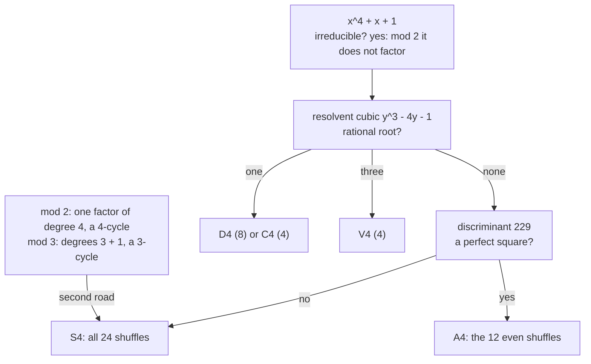

# Computing a Galois group: discriminant tests, resolvents and reduction modulo a prime

[Syllabus](../../../SYLLABUS.md) → [Algebraic and analytic number theory](../README.md) → [Fields and Galois Theory](../README.md#s05) → Computing a Galois group

---

## General Overview

The polynomial $`x^4 + x + 1`$ has four roots, and none of them is real. They sit near −0.727 ± 0.430i and 0.727 ± 0.934i. Its **Galois group** is the set of shuffles of those four roots that keep every rational equation among them true ([The Galois correspondence](05-galois-groups-and-the-fundamental-theorem.md)). Four roots allow 24 shuffles. The question is how many of the 24 survive.

The house example of this shelf, $`x^4 - 2`$, keeps only 8. Its roots are $`\pm 2^{1/4}`$ and $`\pm i\, 2^{1/4}`$, and they sit at the corners of a square, so only the square's symmetries survive. For $`x^4 + x + 1`$ there is no such picture. The quartic formula gives its roots, but too tangled to read the group from.

This card decides the answer without solving for the roots. It uses three tests, each a small piece of integer arithmetic:

- **One number**, the discriminant: here 229, which is not a perfect square.
- **One cubic** built from the quartic, the resolvent cubic: here $`y^3 - 4y - 1`$, which has no rational root.
- **Factoring modulo small primes**: mod 2 the quartic cannot be factored; mod 3 it splits as a degree-1 factor times a cubic.

All three point to the same answer. The group is the full **24 shuffles**. The only rational equations among the roots are the symmetric ones that every shuffle respects.

**A rational square root of the discriminant, or a rational root of the resolvent cubic, traps the group inside a smaller group, and when they are irrational they rule that smaller group out; factoring mod a prime shows a shuffle the group must contain; together they pin the group down.**

**What kind of fact this is:** a set of theorems. The discriminant and resolvent tests are proved on this card in Why it works. The theorem behind factoring mod a prime and the density theorem behind the prime counts are stated precisely, outlined, and sourced. The counts over 9,591 primes are evidence, never proof.

### The picture: the decision for a quartic



The path taken by $`x^4 + x + 1`$ runs down the left: no rational root, then 229 is not a square, so S4. The box at the bottom is the second road, from factoring mod 2 and mod 3.

---

## The formula

Notation first. The four roots are $`r_1, r_2, r_3, r_4`$. The **discriminant** $`\mathrm{disc}(f)`$ multiplies the squares of all six root differences. The **resolvent cubic** $`R(y)`$ is the cubic whose three roots pair the four roots up in the three possible ways:

```math
\mathrm{disc}(f) = \prod_{i<j} (r_i - r_j)^2, \qquad R(y) = (y - \theta_1)(y - \theta_2)(y - \theta_3), \quad \theta_1 = r_1 r_2 + r_3 r_4,\ \theta_2 = r_1 r_3 + r_2 r_4,\ \theta_3 = r_1 r_4 + r_2 r_3
```

**Read it aloud:** the discriminant is the product of every squared gap between two roots; the resolvent cubic has as its roots the three ways to split the roots into two pairs, multiplying within each pair and adding.

Both are symmetric in the roots, so both have rational coefficients that can be written down from $`f`$ alone. For $`f = x^4 + bx^2 + cx + d`$:

```math
R(y) = y^3 - b y^2 - 4d\, y + (4bd - c^2), \qquad \mathrm{disc}(f) = \mathrm{disc}(R); \qquad \text{for } x^4 + cx + d:\ \mathrm{disc}(f) = -27c^4 + 256d^3
```

**Read it aloud:** the resolvent's coefficients come straight from the quartic's; the quartic and its resolvent share one discriminant; and with only an $`x`$ term $`cx`$ and a constant $`d`$, the discriminant is $`-27c^4 + 256d^3`$.

For $`x^4 + x + 1`$: $`R(y) = y^3 - 4y - 1`$ and $`\mathrm{disc}(f) = -27 + 256 = 229`$.

The decision, for an irreducible quartic (one that does not factor over the rationals):

| Resolvent cubic over the rationals | Discriminant a perfect square? | Group | Shuffles |
| --- | --- | --- | ---: |
| no rational root | no | $`S_4`$, every shuffle | 24 |
| no rational root | yes | $`A_4`$, the even shuffles | 12 |
| exactly one rational root | no | $`D_4`$ or $`C_4`$ | 8 or 4 |
| three rational roots | yes | $`V_4`$, the double swaps | 4 |

An irreducible cubic is shorter: a square discriminant gives $`A_3`$, three shuffles; any other gives $`S_3`$, six.

The third test is **reduction modulo a prime**: read the coefficients in Z mod p and factor there.

```math
p \nmid \mathrm{disc}(f), \quad f \equiv g_1 g_2 \cdots g_k \pmod p, \quad \deg g_i = d_i \;\Longrightarrow\; G \text{ contains a shuffle with cycles of lengths } d_1, d_2, \dots, d_k
```

**Read it aloud:** if the prime does not divide the discriminant, and the polynomial factors mod p into pieces of degrees $`d_1`$ to $`d_k`$, then the group contains a shuffle whose cycles have exactly those lengths.

The list of cycle lengths of a shuffle is its **cycle type**, written as a sum: 3 + 1 is a 3-cycle with one root left alone ([Permutations](../../03-Algebra/08-Groups/03-permutations-and-the-symmetric-group.md)).

| Symbol | Plain meaning | In our example | Push it up and the answer… |
| --- | --- | --- | --- |
| $`f`$ | the polynomial being studied, with integer coefficients and leading coefficient 1 | $`x^4 + x + 1`$ | — |
| $`r_1, \dots, r_4`$ | the roots of $`f`$ in the complex numbers | −0.727 ± 0.430i, 0.727 ± 0.934i | — |
| $`G`$ | the Galois group: root shuffles that keep every rational equation among the roots true | all 24 | more shuffles means fewer rational facts about the roots |
| $`\mathrm{disc}(f)`$, $`\delta`$ | the discriminant: product of all squared root differences; $`\delta`$ is the same product unsquared | 229; $`\delta = \pm\sqrt{229}`$ | a perfect square forces $`G`$ into the even shuffles |
| $`\theta_1, \theta_2, \theta_3`$ | the three pair-up sums of the roots | −1.860806, −0.254102, 2.114908 | a rational one shrinks $`G`$ to 8 or fewer |
| $`R(y)`$ | the resolvent cubic, with roots $`\theta_1, \theta_2, \theta_3`$ | $`y^3 - 4y - 1`$ | more rational roots, smaller $`G`$ |
| $`b`$, $`c`$, $`d`$ | coefficients of $`x^4 + bx^2 + cx + d`$ | 0, 1, 1 | — |
| $`p`$, $`\alpha`$ | a prime used for reduction mod p; a root of one factor mod p | 2 and 3 | more primes show more cycle types |
| $`g_1, \dots, g_k`$; $`d_1, \dots, d_k`$ | the irreducible factors of $`f`$ mod p; their degrees, a cycle type | 4 at p = 2; 3 + 1 at p = 3 | — |
| $`S_4`$, $`A_4`$ | all shuffles of four roots; the even ones | 24; 12 | — |
| $`D_4`$, $`C_4`$, $`V_4`$ | symmetries of a square; its quarter turns; the three double swaps with the identity | 8; 4; 4 | — |
| $`S_3`$, $`A_3`$ | all shuffles of three roots; the even ones | 6; 3 | — |

### When it holds

- **The polynomial is irreducible.** The table assumes $`G`$ moves any root to any other. $`x^4 + 4`$ breaks this: it equals $`(x^2 + 2x + 2)(x^2 - 2x + 2)`$, yet its resolvent has three rational roots and its discriminant is $`128^2`$, so the table says $`V_4`$, 4 shuffles. The true group has 2.
- **The roots are distinct.** A repeated root makes the discriminant 0, and the pair-up sums can coincide. Remove repeated factors first.
- **The prime does not divide the discriminant.** At a prime that divides it, two roots merge mod p. For $`x^4 + x + 1`$ at 229, the polynomial is $`(x - 75)^2 (x^2 + 150x + 158)`$, and no cycle type reads off that.
- **Rational coefficients.** The tests here work over the rationals, where no multiple of 1 is 0. Over fields where 2 = 0 the discriminant test needs a different form.
- **Mod-p factoring only adds shuffles.** It proves the group contains a cycle type. It never proves one is missing; the upper limit comes from the discriminant and the resolvent.

---

## Why it works

### Step 0: a rational number is one that every shuffle in G leaves alone

The Galois correspondence gives one fact used throughout ([The Galois correspondence](05-galois-groups-and-the-fundamental-theorem.md)). A number built from the roots is rational exactly when every shuffle in $`G`$ leaves it unchanged.

So each test builds a number from the roots that only some shuffles leave alone. If that number turns out rational, then every shuffle in $`G`$ is one of those. The group is trapped inside a smaller set.

### Step 1: the square root of the discriminant tests for even shuffles

Take the signed product $`\delta = \prod_{i<j}(r_i - r_j)`$, with no squares. A swap of two roots flips the sign of $`\delta`$; an even shuffle keeps it. The roots are distinct, so $`\delta \ne 0`$, and the two signs give two different numbers.

The square $`\delta^2 = \mathrm{disc}(f)`$ is untouched by every shuffle, so it is always rational. By Step 0, $`\delta`$ itself is rational exactly when every shuffle in $`G`$ is even.

So **the discriminant is the square of a rational number exactly when $`G`$ sits inside the even shuffles.** For $`x^4 + x + 1`$, $`15^2 = 225 < 229 < 256 = 16^2`$, so 229 is not a square, and $`G`$ contains an odd shuffle. The same argument works for a cubic, with $`A_3`$ in place of $`A_4`$.

### Step 2: the resolvent cubic tests for a square's symmetries

Any shuffle of the four roots shuffles the three pair-ups among themselves. The swap of $`r_1`$ and $`r_2`$, for example, fixes $`\theta_1`$ and exchanges $`\theta_2`$ with $`\theta_3`$. The three double swaps, $`V_4`$, fix all three pair-ups.

The pair-ups are distinct: $`\theta_1 - \theta_2 = (r_1 - r_4)(r_2 - r_3)`$, and the other two differences factor the same way. Multiplying the three squared differences gives every root difference once, squared, which is why $`\mathrm{disc}(R) = \mathrm{disc}(f)`$.

By Step 0, a pair-up sum is rational exactly when every shuffle in $`G`$ fixes it. An irreducible quartic has only five possible groups, listed in the fold below. Checking each one against the pair-ups gives the table:

- $`S_4`$ and $`A_4`$ move every pair-up, so $`R`$ has no rational root.
- $`D_4`$ and $`C_4`$ fix exactly one pair-up: the one that pairs opposite corners of the square. So $`R`$ has exactly one rational root.
- $`V_4`$ fixes all three, so $`R`$ has three rational roots.

Step 1 then splits $`S_4`$ from $`A_4`$. Separating $`D_4`$ from $`C_4`$ takes one more test: whether two quadratics built from the rational root split once $`\sqrt{\mathrm{disc}(f)}`$ is allowed. See Kappe and Warren in Sources.

<details>
<summary>Detailed proof: an irreducible quartic has one of exactly five groups</summary>

$`G`$ moves each root to every other, because the roots of an irreducible polynomial are all conjugate ([Minimal polynomials](02-minimal-polynomials-and-conjugates.md)). So $`G`$ is transitive: it has one orbit of size 4.

Orbit size times stabiliser size (the shuffles that fix one root) equals group size, so 4 divides the size of $`G`$. The size also divides 24. That leaves 4, 8, 12 or 24.

Size 24 is $`S_4`$. Size 12: the only subgroup of that size in $`S_4`$ is $`A_4`$. Size 8: these are the Sylow 2-subgroups of $`S_4`$ (the subgroups of the largest power-of-2 size), all conjugate, each the symmetries of a square, $`D_4`$.

Size 4: a transitive group of size 4 acts on four roots with trivial stabilisers. It is either cyclic, generated by a 4-cycle, which is $`C_4`$, or made of the identity and three double swaps, which is $`V_4`$.

</details>

### Step 3: factoring mod p shows one shuffle in the group

Work in the finite field built from the integers mod p, enlarged to hold the roots of every mod-p factor (more in [Finite fields](09-finite-fields-and-frobenius.md)). There, raising to the p-th power is a field symmetry called **Frobenius**. It sends roots of each mod-p factor to roots of the same factor.

On the roots of an irreducible factor of degree $`d`$, Frobenius cycles all $`d`$ of them in one loop, because those roots are $`\alpha, \alpha^p, \alpha^{p^2}, \dots`$ and the $`d`$-th step returns to $`\alpha`$. So Frobenius acts on the roots with cycle type $`d_1 + \cdots + d_k`$.

Dedekind's theorem says this mod-p shuffle is the shadow of a real shuffle in $`G`$. Reduce the true roots mod a prime above p (a prime ideal of the splitting field's integers that contains p): when p does not divide the discriminant they stay distinct, and some element of $`G`$ reduces to Frobenius. That lifting step needs algebraic integers, from the next shelf, so this card states it and outlines it; Stevenhagen and Lenstra, cited below, explain it.

For $`x^4 + x + 1`$:

- **Mod 2** it has no root, since $`f(0) = f(1) = 1`$. With no root, it could only split into two irreducible quadratics. Mod 2 the only one is $`x^2 + x + 1`$, and $`(x^2 + x + 1)^2 = x^4 + x^2 + 1`$, which differs. So it is irreducible mod 2: a 4-cycle is in $`G`$.
- **Mod 3** the values at 0, 1, 2 are 1, 3, 19, so the only root is 1. It is a single root, since the derivative $`4x^3 + 1`$ is 5, not 0 mod 3. So the cubic left over has no root, so it is irreducible, and the code's factoring routine agrees: 3 + 1, a 3-cycle.

Irreducible mod 2 also settles irreducibility over the rationals. A monic integer polynomial that factors over the rationals factors over the integers (Gauss's lemma), and that factoring would survive mod 2.

### Step 4: two cycle types force all 24

$`G`$ contains a shuffle of order 4 and one of order 3. The size of $`G`$ is divisible by both, so by 12. The only subgroups of $`S_4`$ with 12 or more shuffles are $`A_4`$ and $`S_4`$. A 4-cycle is three swaps, an odd shuffle, so $`G`$ is not $`A_4`$.

So $`G = S_4`$: 24 shuffles, matching Steps 1 and 2. The code confirms the group arithmetic by brute force: shuffles generated by $`(1\ 2\ 3\ 4)`$ and $`(2\ 3\ 4)`$ number 24.

Two shuffles do not always reach that far. The 4-cycle with the swap $`(1\ 3)`$ generates only 8 shuffles, the square's symmetries: a swap of opposite corners is a symmetry of the square.

### Step 5: every cycle type turns up with a predictable share

Chebotarev's density theorem, proved in the 1920s, says more. As p runs through all primes, each cycle type appears as the mod-p factoring pattern for a share of primes equal to its share of $`G`$.

In $`S_4`$ the 24 shuffles split as 1 identity, 6 swaps, 3 double swaps, 8 three-cycles and 6 four-cycles. The primes below 100,000, with 229 set aside, give:

```
1+1+1+1  ###                             4.12%  S4 predicts  4.17%
2+1+1    ####################           24.95%  S4 predicts 25.00%
2+2      ##########                     12.54%  S4 predicts 12.50%
3+1      ###########################    33.59%  S4 predicts 33.33%
4        ####################           24.79%  S4 predicts 25.00%
```

Each bar is the share of the 9,591 primes with that factoring pattern; the right-hand column is the share of $`S_4`$ with that cycle type.

The house example looks different. For $`x^4 - 2`$, the pattern 3 + 1 never appears among the same primes: $`D_4`$ has no 3-cycle. Seen 3,222 times for one polynomial and 0 times for the other, the pattern separates 24 from 8 at a glance.

A finite count is evidence only. The theorem gives the limit, not how fast the shares get there, and a missing pattern in any finite range proves nothing. The proof of $`S_4`$ is Steps 1 to 4.

---

## Worked numbers, by hand

| Step | Arithmetic | Value |
| --- | --- | --- |
| Discriminant | $`-27 \cdot 1^4 + 256 \cdot 1^3`$ | 229 |
| Is it a square? | $`15^2 = 225`$, $`16^2 = 256`$ | no |
| Resolvent cubic | $`y^3 - 0 \cdot y^2 - 4 \cdot 1 \cdot y + (0 - 1^2)`$ | $`y^3 - 4y - 1`$ |
| Rational roots? | a rational root must divide 1: $`R(1) = -4`$, $`R(-1) = 2`$ | none |
| Resolvent's discriminant | $`-4(-4)^3 - 27(-1)^2 = 256 - 27`$ | 229, the same |
| Table row | no rational root, not a square | $`S_4`$ |
| Mod 2 | $`f(0) = f(1) = 1`$; $`(x^2 + x + 1)^2 \ne f`$ | irreducible: a 4-cycle |
| Mod 3 | $`f(0), f(1), f(2) = 1, 3, 19 \equiv 1, 0, 1`$ | 3 + 1: a 3-cycle |
| Group size | divisible by 4 and 3; contains an odd shuffle | **24** |

So no rational equation among the four roots holds except the ones every shuffle respects, such as "the roots add to 0". Every one of the 24 shuffles keeps the rational facts true.

The resolvent cubic is itself an example of the cubic test. It is irreducible with discriminant 229, not a square, so its group is $`S_3`$, all 6 shuffles of three roots.

### What breaks if you drop a piece

| Mistake | Comes out at | What went wrong |
| --- | --- | --- |
| Stop at the discriminant for $`x^4 - 2`$ | −2048, not a square, so "24" | the resolvent $`y^3 + 8y`$ has the rational root 0, which caps the group at 8 ($`D_4`$ or $`C_4`$); mod 7 the roots are 2 and 5, pattern 2 + 1 + 1, a single swap, which $`C_4`$ lacks: the group is $`D_4`$, 8 |
| Read the pattern at a prime dividing the discriminant | the routine reports 3 + 1 at p = 229 | 229 divides 229; mod 229, $`f = (x - 75)^2 (x^2 + 150x + 158)`$: a repeated root, no cycle type |
| Skip the irreducibility check for $`x^4 + 4`$ | three rational resolvent roots −4, 0, 4 and a square $`128^2`$, so "$`V_4`$, 4" | $`x^4 + 4 = (x^2 + 2x + 2)(x^2 - 2x + 2)`$: the table does not apply, and the group has 2 shuffles |
| Assume every cubic has all 6 shuffles, for $`x^3 - 3x + 1`$ | half the primes should show 2 + 1 | discriminant 81 = $`9^2`$: the group is $`A_3`$, and 2 + 1 appears for 0 of 1,228 primes (404 show 1 + 1 + 1, 824 show 3) |

---

## Code, from first principles, and it actually runs

The code factors polynomials mod p by its own routine: it pulls out the product of all degree-1 factors as a greatest common divisor with $`x^p - x`$, then the degree-2 factors with $`x^{p^2} - x`$. It reaches the group by **four roads**. Road 1 is the discriminant and resolvent in exact integers. Road 2 factors mod 2 and mod 3, then builds the group those cycles generate inside $`S_4`$ by brute force. Road 3 finds the four complex roots numerically and rebuilds the discriminant and the pair-up sums from them. Road 4 counts factoring patterns over 9,591 primes against the shares Chebotarev predicts. A brute-force root count checks the factoring routine for the first 46 primes.

### Python

```python
# Computing a Galois group: x^4 + x + 1 -- the check behind the card.  Standard library only.
# Road 1: discriminant and resolvent cubic, exact integers.  Road 2: factor patterns mod 2 and 3,
# then the group those cycles generate inside S4.  Road 3: numeric roots, from which the
# discriminant and the resolvent's roots are rebuilt.  Road 4: patterns over many primes (evidence).
from math import isqrt

def trim(a):
    while a and a[-1] == 0: a.pop()
    return a
def pmod(a, b, p):                       # remainder of a by b mod p; coefficients low to high
    a = [c % p for c in a]; inv = pow(b[-1], p - 2, p)
    while len(trim(a)) >= len(b):
        c = a[-1] * inv % p; s = len(a) - len(b)
        for i, bi in enumerate(b): a[s + i] = (a[s + i] - c * bi) % p
    return a
def pdiv(a, b, p):                       # exact quotient a / b mod p
    a = [c % p for c in a]; q = [0] * (len(a) - len(b) + 1); inv = pow(b[-1], p - 2, p)
    for s in range(len(q) - 1, -1, -1):
        c = a[s + len(b) - 1] * inv % p; q[s] = c
        for i, bi in enumerate(b): a[s + i] = (a[s + i] - c * bi) % p
    return q
def pmul(a, b, g, p):
    r = [0] * (len(a) + len(b))
    for i, x in enumerate(a):
        for j, y in enumerate(b): r[i + j] += x * y
    return pmod(r, g, p)
def ppow(a, e, g, p):
    r = [1]
    while e:
        if e & 1: r = pmul(r, a, g, p)
        a = pmul(a, a, g, p); e >>= 1
    return r
def pgcd(a, b, p):
    a, b = trim([c % p for c in a]), trim([c % p for c in b])
    while b: a, b = b, trim(pmod(a, b, p))
    return a
def pattern(f, p):                       # degrees of the irreducible factors of f mod p (f squarefree mod p)
    g, h, d, out = [c % p for c in f], [0, 1], 0, []
    while len(g) > 1:
        d += 1
        if 2 * d > len(g) - 1: out.append(len(g) - 1); break
        h = ppow(h, p, g, p)             # h = x^(p^d) mod g
        hx = h + [0] * (2 - len(h)); hx[1] -= 1
        c = pgcd(g, hx, p)               # product of the factors of degree d
        out += [d] * ((len(c) - 1) // d)
        if len(c) > 1: g = pdiv(g, c, p); h = pmod(h, g, p)
    return tuple(sorted(out, reverse=True))
def resolvent(b, c, d): return [4 * b * d - c * c, -4 * d, -b, 1]   # of x^4 + b x^2 + c x + d
def disc3(r):                            # discriminant of y^3 + a y^2 + b y + c
    c, b, a = r[0], r[1], r[2]
    return a * a * b * b - 4 * b**3 - 4 * a**3 * c - 27 * c * c + 18 * a * b * c
def int_roots(r):
    B = 1 + max(abs(x) for x in r)
    return [y for y in range(-B, B + 1) if sum(c * y**i for i, c in enumerate(r)) == 0]

F = [1, 1, 0, 0, 1]                      # x^4 + x + 1, low to high
disc = -27 * 1**4 + 256 * 1**3           # x^4 + c x + d has discriminant -27 c^4 + 256 d^3
R = resolvent(0, 1, 1)
print("discriminant of x^4+x+1:", disc, "| from the resolvent cubic:", disc3(R), "| isqrt:", isqrt(disc))
print("resolvent cubic y^3 - 4y - 1: integer roots", int_roots(R), "| value at 1 and -1:", 1 - 4 - 1, -1 + 4 - 1)
assert disc == disc3(R) and isqrt(disc)**2 != disc
assert int_roots(R) == []
# Road 2: irreducible mod 2 (also by trial division by every monic linear and quadratic) and 1 + 3 mod 3
small = [[a, 1] for a in range(2)] + [[a, b, 1] for a in range(2) for b in range(2)]
print("x^4+x+1 mod 2:", "+".join(map(str, pattern(F, 2))), "| mod 3:", "+".join(map(str, pattern(F, 3))), "| roots mod 3:", [x for x in range(3) if (x**4 + x + 1) % 3 == 0])
assert pattern(F, 2) == (4,) and all(trim(pmod(F, g, 2)) for g in small)
assert pattern(F, 3) == (3, 1)
def closure(gens):                       # every shuffle the generators produce, composed in any order
    grp, todo = set(), [(0, 1, 2, 3)]
    while todo:
        s = todo.pop()
        if s not in grp: grp.add(s); todo += [tuple(s[g[i]] for i in range(4)) for g in gens]
    return grp
g24, g8 = closure([(1, 2, 3, 0), (0, 2, 3, 1)]), closure([(1, 2, 3, 0), (2, 1, 0, 3)])
print("group from (1 2 3 4) and (2 3 4):", len(g24), "shuffles | from (1 2 3 4) and (1 3):", len(g8), "shuffles")
assert len(g24) == 24 and len(g8) == 8
# Road 3: complex roots by Durand-Kerner, then the discriminant and resolvent rebuilt from them
z = [(0.4 + 0.9j) ** k for k in range(4)]
for _ in range(200):
    for i in range(4):
        den = 1
        for j in range(4):
            if j != i: den *= z[i] - z[j]
        z[i] -= (z[i]**4 + z[i] + 1) / den
nd = 1
for i in range(4):
    for j in range(i + 1, 4): nd *= (z[i] - z[j]) ** 2
th = sorted([(z[0]*z[1] + z[2]*z[3]).real, (z[0]*z[2] + z[1]*z[3]).real, (z[0]*z[3] + z[1]*z[2]).real])
print("roots: " + ", ".join("%.6f%+.6fi" % (w.real, w.imag) for w in sorted(z, key=lambda w: (w.real, w.imag))))
print("numeric discriminant: %.6f | numeric resolvent roots: %.6f %.6f %.6f" % (nd.real, *th))
assert abs(nd.real - disc) < 1e-6 and all(abs(sum(c * t**i for i, c in enumerate(R))) < 1e-9 for t in th)
# Road 4: factor patterns over primes; a prime dividing the discriminant is set aside
def primes(n):
    s = bytearray([1]) * n; s[0] = s[1] = 0
    for i in range(2, isqrt(n) + 1):
        if s[i]: s[i*i::i] = bytearray(len(s[i*i::i]))
    return [i for i in range(n) if s[i]]
PR = primes(100000)
for p in PR[:46]:                         # brute-force root count agrees with the pattern's 1s
    if p != 229: assert sum((x**4 + x + 1) % p == 0 for x in range(p)) == pattern(F, p).count(1)
T4, T3 = [(1, 1, 1, 1), (2, 1, 1), (2, 2), (3, 1), (4,)], [(1, 1, 1), (2, 1), (3,)]
S4, D4 = [1, 6, 3, 8, 6], [1, 2, 3, 0, 2]   # elements of each cycle type, out of 24 and out of 8
def count(f, bad, n, types=T4):
    c = {t: 0 for t in types}
    for p in PR:
        if p < n and bad % p: c[pattern(f, p)] += 1
    return [c[t] for t in types]
print("pattern counts       1+1+1+1   2+1+1    2+2    3+1      4   primes")
for n in (1000, 10000, 100000):
    c = count(F, disc, n); print("x^4+x+1, p < %-6d %8d %7d %6d %6d %6d %8d" % (n, *c, sum(c)))
c4 = count([-2, 0, 0, 0, 1], 2048, 100000); print("x^4-2,   p < 100000 %8d %7d %6d %6d %6d %8d" % (*c4, sum(c4)))
for t, k, s in zip(T4, c, S4):
    sh = k / sum(c); print("%-8s %-30s %5.2f%%  S4 predicts %5.2f%%" % ("+".join(map(str, t)), "#" * round(sh * 80), 100 * sh, 100 * s / 24))
    assert abs(sh - s / 24) < 0.01
assert all(abs(k / sum(c4) - s / 8) < 0.01 for k, s in zip(c4, D4))
cR = count(R, disc, 100000, T3)
print("resolvent y^3-4y-1, p < 100000, patterns 1+1+1, 2+1, 3:", *cR, "| S3 predicts shares 1/6, 1/2, 1/3")
assert all(abs(k / sum(cR) - s / 6) < 0.01 for k, s in zip(cR, [1, 3, 2]))
# What breaks
r229 = [x for x in range(229) if (x**4 + x + 1) % 229 == 0]
q229 = pdiv(F, [75 * 75 % 229, -150 % 229, 1], 229)
print("mod 229: roots", r229, "| derivative there:", [(4 * x**3 + 1) % 229 for x in r229], "| f = (x-75)^2 times", q229, "| routine says",
      "+".join(map(str, pattern(F, 229))))
assert r229 == [75] and (4 * 75**3 + 1) % 229 == 0 and all(sum(c * x**i for i, c in enumerate(q229)) % 229 for x in range(229))
assert pmul(q229, [75 * 75, -150, 1], [0] * 5 + [1], 229) == [1, 1, 0, 0, 1]
R2, R4 = resolvent(0, 0, -2), resolvent(0, 0, 4)
print("x^4-2: discriminant", disc3(R2), "| resolvent", R2, "integer roots", int_roots(R2), "| 3+1 never seen:", c4[3],
      "| mod 7: roots", [x for x in range(7) if (x**4 - 2) % 7 == 0], "pattern", "+".join(map(str, pattern([-2, 0, 0, 0, 1], 7))))
assert int_roots(R2) == [0] and c4[3] == 0 and disc3(R2) < 0 and pattern([-2, 0, 0, 0, 1], 7) == (2, 1, 1)   # a single swap: not C4
fac = [sum(a * b for i, a in enumerate([2, 2, 1]) for j, b in enumerate([2, -2, 1]) if i + j == k) for k in range(5)]
print("x^4+4: discriminant", disc3(R4), "=", isqrt(disc3(R4)), "squared | resolvent integer roots", int_roots(R4), "| but (x^2+2x+2)(x^2-2x+2) =", fac)
assert isqrt(disc3(R4))**2 == disc3(R4) and len(int_roots(R4)) == 3 and fac == [4, 0, 0, 0, 1]
c3 = count([1, -3, 0, 1], 81, 10000, T3)
print("x^3-3x+1: discriminant", disc3([1, -3, 0, 1]), "| p < 10000 patterns 1+1+1, 2+1, 3:", *c3)
assert isqrt(disc3([1, -3, 0, 1]))**2 == disc3([1, -3, 0, 1]) and c3[1] == 0
print("ALL CHECKS PASS")
```

**Ran 2026-11-15 on macOS, Python 3.14.10, standard library only. All checks passed. Output, pasted from the run:**

```
discriminant of x^4+x+1: 229 | from the resolvent cubic: 229 | isqrt: 15
resolvent cubic y^3 - 4y - 1: integer roots [] | value at 1 and -1: -4 2
x^4+x+1 mod 2: 4 | mod 3: 3+1 | roots mod 3: [1]
group from (1 2 3 4) and (2 3 4): 24 shuffles | from (1 2 3 4) and (1 3): 8 shuffles
roots: -0.727136-0.430014i, -0.727136+0.430014i, 0.727136-0.934099i, 0.727136+0.934099i
numeric discriminant: 229.000000 | numeric resolvent roots: -1.860806 -0.254102 2.114908
pattern counts       1+1+1+1   2+1+1    2+2    3+1      4   primes
x^4+x+1, p < 1000          3      43     21     60     40      167
x^4+x+1, p < 10000        48     311    144    411    314     1228
x^4+x+1, p < 100000      395    2393   1203   3222   2378     9591
x^4-2,   p < 100000     1182    2399   3611      0   2399     9591
1+1+1+1  ###                             4.12%  S4 predicts  4.17%
2+1+1    ####################           24.95%  S4 predicts 25.00%
2+2      ##########                     12.54%  S4 predicts 12.50%
3+1      ###########################    33.59%  S4 predicts 33.33%
4        ####################           24.79%  S4 predicts 25.00%
resolvent y^3-4y-1, p < 100000, patterns 1+1+1, 2+1, 3: 1598 4771 3222 | S3 predicts shares 1/6, 1/2, 1/3
mod 229: roots [75] | derivative there: [0] | f = (x-75)^2 times [158, 150, 1] | routine says 3+1
x^4-2: discriminant -2048 | resolvent [0, 8, 0, 1] integer roots [0] | 3+1 never seen: 0 | mod 7: roots [2, 5] pattern 2+1+1
x^4+4: discriminant 16384 = 128 squared | resolvent integer roots [-4, 0, 4] | but (x^2+2x+2)(x^2-2x+2) = [4, 0, 0, 0, 1]
x^3-3x+1: discriminant 81 | p < 10000 patterns 1+1+1, 2+1, 3: 404 0 824
ALL CHECKS PASS
```

### Rust

```rust
// Computing a Galois group: x^4 + x + 1 -- the check behind the card.  std only, no crates.
// Road 1: discriminant and resolvent cubic, exact integers.  Road 2: factor patterns mod 2 and 3,
// then the group those cycles generate inside S4.  Road 3: numeric roots, from which the
// discriminant and the resolvent's roots are rebuilt.  Road 4: patterns over many primes (evidence).
use std::collections::HashSet;
type P = Vec<i64>; // coefficients low to high

fn trim(mut a: P) -> P { while a.last() == Some(&0) { a.pop(); } a } fn md(x: i64, p: i64) -> i64 { ((x % p) + p) % p }
fn powm(mut b: i64, mut e: i64, p: i64) -> i64 {
    let mut r = 1; b = md(b, p);
    while e > 0 { if e & 1 == 1 { r = r * b % p; } b = b * b % p; e >>= 1; } r
}
fn pmod(a: &P, b: &P, p: i64) -> P {
    let mut a: P = trim(a.iter().map(|&c| md(c, p)).collect());
    let inv = powm(b[b.len() - 1], p - 2, p);
    while a.len() >= b.len() {
        let c = a[a.len() - 1] * inv % p; let s = a.len() - b.len();
        for (i, &bi) in b.iter().enumerate() { a[s + i] = md(a[s + i] - c * bi, p); }
        a = trim(a);
    }
    a
}
fn pdiv(a: &P, b: &P, p: i64) -> P {
    let mut a: P = a.iter().map(|&c| md(c, p)).collect();
    let mut q = vec![0; a.len() - b.len() + 1]; let inv = powm(b[b.len() - 1], p - 2, p);
    for s in (0..q.len()).rev() {
        let c = a[s + b.len() - 1] * inv % p; q[s] = c;
        for (i, &bi) in b.iter().enumerate() { a[s + i] = md(a[s + i] - c * bi, p); }
    }
    q
}
fn pmul(a: &P, b: &P, g: &P, p: i64) -> P {
    let mut r = vec![0i64; a.len() + b.len()];
    for (i, &x) in a.iter().enumerate() { for (j, &y) in b.iter().enumerate() { r[i + j] = (r[i + j] + x * y) % p; } }
    pmod(&r, g, p)
}
fn ppow(a: &P, mut e: i64, g: &P, p: i64) -> P {
    let (mut r, mut a) = (vec![1], a.clone());
    while e > 0 { if e & 1 == 1 { r = pmul(&r, &a, g, p); } a = pmul(&a, &a, g, p); e >>= 1; }
    r
}
fn pgcd(a: &P, b: &P, p: i64) -> P {
    let (mut a, mut b) = (trim(a.iter().map(|&c| md(c, p)).collect()), trim(b.iter().map(|&c| md(c, p)).collect()));
    while !b.is_empty() { let r = pmod(&a, &b, p); a = b; b = r; } a
}
fn pattern(f: &P, p: i64) -> Vec<usize> { // degrees of the irreducible factors of f mod p (f squarefree mod p)
    let (mut g, mut h, mut d, mut out): (P, P, usize, Vec<usize>) = (f.iter().map(|&c| md(c, p)).collect(), vec![0, 1], 0, vec![]);
    while g.len() > 1 {
        d += 1;
        if 2 * d > g.len() - 1 { out.push(g.len() - 1); break; }
        h = ppow(&h, p, &g, p); // h = x^(p^d) mod g
        let mut hx = h.clone(); while hx.len() < 2 { hx.push(0); } hx[1] -= 1;
        let c = pgcd(&g, &hx, p); // product of the factors of degree d
        for _ in 0..(c.len() - 1) / d { out.push(d); }
        if c.len() > 1 { g = pdiv(&g, &c, p); h = pmod(&h, &g, p); }
    }
    out.sort_by(|a, b| b.cmp(a)); out
}
fn resolvent(b: i64, c: i64, d: i64) -> P { vec![4 * b * d - c * c, -4 * d, -b, 1] } // of x^4 + b x^2 + c x + d
fn disc3(r: &P) -> i64 { let (c, b, a) = (r[0], r[1], r[2]); a * a * b * b - 4 * b.pow(3) - 4 * a.pow(3) * c - 27 * c * c + 18 * a * b * c }
fn int_roots(r: &P) -> Vec<i64> {
    let bd = 1 + r.iter().map(|x| x.abs()).max().unwrap();
    (-bd..=bd).filter(|&y| r.iter().enumerate().map(|(i, &c)| c * y.pow(i as u32)).sum::<i64>() == 0).collect()
}
fn isqrt(n: i64) -> i64 { let mut s = (n as f64).sqrt() as i64; while s * s > n { s -= 1; } while (s + 1) * (s + 1) <= n { s += 1; } s }
fn join(v: &[usize]) -> String { v.iter().map(|x| x.to_string()).collect::<Vec<_>>().join("+") }
#[derive(Clone, Copy)] struct C { re: f64, im: f64 }
fn cm(a: C, b: C) -> C { C { re: a.re * b.re - a.im * b.im, im: a.re * b.im + a.im * b.re } }
fn cs(a: C, b: C) -> C { C { re: a.re - b.re, im: a.im - b.im } } fn ca(a: C, b: C) -> C { C { re: a.re + b.re, im: a.im + b.im } }
fn cd(a: C, b: C) -> C { // scaled division, as in Python
    if b.re.abs() >= b.im.abs() { let r = b.im / b.re; let d = b.re + b.im * r; C { re: (a.re + a.im * r) / d, im: (a.im - a.re * r) / d } }
    else { let r = b.re / b.im; let d = b.re * r + b.im; C { re: (a.re * r + a.im) / d, im: (a.im * r - a.re) / d } }
}
fn sieve(n: usize) -> Vec<i64> {
    let mut s = vec![true; n]; s[0] = false; s[1] = false;
    let mut i = 2; while i * i < n { if s[i] { let mut j = i * i; while j < n { s[j] = false; j += i; } } i += 1; }
    (0..n).filter(|&i| s[i]).map(|i| i as i64).collect()
}
fn count(f: &P, bad: i64, n: i64, types: &[Vec<usize>], pr: &[i64]) -> Vec<usize> {
    let mut c = vec![0; types.len()];
    for &p in pr { if p < n && bad % p != 0 { let t = pattern(f, p); c[types.iter().position(|x| *x == t).unwrap()] += 1; } }
    c
}
fn ev(f: &P, x: i64, p: i64) -> i64 { f.iter().rev().fold(0, |acc, &c| md(acc * x + c, p)) }

fn main() {
    let f: P = vec![1, 1, 0, 0, 1]; // x^4 + x + 1
    let disc = -27 * 1i64.pow(4) + 256 * 1i64.pow(3); // x^4 + c x + d has discriminant -27 c^4 + 256 d^3
    let r = resolvent(0, 1, 1);
    println!("discriminant of x^4+x+1: {} | from the resolvent cubic: {} | isqrt: {}", disc, disc3(&r), isqrt(disc));
    println!("resolvent cubic y^3 - 4y - 1: integer roots {:?} | value at 1 and -1: {} {}", int_roots(&r), 1 - 4 - 1, -1 + 4 - 1);
    assert!(disc == disc3(&r) && isqrt(disc).pow(2) != disc); assert!(int_roots(&r).is_empty());
    // Road 2: irreducible mod 2 (also by trial division by every monic linear and quadratic) and 1 + 3 mod 3
    let small: Vec<P> = vec![vec![0, 1], vec![1, 1], vec![0, 0, 1], vec![0, 1, 1], vec![1, 0, 1], vec![1, 1, 1]];
    let r3: Vec<i64> = (0..3).filter(|&x| ev(&f, x, 3) == 0).collect();
    println!("x^4+x+1 mod 2: {} | mod 3: {} | roots mod 3: {:?}", join(&pattern(&f, 2)), join(&pattern(&f, 3)), r3);
    assert!(pattern(&f, 2) == vec![4] && small.iter().all(|g| !pmod(&f, g, 2).is_empty()));
    assert!(pattern(&f, 3) == vec![3, 1]);
    let closure = |gens: [[usize; 4]; 2]| { // every shuffle the generators produce, composed in any order
        let (mut grp, mut todo) = (HashSet::new(), vec![[0usize, 1, 2, 3]]);
        while let Some(s) = todo.pop() { if grp.insert(s) { for g in &gens { todo.push([s[g[0]], s[g[1]], s[g[2]], s[g[3]]]); } } }
        grp.len()
    };
    let (g24, g8) = (closure([[1, 2, 3, 0], [0, 2, 3, 1]]), closure([[1, 2, 3, 0], [2, 1, 0, 3]]));
    println!("group from (1 2 3 4) and (2 3 4): {} shuffles | from (1 2 3 4) and (1 3): {} shuffles", g24, g8);
    assert!(g24 == 24 && g8 == 8);
    // Road 3: complex roots by Durand-Kerner, then the discriminant and resolvent rebuilt from them
    let one = C { re: 1.0, im: 0.0 }; let s0 = C { re: 0.4, im: 0.9 };
    let mut z = [one, s0, cm(s0, s0), cm(cm(s0, s0), s0)];
    for _ in 0..200 {
        for i in 0..4 {
            let mut den = one;
            for j in 0..4 { if j != i { den = cm(den, cs(z[i], z[j])); } }
            let zi = z[i]; let fz = ca(ca(cm(cm(zi, zi), cm(zi, zi)), zi), one);
            z[i] = cs(zi, cd(fz, den));
        }
    }
    let mut nd = one;
    for i in 0..4 { for j in i + 1..4 { let d = cs(z[i], z[j]); nd = cm(nd, cm(d, d)); } }
    let mut th = [ca(cm(z[0], z[1]), cm(z[2], z[3])).re, ca(cm(z[0], z[2]), cm(z[1], z[3])).re, ca(cm(z[0], z[3]), cm(z[1], z[2])).re];
    th.sort_by(|a, b| a.partial_cmp(b).unwrap());
    let mut zs = z.to_vec(); zs.sort_by(|a, b| (a.re, a.im).partial_cmp(&(b.re, b.im)).unwrap());
    println!("roots: {}", zs.iter().map(|w| format!("{:.6}{:+.6}i", w.re, w.im)).collect::<Vec<_>>().join(", "));
    println!("numeric discriminant: {:.6} | numeric resolvent roots: {:.6} {:.6} {:.6}", nd.re, th[0], th[1], th[2]);
    assert!((nd.re - disc as f64).abs() < 1e-6 && th.iter().all(|&t| r.iter().enumerate().map(|(i, &c)| c as f64 * t.powi(i as i32)).sum::<f64>().abs() < 1e-9));
    // Road 4: factor patterns over primes; a prime dividing the discriminant is set aside
    let pr = sieve(100000);
    for &p in &pr[..46] { // brute-force root count agrees with the pattern's 1s
        if p != 229 { assert!((0..p).filter(|&x| ev(&f, x, p) == 0).count() == pattern(&f, p).iter().filter(|&&d| d == 1).count()); }
    }
    let (t4, t3): (Vec<Vec<usize>>, Vec<Vec<usize>>) = (vec![vec![1, 1, 1, 1], vec![2, 1, 1], vec![2, 2], vec![3, 1], vec![4]], vec![vec![1, 1, 1], vec![2, 1], vec![3]]);
    let (s4, d4) = ([1, 6, 3, 8, 6], [1, 2, 3, 0, 2]); // elements of each cycle type, out of 24 and out of 8
    println!("pattern counts       1+1+1+1   2+1+1    2+2    3+1      4   primes");
    let mut c = vec![];
    for n in [1000, 10000, 100000] {
        c = count(&f, disc, n, &t4, &pr);
        println!("x^4+x+1, p < {:<6} {:>8} {:>7} {:>6} {:>6} {:>6} {:>8}", n, c[0], c[1], c[2], c[3], c[4], c.iter().sum::<usize>());
    }
    let c4 = count(&vec![-2, 0, 0, 0, 1], 2048, 100000, &t4, &pr); let n4 = c4.iter().sum::<usize>();
    println!("x^4-2,   p < 100000 {:>8} {:>7} {:>6} {:>6} {:>6} {:>8}", c4[0], c4[1], c4[2], c4[3], c4[4], n4);
    let tot = c.iter().sum::<usize>() as f64;
    for i in 0..5 {
        let sh = c[i] as f64 / tot;
        println!("{:<8} {:<30} {:5.2}%  S4 predicts {:5.2}%", join(&t4[i]), "#".repeat((sh * 80.0).round() as usize), 100.0 * sh, 100.0 * s4[i] as f64 / 24.0);
        assert!((sh - s4[i] as f64 / 24.0).abs() < 0.01);
    }
    assert!((0..5).all(|i| (c4[i] as f64 / n4 as f64 - d4[i] as f64 / 8.0).abs() < 0.01));
    let cr = count(&r, disc, 100000, &t3, &pr); let nr = cr.iter().sum::<usize>() as f64;
    println!("resolvent y^3-4y-1, p < 100000, patterns 1+1+1, 2+1, 3: {} {} {} | S3 predicts shares 1/6, 1/2, 1/3", cr[0], cr[1], cr[2]);
    assert!((0..3).all(|i| (cr[i] as f64 / nr - [1.0, 3.0, 2.0][i] / 6.0).abs() < 0.01));
    // What breaks
    let r229: Vec<i64> = (0..229).filter(|&x| ev(&f, x, 229) == 0).collect();
    let der: Vec<i64> = r229.iter().map(|&x| ev(&vec![1, 0, 0, 4], x, 229)).collect();
    let q229 = pdiv(&f, &vec![75 * 75 % 229, md(-150, 229), 1], 229);
    println!("mod 229: roots {:?} | derivative there: {:?} | f = (x-75)^2 times {:?} | routine says {}", r229, der, q229, join(&pattern(&f, 229)));
    assert!(r229 == vec![75] && ev(&vec![1, 0, 0, 4], 75, 229) == 0 && (0..229).all(|x| ev(&q229, x, 229) != 0));
    assert!(pmul(&q229, &vec![75 * 75, -150, 1], &vec![0, 0, 0, 0, 0, 1], 229) == vec![1, 1, 0, 0, 1]);
    let (r2, r4) = (resolvent(0, 0, -2), resolvent(0, 0, 4));
    let q4: P = vec![-2, 0, 0, 0, 1]; let r7: Vec<i64> = (0..7).filter(|&x| ev(&q4, x, 7) == 0).collect();
    println!("x^4-2: discriminant {} | resolvent {:?} integer roots {:?} | 3+1 never seen: {} | mod 7: roots {:?} pattern {}", disc3(&r2), r2, int_roots(&r2), c4[3], r7, join(&pattern(&q4, 7)));
    assert!(int_roots(&r2) == vec![0] && c4[3] == 0 && disc3(&r2) < 0 && pattern(&q4, 7) == vec![2, 1, 1]); // a single swap: not C4
    let (a, b) = ([2i64, 2, 1], [2i64, -2, 1]);
    let fac: Vec<i64> = (0..5).map(|k| (0..3).flat_map(|i| (0..3).map(move |j| (i, j))).filter(|&(i, j)| i + j == k).map(|(i, j)| a[i] * b[j]).sum()).collect();
    println!("x^4+4: discriminant {} = {} squared | resolvent integer roots {:?} | but (x^2+2x+2)(x^2-2x+2) = {:?}", disc3(&r4), isqrt(disc3(&r4)), int_roots(&r4), fac);
    assert!(isqrt(disc3(&r4)).pow(2) == disc3(&r4) && int_roots(&r4).len() == 3 && fac == vec![4, 0, 0, 0, 1]);
    let cub: P = vec![1, -3, 0, 1]; let c3 = count(&cub, 81, 10000, &t3, &pr);
    println!("x^3-3x+1: discriminant {} | p < 10000 patterns 1+1+1, 2+1, 3: {} {} {}", disc3(&cub), c3[0], c3[1], c3[2]);
    assert!(isqrt(disc3(&cub)).pow(2) == disc3(&cub) && c3[1] == 0);
    println!("ALL CHECKS PASS");
}
```

**Ran 2026-11-15 on macOS, rustc 1.98.1, no crates. All checks passed. Output, pasted from the run:**

```
discriminant of x^4+x+1: 229 | from the resolvent cubic: 229 | isqrt: 15
resolvent cubic y^3 - 4y - 1: integer roots [] | value at 1 and -1: -4 2
x^4+x+1 mod 2: 4 | mod 3: 3+1 | roots mod 3: [1]
group from (1 2 3 4) and (2 3 4): 24 shuffles | from (1 2 3 4) and (1 3): 8 shuffles
roots: -0.727136-0.430014i, -0.727136+0.430014i, 0.727136-0.934099i, 0.727136+0.934099i
numeric discriminant: 229.000000 | numeric resolvent roots: -1.860806 -0.254102 2.114908
pattern counts       1+1+1+1   2+1+1    2+2    3+1      4   primes
x^4+x+1, p < 1000          3      43     21     60     40      167
x^4+x+1, p < 10000        48     311    144    411    314     1228
x^4+x+1, p < 100000      395    2393   1203   3222   2378     9591
x^4-2,   p < 100000     1182    2399   3611      0   2399     9591
1+1+1+1  ###                             4.12%  S4 predicts  4.17%
2+1+1    ####################           24.95%  S4 predicts 25.00%
2+2      ##########                     12.54%  S4 predicts 12.50%
3+1      ###########################    33.59%  S4 predicts 33.33%
4        ####################           24.79%  S4 predicts 25.00%
resolvent y^3-4y-1, p < 100000, patterns 1+1+1, 2+1, 3: 1598 4771 3222 | S3 predicts shares 1/6, 1/2, 1/3
mod 229: roots [75] | derivative there: [0] | f = (x-75)^2 times [158, 150, 1] | routine says 3+1
x^4-2: discriminant -2048 | resolvent [0, 8, 0, 1] integer roots [0] | 3+1 never seen: 0 | mod 7: roots [2, 5] pattern 2+1+1
x^4+4: discriminant 16384 = 128 squared | resolvent integer roots [-4, 0, 4] | but (x^2+2x+2)(x^2-2x+2) = [4, 0, 0, 0, 1]
x^3-3x+1: discriminant 81 | p < 10000 patterns 1+1+1, 2+1, 3: 404 0 824
ALL CHECKS PASS
```

### Lean

Lean proves the discriminant test for every rational polynomial with distinct roots, and the full group of 24 for $`x^4 + x + 1`$.

- Take any polynomial with rational coefficients and distinct roots. Then its discriminant is the square of a rational number exactly when every shuffle in its Galois group is even.
- The discriminant of $`x^4 + x + 1`$ is 229, and 229 is not the square of a rational number.
- Each of the 24 shuffles of the four complex roots of $`x^4 + x + 1`$ comes from exactly one element of its Galois group.
- Take a group of shuffles of four roots that holds a 4-cycle and a 3-cycle. Then it is all of $`S_4`$.
- The resolvent cubic $`y^3 - 4y - 1`$ does not factor over the rationals, and its discriminant is also 229.
- Mod 2, $`x^4 + x + 1`$ has no root and does not factor. Mod 3, its only root is 1, a single root.
- Mod 229, $`x^4 + x + 1`$ equals $`(x - 75)^2 (x^2 + 150x + 158)`$, a repeated root.
- $`S_4`$ holds 1 identity, 6 swaps, 3 double swaps, 8 three-cycles and 6 four-cycles.
- In What breaks, $`x^4 + 4`$ factors into two quadratics, and $`x^4 - 2`$ has the roots 2 and 5 mod 7.
- The cubic $`x^3 - 3x + 1`$ has discriminant $`81 = 9^2`$.

Dedekind's theorem stays outlined, and the pattern counts over 9,591 primes and the numeric roots are left to the Python and Rust checks.

```lean
-- Computing a Galois group: the discriminant of a rational polynomial with distinct roots is a rational square exactly when its Galois group shuffles the roots only evenly, x^4 + x + 1 has discriminant 229 and the full group of 24 shuffles, and a group of shuffles of four roots holding a 4-cycle and a 3-cycle is all of S4.
import Mathlib.Analysis.Complex.Polynomial.Basic
import Mathlib.RingTheory.Polynomial.Resultant.Basic
import Mathlib.GroupTheory.Perm.Cycle.Type
import Mathlib.Data.ZMod.Basic
import Mathlib.Tactic.NormNum
import Mathlib.GroupTheory.SpecificGroups.Alternating
import Mathlib.LinearAlgebra.Vandermonde
import Mathlib.RingTheory.Polynomial.GaussLemma
import Mathlib.Algebra.Polynomial.SpecificDegree
import Mathlib.Algebra.Polynomial.Eval.Irreducible
import Mathlib.FieldTheory.Finite.Basic

open Polynomial

-- Every rational polynomial splits over ℂ, so its Galois group acts on its complex roots.
attribute [local instance] Polynomial.Gal.splits_ℚ_ℂ

theorem discr_x4_add_x_add_one : (X ^ 4 + X + 1 : ℚ[X]).discr = 229 := by
  have hnd : (X ^ 4 + X + 1 : ℚ[X]).natDegree = 4 := by compute_degree!
  have hdeg : 0 < (X ^ 4 + X + 1 : ℚ[X]).degree := by
    rw [← natDegree_pos_iff_degree_pos, hnd]; norm_num
  have hlc : (X ^ 4 + X + 1 : ℚ[X]).leadingCoeff = 1 := by
    rw [leadingCoeff, hnd]; simp [coeff_X, coeff_one]
  have h := resultant_deriv hdeg
  rw [hnd, hlc] at h
  norm_num at h
  rw [← h]
  have hder : derivative (X ^ 4 + X + 1 : ℚ[X]) = C 4 * X ^ 3 + 1 := by
    simp; ring_nf; simp [C_ofNat]; ring
  rw [hder]
  have hsplit : (X ^ 4 + X + 1 : ℚ[X]) =
      (C (3/4) * X + 1) + (C 4 * X ^ 3 + 1) * (C (1/4) * X) := by
    have e1 : (C 4 * C (1/4) : ℚ[X]) = 1 := by rw [← C_mul]; norm_num
    have e2 : (C (3/4) + C (1/4) : ℚ[X]) = 1 := by rw [← C_add]; norm_num
    linear_combination (-X ^ 4) * e1 + (-X) * e2
  have hg : (C 4 * X ^ 3 + 1 : ℚ[X]).natDegree ≤ 3 := by compute_degree
  have hq : (C (1/4) * X : ℚ[X]).natDegree ≤ 1 := by compute_degree
  rw [hsplit, resultant_add_mul_left _ _ _ _ _ (by omega) hg]
  have hl : (C (3/4) * X + 1 : ℚ[X]).natDegree ≤ 1 := by compute_degree
  rw [resultant_succ_left_deg _ _ _ _ (hl.trans (by norm_num)),
    resultant_succ_left_deg _ _ _ _ (hl.trans (by norm_num)),
    resultant_succ_left_deg _ _ _ _ hl]
  have hlin : (C (3/4) * X + 1 : ℚ[X]) = C (3/4) * (X + C (4/3)) := by
    rw [mul_add, ← C_mul]; norm_num
  rw [hlin, resultant_C_mul_left, resultant_X_add_C_left _ _ _ hg]
  have hc : (C 4 * X ^ 3 + 1 : ℚ[X]).coeff 3 = 4 := by simp [coeff_one]
  rw [hc]
  simp
  norm_num

#print axioms discr_x4_add_x_add_one

open Finset in
theorem sum_card_Ioi_fin (n : ℕ) : ∑ i : Fin (n + 1), #(Ioi i) = (n + 1) * n / 2 := by
  simp_rw [Fin.card_Ioi]
  rw [Fin.sum_univ_eq_sum_range (fun i => n + 1 - 1 - i) (n + 1),
    Finset.sum_range_reflect (fun i => i) (n + 1), Finset.sum_range_id]
  simp

#print axioms sum_card_Ioi_fin

open Finset in
theorem discr_algebraMap_eq_sq {K : Type*} [Field K] [Algebra ℚ K] (f : ℚ[X])
    (hf : f.Separable) (hs : (f.map (algebraMap ℚ K)).Splits) (n : ℕ)
    (hn : f.natDegree = n + 1) (e : Fin (n + 1) ≃ f.rootSet K) :
    algebraMap ℚ K f.discr =
      (algebraMap ℚ K f.leadingCoeff ^ n *
        (Matrix.vandermonde (fun i => (e i : K))).det) ^ 2 := by
  classical
  set φ := algebraMap ℚ K with hφ
  set F := f.map φ with hF
  set v : Fin (n + 1) → K := fun i => (e i : K) with hv
  have hf0 : f ≠ 0 := by rintro rfl; simp at hn
  have hlc : f.leadingCoeff ≠ 0 := leadingCoeff_ne_zero.mpr hf0
  have hvinj : Function.Injective v := fun i j h => e.injective (Subtype.ext h)
  have hroots : F.roots = (Finset.univ.val.map v) := by
    apply (Multiset.Nodup.ext (nodup_roots (hf.map)) (Finset.univ.nodup.map hvinj)).mpr
    intro a
    constructor
    · intro ha
      have : a ∈ f.rootSet K := by rw [rootSet_def]; exact Multiset.mem_toFinset.mpr ha
      obtain ⟨i, hi⟩ := e.surjective ⟨a, this⟩
      exact Multiset.mem_map.mpr ⟨i, Finset.mem_univ_val _, by simp [v, hi]⟩
    · intro ha
      obtain ⟨i, -, rfl⟩ := Multiset.mem_map.mp ha
      have : v i ∈ f.rootSet K := (e i).2
      rw [rootSet_def, Finset.mem_coe] at this
      exact Multiset.mem_toFinset.mp this
  have hFnd : F.natDegree = n + 1 := by rw [hF, natDegree_map, hn]
  have hFlc : F.leadingCoeff = φ f.leadingCoeff := by rw [hF, leadingCoeff_map]
  have hderiv : ∀ i, F.derivative.eval (v i) =
      φ f.leadingCoeff * ∏ j ∈ ({i}ᶜ : Finset _), (v i - v j) := by
    intro i
    have hmem : v i ∈ F.roots := by
      rw [hroots]; exact Multiset.mem_map.mpr ⟨i, Finset.mem_univ_val _, rfl⟩
    conv_lhs => rw [hs.eq_prod_roots]
    rw [derivative_C_mul, eval_C_mul, eval_multiset_prod_X_sub_C_derivative hmem, hFlc]
    congr 1
    rw [hroots, ← Multiset.map_erase v hvinj, Multiset.map_map, Finset.compl_singleton,
      Finset.prod_eq_multiset_prod, Finset.erase_val]
    rfl
  have key : ∏ i, ∏ j ∈ ({i}ᶜ : Finset (Fin (n + 1))), (v i - v j) =
      (-1) ^ ((n + 1) * n / 2) * (Matrix.vandermonde v).det ^ 2 := by
    rw [← prod_prod_Ioi_mul_eq_prod_prod_off_diag (fun j i => v i - v j),
      Matrix.det_vandermonde, ← sum_card_Ioi_fin n, ← Finset.prod_pow_eq_pow_sum,
      ← Finset.prod_pow, ← Finset.prod_mul_distrib]
    refine Finset.prod_congr rfl fun i _ => ?_
    rw [← Finset.prod_pow, ← Finset.prod_neg]
    refine Finset.prod_congr rfl fun j _ => ?_
    ring
  have h1 := resultant_deriv (f := f) (by rw [← natDegree_pos_iff_degree_pos, hn]; omega)
  rw [hn, Nat.add_sub_cancel] at h1
  have h2 := congrArg φ h1
  rw [← resultant_map_map, ← derivative_map] at h2
  have h3 := resultant_eq_prod_eval F F.derivative n
    (by have := natDegree_derivative_le F; rw [hFnd] at this; simpa using this) hs
  rw [hFnd, hFlc, hroots, Multiset.map_map, ← Finset.prod_eq_multiset_prod] at h3
  simp only [Function.comp_apply, hderiv, Finset.prod_mul_distrib, Finset.prod_const,
    Finset.card_univ, Fintype.card_fin, key] at h3
  have h4 := h2.symm.trans h3
  simp only [map_mul, map_pow, map_neg, map_one] at h4
  have hne : ((-1 : K) ^ ((n + 1) * n / 2) * φ f.leadingCoeff) ≠ 0 := by
    have : φ f.leadingCoeff ≠ 0 := (map_ne_zero φ).mpr hlc
    exact mul_ne_zero (pow_ne_zero _ (by norm_num)) this
  apply mul_left_cancel₀ hne
  linear_combination h4

#print axioms discr_algebraMap_eq_sq

theorem zmod2_x4_no_root : ∀ x : ZMod 2, ¬ x ^ 4 + x + 1 = 0 := by decide

#print axioms zmod2_x4_no_root

theorem zmod2_quadratic_coeffs : ∀ b c : ZMod 2, ¬ (0 ^ 2 + b * 0 + c = 0) →
    ¬ (1 ^ 2 + b * 1 + c = 0) → c = 1 ∧ b = 1 := by decide

#print axioms zmod2_quadratic_coeffs

theorem zmod3_cubic_no_root : ∀ x : ZMod 3, ¬ x ^ 3 - 4 * x - 1 = 0 := by decide

#print axioms zmod3_cubic_no_root

theorem irreducible_x4_zmod2 : Irreducible (X ^ 4 + X + 1 : (ZMod 2)[X]) := by
  have : Fact (Nat.Prime 2) := ⟨Nat.prime_two⟩
  have hm : (X ^ 4 + X + 1 : (ZMod 2)[X]).Monic := by monicity!
  have hnd : (X ^ 4 + X + 1 : (ZMod 2)[X]).natDegree = 4 := by compute_degree!
  have hroot : ∀ x : ZMod 2, ¬ (X ^ 4 + X + 1 : (ZMod 2)[X]).IsRoot x := by
    intro x; simp only [IsRoot, eval_add, eval_pow, eval_X, eval_one]; exact zmod2_x4_no_root x
  have hne1 : (X ^ 4 + X + 1 : (ZMod 2)[X]) ≠ 1 := by
    intro h; have := congrArg natDegree h; rw [hnd] at this; simp at this
  rw [hm.irreducible_iff_lt_natDegree_lt hne1]
  intro q hq hdeg hdvd
  rw [hnd] at hdeg
  simp only [Finset.mem_Ioc] at hdeg
  rcases (by omega : q.natDegree = 1 ∨ q.natDegree = 2) with h1 | h2
  · rw [hq.eq_X_add_C h1] at hdvd
    exact hroot (-(q.coeff 0)) (IsRoot.dvd (by rw [IsRoot, eval_add, eval_X, eval_C, neg_add_cancel]) hdvd)
  · have hq2 : q = X ^ 2 + C (q.coeff 1) * X + C (q.coeff 0) := by
      conv_lhs => rw [hq.as_sum, h2]
      simp [Finset.sum_range_succ]; ring
    have hqr : ∀ x, ¬ q.IsRoot x := fun x hx => hroot x (hx.dvd hdvd)
    have hb : q.coeff 0 = 1 ∧ q.coeff 1 = 1 := by
      generalize q.coeff 1 = b at hq2 ⊢
      generalize q.coeff 0 = c at hq2 ⊢
      rw [hq2] at hqr
      have h0 := hqr 0
      have h1 := hqr 1
      simp only [IsRoot, eval_add, eval_pow, eval_X, eval_mul, eval_C] at h0 h1
      exact zmod2_quadratic_coeffs b c h0 h1
    rw [hb.1, hb.2, C_1] at hq2
    obtain ⟨r, hr⟩ := hdvd
    have h2z : (2 : (ZMod 2)[X]) = 0 := CharTwo.two_eq_zero
    have hone : q * (r - (X ^ 2 + X)) = 1 := by
      rw [hq2] at hr ⊢
      linear_combination (-1) * hr + (-(X ^ 3) - X ^ 2) * h2z
    have hu := IsUnit.of_mul_eq_one _ hone
    have := natDegree_eq_zero_of_isUnit hu
    omega

#print axioms irreducible_x4_zmod2

theorem irreducible_x4_rat : Irreducible (X ^ 4 + X + 1 : ℚ[X]) := by
  have hm : (X ^ 4 + X + 1 : ℤ[X]).Monic := by monicity!
  have hZ : Irreducible (X ^ 4 + X + 1 : ℤ[X]) := by
    refine Monic.irreducible_of_irreducible_map (φ := Int.castRingHom (ZMod 2)) _ hm ?_
    simpa [Polynomial.map_add, Polynomial.map_pow] using irreducible_x4_zmod2
  have := (IsPrimitive.Int.irreducible_iff_irreducible_map_cast hm.isPrimitive).mp hZ
  simpa [Polynomial.map_add, Polynomial.map_pow] using this

#print axioms irreducible_x4_rat

theorem irreducible_resolvent_rat : Irreducible (X ^ 3 - 4 * X - 1 : ℚ[X]) := by
  have hm : (X ^ 3 - 4 * X - 1 : ℤ[X]).Monic := by monicity!
  have hZ : Irreducible (X ^ 3 - 4 * X - 1 : ℤ[X]) := by
    have : Fact (Nat.Prime 3) := ⟨Nat.prime_three⟩
    refine Monic.irreducible_of_irreducible_map (φ := Int.castRingHom (ZMod 3)) _ hm ?_
    apply irreducible_of_degree_le_three_of_not_isRoot
    · have : (Polynomial.map (Int.castRingHom (ZMod 3)) (X ^ 3 - 4 * X - 1)).natDegree = 3 := by
        simp only [Polynomial.map_sub, Polynomial.map_pow, map_X, Polynomial.map_mul,
          Polynomial.map_one]
        compute_degree!
      rw [this]; decide
    · intro x
      simp only [IsRoot, Polynomial.map_sub, Polynomial.map_pow, map_X, Polynomial.map_mul,
        Polynomial.map_one, eval_sub, eval_pow, eval_X, eval_mul, eval_one]
      simpa using zmod3_cubic_no_root x
  have := (IsPrimitive.Int.irreducible_iff_irreducible_map_cast hm.isPrimitive).mp hZ
  simpa [Polynomial.map_sub, Polynomial.map_pow] using this

#print axioms irreducible_resolvent_rat

theorem not_isSquare_229 : ¬ IsSquare (229 : ℚ) := by
  have : ((229 : ℕ) : ℚ) = 229 := by norm_num
  rw [← this, Rat.isSquare_natCast_iff]
  rintro ⟨r, hr⟩
  have : r ≤ 15 := by nlinarith
  interval_cases r <;> omega

#print axioms not_isSquare_229

theorem exists_resolvent_root {K : Type*} [Field K] [Algebra ℚ K]
    (hs : ((X ^ 4 + X + 1 : ℚ[X]).map (algebraMap ℚ K)).Splits) :
    ∃ θ : K, aeval θ (X ^ 3 - 4 * X - 1 : ℚ[X]) = 0 := by
  have hmon : ((X ^ 4 + X + 1 : ℚ[X]).map (algebraMap ℚ K)).Monic := by
    apply Monic.map; monicity!
  have hnd : ((X ^ 4 + X + 1 : ℚ[X]).map (algebraMap ℚ K)).natDegree = 4 := by
    rw [natDegree_map]; compute_degree!
  have hcard : Multiset.card ((X ^ 4 + X + 1 : ℚ[X]).map (algebraMap ℚ K)).roots = 4 := by
    rw [← hs.natDegree_eq_card_roots, hnd]
  obtain ⟨a, b, c, d, habcd⟩ := Multiset.card_eq_four.mp hcard
  have hprod := hs.eq_prod_roots_of_monic hmon
  rw [habcd] at hprod
  simp only [Multiset.insert_eq_cons, Multiset.map_cons, Multiset.prod_cons,
    Multiset.map_singleton, Multiset.prod_singleton] at hprod
  have hexp : (X - C a) * ((X - C b) * ((X - C c) * (X - C d))) =
      X ^ 4 - C (a + b + c + d) * X ^ 3 + C (a*b + a*c + a*d + b*c + b*d + c*d) * X ^ 2
        - C (a*b*c + a*b*d + a*c*d + b*c*d) * X + C (a*b*c*d) := by
    simp only [C_add, C_mul]; ring
  rw [hexp] at hprod
  simp only [Polynomial.map_add, Polynomial.map_pow, map_X, Polynomial.map_one] at hprod
  have k0 := congrArg (coeff · 0) hprod
  have k1 := congrArg (coeff · 1) hprod
  have k2 := congrArg (coeff · 2) hprod
  have k3 := congrArg (coeff · 3) hprod
  simp only [coeff_add, coeff_sub, coeff_C_mul, coeff_X_pow, coeff_X, coeff_C, coeff_one] at k0 k1 k2 k3
  norm_num at k0 k1 k2 k3
  have h1 : a + b + c + d = 0 := by linear_combination k3
  have h2 : a*b + a*c + a*d + b*c + b*d + c*d = 0 := by linear_combination -k2
  have h3 : a*b*c + a*b*d + a*c*d + b*c*d = -1 := by linear_combination k1
  have h4 : a*b*c*d = 1 := by linear_combination -k0
  refine ⟨a * b + c * d, ?_⟩
  simp only [map_sub, map_mul, map_pow, aeval_X, map_one, map_ofNat]
  linear_combination ((a * b + c * d) ^ 2 - 4 * (a*b*c*d)) * h2
    + ((a + b + c + d) * (a*b*c*d) - (a*b*c + a*b*d + a*c*d + b*c*d) * (a * b + c * d)) * h1
    + 4 * (a * b + c * d) * h4 + ((a*b*c + a*b*d + a*c*d + b*c*d) - 1) * h3

#print axioms exists_resolvent_root

theorem perm_four_subgroup_eq_top {α : Type*} [Fintype α] [DecidableEq α]
    (hα : Fintype.card α = 4) (H : Subgroup (Equiv.Perm α)) (h12 : 12 ∣ Nat.card H)
    (hodd : ∃ σ ∈ H, Equiv.Perm.sign σ ≠ 1) : H = ⊤ := by
  have hP : Nat.card (Equiv.Perm α) = 24 := by
    rw [Nat.card_perm, Nat.card_eq_fintype_card, hα]; rfl
  have hdvd : Nat.card H ∣ 24 := hP ▸ Subgroup.card_subgroup_dvd_card H
  obtain ⟨k, hk⟩ := h12
  have hk' : k = 1 ∨ k = 2 := by
    have hpos : 0 < Nat.card H := Nat.card_pos
    have : Nat.card H ≤ 24 := Nat.le_of_dvd (by norm_num) hdvd
    rcases hdvd with ⟨m, hm⟩
    have : k ≤ 2 := by omega
    interval_cases k <;> omega
  rcases hk' with rfl | rfl
  · exfalso
    have hidx : H.index = 2 := by
      have := Subgroup.card_mul_index H
      rw [hk, hP] at this; omega
    have hle := Equiv.Perm.alternatingGroup_le_of_index_le_two (G := H) hidx.le
    have : Nontrivial α := Fintype.one_lt_card_iff_nontrivial.mp (by omega)
    have hA : Nat.card (alternatingGroup α) = 12 := by
      have := two_mul_nat_card_alternatingGroup (α := α); rw [hP] at this; omega
    have hEq : alternatingGroup α = H :=
      Subgroup.eq_of_le_of_card_ge hle (by rw [hA, hk])
    obtain ⟨σ, hσ, hs⟩ := hodd
    rw [← hEq] at hσ
    exact hs (Equiv.Perm.mem_alternatingGroup.mp hσ)
  · exact Subgroup.eq_top_of_card_eq H (by rw [hk, hP])

#print axioms perm_four_subgroup_eq_top

/-- The discriminant test (Step 1 of the card). Let `f` have rational coefficients and distinct
roots (`f.Separable`). Then the discriminant of `f` is the square of a rational number exactly when
every shuffle in the Galois group of `f`, acting on the roots of `f` in the complex numbers, is an
even shuffle (sign `1`). A rational square root traps the group inside the even shuffles; an
irrational one means the group holds an odd shuffle. -/
theorem discriminant_square_iff_galois_group_even (f : ℚ[X]) (hf : f.Separable) :
    IsSquare f.discr ↔ ∀ σ : f.Gal, Equiv.Perm.sign (Gal.galActionHom f ℂ σ) = 1 := by
  classical
  set K := f.SplittingField
  let π : f.Gal → Equiv.Perm (f.rootSet K) := fun σ => MulAction.toPerm σ
  have hsign : ∀ σ : f.Gal,
      Equiv.Perm.sign (Gal.galActionHom f ℂ σ) = Equiv.Perm.sign (π σ) := by
    intro σ
    have : Gal.galActionHom f ℂ σ = (Gal.rootsEquivRootsAux f ℂ).permCongr (π σ) := by
      ext x : 1
      rfl
    rw [this, Equiv.Perm.sign_permCongr]
  simp_rw [hsign]
  rcases Nat.eq_zero_or_eq_succ_pred f.natDegree with h0 | hn
  · have hcard0 : Fintype.card (f.rootSet K) = 0 := by
      rw [card_rootSet_eq_natDegree hf (SplittingField.splits f), h0]
    have hempty : IsEmpty (f.rootSet K) := Fintype.card_eq_zero_iff.mp hcard0
    have hd : f.discr = 1 := by rw [eq_C_of_natDegree_eq_zero h0]; exact discr_C _
    rw [hd]
    refine ⟨fun _ σ => ?_, fun _ => ⟨1, by simp⟩⟩
    have : π σ = 1 := Equiv.ext fun x => (hempty.false x).elim
    rw [this, map_one]
  · set n := f.natDegree.pred
    have hs : (f.map (algebraMap ℚ K)).Splits := SplittingField.splits f
    have hcard : Fintype.card (f.rootSet K) = n + 1 := by
      rw [card_rootSet_eq_natDegree hf hs]; exact hn
    let e : Fin (n + 1) ≃ f.rootSet K := (Fintype.equivFinOfCardEq hcard).symm
    set φ := algebraMap ℚ K with hφ
    set v : Fin (n + 1) → K := fun i => (e i : K) with hv
    set E := φ f.leadingCoeff ^ n * (Matrix.vandermonde v).det with hE
    have hdisc : φ f.discr = E ^ 2 := discr_algebraMap_eq_sq f hf hs n hn e
    have hf0 : f ≠ 0 := by rintro rfl; simp at hn
    have hvinj : Function.Injective v := fun i j h => e.injective (Subtype.ext h)
    have hE0 : E ≠ 0 := mul_ne_zero (pow_ne_zero _ ((map_ne_zero φ).mpr
      (leadingCoeff_ne_zero.mpr hf0))) (Matrix.det_vandermonde_ne_zero_iff.mpr hvinj)
    have hact : ∀ σ : f.Gal, σ E = ((Equiv.Perm.sign (π σ) : ℤ) : K) * E := by
      intro σ
      let τ : Equiv.Perm (Fin (n + 1)) := (e.symm.symm.trans (π σ)).trans e.symm
      have hτ : Equiv.Perm.sign τ = Equiv.Perm.sign (π σ) :=
        Equiv.Perm.sign_symm_trans_trans _ _
      have hvτ : ∀ i, σ (v i) = v (τ i) := by
        intro i
        simp only [v, τ, Equiv.trans_apply, Equiv.symm_symm, Equiv.apply_symm_apply]
        rfl
      have hmat : σ.toRingHom.mapMatrix (Matrix.vandermonde v) =
          (Matrix.vandermonde v).submatrix τ id := by
        ext i j
        simp only [RingHom.mapMatrix_apply, Matrix.map_apply, Matrix.vandermonde,
          Matrix.of_apply, Matrix.submatrix_apply, id]
        change σ (v i ^ (j : ℕ)) = v (τ i) ^ (j : ℕ)
        rw [map_pow, hvτ]
      have hD : σ (Matrix.vandermonde v).det =
          ((Equiv.Perm.sign (π σ) : ℤ) : K) * (Matrix.vandermonde v).det := by
        have := RingHom.map_det σ.toRingHom (Matrix.vandermonde v)
        rw [hmat, Matrix.det_permute, hτ] at this
        exact this
      have hc : σ (φ f.leadingCoeff) = φ f.leadingCoeff := σ.commutes _
      rw [hE, map_mul, map_pow, hc, hD]
      ring
    constructor
    · rintro ⟨r, hr⟩ σ
      have hsq : E ^ 2 = (φ r) ^ 2 := by rw [← hdisc, hr, map_mul, sq]
      have hfix : σ E = E := by
        rcases sq_eq_sq_iff_eq_or_eq_neg.mp hsq with h | h
        · rw [h]; exact σ.commutes r
        · rw [h, map_neg]; exact congrArg Neg.neg (σ.commutes r)
      rw [hact σ] at hfix
      have h1 : ((Equiv.Perm.sign (π σ) : ℤ) : K) = 1 := by
        have := mul_right_cancel₀ hE0 (hfix.trans (one_mul E).symm)
        exact this
      rcases Int.units_eq_one_or (Equiv.Perm.sign (π σ)) with h | h
      · exact h
      · rw [h] at h1; norm_num at h1
    · intro h
      have : IsGalois ℚ K := IsGalois.of_separable_splitting_field hf
      have hfix : ∀ σ : Gal(K/ℚ), σ E = E := by
        intro σ; have := hact σ; rw [h σ] at this; simp only [Units.val_one, Int.cast_one, one_mul] at this; exact this
      obtain ⟨r, hr⟩ := (IsGalois.mem_range_algebraMap_iff_fixed E).mpr hfix
      refine ⟨r, φ.injective ?_⟩
      rw [hdisc, map_mul, ← sq]; exact congrArg (· ^ 2) hr.symm

/-- The card's main example. The discriminant of `x^4 + x + 1` is `229`, and its Galois group is
the full group of shuffles of its four complex roots: every one of the `24` shuffles of the roots
comes from exactly one element of the Galois group. -/
theorem x4_add_x_add_one_galois_group_is_S4 :
    (X ^ 4 + X + 1 : ℚ[X]).discr = 229 ∧
    Function.Bijective (Gal.galActionHom (X ^ 4 + X + 1 : ℚ[X]) ℂ) ∧
    Nat.card (X ^ 4 + X + 1 : ℚ[X]).Gal = 24 := by
  classical
  have hirr : Irreducible (X ^ 4 + X + 1 : ℚ[X]) := irreducible_x4_rat
  have hsep : (X ^ 4 + X + 1 : ℚ[X]).Separable := hirr.separable
  have hdisc : (X ^ 4 + X + 1 : ℚ[X]).discr = 229 := discr_x4_add_x_add_one
  have hnd : (X ^ 4 + X + 1 : ℚ[X]).natDegree = 4 := by compute_degree!
  have hs : ((X ^ 4 + X + 1 : ℚ[X]).map
      (algebraMap ℚ (X ^ 4 + X + 1 : ℚ[X]).SplittingField)).Splits := SplittingField.splits _
  have h4 : 4 ∣ Module.finrank ℚ (X ^ 4 + X + 1 : ℚ[X]).SplittingField :=
    by have := hirr.natDegree_dvd_finrank hs; rwa [hnd] at this
  obtain ⟨θ, hθ⟩ := exists_resolvent_root hs
  have hmin : (X ^ 3 - 4 * X - 1 : ℚ[X]) = minpoly ℚ θ :=
    minpoly.eq_of_irreducible_of_monic irreducible_resolvent_rat hθ (by monicity!)
  have h3 : 3 ∣ Module.finrank ℚ (X ^ 4 + X + 1 : ℚ[X]).SplittingField := by
    have := minpoly.degree_dvd (Algebra.IsIntegral.isIntegral (R := ℚ) θ)
    rw [← hmin] at this
    have hd : (X ^ 3 - 4 * X - 1 : ℚ[X]).natDegree = 3 := by compute_degree!
    rwa [hd] at this
  have h12 : 12 ∣ Nat.card (X ^ 4 + X + 1 : ℚ[X]).Gal := by
    rw [Gal.card_of_separable hsep]
    exact Nat.Coprime.mul_dvd_of_dvd_of_dvd (by norm_num) h4 h3
  have hodd : ∃ σ : (X ^ 4 + X + 1 : ℚ[X]).Gal,
      Equiv.Perm.sign (Gal.galActionHom (X ^ 4 + X + 1 : ℚ[X]) ℂ σ) ≠ 1 := by
    by_contra hcon
    push Not at hcon
    have := (discriminant_square_iff_galois_group_even _ hsep).mpr hcon
    rw [hdisc] at this
    exact not_isSquare_229 this
  have hrc : Fintype.card ((X ^ 4 + X + 1 : ℚ[X]).rootSet ℂ) = 4 := by
    rw [card_rootSet_eq_natDegree hsep Fact.out, hnd]
  have hinj := Gal.galActionHom_injective (X ^ 4 + X + 1 : ℚ[X]) ℂ
  have hHcard : Nat.card (Gal.galActionHom (X ^ 4 + X + 1 : ℚ[X]) ℂ).range =
      Nat.card (X ^ 4 + X + 1 : ℚ[X]).Gal :=
    (Nat.card_congr (MonoidHom.ofInjective hinj).toEquiv).symm
  have hHtop : (Gal.galActionHom (X ^ 4 + X + 1 : ℚ[X]) ℂ).range = ⊤ := by
    refine perm_four_subgroup_eq_top hrc _ (hHcard ▸ h12) ?_
    obtain ⟨σ, hσ⟩ := hodd
    exact ⟨_, ⟨σ, rfl⟩, hσ⟩
  have hsurj : Function.Surjective (Gal.galActionHom (X ^ 4 + X + 1 : ℚ[X]) ℂ) :=
    MonoidHom.range_eq_top.mp hHtop
  refine ⟨hdisc, ⟨hinj, hsurj⟩, ?_⟩
  rw [← hHcard, hHtop, Subgroup.card_top, Nat.card_perm, Nat.card_eq_fintype_card, hrc]
  rfl

/-- Two cycle types force all 24 (Step 4 of the card). A group of shuffles of four roots that
contains a 4-cycle (cycle type `4`) and a 3-cycle (cycle type `3 + 1`) is the whole of `S4`. -/
theorem four_cycle_and_three_cycle_generate_S4 (G : Subgroup (Equiv.Perm (Fin 4)))
    (h4 : ∃ σ ∈ G, σ.cycleType = {4}) (h3 : ∃ τ ∈ G, τ.cycleType = {3}) : G = ⊤ := by
  obtain ⟨σ, hσ, hσc⟩ := h4
  obtain ⟨τ, hτ, hτc⟩ := h3
  have o4 : orderOf σ = 4 := by rw [← Equiv.Perm.lcm_cycleType, hσc]; simp
  have o3 : orderOf τ = 3 := by rw [← Equiv.Perm.lcm_cycleType, hτc]; simp
  have d4 : 4 ∣ Nat.card G := by
    have := orderOf_dvd_natCard (⟨σ, hσ⟩ : G); rwa [Subgroup.orderOf_mk, o4] at this
  have d3 : 3 ∣ Nat.card G := by
    have := orderOf_dvd_natCard (⟨τ, hτ⟩ : G); rwa [Subgroup.orderOf_mk, o3] at this
  refine perm_four_subgroup_eq_top (by simp) G ?_ ⟨σ, hσ, ?_⟩
  · exact Nat.Coprime.mul_dvd_of_dvd_of_dvd (by norm_num) d4 d3
  · rw [Equiv.Perm.sign_of_cycleType, hσc]; decide

-- The card's whole-number worked examples.
-- Discriminant of x^4 + c x + d is -27 c^4 + 256 d^3: for x^4 + x + 1 it is 229.
example : (-27 : ℤ) * 1 ^ 4 + 256 * 1 ^ 3 = 229 := by norm_num
-- 229 is not a perfect square: 15^2 = 225 < 229 < 256 = 16^2.
example : 15 ^ 2 < 229 ∧ 229 < 16 ^ 2 ∧ ¬ ∃ n ∈ Finset.range 230, n * n = 229 := by
  decide +kernel
-- Resolvent cubic y^3 - 4y - 1: R(1) = -4, R(-1) = 2, so no rational root (one must divide 1).
example : (1 : ℤ) ^ 3 - 4 * 1 - 1 = -4 ∧ (-1 : ℤ) ^ 3 - 4 * (-1) - 1 = 2 := by norm_num
-- The resolvent's discriminant -4(-4)^3 - 27(-1)^2 is 229, the same as the quartic's.
example : -4 * (-4 : ℤ) ^ 3 - 27 * (-1) ^ 2 = 229 := by norm_num
-- Mod 2: no root, since f(0) = f(1) = 1.
example : ∀ x : ZMod 2, x ^ 4 + x + 1 ≠ 0 := by decide
-- Mod 2: no split into two quadratics (x^2 + a x + b)(x^2 + c x + d), so a 4-cycle.
example : ∀ a b c d : ZMod 2,
    ¬ (a + c = 0 ∧ b + d + a * c = 0 ∧ a * d + b * c = 1 ∧ b * d = 1) := by decide
-- The only irreducible quadratic mod 2 is x^2 + x + 1, and its square is x^4 + x^2 + 1, not f.
example : ∀ x : ZMod 2, (x ^ 2 + x + 1) ^ 2 = x ^ 4 + x ^ 2 + 1 := by decide
-- Mod 3: f(0), f(1), f(2) = 1, 3, 19, so 1 is the only root, and the derivative 4x^3 + 1 is 5 there.
example : (0 : ℕ) ^ 4 + 0 + 1 = 1 ∧ (1 : ℕ) ^ 4 + 1 + 1 = 3 ∧ (2 : ℕ) ^ 4 + 2 + 1 = 19 := by decide
example : ∀ x : ZMod 3, x ^ 4 + x + 1 = 0 ↔ x = 1 := by decide
example : 4 * (1 : ZMod 3) ^ 3 + 1 ≠ 0 := by decide
-- S4 splits as 1 identity, 6 swaps, 3 double swaps, 8 three-cycles and 6 four-cycles.
example : (Finset.univ.filter (fun σ : Equiv.Perm (Fin 4) => σ.cycleType = {2})).card = 6 ∧
    (Finset.univ.filter (fun σ : Equiv.Perm (Fin 4) => σ.cycleType = {2, 2})).card = 3 ∧
    (Finset.univ.filter (fun σ : Equiv.Perm (Fin 4) => σ.cycleType = {3})).card = 8 ∧
    (Finset.univ.filter (fun σ : Equiv.Perm (Fin 4) => σ.cycleType = {4})).card = 6 := by
  decide +kernel
example : 1 + 6 + 3 + 8 + 6 = 24 := by norm_num
-- What breaks at p = 229: the root 75 is a double root, (x - 75)^2 (x^2 + 150x + 158).
example : (75 ^ 4 + 75 + 1) % 229 = 0 ∧ (4 * 75 ^ 3 + 1) % 229 = 0 := by norm_num
example : ∀ x : ZMod 229, (x - 75) ^ 2 * (x ^ 2 + 150 * x + 158) = x ^ 4 + x + 1 := by
  decide +kernel
-- x^4 - 2: discriminant 256(-2)^3 = -2048, resolvent y^3 + 8y has the root 0;
-- mod 7 its roots are 2 and 5, pattern 2 + 1 + 1.
example : (-27 : ℤ) * 0 ^ 4 + 256 * (-2) ^ 3 = -2048 ∧ (0 : ℤ) ^ 3 + 8 * 0 = 0 := by norm_num
example : ∀ x : ZMod 7, x ^ 4 = 2 ↔ x = 2 ∨ x = 5 := by decide
-- x^4 + 4 = (x^2 + 2x + 2)(x^2 - 2x + 2): reducible, though its discriminant is 128^2
-- and its resolvent y^3 - 16y has the three roots -4, 0, 4.
example : (X ^ 2 + 2 * X + 2) * (X ^ 2 - 2 * X + 2) = (X ^ 4 + 4 : ℤ[X]) := by ring
example : (256 : ℤ) * 4 ^ 3 = 16384 ∧ (16384 : ℤ) = 128 ^ 2 := by norm_num
example : ∀ y ∈ ({-4, 0, 4} : Finset ℤ), y ^ 3 - 16 * y = 0 := by decide
-- x^3 - 3x + 1: discriminant -4(-3)^3 - 27(1)^2 = 81 = 9^2, so its group is A3.
example : -4 * (-3 : ℤ) ^ 3 - 27 * 1 ^ 2 = 81 ∧ (81 : ℤ) = 9 ^ 2 := by norm_num

#print axioms discriminant_square_iff_galois_group_even
#print axioms x4_add_x_add_one_galois_group_is_S4
#print axioms four_cycle_and_three_cycle_generate_S4
```

**Checked 2026-11-15 on macOS, Lean 4.36.0-rc2, Mathlib v4.36.0-rc2. Every proof is complete and uses only Lean's standard axioms. Output, pasted from the run:**

```
'discr_x4_add_x_add_one' depends on axioms: [propext, Classical.choice, Quot.sound]
'sum_card_Ioi_fin' depends on axioms: [propext, Classical.choice, Quot.sound]
'discr_algebraMap_eq_sq' depends on axioms: [propext, Classical.choice, Quot.sound]
'zmod2_x4_no_root' depends on axioms: [propext, Classical.choice, Quot.sound]
'zmod2_quadratic_coeffs' depends on axioms: [propext, Classical.choice, Quot.sound]
'zmod3_cubic_no_root' depends on axioms: [propext, Classical.choice, Quot.sound]
'irreducible_x4_zmod2' depends on axioms: [propext, Classical.choice, Quot.sound]
'irreducible_x4_rat' depends on axioms: [propext, Classical.choice, Quot.sound]
'irreducible_resolvent_rat' depends on axioms: [propext, Classical.choice, Quot.sound]
'not_isSquare_229' depends on axioms: [propext, Classical.choice, Quot.sound]
'exists_resolvent_root' depends on axioms: [propext, Classical.choice, Quot.sound]
'perm_four_subgroup_eq_top' depends on axioms: [propext, Classical.choice, Quot.sound]
'discriminant_square_iff_galois_group_even' depends on axioms: [propext, Classical.choice, Quot.sound]
'x4_add_x_add_one_galois_group_is_S4' depends on axioms: [propext, Classical.choice, Quot.sound]
'four_cycle_and_three_cycle_generate_S4' depends on axioms: [propext, Classical.choice, Quot.sound]
```

> [!TIP]
> **Try changing**
> - **Guess first:** what does a 4-cycle and a swap generate? In the line defining `g24`, change `(0, 2, 3, 1)` to `(2, 1, 0, 3)`, the swap $`(1\ 3)`$. The closure stops at 8 shuffles, the square's symmetries, and the first group assert stops the run.
> - **Guess first:** are 167 primes enough? Change `(1000, 10000, 100000)` to `(1000,)`. Only 3 of 167 primes split completely, under half the predicted 4.17%, and the first share assert stops the run.
> - **Guess first:** what changes for a cubic with a non-square discriminant? In the `c3` line, change `[1, -3, 0, 1], 81` to `[-1, -4, 0, 1], 229`, the resolvent cubic. The pattern 2 + 1 now appears for about half the primes, and the last assert stops the run.

---

## The usual mistake

> [!warning]
> **Reading the patterns seen so far as the whole group.** Factoring mod p only ever adds shuffles to the list. A pattern that has not appeared yet proves nothing: the share theorem gives a limit, not a deadline. For $`x^4 - 2`$ the missing 3 + 1 in 9,591 primes is strong evidence of $`D_4`$. The proof: the resolvent's rational root 0 caps the group at 8 ($`D_4`$ or $`C_4`$), and mod 7, with roots 2 and 5, the pattern is 2 + 1 + 1, a single swap, which $`C_4`$ lacks.
>
> - **Using a prime that divides the discriminant.** At 229 the factoring routine reports 3 + 1 for $`x^4 + x + 1`$. The truth is a repeated root, $`(x - 75)^2`$, times a quadratic.
> - **Stopping at the discriminant.** For $`x^4 - 2`$ it is −2048, not a square, which only rules out the even groups. The answer is 8, not 24.
> - **Skipping irreducibility.** For $`x^4 + 4`$ the table says $`V_4`$, 4 shuffles, but the polynomial factors and its group has 2.

---

## Where you meet it in real life

- **Computer algebra systems.** Software that reports the Galois group of a polynomial runs these tests: factoring mod many primes to collect cycle types, then resolvents to prove the upper limit. Cohen's textbook, cited below, describes the method.
- **Tables of number fields.** Online databases of number fields (the rationals with roots of a polynomial added) list quartic fields up to a size limit, each with its group. Each label was found by the same mix of resolvents and mod-p patterns.
- **Splitting of primes.** Which primes split completely in a field is read off from cycle types: here, 395 of 9,591 primes, near the predicted one in 24. The prime-splitting cards on the next shelf build on this.
- **Formulas for roots.** $`S_4`$ is solvable, so $`x^4 + x + 1`$ has a formula in square and cube roots. The classical quartic formula solves the resolvent cubic first; that is where the cubic got its name.
- **Error-checking codes.** Read mod 2, $`x^4 + x + 1`$ is irreducible. It is the polynomial behind a standard 4-bit checksum, and it builds the 16-element field GF(16). Step 3's mod-2 test is the check that makes it usable there.

> **Say it back**
> The Galois group of a polynomial is the set of root shuffles that keep every rational equation among the roots true. A number built from the roots is rational exactly when every shuffle in the group leaves it alone. The square root of the discriminant tests for even shuffles, and the resolvent cubic tests for the square's symmetries. Factoring mod a prime that does not divide the discriminant shows a cycle type the group must contain. For $`x^4 + x + 1`$, a discriminant of 229 and a resolvent with no rational root give all 24 shuffles, and the mod-2 and mod-3 patterns prove the same answer.

---

## What this builds on

- [The Galois correspondence](05-galois-groups-and-the-fundamental-theorem.md): the group of a splitting field, and the fact that only rational numbers are fixed by all of it.
- [Permutations](../../03-Algebra/08-Groups/03-permutations-and-the-symmetric-group.md): cycle notation, cycle types, even and odd shuffles, and the alternating group.

## Where this goes next

- [Solvable by radicals](07-solvability-by-radicals-and-the-quintic.md): $`S_4`$ is solvable, so quartics have a formula; a quintic whose mod-p patterns show $`S_5`$ has none.
- [Weierstrass form](../../22-Algebraic%20geometry/04-Elliptic%20Curves/02-weierstrass-forms-discriminant-and-j-invariant.md): the cubic in $`y^2 = x^3 + ax + b`$, whose discriminant test decides how the curve's points of order 2 are shuffled.

For degree 5 and above the resolvents grow fast, so the question this card leaves open is how few primes and how small a resolvent can still prove the group.

---

## Sources

Verified 2026-11-15: every link below resolves to the publisher's page.

- Kappe, Luise-Charlotte, and Bette Warren. "An Elementary Test for the Galois Group of a Quartic Polynomial." *The American Mathematical Monthly* 96, no. 2 (1989): 133–137. [doi:10.1080/00029890.1989.11972158](https://doi.org/10.1080/00029890.1989.11972158). The resolvent-and-discriminant table, with the extra test that separates $`D_4`$ from $`C_4`$.
- Stevenhagen, Peter, and Hendrik W. Lenstra Jr. "Chebotarëv and His Density Theorem." *The Mathematical Intelligencer* 18, no. 2 (1996): 26–37. [doi:10.1007/BF03027290](https://doi.org/10.1007/BF03027290). Frobenius, Dedekind's factoring theorem and the density theorem behind Step 5, with history.
- Cohen, Henri. *A Course in Computational Algebraic Number Theory*. Springer, Graduate Texts in Mathematics 138, 1993. [doi:10.1007/978-3-662-02945-9](https://doi.org/10.1007/978-3-662-02945-9). How software computes Galois groups of small degree by resolvents and mod-p factoring.
- Cox, David A. *Galois Theory*, 2nd ed. Wiley, 2012. [Publisher page](https://www.wiley.com/en-us/Galois+Theory%2C+2nd+Edition-p-9781118072059). Cubics and quartics by discriminant and resolvent, with the field theory behind Steps 0 to 2.
- Dummit, David S., and Richard M. Foote. *Abstract Algebra*, 3rd ed. Wiley, 2003. [Publisher page](https://www.wiley.com/en-us/Abstract+Algebra%2C+3rd+Edition-p-9780471433347). The Galois groups of polynomials section: the transitive subgroups of $`S_4`$ and worked quartics.
