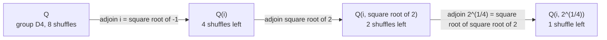

# Solvable by radicals: why the cubic has a formula and the general quintic cannot

[Syllabus](../../../SYLLABUS.md) → [Algebraic and analytic number theory](../README.md) → [Fields and Galois Theory](../README.md#s05) → Solvable by radicals

---

## General Overview

Two equations look almost the same: $`x^3 - x - 1 = 0`$ and $`x^5 - x - 1 = 0`$. Each has exactly one real root: 1.3247179572 for the cubic and 1.1673039783 for the quintic.

The cubic's root has a formula. Cardano's recipe from 1545 writes it with one square root inside two cube roots. The quintic's root has no such formula at all. No finite expression in whole numbers, plus, minus, times, divide and nth roots equals it. Such an expression is a **radical expression**, and the field of numbers it builds is a **radical tower**.

[Why there is no quintic formula](../../03-Algebra/10-For%20the%20Curious/02-why-no-quintic-formula.md) tells this story and takes one bridge on trust: a radical formula forces the roots' symmetry group to come apart in commuting layers. This card proves that bridge. It then computes the symmetry group of $`x^5 - x - 1`$ from two remainder tests, mod 5 and mod 2, instead of quoting it. The group is all 120 shuffles of the five roots, and those do not come apart.

**A polynomial's roots can be written with radicals exactly when its Galois group is solvable, meaning it breaks down through a chain of steps where order does not matter; the group of $`x^5 - x - 1`$ is all 120 shuffles of its roots, which do not break down that way, so no radical expression gives any of its roots.**

**What kind of fact this is:** a theorem (Galois, written by 1832, published 1846). The direction "radicals give a solvable group" is proved on this card in Why it works. The converse is stated with its key step and a source. The group of $`x^5 - x - 1`$ is proved here from exact computations; the count of 1,227 primes is evidence that agrees, not proof.

### The picture: a radical tower and its chain of groups

The shelf's house example, $`x^4 - 2`$, shows the match. Its roots are $`\pm 2^{1/4}`$ and $`\pm i\,2^{1/4}`$, and its group is $`D_4`$, the eight symmetries of a square ([The Galois correspondence](05-galois-groups-and-the-fundamental-theorem.md)). Each field step adjoins one square root. Each group step halves the group, and each half-step is a group of two, where order cannot matter.



Read left to right, it is a radical tower. Read as the sizes of the groups fixing each floor, it is the chain 8 → 4 → 2 → 1. [The Galois correspondence](05-galois-groups-and-the-fundamental-theorem.md) shows that the square's four turns fix $`\mathbb{Q}(i)`$ and its half turn fixes $`\mathbb{Q}(i, \sqrt 2)`$; the code prints the sizes of those groups. It also computes a second chain for this group, 8 → 2 → 1, by repeated commutators (defined under The formula).

---

## The formula

Words first. A **field** is a set of numbers closed under plus, minus, times and divide. $`F(a)`$ is the smallest field holding $`F`$ and the number $`a`$. $`\mathrm{Gal}(L/K)`$ is the group of shuffles of $`L`$ that keep every number of $`K`$ fixed and respect plus and times ([The Galois correspondence](05-galois-groups-and-the-fundamental-theorem.md)).

A group $`G`$ is **solvable** when it has a chain of subgroups $`G = H_0 \supseteq H_1 \supseteq \cdots \supseteq H_m = \{e\}`$ in which each $`H_i`$ is normal in $`H_{i-1}`$ and each quotient $`H_{i-1}/H_i`$ is abelian. **Normal** means $`gHg^{-1} = H`$ for every $`g`$ in the bigger group. Then the cosets of $`H`$ (the blocks $`gH`$ that $`H`$ cuts the group into) multiply as a group of their own, the **quotient**. **Abelian** means order does not matter: $`gh = hg`$.

[Why there is no quintic formula](../../03-Algebra/10-For%20the%20Curious/02-why-no-quintic-formula.md) defines solvable another way, by repeated commutators, and the two definitions agree. The **commutator** $`ghg^{-1}h^{-1}`$ is $`e`$ exactly when $`gh = hg`$, so it measures how far $`g`$ and $`h`$ fail to commute. The commutator chain starts at $`G`$; each round closes all commutators of the last group under composition. If $`H_{i-1}/H_i`$ is abelian, every commutator of two members of $`H_{i-1}`$ lies in $`H_i`$, because in the quotient it is the commutator of two blocks that commute. So if one round lands inside $`H_k`$, the next lands inside $`H_{k+1}`$, and a chain with abelian steps that reaches $`\{e\}`$ forces the commutator chain to reach $`\{e\}`$ too. In the other direction, the commutator chain is itself a chain with abelian steps. Each group in it is normal in the one before, since a conjugate of a commutator is again a commutator, and in each quotient $`gh`$ and $`hg`$ differ by a commutator, which is divided out. So a group whose commutator chain sticks, as that of $`S_5`$ does at 60, has no chain with abelian steps.

The theorem matches two chains:

```math
\mathbb{Q} = F_0 \subset F_1 \subset \cdots \subset F_m,\ \ F_i = F_{i-1}(a_i),\ \ a_i^{\,n_i} \in F_{i-1},\ \ \text{roots of } f \text{ in } F_m \quad\Longleftrightarrow\quad G = H_0 \trianglerighteq H_1 \trianglerighteq \cdots \trianglerighteq H_m = \{e\},\ \ H_{i-1}/H_i \text{ abelian}
```

**Read it aloud:** the roots of $`f`$ lie in a tower where each floor adds an $`n`$th root of something already built, exactly when the group of $`f`$ has a chain of normal subgroups whose steps are all order-free.

Worked once on the house example: $`a_1 = i`$ with $`i^2 = -1`$, $`a_2 = \sqrt 2`$ with square 2, $`a_3 = 2^{1/4}`$ with square $`\sqrt 2`$. The matching groups have sizes 8, 4, 2, 1, and each quotient has two members.

The second half of the card computes $`G`$ for $`f(x) = x^5 - x - 1`$. Its main formula is the discriminant of $`x^5 + ax + b`$ (here $`a`$ and $`b`$ are just the two coefficients), the product of all squared differences of roots ([Computing a Galois group](06-computing-a-galois-group.md)):

```math
\mathrm{disc}(x^5 + ax + b) = 5^5 b^4 + 4^4 a^5 = 3125 - 256 = 2869 = 19 \times 151 \quad (a = b = -1)
```

| Symbol | Plain meaning | In our example | Push it up and the answer… |
| --- | --- | --- | --- |
| $`f`$ | the polynomial whose roots we want | $`x^5 - x - 1`$; the cubic $`x^3 - x - 1`$ | a higher degree allows a bigger group |
| $`F_0, \ldots, F_m`$, $`F(a)`$ | the floors of a tower of fields; $`F`$ with $`a`$ adjoined | $`\mathbb{Q} \subset \mathbb{Q}(i) \subset \mathbb{Q}(i, \sqrt 2) \subset \mathbb{Q}(i, 2^{1/4})`$ | more floors, longer group chain |
| $`a_i`$, $`n_i`$, $`a`$, $`c`$; $`\beta`$, $`\theta`$ | the root adjoined on floor $`i`$ and its index; one such root $`a`$ with $`a^n = c`$; a number on a floor and its Lagrange resolvent | $`a_3 = 2^{1/4}`$, $`n_3 = 2`$, $`c = \sqrt 2`$ | a bigger $`n_i`$ means a bigger cyclic step |
| $`\zeta_n`$ | a primitive $`n`$th root of 1, $`e^{2\pi i/n}`$ (shelf 03's notation) | $`\zeta_4 = i`$ | — |
| $`E`$, $`L`$ | the splitting field of $`f`$ (all its roots adjoined); the top of a radical tower | $`E = \mathbb{Q}(i, 2^{1/4})`$ | — |
| $`G`$, $`\mathrm{Gal}(L/K)`$ | the Galois group: shuffles of the field fixing $`K`$ | $`D_4`$ for $`x^4 - 2`$; 120 shuffles for $`x^5 - x - 1`$ | bigger groups are harder to break down |
| $`H_i`$, $`H_{i-1}/H_i`$, $`\trianglerighteq`$ | the subgroup fixing floor $`i`$; one step of the chain; $`\trianglerighteq`$ reads "contains as a normal subgroup" | sizes 8, 4, 2, 1; each step has 2 members | — |
| $`\sigma`$, $`\tau`$, $`g`$, $`h`$, $`e`$ | members of $`G`$; the do-nothing shuffle | $`\sigma(2^{1/4}) = i\,2^{1/4}`$ | — |
| $`S_n`$, $`A_n`$; $`F_{20}`$, $`D_4`$, $`S_3`$ | all $`n!`$ shuffles of $`n`$ roots; the even ones; groups of 20, 8 and 6 shuffles, $`F_{20}`$ being the maps $`k \mapsto mk + t`$ ($`m \ne 0`$) on roots numbered mod 5 | $`S_5`$: 120, $`A_5`$: 60; groups of $`x^5 - 2`$, $`x^4 - 2`$, $`x^3 - x - 1`$ | $`S_n`$ is not solvable for $`n \ge 5`$ |
| $`p`$, $`q`$; $`u`$, $`v`$ | in Cardano's formula only: the coefficients of $`x^3 + px + q`$; its two cube roots | $`p = q = -1`$; $`u = 0.9869912063`$, $`v = 0.3377267510`$ | — |
| $`\mathrm{disc}(f)`$; $`a`$, $`b`$ | product of all squared root differences; the coefficients in $`x^5 + ax + b`$ | 2,869 for $`x^5 - x - 1`$ ($`a = b = -1`$); −23 for the cubic | a square value means no odd shuffle |
| $`p`$, pattern | a prime; the degrees of the factors of $`f`$ mod $`p`$ | mod 5: (5); mod 2: (3, 2) | — |

### When it holds

- **Numbers inside the complex numbers (characteristic 0).** Step 2 below needs $`x^n - c`$ to have $`n`$ different roots. In a field where $`p`$ copies of 1 add up to 0, such as the integers mod $`p`$, $`x^p - c`$ has one repeated root and the step fails.
- **The roots of 1 come first.** Adjoining $`2^{1/4}`$ to $`\mathbb{Q}`$ alone gives a field of degree 4 with only 2 symmetries, so the group no longer measures the field. Adjoining the needed $`\zeta_n`$ first repairs this.
- **The prime must not divide the discriminant.** At $`p = 19`$, which divides 2,869, two roots of $`f`$ merge mod 19 and the factor pattern describes no shuffle.
- **Proof against count.** The pattern counts over 1,227 primes fit the 120-shuffle group well. Counts like this cannot prove a group; the mod-5 and mod-2 facts plus the lemma in Step 6 do.

---

## Why it works

### Step 0: the idea in words

Adjoin an $`n`$th root $`a`$ of a number $`c`$ when the $`n`$th roots of 1 are already present. Every symmetry can only send $`a`$ to another root of $`x^n = c`$, and those are $`a`$ times a root of 1. So each symmetry is "multiply $`a`$ by $`\zeta^j`$", and two such moves give the same result in either order.

A radical tower is a stack of such floors. The Galois correspondence turns the stack of fields into a chain of groups, floor by floor. Order-free floors give order-free steps, so the group is solvable.

### Step 1: the roots of 1 are an order-free floor

Let $`n`$ be a common multiple of all the indices $`n_i`$ (their product will do), and adjoin $`\zeta_n`$ first. A symmetry of $`\mathbb{Q}(\zeta_n)`$ must send $`\zeta_n`$ to another primitive root, $`\zeta_n^{\,k}`$ ([Cyclotomic fields](08-cyclotomic-extensions-and-roots-of-unity.md)). Call that symmetry $`\sigma_k`$.

Doing $`\sigma_k`$ then $`\sigma_j`$ sends $`\zeta_n`$ to $`\zeta_n^{\,jk}`$, and so does the other order. So $`\mathrm{Gal}(\mathbb{Q}(\zeta_n)/\mathbb{Q})`$ is abelian. In the house tower every index is 2, so $`n = 2`$ will do, and $`\zeta_2 = -1`$ is already in $`\mathbb{Q}`$: this floor adds nothing, and $`i`$ enters as the square root of $`-1`$. Adjoining $`2^{1/4}`$ in one step instead, as a 4th root of 2, needs $`\zeta_4 = i`$ first, and then this floor is $`\mathbb{Q}(i)`$.

### Step 2: one root, with the roots of 1 present, is a cyclic floor

Let $`K`$ contain $`\zeta_n`$, let $`c`$ be in $`K`$, and let $`a^n = c`$. The roots of $`x^n - c`$ are $`a, \zeta_n a, \ldots, \zeta_n^{\,n-1} a`$, all inside $`K(a)`$. So $`K(a)`$ holds every root of that polynomial: it is a normal extension.

Any symmetry $`\sigma`$ fixing $`K`$ sends $`a`$ to a root of $`x^n - c`$, so $`\sigma(a) = \zeta_n^{\,j(\sigma)} a`$. Because $`\sigma`$ fixes $`\zeta_n`$, two symmetries compose by adding their exponents:

```math
\sigma\tau(a) = \sigma(\zeta_n^{\,j(\tau)} a) = \zeta_n^{\,j(\tau)+j(\sigma)} a
```

So $`\sigma \mapsto j(\sigma)`$ turns composition into addition mod $`n`$. It is one-to-one, because a symmetry fixing $`K`$ is decided by where it sends $`a`$. The floor's group is a subgroup of the clock $`\mathbb{Z} \bmod n`$: cyclic, so abelian.

On the house example, $`K = \mathbb{Q}(i, \sqrt 2)`$ and $`a = 2^{1/4}`$, $`n = 2`$: the one non-trivial symmetry sends $`2^{1/4}`$ to $`-2^{1/4}`$.

### Step 3: the tower of fields becomes a chain of groups

First make the tower normal: also adjoin every conjugate of every $`a_i`$ (the other roots of its minimal polynomial). Each conjugate is still an $`n_i`$th root of something already built, so the tower stays radical. Call its top $`L`$ and its group $`\mathrm{Gal}(L/\mathbb{Q})`$.

Let $`H_i`$ be the shuffles of $`L`$ that fix every number of floor $`F_i`$. The fundamental theorem of Galois theory says: when $`F_i`$ is normal over $`F_{i-1}`$, the subgroup $`H_i`$ is normal in $`H_{i-1}`$ and the quotient $`H_{i-1}/H_i`$ is $`\mathrm{Gal}(F_i/F_{i-1})`$ ([The Galois correspondence](05-galois-groups-and-the-fundamental-theorem.md)). Steps 1 and 2 make every floor normal and abelian. So $`\mathrm{Gal}(L/\mathbb{Q})`$ is solvable.

### Step 4: the polynomial's own group inherits it

The roots of $`f`$ lie in $`L`$, so its splitting field $`E`$ sits inside $`L`$. Every shuffle of $`L`$ restricts to a shuffle of $`E`$, and every shuffle of $`E`$ arises this way. So $`\mathrm{Gal}(E/\mathbb{Q})`$ is a quotient of a solvable group, and quotients of solvable groups are solvable.

That proves the bridge: **if the roots of $`f`$ have radical expressions, the group of $`f`$ is solvable.**

<details>
<summary>Detailed proof: the normal tower stays radical, and a quotient of a solvable group is solvable</summary>

**The tower stays radical.** List the shuffles of the splitting field of all the minimal polynomials of $`a_1, \ldots, a_m`$ as $`\sigma_1, \ldots, \sigma_r`$. Adjoin, in order, $`\sigma_1(a_1), \ldots, \sigma_r(a_1)`$, then $`\sigma_1(a_2), \ldots, \sigma_r(a_2)`$, and so on. At the moment $`\sigma_s(a_i)`$ is adjoined, its $`n_i`$th power is $`\sigma_s(a_i^{\,n_i})`$. That number is built from $`\sigma_s(a_1), \ldots, \sigma_s(a_{i-1})`$, all adjoined already. So each new floor is again an $`n_i`$th root of something already present.

**A quotient of a solvable group is solvable.** Let $`\pi`$ map $`G`$ onto $`\bar G`$, respecting composition. Take the chain $`H_0 \supseteq \cdots \supseteq H_m`$ for $`G`$ and set $`\bar H_i = \pi(H_i)`$. Each $`\bar H_i`$ is normal in $`\bar H_{i-1}`$, because conjugating by $`\pi(g)`$ is $`\pi`$ of conjugating by $`g`$. The map $`H_{i-1} \to \bar H_{i-1}/\bar H_i`$ is onto and kills $`H_i`$, so $`\bar H_{i-1}/\bar H_i`$ is a quotient of the abelian group $`H_{i-1}/H_i`$. A quotient of an abelian group is abelian. The chain ends at $`\pi(\{e\}) = \{e\}`$.

**One root is enough.** If $`f`$ is irreducible and a single root $`\alpha`$ lies in a radical tower, the normal tower of Step 3 holds every conjugate of $`\alpha`$. Those are all the roots of $`f`$. So the whole splitting field lies in a radical tower.

</details>

### Step 5: the converse, and why the cubic has a formula

The converse also holds: a solvable group gives a radical formula. Its key step runs Step 2 backwards. Suppose $`\zeta_n`$ is present and a floor's group is cyclic of order $`n`$, generated by $`\sigma`$. For a number $`\beta`$ on that floor, the **Lagrange resolvent** (a different $`\theta`$ from the pair-up sums of [Computing a Galois group](06-computing-a-galois-group.md)) is

```math
\theta = \beta + \zeta_n^{-1}\sigma(\beta) + \zeta_n^{-2}\sigma^2(\beta) + \cdots + \zeta_n^{-(n-1)}\sigma^{n-1}(\beta)
```

Applying $`\sigma`$ shifts every term one place, so $`\sigma(\theta) = \zeta_n \theta`$. Then $`\sigma(\theta^n) = \theta^n`$, so $`\theta^n`$ lies on the floor below, and $`\theta`$ is an $`n`$th root of it. Stewart's *Galois Theory* (Sources) completes the proof.

The cubic shows it. Its group $`S_3`$ breaks as 6 → 3 → 1, a step of 2 and a step of 3. So the formula needs one square root, then one cube root. Cardano's formula for $`x^3 + px + q`$ is exactly that shape. Here $`p`$ and $`q`$ are the coefficients, not a prime; $`u`$ and $`v`$ name its two cube roots.

```math
x = \sqrt[3]{-\tfrac{q}{2} + \sqrt{\tfrac{q^2}{4} + \tfrac{p^3}{27}}} + \sqrt[3]{-\tfrac{q}{2} - \sqrt{\tfrac{q^2}{4} + \tfrac{p^3}{27}}}
```

For $`x^3 - x - 1`$, $`p = q = -1`$ and the inside is $`\tfrac14 - \tfrac1{27} = \tfrac{23}{108}`$. The cube roots are $`u = 0.9869912063`$ and $`v = 0.3377267510`$, with $`uv = -p/3 = \tfrac13`$, and $`u + v = 1.3247179572`$. The quartic's group $`S_4`$ also breaks down to 1, which is why Ferrari's quartic formula exists.

### Step 6: the group of $`x^5 - x - 1`$ is all 120 shuffles

Three facts, each checked exactly in the code.

1. **Mod 5, $`f`$ does not factor.** Its values at 0, 1, 2, 3, 4 are all 4 mod 5, so there is no linear factor. None of the 25 monic quadratics mod 5 divides it. A factoring over $`\mathbb{Q}`$ can be taken with integer coefficients (Gauss's lemma), and monic factors keep their degrees mod 5. So $`f`$ is irreducible over $`\mathbb{Q}`$.
2. **Mod 2, $`f`$ factors as degree 2 times degree 3.** Indeed $`(x^2 + x + 1)(x^3 + x^2 + 1) = x^5 + x + 1`$ mod 2. Neither factor has a root mod 2 (each equals 1 at $`x = 0`$ and at $`x = 1`$), and a quadratic or cubic with no root cannot factor, so both are irreducible.
3. **Neither 2 nor 5 divides 2,869.** So Dedekind's theorem applies to both ([Computing a Galois group](06-computing-a-galois-group.md)). It says: for a monic integer polynomial and a prime not dividing its discriminant, the factor degrees mod $`p`$ are the cycle lengths of some shuffle in $`G`$.

So $`G`$ holds a 5-cycle (from mod 5) and a shuffle that swaps two roots while cycling the other three (from mod 2). Doing that second shuffle three times undoes the 3-cycle and leaves a single swap, a **transposition**. A lemma finishes it: a 5-cycle and a transposition together make all of $`S_5`$.

<details>
<summary>Detailed proof: a 5-cycle and a transposition make all 120 shuffles</summary>

Number the roots so the 5-cycle is $`c = (1\,2\,3\,4\,5)`$, and let the transposition swap roots $`a`$ and $`b`$. Some power $`c^k`$ sends $`a`$ to $`b`$. Because 5 is prime, $`c^k`$ is again a 5-cycle. Renumber so that $`c^k = (1\,2\,3\,4\,5)`$ and the swap is $`(1\,2)`$.

Conjugating: $`c^j (1\,2) c^{-j} = (1{+}j\ \ 2{+}j)`$, counting mod 5. That gives the four neighbour swaps $`(1\,2), (2\,3), (3\,4), (4\,5)`$.

Neighbour swaps make every shuffle: sort any arrangement by swapping neighbours that are out of order, then run the swaps backwards. So the group is all of $`S_5`$.

The code checks the result directly: the 5-cycle together with each of the 10 transpositions generates all 120 shuffles.

</details>

[Why there is no quintic formula](../../03-Algebra/10-For%20the%20Curious/02-why-no-quintic-formula.md) proves that the repeated commutators of $`S_5`$ go 120 → 60 → 60 and never reach 1. By the note under The formula, $`S_5`$ then has no chain with abelian steps: it is not solvable. The code reprints that chain. By Step 4, and the "one root is enough" part of the fold, no root of $`x^5 - x - 1`$ has a radical expression.

One equation with this property is enough to rule out a general quintic formula. A general formula would also have to work for $`x^5 - x - 1`$.

### Step 7: the count over primes agrees (evidence)

Chebotarev's density theorem says more than Dedekind's. Each factor pattern appears for a share of primes equal to the share of shuffles in $`G`$ with that cycle type (Stevenhagen and Lenstra, Sources). The code factors $`f`$ mod every prime below 10,000 except 19 and 151: 1,227 primes. Each line below is pasted from its output: the pattern, how many primes show it, their share, the share $`S_5`$ predicts, and one # per 12 primes, rounded.

```
pattern (4, 1)            296  share 0.241  S5 predicts  30/120 = 0.250  #########################
pattern (5,)              254  share 0.207  S5 predicts  24/120 = 0.200  #####################
pattern (3, 1, 1)         201  share 0.164  S5 predicts  20/120 = 0.167  #################
pattern (3, 2)            211  share 0.172  S5 predicts  20/120 = 0.167  ##################
pattern (2, 2, 1)         151  share 0.123  S5 predicts  15/120 = 0.125  #############
pattern (2, 1, 1, 1)      108  share 0.088  S5 predicts  10/120 = 0.083  #########
pattern (1, 1, 1, 1, 1)     6  share 0.005  S5 predicts   1/120 = 0.008  #
```

Every one of the seven cycle types of $`S_5`$ shows up, at close to its predicted share. A smaller group would miss some patterns entirely. This is the second road to the same group, but it is evidence: a finite count cannot rule out a pattern that never appears.

---

## Worked numbers, by hand

| Step | Arithmetic | Value |
| --- | --- | --- |
| values of $`f`$ mod 5 | $`f(a)`$ for $`a = 0, 1, 2, 3, 4`$, reduced mod 5 | 4, 4, 4, 4, 4: no root |
| quadratic factors mod 5 | try all 25 monic quadratics | 0: pattern (5) |
| mod 2 | $`(x^2 + x + 1)(x^3 + x^2 + 1)`$ | $`x^5 + x + 1`$: pattern (3, 2) |
| discriminant | $`5^5 \cdot 1 + 4^4 \cdot (-1)`$ | 2,869 = 19 × 151, not a square |
| a (3, 2) shuffle cubed | the 3-cycle dies, the swap stays | one transposition |
| 5-cycle and a transposition | the lemma | 120 shuffles |
| commutator chain of $`S_5`$ | from the algebra wing | 120 → 60 → 60 |
| the cubic by Cardano | $`\tfrac{23}{108} = 0.2129629630`$; $`u = 0.9869912063`$, $`v = 0.3377267510`$, $`uv = \tfrac13`$ | root $`u + v`$ = 1.3247179572 |
| the quintic's verdict | group $`S_5`$, not solvable | **no radical expression for any root** |

The real root 1.1673039783 still exists; it can be computed to any accuracy, just never written with radicals.

### What breaks if you drop a piece

| Mistake | Comes out at | What went wrong |
| --- | --- | --- |
| Reading the pattern mod 19 | $`(x - 13)^2`$ divides $`f`$ mod 19, with a cubic cofactor | 19 divides 2,869, so two roots merge and no shuffle is described |
| Stopping at "2,869 is not a square" | $`F_{20}`$ also has odd shuffles, 10 of its 20, and breaks down 20 → 5 → 1 | a non-square discriminant only shows the group is not inside $`A_5`$ |
| Adjoining a root without the roots of 1 | $`\mathbb{Q}(2^{1/4})`$: degree 4, but only 2 symmetries | only $`\pm 2^{1/4}`$ are real, so the floor is not normal and Step 2 fails |
| "Degree 5, so no formula" | $`x^5 - 2`$ shows only the patterns (1, 1, 1, 1, 1), (2, 2, 1), (4, 1), (5): the cycle types of $`F_{20}`$ | its group has 20 shuffles and breaks down 20 → 5 → 1; its root is $`2^{1/5}`$ |

The code prints all four.

---

## Code, from first principles, and it actually runs

The code computes the group instead of quoting it. It factors polynomials mod a prime by distinct-degree factorization (splitting off factors of each degree with gcds against $`x^{p^k} - x`$). It finds all complex roots by the Durand–Kerner iteration, and it builds groups of shuffles by closing generators under composition. Three independent roads meet: the discriminant by formula and from the five computed roots; the group by the mod-5 and mod-2 proof and by pattern counts over 1,227 primes; and the cubic's root by Cardano's radicals and by Durand–Kerner.

### Python

```python
# Solvable by radicals -- the check behind the card.  Standard library only.
# It computes the Galois group of x^5 - x - 1 instead of quoting it: factor
# patterns mod 5 and mod 2 (Dedekind), the group those shuffles generate, and
# a count of patterns over every prime below 10,000 (Chebotarev: evidence).
import math
from collections import Counter
F, G = [-1, -1, 0, 0, 0, 1], [-2, 0, 0, 0, 0, 1]   # x^5 - x - 1 and x^5 - 2, low to high

def trim(a):
    while a and a[-1] == 0: a.pop()
    return a
def divmod_p(a, b, p):                    # long division of polynomials mod p
    a, q, inv = a[:], [0] * max(len(a) - len(b) + 1, 1), pow(b[-1], p - 2, p)
    while len(trim(a)) >= len(b):
        c, s = a[-1] * inv % p, len(a) - len(b)
        q[s] = c
        for i, bi in enumerate(b):
            a[s + i] = (a[s + i] - c * bi) % p
    return trim(q), a

def mul_p(a, b, p):
    out = [0] * (len(a) + len(b) - 1)
    for i, x in enumerate(a):
        for j, y in enumerate(b):
            out[i + j] = (out[i + j] + x * y) % p
    return trim(out)

def gcd_p(a, b, p):
    while b: a, b = b, divmod_p(a, b, p)[1]
    return a

def pattern(f, p):                        # degrees of the factors of f mod p (no repeats)
    g, h, degs, k = trim([c % p for c in f]), [0, 1], [], 0
    while len(g) > 1:
        k += 1
        if len(g) - 1 < 2 * k:
            return tuple(sorted(degs + [len(g) - 1], reverse=True))
        e, base, h = p, divmod_p(h, g, p)[1], [1]
        while e:                          # h <- h^p mod g, square and multiply
            if e & 1:
                h = divmod_p(mul_p(h, base, p), g, p)[1]
            base, e = divmod_p(mul_p(base, base, p), g, p)[1], e >> 1
        d = gcd_p(g, trim([(c - (i == 1)) % p for i, c in enumerate(h + [0, 0])]), p)
        degs += [k] * ((len(d) - 1) // k)
        g = divmod_p(g, d, p)[0]
    return tuple(sorted(degs, reverse=True))

def compose(s, t):                        # do t, then s
    return tuple(s[i] for i in t)
def closure(gens):                        # every shuffle the generators make
    e = tuple(range(len(gens[0])))
    group, frontier = {e}, [e]
    while frontier:
        frontier = [y for y in {compose(g, x) for x in frontier for g in gens} if y not in group]
        group |= set(frontier)
    return group

def inverse(s):
    return tuple(sorted(range(len(s)), key=lambda i: s[i]))
def peel_sizes(group):                    # commutator subgroup, again and again
    sizes = [len(group)]
    while sizes[-1] > 1:
        group = closure(sorted({compose(compose(g, h), compose(inverse(g), inverse(h)))
                                for g in group for h in group}))
        sizes.append(len(group))
        if sizes[-1] == sizes[-2]:
            break
    return sizes

def cycle_type(s):
    seen, out = set(), []
    for i in range(len(s)):
        n, j = 0, i
        while j not in seen: seen.add(j); j = s[j]; n += 1
        if n: out.append(n)
    return tuple(sorted(out, reverse=True))

def roots(f):                             # Durand-Kerner: every complex root at once
    z = [(0.4 + 0.9j) ** k for k in range(len(f) - 1)]
    for _ in range(200):
        for i in range(len(z)):
            z[i] -= ev(f, z[i]) / math.prod(z[i] - z[j] for j in range(len(z)) if j != i)
    return z

ev = lambda f, x: sum(c * x ** i for i, c in enumerate(f))
ps = [p for p in range(2, 10000) if all(p % d for d in range(2, int(p ** 0.5) + 1))]
print(f"1. factor patterns of x^5 - x - 1\nmod 5: {pattern(F, 5)}; values at 0..4 mod 5: {[ev(F, a) % 5 for a in range(5)]}")
quad5 = [(b, c) for b in range(5) for c in range(5) if not divmod_p([c % 5 for c in F], [c, b, 1], 5)[1]]
print(f"monic quadratics mod 5 dividing it, by trying all 25: {len(quad5)}")
prod2 = mul_p([1, 1, 1], [1, 0, 1, 1], 2)
print(f"mod 2: {pattern(F, 2)}; (x^2+x+1)(x^3+x^2+1) mod 2 = {prod2}, f mod 2 = {[c % 2 for c in F]}")
disc = 5 ** 5 * F[0] ** 4 + 4 ** 4 * F[1] ** 5       # x^5 + a x + b: 5^5 b^4 + 4^4 a^5
z = roots(F)
disc_num = math.prod((z[i] - z[j]) ** 2 for i in range(5) for j in range(i + 1, 5))
facs = [p for p in ps if disc % p == 0]
print(f"discriminant: formula {disc}; from the five roots {disc_num.real:.3f}; prime factors {facs}")
print(f"square? {int(disc ** 0.5) ** 2 == disc}; real root {max(r.real for r in z if abs(r.imag) < 1e-9):.10f}")
c5, t23 = (1, 2, 3, 4, 0), (1, 0, 3, 4, 2)
swaps = [tuple(j if k == i else i if k == j else k for k in range(5)) for i in range(5) for j in range(i + 1, 5)]
sizes = [len(closure([c5, t])) for t in swaps]
print(f"2. the group the shuffles generate\na (3, 2) shuffle cubed has cycle type {cycle_type(compose(t23, compose(t23, t23)))}")
print(f"5-cycle with each of the 10 swaps generates: {sizes}")
groups = {"S3, cubic": [(1, 2, 0), (1, 0, 2)], "D4, x^4 - 2": [(1, 2, 3, 0), (0, 3, 2, 1)],
          "F20, x^5 - 2": [c5, (0, 2, 4, 1, 3)], "S5, x^5 - x - 1": [c5, swaps[0]]}
peels = {name: peel_sizes(closure(gens)) for name, gens in groups.items()}
for name in groups:
    print(f"peel sizes {name}: {peels[name]}")
print(f"sizes of D4, its turns, its half turn, the identity: {[len(closure(g)) for g in (groups['D4, x^4 - 2'], [(1, 2, 3, 0)], [(2, 3, 0, 1)], [(0, 1, 2, 3)])]}")
good = [p for p in ps if disc % p]
counts = Counter(pattern(F, p) for p in good)
shape = Counter(cycle_type(s) for s in closure(groups["S5, x^5 - x - 1"]))
n = len(good)
print(f"3. patterns at every prime below 10,000 (evidence, not proof)\nprimes used {n} ({' and '.join(map(str, facs))} skipped)")
for t in sorted(shape, key=lambda t: (-shape[t], t)):
    print(f"pattern {str(t):16} {counts[t]:4}  share {counts[t] / n:.3f}  S5 predicts {shape[t]:3}/120 = {shape[t] / 120:.3f}  {'#' * ((counts[t] + 6) // 12)}")
r19 = [a for a in range(19) if ev(F, a) % 19 == 0 and (5 * a ** 4 - 1) % 19 == 0]
q19, rem19 = divmod_p([c % 19 for c in F], mul_p([19 - r19[0], 1], [19 - r19[0], 1], 19), 19)
print(f"4. what breaks\nmod 19: (x - {r19[0]})^2 divides f, remainder {rem19}; cofactor pattern {pattern(q19, 19)}: two roots merge")
f20 = closure(groups["F20, x^5 - 2"])
odd20 = sum(1 for s in f20 if (5 - len(cycle_type(s))) % 2)
print(f"F20 also has odd shuffles: {odd20} of {len(f20)}, yet peels {peels['F20, x^5 - 2']}")
seen2, types20 = sorted({pattern(G, p) for p in ps if p not in (2, 5)}), sorted({cycle_type(s) for s in f20})
print(f"x^5 - 2 patterns seen: {seen2}; F20 cycle types: {types20}")
real4 = [r for r in roots([-2, 0, 0, 0, 1]) if abs(r.imag) < 1e-9]
print(f"Q(2^(1/4)): degree 4, roots of x^4 - 2 inside it {len(real4)}, so {len(real4)} automorphisms")
D = 1 / 4 - 1 / 27
cbrt = lambda x: abs(x) ** (1 / 3) * (1 if x >= 0 else -1)
u, v = cbrt(0.5 + D ** 0.5), cbrt(0.5 - D ** 0.5)
dk3 = max(r.real for r in roots([-1, -1, 0, 1]) if abs(r.imag) < 1e-9)
print(f"5. the cubic x^3 - x - 1 by Cardano\nq^2/4 + p^3/27 = 23/108 = {D:.10f}; u = {u:.10f}, v = {v:.10f}, u*v = {u * v:.10f}")
print(f"Cardano root {u + v:.10f}; Durand-Kerner root {dk3:.10f}; discriminant {-4 * (-1) ** 3 - 27 * (-1) ** 2}")
assert pattern(F, 5) == (5,) and quad5 == [] and all(ev(F, a) % 5 for a in range(5))
assert pattern(F, 2) == (3, 2) and prod2 == [c % 2 for c in F]
assert disc == 2869 == round(disc_num.real) and facs == [19, 151]
assert sizes == [120] * 10 and peels["S5, x^5 - x - 1"] == [120, 60, 60]
assert [peels[k][-1] for k in groups][:3] == [1, 1, 1] and rem19 == [] and len(real4) == 2
assert set(counts) == set(shape) and all(abs(counts[t] / n - shape[t] / 120)
                                         < 3 * (shape[t] / 120 * (1 - shape[t] / 120) / n) ** 0.5 for t in shape)
assert set(seen2) <= set(types20) and abs(u + v - dk3) < 1e-12 and abs(u * v - 1 / 3) < 1e-12
print("ALL CHECKS PASS")
```

**Ran 2026-11-15 on macOS, Python 3.14.10, standard library only. All checks passed. Output, pasted from the run:**

```
1. factor patterns of x^5 - x - 1
mod 5: (5,); values at 0..4 mod 5: [4, 4, 4, 4, 4]
monic quadratics mod 5 dividing it, by trying all 25: 0
mod 2: (3, 2); (x^2+x+1)(x^3+x^2+1) mod 2 = [1, 1, 0, 0, 0, 1], f mod 2 = [1, 1, 0, 0, 0, 1]
discriminant: formula 2869; from the five roots 2869.000; prime factors [19, 151]
square? False; real root 1.1673039783
2. the group the shuffles generate
a (3, 2) shuffle cubed has cycle type (2, 1, 1, 1)
5-cycle with each of the 10 swaps generates: [120, 120, 120, 120, 120, 120, 120, 120, 120, 120]
peel sizes S3, cubic: [6, 3, 1]
peel sizes D4, x^4 - 2: [8, 2, 1]
peel sizes F20, x^5 - 2: [20, 5, 1]
peel sizes S5, x^5 - x - 1: [120, 60, 60]
sizes of D4, its turns, its half turn, the identity: [8, 4, 2, 1]
3. patterns at every prime below 10,000 (evidence, not proof)
primes used 1227 (19 and 151 skipped)
pattern (4, 1)            296  share 0.241  S5 predicts  30/120 = 0.250  #########################
pattern (5,)              254  share 0.207  S5 predicts  24/120 = 0.200  #####################
pattern (3, 1, 1)         201  share 0.164  S5 predicts  20/120 = 0.167  #################
pattern (3, 2)            211  share 0.172  S5 predicts  20/120 = 0.167  ##################
pattern (2, 2, 1)         151  share 0.123  S5 predicts  15/120 = 0.125  #############
pattern (2, 1, 1, 1)      108  share 0.088  S5 predicts  10/120 = 0.083  #########
pattern (1, 1, 1, 1, 1)     6  share 0.005  S5 predicts   1/120 = 0.008  #
4. what breaks
mod 19: (x - 13)^2 divides f, remainder []; cofactor pattern (3,): two roots merge
F20 also has odd shuffles: 10 of 20, yet peels [20, 5, 1]
x^5 - 2 patterns seen: [(1, 1, 1, 1, 1), (2, 2, 1), (4, 1), (5,)]; F20 cycle types: [(1, 1, 1, 1, 1), (2, 2, 1), (4, 1), (5,)]
Q(2^(1/4)): degree 4, roots of x^4 - 2 inside it 2, so 2 automorphisms
5. the cubic x^3 - x - 1 by Cardano
q^2/4 + p^3/27 = 23/108 = 0.2129629630; u = 0.9869912063, v = 0.3377267510, u*v = 0.3333333333
Cardano root 1.3247179572; Durand-Kerner root 1.3247179572; discriminant -23
ALL CHECKS PASS
```

### Rust

Same numbers, same labels, built with `rustc --edition 2021 -O`.

```rust
// Solvable by radicals -- the same check as the Python, in Rust.  No crates.
// It computes the Galois group of x^5 - x - 1 instead of quoting it: factor
// patterns mod 5 and mod 2 (Dedekind), the group those shuffles generate, and
// a count of patterns over every prime below 10,000 (Chebotarev: evidence).
use std::collections::{BTreeSet, HashMap};
type Poly = Vec<i64>;
type Perm = Vec<usize>;
#[derive(Clone, Copy)] struct C { re: f64, im: f64 }
fn cm(a: C, b: C) -> C { C { re: a.re * b.re - a.im * b.im, im: a.re * b.im + a.im * b.re } }
fn cs(a: C, b: C) -> C { C { re: a.re - b.re, im: a.im - b.im } }
fn cd(a: C, b: C) -> C { let n = b.re * b.re + b.im * b.im; cm(a, C { re: b.re / n, im: -b.im / n }) }

fn trim(mut a: Poly) -> Poly { while a.last() == Some(&0) { a.pop(); } a }
fn powmod(mut b: i64, mut e: i64, p: i64) -> i64 { let mut r = 1; while e > 0 { if e & 1 == 1 { r = r * b % p } b = b * b % p; e >>= 1 } r }
fn divmod_p(a: &Poly, b: &Poly, p: i64) -> (Poly, Poly) {    // long division mod p
    let (mut a, inv) = (trim(a.clone()), powmod(b[b.len() - 1], p - 2, p));
    let mut q = vec![0; if a.len() >= b.len() { a.len() - b.len() + 1 } else { 1 }];
    while a.len() >= b.len() {
        let (c, s) = (a[a.len() - 1] * inv % p, a.len() - b.len());
        q[s] = c;
        for (i, bi) in b.iter().enumerate() { a[s + i] = (a[s + i] - c * bi).rem_euclid(p) }
        a = trim(a);
    }
    (trim(q), a)
}
fn mul_p(a: &Poly, b: &Poly, p: i64) -> Poly {
    let mut out = vec![0; a.len() + b.len() - 1];
    for (i, x) in a.iter().enumerate() { for (j, y) in b.iter().enumerate() { out[i + j] = (out[i + j] + x * y) % p } }
    trim(out)
}
fn gcd_p(a: &Poly, b: &Poly, p: i64) -> Poly {
    let (mut a, mut b) = (a.clone(), b.clone()); while !b.is_empty() { let r = divmod_p(&a, &b, p).1; a = b; b = r } a
}
fn pattern(f: &Poly, p: i64) -> Perm {                       // degrees of the factors of f mod p
    let (mut g, mut h, mut degs, mut k) = (trim(f.iter().map(|c| c.rem_euclid(p)).collect()), vec![0, 1], vec![], 0);
    while g.len() > 1 {
        k += 1;
        if g.len() - 1 < 2 * k { degs.push(g.len() - 1); break }
        let (mut e, mut base) = (p, divmod_p(&h, &g, p).1);
        h = vec![1];
        while e > 0 {                                          // h <- h^p mod g
            if e & 1 == 1 { h = divmod_p(&mul_p(&h, &base, p), &g, p).1 }
            base = divmod_p(&mul_p(&base, &base, p), &g, p).1;
            e >>= 1;
        }
        let mut hx = h.clone();
        hx.resize(h.len().max(2), 0);
        hx[1] = (hx[1] - 1).rem_euclid(p);
        let d = gcd_p(&g, &trim(hx), p);
        for _ in 0..(d.len() - 1) / k { degs.push(k) }
        g = divmod_p(&g, &d, p).0;
    }
    degs.sort_by(|a, b| b.cmp(a));
    degs
}
fn compose(s: &Perm, t: &Perm) -> Perm { t.iter().map(|&i| s[i]).collect() }
fn inverse(s: &Perm) -> Perm { let mut o = vec![0; s.len()]; for (i, &x) in s.iter().enumerate() { o[x] = i } o }
fn closure(gens: &[Perm]) -> BTreeSet<Perm> {                // every shuffle the generators make
    let e: Perm = (0..gens[0].len()).collect();
    let (mut group, mut frontier) = (BTreeSet::from([e.clone()]), vec![e]);
    while !frontier.is_empty() {
        let new: BTreeSet<Perm> = frontier.iter().flat_map(|x| gens.iter().map(move |g| compose(g, x))).collect();
        frontier = new.into_iter().filter(|y| !group.contains(y)).collect();
        for y in &frontier { group.insert(y.clone()); }
    }
    group
}
fn peel_sizes(group: &BTreeSet<Perm>) -> Vec<usize> {       // commutator subgroup, again and again
    let (mut g, mut sizes) = (group.clone(), vec![group.len()]);
    while sizes[sizes.len() - 1] > 1 {
        let mut comms = BTreeSet::new();
        for a in &g { for b in &g { comms.insert(compose(&compose(a, b), &compose(&inverse(a), &inverse(b)))); } }
        g = closure(&comms.into_iter().collect::<Vec<_>>());
        sizes.push(g.len());
        if sizes[sizes.len() - 1] == sizes[sizes.len() - 2] { break }
    }
    sizes
}
fn cycle_type(s: &Perm) -> Perm {
    let (mut seen, mut out) = (vec![false; s.len()], vec![]);
    for i in 0..s.len() {
        let (mut n, mut j) = (0, i);
        while !seen[j] { seen[j] = true; j = s[j]; n += 1 } if n > 0 { out.push(n) }
    }
    out.sort_by(|a, b| b.cmp(a));
    out
}
fn ev(f: &[i64], x: C) -> C { f.iter().rev().fold(C { re: 0.0, im: 0.0 }, |acc, &c| { let m = cm(acc, x); C { re: m.re + c as f64, im: m.im } }) }
fn roots(f: &[i64]) -> Vec<C> {                              // Durand-Kerner: every complex root at once
    let (n, mut z, mut w) = (f.len() - 1, vec![], C { re: 1.0, im: 0.0 });
    for _ in 0..n { z.push(w); w = cm(w, C { re: 0.4, im: 0.9 }) }
    for _ in 0..200 { for i in 0..n {
        let den = (0..n).filter(|&j| j != i).fold(C { re: 1.0, im: 0.0 }, |acc, j| cm(acc, cs(z[i], z[j])));
        z[i] = cs(z[i], cd(ev(f, z[i]), den));
    } }
    z
}
fn tup(t: &[usize]) -> String {                              // Python's tuple printing
    if t.len() == 1 { format!("({},)", t[0]) } else { format!("({})", t.iter().map(|x| x.to_string()).collect::<Vec<_>>().join(", ")) }
}
fn tups(ts: &[Perm]) -> String { format!("[{}]", ts.iter().map(|t| tup(t)).collect::<Vec<_>>().join(", ")) }
fn yn(b: bool) -> &'static str { if b { "True" } else { "False" } }
fn evi(f: &Poly, x: i64, p: i64) -> i64 { f.iter().rev().fold(0, |acc, &c| (acc * x + c).rem_euclid(p)) }

fn main() {
    let (f, g5): (Poly, Poly) = (vec![-1, -1, 0, 0, 0, 1], vec![-2, 0, 0, 0, 0, 1]);
    let ps: Vec<i64> = (2..10000).filter(|&p| (2..).take_while(|d| d * d <= p).all(|d| p % d != 0)).collect();
    let vals: Vec<i64> = (0..5).map(|a| evi(&f, a, 5)).collect();
    println!("1. factor patterns of x^5 - x - 1\nmod 5: {}; values at 0..4 mod 5: {:?}", tup(&pattern(&f, 5)), vals);
    let f5: Poly = f.iter().map(|c| c.rem_euclid(5)).collect();
    let quad5 = (0..5).flat_map(|b| (0..5).map(move |c| (b, c))).filter(|&(b, c)| divmod_p(&f5, &vec![c, b, 1], 5).1.is_empty()).count();
    println!("monic quadratics mod 5 dividing it, by trying all 25: {}", quad5);
    let (prod2, f2): (Poly, Poly) = (mul_p(&vec![1, 1, 1], &vec![1, 0, 1, 1], 2), f.iter().map(|c| c.rem_euclid(2)).collect());
    println!("mod 2: {}; (x^2+x+1)(x^3+x^2+1) mod 2 = {:?}, f mod 2 = {:?}", tup(&pattern(&f, 2)), prod2, f2);
    let disc = 3125 * f[0].pow(4) + 256 * f[1].pow(5);      // x^5 + a x + b: 5^5 b^4 + 4^4 a^5
    let z = roots(&f);
    let mut dn = C { re: 1.0, im: 0.0 };
    for i in 0..5 { for j in i + 1..5 { let d = cs(z[i], z[j]); dn = cm(dn, cm(d, d)) } }
    let facs: Vec<i64> = ps.iter().copied().filter(|p| disc % p == 0).collect();
    println!("discriminant: formula {}; from the five roots {:.3}; prime factors {:?}", disc, dn.re, facs);
    let real = z.iter().filter(|r| r.im.abs() < 1e-9).map(|r| r.re).fold(f64::MIN, f64::max);
    println!("square? {}; real root {:.10}", yn(((disc as f64).sqrt() as i64).pow(2) == disc), real);
    let (c5, t23): (Perm, Perm) = (vec![1, 2, 3, 4, 0], vec![1, 0, 3, 4, 2]);
    let swaps: Vec<Perm> = (0..5).flat_map(|i| (i + 1..5).map(move |j| (0..5).map(|k| if k == i { j } else if k == j { i } else { k }).collect())).collect();
    let sizes: Vec<usize> = swaps.iter().map(|t| closure(&[c5.clone(), t.clone()]).len()).collect();
    println!("2. the group the shuffles generate\na (3, 2) shuffle cubed has cycle type {}", tup(&cycle_type(&compose(&t23, &compose(&t23, &t23)))));
    println!("5-cycle with each of the 10 swaps generates: {:?}", sizes);
    let groups: Vec<(&str, Vec<Perm>)> = vec![("S3, cubic", vec![vec![1, 2, 0], vec![1, 0, 2]]),
        ("D4, x^4 - 2", vec![vec![1, 2, 3, 0], vec![0, 3, 2, 1]]), ("F20, x^5 - 2", vec![c5.clone(), vec![0, 2, 4, 1, 3]]),
        ("S5, x^5 - x - 1", vec![c5.clone(), swaps[0].clone()])];
    let peels: Vec<Vec<usize>> = groups.iter().map(|(_, gens)| peel_sizes(&closure(gens))).collect();
    for (k, (name, _)) in groups.iter().enumerate() { println!("peel sizes {}: {:?}", name, peels[k]) }
    println!("sizes of D4, its turns, its half turn, the identity: {:?}", [groups[1].1.clone(), vec![vec![1, 2, 3, 0]], vec![vec![2, 3, 0, 1]], vec![vec![0, 1, 2, 3]]].iter().map(|g| closure(g).len()).collect::<Vec<_>>());
    let good: Vec<i64> = ps.iter().copied().filter(|p| disc % p != 0).collect();
    let n = good.len();
    let (mut counts, mut shape): (HashMap<Perm, usize>, HashMap<Perm, usize>) = (HashMap::new(), HashMap::new());
    for &p in &good { *counts.entry(pattern(&f, p)).or_insert(0) += 1 }
    for s in closure(&groups[3].1) { *shape.entry(cycle_type(&s)).or_insert(0) += 1 }
    println!("3. patterns at every prime below 10,000 (evidence, not proof)\nprimes used {} ({} skipped)", good.len(), facs.iter().map(|p| p.to_string()).collect::<Vec<_>>().join(" and "));
    let mut order: Vec<Perm> = shape.keys().cloned().collect();
    order.sort_by(|a, b| shape[b].cmp(&shape[a]).then(a.cmp(b)));
    for t in &order {
        let c = *counts.get(t).unwrap_or(&0);
        println!("pattern {:<16} {:4}  share {:.3}  S5 predicts {:3}/120 = {:.3}  {}", tup(t), c, c as f64 / n as f64, shape[t], shape[t] as f64 / 120.0, "#".repeat((c + 6) / 12));
    }
    let r19: Vec<i64> = (0..19).filter(|&a| evi(&f, a, 19) == 0 && (5 * a.pow(4) - 1).rem_euclid(19) == 0).collect();
    let lin = vec![19 - r19[0], 1]; let (q19, rem19) = divmod_p(&f.iter().map(|c| c.rem_euclid(19)).collect(), &mul_p(&lin, &lin, 19), 19);
    println!("4. what breaks\nmod 19: (x - {})^2 divides f, remainder {:?}; cofactor pattern {}: two roots merge", r19[0], rem19, tup(&pattern(&q19, 19)));
    let f20 = closure(&groups[2].1); let odd20 = f20.iter().filter(|s| (5 - cycle_type(s).len()) % 2 == 1).count();
    println!("F20 also has odd shuffles: {} of {}, yet peels {:?}", odd20, f20.len(), peels[2]);
    let seen2: Vec<Perm> = ps.iter().filter(|&&p| p != 2 && p != 5).map(|&p| pattern(&g5, p)).collect::<BTreeSet<_>>().into_iter().collect();
    let types20: Vec<Perm> = f20.iter().map(cycle_type).collect::<BTreeSet<_>>().into_iter().collect();
    println!("x^5 - 2 patterns seen: {}; F20 cycle types: {}", tups(&seen2), tups(&types20));
    let real4 = roots(&[-2, 0, 0, 0, 1]).iter().filter(|r| r.im.abs() < 1e-9).count();
    println!("Q(2^(1/4)): degree 4, roots of x^4 - 2 inside it {}, so {} automorphisms", real4, real4);
    let dd: f64 = 1.0 / 4.0 - 1.0 / 27.0; let cbrt = |x: f64| x.abs().powf(1.0 / 3.0) * if x >= 0.0 { 1.0 } else { -1.0 };
    let (u, v) = (cbrt(0.5 + dd.sqrt()), cbrt(0.5 - dd.sqrt()));
    let dk3 = roots(&[-1, -1, 0, 1]).iter().filter(|r| r.im.abs() < 1e-9).map(|r| r.re).fold(f64::MIN, f64::max);
    println!("5. the cubic x^3 - x - 1 by Cardano\nq^2/4 + p^3/27 = 23/108 = {:.10}; u = {:.10}, v = {:.10}, u*v = {:.10}", dd, u, v, u * v);
    println!("Cardano root {:.10}; Durand-Kerner root {:.10}; discriminant {}", u + v, dk3, -4 * (-1i64).pow(3) - 27 * (-1i64).pow(2));
    assert!(pattern(&f, 5) == vec![5] && quad5 == 0 && vals.iter().all(|&x| x != 0));
    assert!(pattern(&f, 2) == vec![3, 2] && prod2 == f2);
    assert!(disc == 2869 && (dn.re.round() as i64) == 2869 && facs == vec![19, 151]);
    assert!(sizes == vec![120; 10] && peels[3] == vec![120, 60, 60]);
    assert!(peels[..3].iter().all(|s| s[s.len() - 1] == 1) && rem19.is_empty() && real4 == 2);
    assert!(counts.len() == shape.len() && order.iter().all(|t| { let (o, e) = (counts[t] as f64 / n as f64, shape[t] as f64 / 120.0);
        (o - e).abs() < 3.0 * (e * (1.0 - e) / n as f64).sqrt() }));
    assert!(seen2.iter().all(|t| types20.contains(t)) && (u + v - dk3).abs() < 1e-12 && (u * v - 1.0 / 3.0).abs() < 1e-12);
    println!("ALL CHECKS PASS");
}
```

**Ran 2026-11-15 on macOS, rustc 1.98.1, no crates. All checks passed. Output, pasted from the run:**

```
1. factor patterns of x^5 - x - 1
mod 5: (5,); values at 0..4 mod 5: [4, 4, 4, 4, 4]
monic quadratics mod 5 dividing it, by trying all 25: 0
mod 2: (3, 2); (x^2+x+1)(x^3+x^2+1) mod 2 = [1, 1, 0, 0, 0, 1], f mod 2 = [1, 1, 0, 0, 0, 1]
discriminant: formula 2869; from the five roots 2869.000; prime factors [19, 151]
square? False; real root 1.1673039783
2. the group the shuffles generate
a (3, 2) shuffle cubed has cycle type (2, 1, 1, 1)
5-cycle with each of the 10 swaps generates: [120, 120, 120, 120, 120, 120, 120, 120, 120, 120]
peel sizes S3, cubic: [6, 3, 1]
peel sizes D4, x^4 - 2: [8, 2, 1]
peel sizes F20, x^5 - 2: [20, 5, 1]
peel sizes S5, x^5 - x - 1: [120, 60, 60]
sizes of D4, its turns, its half turn, the identity: [8, 4, 2, 1]
3. patterns at every prime below 10,000 (evidence, not proof)
primes used 1227 (19 and 151 skipped)
pattern (4, 1)            296  share 0.241  S5 predicts  30/120 = 0.250  #########################
pattern (5,)              254  share 0.207  S5 predicts  24/120 = 0.200  #####################
pattern (3, 1, 1)         201  share 0.164  S5 predicts  20/120 = 0.167  #################
pattern (3, 2)            211  share 0.172  S5 predicts  20/120 = 0.167  ##################
pattern (2, 2, 1)         151  share 0.123  S5 predicts  15/120 = 0.125  #############
pattern (2, 1, 1, 1)      108  share 0.088  S5 predicts  10/120 = 0.083  #########
pattern (1, 1, 1, 1, 1)     6  share 0.005  S5 predicts   1/120 = 0.008  #
4. what breaks
mod 19: (x - 13)^2 divides f, remainder []; cofactor pattern (3,): two roots merge
F20 also has odd shuffles: 10 of 20, yet peels [20, 5, 1]
x^5 - 2 patterns seen: [(1, 1, 1, 1, 1), (2, 2, 1), (4, 1), (5,)]; F20 cycle types: [(1, 1, 1, 1, 1), (2, 2, 1), (4, 1), (5,)]
Q(2^(1/4)): degree 4, roots of x^4 - 2 inside it 2, so 2 automorphisms
5. the cubic x^3 - x - 1 by Cardano
q^2/4 + p^3/27 = 23/108 = 0.2129629630; u = 0.9869912063, v = 0.3377267510, u*v = 0.3333333333
Cardano root 1.3247179572; Durand-Kerner root 1.3247179572; discriminant -23
ALL CHECKS PASS
```

The two outputs match line for line.

### Lean

Lean proves Galois's theorem for every polynomial with rational coefficients, and the full group of 120 shuffles for $`x^5 - x - 1`$.

- Take any polynomial with rational coefficients. Then all its complex roots have radical expressions exactly when its Galois group is solvable. Both directions are proved, including the converse Step 5 outlines.
- The Galois group of $`x^5 - x - 1`$ gives each of the 120 shuffles of its five complex roots exactly once.
- That group is not solvable, so no complex root of $`x^5 - x - 1`$ has a radical expression.
- Mod 5, $`f`$ takes the value 4 at 0, 1, 2, 3 and 4.
- Mod 2, $`(x^2 + x + 1)(x^3 + x^2 + 1) = x^5 + x + 1`$, and neither factor has a root mod 2.
- The discriminant is 2,869 = 19 × 151, it is not a square, and neither 2 nor 5 divides it.
- A (3, 2) shuffle cubed leaves one transposition, and $`S_5`$ has 120 shuffles.
- $`S_5`$ holds 24 five-cycles, 30 of type (4, 1), and 20 each of types (3, 1, 1) and (3, 2). It also holds 15 of type (2, 2, 1), 10 transpositions and the identity.
- Mod 19, 13 is a root of $`f`$ and of its derivative $`5x^4 - 1`$, so it is a repeated root.
- For the cubic $`x^3 - x - 1`$, the inside of Cardano's square root is $`\tfrac{23}{108}`$, and the discriminant is −23.
- The solvable quintic $`x^5 - 5x + 12`$ from Try changing has discriminant 64,000,000 = 8,000².

The 1,227-prime pattern counts, the commutator chains, the numeric roots and the $`F_{20}`$ examples are left to the Python and Rust checks.

```lean
-- Solvable by radicals: a polynomial with rational coefficients has all its complex roots written by radicals exactly when its Galois group is solvable, and x^5 - x - 1 has all 120 shuffles of its roots as its group, which is not solvable, so none of its roots has a radical expression.
import Mathlib.FieldTheory.AbelRuffini
import Mathlib.Analysis.Complex.Polynomial.Basic
import Mathlib.GroupTheory.Perm.Cycle.Concrete
import Mathlib.GroupTheory.Perm.Cycle.Type
import Mathlib.Data.ZMod.Basic
import Mathlib.Tactic.NormNum
import Mathlib.Tactic.LinearCombination
import Mathlib.FieldTheory.KummerExtension
import Mathlib.RingTheory.RootsOfUnity.Complex
import Mathlib.RingTheory.Frobenius
import Mathlib.RingTheory.Invariant.Galois
import Mathlib.NumberTheory.NumberField.Basic
import Mathlib.RingTheory.Polynomial.Selmer
import Mathlib.LinearAlgebra.FreeModule.IdealQuotient
import Mathlib.Data.ZMod.QuotientRing

open Polynomial Equiv

attribute [local instance] Polynomial.Gal.splits_ℚ_ℂ

open Module IntermediateField in
theorem kummer_step_aux {A B : Type} [Field A] [Field B] [Algebra A B] [FiniteDimensional A B]
    [IsGalois A B] [IsCyclic Gal(B/A)] (N : ℕ) (hN : 0 < N) (ι : B →+* ℂ)
    (hA : ∀ a : A, ι (algebraMap A B a) ∈ solvableByRad ℚ ℂ) (ζ : A) (hζ : IsPrimitiveRoot ζ N)
    (hd : finrank A B ∣ N) (b : B) : ι b ∈ solvableByRad ℚ ℂ := by
  have hd0 : finrank A B ≠ 0 := finrank_pos.ne'
  have hK : (primitiveRoots (finrank A B) A).Nonempty := by
    have := hζ.pow_of_dvd (Nat.div_pos (Nat.le_of_dvd hN hd) finrank_pos).ne'
      (Nat.div_dvd_of_dvd hd)
    rw [Nat.div_div_self hd hN.ne'] at this
    exact ⟨_, (mem_primitiveRoots finrank_pos).mpr this⟩
  obtain ⟨α, ⟨a, ha⟩, hα⟩ := exists_root_adjoin_eq_top_of_isCyclic A B hK
  have hια : ι α ∈ solvableByRad ℚ ℂ := by
    apply solvableByRad.rad_mem hd0
    rw [← map_pow, ← ha]
    exact hA a
  let T : Subalgebra A B :=
    { toSubsemiring := ((solvableByRad ℚ ℂ).toSubfield.comap ι).toSubring.toSubsemiring
      algebraMap_mem' := hA }
  have hαT : Algebra.adjoin A {α} ≤ T := by
    rw [Algebra.adjoin_le_iff, Set.singleton_subset_iff]
    exact hια
  have hb : b ∈ (A⟮α⟯).toSubalgebra := by rw [hα]; trivial
  rw [IntermediateField.adjoin_simple_toSubalgebra_of_isAlgebraic
    (Algebra.IsAlgebraic.isAlgebraic α)] at hb
  exact hαT hb

open Module IntermediateField in
theorem radical_tower_aux (N : ℕ) (hN : 0 < N) : ∀ (d : ℕ) (K L : Type) [Field K] [Field L]
    [Algebra K L] [FiniteDimensional K L] [IsGalois K L], finrank K L = d →
    Group.IsSolvable Gal(L/K) → ∀ ι : L →+* ℂ, (∀ a : K, ι (algebraMap K L a) ∈ solvableByRad ℚ ℂ) →
    ∀ ζ : K, IsPrimitiveRoot ζ N → d ∣ N → ∀ b : L, ι b ∈ solvableByRad ℚ ℂ := by
  intro d
  induction d using Nat.strong_induction_on with
  | _ d IH =>
  intro K L _ _ _ _ _ hdeg hsolv ι hA ζ hζ hdN b
  by_cases hd1 : d = 1
  · obtain ⟨a, rfl⟩ :=
      (Algebra.finrank_eq_one_iff_bijective_algebraMap.mp (hdeg.trans hd1)).2 b
    exact hA a
  have hcard : Nat.card Gal(L/K) = d := (IsGalois.card_aut_eq_finrank K L).trans hdeg
  have hd0 : 0 < d := hdeg ▸ finrank_pos
  -- the bottom step: a fixed field of a nontrivial normal subgroup lies in the radical field
  have bottom : ∀ (H : Subgroup Gal(L/K)) [H.Normal], H ≠ ⊥ →
      ∀ y : fixedField H, ι (y : L) ∈ solvableByRad ℚ ℂ := by
    intro H _ hH
    have hmul := Module.finrank_mul_finrank K (fixedField H) L
    rw [finrank_fixedField_eq_card, hdeg] at hmul
    have hH1 : 1 < Nat.card H := (Subgroup.one_lt_card_iff_ne_bot H).mpr hH
    have hlt : finrank K (fixedField H) < d := by
      rw [← hmul]; exact lt_mul_of_one_lt_right finrank_pos hH1
    refine IH _ hlt K (fixedField H) rfl
      (Group.isSolvable_of_surjective (AlgEquiv.restrictNormalHom_surjective (F := K) L))
      (ι.comp (fixedField H).val.toRingHom) (fun a => hA a) ζ hζ
      (dvd_trans (Dvd.intro _ hmul) hdN)
  -- facts about the top step `L / fixedField H`
  have top : ∀ (H : Subgroup Gal(L/K)), Gal(L/fixedField H) ≃* H := fun H =>
    (IntermediateField.fixingSubgroupEquiv (fixedField H)).symm.trans
      (MulEquiv.subgroupCongr (IntermediateField.fixingSubgroup_fixedField H))
  have topdeg : ∀ (H : Subgroup Gal(L/K)), finrank (fixedField H) L = Nat.card H := fun H =>
    finrank_fixedField_eq_card H
  have hζ' : ∀ (H : Subgroup Gal(L/K)),
      IsPrimitiveRoot (algebraMap K (fixedField H) ζ) N := fun H =>
    hζ.map_of_injective (algebraMap K (fixedField H)).injective
  have topdvd : ∀ (H : Subgroup Gal(L/K)), Nat.card H ∣ N := fun H =>
    dvd_trans (hcard ▸ Subgroup.card_subgroup_dvd_card H) hdN
  by_cases hC : commutator Gal(L/K) = ⊥
  · -- abelian case: one cyclic step on top
    have hcomm : ∀ a b : Gal(L/K), a * b = b * a := by
      intro a b
      have hC' : ⁅(⊤ : Subgroup Gal(L/K)), ⊤⁆ = ⊥ := hC
      have := (Subgroup.commutator_eq_bot_iff_le_centralizer.mp hC') (Subgroup.mem_top a)
      rw [Subgroup.mem_centralizer_iff] at this
      exact (this b (Subgroup.mem_top b)).symm
    have : Nontrivial Gal(L/K) := by
      rw [← Finite.one_lt_card_iff_nontrivial, hcard]; omega
    obtain ⟨g, hg⟩ := exists_ne (1 : Gal(L/K))
    let H := Subgroup.zpowers g
    have hHn : H.Normal := ⟨fun n _ g' => by rwa [hcomm g' n, mul_inv_cancel_right]⟩
    have hHb : H ≠ ⊥ := by
      intro h
      exact hg ((Subgroup.mem_bot).mp (h ▸ Subgroup.mem_zpowers g))
    have : IsCyclic Gal(L/fixedField H) := isCyclic_of_surjective (top H).symm.toMonoidHom
      (top H).symm.surjective
    exact kummer_step_aux N hN ι (bottom H hHb) _ (hζ' H) ((topdeg H).symm ▸ topdvd H) b
  · -- non-abelian case: the commutator subgroup splits the tower in two
    let H := commutator Gal(L/K)
    have hHt : H ≠ ⊤ := by
      intro h
      have hall : ∀ n, Subgroup.derivedSeries Gal(L/K) n = ⊤ := by
        intro n
        induction n with
        | zero => rfl
        | succ n ih => rw [Subgroup.derivedSeries_succ, ih]; exact h
      obtain ⟨n, hn⟩ := hsolv.solvable
      have : Nontrivial Gal(L/K) := by
        rw [← Finite.one_lt_card_iff_nontrivial, hcard]; omega
      exact bot_ne_top (hn ▸ hall n)
    have hlt : Nat.card H < d := by
      rw [← hcard]
      exact lt_of_le_of_ne (Subgroup.card_le_card_group H)
        (fun h => hHt (Subgroup.card_eq_iff_eq_top H |>.mp h))
    exact IH _ hlt (fixedField H) L (topdeg H) 
      (Group.isSolvable_of_surjective (f := (top H).symm.toMonoidHom) (top H).symm.surjective) ι
      (bottom H hC) _ (hζ' H) (topdvd H) b

open Module IntermediateField in
theorem roots_mem_solvableByRad_of_isSolvable (f : ℚ[X]) (hf : Group.IsSolvable f.Gal) :
    ∀ x ∈ f.rootSet ℂ, x ∈ solvableByRad ℚ ℂ := by
  by_cases hf0 : f = 0
  · simp [hf0]
  set N := Nat.card f.Gal with hNdef
  have hN : 0 < N := Nat.card_pos
  have : NeZero N := ⟨hN.ne'⟩
  set g : ℚ[X] := f * (X ^ N - 1) with hg
  have hcyc0 : (X ^ N - 1 : ℚ[X]) ≠ 0 := by
    simpa using X_pow_sub_C_ne_zero hN (1 : ℚ)
  have hg0 : g ≠ 0 := mul_ne_zero hf0 hcyc0
  have hgs : (g.map (algebraMap ℚ g.SplittingField)).Splits := SplittingField.splits g
  have hfs : (f.map (algebraMap ℚ g.SplittingField)).Splits :=
    hgs.of_dvd ((Polynomial.map_ne_zero_iff (algebraMap ℚ _).injective).mpr hg0)
      (Polynomial.map_dvd _ (dvd_mul_right f _))
  have : Fact ((f.map (algebraMap ℚ g.SplittingField)).Splits) := ⟨hfs⟩
  have : IsGalois ℚ g.SplittingField := ⟨⟩
  have hsolvL : Group.IsSolvable Gal(g.SplittingField/ℚ) :=
    gal_mul_isSolvable hf (gal_X_pow_sub_one_isSolvable N)
  let ι : g.SplittingField →ₐ[ℚ] ℂ := SplittingField.lift g (IsAlgClosed.splits _)
  have himg := hgs.image_rootSet ι
  -- a primitive root of unity in the splitting field
  have hζc := Complex.isPrimitiveRoot_exp N hN.ne'
  obtain ⟨ζ, -, hζι⟩ : Complex.exp (2 * Real.pi * Complex.I / N) ∈ ι '' g.rootSet g.SplittingField := by
    rw [himg, mem_rootSet_of_ne hg0, hg, map_mul, mul_eq_zero]
    right
    simp [hζc.pow_eq_one]
  have hζ : IsPrimitiveRoot ζ N := (hζι ▸ hζc).of_map_of_injective ι.injective
  let K : IntermediateField ℚ g.SplittingField := IntermediateField.adjoin ℚ {ζ}
  let ζK : K := ⟨ζ, IntermediateField.mem_adjoin_simple_self ℚ ζ⟩
  have hζK : IsPrimitiveRoot ζK N := hζ.of_map_of_injective (f := K.val) K.val.injective
  -- the base field lies in the radical field
  have hK : ∀ a : K, ι.toRingHom (algebraMap K g.SplittingField a) ∈ solvableByRad ℚ ℂ := by
    have hle : K ≤ (solvableByRad ℚ ℂ).comap ι := by
      rw [IntermediateField.adjoin_simple_le_iff]
      change ι ζ ∈ solvableByRad ℚ ℂ
      apply solvableByRad.rad_mem hN.ne'
      rw [← map_pow, hζ.pow_eq_one, map_one]
      exact one_mem _
    intro a
    exact hle a.2
  -- the group of `L / K` is solvable and its order divides `N`
  have hsolvK : Group.IsSolvable Gal(g.SplittingField/K) :=
    Group.isSolvable_of_surjective (f := (IntermediateField.fixingSubgroupEquiv K).toMonoidHom)
      (IntermediateField.fixingSubgroupEquiv K).surjective
  let φ : K.fixingSubgroup →* f.Gal := (Gal.restrict f g.SplittingField).comp K.fixingSubgroup.subtype
  have hφ : Function.Injective φ := by
    rw [injective_iff_map_eq_one]
    intro σ hσ
    apply Subtype.ext
    apply Polynomial.Gal.ext (p := g)
    intro x hx
    have hx2 : aeval x (f * (X ^ N - 1)) = 0 := (mem_rootSet_of_ne hg0).mp hx
    rw [map_mul, mul_eq_zero] at hx2
    clear hx
    rcases hx2 with hx | hx
    · have hx' : x ∈ f.rootSet g.SplittingField := (mem_rootSet_of_ne hf0).mpr hx
      have := Gal.galActionHom_restrict f g.SplittingField σ.1 ⟨x, hx'⟩
      simp only [φ, MonoidHom.comp_apply, Subgroup.coe_subtype] at hσ
      rw [hσ, map_one] at this
      exact this.symm
    · have hxN : x ^ N = 1 := by simpa [sub_eq_zero] using hx
      obtain ⟨i, -, rfl⟩ := hζ.eq_pow_of_pow_eq_one hxN
      have hσζ : σ.1 ζ = ζ := (IntermediateField.mem_fixingSubgroup_iff K σ.1).mp σ.2 ζ
        (IntermediateField.mem_adjoin_simple_self ℚ ζ)
      change (σ.1 : g.SplittingField ≃ₐ[ℚ] g.SplittingField) (ζ ^ i) = ζ ^ i
      rw [map_pow, hσζ]
  have hdvd : finrank K g.SplittingField ∣ N := by
    rw [← IsGalois.card_aut_eq_finrank, ← Nat.card_congr (IntermediateField.fixingSubgroupEquiv K).toEquiv]
    exact Subgroup.card_dvd_of_injective φ hφ
  -- finish
  intro x hx
  rw [← (hfs.image_rootSet ι)] at hx
  obtain ⟨y, -, rfl⟩ := hx
  exact radical_tower_aux N hN _ K g.SplittingField rfl hsolvK ι.toRingHom hK ζK hζK hdvd y

open Module IntermediateField in
theorem isSolvable_of_roots_mem_solvableByRad (f : ℚ[X])
    (h : ∀ x ∈ f.rootSet ℂ, x ∈ solvableByRad ℚ ℂ) : Group.IsSolvable f.Gal := by
  induction f using UniqueFactorizationMonoid.induction_on_prime with
  | h₁ => exact gal_zero_isSolvable
  | h₂ u hu =>
    obtain ⟨r, -, rfl⟩ := Polynomial.isUnit_iff.mp hu
    exact gal_C_isSolvable r
  | h₃ a p ha hp IH =>
    have hpa : p * a ≠ 0 := mul_ne_zero hp.ne_zero ha
    have hsub : ∀ q, q ∣ p * a → ∀ x ∈ q.rootSet ℂ, x ∈ solvableByRad ℚ ℂ := by
      intro q hq x hx
      apply h x
      rw [mem_rootSet_of_ne hpa]
      obtain ⟨c, hc⟩ := hq
      rw [hc, map_mul, (mem_rootSet.mp hx).2, zero_mul]
    refine gal_mul_isSolvable ?_ (IH (hsub a (dvd_mul_left a p)))
    have hirr : Irreducible p := hp.irreducible
    obtain ⟨x, hx⟩ := IsAlgClosed.exists_aeval_eq_zero ℂ p (degree_pos_of_irreducible hirr).ne'
    exact isSolvable_gal_of_irreducible
      (hsub p (dvd_mul_right p a) x ((mem_rootSet_of_ne hp.ne_zero).mpr hx)) hirr hx

open NumberField in
theorem quintic_reduction_mod_two {R : Type*} [CommRing R] [IsDomain R] (z : R)
    (hz : z ^ 5 - z - 1 = 0) (h2 : (2 : R) = 0) :
    (z ^ 2 + z + 1 = 0 ∧ z ^ 8 ≠ z) ∨ (z ^ 3 + z ^ 2 + 1 = 0 ∧ z ^ 8 = z) := by
  have hprod : (z ^ 2 + z + 1) * (z ^ 3 + z ^ 2 + 1) = 0 := by
    linear_combination hz + (z ^ 4 + z ^ 3 + z ^ 2 + z + 1) * h2
  rcases mul_eq_zero.mp hprod with hq | hc
  · refine Or.inl ⟨hq, fun h8 => one_ne_zero (α := R) ?_⟩
    linear_combination (z ^ 6 - z ^ 5 + z ^ 3 - z ^ 2 + 1) * hq - z * h2 - h8
  · refine Or.inr ⟨hc, ?_⟩
    linear_combination (z ^ 5 - z ^ 4 + z ^ 3 - 2 * z ^ 2 + 3 * z - 4) * hc +
      (3 * z ^ 2 - 2 * z + 2) * h2

open NumberField in
theorem card_rootSet_complex_of_irreducible {p : ℚ[X]} (hirr : Irreducible p) :
    Fintype.card (p.rootSet ℂ) = p.natDegree := by
  simp_rw [rootSet_def, Finset.coe_sort_coe, Fintype.card_coe]
  rw [Multiset.toFinset_card_of_nodup, ← Splits.natDegree_eq_card_roots, natDegree_map]
  · exact IsAlgClosed.splits _
  · exact nodup_roots ((separable_map (algebraMap ℚ ℂ)).mpr hirr.separable)

open NumberField in
theorem ringOfIntegers_isInvariant (L : Type) [Field L] [NumberField L] [IsGalois ℚ L] :
    Algebra.IsInvariant ℤ (𝓞 L) Gal(L/ℚ) := by
  refine ⟨fun b hb => ?_⟩
  have hfix : (b : L) ∈ (⊥ : IntermediateField ℚ L) := by
    rw [IsGalois.mem_bot_iff_fixed]
    intro σ
    have := congrArg (algebraMap (𝓞 L) L) (hb σ)
    rw [algebraMap.smul'] at this
    exact this
  rw [IntermediateField.mem_bot] at hfix
  obtain ⟨r, hr⟩ := hfix
  have hint : IsIntegral ℤ r := by
    have := b.isIntegral_coe
    rw [← RingOfIntegers.coe_eq_algebraMap, ← hr] at this
    exact isIntegral_algebraMap_iff.mp this
  obtain ⟨n, rfl⟩ := IsIntegrallyClosed.algebraMap_eq_of_integral hint
  refine ⟨n, ?_⟩
  ext
  rw [← hr]
  simp

open NumberField in
theorem selmer_five_exists_swap : ∃ g : (X ^ 5 - X - 1 : ℚ[X]).Gal,
    (Gal.galActionHom (X ^ 5 - X - 1 : ℚ[X]) ℂ g).IsSwap := by
  classical
  set f : ℚ[X] := X ^ 5 - X - 1 with hfdef
  let L := f.SplittingField
  have : NumberField L := {}
  have : IsGalois ℚ L := ⟨⟩
  have : Algebra.IsInvariant ℤ (𝓞 L) Gal(L/ℚ) := ringOfIntegers_isInvariant L
  -- a prime of `𝓞 L` over `2`
  have h2max : (Ideal.span {(2 : ℤ)}).IsMaximal :=
    ((Ideal.span_singleton_prime two_ne_zero).mpr Int.prime_two).isMaximal (by simp)
  obtain ⟨Q, hQmax, hQ⟩ := Ideal.exists_ideal_over_maximal_of_isIntegral (S := 𝓞 L)
    (Ideal.span {(2 : ℤ)}) (by
      rw [(RingHom.injective_iff_ker_eq_bot _).mp (algebraMap ℤ (𝓞 L)).injective_int]
      exact bot_le)
  have h2Q : (2 : 𝓞 L) ∈ Q := by
    have : (2 : ℤ) ∈ Q.under ℤ := hQ ▸ Ideal.subset_span rfl
    simpa using this
  have hQbot : Q ≠ ⊥ := by
    intro h
    rw [h, Ideal.mem_bot] at h2Q
    exact two_ne_zero h2Q
  have : Finite (𝓞 L ⧸ Q) := Ideal.finiteQuotientOfFreeOfNeBot Q hQbot
  have hq : Nat.card (ℤ ⧸ Q.under ℤ) = 2 := by
    rw [hQ, Nat.card_congr (Int.quotientSpanEquivZMod 2).toEquiv]
    simp
  obtain ⟨σ, hσ⟩ := IsArithFrobAt.exists_of_isInvariant ℤ Gal(L/ℚ) Q
  have hfrob : ∀ b : 𝓞 L, Ideal.Quotient.mk Q (σ • b) = (Ideal.Quotient.mk Q b) ^ 2 := by
    intro b
    have := AlgHom.IsArithFrobAt.mk_apply hσ b
    rw [hq] at this
    simpa using this
  set τ : Gal(L/ℚ) := σ ^ 3 with hτdef
  have hτ : ∀ b : 𝓞 L, Ideal.Quotient.mk Q (τ • b) = (Ideal.Quotient.mk Q b) ^ 8 := by
    intro b
    rw [hτdef, pow_succ, pow_succ, pow_one, mul_smul, mul_smul, hfrob, hfrob, hfrob]
    ring
  -- the roots, as algebraic integers
  have hintroot : ∀ y ∈ f.rootSet L, IsIntegral ℤ y := by
    intro y hy
    have hy0 : y ^ 5 - y - 1 = 0 := by simpa [hfdef] using (mem_rootSet.mp hy).2
    refine ⟨X ^ 5 - X - 1, by monicity!, ?_⟩
    simpa using hy0
  let e := Gal.rootsEquivRootsAux f ℂ
  let bOf : f.rootSet ℂ → 𝓞 L := fun x => ⟨((e.symm x : f.rootSet L) : L), hintroot _ (e.symm x).2⟩
  have hbroot : ∀ x, (bOf x) ^ 5 - bOf x - 1 = 0 := by
    intro x
    have h := (mem_rootSet.mp (e.symm x).2).2
    simp only [hfdef, map_sub, map_pow, aeval_X, map_one] at h
    ext
    simp only [bOf, map_sub, map_pow, map_one, map_zero, RingOfIntegers.map_mk]
    exact h
  have hbinj : Function.Injective bOf := by
    intro x x' h
    have := congrArg (algebraMap (𝓞 L) L) h
    simp only [bOf, RingOfIntegers.map_mk] at this
    exact e.symm.injective (Subtype.ext this)
  have hbsmul : ∀ (g : f.Gal) (x : f.rootSet ℂ),
      bOf (Gal.galActionHom f ℂ g x) = (show Gal(L/ℚ) from g) • bOf x := by
    intro g x
    apply RingOfIntegers.coe_injective
    rw [algebraMap.smul']
    simp only [bOf, e, Gal.galActionHom, MulAction.toPermHom_apply,
      MulAction.toPerm_apply, Gal.smul_def, Equiv.symm_apply_apply]
    rfl
  -- reduction modulo `Q`
  let r : f.rootSet ℂ → 𝓞 L ⧸ Q := fun x => Ideal.Quotient.mk Q (bOf x)
  have h2 : (2 : 𝓞 L ⧸ Q) = 0 := by
    rw [← map_ofNat (Ideal.Quotient.mk Q) 2]
    exact Ideal.Quotient.eq_zero_iff_mem.mpr h2Q
  have hrroot : ∀ x, (r x) ^ 5 - r x - 1 = 0 := by
    intro x
    have := congrArg (Ideal.Quotient.mk Q) (hbroot x)
    simpa only [map_sub, map_pow, map_one, map_zero] using this
  have hrinj : Function.Injective r := by
    intro x x' hxx'
    by_contra hne
    have hne' : bOf x - bOf x' ≠ 0 := sub_ne_zero.mpr (hbinj.ne hne)
    have hh : bOf x ^ 4 + bOf x ^ 3 * bOf x' + bOf x ^ 2 * bOf x' ^ 2 + bOf x * bOf x' ^ 3 +
        bOf x' ^ 4 - 1 = 0 := by
      have : (bOf x - bOf x') * (bOf x ^ 4 + bOf x ^ 3 * bOf x' + bOf x ^ 2 * bOf x' ^ 2 +
          bOf x * bOf x' ^ 3 + bOf x' ^ 4 - 1) = 0 := by
        linear_combination hbroot x - hbroot x'
      exact (mul_eq_zero.mp this).resolve_left hne'
    have hh' := congrArg (Ideal.Quotient.mk Q) hh
    simp only [map_sub, map_add, map_mul, map_pow, map_one, map_zero] at hh'
    change r x ^ 4 + r x ^ 3 * r x' + r x ^ 2 * r x' ^ 2 + r x * r x' ^ 3 + r x' ^ 4 - 1 = 0 at hh'
    rw [← hxx'] at hh'
    have : (1 : 𝓞 L ⧸ Q) = 0 := by
      linear_combination -hrroot x + r x * hh' - 2 * r x ^ 5 * h2
    exact one_ne_zero this
  let τf : f.Gal := τ
  -- `τ` moves exactly the roots that reduce to roots of `X ^ 2 + X + 1`
  have hmove : ∀ x, Gal.galActionHom f ℂ τf x ≠ x ↔ (r x) ^ 2 + r x + 1 = 0 := by
    intro x
    have key : r (Gal.galActionHom f ℂ τf x) = (r x) ^ 8 := by
      simp only [r]
      rw [hbsmul]
      exact hτ (bOf x)
    rcases quintic_reduction_mod_two (r x) (hrroot x) h2 with ⟨hq, h8⟩ | ⟨hc, h8⟩
    · exact ⟨fun _ => hq, fun _ h => h8 (key.symm.trans (congrArg r h))⟩
    · refine ⟨fun h => absurd (hrinj (key.trans h8)) h, fun hq => ?_⟩
      exfalso
      have : (1 : 𝓞 L ⧸ Q) = 0 := by
        linear_combination (1 - r x ^ 2 - 2 * r x) * hq + (r x + 2) * hc - h2
      exact one_ne_zero this
  -- counting: at most two roots reduce to roots of the quadratic, at most three to the cubic
  have hcount : ∀ (P : (𝓞 L ⧸ Q)[X]), P.Monic → ∀ (s : Finset (f.rootSet ℂ)),
      (∀ x ∈ s, P.IsRoot (r x)) → s.card ≤ P.natDegree := by
    intro P hP s hs
    rw [← Finset.card_image_of_injective s hrinj]
    apply Polynomial.card_le_degree_of_subset_roots
    intro z hz
    obtain ⟨x, hx, rfl⟩ := Finset.mem_image.mp hz
    exact (mem_roots hP.ne_zero).mpr (hs x hx)
  have hirr : Irreducible f := X_pow_sub_X_sub_one_irreducible_rat (by norm_num)
  have h5 : Fintype.card (f.rootSet ℂ) = 5 := by
    rw [card_rootSet_complex_of_irreducible hirr, hfdef]
    compute_degree!
  refine ⟨τf, ?_⟩
  rw [← Equiv.Perm.card_support_eq_two]
  have hsupp : (Gal.galActionHom f ℂ τf).support =
      Finset.univ.filter (fun x => (r x) ^ 2 + r x + 1 = 0) := by
    ext x
    simp [Equiv.Perm.mem_support, hmove]
  rw [hsupp]
  have hle2 := hcount (X ^ 2 + X + 1) (by monicity!)
    (Finset.univ.filter (fun x => (r x) ^ 2 + r x + 1 = 0)) (by
      intro x hx
      simpa using (Finset.mem_filter.mp hx).2)
  have hle3 := hcount (X ^ 3 + X ^ 2 + 1) (by monicity!)
    (Finset.univ.filter (fun x => ¬ (r x) ^ 2 + r x + 1 = 0)) (by
      intro x hx
      have hx' := (Finset.mem_filter.mp hx).2
      rcases quintic_reduction_mod_two (r x) (hrroot x) h2 with ⟨hq, -⟩ | ⟨hc, -⟩
      · exact absurd hq hx'
      · simpa using hc)
  have hd2 : (X ^ 2 + X + 1 : (𝓞 L ⧸ Q)[X]).natDegree = 2 := by compute_degree!
  have hd3 : (X ^ 3 + X ^ 2 + 1 : (𝓞 L ⧸ Q)[X]).natDegree = 3 := by compute_degree!
  have htot := Finset.card_filter_add_card_filter_not (s := Finset.univ)
    (fun x : f.rootSet ℂ => (r x) ^ 2 + r x + 1 = 0)
  rw [Finset.card_univ, h5] at htot
  omega

/-- Galois's theorem, for numbers inside the complex numbers. The roots of a polynomial `f` with
rational coefficients can all be written with radicals (each lies in `solvableByRad ℚ ℂ`, the
smallest field of complex numbers that holds the fractions and every `n`th root of each of its
members) exactly when the Galois group of `f` is solvable: it breaks down through a chain of
normal subgroups whose steps are all abelian. -/
theorem roots_solvable_by_radicals_iff_galois_group_solvable (f : ℚ[X]) :
    (∀ x ∈ f.rootSet ℂ, x ∈ solvableByRad ℚ ℂ) ↔ Group.IsSolvable f.Gal := by
  exact ⟨isSolvable_of_roots_mem_solvableByRad f, roots_mem_solvableByRad_of_isSolvable f⟩

/-- The group of `x^5 - x - 1` is all 120 shuffles of its roots. Its Galois group, acting on the
five complex roots, gives every permutation of them exactly once; it has 120 members; and it is
not solvable. -/
theorem galois_group_of_x5_sub_x_sub_one_is_all_120_shuffles :
    Function.Bijective (Gal.galActionHom (X ^ 5 - X - 1 : ℚ[X]) ℂ) ∧
      Fintype.card (X ^ 5 - X - 1 : ℚ[X]).Gal = 120 ∧
      ¬ Group.IsSolvable (X ^ 5 - X - 1 : ℚ[X]).Gal := by
  have hirr : Irreducible (X ^ 5 - X - 1 : ℚ[X]) :=
    X_pow_sub_X_sub_one_irreducible_rat (by norm_num)
  have hdeg : (X ^ 5 - X - 1 : ℚ[X]).natDegree = 5 := by compute_degree!
  have h1 := card_rootSet_complex_of_irreducible hirr
  rw [hdeg] at h1
  obtain ⟨g, hg⟩ := selmer_five_exists_swap
  have hbij : Function.Bijective (Gal.galActionHom (X ^ 5 - X - 1 : ℚ[X]) ℂ) := by
    classical
    refine ⟨Gal.galActionHom_injective _ ℂ, fun x =>
      congr(x ∈ $(show (Gal.galActionHom (X ^ 5 - X - 1 : ℚ[X]) ℂ).range = ⊤ from ?_)).mpr
        (Subgroup.mem_top x)⟩
    apply Equiv.Perm.subgroup_eq_top_of_swap_mem
    · rw [h1]; exact Nat.prime_five
    · rw [h1]
      have := Gal.prime_degree_dvd_card hirr (by rw [hdeg]; exact Nat.prime_five)
      rw [hdeg] at this
      simpa only [Fintype.card_eq_nat_card,
        Nat.card_congr (MonoidHom.ofInjective (Gal.galActionHom_injective _ ℂ)).toEquiv.symm]
        using this
    · exact ⟨g, rfl⟩
    · exact hg
  refine ⟨hbij, ?_, ?_⟩
  · rw [Fintype.card_of_bijective hbij, Fintype.card_perm, h1]
    rfl
  · intro hs
    have := Group.isSolvable_of_surjective (f := Gal.galActionHom (X ^ 5 - X - 1 : ℚ[X]) ℂ) hbij.2
    refine Equiv.Perm.not_isSolvable _ ?_ this
    rw [Cardinal.mk_fintype, h1]
    norm_num

/-- The verdict: no complex root of `x^5 - x - 1` has a radical expression. -/
theorem no_root_of_x5_sub_x_sub_one_is_solvable_by_radicals (x : ℂ)
    (hx : aeval x (X ^ 5 - X - 1 : ℚ[X]) = 0) : x ∉ solvableByRad ℚ ℂ := by
  intro hrad
  exact galois_group_of_x5_sub_x_sub_one_is_all_120_shuffles.2.2
    (isSolvable_gal_of_irreducible hrad (X_pow_sub_X_sub_one_irreducible_rat (by norm_num)) hx)

-- The card's whole-number worked examples.
-- Mod 5: the values of f at 0, 1, 2, 3, 4 are all 4, so f has no root mod 5.
example : ∀ a : ZMod 5, a ^ 5 - a - 1 = 4 := by decide
-- Mod 2: (x^2 + x + 1)(x^3 + x^2 + 1) = x^5 + x + 1, which is f mod 2.
example : ((X ^ 2 + X + 1) * (X ^ 3 + X ^ 2 + 1) : (ZMod 2)[X]) = X ^ 5 + X + 1 := by
  linear_combination (X ^ 4 + X ^ 3 + X ^ 2) * (CharTwo.two_eq_zero : (2 : (ZMod 2)[X]) = 0)
-- Neither factor has a root mod 2: each equals 1 at 0 and at 1.
example : ∀ a : ZMod 2, a ^ 2 + a + 1 = 1 ∧ a ^ 3 + a ^ 2 + 1 = 1 := by decide
-- The discriminant 5^5 b^4 + 4^4 a^5 at a = b = -1: 3125 - 256 = 2869 = 19 × 151.
example : (5 : ℤ) ^ 5 * (-1) ^ 4 + 4 ^ 4 * (-1) ^ 5 = 2869 ∧ (2869 : ℤ) = 19 * 151 := by norm_num
-- 2869 is not a square (it lies strictly between 53^2 and 54^2), and neither 2 nor 5 divides it.
example : 53 ^ 2 < 2869 ∧ 2869 < 54 ^ 2 ∧ ¬ 2 ∣ 2869 ∧ ¬ 5 ∣ 2869 := by norm_num
-- A (3, 2) shuffle cubed: the 3-cycle dies and one transposition is left.
example : ((swap (0 : Fin 5) 1) * c[2, 3, 4]) ^ 3 = swap 0 1 := by decide
-- All shuffles of five roots: 120 of them.
example : Fintype.card (Perm (Fin 5)) = 120 := by decide
-- The shares S5 predicts: 24 five-cycles, 30 of type (4, 1), 20 of (3, 1, 1), 20 of (3, 2),
-- 15 of (2, 2, 1), 10 transpositions and the identity.
example : (Finset.univ.filter (fun σ : Perm (Fin 5) => σ.cycleType = {5})).card = 24 ∧
    (Finset.univ.filter (fun σ : Perm (Fin 5) => σ.cycleType = {4})).card = 30 ∧
    (Finset.univ.filter (fun σ : Perm (Fin 5) => σ.cycleType = {3})).card = 20 ∧
    (Finset.univ.filter (fun σ : Perm (Fin 5) => σ.cycleType = {3, 2})).card = 20 ∧
    (Finset.univ.filter (fun σ : Perm (Fin 5) => σ.cycleType = {2, 2})).card = 15 ∧
    (Finset.univ.filter (fun σ : Perm (Fin 5) => σ.cycleType = {2})).card = 10 ∧
    (Finset.univ.filter (fun σ : Perm (Fin 5) => σ.cycleType = 0)).card = 1 := by decide
-- What breaks mod 19: 13 is a root of f and of its slope 5x^4 - 1, so (x - 13)^2 divides f.
example : (13 : ZMod 19) ^ 5 - 13 - 1 = 0 ∧ 5 * (13 : ZMod 19) ^ 4 - 1 = 0 := by decide
-- The cubic x^3 - x - 1 by Cardano: q^2/4 + p^3/27 = 23/108 and its discriminant is -23.
example : (-1 : ℚ) ^ 2 / 4 + (-1) ^ 3 / 27 = 23 / 108 := by norm_num
example : -4 * (-1 : ℤ) ^ 3 - 27 * (-1) ^ 2 = -23 := by norm_num
-- The solvable quintic x^5 - 5x + 12: discriminant 64,000,000 = 8,000^2.
example : (5 : ℤ) ^ 5 * 12 ^ 4 + 4 ^ 4 * (-5) ^ 5 = 64000000 ∧ (64000000 : ℤ) = 8000 ^ 2 := by
  norm_num

#print axioms roots_solvable_by_radicals_iff_galois_group_solvable
#print axioms galois_group_of_x5_sub_x_sub_one_is_all_120_shuffles
#print axioms no_root_of_x5_sub_x_sub_one_is_solvable_by_radicals
#print axioms kummer_step_aux
#print axioms radical_tower_aux
#print axioms roots_mem_solvableByRad_of_isSolvable
#print axioms isSolvable_of_roots_mem_solvableByRad
#print axioms quintic_reduction_mod_two
#print axioms card_rootSet_complex_of_irreducible
#print axioms ringOfIntegers_isInvariant
#print axioms selmer_five_exists_swap
```

**Checked 2026-11-15 on macOS, Lean 4.36.0-rc2, Mathlib v4.36.0-rc2. Every proof is complete and uses only Lean's standard axioms. Output, pasted from the run:**

```
'roots_solvable_by_radicals_iff_galois_group_solvable' depends on axioms: [propext, Classical.choice, Quot.sound]
'galois_group_of_x5_sub_x_sub_one_is_all_120_shuffles' depends on axioms: [propext, Classical.choice, Quot.sound]
'no_root_of_x5_sub_x_sub_one_is_solvable_by_radicals' depends on axioms: [propext, Classical.choice, Quot.sound]
'kummer_step_aux' depends on axioms: [propext, Classical.choice, Quot.sound]
'radical_tower_aux' depends on axioms: [propext, Classical.choice, Quot.sound]
'roots_mem_solvableByRad_of_isSolvable' depends on axioms: [propext, Classical.choice, Quot.sound]
'isSolvable_of_roots_mem_solvableByRad' depends on axioms: [propext, Classical.choice, Quot.sound]
'quintic_reduction_mod_two' depends on axioms: [propext, Classical.choice, Quot.sound]
'card_rootSet_complex_of_irreducible' depends on axioms: [propext, Classical.choice, Quot.sound]
'ringOfIntegers_isInvariant' depends on axioms: [propext, Classical.choice, Quot.sound]
'selmer_five_exists_swap' depends on axioms: [propext, Classical.choice, Quot.sound]
```

> [!TIP]
> **Try changing**
> Guess first, then run the Python. The checks are pinned to $`x^5 - x - 1`$, so expect the first two changes to stop the program; the third is the exception.
> - **A solvable quintic.** Set `F` to `[12, -5, 0, 0, 0, 1]`, which is $`x^5 - 5x + 12`$. Guess how many patterns appear. Answer: the discriminant is 64,000,000 = 8,000², and only three patterns appear: (5) at 486 primes, (2, 2, 1) at 625 and (1, 1, 1, 1, 1) at 116. Those are close to 4, 5 and 1 tenths, the shares in the 10 symmetries of a regular pentagon. This quintic is solvable by radicals. The primes skipped are now 2 and 5, and the run stops with an error at the mod-19 line, which expects 19 to divide the discriminant.
> - **A double swap instead of a swap.** In `groups`, replace `swaps[0]` with `(1, 0, 3, 2, 4)`. Guess the group size. Answer: 60, the even shuffles, and the commutator chain is 60 → 60. The table loses the patterns (4, 1), (3, 2) and (2, 1, 1, 1), though 296, 211 and 108 primes show them, and an assert stops the run.
> - **Fewer primes.** Change `10000` to `2000`. Guess whether the fit survives. Answer: 301 primes; (3, 2) rises to 0.206 against 0.167 and the identity pattern appears once. The fit stays inside three standard errors, so the run still ends `ALL CHECKS PASS`.

---

## The usual mistake

> [!warning]
> **Taking the root-taking steps without the roots of 1.** The bridge works because each radical floor is normal with an order-free group. Adjoin $`2^{1/4}`$ to $`\mathbb{Q}`$ alone and the floor has degree 4 but only 2 symmetries, so the field and the group stop matching. Adjoin $`\zeta_n`$ first; that floor is order-free too, by Step 1.
>
> - **"Degree 5 means no formula."** $`x^5 - 2`$ has root $`2^{1/5}`$ and a group of 20 shuffles that breaks down 20 → 5 → 1. Only the patterns of that group appear mod primes.
> - **Reading a prime that divides the discriminant.** Mod 19, $`(x - 13)^2`$ divides $`x^5 - x - 1`$; the pattern is not a shuffle.
> - **Trusting the discriminant alone.** 2,869 is not a square, which rules out the 60 even shuffles; the group of 20, with 10 odd shuffles, is not ruled out.
> - **Treating the prime count as proof.** 1,227 primes fit $`S_5`$, but the proof is the mod-5 and mod-2 factorizations plus the lemma.

---

## Where you meet it in real life

- **Computer algebra systems.** Asked to solve a polynomial exactly, a system can compute its Galois group first, often by the same mod-$`p`$ patterns. It returns radicals only when the group is solvable, and otherwise a numerical root or a symbolic "root of".
- **Eigenvalues of matrices.** The eigenvalues of a 5 × 5 matrix are roots of a degree-5 polynomial. Because no general radical formula exists, numerical libraries find them by iteration.
- **Testing polynomials in number theory.** Mod-$`p`$ factor patterns decide how primes split in number fields; the count in Step 7 is one instance of the Chebotarev density theorem, used throughout algebraic number theory.
- **The classical impossibility proofs.** The same matching of field towers with group chains shows which lengths a straightedge and compass can construct ([Straightedge and compass](10-constructibility-and-the-classical-problems.md)).

> **Say it back**
> A radical formula builds a tower of fields, each floor adding an $`n`$th root. Once the roots of 1 are present, each floor's symmetries just multiply the new root by a root of 1, so they commute. The Galois correspondence turns the tower into a chain of subgroups with order-free steps: the group is solvable. The cubic's group, 6 → 3 → 1, matches Cardano's square root inside a cube root. For $`x^5 - x - 1`$, the patterns mod 5 and mod 2 force all 120 shuffles, which do not break down, so its roots have no radical expression.

---

## What this builds on

- [Computing a Galois group](06-computing-a-galois-group.md): Dedekind's theorem, the discriminant and cycle types, used in Step 6.
- [Why there is no quintic formula](../../03-Algebra/10-For%20the%20Curious/02-why-no-quintic-formula.md): the proof that $`S_5`$ is not solvable, 120 → 60 → 60, and the bridge this card proves.
- [Permutations](../../03-Algebra/08-Groups/03-permutations-and-the-symmetric-group.md): shuffles, cycles, and how they compose, used in the lemma.

## Where this goes next

- [Straightedge and compass](10-constructibility-and-the-classical-problems.md): the same tower-and-chain matching with square roots only, deciding which lengths can be constructed.
- The inverse Galois problem (planned): which groups occur as Galois groups over $`\mathbb{Q}`$ at all; $`x^5 - x - 1`$ shows that $`S_5`$ does.

The card proves that one quintic has no radical formula; it leaves open how to decide, for a given group, whether some polynomial over $`\mathbb{Q}`$ has exactly that group.

---

## Sources

Verified 2026-11-15: every link below resolves to the publisher's page.

- Stewart, Ian. *Galois Theory*. Chapman and Hall/CRC, 2022. [doi:10.1201/9781003213949](https://doi.org/10.1201/9781003213949). Radical towers, the full theorem in both directions, and the Lagrange resolvent.
- Conrad, Keith. "The Galois group of x^n − x − 1 over Q." University of Connecticut. [Expository paper](https://kconrad.math.uconn.edu/blurbs/gradnumthy/galoisselmerpoly.pdf). Proves the group is $`S_n`$ for every $`n`$, by a different road (inertia groups), confirming Step 6.
- Stevenhagen, P., and H. W. Lenstra. "Chebotarëv and his density theorem." *The Mathematical Intelligencer* 18 (1996), 26–37. [doi:10.1007/BF03027290](https://doi.org/10.1007/BF03027290). Dedekind's and Chebotarev's theorems on factor patterns mod primes, behind Steps 6 and 7.
- Judson, Thomas W. *Abstract Algebra: Theory and Applications*, 2020. [Publisher page and full text](https://scholarworks.sfasu.edu/ebooks/23/). Free and complete; its closing chapters build fields, solvable groups and Galois theory.
