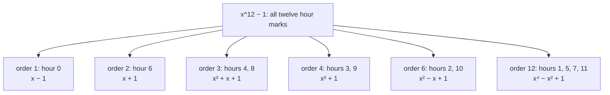
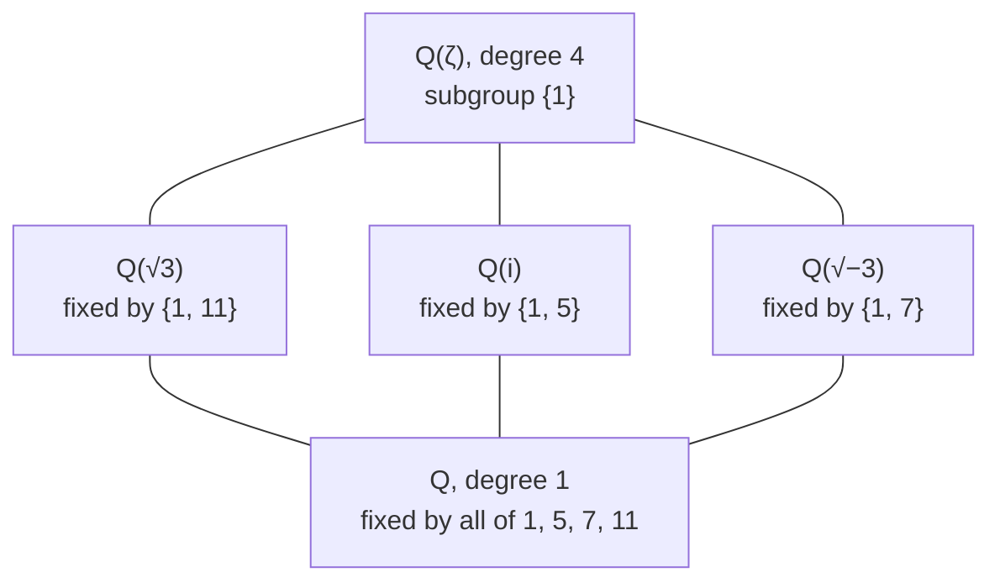

# Cyclotomic fields: the nth roots of one, with the invertible remainders as symmetries

[Syllabus](../../../SYLLABUS.md) → [Algebraic and analytic number theory](../README.md) → [Fields and Galois Theory](../README.md#s05) → Cyclotomic fields

---

## General Overview

Put a clock face on the complex plane: centre at 0, radius 1, hour 0 (the twelve) pointing east and the hours counted anticlockwise. The twelve hour marks are then the twelve complex numbers whose 12th power is 1, the **twelfth roots of unity** (unity is the old word for 1). Hour 1 sits at 30 degrees: the number $`\zeta = 0.866025 + 0.5i`$, read "zeta". Hour k is $`\zeta^k`$, zeta multiplied by itself k times.

A hand that jumps k hours at a time visits every mark only for k = 1, 5, 7 or 11, the hours that share no factor with 12. Those four marks are the **primitive** twelfth roots. The [Powers and roots](../../07-Complex%20analysis/01-Complex%20Numbers%20and%20the%20Plane/05-powers-roots-and-roots-of-unity.md) card showed that the marks of any such clock with two or more hours add to zero, named the primitive ones, and stopped there.

This card asks what the rationals can say about $`\zeta`$. The smallest field (a number system closed under the four operations) holding the rationals and $`\zeta`$ is the **cyclotomic field** $`\mathbb{Q}(\zeta)`$; "cyclotomic" is Greek for circle-cutting. Three facts come out, all by counting:

- **Degree 4.** $`\zeta`$ satisfies a rational equation of degree 4, $`x^4 - x^2 + 1 = 0`$, and none smaller. Every number in the field is a sum of rational multiples of $`1, \zeta, \zeta^2, \zeta^3`$.
- **Four symmetries.** Sending $`\zeta`$ to $`\zeta^5`$, $`\zeta^7`$ or $`\zeta^{11}`$, or leaving it alone, are the only ways to shuffle the field that respect all arithmetic. They combine by multiplying exponents and wrapping at 12.
- **Three middle fields.** Each symmetry other than doing nothing fixes one square root: $`\sqrt{3}`$, $`i`$ or $`\sqrt{-3}`$. So the field contains exactly three fields of degree 2.

**The nth roots of unity generate a field of degree φ(n) over the rationals, φ(n) being the count of exponents from 1 to n sharing no factor with n; its symmetries are the remainders mod n that have a multiplicative undo, and every middle field matches a subgroup of those remainders.**

**What kind of fact this is:** a theorem, proved on this card in Why it works: the degree, the symmetry group, and the middle fields through the Galois correspondence. The mod-p factor counts are a theorem too, proved through the orbit argument of [Finite fields](09-finite-fields-and-frobenius.md) and checked here on every prime from 5 to 97.

### The picture: the twelve hour marks, sorted by order



The **order** of a mark is how many jumps of that size bring the hand home. Each box multiplies out the factors $`(x - \zeta^k)`$ over its own marks; the six boxes together rebuild $`x^{12} - 1`$. The last box is the new object of this card.

---

## The formula

Notation first, in words. $`\zeta_n`$ is the first nth root of unity, $`\cos(2\pi/n) + i\sin(2\pi/n)`$; on this card $`\zeta`$ alone means $`\zeta_{12}`$. $`\varphi(n)`$ (the totient, from wing 02) counts the whole numbers from 1 to n sharing no factor with n. $`[L:K]`$ is the degree of a field L over a smaller field K: how many numbers in L it takes to write every other one with coefficients from K ([Field extensions](01-field-extensions-and-degree.md)). $`\mathrm{Gal}(L/K)`$ is the group of symmetries of L that fix every number in K ([The Galois correspondence](05-galois-groups-and-the-fundamental-theorem.md)).

The **cyclotomic polynomial** $`\Phi_n(x)`$ multiplies out one factor for each primitive nth root:

```math
\Phi_n(x) = \prod_{\gcd(k,\,n) = 1,\ 1 \le k \le n} \bigl(x - \zeta_n^{\,k}\bigr), \qquad x^n - 1 = \prod_{d \mid n} \Phi_d(x)
```

**Read it aloud:** Phi n is the product of x minus each primitive nth root; and x to the n minus 1 is the product of Phi d over every divisor d of n.

The main result:

```math
[\mathbb{Q}(\zeta_n):\mathbb{Q}] = \deg \Phi_n = \varphi(n), \qquad \mathrm{Gal}(\mathbb{Q}(\zeta_n)/\mathbb{Q}) \cong (\mathbb{Z} \bmod n)^{\times}, \quad \sigma_k(\zeta_n) = \zeta_n^{\,k}
```

**Read it aloud:** the field of nth roots of unity has degree phi of n over the rationals; its symmetries match the invertible remainders mod n, the symmetry for k sending zeta to zeta to the k.

With n = 12: $`\Phi_{12}(x) = x^4 - x^2 + 1`$, degree $`\varphi(12) = 4`$, and the symmetries are $`\sigma_1, \sigma_5, \sigma_7, \sigma_{11}`$.

| Symbol | Plain meaning | In our example | Push it up and the answer… |
| --- | --- | --- | --- |
| $`n`$ | how many equal parts the circle is cut into | 12 | the degree grows roughly like n, but jumps about |
| $`\zeta`$, $`\zeta_n`$ | the first nth root of unity, one step round the circle | $`0.866025 + 0.5i`$, hour 1 | — |
| $`k`$, $`d`$ | k: an exponent, or which hour mark; d: a divisor of n | k = 1, 5, 7, 11; d = 1, 2, 3, 4, 6, 12 | — |
| $`\Phi_n(x)`$ | cyclotomic polynomial: the primitive roots multiplied out | $`x^4 - x^2 + 1`$ | longer, with integer coefficients |
| $`\varphi(n)`$ | totient: how many k from 1 to n share no factor with n | 4 | more symmetries, bigger field |
| $`\mathbb{Q}(\zeta)`$ | the smallest field holding the rationals and $`\zeta`$ | sums of rational multiples of $`1, \zeta, \zeta^2, \zeta^3`$ | — |
| $`[L:K]`$, $`\deg`$ | degree of field L over K (here $`[\mathbb{Q}(\zeta):\mathbb{Q}]`$); a polynomial's top power | 4 and 4 | — |
| $`(\mathbb{Z} \bmod n)^{\times}`$ | remainders mod n with a multiplicative undo, under multiplication | 1, 5, 7, 11 | — |
| $`\sigma_k`$, $`\mathrm{Gal}`$ | the symmetry sending $`\zeta`$ to $`\zeta^k`$; Gal: the group of all such symmetries | $`\sigma_{11}`$ is complex conjugation; four members, each its own undo | — |
| $`H`$, $`L^H`$ | a subgroup, and the numbers every member of it fixes | $`H = \{1, 11\}`$, $`L^H = \mathbb{Q}(\sqrt{3})`$ | bigger H, smaller fixed field |
| $`p`$ | a prime, for reading $`\Phi_n`$ mod p | 5, 13 | — |
| $`x`$; $`a, b, c, e`$; $`f, g`$ | the unknown in a polynomial; whole numbers used as coefficients (Step 2), exponents (Step 3) or remainders (the fold); f, the minimal polynomial of $`\zeta_n`$, and g, the other factor of $`\Phi_n`$ (the fold) | Step 2's trial split $`(x^2 + ax + b)(x^2 + cx + e)`$ | — |

### When it holds

- **The base field is the rationals.** Over a bigger or different field the polynomial can split. Over GF(5), the field of remainders mod 5, $`\Phi_{12}`$ breaks into two quadratics and the degree falls to 2.
- **The root is primitive.** A root of lower order makes a smaller field: hour 2 is a sixth root, $`\mathbb{Q}(\zeta^2)`$ has degree 2, and $`\zeta \mapsto \zeta^2`$ is no symmetry of $`\mathbb{Q}(\zeta)`$.
- **The exponent has an undo mod n.** Only k with $`\gcd(k, n) = 1`$ give symmetries; the count is φ(n), not n or n − 1. Treating 12 like a prime gives degree 11, which is wrong.
- **The group is abelian, not always cyclic.** Abelian means the order of combining never matters. $`(\mathbb{Z} \bmod 12)^{\times}`$ has no member of order 4, so it is not cyclic, and the field has three middle fields, not one.
- **A normal field with an abelian group lives inside a cyclotomic one.** Every normal field over the rationals (one holding every conjugate of its members, from [Normal and separable](04-normal-and-separable-extensions.md)) whose symmetry group is abelian sits inside some cyclotomic field. This is the Kronecker–Weber theorem: proved, but only stated here (proof in Washington, under Sources). Drop "normal" and it fails: the symmetries of $`\mathbb{Q}(\sqrt[4]{2})`$ commute, yet the field holds $`\sqrt[4]{2}`$ and not its conjugate $`i\sqrt[4]{2}`$, while every field inside a cyclotomic one is normal, since every subgroup of an abelian group is normal. The house example's field for $`x^4 - 2`$ is normal, but its eight symmetries do not commute, so it sits in no cyclotomic field either.

---

## Why it works

### Step 0: a symmetry can only send a root to a root of the same equations

A symmetry of a field keeps every rational number fixed and respects addition and multiplication. So whatever rational equation $`\zeta`$ satisfies, its image satisfies too. $`\zeta^{12} = 1`$, and no smaller power of $`\zeta`$ is 1, so the image of $`\zeta`$ is again a primitive twelfth root: $`\zeta^k`$ with k = 1, 5, 7 or 11.

So there are at most four symmetries. Steps 1 to 3 show all four exist: the four primitive roots share one equation that cannot be factored.

### Step 1: the cyclotomic polynomial has integer coefficients

Every twelfth root of unity has an order d dividing 12, so $`x^{12} - 1`$ is the product of $`\Phi_d`$ over the divisors, as the picture showed. Peel off the smaller ones:

```math
\Phi_{12}(x) = \frac{x^{12} - 1}{\Phi_1\Phi_2\Phi_3\Phi_4\Phi_6} = \frac{x^{12} - 1}{(x^6 - 1)(x^2 + 1)} = \frac{x^6 + 1}{x^2 + 1} = x^4 - x^2 + 1
```

Here $`\Phi_1\Phi_2\Phi_3\Phi_6 = x^6 - 1`$, the sixth roots. Each division is by a polynomial with leading coefficient 1 and integer coefficients, so no fractions ever appear. By induction on n, every $`\Phi_n`$ has integer coefficients, and its degree is the number of primitive roots, φ(n).

Check at hour 1: $`\zeta^4 = -0.5 + 0.866025i`$ and $`\zeta^2 = 0.5 + 0.866025i`$, so $`\zeta^4 - \zeta^2 + 1 = -1 + 1 = 0`$.

### Step 2: the polynomial does not factor, so the degree is φ(n)

For n = 12 this is a finite check. A rational root would have to be 1 or −1, and $`\Phi_{12}(1) = \Phi_{12}(-1) = 1`$. A split into two quadratics can be taken with integer coefficients (Gauss's lemma, [Minimal polynomials](02-minimal-polynomials-and-conjugates.md)): $`(x^2 + ax + b)(x^2 + cx + e)`$ with whole numbers a, b, c, e and $`be = 1`$. Matching coefficients forces $`c = -a`$ and then $`a^2 = 3`$ or $`a^2 = -1`$. No integer works.

So $`x^4 - x^2 + 1`$ is the **minimal polynomial** of $`\zeta`$: the lowest-degree rational equation it satisfies. Its degree is the field's degree, $`[\mathbb{Q}(\zeta):\mathbb{Q}] = 4`$.

For every n there is one argument. Its idea: if $`\zeta`$ is a root of a factor f, so is $`\zeta^p`$ for each prime p not dividing n. Reducing mod p turns "raise to the power p" into an operation that respects addition, and $`x^n - 1`$ has no repeated roots mod p, so $`\zeta^p`$ cannot escape to another factor. For 12, one step each: $`\zeta^5`$, $`\zeta^7`$ and $`\zeta^{11}`$ are single prime powers of $`\zeta`$.

<details>
<summary>Detailed proof: every cyclotomic polynomial is irreducible over the rationals</summary>

Let f be the minimal polynomial of $`\zeta_n`$. It divides $`\Phi_n`$, so $`\Phi_n = fg`$ for a second polynomial g, and by Gauss's lemma f and g can be taken with integer coefficients and leading coefficient 1.

Take a prime p not dividing n and suppose $`f(\zeta_n^{\,p}) \ne 0`$. Then $`g(\zeta_n^{\,p}) = 0`$, so $`\zeta_n`$ is a root of $`g(x^p)`$, and f divides $`g(x^p)`$.

Now reduce every coefficient mod p. Mod p, $`(a + b)^p = a^p + b^p`$ and $`c^p = c`$ for each remainder c (Fermat), so $`g(x^p) = g(x)^p`$ mod p. Any irreducible factor of f mod p therefore divides g mod p as well.

Then $`\Phi_n = fg`$ has a repeated factor mod p, and so does $`x^n - 1`$. But a repeated root of $`x^n - 1`$ is also a root of its derivative $`n x^{n-1}`$, and mod p that has only the root 0, which $`x^n - 1`$ lacks. Contradiction: $`f(\zeta_n^{\,p}) = 0`$.

Every k with $`\gcd(k, n) = 1`$ is a product of primes not dividing n, so applying the step one prime at a time gives $`f(\zeta_n^{\,k}) = 0`$. Thus f has all φ(n) primitive roots as roots, and $`f = \Phi_n`$.

</details>

### Step 3: the symmetries are the invertible remainders

All four primitive roots are roots of one irreducible polynomial, so the field cannot tell them apart: $`\mathbb{Q}(\zeta)`$ is the splitting field of $`x^{12} - 1`$, and for each k in 1, 5, 7, 11 there is a symmetry $`\sigma_k`$ with $`\sigma_k(\zeta) = \zeta^k`$ ([Splitting fields](03-splitting-fields-and-algebraic-closure.md)). A symmetry is fixed by where it sends $`\zeta`$, since everything in the field is built from $`\zeta`$.

Doing $`\sigma_a`$ then $`\sigma_b`$ sends $`\zeta`$ to $`\zeta^a`$ and then to $`(\zeta^b)^a = \zeta^{ab}`$. So composing symmetries multiplies exponents, wrapping at 12:

| × mod 12 | 1 | 5 | 7 | 11 |
| --- | --- | --- | --- | --- |
| **1** | 1 | 5 | 7 | 11 |
| **5** | 5 | 1 | 11 | 7 |
| **7** | 7 | 11 | 1 | 5 |
| **11** | 11 | 7 | 5 | 1 |

The diagonal is all 1s: 25, 49 and 121 each leave remainder 1. Every symmetry is its own undo. A group of four where each member undoes itself is not cyclic, since no single member reaches all four ([Subgroups and cyclic groups](../../03-Algebra/08-Groups/02-subgroups-and-cyclic-groups.md)).

### Step 4: subgroups give the middle fields

The Galois correspondence, in one line: subgroups H of the symmetry group match the fields between $`\mathbb{Q}`$ and $`\mathbb{Q}(\zeta)`$, each H going to $`L^H`$, the numbers every member of H fixes ([The Galois correspondence](05-galois-groups-and-the-fundamental-theorem.md)). A subgroup of 2 members fixes a field of degree 4 / 2 = 2.

The group has five subgroups: the trivial one, three of the form $`\{1, k\}`$, and the whole group. To find each fixed field, find a number $`\sigma_k`$ leaves alone:

| Subgroup | A number it fixes | Value | Its square | Middle field |
| --- | --- | --- | --- | --- |
| $`\{1, 11\}`$ | $`\zeta + \zeta^{11}`$ | 1.732051 | 3 | $`\mathbb{Q}(\sqrt{3})`$ |
| $`\{1, 5\}`$ | $`\zeta^3`$, hour 3 | $`i`$ | −1 | $`\mathbb{Q}(i)`$ |
| $`\{1, 7\}`$ | $`2\zeta^2 - 1`$ | 1.732051i | −3 | $`\mathbb{Q}(\sqrt{-3})`$ |

Why each is fixed: $`\sigma_{11}`$ swaps $`\zeta`$ and $`\zeta^{11}`$, so their sum stays. $`\sigma_5`$ sends $`\zeta^3`$ to $`\zeta^{15} = \zeta^3`$. $`\sigma_7`$ sends $`\zeta^2`$ to $`\zeta^{14} = \zeta^2`$. The other two symmetries flip each number's sign, so it is not rational.

### The picture: five subgroups, five fields



Each line is a step of degree 2. Bigger subgroups fix smaller fields, so the picture of fields is the picture of subgroups turned upside down.

### Step 5: a second road, through primes

Read $`\Phi_{12}`$ mod a prime p. Its four roots then live in a finite field, still primitive twelfth roots of 1, and Frobenius, raising to the power p, moves each root to its pth power. A root comes back to itself after as many moves as the **order of p mod 12**: the smallest exponent that makes a power of p leave remainder 1 on division by 12. The orbit argument of [Finite fields](09-finite-fields-and-frobenius.md), Step 7, makes each such orbit the roots of one irreducible factor, so $`\Phi_{12}`$ breaks into factors whose degree is that order.

Since every unit mod 12 squares to 1, every factor has degree 1 or 2. The code checks the 23 primes from 5 to 97: $`\Phi_{12}`$ has four roots mod p exactly for 13, 37, 61, 73 and 97, the primes leaving remainder 1 on division by 12, and none for the other 18. Mod 5 it is $`(x^2 + 2x + 4)(x^2 + 3x + 4)`$.

Read backwards, this is a second road to the group: factor patterns mod many primes never show a symmetry of order 4, which points to a group that is not cyclic; Chebotarev's theorem, on shelf 06, makes that inference exact. That is the cycle-type method of [Computing a Galois group](06-computing-a-galois-group.md). The 23 primes are evidence; the factor rule itself is proved, by that orbit argument.

---

## Worked numbers, by hand

| Step | Arithmetic | Value |
| --- | --- | --- |
| hour 1 | $`\cos 30° + i\sin 30°`$ | $`\zeta = 0.866025 + 0.5i`$ |
| primitive exponents | k from 1 to 12 sharing no factor with 12 | 1, 5, 7, 11; $`\varphi(12) = 4`$ |
| peel off smaller orders | $`(x^{12} - 1) / ((x^6 - 1)(x^2 + 1)) = (x^6 + 1)/(x^2 + 1)`$ | $`x^4 - x^2 + 1`$ |
| no factor | roots ±1 give 1; quadratics need $`a^2 = 3`$ or $`-1`$ | irreducible |
| degree | the minimal polynomial's degree | **4** |
| the symmetries | 25, 49, 121 leave remainder 1 mod 12 | **four, each its own undo** |
| subgroups of order 2 | {1, 5}, {1, 7}, {1, 11} | **three middle fields** |
| fixed numbers | $`(\zeta + \zeta^{11})^2`$, $`(\zeta^3)^2`$, $`(2\zeta^2 - 1)^2`$ | 3, −1, −3 |

The field of twelfth roots of unity is four-dimensional over the rationals, has four symmetries that never reach order 4, and holds exactly $`\mathbb{Q}(\sqrt{3})`$, $`\mathbb{Q}(i)`$ and $`\mathbb{Q}(\sqrt{-3})`$ between the bottom and the top.

### What breaks if you drop a piece

| Mistake | Comes out at | What went wrong |
| --- | --- | --- |
| 12 treated like a prime: $`1 + x + \dots + x^{11}`$ | degree 11 | it factors as $`\Phi_2\Phi_3\Phi_4\Phi_6\Phi_{12}`$, degrees 1, 2, 2, 2, 4 |
| $`\zeta \mapsto \zeta^2`$ taken as a symmetry | $`\Phi_{12}(\zeta^2) = 1 - 1.732051i`$, not 0 | 2 has no undo mod 12; hour 2 is a sixth root |
| group taken as cyclic, like n = 5 | 1 middle field | $`(\mathbb{Z} \bmod 12)^{\times}`$ has three members of order 2, so 3 middle fields |
| base field GF(5) instead of the rationals | degree 2 | $`\Phi_{12} = (x^2 + 2x + 4)(x^2 + 3x + 4)`$ mod 5 |

The code prints all four.

---

## Code, from first principles, and it actually runs

The code works with exact integer polynomials, lowest power first, and reduces mod $`\Phi_{12}`$ to compute inside $`\mathbb{Q}(\zeta)`$. It reaches each answer by two independent roads:

- $`\Phi_{12}`$: exact division of $`x^{12} - 1`$ by the smaller cyclotomic polynomials, against multiplying out $`(x - \zeta^k)`$ in floating point.
- The symmetries: which substitutions $`x \mapsto x^k`$ send $`\Phi_{12}`$ to 0 mod itself, against which k share no factor with 12.
- The degree φ(n) for n from 1 to 12: division against the gcd count.
- The mod-p rule: brute-force root counts for each prime below 100, against the remainder of p mod 12.

The middle fields are found by exact symmetry tests and confirmed by squaring. Python's `pow(a, e, n)` is used as a tool; Rust writes its own.

### Python

```python
# Cyclotomic fields -- the check behind the card.  Standard library only.
# The twelfth roots of unity.  Polynomials are integer lists, lowest power
# first.  Phi_12 is built two ways (exact division, and a product over the
# primitive roots in floating point); the symmetries are found two ways (which
# substitutions x -> x^k keep Phi_12 at zero, and which k share no factor with 12).
import cmath
import math

def trim(p):
    while len(p) > 1 and p[-1] == 0:
        p = p[:-1]
    return p

def mul(p, q, m=0):
    out = [0] * (len(p) + len(q) - 1)
    for i, a in enumerate(p):
        for j, b in enumerate(q):
            out[i + j] += a * b
    return trim([c % m for c in out] if m else out)

def divmod_monic(p, d, m=0):                   # long division by a monic d
    p, q = p[:], [0] * max(1, len(p) - len(d) + 1)
    for s in range(len(p) - len(d), -1, -1):
        c = p[s + len(d) - 1]
        q[s] = c
        for j, b in enumerate(d):
            p[s + j] -= c * b
    p = [c % m for c in p] if m else p
    return trim(q), trim(p[:len(d) - 1] or [0])

def cyclo(n):                                  # road one: x^n - 1 over Phi_d, d | n, d < n
    p = [-1] + [0] * (n - 1) + [1]
    for d in range(1, n):
        if n % d == 0:
            p, r = divmod_monic(p, cyclo(d))
            assert r == [0]
    return p

def by_roots(n):                               # road two: product of (x - zeta^k), k coprime to n
    p = [1 + 0j]
    for k in [k for k in range(1, n + 1) if math.gcd(k, n) == 1]:
        z = cmath.exp(2j * math.pi * k / n)
        p = [(p[i - 1] if i else 0) - z * (p[i] if i < len(p) else 0) for i in range(len(p) + 1)]
    return [round(c.real) for c in p]

def units(n): return [k for k in range(1, n) if math.gcd(k, n) == 1]
def order(a, n): return next(e for e in range(1, n + 1) if pow(a, e, n) == 1)
def show(p):
    terms = [(c, ("" if abs(c) == 1 and i else str(abs(c))) + ("x" if i else "") + (f"^{i}" if i > 1 else ""))
             for i, c in reversed(list(enumerate(p))) if c]
    return " ".join((("- " if c < 0 else "+ ") if j else "-" if c < 0 else "") + t for j, (c, t) in enumerate(terms))
def num(z):
    re, im = round(z.real, 6) + 0.0, round(z.imag, 6) + 0.0
    return f"{re:.6f} {'-' if im < 0 else '+'} {abs(im):.6f}i"

N, PHI = 12, cyclo(12)
red = lambda p: divmod_monic(p, PHI)[1]                  # reduce modulo Phi_12: work in Q(zeta)
xp = lambda k: red([0] * k + [1])                        # zeta^k, as a polynomial of degree < 4
def sub(p, k):                                 # apply the substitution x -> x^k, then reduce
    out = [0]
    for i, c in enumerate(p):
        t = mul([c], xp(k * i))
        out = [a + b for a, b in zip(out + [0] * len(t), t + [0] * len(out))]
    return red(trim(out))
zeta = cmath.exp(2j * math.pi / N)
val = lambda p: sum(c * zeta ** i for i, c in enumerate(p))

print(f"zeta = e^(2 pi i/12) = {num(zeta)}; exponents sharing no factor with 12: {units(N)}; phi(12) = {len(units(N))}")
for d in (1, 2, 3, 4, 6, 12):
    print(f"  hours of order {d:>2}: {[k for k in range(N) if N // math.gcd(k, N) == d]}; Phi_{d} = {show(cyclo(d))}")
print(f"Phi_12 by dividing x^12 - 1 by Phi_1 Phi_2 Phi_3 Phi_4 Phi_6: {show(PHI)}")
print(f"Phi_12 by multiplying out (x - zeta^k), k = 1, 5, 7, 11: {show(by_roots(N))}")
print(f"(x^6 + 1) / (x^2 + 1) = {show(divmod_monic([1, 0, 0, 0, 0, 0, 1], [1, 0, 1])[0])}")
print(f"zeta^2 = {num(zeta ** 2)}, zeta^4 = {num(zeta ** 4)}; Phi_12(zeta) = {num(val(PHI))}; Phi_12(1) = {sum(PHI)}, Phi_12(-1) = {sum(c * (-1) ** i for i, c in enumerate(PHI))}")
quads = [(a, b, c, d) for a in range(-5, 6) for c in range(-5, 6) for b in (1, -1) for d in (1, -1)
         if mul([b, a, 1], [d, c, 1]) == PHI]
print(f"factorisations into two integer quadratics (a, c from -5 to 5): {len(quads)}; b = e = 1 or -1 forces a^2 = {' or '.join(str(b + b - PHI[2]) for b in (1, -1))}; so degree [Q(zeta):Q] = {len(PHI) - 1}")
degs = [len(cyclo(n)) - 1 for n in range(1, 13)]
print(f"n = 1..12, degree of Phi_n: {degs}; phi(n): {[len(units(n)) if n > 1 else 1 for n in range(1, 13)]}; phi(17) = {len(units(17))}")
keeps = [k for k in range(N) if sub(PHI, k) == [0]]
print(f"substitutions x -> x^k that keep Phi_12 at zero: k = {keeps}")
print(f"mistake 2, x -> x^2: Phi_12(zeta^2) reduces to {show(sub(PHI, 2))}, value {num(val(sub(PHI, 2)))}")
compose_ok = all(sub(xp(a), b) == xp(a * b % N) for a in keeps for b in keeps)
print(f"applying k = a then k = b equals k = ab mod 12, for all 16 pairs: {'yes' if compose_ok else 'no'}; squares {[a * a for a in keeps]}")
for a in keeps:
    print(f"  {a:>2} x {keeps} mod 12 = {[a * b % N for b in keeps]}; order {order(a, N)}")
alpha = {11: ([0, 1] + [0] * 9 + [1], "zeta + zeta^11"), 5: ([0, 0, 0, 1], "zeta^3"), 7: ([-1, 0, 2], "2 zeta^2 - 1")}
for k, (p, name) in alpha.items():
    p = red(p)
    signs = ["fixed" if sub(p, j) == p else "negated" if sub(p, j) == [-c for c in p] else "moved" for j in keeps]
    print(f"fixed by k = {k:>2}: {name} = {num(val(p))}; square = {show(red(mul(p, p)))}; under k = {keeps}: {', '.join(signs)}")
subgroups = [s for r in range(1, 5) for s in __import__("itertools").combinations(keeps, r)
             if 1 in s and all(a * b % N in s for a in s for b in s)]
print(f"subgroups of (Z mod 12)^x: {[list(s) for s in subgroups]}; count {len(subgroups)}")
for n in (5, 8, 12):
    print(f"n = {n:>2}: Phi_n = {show(cyclo(n))}; largest order {max(order(a, n) for a in units(n))}; "
          f"elements of order 2 (quadratic subfields) {sum(order(a, n) == 2 for a in units(n))}")
P = [p for p in range(5, 101) if all(p % q for q in range(2, p))]
def powmod_x(e, p):                           # x^e modulo (Phi_12, p), by repeated squaring
    out, b = [1], [0, 1]
    while e:
        out, b, e = (divmod_monic(mul(out, b, p), PHI, p)[1] if e & 1 else out), divmod_monic(mul(b, b, p), PHI, p)[1], e >> 1
    return out
roots = {p: sum(sum(c * pow(t, i, p) for i, c in enumerate(PHI)) % p == 0 for t in range(p)) for p in P}
print(f"primes 5 to 100 where Phi_12 has 4 roots mod p: {[p for p in P if roots[p] == 4]}; residues mod 12: {sorted({p % 12 for p in P if roots[p] == 4})}")
print(f"primes with 0 roots: {sum(roots[p] == 0 for p in P)}; other root counts: {sum(roots[p] not in (0, 4) for p in P)}; "
      f"largest order of p mod 12: {max(order(p % 12, 12) for p in P)}")
print(f"x^(p^2) = x modulo (Phi_12, p) for every one of the {len(P)} primes: {'yes' if all(powmod_x(p * p, p) == [0, 1] for p in P) else 'no'}")
f5 = [(a, b) for a in range(5) for b in range(5) if divmod_monic(PHI, [b, a, 1], 5)[1] == [0]]
print(f"mod 5 the monic quadratic factors x^2 + ax + b are (a, b) = {f5}; degree over GF(5) = {order(5, 12)}")
print(f"mistake 1, 12 treated as prime: (x^12 - 1)/(x - 1) has degree {len(divmod_monic([-1] + [0] * 11 + [1], [-1, 1])[0]) - 1}, "
      f"= Phi_2 Phi_3 Phi_4 Phi_6 Phi_12, degrees {[degs[d - 1] for d in (2, 3, 4, 6, 12)]}")
print(f"mistake 3, group taken as cyclic like n = 5: {sum(order(a, 5) == 2 for a in units(5))} quadratic subfield predicted; "
      f"true count {sum(order(a, N) == 2 for a in keeps)}")
assert PHI == by_roots(N) == [1, 0, -1, 0, 1]                    # two roads to Phi_12
assert quads == [] and abs(val(PHI)) < 1e-12                       # zeta is a root; no factorisation
assert keeps == units(N) and compose_ok                            # two roads to the symmetries
assert degs == [1] + [len(units(n)) for n in range(2, 13)]         # degree = phi(n), division vs gcd count
assert all(red(mul(red(p), red(p))) == [s] for (p, _), s in zip(alpha.values(), (3, -1, -3)))
assert [p for p in P if roots[p] == 4] == [p for p in P if p % 12 == 1] and f5 == [(2, 4), (3, 4)]
assert all(powmod_x(p * p, p) == [0, 1] for p in P)                # every factor mod p has degree 1 or 2
print("ALL CHECKS PASS")
```

**Ran 2026-11-15 on macOS, Python 3.14.10, standard library only. All checks passed. Output, pasted from the run:**

```
zeta = e^(2 pi i/12) = 0.866025 + 0.500000i; exponents sharing no factor with 12: [1, 5, 7, 11]; phi(12) = 4
  hours of order  1: [0]; Phi_1 = x - 1
  hours of order  2: [6]; Phi_2 = x + 1
  hours of order  3: [4, 8]; Phi_3 = x^2 + x + 1
  hours of order  4: [3, 9]; Phi_4 = x^2 + 1
  hours of order  6: [2, 10]; Phi_6 = x^2 - x + 1
  hours of order 12: [1, 5, 7, 11]; Phi_12 = x^4 - x^2 + 1
Phi_12 by dividing x^12 - 1 by Phi_1 Phi_2 Phi_3 Phi_4 Phi_6: x^4 - x^2 + 1
Phi_12 by multiplying out (x - zeta^k), k = 1, 5, 7, 11: x^4 - x^2 + 1
(x^6 + 1) / (x^2 + 1) = x^4 - x^2 + 1
zeta^2 = 0.500000 + 0.866025i, zeta^4 = -0.500000 + 0.866025i; Phi_12(zeta) = 0.000000 + 0.000000i; Phi_12(1) = 1, Phi_12(-1) = 1
factorisations into two integer quadratics (a, c from -5 to 5): 0; b = e = 1 or -1 forces a^2 = 3 or -1; so degree [Q(zeta):Q] = 4
n = 1..12, degree of Phi_n: [1, 1, 2, 2, 4, 2, 6, 4, 6, 4, 10, 4]; phi(n): [1, 1, 2, 2, 4, 2, 6, 4, 6, 4, 10, 4]; phi(17) = 16
substitutions x -> x^k that keep Phi_12 at zero: k = [1, 5, 7, 11]
mistake 2, x -> x^2: Phi_12(zeta^2) reduces to -2x^2 + 2, value 1.000000 - 1.732051i
applying k = a then k = b equals k = ab mod 12, for all 16 pairs: yes; squares [1, 25, 49, 121]
   1 x [1, 5, 7, 11] mod 12 = [1, 5, 7, 11]; order 1
   5 x [1, 5, 7, 11] mod 12 = [5, 1, 11, 7]; order 2
   7 x [1, 5, 7, 11] mod 12 = [7, 11, 1, 5]; order 2
  11 x [1, 5, 7, 11] mod 12 = [11, 7, 5, 1]; order 2
fixed by k = 11: zeta + zeta^11 = 1.732051 + 0.000000i; square = 3; under k = [1, 5, 7, 11]: fixed, negated, negated, fixed
fixed by k =  5: zeta^3 = 0.000000 + 1.000000i; square = -1; under k = [1, 5, 7, 11]: fixed, fixed, negated, negated
fixed by k =  7: 2 zeta^2 - 1 = 0.000000 + 1.732051i; square = -3; under k = [1, 5, 7, 11]: fixed, negated, fixed, negated
subgroups of (Z mod 12)^x: [[1], [1, 5], [1, 7], [1, 11], [1, 5, 7, 11]]; count 5
n =  5: Phi_n = x^4 + x^3 + x^2 + x + 1; largest order 4; elements of order 2 (quadratic subfields) 1
n =  8: Phi_n = x^4 + 1; largest order 2; elements of order 2 (quadratic subfields) 3
n = 12: Phi_n = x^4 - x^2 + 1; largest order 2; elements of order 2 (quadratic subfields) 3
primes 5 to 100 where Phi_12 has 4 roots mod p: [13, 37, 61, 73, 97]; residues mod 12: [1]
primes with 0 roots: 18; other root counts: 0; largest order of p mod 12: 2
x^(p^2) = x modulo (Phi_12, p) for every one of the 23 primes: yes
mod 5 the monic quadratic factors x^2 + ax + b are (a, b) = [(2, 4), (3, 4)]; degree over GF(5) = 2
mistake 1, 12 treated as prime: (x^12 - 1)/(x - 1) has degree 11, = Phi_2 Phi_3 Phi_4 Phi_6 Phi_12, degrees [1, 2, 2, 2, 4]
mistake 3, group taken as cyclic like n = 5: 1 quadratic subfield predicted; true count 3
ALL CHECKS PASS
```

### Rust

Same numbers, same labels, built with `rustc --edition 2021 -O`.

```rust
// Cyclotomic fields -- the same check as the Python, in Rust.  No crates.
// The twelfth roots of unity.  Polynomials are integer vectors, lowest power
// first.  Phi_12 is built two ways (exact division, and a product over the
// primitive roots in floating point); the symmetries are found two ways (which
// substitutions x -> x^k keep Phi_12 at zero, and which k share no factor with 12).
type P = Vec<i64>;
#[derive(Clone, Copy)]
struct C { re: f64, im: f64 }
fn cm(a: C, b: C) -> C { C { re: a.re * b.re - a.im * b.im, im: a.re * b.im + a.im * b.re } }
fn cis(t: f64) -> C { C { re: t.cos(), im: t.sin() } }
fn r6(x: f64) -> f64 { (x * 1e6).round() / 1e6 + 0.0 }
fn num(z: C) -> String { let (re, im) = (r6(z.re), r6(z.im)); format!("{:.6} {} {:.6}i", re, if im < 0.0 { "-" } else { "+" }, im.abs()) }

fn trim(mut p: P) -> P { while p.len() > 1 && *p.last().unwrap() == 0 { p.pop(); } p }
fn md(p: P, m: i64) -> P { if m > 0 { p.iter().map(|c| c.rem_euclid(m)).collect() } else { p } }
fn mul(p: &P, q: &P, m: i64) -> P {
    let mut out = vec![0i64; p.len() + q.len() - 1];
    for (i, a) in p.iter().enumerate() { for (j, b) in q.iter().enumerate() { out[i + j] += a * b; } }
    trim(md(out, m))
}
fn divmod_monic(p: &P, d: &P, m: i64) -> (P, P) {     // long division by a monic d
    let mut p = p.clone();
    let mut q = vec![0i64; std::cmp::max(1, p.len() as i64 - d.len() as i64 + 1) as usize];
    for s in (0..(p.len() + 1).saturating_sub(d.len())).rev() {
        let c = p[s + d.len() - 1];
        q[s] = c;
        for (j, b) in d.iter().enumerate() { p[s + j] -= c * b; }
    }
    let p = md(p, m);
    let r: P = if d.len() > 1 { p[..std::cmp::min(d.len() - 1, p.len())].to_vec() } else { vec![] };
    (trim(q), trim(if r.is_empty() { vec![0] } else { r }))
}
fn gcd(a: i64, b: i64) -> i64 { if b == 0 { a } else { gcd(b, a % b) } }  // Euclid
fn cyclo(n: usize) -> P {                             // road one: x^n - 1 over Phi_d, d | n, d < n
    let mut p = vec![0i64; n + 1]; p[0] = -1; p[n] = 1;
    for d in 1..n { if n % d == 0 { let (q, r) = divmod_monic(&p, &cyclo(d), 0); assert!(r == vec![0]); p = q; } }
    p
}
fn units(n: i64) -> Vec<i64> { (1..n).filter(|&k| gcd(k, n) == 1).collect() }
fn by_roots(n: i64) -> P {                            // road two: product of (x - zeta^k), k coprime to n
    let mut p = vec![C { re: 1.0, im: 0.0 }];
    for k in units(n).into_iter().chain(if n == 1 { vec![1] } else { vec![] }) {
        let z = cis(2.0 * std::f64::consts::PI * k as f64 / n as f64);
        let mut q = Vec::new();
        for i in 0..=p.len() {
            let prev = if i > 0 { p[i - 1] } else { C { re: 0.0, im: 0.0 } };
            let cur = if i < p.len() { cm(z, p[i]) } else { C { re: 0.0, im: 0.0 } };
            q.push(C { re: prev.re - cur.re, im: prev.im - cur.im });
        }
        p = q;
    }
    p.iter().map(|c| c.re.round() as i64).collect()
}
fn modpow(a: i64, mut e: i64, n: i64) -> i64 { let (mut out, mut b) = (1 % n, a.rem_euclid(n)); while e > 0 { if e & 1 == 1 { out = out * b % n; } b = b * b % n; e >>= 1; } out }
fn order(a: i64, n: i64) -> i64 { (1..=n).find(|&e| modpow(a, e, n) == 1).unwrap() }
fn show(p: &P) -> String {
    let mut parts = Vec::new();
    for (j, (i, &c)) in p.iter().enumerate().rev().filter(|(_, &c)| c != 0).enumerate() {
        let coef = if c.abs() == 1 && i > 0 { String::new() } else { c.abs().to_string() };
        let t = format!("{}{}{}", coef, if i > 0 { "x" } else { "" }, if i > 1 { format!("^{}", i) } else { String::new() });
        let sign = if j > 0 { if c < 0 { "- " } else { "+ " } } else if c < 0 { "-" } else { "" };
        parts.push(format!("{}{}", sign, t));
    }
    parts.join(" ")
}
fn yn(b: bool) -> &'static str { if b { "yes" } else { "no" } }

struct F { phi: P, zeta: C }
impl F {
    fn red(&self, p: &P) -> P { divmod_monic(p, &self.phi, 0).1 }    // reduce modulo Phi_12: work in Q(zeta)
    fn xp(&self, k: i64) -> P { let mut p = vec![0i64; k as usize + 1]; p[k as usize] = 1; self.red(&p) }
    fn sub(&self, p: &P, k: i64) -> P {                               // apply x -> x^k, then reduce
        let mut out = vec![0i64; 1];
        for (i, &c) in p.iter().enumerate() {
            let t = mul(&vec![c], &self.xp(k * i as i64), 0);
            let n = std::cmp::max(out.len(), t.len());
            out = (0..n).map(|j| out.get(j).copied().unwrap_or(0) + t.get(j).copied().unwrap_or(0)).collect();
        }
        self.red(&trim(out))
    }
    fn val(&self, p: &P) -> C {
        let (mut s, mut z) = (C { re: 0.0, im: 0.0 }, C { re: 1.0, im: 0.0 });
        for &c in p { s = C { re: s.re + c as f64 * z.re, im: s.im + c as f64 * z.im }; z = cm(z, self.zeta); }
        s
    }
}
fn powmod_x(mut e: i64, p: i64, phi: &P) -> P {      // x^e modulo (Phi_12, p), by repeated squaring
    let (mut out, mut b): (P, P) = (vec![1], vec![0, 1]);
    while e > 0 {
        if e & 1 == 1 { out = divmod_monic(&mul(&out, &b, p), phi, p).1; }
        b = divmod_monic(&mul(&b, &b, p), phi, p).1;
        e >>= 1;
    }
    out
}

fn main() {
    let n = 12i64; let f = F { phi: cyclo(12), zeta: cis(2.0 * std::f64::consts::PI / 12.0) };
    let phi = f.phi.clone();
    println!("zeta = e^(2 pi i/12) = {}; exponents sharing no factor with 12: {:?}; phi(12) = {}", num(f.zeta), units(n), units(n).len());
    for d in [1i64, 2, 3, 4, 6, 12] { println!("  hours of order {:>2}: {:?}; Phi_{} = {}", d, (0..n).filter(|&k| n / gcd(k, n) == d).collect::<Vec<i64>>(), d, show(&cyclo(d as usize))); }
    println!("Phi_12 by dividing x^12 - 1 by Phi_1 Phi_2 Phi_3 Phi_4 Phi_6: {}", show(&phi));
    println!("Phi_12 by multiplying out (x - zeta^k), k = 1, 5, 7, 11: {}", show(&by_roots(n)));
    println!("(x^6 + 1) / (x^2 + 1) = {}", show(&divmod_monic(&vec![1, 0, 0, 0, 0, 0, 1], &vec![1, 0, 1], 0).0));
    let at_m1: i64 = phi.iter().enumerate().map(|(i, c)| if i % 2 == 0 { *c } else { -*c }).sum();
    println!("zeta^2 = {}, zeta^4 = {}; Phi_12(zeta) = {}; Phi_12(1) = {}, Phi_12(-1) = {}", num(cm(f.zeta, f.zeta)), num(cm(cm(f.zeta, f.zeta), cm(f.zeta, f.zeta))), num(f.val(&phi)), phi.iter().sum::<i64>(), at_m1);
    let mut quads = 0;
    for a in -5..6 { for c in -5..6 { for &b in &[1i64, -1] { for &d in &[1i64, -1] {
        if mul(&vec![b, a, 1], &vec![d, c, 1], 0) == phi { quads += 1; } } } } }
    println!("factorisations into two integer quadratics (a, c from -5 to 5): {}; b = e = 1 or -1 forces a^2 = {}; so degree [Q(zeta):Q] = {}", quads, [1i64, -1].iter().map(|b| (b + b - phi[2]).to_string()).collect::<Vec<_>>().join(" or "), phi.len() - 1);
    let degs: Vec<usize> = (1..13).map(|k| cyclo(k).len() - 1).collect();
    let phis: Vec<usize> = (1..13).map(|k| if k > 1 { units(k).len() } else { 1 }).collect();
    println!("n = 1..12, degree of Phi_n: {:?}; phi(n): {:?}; phi(17) = {}", degs, phis, units(17).len());
    let keeps: Vec<i64> = (0..n).filter(|&k| f.sub(&phi, k) == vec![0]).collect();
    println!("substitutions x -> x^k that keep Phi_12 at zero: k = {:?}", keeps);
    let s2 = f.sub(&phi, 2);
    println!("mistake 2, x -> x^2: Phi_12(zeta^2) reduces to {}, value {}", show(&s2), num(f.val(&s2)));
    let compose_ok = keeps.iter().all(|&a| keeps.iter().all(|&b| f.sub(&f.xp(a), b) == f.xp(a * b % n)));
    println!("applying k = a then k = b equals k = ab mod 12, for all 16 pairs: {}; squares {:?}", yn(compose_ok), keeps.iter().map(|a| a * a).collect::<Vec<i64>>());
    for &a in &keeps {
        let row: Vec<i64> = keeps.iter().map(|&b| a * b % n).collect();
        println!("  {:>2} x {:?} mod 12 = {:?}; order {}", a, keeps, row, order(a, n));
    }
    let mut z11 = vec![0i64; 12]; z11[1] = 1; z11[11] = 1;  // zeta + zeta^11
    let alpha: Vec<(i64, P, &str, i64)> = vec![(11, z11, "zeta + zeta^11", 3), (5, vec![0, 0, 0, 1], "zeta^3", -1), (7, vec![-1, 0, 2], "2 zeta^2 - 1", -3)];
    let mut squares_ok = true;
    for (k, p, name, want) in &alpha {
        let p = f.red(p);
        let neg: P = p.iter().map(|c| -c).collect();
        let signs: Vec<&str> = keeps.iter().map(|&j| { let s = f.sub(&p, j); if s == p { "fixed" } else if s == neg { "negated" } else { "moved" } }).collect();
        let sq = f.red(&mul(&p, &p, 0));
        squares_ok &= sq == vec![*want];
        println!("fixed by k = {:>2}: {} = {}; square = {}; under k = {:?}: {}", k, name, num(f.val(&p)), show(&sq), keeps, signs.join(", "));
    }
    let mut subgroups: Vec<Vec<i64>> = Vec::new();
    for r in 1..5u32 { for mask in 0u32..16 { if mask.count_ones() == r {
        let s: Vec<i64> = (0..4).filter(|i| mask >> i & 1 == 1).map(|i| keeps[i]).collect();
        if s.contains(&1) && s.iter().all(|a| s.iter().all(|b| s.contains(&(a * b % n)))) { subgroups.push(s); } } } }
    println!("subgroups of (Z mod 12)^x: {:?}; count {}", subgroups, subgroups.len());
    let twos = |m: i64| units(m).iter().filter(|&&a| order(a, m) == 2).count();
    for &m in &[5i64, 8, 12] {
        println!("n = {:>2}: Phi_n = {}; largest order {}; elements of order 2 (quadratic subfields) {}",
                 m, show(&cyclo(m as usize)), units(m).iter().map(|&a| order(a, m)).max().unwrap(), twos(m));
    }
    let primes: Vec<i64> = (5..101).filter(|&p| (2..p).all(|q| p % q != 0)).collect();
    let roots: Vec<usize> = primes.iter().map(|&p| (0..p).filter(|&t| phi.iter().enumerate()
        .map(|(i, c)| c * modpow(t, i as i64, p)).sum::<i64>().rem_euclid(p) == 0).count()).collect();
    let four: Vec<i64> = primes.iter().zip(&roots).filter(|(_, &r)| r == 4).map(|(&p, _)| p).collect();
    let mut res: Vec<i64> = four.iter().map(|p| p % 12).collect(); res.sort(); res.dedup();
    println!("primes 5 to 100 where Phi_12 has 4 roots mod p: {:?}; residues mod 12: {:?}", four, res);
    println!("primes with 0 roots: {}; other root counts: {}; largest order of p mod 12: {}", roots.iter().filter(|&&r| r == 0).count(),
             roots.iter().filter(|&&r| r != 0 && r != 4).count(), primes.iter().map(|&p| order(p % 12, 12)).max().unwrap());
    println!("x^(p^2) = x modulo (Phi_12, p) for every one of the {} primes: {}", primes.len(), yn(primes.iter().all(|&p| powmod_x(p * p, p, &phi) == vec![0, 1])));
    let mut f5: Vec<(i64, i64)> = Vec::new();
    for a in 0..5 { for b in 0..5 { if divmod_monic(&phi, &vec![b, a, 1], 5).1 == vec![0] { f5.push((a, b)); } } }
    println!("mod 5 the monic quadratic factors x^2 + ax + b are (a, b) = {:?}; degree over GF(5) = {}", f5, order(5, 12));
    let mut x12 = vec![0i64; 13]; x12[0] = -1; x12[12] = 1;
    let pd: Vec<usize> = [2, 3, 4, 6, 12].iter().map(|&d| degs[d - 1]).collect();
    println!("mistake 1, 12 treated as prime: (x^12 - 1)/(x - 1) has degree {}, = Phi_2 Phi_3 Phi_4 Phi_6 Phi_12, degrees {:?}",
             divmod_monic(&x12, &vec![-1, 1], 0).0.len() - 1, pd);
    println!("mistake 3, group taken as cyclic like n = 5: {} quadratic subfield predicted; true count {}", twos(5), keeps.iter().filter(|&&a| order(a, n) == 2).count());
    assert!(phi == by_roots(n) && phi == vec![1, 0, -1, 0, 1]);              // two roads to Phi_12
    let v = f.val(&phi); assert!(quads == 0 && (v.re * v.re + v.im * v.im).sqrt() < 1e-12);       // zeta is a root; no factorisation
    assert!(keeps == units(n) && compose_ok);                                 // two roads to the symmetries
    assert!(degs == phis && squares_ok);                                      // degree = phi(n); the three squares
    assert!(four == primes.iter().copied().filter(|p| p % 12 == 1).collect::<Vec<i64>>() && f5 == vec![(2, 4), (3, 4)]);
    assert!(primes.iter().all(|&p| powmod_x(p * p, p, &phi) == vec![0, 1]));   // every factor mod p has degree 1 or 2
    println!("ALL CHECKS PASS");
}
```

**Ran 2026-11-15 on macOS, rustc 1.98.1, no crates. All checks passed. Output, pasted from the run:**

```
zeta = e^(2 pi i/12) = 0.866025 + 0.500000i; exponents sharing no factor with 12: [1, 5, 7, 11]; phi(12) = 4
  hours of order  1: [0]; Phi_1 = x - 1
  hours of order  2: [6]; Phi_2 = x + 1
  hours of order  3: [4, 8]; Phi_3 = x^2 + x + 1
  hours of order  4: [3, 9]; Phi_4 = x^2 + 1
  hours of order  6: [2, 10]; Phi_6 = x^2 - x + 1
  hours of order 12: [1, 5, 7, 11]; Phi_12 = x^4 - x^2 + 1
Phi_12 by dividing x^12 - 1 by Phi_1 Phi_2 Phi_3 Phi_4 Phi_6: x^4 - x^2 + 1
Phi_12 by multiplying out (x - zeta^k), k = 1, 5, 7, 11: x^4 - x^2 + 1
(x^6 + 1) / (x^2 + 1) = x^4 - x^2 + 1
zeta^2 = 0.500000 + 0.866025i, zeta^4 = -0.500000 + 0.866025i; Phi_12(zeta) = 0.000000 + 0.000000i; Phi_12(1) = 1, Phi_12(-1) = 1
factorisations into two integer quadratics (a, c from -5 to 5): 0; b = e = 1 or -1 forces a^2 = 3 or -1; so degree [Q(zeta):Q] = 4
n = 1..12, degree of Phi_n: [1, 1, 2, 2, 4, 2, 6, 4, 6, 4, 10, 4]; phi(n): [1, 1, 2, 2, 4, 2, 6, 4, 6, 4, 10, 4]; phi(17) = 16
substitutions x -> x^k that keep Phi_12 at zero: k = [1, 5, 7, 11]
mistake 2, x -> x^2: Phi_12(zeta^2) reduces to -2x^2 + 2, value 1.000000 - 1.732051i
applying k = a then k = b equals k = ab mod 12, for all 16 pairs: yes; squares [1, 25, 49, 121]
   1 x [1, 5, 7, 11] mod 12 = [1, 5, 7, 11]; order 1
   5 x [1, 5, 7, 11] mod 12 = [5, 1, 11, 7]; order 2
   7 x [1, 5, 7, 11] mod 12 = [7, 11, 1, 5]; order 2
  11 x [1, 5, 7, 11] mod 12 = [11, 7, 5, 1]; order 2
fixed by k = 11: zeta + zeta^11 = 1.732051 + 0.000000i; square = 3; under k = [1, 5, 7, 11]: fixed, negated, negated, fixed
fixed by k =  5: zeta^3 = 0.000000 + 1.000000i; square = -1; under k = [1, 5, 7, 11]: fixed, fixed, negated, negated
fixed by k =  7: 2 zeta^2 - 1 = 0.000000 + 1.732051i; square = -3; under k = [1, 5, 7, 11]: fixed, negated, fixed, negated
subgroups of (Z mod 12)^x: [[1], [1, 5], [1, 7], [1, 11], [1, 5, 7, 11]]; count 5
n =  5: Phi_n = x^4 + x^3 + x^2 + x + 1; largest order 4; elements of order 2 (quadratic subfields) 1
n =  8: Phi_n = x^4 + 1; largest order 2; elements of order 2 (quadratic subfields) 3
n = 12: Phi_n = x^4 - x^2 + 1; largest order 2; elements of order 2 (quadratic subfields) 3
primes 5 to 100 where Phi_12 has 4 roots mod p: [13, 37, 61, 73, 97]; residues mod 12: [1]
primes with 0 roots: 18; other root counts: 0; largest order of p mod 12: 2
x^(p^2) = x modulo (Phi_12, p) for every one of the 23 primes: yes
mod 5 the monic quadratic factors x^2 + ax + b are (a, b) = [(2, 4), (3, 4)]; degree over GF(5) = 2
mistake 1, 12 treated as prime: (x^12 - 1)/(x - 1) has degree 11, = Phi_2 Phi_3 Phi_4 Phi_6 Phi_12, degrees [1, 2, 2, 2, 4]
mistake 3, group taken as cyclic like n = 5: 1 quadratic subfield predicted; true count 3
ALL CHECKS PASS
```

The two outputs match line for line.

### Lean

Lean proves the degree, the symmetries and the middle fields for every n, and checks the twelfth-root numbers of the worked example.

- Take a primitive nth root $`\zeta`$ of unity in the complex numbers. Then $`[\mathbb{Q}(\zeta):\mathbb{Q}] = \varphi(n)`$.
- Take the same $`\zeta`$. Then its symmetries match the invertible remainders mod n, and combining symmetries multiplies remainders. The symmetry for k sends $`\zeta`$ to $`\zeta^k`$.
- Each middle field F matches the subgroup H of remainders whose symmetries fix every number in F. Every subgroup is matched exactly once, bigger subgroups to smaller fields.
- Take a middle field F and its subgroup H. Then the degree of F times the number of members of H is φ(n).
- Take a primitive nth root $`\zeta`$. Then $`\Phi_n`$ is its minimal polynomial, with integer coefficients and degree φ(n).
- Take any whole number n from 1 up. Then $`x^n - 1`$ is the product of $`\Phi_d`$ over the divisors d of n.
- The exponents from 1 to 12 sharing no factor with 12 are 1, 5, 7 and 11, so φ(12) = 4.
- For n from 1 to 12, φ(n) is 1, 1, 2, 2, 4, 2, 6, 4, 6, 4, 10, 4.
- Take n = 12. Then $`\Phi_{12} = x^4 - x^2 + 1`$, and the six boxes of the picture multiply back to $`x^{12} - 1`$.
- Every invertible remainder mod 12 is its own undo. Mod 12, 5 × 7 = 11, 5 × 11 = 7 and 7 × 11 = 5.
- Take $`\zeta`$ any root of $`x^4 - x^2 + 1`$. Then $`(\zeta + \zeta^{11})^2 = 3`$, $`(\zeta^3)^2 = -1`$ and $`(2\zeta^2 - 1)^2 = -3`$.
- Take remainders mod 5. Then $`\Phi_{12} = (x^2 + 2x + 4)(x^2 + 3x + 4)`$.
- Among the 23 primes from 5 to 97, $`\Phi_{12}`$ has four roots mod p exactly for 13, 37, 61, 73 and 97. Those leave remainder 1 on division by 12; the other 18 give no roots.

The five subgroups, the decimal values and the factor degrees mod each prime are left to the Python and Rust checks.

```lean
-- Cyclotomic fields: the field made by a primitive nth root of unity has degree φ(n) over the rationals, its symmetries are the invertible remainders mod n, and its middle fields match their subgroups.
import Mathlib.NumberTheory.Cyclotomic.Gal
import Mathlib.RingTheory.Polynomial.Cyclotomic.Roots
import Mathlib.FieldTheory.Galois.Basic
import Mathlib.Analysis.Complex.Polynomial.Basic
import Mathlib.Tactic.LinearCombination
import Mathlib.RingTheory.Polynomial.Cyclotomic.Expand

open Polynomial IntermediateField

/-- The nth roots of unity generate a field of degree φ(n) over the rationals: for a primitive
nth root of unity ζ in the complex numbers, the field ℚ(ζ) has degree φ(n), and its symmetries
match the invertible remainders mod n, the symmetry for k sending ζ to ζ^k. -/
theorem cyclotomic_field_degree_totient_and_galois_units {n : ℕ} (hn : 0 < n) {ζ : ℂ}
    (hζ : IsPrimitiveRoot ζ n) :
    Module.finrank ℚ ℚ⟮ζ⟯ = n.totient ∧
      ∃ e : (ℚ⟮ζ⟯ ≃ₐ[ℚ] ℚ⟮ζ⟯) ≃* (ZMod n)ˣ,
        ∀ σ, ((σ (AdjoinSimple.gen ℚ ζ) : ℚ⟮ζ⟯) : ℂ) = ζ ^ ((e σ : ZMod n).val) := by
  have : NeZero n := ⟨hn.ne'⟩
  have : IsCyclotomicExtension {n} ℚ ℚ⟮ζ⟯ := by
    change IsCyclotomicExtension {n} ℚ (IntermediateField.adjoin ℚ {ζ}).toSubalgebra
    rw [IntermediateField.adjoin_simple_toSubalgebra_of_isAlgebraic
      ((hζ.isIntegral hn).tower_top (A := ℚ)).isAlgebraic]
    exact hζ.adjoin_isCyclotomicExtension ℚ
  have hirr : Irreducible (cyclotomic n ℚ) := cyclotomic.irreducible_rat hn
  refine ⟨IsCyclotomicExtension.finrank ℚ⟮ζ⟯ hirr, IsCyclotomicExtension.autEquivPow ℚ⟮ζ⟯ hirr,
    fun σ => ?_⟩
  have hx : (AdjoinSimple.gen ℚ ζ) ^ n = 1 := by
    apply Subtype.ext
    simp [hζ.pow_eq_one]
  rw [IsCyclotomicExtension.autEquivPow_apply_of_pow_eq_one ℚ⟮ζ⟯ hirr σ hx]
  simp

/-- Every middle field matches a subgroup of the invertible remainders: sending a field F
between ℚ and ℚ(ζ) to the remainders k whose symmetry (ζ ↦ ζ^k) fixes every number in F is an
order-reversing one-to-one match of middle fields with subgroups, and the degree of F times the
size of its subgroup is φ(n). -/
theorem middle_fields_match_subgroups_of_units {n : ℕ} (hn : 0 < n) {ζ : ℂ}
    (hζ : IsPrimitiveRoot ζ n) :
    ∃ e : (ℚ⟮ζ⟯ ≃ₐ[ℚ] ℚ⟮ζ⟯) ≃* (ZMod n)ˣ,
      (∀ σ, ((σ (AdjoinSimple.gen ℚ ζ) : ℚ⟮ζ⟯) : ℂ) = ζ ^ ((e σ : ZMod n).val)) ∧
      ∃ c : IntermediateField ℚ ℚ⟮ζ⟯ ≃o (Subgroup (ZMod n)ˣ)ᵒᵈ,
        (∀ (F : IntermediateField ℚ ℚ⟮ζ⟯) k, k ∈ OrderDual.ofDual (c F) ↔ ∀ x ∈ F, e.symm k x = x) ∧
        ∀ F : IntermediateField ℚ ℚ⟮ζ⟯,
          Module.finrank ℚ F * Nat.card ↥(OrderDual.ofDual (c F)) = n.totient := by
  have : NeZero n := ⟨hn.ne'⟩
  have : IsCyclotomicExtension {n} ℚ ℚ⟮ζ⟯ := by
    change IsCyclotomicExtension {n} ℚ (IntermediateField.adjoin ℚ {ζ}).toSubalgebra
    rw [IntermediateField.adjoin_simple_toSubalgebra_of_isAlgebraic
      ((hζ.isIntegral hn).tower_top (A := ℚ)).isAlgebraic]
    exact hζ.adjoin_isCyclotomicExtension ℚ
  have : IsGalois ℚ ℚ⟮ζ⟯ := IsCyclotomicExtension.isGalois {n} ℚ ℚ⟮ζ⟯
  have : FiniteDimensional ℚ ℚ⟮ζ⟯ := IsCyclotomicExtension.finiteDimensional {n} ℚ ℚ⟮ζ⟯
  obtain ⟨hdeg, e, he⟩ := cyclotomic_field_degree_totient_and_galois_units hn hζ
  refine ⟨e, he, (IsGalois.intermediateFieldEquivSubgroup).trans (MulEquiv.mapSubgroup e).dual,
    fun F k => ?_, fun F => ?_⟩
  · simp only [OrderIso.trans_apply, IsGalois.intermediateFieldEquivSubgroup_apply,
      OrderIso.dual_apply, OrderDual.ofDual_toDual, MulEquiv.coe_mapSubgroup]
    rw [Subgroup.mem_map_equiv, IntermediateField.mem_fixingSubgroup_iff]
  · simp only [OrderIso.trans_apply, IsGalois.intermediateFieldEquivSubgroup_apply,
      OrderIso.dual_apply, OrderDual.ofDual_toDual, MulEquiv.coe_mapSubgroup]
    have hcard : Nat.card ↥(Subgroup.map e.toMonoidHom F.fixingSubgroup) =
        Nat.card F.fixingSubgroup :=
      (Nat.card_congr (F.fixingSubgroup.equivMapOfInjective e.toMonoidHom e.injective)).symm
    rw [hcard, IsGalois.card_fixingSubgroup_eq_finrank, Module.finrank_mul_finrank, hdeg]

/-- The cyclotomic polynomial Φ_n has integer coefficients and degree φ(n), it is the minimal
polynomial of any primitive nth root of unity over the rationals, and x^n − 1 is the product of
Φ_d over the divisors d of n. -/
theorem cyclotomic_poly_minpoly_degree_totient {n : ℕ} (hn : 0 < n) {ζ : ℂ}
    (hζ : IsPrimitiveRoot ζ n) :
    minpoly ℚ ζ = (cyclotomic n ℤ).map (Int.castRingHom ℚ) ∧
      (cyclotomic n ℤ).natDegree = n.totient ∧
      ∏ d ∈ n.divisors, cyclotomic d ℤ = X ^ n - 1 := by
  refine ⟨?_, natDegree_cyclotomic n ℤ, prod_cyclotomic_eq_X_pow_sub_one hn ℤ⟩
  rw [map_cyclotomic, cyclotomic_eq_minpoly_rat hζ hn]

-- The exponents from 1 to 12 sharing no factor with 12 are 1, 5, 7, 11; φ(12) = 4.
example : (Finset.range 13).filter (fun k => Nat.Coprime k 12) = {1, 5, 7, 11} := by decide
example : Nat.totient 12 = 4 := by decide

-- Degree of Φ_n for n = 1 to 12, read as φ(n).
example : (List.range 12).map (fun n => Nat.totient (n + 1)) = [1, 1, 2, 2, 4, 2, 6, 4, 6, 4, 10, 4] := by
  decide

-- Φ_12 = x^4 − x^2 + 1, and the six boxes of the picture rebuild x^12 − 1.
example : cyclotomic 12 ℤ = X ^ 4 - X ^ 2 + 1 := by
  have h6 : cyclotomic 6 ℤ = X ^ 2 - X + 1 := by
    have h := cyclotomic_expand_eq_cyclotomic_mul Nat.prime_two (by decide : ¬ 2 ∣ 3) ℤ
    rw [cyclotomic_three] at h
    have hne : (X ^ 2 + X + 1 : ℤ[X]) ≠ 0 := by
      rw [← cyclotomic_three]; exact cyclotomic_ne_zero 3 ℤ
    apply mul_right_cancel₀ hne
    rw [show (3 * 2 : ℕ) = 6 from rfl] at h
    rw [← h]
    simp only [map_add, map_pow, expand_X, map_one]
    ring
  have h := cyclotomic_expand_eq_cyclotomic Nat.prime_two (by decide : 2 ∣ 6) ℤ
  rw [show (6 * 2 : ℕ) = 12 from rfl, h6] at h
  rw [← h]
  simp only [map_add, map_sub, map_pow, expand_X, map_one]
  ring
example : (X ^ 12 - 1 : ℤ[X]) = (X - 1) * (X + 1) * (X ^ 2 + X + 1) * (X ^ 2 + 1) *
    (X ^ 2 - X + 1) * (X ^ 4 - X ^ 2 + 1) := by ring
example : (X ^ 2 + 1 : ℤ[X]) * (X ^ 4 - X ^ 2 + 1) = X ^ 6 + 1 := by ring

-- The multiplication table mod 12: every invertible remainder is its own undo, so none has order 4.
example : ∀ k : (ZMod 12)ˣ, k ^ 2 = 1 := by decide
example : (5 * 7 : ZMod 12) = 11 ∧ (5 * 11 : ZMod 12) = 7 ∧ (7 * 11 : ZMod 12) = 5 := by decide

-- The three numbers fixed by the symmetries square to 3, −1 and −3.
example (z : ℂ) (h : z ^ 4 - z ^ 2 + 1 = 0) : (z + z ^ 11) ^ 2 = 3 := by
  linear_combination (-3 - 2 * z ^ 2 + z ^ 4 + 3 * z ^ 6 + 2 * z ^ 8 - z ^ 10 - z ^ 12
    + z ^ 16 + z ^ 18) * h
example (z : ℂ) (h : z ^ 4 - z ^ 2 + 1 = 0) : (z ^ 3) ^ 2 = -1 := by
  linear_combination (z ^ 2 + 1) * h
example (z : ℂ) (h : z ^ 4 - z ^ 2 + 1 = 0) : (2 * z ^ 2 - 1) ^ 2 = -3 := by
  linear_combination 4 * h

-- Mod 5, Φ_12 = (x^2 + 2x + 4)(x^2 + 3x + 4): the difference is a multiple of 5.
example : (X ^ 2 + 2 * X + 4 : ℤ[X]) * (X ^ 2 + 3 * X + 4) =
    X ^ 4 - X ^ 2 + 1 + 5 * (X ^ 3 + 3 * X ^ 2 + 4 * X + 3) := by ring

-- Among the 23 primes from 5 to 97, Φ_12 has four roots mod p exactly for 13, 37, 61, 73, 97,
-- the primes leaving remainder 1 on division by 12, and no roots for the other 18.
example : ([5, 7, 11, 13, 17, 19, 23, 29, 31, 37, 41, 43, 47, 53, 59, 61, 67, 71, 73, 79, 83, 89,
    97].filter fun p => ((List.range p).filter fun x => (x ^ 4 + 1) % p = x ^ 2 % p).length = 4)
    = [13, 37, 61, 73, 97] := by decide
example : ([5, 7, 11, 13, 17, 19, 23, 29, 31, 37, 41, 43, 47, 53, 59, 61, 67, 71, 73, 79, 83, 89,
    97].filter fun p => ((List.range p).filter fun x => (x ^ 4 + 1) % p = x ^ 2 % p).length = 0)
    = [5, 7, 11, 17, 19, 23, 29, 31, 41, 43, 47, 53, 59, 67, 71, 79, 83, 89] := by decide
example : ([5, 7, 11, 13, 17, 19, 23, 29, 31, 37, 41, 43, 47, 53, 59, 61, 67, 71, 73, 79, 83, 89,
    97].filter fun p => p % 12 = 1) = [13, 37, 61, 73, 97] := by decide

#print axioms cyclotomic_field_degree_totient_and_galois_units
#print axioms middle_fields_match_subgroups_of_units
#print axioms cyclotomic_poly_minpoly_degree_totient
```

**Checked 2026-11-15 on macOS, Lean 4.36.0-rc2, Mathlib v4.36.0-rc2. Every proof is complete and uses only Lean's standard axioms. Output, pasted from the run:**

```
'cyclotomic_field_degree_totient_and_galois_units' depends on axioms: [propext, Classical.choice, Quot.sound]
'middle_fields_match_subgroups_of_units' depends on axioms: [propext, Classical.choice, Quot.sound]
'cyclotomic_poly_minpoly_degree_totient' depends on axioms: [propext, Classical.choice, Quot.sound]
```

> [!TIP]
> **Try changing**
> Guess first, then run the Python. The asserts are pinned to the example, so some changes stop the program on purpose.
> - **More primes.** Change `range(5, 101)` to `range(5, 201)`. Guess which new primes give four roots. Answer: 109, 157, 181, 193, all leaving remainder 1 mod 12, and every assert still passes.
> - **The wrong fixed number.** In `alpha`, replace `[-1, 0, 2]` by `[0, 0, 1]`, which is $`\zeta^2`$ alone. Guess its square. Answer: $`x^2 - 1`$, not a rational number, and two symmetries move it rather than flip its sign. The squares assert stops the run: that is why the card uses $`2\zeta^2 - 1`$.
> - **Eight parts, not twelve.** Set `N, PHI = 8, cyclo(8)`. Guess the polynomial. Answer: $`x^4 + 1`$, symmetries k = 1, 3, 5, 7, and four roots mod 17, 41, 73, 89, 97, the primes one more than a multiple of 8. The labels still say 12, and the first assert stops the run.

---

## The usual mistake

> [!warning]
> **Taking the degree to be n − 1.** For a prime n, $`\Phi_n = 1 + x + \dots + x^{n-1}`$ and the degree is n − 1. For 12 that polynomial has degree 11 and splits into five factors; only the last one, of degree 4, belongs to $`\zeta`$. The degree is φ(n), the count of exponents sharing no factor with n.
>
> - **Every exponent as a symmetry.** $`\zeta \mapsto \zeta^2`$ sends $`\Phi_{12}(\zeta) = 0`$ to $`\Phi_{12}(\zeta^2) = 1 - 1.732051i`$; only k with an undo mod 12 work.
> - **Assuming the group is cyclic.** For n = 5 it is, with one middle field, $`\mathbb{Q}(\sqrt{5})`$. For n = 12 and n = 8 all four symmetries are their own undo, and there are three middle fields.
> - **Testing irreducibility mod one prime.** $`\Phi_{12}`$ factors mod every prime (for example into two quadratics mod 5), yet it is irreducible over the rationals. A factorisation mod p proves nothing.
> - **Mixing up the base field.** Over GF(5) the degree of $`\zeta`$ is 2, the order of 5 mod 12, not 4.

---

## Where you meet it in real life

- **Fast Fourier transforms.** A length-12 transform treats 12 samples of a signal as the coefficients of a polynomial and evaluates it at the twelve hour marks; splitting it as 4 × 3 uses $`\zeta^3 = i`$ and $`\zeta^4`$, a cube root of 1. Exact versions, number-theoretic transforms, work mod a prime p where $`\Phi_n`$ has all its roots: for n = 12 the code lists 13, 37, 61, 73, 97.
- **Regular polygons.** A regular 17-gon can be drawn with straightedge and compass because φ(17) = 16 is a power of 2, so the field climbs from the rationals in steps of degree 2 (Gauss, 1796). See [Straightedge and compass](10-constructibility-and-the-classical-problems.md).
- **Fermat's last theorem.** Kummer factored $`x^p + y^p`$ into factors $`x + \zeta_p^{\,k} y`$ inside cyclotomic fields, and his work on when that factoring is unique settled many prime exponents ([Fermat's last theorem](../07-Diophantine%20and%20Modular/04-fermats-last-theorem-history-and-descent.md)).
- **Quadratic reciprocity.** The square roots $`\sqrt{3}`$, $`i`$ and $`\sqrt{-3}`$ inside $`\mathbb{Q}(\zeta_{12})`$ are a small case of a general fact: each $`\sqrt{\pm p}`$ lies in a cyclotomic field, which is how Gauss sums prove reciprocity.

> **Say it back**
> The nth roots of unity are the n equally spaced points on the unit circle, and the primitive ones are those with exponent sharing no factor with n. Their product polynomial $`\Phi_n`$ has integer coefficients and cannot be factored over the rationals, so the field they make has degree φ(n). A symmetry must send a primitive root to another, $`\zeta \mapsto \zeta^k`$, and composing symmetries multiplies exponents mod n. For n = 12 that gives degree 4, four symmetries each its own undo, and three middle fields, $`\mathbb{Q}(\sqrt{3})`$, $`\mathbb{Q}(i)`$ and $`\mathbb{Q}(\sqrt{-3})`$.

---

## What this builds on

- [The Galois correspondence](05-galois-groups-and-the-fundamental-theorem.md): subgroups of symmetries match middle fields; Step 4 runs it on the twelfth roots.
- [Powers and roots](../../07-Complex%20analysis/01-Complex%20Numbers%20and%20the%20Plane/05-powers-roots-and-roots-of-unity.md): the roots of unity as points on the circle, their zero sum, and which ones are primitive.
- [Subgroups and cyclic groups](../../03-Algebra/08-Groups/02-subgroups-and-cyclic-groups.md): orders of members, and why a group whose members all undo themselves is not cyclic.

## Where this goes next

- [Fermat's last theorem](../07-Diophantine%20and%20Modular/04-fermats-last-theorem-history-and-descent.md): Kummer's attack inside $`\mathbb{Q}(\zeta_p)`$, and the regular primes.
- [Modular forms](../07-Diophantine%20and%20Modular/07-modular-forms-in-outline.md): forms are written in powers of $`q = e^{2\pi i z}`$, a point inside the same unit circle when z lies above the real axis, and forms of level N, a whole number fixed for each form, carry characters of $`(\mathbb{Z} \bmod N)^{\times}`$, the group met here.
- [The inverse Galois problem](../../25-Frontier/06-Algebra%2C%20Logic%20and%20Computation/01-inverse-galois-problem.md): every finite abelian group is a symmetry group over the rationals, cut out of a cyclotomic field; whether every finite group is one is open as of 2026-11-15.

The question this card leaves open: which fields with non-commuting symmetries, like the eight of $`x^4 - 2`$, can still be described by something as explicit as roots of unity?

---

## Sources

Verified 2026-11-15: every link below resolves to the publisher's page.

- Washington, Lawrence C. *Introduction to Cyclotomic Fields*, 2nd ed. Springer, Graduate Texts in Mathematics 83, 1997. [doi:10.1007/978-1-4612-1934-7](https://doi.org/10.1007/978-1-4612-1934-7). The standard reference: degree, Galois group, subfields, and the Kronecker–Weber theorem.
- Ireland, Kenneth, and Michael Rosen. *A Classical Introduction to Modern Number Theory*, 2nd ed. Springer, Graduate Texts in Mathematics 84, 1990. [doi:10.1007/978-1-4757-2103-4](https://doi.org/10.1007/978-1-4757-2103-4). Cyclotomic fields at a gentler pace, how primes factor in them, and Gauss sums.
- Weintraub, Steven H. "Several Proofs of the Irreducibility of the Cyclotomic Polynomials." *The American Mathematical Monthly* 120, no. 6 (2013): 537. [doi:10.4169/amer.math.monthly.120.06.537](https://doi.org/10.4169/amer.math.monthly.120.06.537). The mod-p proof in the fold, beside other routes.
- Dummit, David S., and Richard M. Foote. *Abstract Algebra*, 3rd ed. Wiley, 2003. [Publisher page](https://www.wiley.com/en-us/Abstract+Algebra%2C+3rd+Edition-p-9780471433347). Cyclotomic polynomials and the Galois group of $`\mathbb{Q}(\zeta_n)`$ as a textbook chapter, with subfield lattices worked out.
