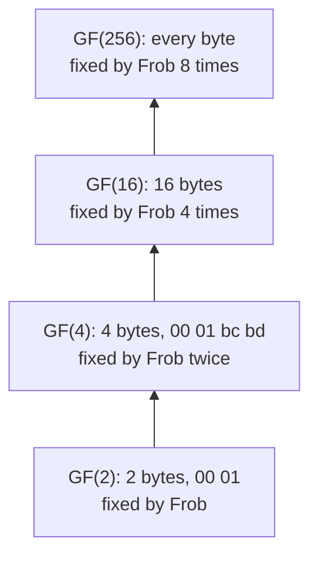

# Finite fields: exactly one of each prime power size, with Frobenius as its symmetry

[Syllabus](../../../SYLLABUS.md) → [Algebraic and analytic number theory](../README.md) → [Fields and Galois Theory](../README.md#s05) → Finite fields

---

## General Overview

A block cipher works on bytes, and it multiplies them in a field of 256 elements. A byte is eight bits. Each bit is read as one coefficient, 0 or 1, of a polynomial of degree at most 7. Two bytes multiply as polynomials, and the product is wrapped by $`x^8 + x^4 + x^3 + x + 1`$. The algebra wing's [Finite fields](../../03-Algebra/09-Rings%20and%20Fields/05-finite-fields.md) builds fields this way and proves every finite field has a prime power of elements; [AES](../../14-Applied%20and%20computational/04-Cryptography/02-symmetric-ciphers-and-aes.md) works the cipher's byte arithmetic.

The error-correcting layer of a QR code also uses a 256-byte field, wrapped by a different polynomial, $`x^8 + x^4 + x^3 + x^2 + 1`$. Two recipes give two multiplication tables. Are they two different fields?

No. This card proves there is exactly one field of each prime power size, after renaming the elements. The tool is squaring. In these fields 1 + 1 = 0, so squaring a sum gives the sum of the squares. Squaring is then a **symmetry**: a renaming of the field's elements that keeps every sum and every product correct. It is called **Frobenius**.

Frobenius does three jobs here. It proves the field exists, and one equation that every element solves then proves the field unique. Its repeats are all the field's symmetries: eight of them for 256 bytes. And the bytes that one of those repeats leaves unmoved form the **subfields**, the smaller fields sitting inside. The 256-byte field has exactly four, of sizes 2, 4, 16 and 256, and no 8-element subfield.

**For every prime p and whole number n of at least 1 there is exactly one field with p^n elements, up to renaming; raising to the p-th power is a symmetry of it, its repeats are all its symmetries, and the elements one repeat fixes form a subfield, one of size p^d for each d dividing n.**

**What kind of fact this is:** a theorem, proved on this card in Why it works, for every prime power. The code counts the case of 256 elements exhaustively: that confirms one field and every number on the card, while the proof covers all sizes.

### The picture: the four subfields of the 256-byte field



Each arrow means "sits inside". The divisors of 8 are 1, 2, 4 and 8, so the subfields form one chain. A field of 64 elements has degree 6, with divisors 1, 2, 3 and 6, so its picture has two side branches; "Try changing" builds it.

---

## The formula

Notation first. GF($`p^n`$) is the field with $`p^n`$ elements, from the algebra wing. A byte is written as two hexadecimal digits, so `1b` is the bits 0001 1011, the polynomial $`x^4 + x^3 + x + 1`$. Adding two bytes adds coefficients with 1 + 1 = 0, bit by bit.

Frobenius, written Frob, raises an element to the power $`p`$, the field's characteristic (the smallest number of 1's that add to 0). For bytes $`p = 2`$, so Frob squares.

```math
\mathrm{Frob}(a) = a^p, \qquad \mathrm{Frob}(a + b) = \mathrm{Frob}(a) + \mathrm{Frob}(b), \qquad \mathrm{Frob}(ab) = \mathrm{Frob}(a)\,\mathrm{Frob}(b)
```

**Read it aloud:** raising to the p-th power respects both sums and products, so it is a symmetry of the field.

Three consequences make up the theorem. Gal(L/K), from [The Galois correspondence](05-galois-groups-and-the-fundamental-theorem.md), is the group of symmetries of the field L that leave every element of K unmoved.

```math
\mathrm{GF}(p^n) = \{\, a : a^{p^n} = a \,\}, \qquad \mathrm{Gal}(\mathrm{GF}(p^n)/\mathrm{GF}(p)) = \{\, \mathrm{id}, \mathrm{Frob}, \mathrm{Frob}^2, \dots, \mathrm{Frob}^{n-1} \,\}
```

**Read it aloud:** the field is exactly the solutions of $`a^{p^n} = a`$, and its symmetries are Frobenius repeated 0 to n − 1 times.

```math
\text{subfields of } \mathrm{GF}(p^n) = \{\, \mathrm{GF}(p^d) = \{\, a : \mathrm{Frob}^d(a) = a \,\} \ \text{ for each } d \text{ dividing } n \,\}
```

**Read it aloud:** for each divisor d of n there is one subfield, the elements that Frobenius repeated d times leaves alone, and it has $`p^d`$ elements.

Grouping elements by the smallest subfield they lie in gives a count of irreducible polynomials, worked for the bytes in Why it works:

```math
\sum_{d \mid n} d \, N_d = p^n, \qquad 1 \cdot 2 + 2 \cdot 1 + 4 \cdot 3 + 8 \cdot 30 = 256
```

| Symbol | Plain meaning | In our example | Push it up and the answer… |
| --- | --- | --- | --- |
| $`p`$ | the characteristic: a prime | 2 | Frob raises to a higher power |
| $`n`$ | the degree: coefficients per element | 8 | more symmetries, n of them |
| $`p^n`$ | the number of elements | 256 | — |
| $`f`$, $`x`$ | the wrapping polynomial, irreducible (no smaller factors), in the placeholder letter $`x`$ | $`x^8 + x^4 + x^3 + x + 1`$, written `11b` | — |
| $`\alpha`$ | what $`x`$ becomes after the wrap: the byte `02` | $`\alpha^8 =`$ `1b` | — |
| $`a`$, $`b`$ | any two elements | `02` and `01` | — |
| $`\mathrm{Frob}`$, $`\mathrm{Frob}^k`$, $`\mathrm{id}`$ | raise to the power $`p`$; do that $`k`$ times, which raises to the power $`p^k`$; the do-nothing map | Frob(`03`) = `05` | — |
| $`d`$ | a divisor of $`n`$: the degree of a subfield | 1, 2, 4, 8 | a bigger subfield |
| $`\mathrm{GF}(p^d)`$ | the subfield that $`\mathrm{Frob}^d`$ fixes | GF(4) is `00 01 bc bd` | — |
| $`\mathrm{Gal}(L/K)`$ | the symmetries of $`L`$ that fix $`K`$ | Frob⁰ to Frob⁷, 8 symmetries | — |
| $`g`$ | a generator: its powers give every nonzero element | `03`, of order 255 | — |
| $`N_d`$ | how many irreducible polynomials of degree $`d`$ start with $`x^d`$ | $`N_8 = 30`$ | — |

### When it holds

- **The power must be the characteristic.** Squaring works for bytes; cubing does not respect sums: (`02` + `01`) cubed is `0f`, but `02` cubed plus `01` cubed is `09`.
- **The wrapping polynomial must be irreducible.** Wrap by $`x^8 + 1`$, which is $`(x + 1)^8`$, and 127 nonzero bytes have no reciprocal.
- **"Exactly one" means one after renaming.** The bytes in a subfield depend on the polynomial: GF(4) is `00 01 bc bd` under `11b`, and other bytes under `11d` (see "Try changing").
- **Subfields exist only for divisors of n.** 3 does not divide 8, so there is no GF(8) inside: $`a^8 = a`$ holds for 2 bytes only.
- **The field must be finite.** Over an infinite field of characteristic 2, such as fractions of polynomials in $`x`$, squaring still respects sums but misses some elements: $`x`$ is no square.

---

## Why it works

### Step 0: two facts do all the work

The first fact: raising to the p-th power respects sums. That makes Frobenius a symmetry.

The second fact: in a field of $`p^n`$ elements, every element solves $`a^{p^n} = a`$. That pins the field down as the solutions of one equation.

Existence, uniqueness, the symmetries and the subfields all follow from these two, with one rule for counting roots: a polynomial over a field has at most as many roots as its degree.

### Step 1: Frobenius is a symmetry

Square a sum of bytes: $`(a + b)^2 = a^2 + 2ab + b^2`$. The middle term is $`ab + ab`$, and 1 + 1 = 0, so it vanishes: $`(a + b)^2 = a^2 + b^2`$. Products are easier: $`(ab)^2 = a^2 b^2`$ in any field where order does not matter.

For a general prime, the binomial theorem expands $`(a + b)^p`$. Each middle coefficient counts the ways to choose some of $`p`$ items, more than none and fewer than all. It is $`p!`$ divided by smaller factorials, and the prime $`p`$ on top is not cancelled by anything below. So each middle coefficient is a multiple of $`p`$, which is 0 in the field.

Frobenius is one-to-one: if $`a^p = 0`$ then $`a = 0`$, since a field has no zero products; and if $`a^p = b^p`$ then $`(a - b)^p = a^p - b^p = 0`$, so $`a = b`$. A one-to-one map from a finite set to itself misses nothing. So Frobenius is a symmetry.

On GF($`p`$) itself it moves nothing: $`a^p = a`$ there is [Fermat's little theorem](../../02-Number%20theory/04-Powers%20on%20the%20Clock/02-fermats-little-theorem.md). On bytes, Frob(`03`) = $`(x + 1)^2 = x^2 + 1`$ = `05`.

### Step 2: every element solves one equation

The nonzero elements form a group under multiplication, of size $`p^n - 1`$. A member's order divides the group's size (Lagrange's theorem), so $`a^{p^n - 1} = 1`$ for $`a \ne 0`$. Multiply by $`a`$: $`a^{p^n} = a`$, and 0 solves it too.

The polynomial $`x^{p^n} - x`$ has degree $`p^n`$, so at most $`p^n`$ roots. The field supplies $`p^n`$ of them. So the field is exactly the root set of $`x^{p^n} - x`$. For bytes, $`a^{256} = a`$ for all 256 bytes, which says Frob⁸ = id.

### Step 3: existence for every prime power

Start from the clock GF($`p`$) and the polynomial $`x^{p^n} - x`$. A splitting field for it exists: a field where it factors fully into degree-one pieces ([Splitting fields](03-splitting-fields-and-algebraic-closure.md)). Look at its roots there.

- **They are closed under sums and products.** $`\mathrm{Frob}^n`$ is a symmetry (Step 1, repeated n times), so if $`a`$ and $`b`$ are fixed by it, so are $`a + b`$ and $`ab`$. Reciprocals and negatives are fixed too.
- **There are exactly $`p^n`$ of them.** A repeated root would also be a root of the derivative. The derivative is $`p^n x^{p^n - 1} - 1 = -1`$, since $`p^n`$ is 0 in the field. It has no roots, so no root repeats ([Normal and separable](04-normal-and-separable-extensions.md)).

So the roots form a field with exactly $`p^n`$ elements.

<details>
<summary>Detailed proof: the roots are closed under negatives and reciprocals</summary>

If $`a^{p^n} = a`$ then $`(-a)^{p^n} = (-1)^{p^n} a^{p^n}`$. For odd $`p`$, $`p^n`$ is odd and $`(-1)^{p^n} = -1`$. For $`p = 2`$, $`-1 = 1`$. Either way $`(-a)^{p^n} = -a`$.

For $`a \ne 0`$, $`(a^{-1})^{p^n} = (a^{p^n})^{-1} = a^{-1}`$. Together with Step 3's sums and products, the root set is a subfield of the splitting field.

</details>

### Step 4: uniqueness, and the renaming made explicit

Take any field with $`p^n`$ elements. By Step 2 its elements are all the roots of $`x^{p^n} - x`$, so that polynomial splits there and nothing smaller holds its roots. Any two splitting fields of one polynomial match by a renaming ([Splitting fields](03-splitting-fields-and-algebraic-closure.md)). So any two fields of size $`p^n`$ match.

The code builds the renaming for the cipher and the QR code. The polynomial `11d` has 8 roots among the cipher's bytes: `03 05 11 1a 4c 5f e5 fb`. Send the QR field's $`x`$ to any one of them. Each of the 8 choices gives a renaming that agrees on all 65,536 products.

### Step 5: Frobenius generates every symmetry

The repeats of Frobenius are distinct up to $`\mathrm{Frob}^{n-1}`$. If $`\mathrm{Frob}^k = \mathrm{id}`$ with $`k < n`$, every element would solve $`a^{p^k} = a`$: at most $`p^k`$ roots for $`p^n`$ elements, which is too few. So there are at least $`n`$ symmetries.

There are at most $`n`$. Write $`\alpha`$ for what $`x`$ becomes after the wrap (the byte `02`). Every element is a polynomial in $`\alpha`$, so a symmetry is fixed by where it sends $`\alpha`$. It must send $`\alpha`$ to a root of $`f`$, since it keeps $`f(\alpha) = 0`$ true. And $`f`$ has degree $`n`$, so at most $`n`$ roots.

So $`\mathrm{Gal}(\mathrm{GF}(p^n)/\mathrm{GF}(p))`$ is exactly Frob⁰ to $`\mathrm{Frob}^{n-1}`$: a **cyclic** group, all powers of one member. For bytes, the orbit of `02` under squaring is `02 04 10 1b 5e e4 4d fa`, the 8 roots of `11b`. Sending `02` to each root gives 8 symmetries, and the code matches each to one power of Frob.

### Step 6: the subfields

A cyclic group of size $`n`$ has exactly one subgroup for each divisor $`d`$ of $`n`$: the powers of $`\mathrm{Frob}^d`$. [The Galois correspondence](05-galois-groups-and-the-fundamental-theorem.md) matches subgroups with subfields, each subfield being what its subgroup fixes. So the subfields are the sets $`\{a : a^{p^d} = a\}`$, one for each divisor $`d`$.

Each has exactly $`p^d`$ elements. When $`d`$ divides $`n`$, $`x^{p^d} - x`$ divides $`x^{p^n} - x`$, so all its $`p^d`$ distinct roots are in the big field.

A direct count shows the sizes could be no others. A subfield of $`p^d`$ elements makes the big field a vector space over it ([Field extensions](01-field-extensions-and-degree.md)), with a whole number of coordinates. So $`p^n`$ is a whole power of $`p^d`$, and $`d`$ divides $`n`$.

For bytes, the divisors of 8 give the four subfields of the picture. Repeats of Frob that do not divide 8 fix only a smaller subfield: Frob³ fixes the bytes with $`a^8 = a`$, which are just `00` and `01`.

<details>
<summary>Detailed proof: why x^(p^d) − x divides x^(p^n) − x when d divides n</summary>

Since $`d`$ divides $`n`$, $`p^n`$ is $`p^d`$ raised to the whole power $`n/d`$. The geometric sum factors it:

$`\displaystyle p^n - 1 = (p^d)^{n/d} - 1 = (p^d - 1)\,\big((p^d)^{n/d - 1} + \dots + p^d + 1\big)`$

So $`p^d - 1`$ divides $`p^n - 1`$. The same factoring, with $`x^{p^d - 1}`$ in place of $`p^d`$ and the whole number $`(p^n - 1)/(p^d - 1)`$ as the power, shows $`x^{p^d - 1} - 1`$ divides $`x^{p^n - 1} - 1`$. Multiply both by $`x`$.

</details>

### Step 7: counting irreducible polynomials

Each element lies in a smallest subfield, of some degree $`d`$ dividing $`n`$. Frobenius moves it around a cycle of exactly $`d`$ elements: its **orbit**. Those $`d`$ elements are the roots of one irreducible polynomial of degree $`d`$, its minimal polynomial ([Minimal polynomials](02-minimal-polynomials-and-conjugates.md)). Every monic irreducible of degree $`d`$ appears exactly once: wrapping by it builds a field of $`p^d`$ elements, which by Step 4 is the subfield GF($`p^d`$), so its roots are there.

So counting elements orbit by orbit gives $`\sum_{d \mid n} d N_d = p^n`$. For bytes: 2 elements in GF(2), 2 more in GF(4), 12 more in GF(16), and the rest in orbits of 8:

```math
2 + 2 + 12 + 8 N_8 = 256, \qquad N_8 = 30
```

The code counts the 30 irreducibles a second way, by trial division of all 256 polynomials of degree 8. The same identity proves an irreducible of every degree exists: the terms with $`d < n`$ add up to less than $`p^n`$. That is the existence road the algebra wing's construction needs.

---

## Worked numbers, by hand

Bytes add bit by bit with 1 + 1 = 0. The wrap trades $`x^8`$ for `1b`.

| Step | Arithmetic | Value |
| --- | --- | --- |
| Frob(`02`) | $`x \cdot x`$ | `04` |
| Frob(`03`) | $`(x + 1)^2 = x^2 + 2x + 1`$, and $`2x = 0`$ | `05` |
| `02` to the 8th, three squarings | $`x^8`$, wrapped | `1b` |
| Frob(`1b`) | $`x^8 + x^6 + x^2 + 1`$; trade $`x^8`$ for $`x^4 + x^3 + x + 1`$ | `5e` |
| the subfield sizes | divisors of 8 are 1, 2, 4, 8 | 2, 4, 16, 256 |
| GF(4)'s two new bytes | `bc` + `bd`, bit by bit | `01` |
| irreducibles of degree 8 | $`(256 - 2 - 2 - 12) / 8`$ | 30 |
| subfields of GF(256) | one per divisor of 8 | **4** |

The 256-byte field holds exactly four fields, nested in one chain. The cipher's eight symmetries are squaring repeated 0 to 7 times.

The GF(4) row is a check by hand. GF(4)'s two new elements are the roots of $`x^2 + x + 1`$, the one irreducible quadratic. If one root is `bc`, the other is `bc` plus `01`, since the two roots add to the coefficient of $`x`$, which is 1.

### What breaks if you drop a piece

| Mistake | Comes out at | What went wrong |
| --- | --- | --- |
| Wrap by $`x^8 + 1`$ | 127 nonzero bytes without a reciprocal | $`x^8 + 1 = (x + 1)^8`$ is reducible |
| The clock mod 256 | 128 numbers without a reciprocal; $`(1 + 1)^2 = 4`$, not 2 | 256 is not prime; characteristic is not 2 |
| Look for an 8-element subfield | $`a^8 = a`$ for 2 bytes: `00`, `01` | 3 does not divide 8 |
| Cube instead of square | `0f` against `09` | Only the p-th power respects sums |

The code prints all four.

---

## Code, from first principles, and it actually runs

Nothing is imported. The code builds the 256-byte field by shift and XOR (exclusive or, adding bits with 1 + 1 = 0) and stores its multiplication table. It takes four independent roads.

1. **Subfields** by Frobenius fixed points, and again by spanning each byte's powers, a road that never uses Frobenius.
2. **Symmetries** by sending `02` to every root of `11b`, found by trying all 256 bytes, then matched against the powers of Frobenius.
3. **Irreducible counts** by Frobenius orbits, and again by trial division of polynomials.
4. **Uniqueness** by renaming the `11d` field onto the `11b` field and testing all 65,536 products.

GF(4) is also found a third way, as 0, 1 and two powers of the generator.

### Python

```python
# Finite fields and Frobenius -- the check behind the card.  Nothing is imported.
# A byte is a polynomial over GF(2): bit i is the coefficient of x^i, so hex 1b is
# x^4 + x^3 + x + 1.  The field is every byte, wrapped by MOD = 11b, the polynomial
# x^8 + x^4 + x^3 + x + 1.  Frobenius squares.  Subfields are found by Frobenius and
# again by spanning each byte's powers; automorphisms are found by root search; and
# a second field, wrapped by OTHER = 11d, is renamed onto the first.
DEG, MOD, OTHER = 8, 0x11B, 0x11D
SIZE = 1 << DEG
DIVS = [d for d in range(1, DEG + 1) if DEG % d == 0]

def mul(u, v, mod=MOD):              # multiply two bytes: shift and XOR, fold at mod
    out = 0
    while v:
        if v & 1:
            out ^= u
        v, u = v >> 1, u << 1
        if u >> DEG & 1:
            u ^= mod
    return out

T = [mul(a, b) for a in range(SIZE) for b in range(SIZE)]   # multiplication table
def m(a, b): return T[a * SIZE + b]
def frob(a, k=1):                     # Frobenius applied k times: square k times
    for _ in range(k):
        a = m(a, a)
    return a
def inv(a):                           # a^(2 + 4 + ... + 128) = a^254, by squarings and products
    out = 1
    for k in range(1, DEG):
        out = m(out, frob(a, k))
    return out
def pmod(a, b):                       # remainder of polynomial a by b, over GF(2)
    while a and a.bit_length() >= b.bit_length():
        a ^= b << (a.bit_length() - b.bit_length())
    return a
def irreducible(f):                   # trial division by every g of degree 1 .. deg f / 2
    return all(pmod(f, g) for g in range(2, 1 << ((f.bit_length() - 1) // 2 + 1)))
def at(f, r, mul_=m):                 # f evaluated at the byte r, by Horner's rule
    out = 0
    for i in range(f.bit_length() - 1, -1, -1):
        out = mul_(out, r) ^ (f >> i & 1)
    return out
def rename(src, r):                   # send x to r: the byte sum of a_i r^i
    pw, out = [1], []
    for _ in range(DEG - 1):
        pw.append(m(pw[-1], r))
    for a in range(SIZE):
        s = 0
        for i in range(DEG):
            if a >> i & 1:
                s ^= pw[i]
        out.append(s)
    ok = len(set(out)) == SIZE and all(out[mul(a, b, src)] == m(out[a], out[b])
                                       for a in range(SIZE) for b in range(SIZE))
    return out, ok
def span(a):                          # GF(2)-span of the powers of a: closed under + and x
    s, p = {0}, 1
    for _ in range(SIZE):
        if p not in s:
            s |= {x ^ p for x in s}
        p = m(p, a)
        if p == 1:
            break
    return frozenset(s)
def hx(xs): return " ".join(f"{x:02x}" for x in xs)
def yn(c): return "yes" if c else "no"
def poly(v): return " + ".join("1" if i == 0 else "x" if i == 1 else f"x^{i}" for i in range(v.bit_length() - 1, -1, -1) if v >> i & 1)

recip = all(any(m(a, b) == 1 for b in range(SIZE)) for a in range(1, SIZE))
recip254 = all(m(inv(a), a) == 1 for a in range(1, SIZE))
additive = all(frob(a ^ b) == frob(a) ^ frob(b) for a in range(SIZE) for b in range(SIZE))
order = next((k for k in range(1, SIZE) if all(frob(a, k) == a for a in range(SIZE))), 0)
orb = [2]
while frob(orb[-1]) != 2 and len(orb) < SIZE:
    orb.append(frob(orb[-1]))
roots = [r for r in range(SIZE) if at(MOD, r) == 0]
autos = [rename(MOD, r) for r in roots]
as_frob = sorted(next((k for k in range(DEG) if all(t[a] == frob(a, k) for a in range(SIZE))), -1)
                 for t, ok in autos if ok)
fixed = {d: frozenset(a for a in range(SIZE) if frob(a, d) == a) for d in range(1, DEG + 1)}
by_span = sorted({span(a) for a in range(1, SIZE)}, key=len)
def powers(a):                        # 1, a, a^2, ... until the return to 1
    out = [1]
    while m(out[-1], a) != 1 and len(out) < SIZE:
        out.append(m(out[-1], a))
    return out
g = next((a for a in range(2, SIZE) if len(powers(a)) == SIZE - 1), 1)
gpow = powers(g)
gf4 = sorted({0} | {gpow[k] for k in range(0, SIZE - 1, (SIZE - 1) // 3)})
orbits = {frozenset(frob(a, k) for k in range(DEG)) for a in range(SIZE)}
n_orb = [sum(len(o) == d for o in orbits) for d in DIVS]
n_irr = [sum(irreducible(f) for f in range(1 << d, 2 << d)) for d in DIVS]
oroots = [r for r in range(SIZE) if at(OTHER, r) == 0]
renamings = [rename(OTHER, r)[1] for r in oroots]
bad = (1 << DEG) | 1                  # x^8 + 1 = (x + 1)^8: reducible
no_recip = sum(not any(mul(a, b, bad) == 1 for b in range(SIZE)) for a in range(1, SIZE))
even = sum(bin(a).count("1") % 2 == 0 for a in range(1, SIZE))
clock = sum(not any(a * b % SIZE == 1 for b in range(SIZE)) for a in range(SIZE))
cube = lambda a: m(m(a, a), a)
quart = [(b, c, d, e) for b in range(5) for c in range(5) for d in range(5) for e in range(5)
         if ((b + d) % 5, (c + e + b * d) % 5, (b * e + c * d) % 5, c * e % 5) == (0, 0, 0, 3)]
lin = [a for a in range(5) if (a ** 4 - 2) % 5 == 0]

print(f"field: bytes wrapped by {MOD:x}; irreducible by trial division: {yn(irreducible(MOD))}; {SIZE} elements")
print(f"every nonzero byte has a reciprocal: {yn(recip)}; a^{SIZE - 2} = a^2 a^4 ... a^{SIZE // 2} is it, for all {SIZE - 1}: {yn(recip254)}")
print(f"Frob(02) = {frob(2):02x}, Frob(03) = {frob(3):02x}, 02^8 = {frob(2, 3):02x}; Frob({frob(2, 3):02x}) = {poly(mul(frob(2, 3), frob(2, 3), 0))} before the wrap, {frob(2, 4):02x} after")
print(f"Frob(a + b) = Frob(a) + Frob(b) for all {SIZE * SIZE:,} pairs: {yn(additive)}")
print(f"smallest k with Frob^k = identity: {order}; so a^{SIZE} = a for every byte")
print(f"orbit of 02 under Frob: {hx(orb)}")
print(f"roots of {MOD:x} found by trying all {SIZE} bytes: {hx(roots)}")
print(f"symmetries made by sending 02 to a root: {sum(ok for _, ok in autos)} of {len(roots)}; "
      f"each is Frob^k for k = {as_frob}")
print(f"bytes fixed by Frob^d, d = 1..{DEG}: {[len(fixed[d]) for d in range(1, DEG + 1)]}")
print(f"subfields found by spanning powers: sizes {[len(s) for s in by_span]}")
print(f"the same sets Frob^d fixes for d = {DIVS}: {yn(by_span == [fixed[d] for d in DIVS])}")
print(f"generator g = {g:02x}, of order {SIZE - 1}")
print(f"GF(4) inside: {hx(sorted(fixed[2]))}; as 0, 1, g^85, g^170: {hx(gf4)}; its two new bytes add to {gf4[2] ^ gf4[3]:02x}")
print(f"GF(16) inside: {hx(sorted(fixed[4]))}")
print(f"Frobenius orbits of size {DIVS}: {n_orb}; {len(orbits)} orbits in all")
print(f"irreducible polynomials of degree {DIVS}, by trial division: {n_irr}")
print(f"sum of degree x count: {' + '.join(f'{d}*{n}' for d, n in zip(DIVS, n_irr))} = "
      f"{sum(d * n for d, n in zip(DIVS, n_irr))}")
print(f"second field {OTHER:x} irreducible: {yn(irreducible(OTHER))}; its roots in the first: {hx(oroots)}")
print(f"renamings x -> root that respect + and x on all pairs: {sum(renamings)} of {len(oroots)}")
print(f"mistake 1, wrap by {bad:x} = (x + 1)^8: {no_recip} nonzero bytes have no reciprocal "
      f"(nonzero bytes with an even count of 1 bits: {even})")
print(f"mistake 2, the clock mod {SIZE}: {clock} numbers have no reciprocal; "
      f"(1 + 1)^2 = {(1 + 1) ** 2 % SIZE}, 1^2 + 1^2 = {2 % SIZE}")
print(f"mistake 3, an 8-element subfield: a^8 = a holds for {len(fixed[3])} bytes: {hx(sorted(fixed[3]))}")
print(f"mistake 4, cubing for squaring: (02 + 01)^3 = {cube(3):02x}, 02^3 + 01^3 = {cube(2) ^ cube(1):02x}")
print(f"house: x^4 - 2 over GF(5): {len(lin)} roots, {len(quart)} splittings into two quadratics: irreducible")
assert irreducible(MOD) and recip and recip254 and additive and order == DEG
assert sorted(orb) == roots and len(roots) == DEG and as_frob == list(range(DEG))
assert by_span == [fixed[d] for d in DIVS] and [len(s) for s in by_span] == [2 ** d for d in DIVS]
assert gf4 == sorted(fixed[2]) and gf4[2] ^ gf4[3] == 1 and n_orb == n_irr and sum(d * n for d, n in zip(DIVS, n_irr)) == SIZE
assert irreducible(OTHER) and all(renamings) and len(oroots) == DEG
assert no_recip == even and clock == SIZE // 2 and len(fixed[3]) == 2 ** (3 if DEG % 3 == 0 else 1)
assert cube(3) != cube(2) ^ cube(1) and not lin and not quart
print("ALL CHECKS PASS")
```

**Ran 2026-11-15 on macOS, Python 3.14.10, standard library only. All checks passed. Output, pasted from the run:**

```
field: bytes wrapped by 11b; irreducible by trial division: yes; 256 elements
every nonzero byte has a reciprocal: yes; a^254 = a^2 a^4 ... a^128 is it, for all 255: yes
Frob(02) = 04, Frob(03) = 05, 02^8 = 1b; Frob(1b) = x^8 + x^6 + x^2 + 1 before the wrap, 5e after
Frob(a + b) = Frob(a) + Frob(b) for all 65,536 pairs: yes
smallest k with Frob^k = identity: 8; so a^256 = a for every byte
orbit of 02 under Frob: 02 04 10 1b 5e e4 4d fa
roots of 11b found by trying all 256 bytes: 02 04 10 1b 4d 5e e4 fa
symmetries made by sending 02 to a root: 8 of 8; each is Frob^k for k = [0, 1, 2, 3, 4, 5, 6, 7]
bytes fixed by Frob^d, d = 1..8: [2, 4, 2, 16, 2, 4, 2, 256]
subfields found by spanning powers: sizes [2, 4, 16, 256]
the same sets Frob^d fixes for d = [1, 2, 4, 8]: yes
generator g = 03, of order 255
GF(4) inside: 00 01 bc bd; as 0, 1, g^85, g^170: 00 01 bc bd; its two new bytes add to 01
GF(16) inside: 00 01 0c 0d 50 51 5c 5d b0 b1 bc bd e0 e1 ec ed
Frobenius orbits of size [1, 2, 4, 8]: [2, 1, 3, 30]; 36 orbits in all
irreducible polynomials of degree [1, 2, 4, 8], by trial division: [2, 1, 3, 30]
sum of degree x count: 1*2 + 2*1 + 4*3 + 8*30 = 256
second field 11d irreducible: yes; its roots in the first: 03 05 11 1a 4c 5f e5 fb
renamings x -> root that respect + and x on all pairs: 8 of 8
mistake 1, wrap by 101 = (x + 1)^8: 127 nonzero bytes have no reciprocal (nonzero bytes with an even count of 1 bits: 127)
mistake 2, the clock mod 256: 128 numbers have no reciprocal; (1 + 1)^2 = 4, 1^2 + 1^2 = 2
mistake 3, an 8-element subfield: a^8 = a holds for 2 bytes: 00 01
mistake 4, cubing for squaring: (02 + 01)^3 = 0f, 02^3 + 01^3 = 09
house: x^4 - 2 over GF(5): 0 roots, 0 splittings into two quadratics: irreducible
ALL CHECKS PASS
```

### Rust

Same numbers, same labels, built with `rustc --edition 2021 -O`.

```rust
// Finite fields and Frobenius -- the same check as the Python, in Rust.  No crates.
// A byte is a polynomial over GF(2): bit i is the coefficient of x^i, so hex 1b is
// x^4 + x^3 + x + 1.  The field is every byte, wrapped by MOD = 11b, the polynomial
// x^8 + x^4 + x^3 + x + 1.  Frobenius squares.  Subfields are found by Frobenius and
// again by spanning each byte's powers; automorphisms are found by root search; and
// a second field, wrapped by OTHER = 11d, is renamed onto the first.
use std::collections::BTreeSet;
const DEG: u32 = 8;
const MOD: usize = 0x11B;
const OTHER: usize = 0x11D;
const SIZE: usize = 1 << DEG;

fn mul(mut u: usize, mut v: usize, md: usize) -> usize { // shift and XOR, fold at md
    let mut out = 0;
    while v != 0 {
        if v & 1 == 1 { out ^= u }
        v >>= 1;
        u <<= 1;
        if (u >> DEG) & 1 == 1 { u ^= md }
    }
    out
}
fn bits(a: usize) -> u32 { usize::BITS - a.leading_zeros() }
fn pmod(mut a: usize, b: usize) -> usize {          // remainder of polynomial a by b, over GF(2)
    while a != 0 && bits(a) >= bits(b) { a ^= b << (bits(a) - bits(b)) }
    a
}
fn irreducible(f: usize) -> bool {                  // trial division by every g of degree 1 .. deg f / 2
    (2..(1usize << ((bits(f) - 1) / 2 + 1))).all(|g| pmod(f, g) != 0)
}
struct F { t: Vec<usize> }
impl F {
    fn m(&self, a: usize, b: usize) -> usize { self.t[a * SIZE + b] }
    fn frob(&self, mut a: usize, k: u32) -> usize { for _ in 0..k { a = self.m(a, a) } a }
    fn inv(&self, a: usize) -> usize { (1..DEG).fold(1, |out, k| self.m(out, self.frob(a, k))) } // a^(2 + 4 + ... + 128) = a^254
    fn at(&self, f: usize, r: usize) -> usize {     // f evaluated at the byte r, by Horner's rule
        let mut out = 0;
        for i in (0..bits(f)).rev() { out = self.m(out, r) ^ ((f >> i) & 1) }
        out
    }
    fn rename(&self, src: usize, r: usize) -> (Vec<usize>, bool) { // send x to r
        let mut pw = vec![1usize];
        for _ in 0..DEG - 1 { let p = self.m(*pw.last().unwrap(), r); pw.push(p) }
        let out: Vec<usize> = (0..SIZE).map(|a| (0..DEG as usize).filter(|i| (a >> i) & 1 == 1)
            .fold(0, |s, i| s ^ pw[i])).collect();
        let distinct = out.iter().collect::<BTreeSet<_>>().len() == SIZE;
        let ok = distinct && (0..SIZE).all(|a| (0..SIZE).all(|b|
            out[mul(a, b, src)] == self.m(out[a], out[b])));
        (out, ok)
    }
    fn span(&self, a: usize) -> Vec<usize> {        // GF(2)-span of the powers of a
        let (mut s, mut p) = (BTreeSet::from([0usize]), 1usize);
        for _ in 0..SIZE {
            if !s.contains(&p) { let add: Vec<usize> = s.iter().map(|x| x ^ p).collect(); s.extend(add) }
            p = self.m(p, a);
            if p == 1 { break }
        }
        s.into_iter().collect()
    }
    fn powers(&self, a: usize) -> Vec<usize> {      // 1, a, a^2, ... until the return to 1
        let mut out = vec![1usize];
        while self.m(*out.last().unwrap(), a) != 1 && out.len() < SIZE {
            let p = self.m(*out.last().unwrap(), a);
            out.push(p);
        }
        out
    }
}
fn hx(xs: &[usize]) -> String { xs.iter().map(|x| format!("{:02x}", x)).collect::<Vec<_>>().join(" ") }
fn yn(c: bool) -> &'static str { if c { "yes" } else { "no" } }
fn poly(v: usize) -> String { (0..bits(v)).rev().filter(|i| (v >> i) & 1 == 1).map(|i| match i { 0 => "1".to_string(), 1 => "x".to_string(), _ => format!("x^{}", i) }).collect::<Vec<_>>().join(" + ") }
fn commas(n: usize) -> String {
    let s = n.to_string();
    let mut out = String::new();
    for (i, ch) in s.chars().enumerate() {
        if i > 0 && (s.len() - i) % 3 == 0 { out.push(',') }
        out.push(ch);
    }
    out
}

fn main() {
    let divs: Vec<u32> = (1..=DEG).filter(|d| DEG % d == 0).collect();
    let f = F { t: (0..SIZE * SIZE).map(|i| mul(i / SIZE, i % SIZE, MOD)).collect() };
    let recip = (1..SIZE).all(|a| (0..SIZE).any(|b| f.m(a, b) == 1));
    let recip254 = (1..SIZE).all(|a| f.m(f.inv(a), a) == 1);
    let additive = (0..SIZE).all(|a| (0..SIZE).all(|b| f.frob(a ^ b, 1) == f.frob(a, 1) ^ f.frob(b, 1)));
    let order = (1..SIZE as u32).find(|&k| (0..SIZE).all(|a| f.frob(a, k) == a)).unwrap_or(0);
    let mut orb = vec![2usize];
    while f.frob(*orb.last().unwrap(), 1) != 2 && orb.len() < SIZE { let x = f.frob(*orb.last().unwrap(), 1); orb.push(x) }
    let roots: Vec<usize> = (0..SIZE).filter(|&r| f.at(MOD, r) == 0).collect();
    let autos: Vec<(Vec<usize>, bool)> = roots.iter().map(|&r| f.rename(MOD, r)).collect();
    let mut as_frob: Vec<i64> = autos.iter().filter(|(_, ok)| *ok).map(|(t, _)| (0..DEG)
        .find(|&k| (0..SIZE).all(|a| t[a] == f.frob(a, k))).map(|k| k as i64).unwrap_or(-1)).collect();
    as_frob.sort();
    let fixed: Vec<Vec<usize>> = (0..=DEG).map(|d| (0..SIZE).filter(|&a| f.frob(a, d) == a).collect()).collect();
    let mut by_span: Vec<Vec<usize>> = (1..SIZE).map(|a| f.span(a)).collect::<BTreeSet<_>>().into_iter().collect();
    by_span.sort_by_key(|s| s.len());
    let g = (2..SIZE).find(|&a| f.powers(a).len() == SIZE - 1).unwrap_or(1);
    let gpow = f.powers(g);
    let mut gf4: Vec<usize> = vec![0];
    gf4.extend((0..SIZE - 1).step_by((SIZE - 1) / 3).map(|k| gpow[k]));
    gf4.sort();
    let orbits: BTreeSet<Vec<usize>> = (0..SIZE).map(|a| (0..DEG).map(|k| f.frob(a, k))
        .collect::<BTreeSet<_>>().into_iter().collect()).collect();
    let n_orb: Vec<usize> = divs.iter().map(|&d| orbits.iter().filter(|o| o.len() == d as usize).count()).collect();
    let n_irr: Vec<usize> = divs.iter().map(|&d| ((1usize << d)..(2usize << d)).filter(|&p| irreducible(p)).count()).collect();
    let oroots: Vec<usize> = (0..SIZE).filter(|&r| f.at(OTHER, r) == 0).collect();
    let renamings: Vec<bool> = oroots.iter().map(|&r| f.rename(OTHER, r).1).collect();
    let bad = (1usize << DEG) | 1;                  // x^8 + 1 = (x + 1)^8: reducible
    let no_recip = (1..SIZE).filter(|&a| !(0..SIZE).any(|b| mul(a, b, bad) == 1)).count();
    let even = (1..SIZE).filter(|a| a.count_ones() % 2 == 0).count();
    let clock = (0..SIZE).filter(|a| !(0..SIZE).any(|b| a * b % SIZE == 1)).count();
    let cube = |a: usize| f.m(f.m(a, a), a);
    let mut quart = 0;
    for b in 0..5 { for c in 0..5 { for d in 0..5 { for e in 0..5 {
        if ((b + d) % 5, (c + e + b * d) % 5, (b * e + c * d) % 5, c * e % 5) == (0, 0, 0, 3) { quart += 1 }
    } } } }
    let lin = (0..5i64).filter(|a| (a.pow(4) - 2) % 5 == 0).count();
    let sumdn: usize = divs.iter().zip(&n_irr).map(|(&d, &n)| d as usize * n).sum();
    let sizes: Vec<usize> = by_span.iter().map(|s| s.len()).collect();
    let same = by_span == divs.iter().map(|&d| fixed[d as usize].clone()).collect::<Vec<_>>();

    println!("field: bytes wrapped by {:x}; irreducible by trial division: {}; {} elements", MOD, yn(irreducible(MOD)), SIZE);
    println!("every nonzero byte has a reciprocal: {}; a^{} = a^2 a^4 ... a^{} is it, for all {}: {}", yn(recip), SIZE - 2, SIZE / 2, SIZE - 1, yn(recip254));
    let b8 = f.frob(2, 3);
    println!("Frob(02) = {:02x}, Frob(03) = {:02x}, 02^8 = {:02x}; Frob({:02x}) = {} before the wrap, {:02x} after", f.frob(2, 1), f.frob(3, 1), b8, b8, poly(mul(b8, b8, 0)), f.frob(2, 4));
    println!("Frob(a + b) = Frob(a) + Frob(b) for all {} pairs: {}", commas(SIZE * SIZE), yn(additive));
    println!("smallest k with Frob^k = identity: {}; so a^{} = a for every byte", order, SIZE);
    println!("orbit of 02 under Frob: {}", hx(&orb));
    println!("roots of {:x} found by trying all {} bytes: {}", MOD, SIZE, hx(&roots));
    println!("symmetries made by sending 02 to a root: {} of {}; each is Frob^k for k = {:?}",
             autos.iter().filter(|(_, ok)| *ok).count(), roots.len(), as_frob);
    println!("bytes fixed by Frob^d, d = 1..{}: {:?}", DEG, (1..=DEG as usize).map(|d| fixed[d].len()).collect::<Vec<_>>());
    println!("subfields found by spanning powers: sizes {:?}", sizes);
    println!("the same sets Frob^d fixes for d = {:?}: {}", divs, yn(same));
    println!("generator g = {:02x}, of order {}", g, SIZE - 1);
    println!("GF(4) inside: {}; as 0, 1, g^85, g^170: {}; its two new bytes add to {:02x}", hx(&fixed[2]), hx(&gf4), gf4[2] ^ gf4[3]);
    println!("GF(16) inside: {}", hx(&fixed[4]));
    println!("Frobenius orbits of size {:?}: {:?}; {} orbits in all", divs, n_orb, orbits.len());
    println!("irreducible polynomials of degree {:?}, by trial division: {:?}", divs, n_irr);
    println!("sum of degree x count: {} = {}", divs.iter().zip(&n_irr).map(|(d, n)| format!("{}*{}", d, n))
             .collect::<Vec<_>>().join(" + "), sumdn);
    println!("second field {:x} irreducible: {}; its roots in the first: {}", OTHER, yn(irreducible(OTHER)), hx(&oroots));
    println!("renamings x -> root that respect + and x on all pairs: {} of {}", renamings.iter().filter(|&&b| b).count(), oroots.len());
    println!("mistake 1, wrap by {:x} = (x + 1)^8: {} nonzero bytes have no reciprocal (nonzero bytes with an even count of 1 bits: {})", bad, no_recip, even);
    println!("mistake 2, the clock mod {}: {} numbers have no reciprocal; (1 + 1)^2 = {}, 1^2 + 1^2 = {}", SIZE, clock, 4 % SIZE, 2 % SIZE);
    println!("mistake 3, an 8-element subfield: a^8 = a holds for {} bytes: {}", fixed[3].len(), hx(&fixed[3]));
    println!("mistake 4, cubing for squaring: (02 + 01)^3 = {:02x}, 02^3 + 01^3 = {:02x}", cube(3), cube(2) ^ cube(1));
    println!("house: x^4 - 2 over GF(5): {} roots, {} splittings into two quadratics: irreducible", lin, quart);
    assert!(irreducible(MOD) && recip && recip254 && additive && order == DEG);
    let mut so = orb.clone(); so.sort();
    assert!(so == roots && roots.len() == DEG as usize && as_frob == (0..DEG as i64).collect::<Vec<_>>());
    assert!(same && sizes == divs.iter().map(|&d| 1usize << d).collect::<Vec<_>>());
    assert!(gf4 == fixed[2] && gf4[2] ^ gf4[3] == 1 && n_orb == n_irr && sumdn == SIZE);
    assert!(irreducible(OTHER) && renamings.iter().all(|&b| b) && oroots.len() == DEG as usize);
    assert!(no_recip == even && clock == SIZE / 2 && fixed[3].len() == 1 << (if DEG % 3 == 0 { 3 } else { 1 }));
    assert!(cube(3) != cube(2) ^ cube(1) && lin == 0 && quart == 0);
    println!("ALL CHECKS PASS");
}
```

**Ran 2026-11-15 on macOS, rustc 1.98.1, no crates. All checks passed. Output, pasted from the run:**

```
field: bytes wrapped by 11b; irreducible by trial division: yes; 256 elements
every nonzero byte has a reciprocal: yes; a^254 = a^2 a^4 ... a^128 is it, for all 255: yes
Frob(02) = 04, Frob(03) = 05, 02^8 = 1b; Frob(1b) = x^8 + x^6 + x^2 + 1 before the wrap, 5e after
Frob(a + b) = Frob(a) + Frob(b) for all 65,536 pairs: yes
smallest k with Frob^k = identity: 8; so a^256 = a for every byte
orbit of 02 under Frob: 02 04 10 1b 5e e4 4d fa
roots of 11b found by trying all 256 bytes: 02 04 10 1b 4d 5e e4 fa
symmetries made by sending 02 to a root: 8 of 8; each is Frob^k for k = [0, 1, 2, 3, 4, 5, 6, 7]
bytes fixed by Frob^d, d = 1..8: [2, 4, 2, 16, 2, 4, 2, 256]
subfields found by spanning powers: sizes [2, 4, 16, 256]
the same sets Frob^d fixes for d = [1, 2, 4, 8]: yes
generator g = 03, of order 255
GF(4) inside: 00 01 bc bd; as 0, 1, g^85, g^170: 00 01 bc bd; its two new bytes add to 01
GF(16) inside: 00 01 0c 0d 50 51 5c 5d b0 b1 bc bd e0 e1 ec ed
Frobenius orbits of size [1, 2, 4, 8]: [2, 1, 3, 30]; 36 orbits in all
irreducible polynomials of degree [1, 2, 4, 8], by trial division: [2, 1, 3, 30]
sum of degree x count: 1*2 + 2*1 + 4*3 + 8*30 = 256
second field 11d irreducible: yes; its roots in the first: 03 05 11 1a 4c 5f e5 fb
renamings x -> root that respect + and x on all pairs: 8 of 8
mistake 1, wrap by 101 = (x + 1)^8: 127 nonzero bytes have no reciprocal (nonzero bytes with an even count of 1 bits: 127)
mistake 2, the clock mod 256: 128 numbers have no reciprocal; (1 + 1)^2 = 4, 1^2 + 1^2 = 2
mistake 3, an 8-element subfield: a^8 = a holds for 2 bytes: 00 01
mistake 4, cubing for squaring: (02 + 01)^3 = 0f, 02^3 + 01^3 = 09
house: x^4 - 2 over GF(5): 0 roots, 0 splittings into two quadratics: irreducible
ALL CHECKS PASS
```

The two outputs match line for line.

### Lean

Lean proves the theorem for every prime p and every n of at least 1, and checks the byte arithmetic.

- Take a prime $`p`$ and a whole number $`n`$ of at least 1. Then a field with $`p^n`$ elements exists, and any two match after renaming.
- Take a field with $`p^n`$ elements. Then Frob is a symmetry of it, and every symmetry is Frob repeated k times, for exactly one k from 0 to n − 1.
- Take a field with $`p^n`$ elements and a divisor d of n. Then the elements that $`\mathrm{Frob}^d`$ leaves unmoved form a subfield with $`p^d`$ elements.
- Take any subfield of a field with $`p^n`$ elements. Then it is the set that $`\mathrm{Frob}^d`$ leaves unmoved, for some divisor d of n.
- The divisors of 8 are 1, 2, 4 and 8, giving subfield sizes 2, 4, 16 and 256; 3 does not divide 8.
- The orbit sum 1·2 + 2·1 + 4·3 + 8·30 equals 256, and (256 − 2 − 2 − 12) / 8 = 30.
- GF(4)'s two new bytes add bit by bit to `01`: `bc` + `bd` = `01`, and 256 − 1 = 255.

Building the bytes, the generator `03` and the renaming from `11d` to `11b` are left to the Python and Rust checks.

```lean
-- Finite fields: for every prime p and n ≥ 1 there is exactly one field with p^n elements up to renaming, its symmetries are the n powers of Frobenius, and its subfields are the fixed sets of Frobenius^d, one of size p^d for each d dividing n.
import Mathlib.FieldTheory.Finite.GaloisField
import Mathlib.NumberTheory.Divisors

theorem ff_charP_of_card (p : ℕ) [hp : Fact p.Prime] (n : ℕ) (hn : 0 < n)
    (K : Type) [Field K] [Fintype K] (hK : Fintype.card K = p ^ n) : CharP K p := by
  obtain ⟨q, hq⟩ := CharP.exists K
  obtain ⟨m, hqp, hm⟩ := FiniteField.card K q
  have hdvd : p ∣ q ^ (m : ℕ) := by
    rw [← hm, hK]; exact dvd_pow_self p hn.ne'
  have := (Nat.prime_dvd_prime_iff_eq hp.out hqp).mp (hp.out.dvd_of_dvd_pow hdvd)
  subst this
  exact hq

#print axioms ff_charP_of_card

theorem ff_ncard_fixed_le (p : ℕ) [hp : Fact p.Prime] (K : Type) [Field K] [Fintype K]
    (d : ℕ) (hd : 0 < d) : Set.ncard {a : K | a ^ p ^ d = a} ≤ p ^ d := by
  classical
  have h1 : 1 < p ^ d := Nat.one_lt_pow hd.ne' hp.out.one_lt
  set f : Polynomial K := Polynomial.X ^ p ^ d - Polynomial.X with hf
  have hf0 : f ≠ 0 := Polynomial.X_pow_sub_X_ne_zero h1
  let Z : Finset K := Finset.univ.filter (fun a => a ^ p ^ d = a)
  have hZ : {a : K | a ^ p ^ d = a} = (Z : Set K) := by
    ext a; simp [Z]
  rw [hZ, Set.ncard_coe_finset]
  have hdeg : f.natDegree ≤ p ^ d := by
    refine (Polynomial.natDegree_sub_le _ _).trans ?_
    simp
    omega
  refine le_trans (Polynomial.card_le_degree_of_subset_roots ?_) hdeg
  intro a ha
  have ha' : a ^ p ^ d = a := by simpa [Z] using ha
  rw [Polynomial.mem_roots hf0, Polynomial.IsRoot, hf]
  simp [ha']

#print axioms ff_ncard_fixed_le

theorem ff_finrank_eq (p : ℕ) [hp : Fact p.Prime] (n : ℕ)
    (K : Type) [Field K] [Fintype K] [Algebra (ZMod p) K] (hK : Fintype.card K = p ^ n) :
    Module.finrank (ZMod p) K = n := by
  have h := FiniteField.pow_finrank_eq_card p K
  rw [hK] at h
  exact Nat.pow_right_injective hp.out.two_le h

#print axioms ff_finrank_eq

/-- For every prime `p` and whole number `n ≥ 1` there is a field with `p ^ n` elements,
and any two fields with `p ^ n` elements are the same field after renaming
(there is a bijection between them that keeps every sum and every product). -/
theorem exists_unique_field_of_prime_power_card (p : ℕ) [Fact p.Prime] (n : ℕ) (hn : 0 < n) :
    (∃ (K : Type) (_ : Field K) (_ : Fintype K), Fintype.card K = p ^ n) ∧
    ∀ (K L : Type) [Field K] [Fintype K] [Field L] [Fintype L],
      Fintype.card K = p ^ n → Fintype.card L = p ^ n → Nonempty (K ≃+* L) := by
  constructor
  · refine ⟨GaloisField p n, inferInstance, Fintype.ofFinite _, ?_⟩
    rw [Fintype.card_eq_nat_card]
    exact GaloisField.card p n hn.ne'
  · intro K L _ _ _ _ hK hL
    exact ⟨FiniteField.ringEquivOfCardEq (hK.trans hL.symm)⟩

/-- In a field with `p ^ n` elements, raising to the `p`-th power (Frobenius) is a symmetry,
and every symmetry of the field is Frobenius repeated `k` times, `a ↦ a ^ (p ^ k)`, for exactly
one `k` from `0` to `n - 1`: the symmetries are exactly `id, Frob, …, Frob^(n-1)`. -/
theorem symmetries_are_powers_of_frobenius (p : ℕ) [Fact p.Prime] (n : ℕ) (hn : 0 < n)
    (K : Type) [Field K] [Fintype K] (hK : Fintype.card K = p ^ n) :
    (∃ σ : K ≃+* K, ∀ a : K, σ a = a ^ p) ∧
    ∀ σ : K ≃+* K, ∃! k : ℕ, k < n ∧ ∀ a : K, σ a = a ^ p ^ k := by
  have := ff_charP_of_card p n hn K hK
  constructor
  · exact ⟨frobeniusEquiv K p, fun a => by simp [frobenius_def]⟩
  · intro σ
    let : Algebra (ZMod p) K := ZMod.algebra K p
    have hfin := ff_finrank_eq p n K hK
    let τ : K ≃ₐ[ZMod p] K := AlgEquiv.ofRingEquiv (f := σ) (fun x => by
      have h : (σ : K →+* K).comp (algebraMap (ZMod p) K) = algebraMap (ZMod p) K :=
        Subsingleton.elim _ _
      exact RingHom.congr_fun h x)
    have hτ : ∀ a, τ a = σ a := fun a => rfl
    have hfr : ∀ k : ℕ, ∀ a : K,
        (FiniteField.frobeniusAlgEquivOfAlgebraic (ZMod p) K ^ k) a = a ^ p ^ k := by
      intro k a
      rw [AlgEquiv.coe_pow, FiniteField.coe_frobeniusAlgEquivOfAlgebraic_iterate, ZMod.card]
    have hbij := FiniteField.bijective_frobeniusAlgEquivOfAlgebraic_pow (ZMod p) K
    obtain ⟨⟨k, hk⟩, hk'⟩ := hbij.2 τ
    have hka : ∀ a, σ a = a ^ p ^ k := by
      intro a
      rw [← hτ, ← hfr]
      exact (congrArg (fun g : K ≃ₐ[ZMod p] K => g a) hk').symm
    refine ⟨k, ⟨hfin ▸ hk, hka⟩, ?_⟩
    rintro j ⟨hj, hja⟩
    have heq : FiniteField.frobeniusAlgEquivOfAlgebraic (ZMod p) K ^ j =
        FiniteField.frobeniusAlgEquivOfAlgebraic (ZMod p) K ^ k := by
      ext a
      rw [hfr, hfr, ← hja a, hka a]
    have := hbij.1 (a₁ := ⟨j, hfin ▸ hj⟩) (a₂ := ⟨k, hk⟩) heq
    exact congrArg Fin.val this

/-- In a field with `p ^ n` elements, for each divisor `d` of `n` the elements fixed by
Frobenius repeated `d` times, `{a | a ^ (p ^ d) = a}`, form a subfield with `p ^ d` elements;
and every subfield is one of these. -/
theorem subfields_are_frobenius_fixed_sets (p : ℕ) [Fact p.Prime] (n : ℕ) (hn : 0 < n)
    (K : Type) [Field K] [Fintype K] (hK : Fintype.card K = p ^ n) :
    (∀ d : ℕ, d ∣ n →
      ∃ L : Subfield K, (L : Set K) = {a | a ^ p ^ d = a} ∧ Nat.card L = p ^ d) ∧
    ∀ L : Subfield K, ∃ d : ℕ, d ∣ n ∧ (L : Set K) = {a | a ^ p ^ d = a} := by
  have := ff_charP_of_card p n hn K hK
  constructor
  · intro d hd
    have hd0 : 0 < d := Nat.pos_of_dvd_of_pos hd hn
    let L : Subfield K := (iterateFrobenius K p d).eqLocusField (RingHom.id K)
    have hS : (L : Set K) = {a | a ^ p ^ d = a} := by
      ext a
      simp [L, iterateFrobenius_def]
    refine ⟨L, hS, ?_⟩
    rw [← SetLike.coe_sort_coe, Nat.card_coe_set_eq, hS]
    refine le_antisymm (ff_ncard_fixed_le p K d hd0) ?_
    let : Algebra (ZMod p) K := ZMod.algebra K p
    have hfin := ff_finrank_eq p n K hK
    obtain ⟨φ⟩ := FiniteField.nonempty_algHom_of_finrank_dvd (F := ZMod p)
      (K := GaloisField p d) (L := K) (by rw [GaloisField.finrank p hd0.ne', hfin]; exact hd)
    let := Fintype.ofFinite (GaloisField p d)
    have hG : Fintype.card (GaloisField p d) = p ^ d := by
      rw [Fintype.card_eq_nat_card]; exact GaloisField.card p d hd0.ne'
    let f : GaloisField p d → {a : K | a ^ p ^ d = a} := fun x =>
      ⟨φ x, by
        show φ x ^ p ^ d = φ x
        rw [← map_pow, ← hG, FiniteField.pow_card]⟩
    have hf : Function.Injective f := by
      intro x y hxy
      exact φ.toRingHom.injective (congrArg Subtype.val hxy)
    have := Nat.card_le_card_of_injective f hf
    rw [Nat.card_coe_set_eq, Nat.card_eq_fintype_card, hG] at this
    exact this
  · intro L
    let := Fintype.ofFinite L
    have : CharP L p := ⟨fun x => by
      rw [← CharP.cast_eq_zero_iff K p x]
      constructor
      · intro h; simpa using congrArg Subtype.val h
      · intro h; exact Subtype.ext (by simpa using h)⟩
    obtain ⟨m, _, hm⟩ := FiniteField.card L p
    have hcardK : Fintype.card K = Fintype.card L ^ Module.finrank L K :=
      Module.card_eq_pow_finrank
    rw [hK, hm, ← pow_mul] at hcardK
    have hn' : n = (m : ℕ) * Module.finrank L K :=
      Nat.pow_right_injective (Fact.out : p.Prime).two_le hcardK
    refine ⟨m, ⟨_, hn'⟩, ?_⟩
    have hsub : (L : Set K) ⊆ {a | a ^ p ^ (m : ℕ) = a} := by
      intro a ha
      have h := FiniteField.pow_card (⟨a, ha⟩ : L)
      rw [hm] at h
      exact congrArg Subtype.val h
    refine Set.eq_of_subset_of_ncard_le hsub ?_
    have hL : (L : Set K).ncard = p ^ (m : ℕ) := by
      rw [← Nat.card_coe_set_eq, SetLike.coe_sort_coe, Nat.card_eq_fintype_card, hm]
    rw [hL]
    exact ff_ncard_fixed_le p K m m.pos

-- The 256-element field: the divisors of 8 are 1, 2, 4, 8, giving four subfields.
example : Nat.divisors 8 = {1, 2, 4, 8} := by decide
example : (Nat.divisors 8).card = 4 := by decide
-- Their sizes 2, 4, 16, 256.
example : [1, 2, 4, 8].map (fun d => 2 ^ d) = [2, 4, 16, 256] := by decide
-- 3 does not divide 8, so there is no 8-element subfield.
example : ¬ (3 ∣ 8) := by decide
-- Counting elements by Frobenius orbits: 1·2 + 2·1 + 4·3 + 8·30 = 256.
example : 1 * 2 + 2 * 1 + 4 * 3 + 8 * 30 = 2 ^ 8 := by norm_num
-- The 30 irreducible polynomials of degree 8: (256 - 2 - 2 - 12) / 8 = 30.
example : (256 - 2 - 2 - 12) / 8 = 30 := by norm_num
-- GF(4)'s two new bytes add (bit by bit) to 01: bc + bd = 01.
example : (0xbc : ℕ) ^^^ 0xbd = 0x01 := by decide
-- 255 = 256 - 1, the order of the generator 03.
example : 2 ^ 8 - 1 = 255 := by norm_num

#print axioms exists_unique_field_of_prime_power_card
#print axioms symmetries_are_powers_of_frobenius
#print axioms subfields_are_frobenius_fixed_sets
```

**Checked 2026-11-15 on macOS, Lean 4.36.0-rc2, Mathlib v4.36.0-rc2. Every proof is complete and uses only Lean's standard axioms. Output, pasted from the run:**

```
'ff_charP_of_card' depends on axioms: [propext, Classical.choice, Quot.sound]
'ff_ncard_fixed_le' depends on axioms: [propext, Classical.choice, Quot.sound]
'ff_finrank_eq' depends on axioms: [propext, Classical.choice, Quot.sound]
'exists_unique_field_of_prime_power_card' depends on axioms: [propext, Classical.choice, Quot.sound]
'symmetries_are_powers_of_frobenius' depends on axioms: [propext, Classical.choice, Quot.sound]
'subfields_are_frobenius_fixed_sets' depends on axioms: [propext, Classical.choice, Quot.sound]
```

> [!TIP]
> **Try changing**
> Guess first, then run it.
> - **Swap the two polynomials.** Set `DEG, MOD, OTHER = 8, 0x11D, 0x11B`. Do the subfield sizes change? No: still 2, 4, 16, 256, still 30 irreducibles. Only the names move: GF(4) becomes `00 01 d6 d7`, and the generator becomes `02`. Every check passes.
> - **A 64-element field.** Set `DEG, MOD, OTHER = 6, 0x43, 0x49`. Guess the subfields first. The run prints sizes 2, 4, 8, 64: GF(4) and GF(8) sit side by side, neither inside the other, and the orbits number 2, 1, 2, 9. Then the mistake-1 assert stops it: $`x^6 + 1`$ is not a power of $`x + 1`$, so 39 bytes lack a reciprocal, not 31.
> - **Cube instead of square.** In `frob`, change `a = m(a, a)` to `a = m(m(a, a), a)`. The first assert stops it, because cubing does not respect sums.

---

## The usual mistake

> [!warning]
> **Taking GF(256) to be the numbers 0 to 255 wrapped at 256.** That clock has 128 numbers with no reciprocal, and squaring breaks sums there: $`(1 + 1)^2 = 4`$, while $`1^2 + 1^2 = 2`$. In GF(256), 1 + 1 = 0 and squaring is a symmetry.
>
> - **Expecting a subfield for every small size.** Subfield sizes are $`2^d`$ with $`d`$ dividing 8. There is no 8-element subfield: $`a^8 = a`$ holds for 2 bytes only.
> - **Counting 255 symmetries.** The nonzero bytes form a group of 255 under multiplication, but the field has 8 symmetries, the powers of Frobenius.
> - **Using any degree-8 polynomial.** $`x^8 + 1`$ gives 127 nonzero bytes with no reciprocal.
> - **Treating every power map as a symmetry.** Cubing gives `0f` for (`02` + `01`) cubed but `09` for the sum of the cubes.

---

## Where you meet it in real life

- **Block ciphers.** The cipher's S-box takes reciprocals in GF(256) ([AES](../../14-Applied%20and%20computational/04-Cryptography/02-symmetric-ciphers-and-aes.md)). The reciprocal of a nonzero byte is its 254th power, built from squarings and a few products. Squaring respects sums, so each squaring is a fixed rewiring of the eight bits with XORs, almost free in hardware.
- **QR codes and storage.** Reed–Solomon codes repair data by solving equations over a finite field ([Hamming and Reed-Solomon](../../14-Applied%20and%20computational/03-Information%20Theory/08-error-correcting-codes-hamming-and-reed-solomon.md)). Uniqueness means one renaming table converts a decoder written for `11d` into one for `11b`, carrying its generator element along: the table sends the `11d` field's `02` to a root of `11d` such as `03`, never to `02`.
- **Galois groups of whole-number polynomials.** Reduce the shelf's house polynomial $`x^4 - 2`$ mod 5: it has 0 roots and 0 splittings into two quadratics, so it stays irreducible. Frobenius then turns its four roots in one cycle of four, so the symmetries of $`x^4 - 2`$ include a four-cycle. [Computing a Galois group](06-computing-a-galois-group.md) uses that test.

> **Say it back**
> In a field where p ones add to 0, raising to the p-th power respects sums and products, so it is a symmetry called Frobenius. Every element of a field of size $`p^n`$ solves $`a^{p^n} = a`$, so the field is that equation's root set: it exists, and any two of a size match after renaming. Frobenius repeated 0 to n − 1 times gives every symmetry, and what one repeat fixes is a subfield, one for each divisor of n. The cipher's 256-byte field has 8 symmetries and 4 subfields, of sizes 2, 4, 16 and 256.

---

## What this builds on

- [Field extensions](01-field-extensions-and-degree.md): degree as a dimension, which forces a subfield's degree to divide 8.
- [The Galois correspondence](05-galois-groups-and-the-fundamental-theorem.md): subgroups of symmetries matched with subfields.
- [Finite fields](../../03-Algebra/09-Rings%20and%20Fields/05-finite-fields.md): the construction by wrapping, and why sizes are prime powers.
- [Fermat's little theorem](../../02-Number%20theory/04-Powers%20on%20the%20Clock/02-fermats-little-theorem.md): $`a^p = a`$ on the clock, so Frobenius fixes GF($`p`$).
- [AES](../../14-Applied%20and%20computational/04-Cryptography/02-symmetric-ciphers-and-aes.md): the 256-byte field at work in a cipher.

## Where this goes next

- [Straightedge and compass](10-constructibility-and-the-classical-problems.md): the next card, where degrees that are powers of 2 decide what can be drawn.
- [Computing a Galois group](06-computing-a-galois-group.md): Frobenius mod many primes reveals the cycle types of a polynomial's symmetries.
- [Cyclotomic fields](08-cyclotomic-extensions-and-roots-of-unity.md): roots of one, where the field of size $`p^n`$ holds all the $`(p^n - 1)`$-th roots.
- [The Weil conjectures](../../22-Algebraic%20geometry/08-Sheaf%20Cohomology%20and%20Differentials/07-weil-conjectures-and-etale-cohomology.md): point counts over every F_(q^n) packed into one rational function, explained by etale cohomology.
- [Kummer and Artin-Schreier](11-kummer-theory-and-hilbert-90.md): every cyclic extension is a root extraction, once the roots of unity are there.
- [Infinite Galois theory](12-infinite-galois-theory-and-the-krull-topology.md): the symmetries of all algebraic numbers at once, and why only closed subgroups count.
- [Cubic reciprocity](../06-Algebraic%20Numbers/12-cubic-reciprocity-and-jacobi-sums.md): Jacobi sums, primes in the Eisenstein integers, and when 2 is a cube.
- [Decomposition and inertia groups](../09-Local%20Fields%20and%20Class%20Field%20Theory/02-decomposition-and-inertia-groups.md): how one prime's splitting sits inside the Galois group.

Step 7 proves an irreducible polynomial of every degree exists, but whether a method with no random choices can always find one in time polynomial in the degree and in the number of digits of p is open as of 2026-11-15, known only when p is small or if GRH, the generalized Riemann hypothesis, holds.

---

## Sources

Verified 2026-11-15: every link below resolves to the publisher's page.

- Lidl, Rudolf, and Harald Niederreiter. *Finite Fields*, 2nd ed. Cambridge University Press, 1996. [doi:10.1017/CBO9780511525926](https://doi.org/10.1017/CBO9780511525926). The standard reference: existence, uniqueness, Frobenius, subfields and the count of irreducibles.
- National Institute of Standards and Technology. *Advanced Encryption Standard (AES)*, FIPS 197, updated 2023. [doi:10.6028/NIST.FIPS.197-upd1](https://doi.org/10.6028/NIST.FIPS.197-upd1). The byte field and its polynomial $`x^8 + x^4 + x^3 + x + 1`$.
- Judson, Thomas W. *Abstract Algebra: Theory and Applications*, 2020. [Publisher page and full text](https://scholarworks.sfasu.edu/ebooks/23/). Free; its finite fields chapter proves existence, uniqueness and the subfield rule.
- Dummit, David S., and Richard M. Foote. *Abstract Algebra*, 3rd ed. Wiley, 2003. [Publisher page](https://www.wiley.com/en-us/Abstract+Algebra%2C+3rd+Edition-p-9780471433347). Finite fields as Galois extensions with a cyclic group generated by Frobenius.
