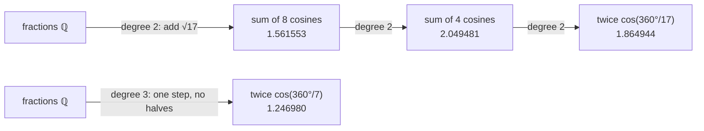

# Straightedge and compass: why trisection and doubling the cube must fail

[Syllabus](../../../SYLLABUS.md) → [Algebraic and analytic number theory](../README.md) → [Fields and Galois Theory](../README.md#s05) → Straightedge and compass

---

## General Overview

A regular 17-gon, seventeen equal sides round a circle, can be drawn exactly with an unmarked straightedge and a compass. A regular 7-gon cannot. The [Ruler and compass](../../05-Geometry%20and%20trig/06-Beyond%20Euclid/03-ruler-and-compass-constructions.md) card shows both: the 17-gon's cosine is four square roots deep, and the 7-gon's cosine solves a cubic with no fraction root.

That cubic argument stops at cubics. The 11-gon's cosine solves an equation of degree 5, the 13-gon's one of degree 6. "No fraction root" proves nothing there. This card replaces the cubic trick with one number that works for every length: the **degree**, the dimension of the smallest field that holds the length ([Field extensions](01-field-extensions-and-degree.md)).

Each straightedge-and-compass step at most doubles that dimension. So every length you can build has degree 1, 2, 4, 8, 16 and so on. The 17-gon's cosine has degree 8. The 7-gon's has degree 3, the 11-gon's degree 5: neither is a power of 2, so neither polygon can be built. The same count ends trisection and doubling the cube.

**A constructible length always has a degree that is a power of 2, and a regular n-gon is constructible exactly when φ(n), the count of whole numbers from 1 to n sharing no factor with n, is a power of 2: that is, when n is a power of 2 times distinct Fermat primes (primes of the form $`2^{2^j} + 1`$ for a whole number j; the known ones are 3, 5, 17, 257 and 65,537).**

**What kind of fact this is:** a theorem, proved on this card in Why it works, using the degree of the nth roots of 1 from [Cyclotomic fields](08-cyclotomic-extensions-and-roots-of-unity.md) and [The Galois correspondence](05-galois-groups-and-the-fundamental-theorem.md); π's case rests on Lindemann's 1882 theorem, stated without proof. Whether any Fermat prime beyond 65,537 exists is open as of 2026-11-15.

### The picture: two towers



The 17-gon's cosine sits at the top of three steps of degree 2, so its degree is 2 × 2 × 2 = 8. The 7-gon's cosine sits one step of degree 3 above the fractions, and no chain of doublings ever passes through a 3.

---

## The formula

Notation, in words first. $`\mathbb{Q}`$ is the field of fractions, also called the rationals. For a number $`\alpha`$, $`\mathbb{Q}(\alpha)`$ is the smallest field holding the fractions and $`\alpha`$. Its **degree**, $`[\mathbb{Q}(\alpha):\mathbb{Q}]`$, is its dimension over the fractions: the degree of $`\alpha`$'s minimal polynomial, the lowest-degree fraction-coefficient equation it solves ([Minimal polynomials](02-minimal-polynomials-and-conjugates.md)).

```math
\alpha \text{ constructible} \quad\Longrightarrow\quad [\mathbb{Q}(\alpha):\mathbb{Q}] = 2^{k} \text{ for some whole number } k
```

**Read it aloud:** if a length can be built, the smallest field holding it has dimension a power of 2 over the fractions.

The rule runs one way only. A degree-4 number can still be out of reach; What breaks gives one. For the regular polygons the test is exact:

```math
\text{regular } n\text{-gon constructible} \iff \varphi(n) = 2^{k} \iff n = 2^{a}\, p_1 p_2 \cdots p_r, \ \ p_i \text{ distinct Fermat primes}
```

**Read it aloud:** an n-gon can be built exactly when the number of remainders coprime to n is a power of 2, which happens exactly when n is a power of 2 times Fermat primes, each used once.

A **Fermat number** is $`F_j = 2^{2^j} + 1`$. A **Fermat prime** is one that is prime. The known ones are $`F_0`$ to $`F_4`$: 3, 5, 17, 257 and 65,537.

| Symbol | Plain meaning | In our example | Push it up and the answer… |
| --- | --- | --- | --- |
| $`n`$ | number of equal sides | 17, and 7 | more corners to place |
| $`c`$, $`\theta`$ | $`c = \cos(360^\circ/n)`$: on a circle of radius 1, how far along the starting radius the first corner sits; $`\theta`$ is an angle in $`\cos 3\theta`$ | 0.932472 for 17 | — |
| $`\varphi(n)`$ | Euler's totient: whole numbers from 1 to n sharing no factor with n | 16 for 17; 6 for 7 | degree of $`c`$ is $`\varphi(n)/2`$ |
| $`\mathbb{Q}`$ | the field of fractions, where every construction starts | contains 1 and 17 | — |
| $`\alpha`$, $`x`$ | a number to build; the unknown in its polynomial | $`2c`$, root of $`x^3 + x^2 - 2x - 1`$ for 7 | — |
| $`K`$, $`L`$, $`M`$, $`[L:K]`$; $`K_0, \dots, K_m`$ | fields, each inside the next; $`[L:K]`$ is the degree, the dimension of $`L`$ over $`K`$; $`K_0, \dots, K_m`$ is a tower, each field the one below plus one square root | $`[\mathbb{Q}(\sqrt{17}):\mathbb{Q}] = 2`$; 3 steps for the 17-gon's cosine | degrees multiply up a tower, to $`2^m`$ at the top |
| $`v`$, $`w`$, $`s`$ | in Step 0, numbers already built, making the new number $`v + w\sqrt{s}`$ | $`s = 17`$ at the first step | — |
| $`\zeta`$, $`t`$ | $`\zeta_n`$, the first corner as a complex number, a root of $`x^n = 1`$; $`t`$ a whole number coprime to n, in the symmetry $`\zeta \mapsto \zeta^t`$ | $`\zeta_{17}`$, degree 16; $`t = 3`$ | — |
| $`G`$, $`H`$, $`N`$, $`g`$, $`L^H`$ | the symmetry group of $`\mathbb{Q}(\zeta)`$; a subgroup; the subgroup $`\{1, g\}`$ with $`g`$ of order 2; the numbers the symmetries in $`H`$ leave alone | sizes 16, 8, 4, 2 for 17 | — |
| $`p`$; $`F_j`$, $`p_i`$, $`e_i`$ | a prime, as in "mod p"; Fermat numbers; the odd primes dividing n, and how often each divides it | p = 7 for $`x^3 - 2`$; $`F_2 = 17`$ | — |
| $`k`$, $`a`$, $`j`$, $`r`$, $`m`$, $`b`$, $`d`$, $`e`$ | whole-number counters in exponents and lists | $`17 = 2^0 \times 17`$ | — |
| $`r_1`$, $`r_2`$, $`u`$ | the two real roots of $`x^4 - 4x + 2`$, and $`u = (r_1 + r_2)^2`$ | 0.517999, 1.363113, 3.538585 | — |

### When it holds

- **Start from the length 1 only.** Given a segment of length $`\sqrt[3]{2}`$ as well, doubling the cube is trivial. The field you start from is the field the degrees count over.
- **An unmarked straightedge.** Two marks on the edge, slid into place (a **neusis**), solve cubics: trisection and the 7-gon become possible.
- **Finitely many exact steps.** A 7-gon drawn to within a hair is a drawing, not a construction.
- **"Power of 2" is necessary, not enough.** It decides polygons and cubics. For a general number, the test is that its whole **splitting field** (the smallest field holding every root of its minimal polynomial, from [Splitting fields](03-splitting-fields-and-algebraic-closure.md)) has degree a power of 2. The argument in the fold under What breaks shows every buildable number passes this test. That passing it is also enough is stated here, not proved: it needs Step 4's halving chain in every group of size $`2^m`$, not only those where order does not matter (Cox, under Sources, chapter on geometric constructions).

---

## Why it works

### Step 0: one step, one square root, degree at most 2

The [Ruler and compass](../../05-Geometry%20and%20trig/06-Beyond%20Euclid/03-ruler-and-compass-constructions.md) card shows each new crossing point has coordinates $`v + w\sqrt{s}`$ with $`v`$, $`w`$, $`s`$ already built. So the field of numbers built so far grows by one square root at a time.

Adding $`\sqrt{s}`$ to a field $`K`$ gives degree 1, if $`\sqrt{s}`$ was already in $`K`$, or degree 2: every new number is $`v + w\sqrt{s}`$, two coordinates over $`K`$.

### Step 1: degrees multiply up a tower

The **tower law** ([Field extensions](01-field-extensions-and-degree.md)): for fields $`K \subseteq L \subseteq M`$,

```math
[M:K] = [M:L]\,[L:K]
```

**Read it aloud:** the dimension of the top over the bottom is the product of the two step dimensions.

A built length $`\alpha`$ sits at the top of a tower $`\mathbb{Q} = K_0 \subseteq K_1 \subseteq \cdots \subseteq K_m`$, each step of degree 1 or 2. So $`[K_m:\mathbb{Q}]`$ is a power of 2. And $`\mathbb{Q}(\alpha)`$ sits inside $`K_m`$, so by the tower law again its degree divides $`[K_m:\mathbb{Q}]`$. A divisor of a power of 2 is a power of 2. That proves the first formula.

### Step 2: the three ancient problems

- **Doubling the cube.** A cube of volume 2 has side $`\sqrt[3]{2} = 1.259921`$, a root of $`x^3 - 2`$. That cubic has no factor over the fractions: reduced mod 7 it has no factor at all, since 2 is no cube mod 7. So the degree is 3, not a power of 2.
- **Trisecting 60°.** The angle 20° needs $`\cos 20^\circ = 0.939693`$. Twice it is a root of $`x^3 - 3x - 1`$, from $`\cos 3\theta = 4\cos^3\theta - 3\cos\theta`$. Reduced mod 2 it has no factor, so degree 3. One angle that cannot be cut in three is enough to kill a recipe for every angle.
- **Squaring the circle.** A unit circle has area π, so the square needs side $`\sqrt{\pi} = 1.772454`$. Lindemann proved in 1882 that π is **transcendental** (solves no polynomial with fraction coefficients), so it has no degree at all. Then neither does $`\sqrt{\pi}`$, since squaring would bring back π.

<details>
<summary>Why "no factor mod a prime" proves "no factor over the fractions"</summary>

Take a polynomial with whole-number coefficients and leading coefficient 1. If it factored over the fractions, Gauss's lemma says it would factor into whole-number polynomials, each with leading coefficient 1. Reduce both factors mod a prime p: they stay of the same degrees and multiply to the reduced polynomial. So a polynomial with no factor mod p has none over the fractions.

The converse fails. $`x^4 - x^2 + 1`$, whose roots are four of the twelfth roots of 1, has no factor over the fractions, yet it factors mod every prime ([Cyclotomic fields](08-cyclotomic-extensions-and-roots-of-unity.md) shows why), as the code confirms for each prime below 60. So the code searches the primes up to 59 for one that works. As a control, it also checks that its test finds the factors of $`(x^2 - 2)(x^2 - 3)`$ mod 2, 3, 5, 7 and 11.

</details>

### Step 3: the polygon's cosine has degree φ(n)/2

The first corner of a regular n-gon on the unit circle is $`\zeta`$, a root of $`x^n = 1`$. [Cyclotomic fields](08-cyclotomic-extensions-and-roots-of-unity.md) proves $`\zeta`$ has degree $`\varphi(n)`$. The cosine is the corner's shadow on the axis:

```math
2c = \zeta + \zeta^{-1}
```

So $`\zeta`$ solves $`x^2 - 2c\,x + 1 = 0`$, a quadratic over $`\mathbb{Q}(c)`$, and $`\zeta`$ is not real while $`c`$ is. That makes $`[\mathbb{Q}(\zeta):\mathbb{Q}(c)] = 2`$, and the tower law gives

```math
[\mathbb{Q}(c):\mathbb{Q}] = \frac{\varphi(n)}{2} \qquad (n \ge 3)
```

For 7: $`\varphi(7) = 6`$, degree 3. For 11: $`\varphi(11) = 10`$, degree 5. For 17: $`\varphi(17) = 16`$, degree 8. Step 1 now rules out 7 and 11 at once, with no search for fraction roots.

The code reaches these degrees a second way. It builds each minimal polynomial of $`2c`$ exactly, by long division of $`x^n - 1`$, and proves it has no factor by reducing mod a prime. For the 11-gon that polynomial is $`x^5 + x^4 - 4x^3 - 3x^2 + 3x + 1`$, with no factor mod 2.

### Step 4: when φ(n) is a power of 2, square roots do reach the corner

Here the Galois correspondence turns a count into a construction. The symmetries of $`\mathbb{Q}(\zeta)`$ are the maps $`\zeta \mapsto \zeta^t`$ for t coprime to n: a group of size $`\varphi(n)`$ in which order of combining does not matter.

If $`\varphi(n) = 2^m`$, that group has a chain of subgroups, each half the size of the one before. [The Galois correspondence](05-galois-groups-and-the-fundamental-theorem.md) turns the chain into a tower of fields, each of degree 2 over the one below. A degree-2 step is one quadratic, so one square root by the quadratic formula. The tower ends at $`\mathbb{Q}(\zeta)`$, which holds $`c`$.

For 17 the chain is visible. The powers of 3 mod 17 run through all 16 nonzero remainders. Every second power gives the subgroup of size 8, `1, 2, 4, 8, 9, 13, 15, 16`; every fourth gives `1, 4, 13, 16`; every eighth gives `1, 16`. Summing the cosines of 360°/17 times each subgroup member gives Gauss's numbers: 1.561553, then 2.049481, then 1.864944, which is $`2c`$.

<details>
<summary>Detailed proof: a group of size 2^m in which order does not matter has the chain</summary>

Induct on m. For m = 0 there is nothing to do. Otherwise the group G has an element g of order 2: take any element other than the identity, of order $`2^e`$ by Lagrange, and raise it to the power $`2^{e-1}`$.

The pair $`\{1, g\}`$ is a subgroup N, and since order does not matter, the cosets of N form a group G/N of size $`2^{m-1}`$. By induction G/N has a chain down to one element, each step half the last. Pulling each subgroup of G/N back to the members of G that land in it gives a chain in G from G down to N, each step half, and N to $`\{1\}`$ is one more half.

Each subgroup H in the chain has a fixed field $`L^H`$, with $`L = \mathbb{Q}(\zeta)`$: the numbers in $`L`$ the symmetries in H leave alone. The correspondence makes $`[L^{H'}:L^{H}] = [H:H'] = 2`$ for consecutive members $`H \supseteq H'`$.

</details>

### Step 5: φ(n) is a power of 2 exactly for Fermat primes

Write $`n = 2^a p_1^{e_1} \cdots p_r^{e_r}`$ with odd primes $`p_i`$. Then $`\varphi(n) = 2^{a-1} \prod p_i^{e_i - 1}(p_i - 1)`$ (with no $`2^{a-1}`$ factor when a = 0).

- Each $`p_i^{e_i - 1}`$ is odd, so each $`e_i`$ must be 1: no odd prime twice. That is why 9 fails though 3 works.
- Each $`p_i - 1`$ must be a power of 2, so $`p_i = 2^b + 1`$. If b had an odd factor $`d > 1`$, writing $`b = de`$, then $`2^e + 1`$ would divide $`2^b + 1`$, so it would not be prime. So b is itself a power of 2, and $`p_i`$ is a Fermat prime.

The code compares this factor test with the φ test for every n from 3 to 1,000. They agree, as the proof says they must. That run checks the code; the proof covers every n.

---

## Worked numbers, by hand

| Step | Arithmetic | Value |
| --- | --- | --- |
| φ(17) | 17 is prime, so 1 to 16 all count | 16 |
| degree of the 17-gon's cosine | 16 ÷ 2 | **8 = 2 × 2 × 2: buildable** |
| φ(7) | 7 is prime | 6 |
| degree of the 7-gon's cosine | 6 ÷ 2 | **3: not buildable** |
| φ(11), degree | 10, then 10 ÷ 2 | **5: not buildable** |
| φ(9), degree | 1, 2, 4, 5, 7, 8 count | 6, so **3: not buildable** |
| 17 by the factor test | 17 = 2^4 + 1 = F_2 | Fermat prime: buildable |
| 15 by the factor test | 3 × 5, distinct Fermat primes | buildable |
| the 17-gon's cosine | four square roots, from √17 = 4.123106 | **0.932472** |

From 3 to 20, the buildable polygons are 3, 4, 5, 6, 8, 10, 12, 15, 16, 17 and 20. The others carry these cosine degrees: 7 (3), 9 (3), 11 (5), 13 (6), 14 (3), 18 (3), 19 (9). Up to 100 there are 24 buildable n-gons; up to 1,000 there are 52.

The five known Fermat primes multiply to 4,294,967,295, which is $`2^{32} - 1`$. So with those five, the odd buildable polygons stop there. The next Fermat number, $`F_5`$ = 4,294,967,297, is 641 × 6,700,417, as Euler found in 1732.

### What breaks if you drop a piece

| Mistake | Comes out at | What went wrong |
| --- | --- | --- |
| "No fraction root, so not buildable", on $`x^4 - 2`$ | wrongly rules out $`\sqrt[4]{2}`$ = 1.189207, which is $`\sqrt{\sqrt{2}}`$ | The fraction-root test only works for cubics |
| "Degree 4, so buildable", on $`x^4 - 4x + 2`$ | root 0.517999 wrongly called buildable | Degree $`2^k`$ is needed, not enough: the splitting field has a factor 3 |
| "3 is a Fermat prime, so the 9-gon works" | cosine of degree 3 | Each Fermat prime may appear only once |
| Cubic test on the 11-gon | no cubic to test: the degree is 5 | Only the degree argument reaches it |

The roots of the house example, $`x^4 - 2`$, are buildable: its splitting field has degree 8 = $`2^3`$, with the eight symmetries of a square ([The Galois correspondence](05-galois-groups-and-the-fundamental-theorem.md)).

The second witness needs one more step. Split the four roots of $`x^4 - 4x + 2`$ into two pairs: the real roots $`r_1`$, $`r_2`$, and the two complex ones. The square $`u`$ of the sum of the real pair solves the **resolvent cubic** $`u^3 - 8u - 16 = 0`$ ([Computing a Galois group](06-computing-a-galois-group.md)). Its only possible whole-number roots are ±1, ±2, ±4, ±8, ±16, and none works. The code checks that $`u = (r_1 + r_2)^2 = 3.538585`$ does solve it.

<details>
<summary>Detailed proof: x^4 − 4x + 2 has a root of degree 4 that cannot be built</summary>

Degree 4: the code finds no factor mod 3. The number $`u`$ is built from the roots, so it lies in the splitting field $`L`$, and its cubic has no fraction root, so $`[\mathbb{Q}(u):\mathbb{Q}] = 3`$. By the tower law, 3 divides $`[L:\mathbb{Q}]`$.

Suppose $`r_1`$ were buildable, at the top of a square-root tower. Each symmetry sending $`r_1`$ to another root carries the tower to another square-root tower, since it sends $`\sqrt{s}`$ to a square root of the image of $`s`$. Stacking all these towers on top of each other gives one square-root tower that holds every root, so it contains $`L`$. Its degree is a power of 2, and $`[L:\mathbb{Q}]`$ divides it. A power of 2 has no factor 3: contradiction.

</details>

---

## Code, from first principles, and it actually runs

The scripts take four roads. Road 1 asks whether φ(n) is a power of 2; road 2 factors n against the Fermat primes; the two must agree to 1,000. Road 3 builds each minimal polynomial exactly and proves its degree by finding a prime where it has no factor; it must give φ(n)/2. Road 4 builds the 17-gon's cosine from square roots and from cosine sums over subgroups, and the two must match.

### Python

```python
# Straightedge and compass -- the check behind the card.  Standard library only;
# math gives cos, sqrt, pi and gcd as tools.  Every number on the card is printed here.
# Roads: (1) phi(n) a power of 2 against (2) n = a power of 2 times distinct Fermat
# primes, for every n to 1000; (3) exact minimal polynomials, proved irreducible by
# reduction mod a prime; (4) the 17-gon's cosine by square roots against cosine sums.
import math

def is_prime(m):
    return m > 1 and all(m % d for d in range(2, math.isqrt(m) + 1))

def phi(n):                                  # road 1 counts what shares no factor with n
    return sum(1 for k in range(1, n + 1) if math.gcd(k, n) == 1)

def pow2(m):
    return m > 0 and m & (m - 1) == 0

FERMAT = [2 ** (2 ** j) + 1 for j in range(5)]

def gauss_wantzel(n):                        # road 2: strip the 2s, then each Fermat prime once
    while n % 2 == 0:
        n //= 2
    for p in FERMAT:
        if n % p == 0:
            n //= p
    return n == 1

def padd(a, b):                              # polynomials: integer lists, constant term first
    a, b = a + [0] * (len(b) - len(a)), b + [0] * (len(a) - len(b))
    return [x + y for x, y in zip(a, b)]

def pmul(a, b):
    out = [0] * (len(a) + len(b) - 1)
    for i, x in enumerate(a):
        for j, y in enumerate(b):
            out[i + j] += x * y
    return out

def divide(f, g, p=0):                       # f by monic g; p = 0 means exact, over the integers
    f, q = f[:], [0] * (len(f) - len(g) + 1)
    for i in range(len(f) - len(g), -1, -1):
        c = f[i + len(g) - 1] % p if p else f[i + len(g) - 1]
        q[i] = c
        for j, y in enumerate(g):
            f[i + j] -= c * y
    return q, [x % p for x in f[:len(g) - 1]] if p else f[:len(g) - 1]

def cyclotomic(n):                           # x^n - 1 with every smaller divisor's factor removed
    f = [-1] + [0] * (n - 1) + [1]
    for d in range(1, n):
        if n % d == 0:
            f = divide(f, cyclotomic(d))[0]
    return f

def twice_cos_poly(n):                       # z^-m times the cyclotomic polynomial, in x = z + 1/z
    c = cyclotomic(n)
    m = (len(c) - 1) // 2
    D = [[2], [0, 1]]                        # z^k + z^-k as a polynomial in x
    while len(D) <= m:
        D.append(padd(pmul([0, 1], D[-1]), [-v for v in D[-2]]))
    out = [c[m]]
    for k in range(1, m + 1):
        out = padd(out, [c[m + k] * v for v in D[k]])
    return out

def irreducible_mod(f, p):                   # no monic factor of degree 1 to d/2 over GF(p)
    d = len(f) - 1
    for k in range(1, d // 2 + 1):
        for code in range(p ** k):
            g = [code // p ** i % p for i in range(k)] + [1]
            if not any(divide(f, g, p)[1]):
                return False
    return True

def certificate(f):                          # the smallest prime that proves f irreducible
    return next(p for p in range(2, 60) if is_prime(p) and irreducible_mod(f, p))

def value(f, x):
    return sum(c * x ** i for i, c in enumerate(f))

def bisect(f, lo, hi):
    for _ in range(200):
        mid = (lo + hi) / 2
        lo, hi = (mid, hi) if value(f, lo) * value(f, mid) > 0 else (lo, mid)
    return lo

yn = lambda b: "yes" if b else "no"
print(f"Fermat numbers 2^(2^j) + 1, j = 0..4: {FERMAT}, all prime: {yn(all(map(is_prime, FERMAT)))}")
f5 = 2 ** 32 + 1
d5 = next(d for d in range(3, 10 ** 6, 2) if f5 % d == 0)
print(f"F5 = {f5} = {d5} x {f5 // d5}; product of the five Fermat primes = {math.prod(FERMAT)} = 2^32 - 1: {yn(math.prod(FERMAT) == 2 ** 32 - 1)}")
yes = [n for n in range(3, 21) if pow2(phi(n))]
no = [f"{n} (degree {phi(n) // 2})" for n in range(3, 21) if not pow2(phi(n))]
print(f"n = 3..20, buildable: {yes}")
print(f"n = 3..20, not: {', '.join(no)}")
agree = all(pow2(phi(n)) == gauss_wantzel(n) for n in range(3, 1001))
print(f"phi test and Fermat-prime test agree for every n = 3..1000: {yn(agree)}")
print(f"buildable n-gons up to 100: {sum(gauss_wantzel(n) for n in range(3, 101))}; up to 1000: {sum(gauss_wantzel(n) for n in range(3, 1001))}")

quartic = [2, -4, 0, 0, 1]
r1, r2 = bisect(quartic, 0, 1), bisect(quartic, 1, 2)
cases = [("x^3 - 2, side of the doubled cube", [-2, 0, 0, 1], 2 ** (1 / 3)),
         ("x^3 - 3x - 1, twice cos 20 deg", [-1, -3, 0, 1], 2 * math.cos(math.pi / 9)),
         ("x^4 - 2, the house example", [-2, 0, 0, 0, 1], math.sqrt(math.sqrt(2))),
         ("x^4 - 4x + 2", quartic, r1)]
cases += [(f"twice cos(360/{n})", twice_cos_poly(n), 2 * math.cos(2 * math.pi / n)) for n in (7, 9, 11, 13, 17)]
print("polynomial (top power first) | irreducible mod p | degree | power of 2 | root")
for name, f, x in cases:
    p, d = certificate(f), len(f) - 1
    assert abs(value(f, x)) < 1e-9                         # the number really is a root
    print(f"{name}: {f[::-1]} | p = {p} | {d} | {yn(pow2(d))} | {x:.6f}")
    if name.startswith("twice cos"):
        n = int(name[14:-1])
        assert d == phi(n) // 2 and pow2(d) == gauss_wantzel(n)   # exact degree = phi(n)/2
w12 = [p for p in range(2, 60) if is_prime(p) and irreducible_mod([1, 0, -1, 0, 1], p)]  # the converse fails
print(f"x^4 - x^2 + 1 (twelfth roots of 1): primes below 60 where it has no factor mod p: {w12}")
assert w12 == [] and not any(irreducible_mod(pmul([-2, 0, 1], [-3, 0, 1]), p) for p in (2, 3, 5, 7, 11))  # a known product
print(f"cos 20 deg = {math.cos(math.pi / 9):.6f}; side of a square of area pi = {math.sqrt(math.pi):.6f}")

s17 = math.sqrt(17)                          # road 4a: the 17-gon by four square roots
A, B = (-1 + s17) / 2, (-1 - s17) / 2
A1, B1 = (A + math.sqrt(A * A + 4)) / 2, (B + math.sqrt(B * B + 4)) / 2
c17 = (A1 + math.sqrt(A1 * A1 - 4 * B1)) / 4
print(f"square-root road: sqrt 17 = {s17:.6f}, A = {A:.6f}, B = {B:.6f}, A1 = {A1:.6f}, B1 = {B1:.6f}, c = {c17:.6f}")
powers = [pow(3, k, 17) for k in range(16)]  # road 4b: 3 runs through all 16 remainders
print(f"powers of 3 mod 17 reach all 16 nonzero remainders: {yn(sorted(powers) == list(range(1, 17)))}")
for size in (8, 4, 2):
    H = sorted(powers[::16 // size])
    eta = sum(math.cos(2 * math.pi * h / 17) for h in H)
    print(f"subgroup of size {size}: {H}, cosine sum {eta:.6f}")
    assert abs(eta - {8: A, 4: A1, 2: 2 * c17}[size]) < 1e-12   # two roads, one number
assert abs(c17 - 0.932472) < 5e-7

u = (r1 + r2) ** 2
roots = [t for d in (1, 2, 4, 8, 16) for t in (d, -d) if t ** 3 - 8 * t - 16 == 0]
print(f"x^4 - 4x + 2: real roots {r1:.6f}, {r2:.6f}; u = (sum)^2 = {u:.6f}")
print(f"u^3 - 8u - 16 at u is zero: {yn(abs(u ** 3 - 8 * u - 16) < 1e-9)}; whole-number roots of it: {roots}")
assert roots == [] and abs(u ** 3 - 8 * u - 16) < 1e-9
assert agree and len(yes) == 11 and d5 == 641 and all(map(is_prime, FERMAT)) and math.prod(FERMAT) == 2 ** 32 - 1
print("ALL CHECKS PASS")
```

**Ran 2026-11-15 on macOS, Python 3.14.10, standard library only. All checks passed. Output, pasted from the run:**

```
Fermat numbers 2^(2^j) + 1, j = 0..4: [3, 5, 17, 257, 65537], all prime: yes
F5 = 4294967297 = 641 x 6700417; product of the five Fermat primes = 4294967295 = 2^32 - 1: yes
n = 3..20, buildable: [3, 4, 5, 6, 8, 10, 12, 15, 16, 17, 20]
n = 3..20, not: 7 (degree 3), 9 (degree 3), 11 (degree 5), 13 (degree 6), 14 (degree 3), 18 (degree 3), 19 (degree 9)
phi test and Fermat-prime test agree for every n = 3..1000: yes
buildable n-gons up to 100: 24; up to 1000: 52
polynomial (top power first) | irreducible mod p | degree | power of 2 | root
x^3 - 2, side of the doubled cube: [1, 0, 0, -2] | p = 7 | 3 | no | 1.259921
x^3 - 3x - 1, twice cos 20 deg: [1, 0, -3, -1] | p = 2 | 3 | no | 1.879385
x^4 - 2, the house example: [1, 0, 0, 0, -2] | p = 5 | 4 | yes | 1.189207
x^4 - 4x + 2: [1, 0, 0, -4, 2] | p = 3 | 4 | yes | 0.517999
twice cos(360/7): [1, 1, -2, -1] | p = 2 | 3 | no | 1.246980
twice cos(360/9): [1, 0, -3, 1] | p = 2 | 3 | no | 1.532089
twice cos(360/11): [1, 1, -4, -3, 3, 1] | p = 2 | 5 | no | 1.682507
twice cos(360/13): [1, 1, -5, -4, 6, 3, -1] | p = 2 | 6 | no | 1.770912
twice cos(360/17): [1, 1, -7, -6, 15, 10, -10, -4, 1] | p = 3 | 8 | yes | 1.864944
x^4 - x^2 + 1 (twelfth roots of 1): primes below 60 where it has no factor mod p: []
cos 20 deg = 0.939693; side of a square of area pi = 1.772454
square-root road: sqrt 17 = 4.123106, A = 1.561553, B = -2.561553, A1 = 2.049481, B1 = 0.344151, c = 0.932472
powers of 3 mod 17 reach all 16 nonzero remainders: yes
subgroup of size 8: [1, 2, 4, 8, 9, 13, 15, 16], cosine sum 1.561553
subgroup of size 4: [1, 4, 13, 16], cosine sum 2.049481
subgroup of size 2: [1, 16], cosine sum 1.864944
x^4 - 4x + 2: real roots 0.517999, 1.363113; u = (sum)^2 = 3.538585
u^3 - 8u - 16 at u is zero: yes; whole-number roots of it: []
ALL CHECKS PASS
```

### Rust

Same numbers, same labels, built with `rustc --edition 2021 -O`.

```rust
// Straightedge and compass -- the same check as the Python, in Rust.  No crates.
// Every number on the card is printed here, with the same labels.
// Roads: (1) phi(n) a power of 2 against (2) n = a power of 2 times distinct Fermat
// primes, for every n to 1000; (3) exact minimal polynomials, proved irreducible by
// reduction mod a prime; (4) the 17-gon's cosine by square roots against cosine sums.
use std::f64::consts::PI;
type Poly = Vec<i64>; // integer coefficients, constant term first

fn gcd(mut a: i64, mut b: i64) -> i64 {
    while b != 0 { (a, b) = (b, a % b) }
    a
}
fn is_prime(m: i64) -> bool { m > 1 && (2..).take_while(|d| d * d <= m).all(|d| m % d != 0) }
fn phi(n: i64) -> i64 { (1..=n).filter(|&k| gcd(k, n) == 1).count() as i64 } // road 1
fn pow2(m: i64) -> bool { m > 0 && m & (m - 1) == 0 }
const FERMAT: [i64; 5] = [3, 5, 17, 257, 65537];

fn gauss_wantzel(mut n: i64) -> bool { // road 2: strip the 2s, then each Fermat prime once
    while n % 2 == 0 { n /= 2 }
    for p in FERMAT { if n % p == 0 { n /= p } }
    n == 1
}
fn padd(a: &Poly, b: &Poly) -> Poly {
    (0..a.len().max(b.len())).map(|i| a.get(i).unwrap_or(&0) + b.get(i).unwrap_or(&0)).collect()
}
fn pmul(a: &Poly, b: &Poly) -> Poly {
    let mut out = vec![0; a.len() + b.len() - 1];
    for (i, x) in a.iter().enumerate() { for (j, y) in b.iter().enumerate() { out[i + j] += x * y } }
    out
}
fn divide(f: &Poly, g: &Poly, p: i64) -> (Poly, Poly) { // f by monic g; p = 0 means exact
    let (mut f, mut q) = (f.clone(), vec![0; f.len() - g.len() + 1]);
    for i in (0..=f.len() - g.len()).rev() {
        let top = f[i + g.len() - 1];
        let c = if p > 0 { top.rem_euclid(p) } else { top };
        q[i] = c;
        for (j, y) in g.iter().enumerate() { f[i + j] -= c * y }
    }
    let r: Poly = f[..g.len() - 1].iter().map(|x| if p > 0 { x.rem_euclid(p) } else { *x }).collect();
    (q, r)
}
fn cyclotomic(n: usize) -> Poly { // x^n - 1 with every smaller divisor's factor removed
    let mut f = vec![0; n + 1];
    f[0] = -1;
    f[n] = 1;
    for d in 1..n { if n % d == 0 { f = divide(&f, &cyclotomic(d), 0).0 } }
    f
}
fn twice_cos_poly(n: usize) -> Poly { // z^-m times the cyclotomic polynomial, in x = z + 1/z
    let c = cyclotomic(n);
    let m = (c.len() - 1) / 2;
    let mut d: Vec<Poly> = vec![vec![2], vec![0, 1]]; // z^k + z^-k as a polynomial in x
    while d.len() <= m {
        let next = padd(&pmul(&vec![0, 1], &d[d.len() - 1]), &d[d.len() - 2].iter().map(|v| -v).collect());
        d.push(next);
    }
    let mut out = vec![c[m]];
    for k in 1..=m { out = padd(&out, &d[k].iter().map(|v| c[m + k] * v).collect()) }
    out
}
fn irreducible_mod(f: &Poly, p: i64) -> bool { // no monic factor of degree 1 to d/2 over GF(p)
    let d = f.len() - 1;
    for k in 1..=d / 2 {
        for code in 0..p.pow(k as u32) {
            let mut g: Poly = (0..k).map(|i| code / p.pow(i as u32) % p).collect();
            g.push(1);
            if divide(f, &g, p).1.iter().all(|&x| x == 0) { return false }
        }
    }
    true
}
fn certificate(f: &Poly) -> i64 { (2..60).find(|&p| is_prime(p) && irreducible_mod(f, p)).unwrap() }
fn value(f: &Poly, x: f64) -> f64 { f.iter().enumerate().map(|(i, &c)| c as f64 * x.powi(i as i32)).sum() }
fn bisect(f: &Poly, mut lo: f64, mut hi: f64) -> f64 {
    for _ in 0..200 {
        let mid = (lo + hi) / 2.0;
        if value(f, lo) * value(f, mid) > 0.0 { lo = mid } else { hi = mid }
    }
    lo
}
fn yn(b: bool) -> &'static str { if b { "yes" } else { "no" } }
fn rev(f: &Poly) -> Poly { f.iter().rev().copied().collect() }

fn main() {
    let fermat: Vec<i64> = (0..5).map(|j| 2i64.pow(2u32.pow(j)) + 1).collect();
    assert!(fermat == FERMAT.to_vec());
    println!("Fermat numbers 2^(2^j) + 1, j = 0..4: {:?}, all prime: {}", fermat, yn(fermat.iter().all(|&m| is_prime(m))));
    let f5: i64 = (1i64 << 32) + 1;
    let d5 = (3..1_000_000i64).step_by(2).find(|d| f5 % d == 0).unwrap();
    let prod: i64 = fermat.iter().product();
    println!("F5 = {} = {} x {}; product of the five Fermat primes = {} = 2^32 - 1: {}", f5, d5, f5 / d5, prod, yn(prod == (1i64 << 32) - 1));
    let yes: Vec<i64> = (3..21).filter(|&n| pow2(phi(n))).collect();
    let no: Vec<String> = (3..21).filter(|&n| !pow2(phi(n))).map(|n| format!("{} (degree {})", n, phi(n) / 2)).collect();
    println!("n = 3..20, buildable: {:?}", yes);
    println!("n = 3..20, not: {}", no.join(", "));
    let agree = (3..1001).all(|n| pow2(phi(n)) == gauss_wantzel(n));
    println!("phi test and Fermat-prime test agree for every n = 3..1000: {}", yn(agree));
    let count = |top: i64| (3..=top).filter(|&n| gauss_wantzel(n)).count();
    println!("buildable n-gons up to 100: {}; up to 1000: {}", count(100), count(1000));

    let quartic: Poly = vec![2, -4, 0, 0, 1];
    let (r1, r2) = (bisect(&quartic, 0.0, 1.0), bisect(&quartic, 1.0, 2.0));
    let mut cases: Vec<(String, Poly, f64)> = vec![
        ("x^3 - 2, side of the doubled cube".into(), vec![-2, 0, 0, 1], 2f64.powf(1.0 / 3.0)),
        ("x^3 - 3x - 1, twice cos 20 deg".into(), vec![-1, -3, 0, 1], 2.0 * (PI / 9.0).cos()),
        ("x^4 - 2, the house example".into(), vec![-2, 0, 0, 0, 1], 2f64.sqrt().sqrt()),
        ("x^4 - 4x + 2".into(), quartic.clone(), r1)];
    for n in [7usize, 9, 11, 13, 17] {
        cases.push((format!("twice cos(360/{})", n), twice_cos_poly(n), 2.0 * (2.0 * PI / n as f64).cos()));
    }
    println!("polynomial (top power first) | irreducible mod p | degree | power of 2 | root");
    for (name, f, x) in &cases {
        let (p, d) = (certificate(f), (f.len() - 1) as i64);
        assert!(value(f, *x).abs() < 1e-9); // the number really is a root
        println!("{}: {:?} | p = {} | {} | {} | {:.6}", name, rev(f), p, d, yn(pow2(d)), x);
        if let Some(n) = name.strip_prefix("twice cos(360/") {
            let n: i64 = n.trim_end_matches(')').parse().unwrap();
            assert!(d == phi(n) / 2 && pow2(d) == gauss_wantzel(n)); // exact degree = phi(n)/2
        }
    }
    let w12: Vec<i64> = (2..60).filter(|&p| is_prime(p) && irreducible_mod(&vec![1, 0, -1, 0, 1], p)).collect(); // the converse fails
    println!("x^4 - x^2 + 1 (twelfth roots of 1): primes below 60 where it has no factor mod p: {:?}", w12);
    assert!(w12.is_empty() && ![2, 3, 5, 7, 11].iter().any(|&p| irreducible_mod(&pmul(&vec![-2, 0, 1], &vec![-3, 0, 1]), p))); // a known product
    println!("cos 20 deg = {:.6}; side of a square of area pi = {:.6}", (PI / 9.0).cos(), PI.sqrt());

    let s17 = 17f64.sqrt(); // road 4a: the 17-gon by four square roots
    let (a, b) = ((-1.0 + s17) / 2.0, (-1.0 - s17) / 2.0);
    let (a1, b1) = ((a + (a * a + 4.0).sqrt()) / 2.0, (b + (b * b + 4.0).sqrt()) / 2.0);
    let c17 = (a1 + (a1 * a1 - 4.0 * b1).sqrt()) / 4.0;
    println!("square-root road: sqrt 17 = {:.6}, A = {:.6}, B = {:.6}, A1 = {:.6}, B1 = {:.6}, c = {:.6}", s17, a, b, a1, b1, c17);
    let powers: Vec<i64> = (0..16).scan(1i64, |x, _| { let v = *x; *x = *x * 3 % 17; Some(v) }).collect();
    let mut sorted = powers.clone();
    sorted.sort();
    println!("powers of 3 mod 17 reach all 16 nonzero remainders: {}", yn(sorted == (1..17).collect::<Vec<i64>>()));
    for (size, target) in [(8usize, a), (4, a1), (2, 2.0 * c17)] {
        let mut h: Vec<i64> = powers.iter().step_by(16 / size).copied().collect();
        h.sort();
        let eta: f64 = h.iter().map(|&k| (2.0 * PI * k as f64 / 17.0).cos()).sum();
        println!("subgroup of size {}: {:?}, cosine sum {:.6}", size, h, eta);
        assert!((eta - target).abs() < 1e-12); // two roads, one number
    }
    assert!((c17 - 0.932472).abs() < 5e-7);

    let u = (r1 + r2).powi(2);
    let roots: Vec<i64> = [1i64, 2, 4, 8, 16].iter().flat_map(|&d| [d, -d]).filter(|t| t * t * t - 8 * t - 16 == 0).collect();
    println!("x^4 - 4x + 2: real roots {:.6}, {:.6}; u = (sum)^2 = {:.6}", r1, r2, u);
    println!("u^3 - 8u - 16 at u is zero: {}; whole-number roots of it: {:?}", yn((u.powi(3) - 8.0 * u - 16.0).abs() < 1e-9), roots);
    assert!(roots.is_empty() && (u.powi(3) - 8.0 * u - 16.0).abs() < 1e-9);
    assert!(agree && yes.len() == 11 && d5 == 641 && fermat.iter().all(|&m| is_prime(m)) && prod == (1i64 << 32) - 1);
    println!("ALL CHECKS PASS");
}
```

**Ran 2026-11-15 on macOS, rustc 1.98.1, no crates. All checks passed. Output, pasted from the run:**

```
Fermat numbers 2^(2^j) + 1, j = 0..4: [3, 5, 17, 257, 65537], all prime: yes
F5 = 4294967297 = 641 x 6700417; product of the five Fermat primes = 4294967295 = 2^32 - 1: yes
n = 3..20, buildable: [3, 4, 5, 6, 8, 10, 12, 15, 16, 17, 20]
n = 3..20, not: 7 (degree 3), 9 (degree 3), 11 (degree 5), 13 (degree 6), 14 (degree 3), 18 (degree 3), 19 (degree 9)
phi test and Fermat-prime test agree for every n = 3..1000: yes
buildable n-gons up to 100: 24; up to 1000: 52
polynomial (top power first) | irreducible mod p | degree | power of 2 | root
x^3 - 2, side of the doubled cube: [1, 0, 0, -2] | p = 7 | 3 | no | 1.259921
x^3 - 3x - 1, twice cos 20 deg: [1, 0, -3, -1] | p = 2 | 3 | no | 1.879385
x^4 - 2, the house example: [1, 0, 0, 0, -2] | p = 5 | 4 | yes | 1.189207
x^4 - 4x + 2: [1, 0, 0, -4, 2] | p = 3 | 4 | yes | 0.517999
twice cos(360/7): [1, 1, -2, -1] | p = 2 | 3 | no | 1.246980
twice cos(360/9): [1, 0, -3, 1] | p = 2 | 3 | no | 1.532089
twice cos(360/11): [1, 1, -4, -3, 3, 1] | p = 2 | 5 | no | 1.682507
twice cos(360/13): [1, 1, -5, -4, 6, 3, -1] | p = 2 | 6 | no | 1.770912
twice cos(360/17): [1, 1, -7, -6, 15, 10, -10, -4, 1] | p = 3 | 8 | yes | 1.864944
x^4 - x^2 + 1 (twelfth roots of 1): primes below 60 where it has no factor mod p: []
cos 20 deg = 0.939693; side of a square of area pi = 1.772454
square-root road: sqrt 17 = 4.123106, A = 1.561553, B = -2.561553, A1 = 2.049481, B1 = 0.344151, c = 0.932472
powers of 3 mod 17 reach all 16 nonzero remainders: yes
subgroup of size 8: [1, 2, 4, 8, 9, 13, 15, 16], cosine sum 1.561553
subgroup of size 4: [1, 4, 13, 16], cosine sum 2.049481
subgroup of size 2: [1, 16], cosine sum 1.864944
x^4 - 4x + 2: real roots 0.517999, 1.363113; u = (sum)^2 = 3.538585
u^3 - 8u - 16 at u is zero: yes; whole-number roots of it: []
ALL CHECKS PASS
```

The two outputs match line for line.

### Lean

Lean proves the degree rule for every buildable length, the polygon test for every n from 3 up, and all three ancient impossibilities.

- Lean's buildable lengths start from 1 only. Each step adds, subtracts, multiplies or divides built lengths, or takes a square root of one.
- Suppose $`\alpha`$ can be built. Then $`[\mathbb{Q}(\alpha):\mathbb{Q}] = 2^{k}`$ for some whole number $`k`$.
- Take a whole number $`n \ge 3`$. Then the n-gon's cosine $`c = \cos(360^\circ/n)`$ can be built exactly when $`\varphi(n)`$ is a power of 2.
- Take $`n \ge 3`$. Then $`\varphi(n)`$ is a power of 2 exactly when n is a power of 2 times distinct Fermat primes.
- Take a real $`x`$ with $`x^3 = 2`$. Then $`x`$ cannot be built, so doubling the cube fails.
- Take the angle 60°. Then $`\cos 60^\circ = 1/2`$ can be built, but $`\cos 20^\circ`$ cannot, so 60° cannot be cut in three.
- Take a real $`x`$ with $`x^2 = \pi`$. Then $`x`$ cannot be built, so squaring the circle fails.
- The file proves the needed part of Lindemann's theorem itself, so π's case is checked here, not assumed.
- Take n = 17, 7, 11 and 9. Then φ(n) is 16, 6, 10 and 6, so the cosine degrees are 8, 3, 5 and 3.
- Take n from 3 to 20. Then the buildable ones are 3, 4, 5, 6, 8, 10, 12, 15, 16, 17 and 20.
- Take n = 13, 14, 18 and 19. Then the cosine degrees are 6, 3, 3 and 9.
- Up to 100 there are 24 buildable n-gons; up to 1,000 there are 52.
- Take $`F_0`$ to $`F_4`$. Then they are 3, 5, 17, 257 and 65,537, all prime, with product $`2^{32} - 1`$.
- Take $`F_5`$. Then $`F_5`$ = 4,294,967,297 = 641 × 6,700,417.
- Take the cubics $`x^3 - 2`$ and $`x^3 - 3x - 1`$. Then the first has no root mod 7, and the second none mod 2.
- Take the powers of 3 mod 17. Then they reach all 16 nonzero remainders, and every second, fourth and eighth power give subgroups of sizes 8, 4 and 2.
- Take the resolvent cubic $`u^3 - 8u - 16`$. Then none of ±1, ±2, ±4, ±8 and ±16 is a root.

The decimals, the minimal polynomials, the other factor tests mod p and the $`x^4 - 4x + 2`$ witness are left to Python and Rust.

```lean
-- Straightedge and compass: every constructible length has degree a power of 2, a regular n-gon is constructible exactly when φ(n) is a power of 2 (n a power of 2 times distinct Fermat primes), and doubling the cube, trisecting 60° and squaring the circle are impossible.
import Mathlib
import Mathlib.FieldTheory.IntermediateField.Adjoin.Basic
import Mathlib.LinearAlgebra.Dimension.Finrank
import Mathlib.Analysis.SpecialFunctions.Trigonometric.Basic
import Mathlib.Analysis.SpecialFunctions.Sqrt
import Mathlib.Data.Nat.Totient
import Mathlib.Data.ZMod.Basic
import Mathlib.NumberTheory.Fermat
import Mathlib.Tactic.NormNum.Prime

open IntermediateField Real

/-- The lengths that can be built from the length 1 with an unmarked straightedge and a compass,
in finitely many exact steps. Each step adds, subtracts, multiplies or divides two lengths
already built, or takes the square root of one: the crossing points of lines and circles have
coordinates `v + w √s` with `v`, `w`, `s` already built (the geometry wing's ruler-and-compass
card). Being an inductive definition, every member is reached in finitely many steps, and the
only starting length is 1. -/
inductive Constructible : ℝ → Prop
  | one : Constructible 1
  | add {x y : ℝ} : Constructible x → Constructible y → Constructible (x + y)
  | neg {x : ℝ} : Constructible x → Constructible (-x)
  | mul {x y : ℝ} : Constructible x → Constructible y → Constructible (x * y)
  | inv {x : ℝ} : Constructible x → Constructible x⁻¹
  | sqrt {x : ℝ} : Constructible x → 0 ≤ x → Constructible (√x)

section Helpers

open Polynomial

/-- Fields reached from the fractions by adjoining square roots one at a time. -/
inductive QTower {E : Type*} [Field E] [CharZero E] : IntermediateField ℚ E → Prop
  | base : QTower ⊥
  | step {K : IntermediateField ℚ E} {s : E} : QTower K → s ^ 2 ∈ K →
      QTower (IntermediateField.adjoin ℚ (insert s (K : Set E)))

theorem qtower_merge {E : Type*} [Field E] [CharZero E] {K1 K2 : IntermediateField ℚ E}
    (h1 : QTower K1) (h2 : QTower K2) : ∃ K, QTower K ∧ K1 ≤ K ∧ K2 ≤ K := by
  induction h2 with
  | base => exact ⟨K1, h1, le_rfl, bot_le⟩
  | @step K2 s _ hs ih =>
    obtain ⟨K, hK, h1K, h2K⟩ := ih
    refine ⟨_, QTower.step hK (h2K hs), ?_, ?_⟩
    · exact le_trans h1K (fun x hx => IntermediateField.subset_adjoin ℚ _
        (Set.mem_insert_of_mem _ hx))
    · exact IntermediateField.adjoin.mono ℚ _ _ (Set.insert_subset_insert h2K)

theorem qtower_step_finrank {E : Type*} [Field E] [CharZero E] (K : IntermediateField ℚ E)
    (s : E) :
    Module.finrank ℚ (IntermediateField.adjoin ℚ (insert s (K : Set E))) =
      Module.finrank ℚ K * Module.finrank K (IntermediateField.adjoin K {s}) := by
  have e : IntermediateField.adjoin ℚ (insert s (K : Set E)) =
      (IntermediateField.adjoin K {s}).restrictScalars ℚ := by
    rw [IntermediateField.restrictScalars_adjoin, Set.union_comm, Set.singleton_union]
  have : Module.Free K (IntermediateField.adjoin K {s}) := Module.Free.of_divisionRing _ _
  rw [e]
  exact (Module.finrank_mul_finrank ℚ K (IntermediateField.adjoin K {s})).symm

theorem qtower_rel_finrank {E : Type*} [Field E] [CharZero E] (K : IntermediateField ℚ E)
    (s : E) (hs : s ^ 2 ∈ K) :
    Module.finrank K (IntermediateField.adjoin K {s}) = 1 ∨
      Module.finrank K (IntermediateField.adjoin K {s}) = 2 := by
  set d : K := ⟨s ^ 2, hs⟩
  have hroot : Polynomial.aeval s (Polynomial.X ^ 2 - Polynomial.C d) = 0 := by
    simp [d]
  have hmon : (Polynomial.X ^ 2 - Polynomial.C d).Monic :=
    Polynomial.monic_X_pow_sub_C d two_ne_zero
  have hint : IsIntegral K s := ⟨_, hmon, by simpa [Polynomial.aeval_def] using hroot⟩
  rw [IntermediateField.adjoin.finrank hint]
  have hdvd := minpoly.dvd K s hroot
  have hle : (minpoly K s).natDegree ≤ 2 := by
    have := Polynomial.natDegree_le_of_dvd hdvd hmon.ne_zero
    rwa [Polynomial.natDegree_X_pow_sub_C] at this
  have hpos := minpoly.natDegree_pos hint
  omega

theorem qtower_finrank {E : Type*} [Field E] [CharZero E] {K : IntermediateField ℚ E}
    (h : QTower K) : ∃ k : ℕ, Module.finrank ℚ K = 2 ^ k := by
  induction h with
  | base => exact ⟨0, by simp⟩
  | @step K s _ hs ih =>
    obtain ⟨k, hk⟩ := ih
    rw [qtower_step_finrank K s, hk]
    rcases qtower_rel_finrank K s hs with h | h
    · exact ⟨k, by rw [h, mul_one]⟩
    · exact ⟨k + 1, by rw [h, pow_succ]⟩

theorem constructible_tower {E : Type*} [Field E] [CharZero E] (ι : ℝ →+* E) {x : ℝ}
    (h : Constructible x) : ∃ K : IntermediateField ℚ E, QTower K ∧ ι x ∈ K := by
  induction h with
  | one => exact ⟨⊥, QTower.base, by simp⟩
  | add _ _ ihx ihy =>
    obtain ⟨K1, h1, hx⟩ := ihx
    obtain ⟨K2, h2, hy⟩ := ihy
    obtain ⟨K, hK, l1, l2⟩ := qtower_merge h1 h2
    exact ⟨K, hK, by rw [map_add]; exact add_mem (l1 hx) (l2 hy)⟩
  | neg _ ihx =>
    obtain ⟨K, hK, hx⟩ := ihx
    exact ⟨K, hK, by rw [map_neg]; exact neg_mem hx⟩
  | mul _ _ ihx ihy =>
    obtain ⟨K1, h1, hx⟩ := ihx
    obtain ⟨K2, h2, hy⟩ := ihy
    obtain ⟨K, hK, l1, l2⟩ := qtower_merge h1 h2
    exact ⟨K, hK, by rw [map_mul]; exact mul_mem (l1 hx) (l2 hy)⟩
  | inv _ ihx =>
    obtain ⟨K, hK, hx⟩ := ihx
    exact ⟨K, hK, by rw [map_inv₀]; exact inv_mem hx⟩
  | @sqrt x _ hx0 ihx =>
    obtain ⟨K, hK, hx⟩ := ihx
    refine ⟨_, QTower.step (s := ι (√x)) hK ?_,
      IntermediateField.subset_adjoin ℚ _ (Set.mem_insert _ _)⟩
    rw [← map_pow, Real.sq_sqrt hx0]; exact hx

theorem qtower_mem_finrank {E : Type*} [Field E] [CharZero E] {K : IntermediateField ℚ E}
    (h : QTower K) {x : E} (hx : x ∈ K) : ∃ j : ℕ, Module.finrank ℚ ℚ⟮x⟯ = 2 ^ j := by
  obtain ⟨k, hk⟩ := qtower_finrank h
  have hd : Module.finrank ℚ ℚ⟮x⟯ ∣ Module.finrank ℚ K :=
    IntermediateField.finrank_dvd_of_le_right (IntermediateField.adjoin_simple_le_iff.mpr hx)
  rw [hk] at hd
  obtain ⟨j, -, hj⟩ := (Nat.dvd_prime_pow Nat.prime_two).1 hd
  exact ⟨j, hj⟩

theorem constructible_degree_pow_two {α : ℝ} (h : Constructible α) :
    ∃ k : ℕ, Module.finrank ℚ ℚ⟮α⟯ = 2 ^ k := by
  obtain ⟨K, hK, hα⟩ := constructible_tower (RingHom.id ℝ) h
  exact qtower_mem_finrank hK hα

theorem cons_zero : Constructible 0 := by
  simpa using Constructible.add Constructible.one (Constructible.neg Constructible.one)

theorem cons_sub {x y : ℝ} (hx : Constructible x) (hy : Constructible y) :
    Constructible (x - y) := by
  simpa [sub_eq_add_neg] using Constructible.add hx (Constructible.neg hy)

theorem cons_div {x y : ℝ} (hx : Constructible x) (hy : Constructible y) :
    Constructible (x / y) := by
  simpa [div_eq_mul_inv] using Constructible.mul hx (Constructible.inv hy)

theorem cons_nat (m : ℕ) : Constructible (m : ℝ) := by
  induction m with
  | zero => simpa using cons_zero
  | succ m ih => simpa using Constructible.add ih Constructible.one

theorem cons_int (m : ℤ) : Constructible (m : ℝ) := by
  rcases Int.eq_nat_or_neg m with ⟨k, rfl | rfl⟩
  · simpa using cons_nat k
  · simpa using Constructible.neg (cons_nat k)

theorem cons_rat (q : ℚ) : Constructible (q : ℝ) := by
  rw [Rat.cast_def]
  exact cons_div (cons_int _) (cons_nat _)

theorem cons_of_sq {x : ℝ} (h : Constructible (x ^ 2)) : Constructible x := by
  have hs : Constructible (√(x ^ 2)) := Constructible.sqrt h (sq_nonneg x)
  rw [Real.sqrt_sq_eq_abs] at hs
  rcases abs_choice x with h1 | h1
  · rwa [h1] at hs
  · have := Constructible.neg hs
    rwa [h1, neg_neg] at this

/-- A complex number whose two coordinates are constructible lengths. -/
def CCons (z : ℂ) : Prop := Constructible z.re ∧ Constructible z.im

theorem ccons_add {z w : ℂ} (hz : CCons z) (hw : CCons w) : CCons (z + w) :=
  ⟨by simpa using Constructible.add hz.1 hw.1, by simpa using Constructible.add hz.2 hw.2⟩

theorem ccons_neg {z : ℂ} (hz : CCons z) : CCons (-z) :=
  ⟨by simpa using Constructible.neg hz.1, by simpa using Constructible.neg hz.2⟩

theorem ccons_sub {z w : ℂ} (hz : CCons z) (hw : CCons w) : CCons (z - w) := by
  simpa [sub_eq_add_neg] using ccons_add hz (ccons_neg hw)

theorem ccons_mul {z w : ℂ} (hz : CCons z) (hw : CCons w) : CCons (z * w) :=
  ⟨by simpa using cons_sub (Constructible.mul hz.1 hw.1) (Constructible.mul hz.2 hw.2),
   by simpa using Constructible.add (Constructible.mul hz.1 hw.2) (Constructible.mul hz.2 hw.1)⟩

theorem ccons_inv {z : ℂ} (hz : CCons z) : CCons z⁻¹ := by
  have hn : Constructible (Complex.normSq z) := by
    rw [Complex.normSq_apply]
    exact Constructible.add (Constructible.mul hz.1 hz.1) (Constructible.mul hz.2 hz.2)
  exact ⟨by simpa using cons_div hz.1 hn, by simpa using cons_div (Constructible.neg hz.2) hn⟩

theorem ccons_rat (q : ℚ) : CCons (q : ℂ) :=
  ⟨by simpa using cons_rat q, by simpa using cons_zero⟩

theorem ccons_of_sq {z : ℂ} (h : CCons (z ^ 2)) : CCons z := by
  obtain ⟨h1, h2⟩ := h
  set a := z.re
  set b := z.im
  have hre : (z ^ 2).re = a ^ 2 - b ^ 2 := by simp [pow_two, a, b]
  have him : (z ^ 2).im = 2 * a * b := by simp [pow_two, a, b]; ring
  rw [hre] at h1
  rw [him] at h2
  have hN : Constructible (√((a ^ 2 - b ^ 2) ^ 2 + (2 * a * b) ^ 2)) := by
    refine Constructible.sqrt ?_ (by positivity)
    simpa [pow_two] using Constructible.add (Constructible.mul h1 h1) (Constructible.mul h2 h2)
  have hN' : √((a ^ 2 - b ^ 2) ^ 2 + (2 * a * b) ^ 2) = a ^ 2 + b ^ 2 := by
    rw [show (a ^ 2 - b ^ 2) ^ 2 + (2 * a * b) ^ 2 = (a ^ 2 + b ^ 2) ^ 2 by ring]
    exact Real.sqrt_sq (by positivity)
  rw [hN'] at hN
  have h2' : Constructible 2 := by simpa using cons_nat 2
  refine ⟨cons_of_sq ?_, cons_of_sq ?_⟩
  · have := cons_div (Constructible.add hN h1) h2'
    convert this using 1
    ring
  · have := cons_div (cons_sub hN h1) h2'
    convert this using 1
    ring

theorem cos_two_pi_div_eq (n : ℕ) :
    Complex.exp (2 * π * Complex.I / n) =
      (Real.cos (2 * π / n) : ℂ) + (Real.sin (2 * π / n) : ℂ) * Complex.I := by
  rw [show 2 * (π : ℂ) * Complex.I / n = ((2 * π / n : ℝ) : ℂ) * Complex.I by push_cast; ring,
    Complex.exp_mul_I]
  push_cast
  ring

theorem cyclo_finrank (n : ℕ) (hn : 0 < n) :
    Module.finrank ℚ ℚ⟮Complex.exp (2 * π * Complex.I / n)⟯ = n.totient := by
  have hζ := Complex.isPrimitiveRoot_exp n hn.ne'
  rw [IntermediateField.adjoin.finrank (hζ.isIntegral hn).tower_top, ← Polynomial.cyclotomic_eq_minpoly_rat hζ hn,
    Polynomial.natDegree_cyclotomic]

theorem totient_of_constructible_cos {n : ℕ} (hn : 0 < n)
    (h : Constructible (Real.cos (2 * π / n))) : ∃ k : ℕ, Nat.totient n = 2 ^ k := by
  obtain ⟨K, hK, hc⟩ := constructible_tower Complex.ofRealHom h
  set c : ℂ := (Real.cos (2 * π / n) : ℂ)
  set s : ℂ := (Real.sin (2 * π / n) : ℂ) * Complex.I
  have hs : s ^ 2 ∈ K := by
    have e : s ^ 2 = c ^ 2 - 1 := by
      simp only [s, c]
      rw [mul_pow, Complex.I_sq]
      have := Real.sin_sq_add_cos_sq (2 * π / n)
      have e2 : ((Real.sin (2 * π / n) : ℂ)) ^ 2 + (Real.cos (2 * π / n) : ℂ) ^ 2 = 1 := by
        exact_mod_cast this
      linear_combination -e2
    rw [e]
    exact sub_mem (pow_mem hc 2) (one_mem K)
  have hz : Complex.exp (2 * π * Complex.I / n) ∈
      IntermediateField.adjoin ℚ (insert s (K : Set ℂ)) := by
    rw [cos_two_pi_div_eq]
    exact add_mem (IntermediateField.subset_adjoin ℚ _ (Set.mem_insert_of_mem _ hc))
      (IntermediateField.subset_adjoin ℚ _ (Set.mem_insert _ _))
  obtain ⟨j, hj⟩ := qtower_mem_finrank (QTower.step hK hs) hz
  exact ⟨j, by rw [← cyclo_finrank n hn, hj]⟩

theorem cyclo_isCyclotomic (n : ℕ) [NeZero n] {ζ : ℂ} (hζ : IsPrimitiveRoot ζ n) :
    IsCyclotomicExtension {n} ℚ ℚ⟮ζ⟯ := by
  change IsCyclotomicExtension {n} ℚ (IntermediateField.adjoin ℚ {ζ}).toSubalgebra
  rw [IntermediateField.adjoin_simple_toSubalgebra_of_isAlgebraic
    (hζ.isIntegral (NeZero.pos n)).tower_top.isAlgebraic]
  exact hζ.adjoin_isCyclotomicExtension ℚ

/-- In a field whose automorphism group is a commutative 2-group, every element fixed by a
subgroup has constructible coordinates, by climbing through subgroups of index 2. -/
theorem ccons_of_fixed {L : IntermediateField ℚ ℂ} [IsGalois ℚ L] [FiniteDimensional ℚ L]
    (hcomm : ∀ σ τ : Gal(L/ℚ), σ * τ = τ * σ) {k : ℕ} (hcard : Nat.card Gal(L/ℚ) = 2 ^ k) :
    ∀ (H : Subgroup Gal(L/ℚ)) (x : L), (∀ h ∈ H, h x = x) → CCons (x : ℂ) := by
  suffices key : ∀ m : ℕ, ∀ (H : Subgroup Gal(L/ℚ)), Nat.card Gal(L/ℚ) - Nat.card H = m →
      ∀ x : L, (∀ h ∈ H, h x = x) → CCons (x : ℂ) from
    fun H x hx => key _ H rfl x hx
  intro m
  induction m using Nat.strong_induction_on with
  | _ m ih =>
  intro H hm x hx
  by_cases hH : ∀ g : Gal(L/ℚ), g ∈ H
  · have hbot : x ∈ (⊥ : IntermediateField ℚ L) :=
      (IsGalois.mem_bot_iff_fixed x).2 (fun g => hx g (hH g))
    obtain ⟨q, rfl⟩ := IntermediateField.mem_bot.1 hbot
    simpa using ccons_rat q
  push Not at hH
  obtain ⟨g, hg⟩ := hH
  have hex : ∃ j, g ^ (2 ^ j) ∈ H := ⟨k, by rw [← hcard, pow_card_eq_one']; exact H.one_mem⟩
  classical
  set j0 := Nat.find hex with hj0
  have hj0H : g ^ (2 ^ j0) ∈ H := Nat.find_spec hex
  have hj0pos : j0 ≠ 0 := by
    intro h0
    rw [h0, pow_zero, pow_one] at hj0H
    exact hg hj0H
  set σ := g ^ (2 ^ (j0 - 1)) with hσ
  have hσH : σ ∉ H := Nat.find_min hex (by omega)
  have hσ2 : σ * σ ∈ H := by
    rw [hσ, ← pow_add, ← two_mul, ← pow_succ', Nat.sub_add_cancel (Nat.one_le_iff_ne_zero.2 hj0pos)]
    exact hj0H
  set H' := H ⊔ Subgroup.zpowers σ with hH'
  have hlt : H < H' := by
    refine lt_of_le_of_ne le_sup_left ?_
    intro h
    apply hσH
    rw [h]
    exact Subgroup.mem_sup_right (Subgroup.mem_zpowers σ)
  have hcardlt : Nat.card H < Nat.card H' := Subgroup.card_lt_of_lt hlt
  have hcardle : Nat.card H' ≤ Nat.card Gal(L/ℚ) := Subgroup.card_le_card_group H'
  have hfix : ∀ z : L, (∀ h ∈ H, h z = z) → σ z = z → ∀ h ∈ H', h z = z := by
    intro z hzH hzσ
    have hle : H' ≤ MulAction.stabilizer Gal(L/ℚ) z := by
      refine sup_le (fun h hh => ?_) (Subgroup.zpowers_le.2 ?_)
      · rw [MulAction.mem_stabilizer_iff, AlgEquiv.smul_def]
        exact hzH h hh
      · rw [MulAction.mem_stabilizer_iff, AlgEquiv.smul_def]
        exact hzσ
    intro h hh
    have := hle hh
    rwa [MulAction.mem_stabilizer_iff, AlgEquiv.smul_def] at this
  have hτσ : ∀ τ ∈ H, τ (σ x) = σ x := by
    intro τ hτ
    rw [← AlgEquiv.mul_apply, hcomm τ σ, AlgEquiv.mul_apply, hx τ hτ]
  have hσσ : σ (σ x) = x := by
    rw [← AlgEquiv.mul_apply]
    exact hx _ hσ2
  have hb := ih (Nat.card Gal(L/ℚ) - Nat.card H') (by omega) H' rfl (x + σ x)
    (hfix _ (fun τ hτ => by rw [map_add, hx τ hτ, hτσ τ hτ]) (by rw [map_add, hσσ, add_comm]))
  have hc := ih (Nat.card Gal(L/ℚ) - Nat.card H') (by omega) H' rfl (x * σ x)
    (hfix _ (fun τ hτ => by rw [map_mul, hx τ hτ, hτσ τ hτ]) (by rw [map_mul, hσσ, mul_comm]))
  push_cast at hb hc
  have hd : CCons (((x : ℂ) - (σ x : ℂ)) ^ 2) := by
    have e : ((x : ℂ) - (σ x : ℂ)) ^ 2 = ((x : ℂ) + (σ x : ℂ)) ^ 2 - 4 * ((x : ℂ) * (σ x : ℂ)) := by
      ring
    rw [e]
    refine ccons_sub (by rw [pow_two]; exact ccons_mul hb hb) (ccons_mul ?_ hc)
    simpa using ccons_rat 4
  have hd' := ccons_of_sq hd
  have e2 : (x : ℂ) = (((x : ℂ) + (σ x : ℂ)) + ((x : ℂ) - (σ x : ℂ))) * (2 : ℂ)⁻¹ := by ring
  rw [e2]
  refine ccons_mul (ccons_add hb hd') (ccons_inv ?_)
  simpa using ccons_rat 2

theorem constructible_cos_of_totient {n : ℕ} (hn : 0 < n) {k : ℕ} (hk : Nat.totient n = 2 ^ k) :
    Constructible (Real.cos (2 * π / n)) := by
  have : NeZero n := ⟨hn.ne'⟩
  set ζ := Complex.exp (2 * π * Complex.I / n) with hζdef
  have hζ : IsPrimitiveRoot ζ n := Complex.isPrimitiveRoot_exp n hn.ne'
  have := cyclo_isCyclotomic n hζ
  have : IsGalois ℚ ℚ⟮ζ⟯ := IsCyclotomicExtension.isGalois {n} ℚ ℚ⟮ζ⟯
  have : FiniteDimensional ℚ ℚ⟮ζ⟯ :=
    IntermediateField.adjoin.finiteDimensional (hζ.isIntegral hn).tower_top
  have hcomm : ∀ σ τ : Gal(ℚ⟮ζ⟯/ℚ), σ * τ = τ * σ := by
    have := IsCyclotomicExtension.isMulCommutative {n} ℚ ℚ⟮ζ⟯
    exact fun σ τ => this.is_comm.comm σ τ
  have hcard : Nat.card Gal(ℚ⟮ζ⟯/ℚ) = 2 ^ k := by
    rw [IsGalois.card_aut_eq_finrank, cyclo_finrank n hn, hk]
  have h := ccons_of_fixed hcomm hcard ⊥ ⟨ζ, IntermediateField.mem_adjoin_simple_self ℚ ζ⟩
    (fun h hh => by rw [Subgroup.mem_bot.1 hh]; rfl)
  have h1 := h.1
  simp only at h1
  rwa [hζdef, cos_two_pi_div_eq, Complex.add_re, Complex.ofReal_re, Complex.mul_re,
    Complex.ofReal_re, Complex.ofReal_im, Complex.I_re, Complex.I_im, mul_zero, zero_mul,
    sub_zero, add_zero] at h1

theorem not_constructible_of_cubic (x : ℝ) (p : Polynomial ℚ) (hirr : Irreducible p)
    (hmon : p.Monic) (hdeg : p.natDegree = 3) (hroot : Polynomial.aeval x p = 0) :
    ¬ Constructible x := by
  intro h
  obtain ⟨k, hk⟩ := constructible_degree_pow_two h
  have hint : IsIntegral ℚ x := ⟨p, hmon, by rwa [Polynomial.aeval_def] at hroot⟩
  rw [IntermediateField.adjoin.finrank hint, ← minpoly.eq_of_irreducible_of_monic hirr hroot hmon,
    hdeg] at hk
  rcases k with _ | k
  · norm_num at hk
  · rw [pow_succ] at hk
    omega

theorem rat_cube_ne_two (b : ℚ) : b ^ 3 ≠ 2 := by
  intro hb
  have hmon : (Polynomial.X ^ 3 - Polynomial.C 2 : Polynomial ℤ).Monic :=
    Polynomial.monic_X_pow_sub_C 2 (by norm_num)
  obtain ⟨z, rfl, -⟩ := exists_integer_of_is_root_of_monic hmon (r := b)
    (by simp [hb, map_ofNat])
  rw [algebraMap_int_eq, eq_intCast] at hb
  have hz : z ^ 3 = 2 := by exact_mod_cast hb
  have h7 := congrArg (Int.cast : ℤ → ZMod 7) hz
  push_cast at h7
  generalize (z : ZMod 7) = w at h7
  revert w
  decide

theorem rat_trisect_ne (b : ℚ) : b ^ 3 - 3 * b - 1 ≠ 0 := by
  intro hb
  have hmon : (Polynomial.X ^ 3 - Polynomial.C 3 * Polynomial.X - 1 : Polynomial ℤ).Monic := by
    monicity!
  obtain ⟨z, rfl, -⟩ := exists_integer_of_is_root_of_monic hmon (r := b)
    (by simpa [map_ofNat] using hb)
  rw [algebraMap_int_eq, eq_intCast] at hb
  have hz : z ^ 3 - 3 * z - 1 = 0 := by exact_mod_cast hb
  have h2 := congrArg (Int.cast : ℤ → ZMod 2) hz
  push_cast at h2
  generalize (z : ZMod 2) = w at h2
  revert w
  decide

theorem cube_root_two_not_constructible (x : ℝ) (hx : x ^ 3 = 2) : ¬ Constructible x := by
  refine not_constructible_of_cubic x (Polynomial.X ^ 3 - Polynomial.C 2)
    (X_pow_sub_C_irreducible_of_prime Nat.prime_three rat_cube_ne_two)
    (Polynomial.monic_X_pow_sub_C 2 (by norm_num)) (by compute_degree!) ?_
  simp [hx]

theorem cos_twenty_not_constructible : ¬ Constructible (Real.cos (π / 9)) := by
  intro h
  have h2 : Constructible (2 * Real.cos (π / 9)) := by
    simpa [two_mul] using Constructible.add h h
  have hdeg : (Polynomial.X ^ 3 - Polynomial.C 3 * Polynomial.X - 1 : Polynomial ℚ).natDegree = 3 := by
    compute_degree!
  refine not_constructible_of_cubic _ (Polynomial.X ^ 3 - Polynomial.C 3 * Polynomial.X - 1)
    ?_ (by monicity!) hdeg ?_ h2
  · refine Polynomial.irreducible_of_degree_le_three_of_not_isRoot (by rw [hdeg]; decide) ?_
    intro b hb
    exact rat_trisect_ne b (by simpa using hb)
  · have h3 := Real.cos_three_mul (π / 9)
    rw [show 3 * (π / 9) = π / 3 by ring, Real.cos_pi_div_three] at h3
    simp only [map_sub, map_mul, Polynomial.aeval_X_pow, Polynomial.aeval_C, Polynomial.aeval_X,
      map_one]
    simp
    linear_combination (-2) * h3

theorem totient_fermat_prod (a : ℕ) (S : Finset ℕ)
    (hS : ∀ p ∈ S, p.Prime ∧ ∃ j : ℕ, p = Nat.fermatNumber j) :
    ∃ k : ℕ, Nat.totient (2 ^ a * ∏ p ∈ S, p) = 2 ^ k := by
  induction S using Finset.induction_on with
  | empty =>
    rcases Nat.eq_zero_or_pos a with rfl | ha
    · exact ⟨0, by simp⟩
    · exact ⟨a - 1, by rw [Finset.prod_empty, mul_one, Nat.totient_prime_pow Nat.prime_two ha]; simp⟩
  | @insert q S hqS ih =>
    obtain ⟨k, hk⟩ := ih (fun p hp => hS p (Finset.mem_insert_of_mem hp))
    obtain ⟨hq, j, rfl⟩ := hS _ (Finset.mem_insert_self _ _)
    have hq3 := Nat.three_le_fermatNumber j
    have hcop : (Nat.fermatNumber j).Coprime (2 ^ a * ∏ p ∈ S, p) := by
      refine Nat.Coprime.mul_right ?_ ?_
      · exact Nat.Coprime.pow_right _ ((Nat.coprime_primes hq Nat.prime_two).2 (by omega))
      · refine Nat.Coprime.prod_right (fun p hpS => ?_)
        obtain ⟨hp, -⟩ := hS p (Finset.mem_insert_of_mem hpS)
        exact (Nat.coprime_primes hq hp).2 (fun h => hqS (h ▸ hpS))
    refine ⟨2 ^ j + k, ?_⟩
    rw [Finset.prod_insert hqS, mul_left_comm, Nat.totient_mul hcop, Nat.totient_prime hq, hk,
      pow_add]
    simp [Nat.fermatNumber]

theorem fermat_of_totient {n k : ℕ} (h : Nat.totient n = 2 ^ k) :
    ∃ (a : ℕ) (S : Finset ℕ),
      (∀ p ∈ S, p.Prime ∧ ∃ j : ℕ, p = Nat.fermatNumber j) ∧ n = 2 ^ a * ∏ p ∈ S, p := by
  have hn : n ≠ 0 := by
    rintro rfl
    simp only [Nat.totient_zero] at h
    exact absurd h.symm (pow_ne_zero _ two_ne_zero)
  obtain ⟨a, m, hm, rfl⟩ := Nat.exists_eq_two_pow_mul_odd hn
  have hodd : ∀ p, p.Prime → p ∣ m → p ≠ 2 := by
    rintro p hp hpm rfl
    exact (Nat.not_even_iff_odd.2 hm) (even_iff_two_dvd.2 hpm)
  have hsq : Squarefree m := by
    rw [Nat.squarefree_iff_prime_squarefree]
    intro p hp hpp
    have hp' : p.Prime := hp
    have h1 : Nat.totient (p * p) ∣ 2 ^ k := h ▸ Nat.totient_dvd_of_dvd (Dvd.dvd.mul_left hpp _)
    rw [← pow_two, Nat.totient_prime_pow hp' (by norm_num), pow_one] at h1
    have h2 : p ∣ 2 ^ k := (Dvd.dvd.mul_right (dvd_refl p) _).trans h1
    have h3 : p ∣ 2 := hp'.dvd_of_dvd_pow h2
    have h4 : p = 2 := (Nat.prime_dvd_prime_iff_eq hp' Nat.prime_two).1 h3
    exact hodd p hp' (Dvd.dvd.trans (dvd_mul_right p p) hpp) h4
  refine ⟨a, m.primeFactors, fun p hpS => ?_, by rw [Nat.prod_primeFactors_of_squarefree hsq]⟩
  have hp := Nat.prime_of_mem_primeFactors hpS
  have hpm := Nat.dvd_of_mem_primeFactors hpS
  have h1 : Nat.totient p ∣ 2 ^ k := h ▸ Nat.totient_dvd_of_dvd (Dvd.dvd.mul_left hpm _)
  rw [Nat.totient_prime hp] at h1
  obtain ⟨e, -, he⟩ := (Nat.dvd_prime_pow Nat.prime_two).1 h1
  have hp2 := hodd p hp hpm
  have hp3 := hp.two_le
  have hpe : p = 2 ^ e + 1 := by omega
  have he0 : e ≠ 0 := by
    rintro rfl
    omega
  obtain ⟨j, rfl⟩ := Nat.pow_of_pow_add_prime (by norm_num) he0 (hpe ▸ hp)
  exact ⟨hp, j, hpe⟩

/-- The sums of all sub-multisets of a multiset. -/
noncomputable def subSums {α : Type*} [AddCommMonoid α] (s : Multiset α) : Multiset α :=
  s.powerset.map Multiset.sum

theorem subSums_cons {α : Type*} [AddCommMonoid α] (a : α) (s : Multiset α) :
    subSums (a ::ₘ s) = subSums s + (subSums s).map (fun x => a + x) := by
  simp [subSums, Multiset.powerset_cons, Multiset.map_map]

theorem subSums_map {α β F : Type*} [AddCommMonoid α] [AddCommMonoid β] [FunLike F α β]
    [AddMonoidHomClass F α β] (f : F) (s : Multiset α) :
    subSums (s.map f) = (subSums s).map f := by
  induction s using Multiset.induction_on with
  | empty => simp [subSums]
  | cons a s ih =>
    rw [Multiset.map_cons, subSums_cons, subSums_cons, ih, Multiset.map_add, Multiset.map_map,
      Multiset.map_map]
    congr 1
    apply Multiset.map_congr rfl
    intro x _
    simp [map_add]

theorem zero_mem_subSums {α : Type*} [AddCommMonoid α] (s : Multiset α) : 0 ∈ subSums s :=
  Multiset.mem_map.2 ⟨0, Multiset.zero_mem_powerset s, Multiset.sum_zero⟩

theorem sum_exp_subSums (A : Multiset ℂ) :
    ((subSums A).map Complex.exp).sum = (A.map (fun a => 1 + Complex.exp a)).prod := by
  induction A using Multiset.induction_on with
  | empty => simp [subSums]
  | cons a s ih =>
    rw [subSums_cons, Multiset.map_add, Multiset.sum_add, Multiset.map_map, Multiset.map_cons,
      Multiset.prod_cons, ← ih]
    have : ((subSums s).map (Complex.exp ∘ fun x => a + x)).sum =
        Complex.exp a * ((subSums s).map Complex.exp).sum := by
      rw [← Multiset.sum_map_mul_left]
      congr 1
      apply Multiset.map_congr rfl
      intro x _
      simp [Complex.exp_add]
    rw [this]
    ring

theorem galois_fixed_rat {K : Type*} [Field K] [Algebra ℚ K] [IsGalois ℚ K]
    [FiniteDimensional ℚ K] (x : K) (hx : ∀ σ : Gal(K/ℚ), σ x = x) :
    ∃ r : ℚ, x = algebraMap ℚ K r := by
  obtain ⟨r, hr⟩ := IntermediateField.mem_bot.1 ((IsGalois.mem_bot_iff_fixed x).2 hx)
  exact ⟨r, hr.symm⟩

theorem galois_prod_rat {K : Type*} [Field K] [Algebra ℚ K] [IsGalois ℚ K]
    [FiniteDimensional ℚ K] (M : Multiset K) (hM : ∀ σ : Gal(K/ℚ), M.map σ = M) :
    ∃ G : ℚ[X], G.map (algebraMap ℚ K) = (M.map (fun r => X - C r)).prod := by
  have hinv : ∀ σ : Gal(K/ℚ), ((M.map (fun r => X - C r)).prod).map (σ : K →+* K) =
      (M.map (fun r => X - C r)).prod := by
    intro σ
    rw [Polynomial.map_multiset_prod, Multiset.map_map]
    conv_rhs => rw [← hM σ, Multiset.map_map]
    congr 1
    apply Multiset.map_congr rfl
    intro x _
    simp
  have hl : (M.map (fun r => X - C r)).prod ∈ Polynomial.lifts (algebraMap ℚ K) := by
    rw [Polynomial.lifts_iff_coeff_lifts]
    intro n
    obtain ⟨r, hr⟩ := galois_fixed_rat ((M.map (fun r => X - C r)).prod.coeff n) (fun σ => by
      have := congrArg (fun p => Polynomial.coeff p n) (hinv σ)
      simpa [Polynomial.coeff_map] using this)
    exact ⟨r, hr.symm⟩
  exact (Polynomial.mem_lifts _).1 hl

theorem galois_sum_rat {K : Type*} [Field K] [Algebra ℚ K] [IsGalois ℚ K]
    [FiniteDimensional ℚ K] (M : Multiset K) (hM : ∀ σ : Gal(K/ℚ), M.map σ = M) (h : ℚ[X]) :
    ∃ r : ℚ, (M.map (fun x => aeval x h)).sum = algebraMap ℚ K r := by
  refine galois_fixed_rat _ (fun σ => ?_)
  rw [map_multiset_sum, Multiset.map_map]
  conv_rhs => rw [← hM σ, Multiset.map_map]
  congr 1
  apply Multiset.map_congr rfl
  intro x _
  simp [Polynomial.aeval_algHom_apply]

theorem int_sum_aeval (M : Multiset ℂ) (ℓ : ℤ)
    (hT : ∀ j : ℕ, ∃ z : ℤ, (M.map (fun r => ((ℓ : ℂ) * r) ^ j)).sum = z) (g : ℤ[X]) (L : ℕ)
    (hg : g.natDegree ≤ L) : ∃ z : ℤ, (ℓ : ℂ) ^ L * (M.map (fun r => aeval r g)).sum = z := by
  choose z hz using hT
  have e : ∀ r : ℂ, (ℓ : ℂ) ^ L * aeval r g = ∑ i ∈ Finset.range (L + 1),
      ((g.coeff i * ℓ ^ (L - i) : ℤ) : ℂ) * ((ℓ : ℂ) * r) ^ i := by
    intro r
    rw [aeval_eq_sum_range' (Nat.lt_succ_of_le hg), Finset.mul_sum]
    apply Finset.sum_congr rfl
    intro i hi
    have hiL : i ≤ L := Nat.lt_succ_iff.1 (Finset.mem_range.1 hi)
    rw [zsmul_eq_mul, mul_pow]
    push_cast
    rw [show (ℓ : ℂ) ^ L = (ℓ : ℂ) ^ (L - i) * (ℓ : ℂ) ^ i by
      rw [← pow_add, Nat.sub_add_cancel hiL]]
    ring
  refine ⟨∑ i ∈ Finset.range (L + 1), g.coeff i * ℓ ^ (L - i) * z i, ?_⟩
  rw [← Multiset.sum_map_mul_left, Multiset.map_congr rfl (fun r _ => e r),
    Multiset.sum_map_sum]
  push_cast
  apply Finset.sum_congr rfl
  intro i _
  rw [Multiset.sum_map_mul_left, hz i]

theorem I_pi_not_integral : ¬ IsIntegral ℚ (Complex.I * (π : ℂ)) := by
  intro hint
  classical
  set q := minpoly ℚ (Complex.I * (π : ℂ)) with hq
  have hsep : q.Separable := (minpoly.irreducible hint).separable
  let K := q.SplittingField
  have : IsGalois ℚ K := IsGalois.of_separable_splitting_field hsep
  let φ : K →ₐ[ℚ] ℂ := Polynomial.SplittingField.lift q (IsAlgClosed.splits _)
  set AK : Multiset K := (q.map (algebraMap ℚ K)).roots with hAK
  have hsplit : (q.map (algebraMap ℚ K)).Splits := Polynomial.SplittingField.splits q
  have hAKinv : ∀ σ : Gal(K/ℚ), AK.map σ = AK := by
    intro σ
    have := hsplit.roots_map (σ : K →+* K)
    rw [Polynomial.map_map] at this
    rw [hAK]
    convert this.symm using 3
    all_goals first | rfl | exact RingHom.ext fun x => (σ.commutes x).symm
  have hA : q.aroots ℂ = AK.map φ := by
    rw [Polynomial.aroots_def, ← φ.comp_algebraMap, ← Polynomial.map_map]
    exact hsplit.roots_map (φ : K →+* ℂ)
  have hmem : Complex.I * (π : ℂ) ∈ q.aroots ℂ :=
    Polynomial.mem_aroots.2 ⟨minpoly.ne_zero hint, minpoly.aeval ℚ _⟩
  set SK := subSums AK with hSK
  have hSKinv : ∀ σ : Gal(K/ℚ), SK.map σ = SK := by
    intro σ
    rw [hSK, ← subSums_map, hAKinv]
  set M1K := SK.filter (fun x => x ≠ 0) with hM1K
  have hM1inv : ∀ σ : Gal(K/ℚ), M1K.map σ = M1K := by
    intro σ
    have h1 := Multiset.filter_map (p := fun x : K => x ≠ 0) (σ : K → K) SK
    rw [hSKinv σ] at h1
    rw [hM1K]
    conv_rhs => rw [h1]
    congr 1
    apply Multiset.filter_congr
    intro x _
    simp
  obtain ⟨G, hG⟩ := galois_prod_rat M1K hM1inv
  set M1 := M1K.map φ with hM1
  have hGC : G.map (algebraMap ℚ ℂ) = (M1.map (fun r => X - C r)).prod := by
    rw [← φ.comp_algebraMap, ← Polynomial.map_map, hG, Polynomial.map_multiset_prod,
      Multiset.map_map, hM1, Multiset.map_map]
    congr 1
    apply Multiset.map_congr rfl
    intro x _
    simp
  obtain ⟨b, hb, hf⟩ := IsLocalization.integerNormalization_spec (nonZeroDivisors ℤ) G
  set f := IsLocalization.integerNormalization (nonZeroDivisors ℤ) G with hfdef
  have hb0 : b ≠ 0 := nonZeroDivisors.ne_zero hb
  have hP0 : (M1.map (fun r => X - C r)).prod ≠ 0 :=
    (Polynomial.monic_multiset_prod_of_monic _ _ (fun r _ => Polynomial.monic_X_sub_C r)).ne_zero
  have hfC : f.map (algebraMap ℤ ℂ) = C (b : ℂ) * (M1.map (fun r => X - C r)).prod := by
    rw [show algebraMap ℤ ℂ = (algebraMap ℚ ℂ).comp (algebraMap ℤ ℚ) from
      RingHom.ext_int _ _, ← Polynomial.map_map, hf, zsmul_eq_mul, Polynomial.map_mul,
      Polynomial.map_intCast, hGC, ← Polynomial.C_eq_intCast]
  have hfmap0 : f.map (algebraMap ℤ ℂ) ≠ 0 := by
    rw [hfC]
    exact mul_ne_zero (by simpa using hb0) hP0
  have hroots : f.aroots ℂ = M1 := by
    rw [Polynomial.aroots_def, hfC, Polynomial.roots_C_mul _ (by simpa using hb0),
      Polynomial.roots_multiset_prod_X_sub_C]
  have hf0 : f.eval 0 ≠ 0 := by
    intro h0
    have h0' : (0 : ℂ) ∈ f.aroots ℂ := by
      refine Polynomial.mem_aroots.2 ⟨fun h => hfmap0 (by rw [h, Polynomial.map_zero]), ?_⟩
      rw [Polynomial.aeval_def, Polynomial.eval₂_at_zero, Polynomial.coeff_zero_eq_eval_zero, h0,
        map_zero]
    rw [hroots, hM1, Multiset.mem_map] at h0'
    obtain ⟨x, hx, hx0⟩ := h0'
    have : x = 0 := (map_eq_zero_iff φ φ.toRingHom.injective).1 hx0
    exact (Multiset.mem_filter.1 hx).2 this
  have hprod : ((q.aroots ℂ).map (fun a => 1 + Complex.exp a)).prod = 0 := by
    apply Multiset.prod_eq_zero
    refine Multiset.mem_map.2 ⟨_, hmem, ?_⟩
    rw [mul_comm, Complex.exp_pi_mul_I]
    ring
  have hsumS : ((SK.map φ).map Complex.exp).sum = 0 := by
    rw [hSK, ← subSums_map, ← hA, sum_exp_subSums, hprod]
  set m := Multiset.card (SK.filter (fun x => x = 0)) with hm
  have hm1 : 0 < m := Multiset.card_pos_iff_exists_mem.2
    ⟨0, Multiset.mem_filter.2 ⟨zero_mem_subSums AK, rfl⟩⟩
  have hsumM1 : (M1.map Complex.exp).sum = -(m : ℂ) := by
    have h := hsumS
    rw [← Multiset.filter_add_not (fun x => x = 0) SK, Multiset.map_add, Multiset.map_add,
      Multiset.sum_add] at h
    have h0 : (((SK.filter (fun x => x = 0)).map φ).map Complex.exp).sum = m := by
      rw [Multiset.map_map, Multiset.map_congr rfl (fun x hx => show (Complex.exp ∘ φ) x = 1 by
        rw [(Multiset.mem_filter.1 hx).2]; simp)]
      simp [hm]
    rw [h0] at h
    have e : SK.filter (fun a => ¬ (fun x => x = 0) a) = M1K := by
      rw [hM1K]
    rw [e] at h
    rw [hM1]
    linear_combination h
  set ℓ := f.leadingCoeff with hℓ
  have hf00 : f ≠ 0 := fun h => hfmap0 (by rw [h, Polynomial.map_zero])
  have hℓ0 : ℓ ≠ 0 := Polynomial.leadingCoeff_ne_zero.2 hf00
  have hintM1 : ∀ r ∈ M1, IsIntegral ℤ ((ℓ : ℂ) * r) := by
    intro r hr
    rw [← hroots] at hr
    have h1 := isIntegral_leadingCoeff_smul f r (Polynomial.mem_aroots.1 hr).2
    rwa [zsmul_eq_mul] at h1
  have hT : ∀ j : ℕ, ∃ z : ℤ, (M1.map (fun r => ((ℓ : ℂ) * r) ^ j)).sum = z := by
    intro j
    obtain ⟨r0, hr0⟩ := galois_sum_rat M1K hM1inv ((C (ℓ : ℚ) * X) ^ j)
    have e1 : (M1.map (fun r => ((ℓ : ℂ) * r) ^ j)).sum = algebraMap ℚ ℂ r0 := by
      rw [← φ.commutes r0, ← hr0, map_multiset_sum]
      simp only [hM1, Multiset.map_map]
      congr 1
      apply Multiset.map_congr rfl
      intro x _
      simp
    have hI : (M1.map (fun r => ((ℓ : ℂ) * r) ^ j)).sum ∈ integralClosure ℤ ℂ :=
      multiset_sum_mem _ (fun y hy => by
        obtain ⟨r, hr, rfl⟩ := Multiset.mem_map.1 hy
        exact pow_mem (show ((ℓ : ℂ) * r) ∈ integralClosure ℤ ℂ from hintM1 r hr) j)
    rw [e1] at hI
    have hI' : IsIntegral ℤ r0 :=
      (isIntegral_algHom_iff (IsScalarTower.toAlgHom ℤ ℚ ℂ)
        (IsScalarTower.toAlgHom ℤ ℚ ℂ).toRingHom.injective).1 hI
    obtain ⟨y, hy⟩ := IsIntegrallyClosed.isIntegral_iff.1 hI'
    exact ⟨y, by rw [e1, ← hy]; simp⟩
  obtain ⟨c, hc⟩ := LindemannWeierstrass.exp_polynomial_approx f hf0
  set D := f.natDegree with hD
  set N : ℝ := (Multiset.card M1 : ℝ) with hN
  set a : ℝ := |(ℓ : ℝ)| ^ D * |c| with ha
  have ha0 : 0 ≤ a := by positivity
  have hN0' : 0 ≤ N := by positivity
  have hε : (0 : ℝ) < 1 / (N * a + 1) := by positivity
  obtain ⟨N0, hN0⟩ := Filter.eventually_atTop.1
    ((FloorSemiring.tendsto_pow_div_factorial_atTop a).eventually (gt_mem_nhds hε))
  obtain ⟨p, hpge, hp⟩ :=
    Nat.exists_infinite_primes (N0 + (f.eval 0).natAbs + ℓ.natAbs + m + 2)
  obtain ⟨n, hn, g, hgdeg, hbound⟩ := hc p (by omega) hp
  obtain ⟨z, hz⟩ := int_sum_aeval M1 ℓ hT g (p * D - 1) hgdeg
  have hWC : ((-(ℓ ^ (p * D - 1) * n * m) - p * z : ℤ) : ℂ) = (ℓ : ℂ) ^ (p * D - 1) *
      (M1.map (fun r => n • Complex.exp r - p • aeval r g)).sum := by
    simp_rw [zsmul_eq_mul, nsmul_eq_mul]
    rw [Multiset.sum_map_sub, Multiset.sum_map_mul_left, Multiset.sum_map_mul_left, hsumM1]
    push_cast
    rw [← hz]
    ring
  have hpZ : Prime (p : ℤ) := Nat.prime_iff_prime_int.1 hp
  have hW0 : (-(ℓ ^ (p * D - 1) * n * m) - p * z : ℤ) ≠ 0 := by
    intro h0
    have hdvd : (p : ℤ) ∣ ℓ ^ (p * D - 1) * n * m := ⟨-z, by linear_combination -h0⟩
    rcases hpZ.dvd_or_dvd hdvd with h1 | h1
    · rcases hpZ.dvd_or_dvd h1 with h2 | h2
      · have h3 := Int.natCast_dvd.1 (hpZ.dvd_of_dvd_pow h2)
        have h4 := Nat.le_of_dvd (Int.natAbs_pos.2 hℓ0) h3
        omega
      · exact hn h2
    · have h3 := Nat.le_of_dvd hm1 (Int.natCast_dvd_natCast.1 h1)
      omega
  have hnorm1 : (1 : ℝ) ≤ ‖(((-(ℓ ^ (p * D - 1) * n * m) - p * z : ℤ)) : ℂ)‖ := by
    rw [Complex.norm_intCast]
    exact_mod_cast Int.one_le_abs hW0
  have hsum_le : ‖(M1.map (fun r => n • Complex.exp r - p • aeval r g)).sum‖ ≤
      N * (c ^ p / (Nat.factorial (p - 1))) := by
    refine (norm_multiset_sum_le _).trans ?_
    have := Multiset.sum_le_card_nsmul
      ((M1.map (fun r => n • Complex.exp r - p • aeval r g)).map norm) (c ^ p / (Nat.factorial (p - 1)))
      (fun y hy => by
        obtain ⟨y', hy', rfl⟩ := Multiset.mem_map.1 hy
        obtain ⟨r, hr, rfl⟩ := Multiset.mem_map.1 hy'
        exact hbound (by rw [hroots]; exact hr))
    simpa [hN, nsmul_eq_mul] using this
  have hℓ1 : (1 : ℝ) ≤ |(ℓ : ℝ)| := by exact_mod_cast Int.one_le_abs hℓ0
  have hcp : c ^ p ≤ |c| ^ p := (le_abs_self _).trans (abs_pow c p).le
  have hsmall := hN0 (p - 1) (by omega)
  have hX0 : (0 : ℝ) ≤ a ^ (p - 1) / ((Nat.factorial (p - 1)) : ℝ) := by positivity
  have hX : a ^ (p - 1) / ((Nat.factorial (p - 1)) : ℝ) * (N * a + 1) < 1 := by
    rwa [lt_div_iff₀ (by positivity)] at hsmall
  have hap : (|(ℓ : ℝ)| ^ D) ^ p * |c| ^ p = a * a ^ (p - 1) := by
    rw [← mul_pow, ← pow_succ', Nat.sub_add_cancel hp.one_le]
  have key : ‖(((-(ℓ ^ (p * D - 1) * n * m) - p * z : ℤ)) : ℂ)‖ < 1 := by
    rw [hWC, norm_mul, norm_pow, Complex.norm_intCast]
    calc |(ℓ : ℝ)| ^ (p * D - 1) * ‖(M1.map (fun r => n • Complex.exp r - p • aeval r g)).sum‖
        ≤ |(ℓ : ℝ)| ^ (p * D) * (N * (|c| ^ p / (Nat.factorial (p - 1)))) := by
          apply mul_le_mul (pow_le_pow_right₀ hℓ1 (Nat.sub_le _ _)) _ (norm_nonneg _)
            (by positivity)
          refine hsum_le.trans ?_
          gcongr
      _ = N * a * (a ^ (p - 1) / ((Nat.factorial (p - 1)) : ℝ)) := by
          rw [pow_mul', mul_div_assoc', mul_div_assoc', ← mul_assoc, mul_comm _ N, mul_assoc N,
            hap]
          ring
      _ < 1 := by nlinarith
  linarith

theorem sqrt_pi_not_constructible (x : ℝ) (hx : x ^ 2 = π) : ¬ Constructible x := by
  intro hc
  have hπ : Constructible π := by rw [← hx, pow_two]; exact Constructible.mul hc hc
  obtain ⟨K, hK, hπK⟩ := constructible_tower Complex.ofRealHom hπ
  have hI : Complex.I ^ 2 ∈ K := by rw [Complex.I_sq]; exact neg_mem (one_mem K)
  have hK' := QTower.step hK hI
  have hmem : Complex.I * (π : ℂ) ∈ IntermediateField.adjoin ℚ (insert Complex.I (K : Set ℂ)) :=
    mul_mem (IntermediateField.subset_adjoin ℚ _ (Set.mem_insert _ _))
      (IntermediateField.subset_adjoin ℚ _ (Set.mem_insert_of_mem _ hπK))
  obtain ⟨k, hk⟩ := qtower_finrank hK'
  have : FiniteDimensional ℚ (IntermediateField.adjoin ℚ (insert Complex.I (K : Set ℂ))) :=
    Module.finite_of_finrank_pos (by rw [hk]; positivity)
  have hint : IsIntegral ℚ
      (⟨_, hmem⟩ : IntermediateField.adjoin ℚ (insert Complex.I (K : Set ℂ))) :=
    Algebra.IsIntegral.isIntegral _
  exact I_pi_not_integral (IntermediateField.isIntegral_iff.1 hint)

end Helpers

#print axioms qtower_merge
#print axioms qtower_step_finrank
#print axioms qtower_rel_finrank
#print axioms qtower_finrank
#print axioms constructible_tower
#print axioms qtower_mem_finrank
#print axioms constructible_degree_pow_two
#print axioms cons_zero
#print axioms cons_sub
#print axioms cons_div
#print axioms cons_nat
#print axioms cons_int
#print axioms cons_rat
#print axioms cons_of_sq
#print axioms ccons_add
#print axioms ccons_neg
#print axioms ccons_sub
#print axioms ccons_mul
#print axioms ccons_inv
#print axioms ccons_rat
#print axioms ccons_of_sq
#print axioms cos_two_pi_div_eq
#print axioms cyclo_finrank
#print axioms totient_of_constructible_cos
#print axioms cyclo_isCyclotomic
#print axioms ccons_of_fixed
#print axioms constructible_cos_of_totient
#print axioms not_constructible_of_cubic
#print axioms rat_cube_ne_two
#print axioms rat_trisect_ne
#print axioms cube_root_two_not_constructible
#print axioms cos_twenty_not_constructible
#print axioms totient_fermat_prod
#print axioms fermat_of_totient
#print axioms subSums_cons
#print axioms subSums_map
#print axioms zero_mem_subSums
#print axioms sum_exp_subSums
#print axioms galois_fixed_rat
#print axioms galois_prod_rat
#print axioms galois_sum_rat
#print axioms int_sum_aeval
#print axioms I_pi_not_integral
#print axioms sqrt_pi_not_constructible

/-- A constructible length always has a degree that is a power of 2: the smallest field
holding it, `ℚ(α)`, has dimension `2 ^ k` over the fractions for some whole number `k`.
(In particular a constructible length is algebraic, since `2 ^ k ≥ 1`.) -/
theorem degree_of_constructible_is_pow_two (α : ℝ) (h : Constructible α) :
    ∃ k : ℕ, Module.finrank ℚ ℚ⟮α⟯ = 2 ^ k := by
  exact constructible_degree_pow_two h

/-- Gauss-Wantzel: for `n ≥ 3`, a regular n-gon is constructible (its first corner's cosine
`cos (360° / n)` can be built) exactly when `φ(n)` is a power of 2, and `φ(n)` is a power of 2
exactly when `n` is a power of 2 times distinct Fermat primes `2 ^ (2 ^ j) + 1`. -/
theorem regular_polygon_constructible_iff (n : ℕ) (hn : 3 ≤ n) :
    (Constructible (Real.cos (2 * π / n)) ↔ ∃ k : ℕ, Nat.totient n = 2 ^ k) ∧
    ((∃ k : ℕ, Nat.totient n = 2 ^ k) ↔
      ∃ (a : ℕ) (S : Finset ℕ),
        (∀ p ∈ S, p.Prime ∧ ∃ j : ℕ, p = Nat.fermatNumber j) ∧ n = 2 ^ a * ∏ p ∈ S, p) := by
  have hn0 : 0 < n := by omega
  refine ⟨⟨totient_of_constructible_cos hn0, fun ⟨k, hk⟩ => constructible_cos_of_totient hn0 hk⟩,
    ⟨fun ⟨k, hk⟩ => fermat_of_totient hk, fun ⟨a, S, hS, hnS⟩ => ?_⟩⟩
  subst hnS
  exact totient_fermat_prod a S hS

/-- The three classical problems fail. Doubling the cube: no side `x` with `x ^ 3 = 2` can be
built. Trisection: the angle 60° can be built (`cos 60° = 1/2`) but cutting it in three cannot,
since `cos 20°` cannot be built. Squaring the circle: no side `x` with `x ^ 2 = π` can be built
(this rests on Lindemann's 1882 theorem that π is transcendental). -/
theorem classical_problems_impossible :
    (∀ x : ℝ, x ^ 3 = 2 → ¬ Constructible x) ∧
    (Constructible (Real.cos (π / 3)) ∧ ¬ Constructible (Real.cos (π / 9))) ∧
    (∀ x : ℝ, x ^ 2 = π → ¬ Constructible x) := by
  refine ⟨cube_root_two_not_constructible, ⟨?_, cos_twenty_not_constructible⟩,
    sqrt_pi_not_constructible⟩
  rw [Real.cos_pi_div_three]
  have h := cons_rat (1 / 2)
  push_cast at h
  exact h

-- The card's whole-number worked examples.
-- φ(17) = 16, φ(7) = 6, φ(11) = 10, φ(9) = 6; the cosine degrees φ(n)/2 are 8, 3, 5, 3.
example : Nat.totient 17 = 16 ∧ Nat.totient 7 = 6 ∧ Nat.totient 11 = 10 ∧ Nat.totient 9 = 6 := by
  decide
example : Nat.totient 17 / 2 = 2 ^ 3 ∧ Nat.totient 7 / 2 = 3 ∧ Nat.totient 11 / 2 = 5 := by decide
-- The five known Fermat primes 3, 5, 17, 257, 65,537; 17 = F_2.
example : Nat.fermatNumber 0 = 3 ∧ Nat.fermatNumber 1 = 5 ∧ Nat.fermatNumber 2 = 17 ∧
    Nat.fermatNumber 3 = 257 ∧ Nat.fermatNumber 4 = 65537 := by norm_num [Nat.fermatNumber]
example : Nat.Prime 3 ∧ Nat.Prime 5 ∧ Nat.Prime 17 ∧ Nat.Prime 257 ∧ Nat.Prime 65537 := by
  norm_num
-- F_5 = 4,294,967,297 = 641 × 6,700,417 (Euler, 1732), and the five Fermat primes multiply to 2^32 - 1.
example : Nat.fermatNumber 5 = 4294967297 ∧ 4294967297 = 641 * 6700417 := by
  norm_num [Nat.fermatNumber]
example : 3 * 5 * 17 * 257 * 65537 = 4294967295 ∧ 4294967295 = 2 ^ 32 - 1 := by norm_num
-- From 3 to 20 the buildable polygons are 3, 4, 5, 6, 8, 10, 12, 15, 16, 17, 20.
example : (Finset.Icc 3 20).filter (fun n => ∃ k ∈ Finset.range 5, Nat.totient n = 2 ^ k) =
    {3, 4, 5, 6, 8, 10, 12, 15, 16, 17, 20} := by decide
-- The others carry cosine degrees 7 (3), 9 (3), 11 (5), 13 (6), 14 (3), 18 (3), 19 (9).
example : Nat.totient 13 / 2 = 6 ∧ Nat.totient 14 / 2 = 3 ∧ Nat.totient 18 / 2 = 3 ∧
    Nat.totient 19 / 2 = 9 := by decide
-- Up to 100 there are 24 buildable n-gons; up to 1,000 there are 52.
example : ((Finset.Icc 3 100).filter
    (fun n => ∃ k ∈ Finset.range 7, Nat.totient n = 2 ^ k)).card = 24 := by decide +kernel
example : ((Finset.Icc 3 1000).filter
    (fun n => ∃ k ∈ Finset.range 10, Nat.totient n = 2 ^ k)).card = 52 := by decide +kernel
-- Doubling the cube: 2 is no cube mod 7, so x^3 - 2 has no factor mod 7.
example : ∀ x : ZMod 7, x ^ 3 ≠ 2 := by decide
-- Trisecting 60°: x^3 - 3x - 1 has no root mod 2.
example : ∀ x : ZMod 2, x ^ 3 - 3 * x - 1 ≠ 0 := by decide
-- The 17-gon: powers of 3 mod 17 reach all 16 nonzero remainders, and the halving chain.
example : (Finset.range 16).image (fun k => 3 ^ k % 17) = (Finset.range 17).erase 0 := by decide
example : (Finset.range 8).image (fun k => 3 ^ (2 * k) % 17) = {1, 2, 4, 8, 9, 13, 15, 16} := by
  decide
example : (Finset.range 4).image (fun k => 3 ^ (4 * k) % 17) = {1, 4, 13, 16} := by decide
example : (Finset.range 2).image (fun k => 3 ^ (8 * k) % 17) = {1, 16} := by decide
-- The resolvent cubic u^3 - 8u - 16 of x^4 - 4x + 2 has no whole-number root.
example : ∀ u ∈ ({1, -1, 2, -2, 4, -4, 8, -8, 16, -16} : Finset ℤ), u ^ 3 - 8 * u - 16 ≠ 0 := by
  decide

#print axioms degree_of_constructible_is_pow_two
#print axioms regular_polygon_constructible_iff
#print axioms classical_problems_impossible
```

**Checked 2026-11-15 on macOS, Lean 4.36.0-rc2, Mathlib v4.36.0-rc2. Every proof is complete and uses only Lean's standard axioms. Output, pasted from the run:**

```
'qtower_merge' depends on axioms: [propext, Classical.choice, Quot.sound]
'qtower_step_finrank' depends on axioms: [propext, Classical.choice, Quot.sound]
'qtower_rel_finrank' depends on axioms: [propext, Classical.choice, Quot.sound]
'qtower_finrank' depends on axioms: [propext, Classical.choice, Quot.sound]
'constructible_tower' depends on axioms: [propext, Classical.choice, Quot.sound]
'qtower_mem_finrank' depends on axioms: [propext, Classical.choice, Quot.sound]
'constructible_degree_pow_two' depends on axioms: [propext, Classical.choice, Quot.sound]
'cons_zero' depends on axioms: [propext, Classical.choice, Quot.sound]
'cons_sub' depends on axioms: [propext, Classical.choice, Quot.sound]
'cons_div' depends on axioms: [propext, Classical.choice, Quot.sound]
'cons_nat' depends on axioms: [propext, Classical.choice, Quot.sound]
'cons_int' depends on axioms: [propext, Classical.choice, Quot.sound]
'cons_rat' depends on axioms: [propext, Classical.choice, Quot.sound]
'cons_of_sq' depends on axioms: [propext, Classical.choice, Quot.sound]
'ccons_add' depends on axioms: [propext, Classical.choice, Quot.sound]
'ccons_neg' depends on axioms: [propext, Classical.choice, Quot.sound]
'ccons_sub' depends on axioms: [propext, Classical.choice, Quot.sound]
'ccons_mul' depends on axioms: [propext, Classical.choice, Quot.sound]
'ccons_inv' depends on axioms: [propext, Classical.choice, Quot.sound]
'ccons_rat' depends on axioms: [propext, Classical.choice, Quot.sound]
'ccons_of_sq' depends on axioms: [propext, Classical.choice, Quot.sound]
'cos_two_pi_div_eq' depends on axioms: [propext, Classical.choice, Quot.sound]
'cyclo_finrank' depends on axioms: [propext, Classical.choice, Quot.sound]
'totient_of_constructible_cos' depends on axioms: [propext, Classical.choice, Quot.sound]
'cyclo_isCyclotomic' depends on axioms: [propext, Classical.choice, Quot.sound]
'ccons_of_fixed' depends on axioms: [propext, Classical.choice, Quot.sound]
'constructible_cos_of_totient' depends on axioms: [propext, Classical.choice, Quot.sound]
'not_constructible_of_cubic' depends on axioms: [propext, Classical.choice, Quot.sound]
'rat_cube_ne_two' depends on axioms: [propext, Classical.choice, Quot.sound]
'rat_trisect_ne' depends on axioms: [propext, Classical.choice, Quot.sound]
'cube_root_two_not_constructible' depends on axioms: [propext, Classical.choice, Quot.sound]
'cos_twenty_not_constructible' depends on axioms: [propext, Classical.choice, Quot.sound]
'totient_fermat_prod' depends on axioms: [propext, Classical.choice, Quot.sound]
'fermat_of_totient' depends on axioms: [propext, Classical.choice, Quot.sound]
'subSums_cons' depends on axioms: [propext, Classical.choice, Quot.sound]
'subSums_map' depends on axioms: [propext, Classical.choice, Quot.sound]
'zero_mem_subSums' depends on axioms: [propext, Classical.choice, Quot.sound]
'sum_exp_subSums' depends on axioms: [propext, Classical.choice, Quot.sound]
'galois_fixed_rat' depends on axioms: [propext, Classical.choice, Quot.sound]
'galois_prod_rat' depends on axioms: [propext, Classical.choice, Quot.sound]
'galois_sum_rat' depends on axioms: [propext, Classical.choice, Quot.sound]
'int_sum_aeval' depends on axioms: [propext, Classical.choice, Quot.sound]
'I_pi_not_integral' depends on axioms: [propext, Classical.choice, Quot.sound]
'sqrt_pi_not_constructible' depends on axioms: [propext, Classical.choice, Quot.sound]
'degree_of_constructible_is_pow_two' depends on axioms: [propext, Classical.choice, Quot.sound]
'regular_polygon_constructible_iff' depends on axioms: [propext, Classical.choice, Quot.sound]
'classical_problems_impossible' depends on axioms: [propext, Classical.choice, Quot.sound]
```

> [!TIP]
> **Try changing**
> Guess first, then run it.
> - **Test 15 and 19.** Add them to the tuple `(7, 9, 11, 13, 17)`. Guess the degrees. Answer: 15 gives degree 4, buildable, proved mod 2; 19 gives degree 9, not buildable, also mod 2.
> - **Forget 65,537.** Change `range(5)` in `FERMAT` to `range(4)`. Does the agreement to 1,000 survive? Yes, since 65,537 is above 1,000; only the product line turns to "no", and the last assert stops the run on it. A check to N cannot see what lies past N.
> - **Allow a Fermat prime twice.** In `gauss_wantzel`, change `if n % p == 0:` to `while n % p == 0:`. The factor test now passes 9, the agreement prints "no", the counts jump to 37 and 115, and an assert stops the run at the 9-gon.

---

## The usual mistake

> [!warning]
> **Reading "degree a power of 2" as "buildable".** The rule only runs one way. The real root 0.517999 of $`x^4 - 4x + 2`$ has degree 4, yet its splitting field has a factor 3 in its degree, so no construction reaches it. For polygons and cubics the two do coincide, which hides the gap.
>
> - **Using the fraction-root test past degree 3.** $`x^4 - 2`$ has no fraction root, yet $`\sqrt[4]{2}`$ = 1.189207 is two square roots deep.
> - **Repeating a Fermat prime.** 3 works and 3 × 5 = 15 works, but 3 × 3 = 9 does not: degree 3.
> - **Taking a finite check for a proof.** The two polygon tests agree to 1,000 because a proof says so. Whether a sixth Fermat prime exists is open as of 2026-11-15.
> - **"Any angle" for "some angle".** 90° can be cut in three (30° is the 12-gon's angle); 60° cannot, with $`\cos 20^\circ`$ = 0.939693 of degree 3. One failure is enough to rule out a general recipe.

---

## Where you meet it in real life

- **Drafting and design.** Hexagons, octagons and 12-gons are set out exactly with compass and straightedge; a 7-sided or 11-sided outline, such as a seven-sided coin, needs computed coordinates.
- **Impossibility by counting.** Find a number every allowed move keeps in a known set, here a degree that stays a power of 2, and show the target lies outside it. The proof that no root formula solves every quintic, in [Solvable by radicals](07-solvability-by-radicals-and-the-quintic.md), runs the same way with groups.
- **Origami and marked rulers.** Paper folding and neusis solve cubics, so they reach at least every n-gon with φ(n) of the form $`2^a 3^b`$, including the 7-gon and the 9-gon.

> **Say it back**
> Each straightedge-and-compass step adds one square root, so it at most doubles the degree. By the tower law every constructible length has degree a power of 2. Doubling the cube and trisecting 60° need numbers of degree 3, and π has no degree at all. A regular n-gon's cosine has degree φ(n)/2, so the n-gon is buildable exactly when φ(n) is a power of 2: n is a power of 2 times distinct Fermat primes. That admits 17, with degree 8, and rules out 7 and 11, with degrees 3 and 5.

---

## What this builds on

- [Field extensions](01-field-extensions-and-degree.md): the degree of a field over another, and the tower law that multiplies degrees.
- [Cyclotomic fields](08-cyclotomic-extensions-and-roots-of-unity.md): the degree φ(n) of the corner $`\zeta`$, used in Step 3, and its symmetry group, used in Step 4.
- [Solvable by radicals](07-solvability-by-radicals-and-the-quintic.md): the same move, from a chain of subgroups to a tower of simple steps; here every step is a square root.
- [Ruler and compass](../../05-Geometry%20and%20trig/06-Beyond%20Euclid/03-ruler-and-compass-constructions.md): why each step solves at worst a quadratic, the 17-gon's four square roots, and the cubic argument for 7.

## Where this goes next

Two earlier cards on this shelf take this card's questions further:

- [Computing a Galois group](06-computing-a-galois-group.md): resolvent cubics and cycle types, which find the splitting-field degree and so decide any quartic, like $`x^4 - 4x + 2`$, that the power-of-2 test leaves open.
- [Finite fields](09-finite-fields-and-frobenius.md): the arithmetic mod p behind the "no factor mod a prime" proofs, and why reduction mod p can certify a polynomial has no factor.
- [Transcendence of e and pi](../07-Diophantine%20and%20Modular/13-transcendence-of-e-and-pi.md): Hermite's integral trick, and Lindemann's step from e to pi.

The question this leaves open is arithmetic, not geometric: are 3, 5, 17, 257 and 65,537 the only Fermat primes, so that the list of buildable odd polygons is finite?

---

## Sources

Verified 2026-11-15: every link below resolves to the publisher's page.

- Wantzel, Pierre Laurent. "Recherches sur les moyens de reconnaître si un Problème de Géométrie peut se résoudre avec la règle et le compas." *Journal de Mathématiques Pures et Appliquées*, series 1, vol. 2 (1837), 366–372. [Numdam](http://www.numdam.org/item/JMPA_1837_1_2__366_0/). The first proofs that doubling the cube, trisection and most polygons are impossible.
- Gauss, Carl Friedrich. *Disquisitiones Arithmeticae*. English translation, Springer, 1986. [doi:10.1007/978-1-4939-7560-0](https://doi.org/10.1007/978-1-4939-7560-0). Section VII divides the circle: the 17-gon and the Fermat-prime polygons.
- Lindemann, F. "Ueber die Zahl π." *Mathematische Annalen* 20 (1882), 213–225. [doi:10.1007/BF01446522](https://doi.org/10.1007/BF01446522). π is transcendental, which ends squaring the circle.
- Cox, David A. *Galois Theory*. Wiley, 2012. [doi:10.1002/9781118218457](https://doi.org/10.1002/9781118218457). Constructible numbers by field degrees, and the Gauss–Wantzel polygon theorem through the Galois correspondence.
