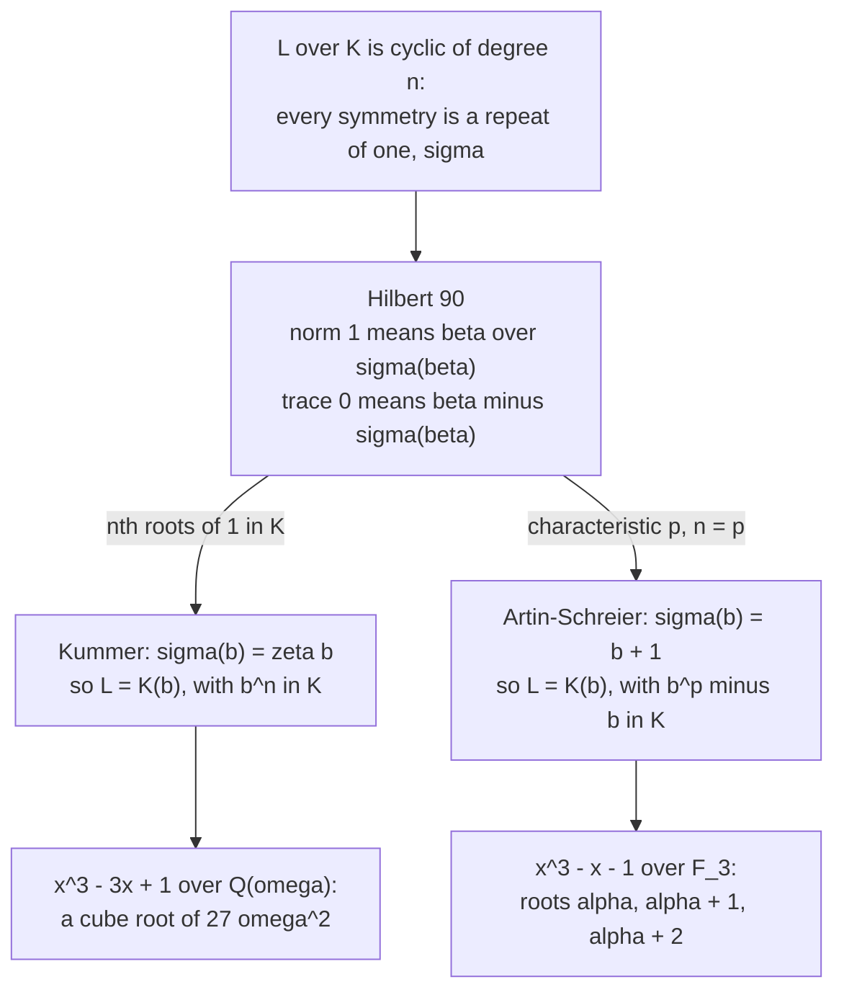

# Kummer and Artin-Schreier: every cyclic extension is a root extraction, once the roots of unity are there

[Syllabus](../../../SYLLABUS.md) → [Algebraic and analytic number theory](../README.md) → [Fields and Galois Theory](../README.md#s05) → Kummer and Artin-Schreier

---

## General Overview

The 3, 4, 5 right triangle gives the point (3/5, 4/5) on the circle of radius 1. Write that point as the complex number $`\alpha = \tfrac35 + \tfrac45 i`$. Multiplying it by its mirror image $`\tfrac35 - \tfrac45 i`$ gives $`\tfrac{9}{25} + \tfrac{16}{25} = 1`$. That product is the **norm** of $`\alpha`$, so $`\alpha`$ has norm 1.

Now $`\alpha`$ is a whole-number complex number divided by its mirror image: $`\alpha = (2 + i)/(2 - i)`$. Squaring $`2 + i`$ gives $`3 + 4i`$, and $`2^2 + 1^2 = 5`$. This is the triple 3, 4, 5. Every rational point of the circle comes this way. **Hilbert's Theorem 90** says why: in a field whose symmetries are the repeats of one symmetry $`\sigma`$, every element of norm 1 has the form $`\beta / \sigma(\beta)`$. The name is its number in Hilbert's 1897 report on number fields.

The same theorem builds generators. Take the cubic $`x^3 - 3x + 1`$. Its three roots are real; one is $`t = 2\cos 40^\circ = 1.5320888862`$. Its three symmetries are the repeats of one, so its group is **cyclic**. Hilbert 90 turns that into a cube root. Once the cube roots of 1 are present, its field is the field of a cube root of $`27\omega^2`$, where $`\omega`$ is a cube root of 1 other than 1. This is **Kummer theory**.

In a field where 3 copies of 1 add to 0, such as $`\mathbb{F}_3`$ (the integers mod 3), cube roots build nothing new. The replacement is $`x^3 - x - 1`$. It has no root in $`\mathbb{F}_3`$. Its roots are $`\alpha`$, $`\alpha + 1`$ and $`\alpha + 2`$ in the field of 27 elements, and its group is cyclic of order 3. This is **Artin-Schreier theory**.

**When the symmetries of a field extension are the repeats of one symmetry, Hilbert's Theorem 90 finds an element that this symmetry moves in the simplest possible way; if the nth roots of 1 are present, that element is an nth root of something in the base field, and in characteristic p it is a root of x^p − x − a.**

**What kind of fact this is:** three theorems, proved on this card in Why it works: Hilbert 90 (Hilbert, 1897), Kummer's description of cyclic extensions (Kummer, mid-1800s), and the Artin-Schreier description (Artin and Schreier, 1927). The code checks every instance named here exactly; its counts, such as 132 points of norm 1, are instances, not the proof. The converse half of Kummer, that one root gives a cyclic extension, is proved on [Solvable by radicals](07-solvability-by-radicals-and-the-quintic.md) and stated here.

### The picture: one lemma, two characteristics



The left branch multiplies the generator by a root of 1. The right branch adds 1 to it. Both steps come from the same lemma.

---

## The formula

Words first. $`L/K`$ is a field $`L`$ containing a field $`K`$, and $`[L : K]`$ is its degree ([Field extensions](01-field-extensions-and-degree.md)). $`\mathrm{Gal}(L/K)`$ is the group of symmetries of $`L`$ that fix every element of $`K`$ ([The Galois correspondence](05-galois-groups-and-the-fundamental-theorem.md)). The extension is **cyclic** of degree $`n`$ when that group has $`n`$ members, all repeats of one symmetry $`\sigma`$.

The **norm** of an element is the product of its images under the whole group; the **trace** is their sum:

```math
N(\alpha) = \alpha\,\sigma(\alpha)\,\sigma^2(\alpha)\cdots\sigma^{n-1}(\alpha), \qquad \mathrm{Tr}(\alpha) = \alpha + \sigma(\alpha) + \cdots + \sigma^{n-1}(\alpha)
```

Both land in $`K`$, because applying $`\sigma`$ only reorders the factors. In $`\mathbb{Q}(i)/\mathbb{Q}`$, $`\sigma`$ sends $`i`$ to $`-i`$, so $`N(x + yi) = x^2 + y^2`$.

**Hilbert's Theorem 90.** For a cyclic extension with generator $`\sigma`$:

```math
N(\alpha) = 1 \iff \alpha = \frac{\beta}{\sigma(\beta)} \text{ for some } \beta \ne 0 \text{ in } L, \qquad \mathrm{Tr}(\alpha) = 0 \iff \alpha = \beta - \sigma(\beta) \text{ for some } \beta \text{ in } L
```

**Read it aloud:** an element whose images multiply to 1 is a ratio of some element to its own image; an element whose images add to 0 is a difference of some element and its image.

Worked once: $`\alpha = \tfrac35 + \tfrac45 i`$ has norm 1, and $`\beta = 2 + i`$ gives $`\beta/\sigma(\beta) = (2+i)/(2-i) = \tfrac35 + \tfrac45 i`$.

**The two consequences.** Here $`\zeta_n`$ is a primitive $`n`$th root of 1, as on [Cyclotomic fields](08-cyclotomic-extensions-and-roots-of-unity.md), and $`p`$ is a prime.

```math
\text{Kummer: } \zeta_n \in K,\ L/K \text{ cyclic of degree } n \implies L = K(b),\ b^n \in K. \qquad \text{Artin-Schreier: } \mathrm{char}\,K = p,\ L/K \text{ cyclic of degree } p \implies L = K(b),\ b^p - b \in K
```

**Read it aloud:** with the nth roots of 1 present, a cyclic extension of degree n is made by one nth root; in characteristic p, a cyclic extension of degree p is made by one root of $`x^p - x - a`$.

The **characteristic** of a field, $`\mathrm{char}\,K`$, is the number of copies of 1 that add to 0, or 0 if none do. $`\mathbb{Q}`$ has characteristic 0; $`\mathbb{F}_3`$ and $`\mathbb{F}_{27}`$, the fields of 3 and 27 elements (written GF(3) and GF(27) on [Finite fields](09-finite-fields-and-frobenius.md)), have characteristic 3.

| Symbol | Plain meaning | In our example | Push it up and the answer… |
| --- | --- | --- | --- |
| $`K`$, $`L`$, $`[L:K]`$ | base field, bigger field, degree | $`\mathbb{Q} \subset \mathbb{Q}(i)`$, degree 2 | a bigger degree, a longer norm product |
| $`\sigma`$, $`n`$ | the symmetry whose repeats give the whole group; the group's size | $`i \mapsto -i`$, $`n = 2`$ | — |
| $`N(\alpha)`$, $`\mathrm{Tr}(\alpha)`$ | product and sum of all images of $`\alpha`$ | $`N(\tfrac35 + \tfrac45 i) = 1`$ | — |
| $`\alpha`$ | in Hilbert 90, an element of norm 1; in $`\mathbb{F}_{27}`$, a root of $`x^3 - x - 1`$ | $`\tfrac35 + \tfrac45 i`$ | — |
| $`\beta`$, $`\theta`$ | the element Hilbert 90 finds; the seed it is built from | $`\beta = 1 + \alpha = \tfrac85 + \tfrac45 i`$ from $`\theta = 1`$ | — |
| $`u`$, $`v`$ | $`\beta`$ scaled to a whole-number complex number $`u + vi`$ | $`u = 2`$, $`v = 1`$ | the triple $`u^2 - v^2, 2uv, u^2 + v^2`$ grows |
| $`\zeta_n`$, $`\omega`$ | a primitive nth root of 1; $`\omega = \zeta_3`$, with $`\omega^2 = -1 - \omega`$ | $`\omega = e^{2\pi i/3}`$ | — |
| $`b`$, $`c`$ | the generator Kummer finds, and its nth power $`c = b^n`$ in $`K`$ | $`b = \sqrt[3]{2}`$, $`c = 2`$ | — |
| $`t`$ | a root of the cyclic cubic $`x^3 - 3x + 1`$ | $`2\cos 40^\circ = 1.5320888862`$ | — |
| $`p`$, $`\mathrm{char}\,K`$ | a prime; copies of 1 that add to 0 | $`p = 3`$ | — |
| $`a`$ | the constant in $`x^p - x - a`$ | $`a = 1`$ | — |
| $`c_i`$, $`m`$, $`y`$, $`s_k`$, $`d`$, $`j`$ | in the proofs only: coefficients and length of a relation; a test element; a partial sum of images; a factor's degree; a shift in $`\mathbb{F}_p`$ | $`j = 1`$ sends $`\alpha`$ to $`\alpha + 1`$ | — |

### When it holds

- **The group must be cyclic.** Hilbert 90 in this form needs one generator $`\sigma`$. For a Galois group with no single generator, $`\mathbb{Q}(\sqrt2, \sqrt3)`$ for example, there is no one ratio $`\beta/\sigma(\beta)`$ to write. The general version is a statement about group cohomology (Neukirch, Sources), not proved here.
- **The roots of 1 must be in $`K`$.** Over $`\mathbb{Q}`$ alone, $`x^3 - 3x + 1`$ is cyclic, yet its field is no $`\mathbb{Q}(\sqrt[3]{c})`$: that field holds only 1 of the 3 roots of $`x^3 - c`$, so it has 1 symmetry, not 3.
- **The characteristic must not divide $`n`$.** In characteristic 3, $`(x - c)^3 = x^3 - c`$ for $`c`$ in $`\mathbb{F}_3`$, so $`x^3 - c`$ has one root repeated three times. Every element of $`\mathbb{F}_{27}`$ is already a cube. Artin-Schreier replaces Kummer exactly here.
- **The seed must give $`\beta \ne 0`$.** For $`\alpha = -1`$ in $`\mathbb{Q}(i)`$, the seed $`\theta = 1`$ gives $`\beta = 0`$. The seed $`\theta = i`$ gives $`\beta = 2i`$, and $`2i/(-2i) = -1`$.

---

## Why it works

### Step 0: the idea in words

Want $`\beta`$ with $`\alpha\,\sigma(\beta) = \beta`$. Start from any seed $`\theta`$. Add up $`\theta`$, its image weighted by $`\alpha`$, its second image weighted by $`\alpha\,\sigma(\alpha)`$, and so on. Applying $`\sigma`$ and multiplying by $`\alpha`$ shifts every term one place along. The last term wraps round to the first, and the factor it picks up is the full norm, which is 1. So the sum comes back to itself.

The only danger is that the sum is 0. A lemma of Dedekind rules that out for some seed.

### Step 1: the symmetries are independent

**Dedekind's lemma.** Distinct symmetries $`\sigma_1, \ldots, \sigma_m`$ of a field $`L`$ satisfy no relation $`c_1\sigma_1(x) + \cdots + c_m\sigma_m(x) = 0`$ for all $`x`$, with $`c_i`$ in $`L`$ not all 0.

The idea: a shortest such relation can be shortened again, by comparing it at $`x`$ and at $`yx`$.

<details>
<summary>Detailed proof: Dedekind's lemma</summary>

Take a relation with the fewest nonzero coefficients, and number the symmetries so that it is $`c_1\sigma_1(x) + \cdots + c_m\sigma_m(x) = 0`$ with every $`c_i \ne 0`$. Then $`m \ge 2`$, since $`c_1\sigma_1(1) = c_1 \ne 0`$.

Because $`\sigma_1 \ne \sigma_m`$, some $`y`$ has $`\sigma_1(y) \ne \sigma_m(y)`$. Put $`yx`$ in place of $`x`$. Symmetries respect products, so:

$`\displaystyle c_1\sigma_1(y)\sigma_1(x) + \cdots + c_m\sigma_m(y)\sigma_m(x) = 0`$

Subtract $`\sigma_m(y)`$ times the first relation:

$`\displaystyle c_1\bigl(\sigma_1(y) - \sigma_m(y)\bigr)\sigma_1(x) + \cdots + c_{m-1}\bigl(\sigma_{m-1}(y) - \sigma_m(y)\bigr)\sigma_{m-1}(x) = 0`$

The last term is gone and the first coefficient is not 0. That is a shorter relation, a contradiction.

</details>

### Step 2: Hilbert 90, multiplicative form

Let $`N(\alpha) = 1`$. For a seed $`\theta`$ in $`L`$, set

```math
\beta = \theta + \alpha\,\sigma(\theta) + \alpha\sigma(\alpha)\,\sigma^2(\theta) + \cdots + \alpha\sigma(\alpha)\cdots\sigma^{n-2}(\alpha)\,\sigma^{n-1}(\theta)
```

Apply $`\sigma`$ and multiply by $`\alpha`$. Each term becomes the next one. The last becomes $`N(\alpha)\,\sigma^n(\theta) = \theta`$, the first term. So $`\alpha\,\sigma(\beta) = \beta`$.

As a function of $`\theta`$, $`\beta`$ is a combination of the distinct symmetries $`1, \sigma, \ldots, \sigma^{n-1}`$ with nonzero coefficients. By Step 1 it is not 0 for every $`\theta`$. Pick a $`\theta`$ with $`\beta \ne 0`$; then $`\alpha = \beta/\sigma(\beta)`$.

The other direction is short. $`N(\sigma(\beta)) = N(\beta)`$, because the images of $`\sigma(\beta)`$ are those of $`\beta`$ in a new order. So $`N(\beta/\sigma(\beta)) = 1`$.

**On $`\mathbb{Q}(i)`$.** Here $`n = 2`$ and $`\beta = \theta + \alpha\,\sigma(\theta)`$. Seed $`\theta = 1`$ gives $`\beta = 1 + \alpha`$. For $`\alpha = \tfrac35 + \tfrac45 i`$ that is $`\tfrac85 + \tfrac45 i = \tfrac45(2 + i)`$. The factor $`\tfrac45`$ cancels in $`\beta/\sigma(\beta)`$, leaving $`(2 + i)/(2 - i)`$.

Written out for $`\beta = u + vi`$:

```math
\frac{u + vi}{u - vi} = \frac{(u + vi)^2}{u^2 + v^2} = \frac{u^2 - v^2}{u^2 + v^2} + \frac{2uv}{u^2 + v^2}\,i
```

That is Euclid's formula for Pythagorean triples ([Pythagorean triples](../../02-Number%20theory/07-For%20the%20Curious/01-pythagorean-triples.md)), now as a case of Hilbert 90. The code runs the seed recipe on all 132 points of norm 1 with denominator at most 100. Each comes out as $`\beta/\sigma(\beta)`$. From the 16 primitive triples with hypotenuse at most 100, the recipe's $`u + vi`$ rebuilds each triple.

### Step 3: Kummer, cyclic means one root

Let $`K`$ hold $`\zeta = \zeta_n`$, and let $`L/K`$ be cyclic of degree $`n`$ with generator $`\sigma`$. Since $`\sigma`$ fixes $`\zeta`$, $`N(\zeta^{-1}) = \zeta^{-n} = 1`$. Hilbert 90 gives $`b \ne 0`$ with $`\zeta^{-1} = b/\sigma(b)`$, that is, $`\sigma(b) = \zeta b`$.

1. **$`b`$ generates $`L`$.** Its images $`b, \zeta b, \ldots, \zeta^{n-1}b`$ are $`n`$ different numbers. So $`b`$ has $`n`$ conjugates (images under the group), $`[K(b) : K] \ge n = [L : K]`$, and $`K(b) = L`$.
2. **$`b^n`$ lies in $`K`$.** $`\sigma(b^n) = \zeta^n b^n = b^n`$. An element fixed by the whole group lies in $`K`$, by [The Galois correspondence](05-galois-groups-and-the-fundamental-theorem.md).

With $`\alpha = \zeta^{-1}`$, Step 2's sum is $`b = \theta + \zeta^{-1}\sigma(\theta) + \zeta^{-2}\sigma^2(\theta) + \cdots`$. That is the Lagrange resolvent of [Solvable by radicals](07-solvability-by-radicals-and-the-quintic.md), Step 5. That card used it and cited a book for the missing piece. Step 1 here supplies that piece: some seed gives a resolvent that is not 0.

The converse is Step 2 of [Solvable by radicals](07-solvability-by-radicals-and-the-quintic.md): if $`\zeta_n`$ is in $`K`$ and $`b^n = c`$ is in $`K`$, then $`K(b)/K`$ is cyclic, and its degree divides $`n`$.

**$`x^3 - 2`$ over $`K = \mathbb{Q}(\omega)`$.** Its roots are $`b, \omega b, \omega^2 b`$, with $`b = \sqrt[3]{2}`$. The symmetry $`\sigma(b) = \omega b`$ has order 3, so the group is cyclic of order 3. Hilbert 90 is visible directly: $`N(\omega) = \omega^3 = 1`$, and $`\beta = b^2`$ gives $`\beta/\sigma(\beta) = b^2/(\omega^2 b^2) = \omega`$.

**$`x^3 - 3x + 1`$ over $`K = \mathbb{Q}(\omega)`$.** This is the case Kummer is for: nothing about the cubic looks like a cube root. Its roots are $`t`$, $`\sigma(t) = t^2 - 2`$ and $`\sigma^2(t) = 2 - t - t^2`$, all inside $`\mathbb{Q}(t)`$ ([Normal and separable](04-normal-and-separable-extensions.md)). Seed $`\theta = t`$:

```math
b = t + \omega^2\sigma(t) + \omega\,\sigma^2(t) = (2 + 4\omega) + (1 - \omega)\,t + (-1 - 2\omega)\,t^2, \qquad b^3 = -27 - 27\omega = 27\omega^2
```

The code checks $`\sigma(b) = \omega b`$ and $`b^3 = 27\omega^2`$ exactly, in coordinates over $`K`$. As a complex number, $`b/3`$ is the ninth root of 1 $`\zeta_9^{\,8}`$. So, once $`\omega`$ is present, the field of $`x^3 - 3x + 1`$ is the field of a ninth root of 1.

The house example fits too. Over $`\mathbb{Q}(i)`$, which holds $`\zeta_4 = i`$, the splitting field of $`x^4 - 2`$ is $`\mathbb{Q}(i)(2^{1/4})`$. The symmetry $`2^{1/4} \mapsto i\,2^{1/4}`$, keeping $`i`$, is the quarter turn of the square on [The Galois correspondence](05-galois-groups-and-the-fundamental-theorem.md). That card's check prints that it has order 4 and that its four turns fix exactly $`\mathbb{Q}(i)`$. So over $`\mathbb{Q}(i)`$ the extension is cyclic of degree 4, made by one fourth root, as Kummer says.

### Step 4: Hilbert 90, additive form

Let $`\mathrm{Tr}(\alpha) = 0`$. By Step 1, the trace, a sum of distinct symmetries, is not 0 everywhere: pick $`\theta`$ with $`\mathrm{Tr}(\theta) \ne 0`$. Set

```math
\beta = \frac{1}{\mathrm{Tr}(\theta)}\Bigl(\alpha\,\sigma(\theta) + (\alpha + \sigma(\alpha))\,\sigma^2(\theta) + \cdots + (\alpha + \sigma(\alpha) + \cdots + \sigma^{n-2}(\alpha))\,\sigma^{n-1}(\theta)\Bigr)
```

Then $`\beta - \sigma(\beta) = \alpha`$. The other direction: $`\mathrm{Tr}(\sigma(\beta)) = \mathrm{Tr}(\beta)`$, so $`\mathrm{Tr}(\beta - \sigma(\beta)) = 0`$.

<details>
<summary>Detailed proof: the additive formula gives beta minus sigma(beta) = alpha</summary>

Write $`s_k = \alpha + \sigma(\alpha) + \cdots + \sigma^{k-1}(\alpha)`$, so $`s_1 = \alpha`$ and $`s_n = \mathrm{Tr}(\alpha) = 0`$. Then $`\mathrm{Tr}(\theta)\,\beta = s_1\sigma(\theta) + s_2\sigma^2(\theta) + \cdots + s_{n-1}\sigma^{n-1}(\theta)`$.

Apply $`\sigma`$. It sends $`s_k`$ to $`s_{k+1} - \alpha`$ and $`\sigma^k(\theta)`$ to $`\sigma^{k+1}(\theta)`$:

$`\displaystyle \mathrm{Tr}(\theta)\,\sigma(\beta) = \sum_{k=1}^{n-1} (s_{k+1} - \alpha)\,\sigma^{k+1}(\theta) = \sum_{j=2}^{n} s_j\,\sigma^j(\theta) - \alpha \sum_{j=2}^{n} \sigma^j(\theta)`$

The $`j = n`$ term of the first sum is 0, because $`s_n = 0`$. Subtract this from the line for $`\beta`$. The terms in $`s_2, \ldots, s_{n-1}`$ cancel, leaving the $`k = 1`$ term $`s_1\sigma(\theta) = \alpha\,\sigma(\theta)`$ and the second sum:

$`\displaystyle \mathrm{Tr}(\theta)\,(\beta - \sigma(\beta)) = \alpha\,\sigma(\theta) + \alpha\sum_{j=2}^{n}\sigma^j(\theta) = \alpha\,\mathrm{Tr}(\theta)`$

using $`\sigma^n(\theta) = \theta`$. Divide by $`\mathrm{Tr}(\theta)`$.

</details>

### Step 5: Artin-Schreier, cyclic of degree p means one root of x^p − x − a

Let $`\mathrm{char}\,K = p`$ and $`L/K`$ cyclic of degree $`p`$. Then $`\mathrm{Tr}(-1) = -p = 0`$. The additive form gives $`b`$ with $`-1 = b - \sigma(b)`$, that is, $`\sigma(b) = b + 1`$.

1. **$`b`$ generates $`L`$.** Its images $`b, b + 1, \ldots, b + p - 1`$ are $`p`$ different numbers, so $`K(b) = L`$.
2. **$`b^p - b`$ lies in $`K`$.** In characteristic $`p`$, $`(x + y)^p = x^p + y^p`$ ([Finite fields](09-finite-fields-and-frobenius.md)). So $`\sigma(b^p - b) = (b + 1)^p - (b + 1) = b^p - b`$.

**The converse.** Take $`a`$ in $`K`$ and a root $`b`$ of $`x^p - x - a`$. Each $`b + j`$, for $`j`$ in $`\mathbb{F}_p`$, is also a root, since $`j^p = j`$. So all $`p`$ roots are distinct and lie in $`K(b)`$.

Either $`b`$ is in $`K`$, and the polynomial splits in $`K`$, or it is irreducible. Suppose a factor of degree $`d`$, with $`0 < d < p`$, has coefficients in $`K`$. Its roots are $`d`$ of the $`b + j`$. Their sum, $`d\,b`$ plus whole numbers, lies in $`K`$. Since $`d`$ is not 0 mod $`p`$, $`b`$ lies in $`K`$. When it is irreducible, its symmetries are $`b \mapsto b + j`$: a cyclic group of order $`p`$.

**$`x^3 - x - 1`$ over $`\mathbb{F}_3`$.** Its values at 0, 1, 2 are all 2 mod 3, so there is no root, and it is irreducible. In $`\mathbb{F}_{27} = \mathbb{F}_3(\alpha)`$, where $`\alpha`$ now names a root of $`x^3 - x - 1`$ (not Step 2's element of norm 1), so $`\alpha^3 = \alpha + 1`$, Frobenius (cubing) sends $`\alpha`$ to $`\alpha + 1`$. Trying all 27 elements finds exactly three roots, $`\alpha`$, $`\alpha + 1`$, $`\alpha + 2`$. Step 4's recipe, run on the element $`-1`$ (trace 0) with seed $`\theta = \alpha^2`$ (trace 2), returns $`b = \alpha`$.

### Step 6: where proof ends and counting begins

The proofs above cover every cyclic extension. The code checks the instances by exact count, by roads that do not use the proof:

- **132 points** of norm 1 in $`\mathbb{Q}(i)`$ with denominator at most 100, found by brute force. The seed recipe writes every one as $`\beta/\sigma(\beta)`$. They are $`16 \times 8`$ from the primitive triples, by signs and swaps, plus $`\pm 1`$ and $`\pm i`$.
- **16 primitive triples** with hypotenuse at most 100, found three ways: direct search, Hilbert 90's $`u + vi`$, and Euclid's $`u, v`$.
- **9 and 9.** In $`\mathbb{F}_{27}`$, the trace is $`x + x^3 + x^9`$, and 9 elements have trace 0. The values of $`\beta^3 - \beta`$ are 9 elements too, and they are the same 9. This is the additive form, counted.
- **13 and 13.** The norm is $`x^{1+3+9} = x^{13}`$, and 13 elements have norm 1. The values of $`\beta/\beta^3`$ are the same 13. This is the multiplicative form, counted.

---

## Worked numbers, by hand

| Step | Arithmetic | Value |
| --- | --- | --- |
| norm of $`\alpha`$ | $`\tfrac{9}{25} + \tfrac{16}{25}`$ | 1 |
| Hilbert 90 seed $`\theta = 1`$ | $`\beta = 1 + \alpha`$ | $`\tfrac85 + \tfrac45 i = \tfrac45(2 + i)`$ |
| check | $`(2+i)^2 / 5 = (3 + 4i)/5`$ | $`\alpha`$ again; triple 3, 4, 5 |
| Kummer on $`x^3 - 2`$ | $`\sigma(b) = \omega b`$, three steps to return | cyclic of order 3 |
| resolvent of $`x^3 - 3x + 1`$ | $`t + \omega^2\sigma(t) + \omega\sigma^2(t)`$, then cube | $`b^3 = -27 - 27\omega = 27\omega^2`$ |
| size of $`b`$ | $`\lvert b\rvert^3 = 27`$ | $`\lvert b\rvert = 3`$ |
| $`x^3 - x - 1`$ mod 3 | values at 0, 1, 2 | 2, 2, 2: no root |
| Frobenius on $`\alpha`$ | $`\alpha^3 = \alpha + 1`$ | roots $`\alpha, \alpha + 1, \alpha + 2`$ |
| the extension | Artin-Schreier with $`a = 1`$ | **$`\mathbb{F}_{27}/\mathbb{F}_3`$, cyclic of order 3** |

The rational point (3/5, 4/5), the cubic with roots near 2cos 40°, and the field of 27 elements are three faces of one lemma: each cyclic extension is generated by an element its symmetry moves by a multiplication or by adding 1.

### What breaks if you drop a piece

| Mistake | Comes out at | What went wrong |
| --- | --- | --- |
| Seed $`\theta = 1`$ for $`\alpha = -1`$ | $`\beta = 0`$ | $`1 + (-1) = 0`$; the seed $`\theta = i`$ gives $`2i`$ |
| Hilbert 90 for $`1 + i`$ | norm 2; every $`\beta/\sigma(\beta)`$ over 120 small $`\beta`$ has norm 1 | the norm must be 1 |
| Kummer over $`\mathbb{Q}`$, no $`\omega`$ | $`x^3 - 2`$ has 1 real root of 3, so $`\mathbb{Q}(\sqrt[3]{2})`$ has 1 symmetry | the roots of 1 are missing |
| Cube roots in characteristic 3 | all 27 elements of $`\mathbb{F}_{27}`$ are cubes; $`(x - c)^3 = x^3 - c`$ | the characteristic divides $`n`$ |
| $`x^3 - x - a`$ with $`a = 0`$ | 3 roots in $`\mathbb{F}_3`$ (0, 1, 2), against 0 for $`a = 1`$ and $`a = 2`$ | $`a = c^3 - c`$ for $`c`$ in $`\mathbb{F}_3`$, so nothing new |

The code prints all five.

---

## Code, from first principles, and it actually runs

The code builds every field it needs as coordinate vectors with exact fractions: $`\mathbb{Q}(i)`$, $`\mathbb{Q}(\omega)`$, the cubic fields over $`\mathbb{Q}(\omega)`$, and $`\mathbb{F}_{27}`$. It applies symmetries by substitution. Three independent roads meet. The Pythagorean triples come from a brute-force search, from the Hilbert 90 recipe and from Euclid's formula. The resolvent's cube is computed exactly and checked against a floating-point evaluation. In $`\mathbb{F}_{27}`$, the images of $`\beta^3 - \beta`$ and $`\beta/\beta^3`$ are compared with the trace-zero and norm-one sets found by trying all 27 elements.

### Python

```python
# Kummer and Artin-Schreier -- the check behind the card.  Standard library only.
# 1. Hilbert 90 in Q(i)/Q, against a brute-force list of Pythagorean triples.
# 2. Kummer over K = Q(omega): x^3 - 2, and the resolvent that turns the cyclic
#    cubic x^3 - 3x + 1 into a cube root.  3. Artin-Schreier in F_27 over F_3.
from fractions import Fraction as Fr
from math import gcd, isqrt, cos, sin, atan2, pi

def fs(x): return str(Fr(x))
def term(c, v): return v if c == 1 else "-" + v if c == -1 else fs(c) + v
def cs(p, q, v):                                  # p + q v, zero parts dropped
    if q == 0: return fs(p)
    if p == 0: return term(q, v)
    return f"{fs(p)} {'-' if q < 0 else '+'} {term(abs(q), v)}"
def gs(a): return cs(a[0], a[1], "i")
def gm(a, b): return (a[0] * b[0] - a[1] * b[1], a[0] * b[1] + a[1] * b[0])  # Q(i) times
def gc(a): return (a[0], -a[1])                                           # sigma: i -> -i
def gn(a): return a[0] ** 2 + a[1] ** 2                                   # the norm
def gd(a, b): t = gm(a, gc(b)); return (Fr(t[0], gn(b)), Fr(t[1], gn(b)))
def h90(al, th):                                  # beta = theta + alpha sigma(theta)
    t = gm(al, gc(th)); return (th[0] + t[0], th[1] + t[1])
def recipe(al):                                   # theta = 1, or theta = i if that gives 0
    b = h90(al, (1, 0)); return b if b != (0, 0) else h90(al, (0, 1))
def prim(b):                                      # scale a Gaussian rational to a primitive integer
    d = Fr(b[0]).denominator * Fr(b[1]).denominator; m, n = int(b[0] * d), int(b[1] * d)
    g = gcd(m, n); return (m // g, n // g)

print("1. Hilbert 90 in Q(i)/Q")
al = (Fr(3, 5), Fr(4, 5)); be = h90(al, (1, 0))
print(f"alpha = {gs(al)}, norm {fs(gn(al))}; theta = 1 gives beta = 1 + alpha = {gs(be)}")
print(f"beta / sigma(beta) = {gs(gd(be, gc(be)))}; beta scaled to a Gaussian integer: {gs(prim(be))}")
print(f"(2 + i)^2 = {gs(gm((2, 1), (2, 1)))}; norm of 2 + i = {gn((2, 1))}: the triple 3, 4, 5")
pts = [(Fr(p, c), Fr(s * isqrt(c * c - p * p), c)) for c in range(1, 101) for p in range(-c, c + 1)
       for s in (1, -1) if isqrt(c * c - p * p) ** 2 == c * c - p * p and gcd(p, isqrt(c * c - p * p), c) == 1
       and (s == 1 or p * p != c * c)]
ok = all(gd(recipe(a), gc(recipe(a))) == a for a in pts)
search = sorted((a, b, c) for c in range(1, 101) for a in range(1, c) for b in range(a + 1, c)
                if a * a + b * b == c * c and gcd(a, b) == 1)
by_h90 = []
for (a, b, c) in search:
    odd, even = (a, b) if a % 2 else (b, a)
    m, n = prim(recipe((Fr(odd, c), Fr(even, c))))
    by_h90.append(tuple(sorted((m * m - n * n, 2 * m * n))) + (m * m + n * n,))
euclid = sorted(tuple(sorted((m * m - n * n, 2 * m * n))) + (m * m + n * n,) for m in range(2, 11)
                for n in range(1, m) if gcd(m, n) == 1 and (m - n) % 2 and m * m + n * n <= 100)
units = sum(1 for a in pts if a[0].denominator == 1 and a[1].denominator == 1)
print(f"norm-1 points with denominator at most 100, by brute force: {len(pts)} = {len(search)} x 8 + {units}; each is beta/sigma(beta): {ok}")
print(f"primitive triples with hypotenuse at most 100, by search: {len(search)}")
print(f"the same list from Hilbert 90's u + vi: {sorted(by_h90) == search}; from Euclid's u, v: {euclid == search}")
print(f"first four: {search[:4]}")

Z, O, W = (Fr(0), Fr(0)), (Fr(1), Fr(0)), (Fr(0), Fr(1))  # K = Q(omega): p + q omega
def km(a, b): return (a[0] * b[0] - a[1] * b[1], a[0] * b[1] + a[1] * b[0] - a[1] * b[1])
def ka(a, b): return (a[0] + b[0], a[1] + b[1])
def ws(a): return cs(a[0], a[1], "w")
def lm(x, y, c):                                  # L = K[t] / (t^3 - c0 - c1 t)
    t = [Z] * 5
    for i in range(3):
        for j in range(3): t[i + j] = ka(t[i + j], km(x[i], y[j]))
    for d in (4, 3):
        for k in (0, 1): t[d - 3 + k] = ka(t[d - 3 + k], km(t[d], c[k]))
        t[d] = Z
    return t[:3]
def la(x, y): return [ka(a, b) for a, b in zip(x, y)]
def ks(k, x): return [km(k, a) for a in x]
def sub(x, img, c):                               # apply sigma: t -> img, K fixed
    out, p = [Z, Z, Z], [O, Z, Z]
    for j in range(3): out, p = la(out, ks(x[j], p)), lm(p, img, c)
    return out
def ls(x): return " + ".join(f"({ws(x[j])}){['', ' t', ' t^2'][j]}" for j in range(3) if x[j] != Z) or "0"
def order(x, img, c):
    k, y = 1, sub(x, img, c)
    while y != x and k < 9: k, y = k + 1, sub(y, img, c)
    return k

print("2. Kummer over K = Q(omega), omega^2 = -1 - omega")
c2, t, W2 = [(Fr(2), Fr(0)), Z], [Z, O, Z], km(W, W)
sa, b2 = [Z, W, Z], [Z, Z, O]                     # x^3 - 2: sigma(b) = omega b; beta = b^2
print(f"x^3 - 2: sigma(b) = omega b has order {order(t, sa, c2)}; "
      f"beta = b^2 has beta = omega sigma(beta): {b2 == ks(W, sub(b2, sa, c2))}")
c3, sr = [(Fr(-1), Fr(0)), (Fr(3), Fr(0))], [(Fr(-2), Fr(0)), Z, O]   # t^3 = 3t - 1
s1 = sub(t, sr, c3); s2 = sub(s1, sr, c3)
print(f"x^3 - 3x + 1 = 0 at t: sigma(t) = t^2 - 2, sigma^2(t) = {ls(s2)}; order of sigma {order(t, sr, c3)}")
th = la(la(t, ks(W2, s1)), ks(W, s2)); th3 = lm(lm(th, th, c3), th, c3)
print(f"resolvent b = t + omega^2 sigma(t) + omega sigma^2(t) = {ls(th)}")
print(f"sigma(b) = omega b: {sub(th, sr, c3) == ks(W, th)}; b^3 = {ls(th3)}; equals 27 omega^2: {th3 == [ks((Fr(27), Fr(0)), [W2])[0], Z, Z]}")
r = 2 * cos(2 * pi / 9); rs = [r, r * r - 2, 2 - r - r * r]
wn = [(cos(2 * pi * k / 3), sin(2 * pi * k / 3)) for k in range(3)]
tn = [sum(rs[j] * wn[(-j) % 3][e] for j in range(3)) for e in (0, 1)]
k9 = round(atan2(tn[1], tn[0]) * 9 / (2 * pi)) % 9
print(f"numerically: t = {r:.10f}; |b| = {(tn[0] ** 2 + tn[1] ** 2) ** 0.5:.10f}; b / 3 = zeta_9^{k9}")

print("3. Artin-Schreier over F_3, alpha^3 = alpha + 1")
F = [(a, b, c) for c in range(3) for b in range(3) for a in range(3)]
def fm(x, y):
    t = [0] * 5
    for i in range(3):
        for j in range(3): t[i + j] += x[i] * y[j]
    for d in (4, 3): t[d - 3] += t[d]; t[d - 2] += t[d]; t[d] = 0
    return tuple(v % 3 for v in t[:3])
def fp(x, k):
    out = (1, 0, 0)
    for _ in range(k): out = fm(out, x)
    return out
def fa(x, y, s=1): return tuple((a + s * b) % 3 for a, b in zip(x, y))
def fe(x):                                        # c0 + c1 alpha + c2 alpha^2, written out
    t = [f"{c if c > 1 else ''}{v}" for c, v in [(x[2], "alpha^2"), (x[1], "alpha")] if c] + [str(x[0])] * (x[0] > 0)
    return " + ".join(t) or "0"
def tr(x): return fa(fa(x, fp(x, 3)), fp(x, 9))
A = (0, 1, 0); one = (1, 0, 0)
print(f"x^3 - x - 1 at 0, 1, 2 mod 3: {[(x ** 3 - x - 1) % 3 for x in range(3)]}; Frobenius alpha^3 = {fe(fp(A, 3))}")
roots = [x for x in F if fa(fa(fp(x, 3), x, -1), one, -1) == (0, 0, 0)]
print(f"roots in F_27, trying all 27: {", ".join(fe(x) for x in roots)}; Frobenius order on alpha: {next(k for k in (1, 2, 3) if fp(A, 3 ** k) == A)}")
ap, tz = {fa(fp(x, 3), x, -1) for x in F}, {x for x in F if tr(x) == (0, 0, 0)}
print(f"values of beta^3 - beta: {len(ap)}; trace-zero elements: {len(tz)}; same set: {ap == tz}")
nz = [x for x in F if x != (0, 0, 0)]
n1 = {x for x in nz if fp(x, 13) == one}; q1 = {fm(x, fp(fp(x, 3), 25)) for x in nz}
print(f"norm-1 elements, x^13 = 1: {len(n1)}; values of beta / beta^3: {len(q1)}; same set: {n1 == q1}")
a2, T = (2, 0, 0), fp(A, 2)                       # additive Hilbert 90 for -1, theta = alpha^2
iv = fp(tr(T), 1)[0]                              # Tr(theta) lies in F_3; its inverse is itself
bb = tuple(iv * v % 3 for v in fa(fm(a2, fp(T, 3)), fm(fa(a2, a2), fp(T, 9))))
print(f"additive recipe, Tr(alpha^2) = {tr(T)[0]}: beta = {fe(bb)}; sigma(beta) - beta = {fe(fa(fp(bb, 3), bb, -1))}")

print("4. what breaks")
print(f"alpha = -1 with theta = 1: beta = {gs(h90((-1, 0), (1, 0)))}; theta = i gives {gs(h90((-1, 0), (0, 1)))}")
small = [(x, y) for x in range(-5, 6) for y in range(-5, 6) if (x, y) != (0, 0)]
print(f"norm of 1 + i: {gn((1, 1))}; norms of beta/sigma(beta) over {len(small)} small beta: {", ".join(sorted({fs(gn(gd(b, gc(b)))) for b in small}))}")
real = sum(1 for k in range(3) if abs(sin(2 * pi * k / 3)) < 1e-12)
print(f"x^3 - 2 over Q: real roots {real} of 3, so Q(2^(1/3)) has {real} automorphism")
print(f"cubes in F_27: {len({fp(x, 3) for x in F})} distinct; (x - c)^3 = x^3 - c mod 3 for c = 0, 1, 2: "
      f"{all([(-c) ** 3 % 3, 3 * c * c % 3, -3 * c % 3] == [-c % 3, 0, 0] for c in range(3))}")
asr = [sum(1 for x in range(3) if (x ** 3 - x - a) % 3 == 0) for a in range(3)]
print(f"roots of x^3 - x - a in F_3 for a = 0, 1, 2: {asr}")
assert ok and len(pts) == 132 == 8 * len(search) + units and gs(prim(be)) == "2 + i"        # recipe against brute force
assert sorted(by_h90) == search == euclid and len(search) == 16  # three roads to the triples
assert th3 == [(Fr(-27), Fr(-27)), Z, Z] and 3 * k9 % 9 == 6       # exact resolvent against floats
assert sorted(roots) == sorted([A, fa(A, one), fa(A, (2, 0, 0))]) and ap == tz and n1 == q1
assert fa(fp(bb, 3), bb, -1) == one and asr == [3, 0, 0]
assert sub(th, sr, c3) == ks(W, th) and order(t, sr, c3) == 3 == order(t, sa, c2) and b2 == ks(W, sub(b2, sa, c2))  # Kummer
print("ALL CHECKS PASS")
```

**Ran 2026-11-24 on macOS, Python 3.14.10, standard library only. All checks passed. Output, pasted from the run:**

```
1. Hilbert 90 in Q(i)/Q
alpha = 3/5 + 4/5i, norm 1; theta = 1 gives beta = 1 + alpha = 8/5 + 4/5i
beta / sigma(beta) = 3/5 + 4/5i; beta scaled to a Gaussian integer: 2 + i
(2 + i)^2 = 3 + 4i; norm of 2 + i = 5: the triple 3, 4, 5
norm-1 points with denominator at most 100, by brute force: 132 = 16 x 8 + 4; each is beta/sigma(beta): True
primitive triples with hypotenuse at most 100, by search: 16
the same list from Hilbert 90's u + vi: True; from Euclid's u, v: True
first four: [(3, 4, 5), (5, 12, 13), (7, 24, 25), (8, 15, 17)]
2. Kummer over K = Q(omega), omega^2 = -1 - omega
x^3 - 2: sigma(b) = omega b has order 3; beta = b^2 has beta = omega sigma(beta): True
x^3 - 3x + 1 = 0 at t: sigma(t) = t^2 - 2, sigma^2(t) = (2) + (-1) t + (-1) t^2; order of sigma 3
resolvent b = t + omega^2 sigma(t) + omega sigma^2(t) = (2 + 4w) + (1 - w) t + (-1 - 2w) t^2
sigma(b) = omega b: True; b^3 = (-27 - 27w); equals 27 omega^2: True
numerically: t = 1.5320888862; |b| = 3.0000000000; b / 3 = zeta_9^8
3. Artin-Schreier over F_3, alpha^3 = alpha + 1
x^3 - x - 1 at 0, 1, 2 mod 3: [2, 2, 2]; Frobenius alpha^3 = alpha + 1
roots in F_27, trying all 27: alpha, alpha + 1, alpha + 2; Frobenius order on alpha: 3
values of beta^3 - beta: 9; trace-zero elements: 9; same set: True
norm-1 elements, x^13 = 1: 13; values of beta / beta^3: 13; same set: True
additive recipe, Tr(alpha^2) = 2: beta = alpha; sigma(beta) - beta = 1
4. what breaks
alpha = -1 with theta = 1: beta = 0; theta = i gives 2i
norm of 1 + i: 2; norms of beta/sigma(beta) over 120 small beta: 1
x^3 - 2 over Q: real roots 1 of 3, so Q(2^(1/3)) has 1 automorphism
cubes in F_27: 27 distinct; (x - c)^3 = x^3 - c mod 3 for c = 0, 1, 2: True
roots of x^3 - x - a in F_3 for a = 0, 1, 2: [3, 0, 0]
ALL CHECKS PASS
```

### Rust

Same numbers, same labels, built with `rustc --edition 2021 -O`.

```rust
// Kummer and Artin-Schreier -- the same check as the Python, in Rust.  No crates.
// 1. Hilbert 90 in Q(i)/Q, against a brute-force list of Pythagorean triples.
// 2. Kummer over K = Q(omega): x^3 - 2, and the resolvent that turns the cyclic
//    cubic x^3 - 3x + 1 into a cube root.  3. Artin-Schreier in F_27 over F_3.
use std::collections::BTreeSet;
use std::f64::consts::PI;

fn gcd(a: i64, b: i64) -> i64 { if b == 0 { a.abs() } else { gcd(b, a % b) } }
#[derive(Clone, Copy, PartialEq, Debug)]
struct Fr { n: i64, d: i64 }
fn fr(n: i64, d: i64) -> Fr { let g = gcd(n, d) * d.signum(); Fr { n: n / g, d: d / g } }
fn add(a: Fr, b: Fr) -> Fr { fr(a.n.checked_mul(b.d).unwrap() + b.n * a.d, a.d * b.d) }
fn mul(a: Fr, b: Fr) -> Fr { fr(a.n.checked_mul(b.n).unwrap(), a.d * b.d) }
fn neg(a: Fr) -> Fr { Fr { n: -a.n, d: a.d } }
fn fs(x: Fr) -> String { if x.d == 1 { format!("{}", x.n) } else { format!("{}/{}", x.n, x.d) } }
fn term(c: Fr, v: &str) -> String { if c == fr(1, 1) { v.into() } else if c == fr(-1, 1) { format!("-{v}") } else { format!("{}{v}", fs(c)) } }
fn cs(p: Fr, q: Fr, v: &str) -> String {                 // p + q v, zero parts dropped
    if q.n == 0 { return fs(p) }
    if p.n == 0 { return term(q, v) }
    format!("{} {} {}", fs(p), if q.n < 0 { "-" } else { "+" }, term(Fr { n: q.n.abs(), d: q.d }, v))
}
type G = (Fr, Fr);
fn g(a: i64, b: i64) -> G { (fr(a, 1), fr(b, 1)) }
fn gs(a: G) -> String { cs(a.0, a.1, "i") }
fn gm(a: G, b: G) -> G { (add(mul(a.0, b.0), neg(mul(a.1, b.1))), add(mul(a.0, b.1), mul(a.1, b.0))) }
fn gc(a: G) -> G { (a.0, neg(a.1)) }                     // sigma: i -> -i
fn gn(a: G) -> Fr { add(mul(a.0, a.0), mul(a.1, a.1)) }  // the norm
fn gd(a: G, b: G) -> G { let (t, n) = (gm(a, gc(b)), gn(b)); let iv = fr(n.d, n.n); (mul(t.0, iv), mul(t.1, iv)) }
fn h90(al: G, th: G) -> G { let t = gm(al, gc(th)); (add(th.0, t.0), add(th.1, t.1)) }
fn recipe(al: G) -> G { let b = h90(al, g(1, 0)); if b != g(0, 0) { b } else { h90(al, g(0, 1)) } }
fn prim(b: G) -> (i64, i64) {
    let d = b.0.d * b.1.d; let (m, n) = (b.0.n * (d / b.0.d), b.1.n * (d / b.1.d));
    let k = gcd(m, n); (m / k, n / k)
}
fn trip(m: i64, n: i64) -> (i64, i64, i64) { let (x, y) = (m * m - n * n, 2 * m * n); (x.min(y), x.max(y), m * m + n * n) }
fn tb(b: bool) -> &'static str { if b { "True" } else { "False" } }
fn isqrt(x: i64) -> i64 { let mut r = (x as f64).sqrt() as i64; while r * r > x { r -= 1 } while (r + 1) * (r + 1) <= x { r += 1 } r }

type K = (Fr, Fr);                                       // p + q omega, omega^2 = -1 - omega
type L = [K; 3];                                         // c0 + c1 t + c2 t^2 over K
const KZ: K = (Fr { n: 0, d: 1 }, Fr { n: 0, d: 1 });
fn km(a: K, b: K) -> K { (add(mul(a.0, b.0), neg(mul(a.1, b.1))), add(add(mul(a.0, b.1), mul(a.1, b.0)), neg(mul(a.1, b.1)))) }
fn ka(a: K, b: K) -> K { (add(a.0, b.0), add(a.1, b.1)) }
fn ws(a: K) -> String { cs(a.0, a.1, "w") }
fn lm(x: &L, y: &L, c: &[K; 2]) -> L {                   // L = K[t] / (t^3 - c0 - c1 t)
    let mut t = [KZ; 5];
    for i in 0..3 { for j in 0..3 { t[i + j] = ka(t[i + j], km(x[i], y[j])) } }
    for d in [4, 3] { for k in 0..2 { t[d - 3 + k] = ka(t[d - 3 + k], km(t[d], c[k])) } t[d] = KZ }
    [t[0], t[1], t[2]]
}
fn la(x: &L, y: &L) -> L { [ka(x[0], y[0]), ka(x[1], y[1]), ka(x[2], y[2])] }
fn ks(k: K, x: &L) -> L { [km(k, x[0]), km(k, x[1]), km(k, x[2])] }
fn sub(x: &L, img: &L, c: &[K; 2]) -> L {                // apply sigma: t -> img, K fixed
    let (mut out, mut p) = ([KZ; 3], [(fr(1, 1), fr(0, 1)), KZ, KZ]);
    for j in 0..3 { out = la(&out, &ks(x[j], &p)); p = lm(&p, img, c) }
    out
}
fn ls(x: &L) -> String {
    let v: Vec<String> = (0..3).filter(|&j| x[j] != KZ).map(|j| format!("({}){}", ws(x[j]), ["", " t", " t^2"][j])).collect();
    if v.is_empty() { "0".into() } else { v.join(" + ") }
}
fn order(x: &L, img: &L, c: &[K; 2]) -> usize { let (mut k, mut y) = (1, sub(x, img, c)); while y != *x && k < 9 { k += 1; y = sub(&y, img, c) } k }

type E = [i64; 3];                                       // F_27: c0 + c1 alpha + c2 alpha^2
fn fm(x: E, y: E) -> E {
    let mut t = [0i64; 5];
    for i in 0..3 { for j in 0..3 { t[i + j] += x[i] * y[j] } }
    for d in [4, 3] { t[d - 3] += t[d]; t[d - 2] += t[d]; t[d] = 0 }
    [t[0] % 3, t[1] % 3, t[2] % 3]
}
fn fp(x: E, k: u32) -> E { let mut o = [1, 0, 0]; for _ in 0..k { o = fm(o, x) } o }
fn fa(x: E, y: E, s: i64) -> E { [(x[0] + s * y[0]).rem_euclid(3), (x[1] + s * y[1]).rem_euclid(3), (x[2] + s * y[2]).rem_euclid(3)] }
fn fe(x: E) -> String {
    let mut t: Vec<String> = [(x[2], "alpha^2"), (x[1], "alpha")].iter().filter(|p| p.0 != 0)
        .map(|p| format!("{}{}", if p.0 > 1 { p.0.to_string() } else { String::new() }, p.1)).collect();
    if x[0] > 0 { t.push(x[0].to_string()) }
    if t.is_empty() { "0".into() } else { t.join(" + ") }
}
fn tr(x: E) -> E { fa(fa(x, fp(x, 3), 1), fp(x, 9), 1) }

fn main() {
    println!("1. Hilbert 90 in Q(i)/Q");
    let al = (fr(3, 5), fr(4, 5)); let be = h90(al, g(1, 0));
    println!("alpha = {}, norm {}; theta = 1 gives beta = 1 + alpha = {}", gs(al), fs(gn(al)), gs(be));
    let pb = prim(be);
    println!("beta / sigma(beta) = {}; beta scaled to a Gaussian integer: {}", gs(gd(be, gc(be))), gs(g(pb.0, pb.1)));
    println!("(2 + i)^2 = {}; norm of 2 + i = {}: the triple 3, 4, 5", gs(gm(g(2, 1), g(2, 1))), fs(gn(g(2, 1))));
    let mut pts: Vec<G> = vec![];
    for c in 1..=100i64 { for p in -c..=c { for s in [1i64, -1] {
        let q = isqrt(c * c - p * p);
        if q * q == c * c - p * p && gcd(gcd(p, q), c) == 1 && (s == 1 || p * p != c * c) { pts.push((fr(p, c), fr(s * q, c))) }
    } } }
    let ok = pts.iter().all(|&a| gd(recipe(a), gc(recipe(a))) == a);
    let mut search = vec![];
    for c in 1..=100i64 { for a in 1..c { for b in a + 1..c { if a * a + b * b == c * c && gcd(a, b) == 1 { search.push((a, b, c)) } } } }
    search.sort();
    let mut by_h90: Vec<(i64, i64, i64)> = search.iter().map(|&(a, b, c)| {
        let (odd, even) = if a % 2 == 1 { (a, b) } else { (b, a) };
        let (m, n) = prim(recipe((fr(odd, c), fr(even, c)))); trip(m, n) }).collect();
    by_h90.sort();
    let mut euclid = vec![];
    for m in 2..11i64 { for n in 1..m { if gcd(m, n) == 1 && (m - n) % 2 == 1 && m * m + n * n <= 100 { euclid.push(trip(m, n)) } } }
    euclid.sort();
    let units = pts.iter().filter(|a| a.0.d == 1 && a.1.d == 1).count();
    println!("norm-1 points with denominator at most 100, by brute force: {} = {} x 8 + {}; each is beta/sigma(beta): {}", pts.len(), search.len(), units, tb(ok));
    println!("primitive triples with hypotenuse at most 100, by search: {}", search.len());
    println!("the same list from Hilbert 90's u + vi: {}; from Euclid's u, v: {}", tb(by_h90 == search), tb(euclid == search));
    println!("first four: {:?}", &search[..4]);

    println!("2. Kummer over K = Q(omega), omega^2 = -1 - omega");
    let (o, w) = ((fr(1, 1), fr(0, 1)), (fr(0, 1), fr(1, 1)));
    let kc = |n: i64| (fr(n, 1), fr(0, 1));
    let (c2, t, w2) = ([kc(2), KZ], [KZ, o, KZ], km(w, w));
    let (sa, b2) = ([KZ, w, KZ], [KZ, KZ, o]);
    println!("x^3 - 2: sigma(b) = omega b has order {}; beta = b^2 has beta = omega sigma(beta): {}",
             order(&t, &sa, &c2), tb(b2 == ks(w, &sub(&b2, &sa, &c2))));
    let (c3, sr) = ([kc(-1), kc(3)], [kc(-2), KZ, o]);
    let s1 = sub(&t, &sr, &c3); let s2 = sub(&s1, &sr, &c3);
    println!("x^3 - 3x + 1 = 0 at t: sigma(t) = t^2 - 2, sigma^2(t) = {}; order of sigma {}", ls(&s2), order(&t, &sr, &c3));
    let th = la(&la(&t, &ks(w2, &s1)), &ks(w, &s2)); let th3 = lm(&lm(&th, &th, &c3), &th, &c3);
    println!("resolvent b = t + omega^2 sigma(t) + omega sigma^2(t) = {}", ls(&th));
    println!("sigma(b) = omega b: {}; b^3 = {}; equals 27 omega^2: {}", tb(sub(&th, &sr, &c3) == ks(w, &th)), ls(&th3), tb(th3 == [km(kc(27), w2), KZ, KZ]));
    let r = 2.0 * (2.0 * PI / 9.0).cos(); let rs = [r, r * r - 2.0, 2.0 - r - r * r];
    let wn: Vec<(f64, f64)> = (0..3).map(|k| ((2.0 * PI * k as f64 / 3.0).cos(), (2.0 * PI * k as f64 / 3.0).sin())).collect();
    let tn = [(0..3).map(|j| rs[j] * wn[(3 - j) % 3].0).sum::<f64>(), (0..3).map(|j| rs[j] * wn[(3 - j) % 3].1).sum::<f64>()];
    let k9 = ((tn[1].atan2(tn[0]) * 9.0 / (2.0 * PI)).round() as i64).rem_euclid(9);
    println!("numerically: t = {:.10}; |b| = {:.10}; b / 3 = zeta_9^{}", r, (tn[0] * tn[0] + tn[1] * tn[1]).sqrt(), k9);

    println!("3. Artin-Schreier over F_3, alpha^3 = alpha + 1");
    let f: Vec<E> = (0..27).map(|k| [k % 3, k / 3 % 3, k / 9]).collect();
    let (a, one) = ([0, 1, 0], [1, 0, 0]);
    println!("x^3 - x - 1 at 0, 1, 2 mod 3: {:?}; Frobenius alpha^3 = {}", (0..3i64).map(|x| (x * x * x - x - 1).rem_euclid(3)).collect::<Vec<_>>(), fe(fp(a, 3)));
    let roots: Vec<E> = f.iter().copied().filter(|&x| fa(fa(fp(x, 3), x, -1), one, -1) == [0, 0, 0]).collect();
    println!("roots in F_27, trying all 27: {}; Frobenius order on alpha: {}", roots.iter().map(|&x| fe(x)).collect::<Vec<_>>().join(", "),
             (1..4u32).find(|&k| fp(a, 3u32.pow(k)) == a).unwrap());
    let ap: BTreeSet<E> = f.iter().map(|&x| fa(fp(x, 3), x, -1)).collect();
    let tz: BTreeSet<E> = f.iter().copied().filter(|&x| tr(x) == [0, 0, 0]).collect();
    println!("values of beta^3 - beta: {}; trace-zero elements: {}; same set: {}", ap.len(), tz.len(), tb(ap == tz));
    let nz: Vec<E> = f.iter().copied().filter(|&x| x != [0, 0, 0]).collect();
    let n1: BTreeSet<E> = nz.iter().copied().filter(|&x| fp(x, 13) == one).collect();
    let q1: BTreeSet<E> = nz.iter().map(|&x| fm(x, fp(fp(x, 3), 25))).collect();
    println!("norm-1 elements, x^13 = 1: {}; values of beta / beta^3: {}; same set: {}", n1.len(), q1.len(), tb(n1 == q1));
    let (a2, tt) = ([2, 0, 0], fp(a, 2));
    let iv = tr(tt)[0];
    let s = fa(fm(a2, fp(tt, 3)), fm(fa(a2, a2, 1), fp(tt, 9)), 1);
    let bb = [iv * s[0] % 3, iv * s[1] % 3, iv * s[2] % 3];
    println!("additive recipe, Tr(alpha^2) = {}: beta = {}; sigma(beta) - beta = {}", tr(tt)[0], fe(bb), fe(fa(fp(bb, 3), bb, -1)));

    println!("4. what breaks");
    println!("alpha = -1 with theta = 1: beta = {}; theta = i gives {}", gs(h90(g(-1, 0), g(1, 0))), gs(h90(g(-1, 0), g(0, 1))));
    let small: Vec<G> = (-5..6).flat_map(|x| (-5..6).map(move |y| g(x, y))).filter(|&b| b != g(0, 0)).collect();
    let norms: BTreeSet<String> = small.iter().map(|&b| fs(gn(gd(b, gc(b))))).collect();
    println!("norm of 1 + i: {}; norms of beta/sigma(beta) over {} small beta: {}", fs(gn(g(1, 1))), small.len(), norms.into_iter().collect::<Vec<_>>().join(", "));
    let real = (0..3).filter(|&k| (2.0 * PI * k as f64 / 3.0).sin().abs() < 1e-12).count();
    println!("x^3 - 2 over Q: real roots {} of 3, so Q(2^(1/3)) has {} automorphism", real, real);
    let cubes: BTreeSet<E> = f.iter().map(|&x| fp(x, 3)).collect();
    let binom = (0..3i64).all(|c| [(-c * c * c).rem_euclid(3), 3 * c * c % 3, (-3 * c).rem_euclid(3)] == [(-c).rem_euclid(3), 0, 0]);
    println!("cubes in F_27: {} distinct; (x - c)^3 = x^3 - c mod 3 for c = 0, 1, 2: {}", cubes.len(), tb(binom));
    let asr: Vec<usize> = (0..3i64).map(|q| (0..3i64).filter(|x| (x * x * x - x - q).rem_euclid(3) == 0).count()).collect();
    println!("roots of x^3 - x - a in F_3 for a = 0, 1, 2: {:?}", asr);
    assert!(ok && pts.len() == 132 && pts.len() == 8 * search.len() + units && gs(g(pb.0, pb.1)) == "2 + i");     // recipe against brute force
    assert!(by_h90 == search && search == euclid && search.len() == 16);  // three roads to the triples
    assert!(th3 == [(fr(-27, 1), fr(-27, 1)), KZ, KZ] && 3 * k9 % 9 == 6); // exact resolvent against floats
    assert!(roots == vec![a, [1, 1, 0], [2, 1, 0]] && ap == tz && n1 == q1);
    assert!(fa(fp(bb, 3), bb, -1) == one && asr == vec![3, 0, 0]);
    assert!(sub(&th, &sr, &c3) == ks(w, &th) && order(&t, &sr, &c3) == 3 && order(&t, &sa, &c2) == 3 && b2 == ks(w, &sub(&b2, &sa, &c2))); // Kummer
    println!("ALL CHECKS PASS");
}
```

**Ran 2026-11-24 on macOS, rustc 1.98.1, no crates. All checks passed. Output, pasted from the run:**

```
1. Hilbert 90 in Q(i)/Q
alpha = 3/5 + 4/5i, norm 1; theta = 1 gives beta = 1 + alpha = 8/5 + 4/5i
beta / sigma(beta) = 3/5 + 4/5i; beta scaled to a Gaussian integer: 2 + i
(2 + i)^2 = 3 + 4i; norm of 2 + i = 5: the triple 3, 4, 5
norm-1 points with denominator at most 100, by brute force: 132 = 16 x 8 + 4; each is beta/sigma(beta): True
primitive triples with hypotenuse at most 100, by search: 16
the same list from Hilbert 90's u + vi: True; from Euclid's u, v: True
first four: [(3, 4, 5), (5, 12, 13), (7, 24, 25), (8, 15, 17)]
2. Kummer over K = Q(omega), omega^2 = -1 - omega
x^3 - 2: sigma(b) = omega b has order 3; beta = b^2 has beta = omega sigma(beta): True
x^3 - 3x + 1 = 0 at t: sigma(t) = t^2 - 2, sigma^2(t) = (2) + (-1) t + (-1) t^2; order of sigma 3
resolvent b = t + omega^2 sigma(t) + omega sigma^2(t) = (2 + 4w) + (1 - w) t + (-1 - 2w) t^2
sigma(b) = omega b: True; b^3 = (-27 - 27w); equals 27 omega^2: True
numerically: t = 1.5320888862; |b| = 3.0000000000; b / 3 = zeta_9^8
3. Artin-Schreier over F_3, alpha^3 = alpha + 1
x^3 - x - 1 at 0, 1, 2 mod 3: [2, 2, 2]; Frobenius alpha^3 = alpha + 1
roots in F_27, trying all 27: alpha, alpha + 1, alpha + 2; Frobenius order on alpha: 3
values of beta^3 - beta: 9; trace-zero elements: 9; same set: True
norm-1 elements, x^13 = 1: 13; values of beta / beta^3: 13; same set: True
additive recipe, Tr(alpha^2) = 2: beta = alpha; sigma(beta) - beta = 1
4. what breaks
alpha = -1 with theta = 1: beta = 0; theta = i gives 2i
norm of 1 + i: 2; norms of beta/sigma(beta) over 120 small beta: 1
x^3 - 2 over Q: real roots 1 of 3, so Q(2^(1/3)) has 1 automorphism
cubes in F_27: 27 distinct; (x - c)^3 = x^3 - c mod 3 for c = 0, 1, 2: True
roots of x^3 - x - a in F_3 for a = 0, 1, 2: [3, 0, 0]
ALL CHECKS PASS
```

The two outputs match line for line.

### Lean

Lean proves Hilbert 90, Kummer and Artin-Schreier for every cyclic extension, without the converses, and checks the worked numbers.

- Take $`L/K`$ cyclic with generator $`\sigma`$. Then $`N(\alpha) = 1`$ exactly when $`\alpha = \beta/\sigma(\beta)`$ for some $`\beta \ne 0`$ in $`L`$.
- Take the same $`L/K`$ and $`\sigma`$. Then $`\mathrm{Tr}(\alpha) = 0`$ exactly when $`\alpha = \beta - \sigma(\beta)`$ for some $`\beta`$ in $`L`$.
- Take $`\zeta_n`$ in $`K`$, $`\mathrm{char}\,K`$ not dividing $`n`$, and $`L/K`$ cyclic of degree $`n`$. Then $`L = K(b)`$, with $`\sigma(b) = \zeta_n b`$ and $`b^n`$ in $`K`$.
- Take $`\mathrm{char}\,K = p`$ and $`L/K`$ cyclic of degree $`p`$. Then $`L = K(b)`$, with $`\sigma(b) = b + 1`$ and $`b^p - b`$ in $`K`$.
- In $`\mathbb{Q}(i)`$, $`(2 + i)/(2 - i) = \tfrac35 + \tfrac45 i`$, an element of norm 1.
- $`(2 + i)^2 = 3 + 4i`$, and $`3^2 + 4^2 = 5^2`$: the triple 3, 4, 5.
- Take $`\omega^2 + \omega + 1 = 0`$ and $`t^3 - 3t + 1 = 0`$. Then the resolvent $`b`$ of Step 3 has $`b^3 = -27 - 27\omega = 27\omega^2`$.
- Over $`\mathbb{F}_3`$, $`x^3 - x - 1`$ has no root.
- Over $`\mathbb{F}_3`$, $`x^3 - x - a`$ has 3, 0 and 0 roots for $`a`$ = 0, 1 and 2.
- Take $`x`$ and $`c`$ in $`\mathbb{F}_3`$. Then $`(x - c)^3 = x^3 - c`$.

The 132 points of norm 1, the 16 triples and the counts in $`\mathbb{F}_{27}`$ are left to the Python and Rust checks.

```lean
-- Kummer and Artin-Schreier: in a cyclic Galois extension an element has norm 1 exactly when it is β/σ(β) and trace 0 exactly when it is β − σ(β), so with the nth roots of 1 in the base field the extension is made by one nth root, and in characteristic p a cyclic extension of degree p is made by one root of x^p − x − a.
import Mathlib.RepresentationTheory.Homological.GroupCohomology.Hilbert90
import Mathlib.FieldTheory.KummerExtension
import Mathlib.RingTheory.Trace.Basic
import Mathlib.Basic.Complex.Basic

open IntermediateField

/-- An element fixed by a generator of a cyclic Galois group lies in the base field. -/
theorem kh90_mem_range_of_fixed {K L : Type*} [Field K] [Field L] [Algebra K L]
    [FiniteDimensional K L] [IsGalois K L] (σ : Gal(L/K))
    (hσ : ∀ τ : Gal(L/K), τ ∈ Subgroup.zpowers σ) {x : L} (hx : σ x = x) :
    x ∈ Set.range (algebraMap K L) := by
  rw [IsGalois.mem_range_algebraMap_iff_fixed]
  intro τ
  obtain ⟨k, rfl : σ ^ k = τ⟩ := mem_powers_iff_mem_zpowers.mpr (hσ τ)
  induction k with
  | zero => simp
  | succ k ih => rw [pow_succ, AlgEquiv.mul_apply, hx, ih]

/-- A product over the powers σ^0, ..., σ^(m-1), m the order of a generator σ, runs over the
whole Galois group once. -/
theorem kh90_prod_range_pow {K L : Type*} [Field K] [Field L] [Algebra K L]
    [FiniteDimensional K L] (σ : Gal(L/K))
    (hσ : ∀ τ : Gal(L/K), τ ∈ Subgroup.zpowers σ) {M : Type*} [CommMonoid M]
    (F : Gal(L/K) → M) :
    ∏ i ∈ Finset.range (orderOf σ), F (σ ^ i) = ∏ τ, F τ := by
  classical
  rw [← Finset.prod_image (f := F) (g := fun i => σ ^ i)]
  · congr 1
    ext τ
    simp only [Finset.mem_image, Finset.mem_range, Finset.mem_univ, iff_true]
    obtain ⟨k, rfl : σ ^ k = τ⟩ := mem_powers_iff_mem_zpowers.mpr (hσ τ)
    exact ⟨k % orderOf σ, Nat.mod_lt _ (orderOf_pos σ), pow_mod_orderOf σ k⟩
  · intro x hx y hy h
    exact pow_injOn_Iio_orderOf (by simpa using hx) (by simpa using hy) h

/-- If no nontrivial power of a generator fixes b, then b generates the extension. -/
theorem kh90_adjoin_eq_top {K L : Type*} [Field K] [Field L] [Algebra K L]
    [FiniteDimensional K L] [IsGalois K L] (σ : Gal(L/K))
    (hσ : ∀ τ : Gal(L/K), τ ∈ Subgroup.zpowers σ) (b : L)
    (hb : ∀ k : ℕ, (σ ^ k) b = b → σ ^ k = 1) : K⟮b⟯ = ⊤ := by
  apply IsGalois.intermediateFieldEquivSubgroup.injective
  rw [map_top, eq_top_iff]
  intro τ hτ
  obtain ⟨k, rfl : σ ^ k = τ⟩ := mem_powers_iff_mem_zpowers.mpr (hσ τ)
  have := hτ ⟨b, IntermediateField.mem_adjoin_simple_self K b⟩
  simp only [AlgEquiv.smul_def] at this
  rw [hb k this]
  exact one_mem _


/-- Hilbert's Theorem 90, both forms. Let L/K be a finite Galois extension whose symmetries
are all repeats of one symmetry σ (a cyclic extension). Then an element α of L has norm 1
exactly when α = β/σ(β) for some nonzero β in L, and α has trace 0 exactly when
α = β − σ(β) for some β in L. -/
theorem hilbert_90 {K L : Type*} [Field K] [Field L] [Algebra K L] [FiniteDimensional K L]
    [IsGalois K L] (σ : Gal(L/K)) (hσ : ∀ τ : Gal(L/K), τ ∈ Subgroup.zpowers σ) (α : L) :
    (Algebra.norm K α = 1 ↔ ∃ β : L, β ≠ 0 ∧ α = β / σ β) ∧
      (Algebra.trace K L α = 0 ↔ ∃ β : L, α = β - σ β) := by
  refine ⟨⟨fun h => ?_, ?_⟩, ⟨fun h => ?_, ?_⟩⟩
  · set n := orderOf σ with hn
    have hn0 : 0 < n := orderOf_pos σ
    let c : ℕ → L := fun i => ∏ j ∈ Finset.range i, (σ ^ j) α
    have hc0 : c 0 = 1 := by simp [c]
    have hcn : c n = 1 := by
      simp only [c]
      rw [kh90_prod_range_pow σ hσ (fun τ => τ α), ← Algebra.norm_eq_prod_automorphisms, h,
        map_one]
    have hcs : ∀ i, α * σ (c i) = c (i + 1) := by
      intro i
      simp only [c]
      rw [map_prod, Finset.prod_range_succ']
      simp_rw [← AlgEquiv.mul_apply, ← pow_succ', pow_zero, AlgEquiv.one_apply]
      ring
    have hinj : Function.Injective
        (fun i : Fin n => ((σ ^ (i : ℕ) : Gal(L/K)) : L →* L)) := by
      intro i j hij
      have h1 : σ ^ (i : ℕ) = σ ^ (j : ℕ) := by
        ext x
        exact DFunLike.ext_iff.1 hij x
      exact Fin.ext (pow_injOn_Iio_orderOf (Set.mem_Iio.2 i.2) (Set.mem_Iio.2 j.2) h1)
    have hli : LinearIndependent L
        (fun i : Fin n => (((σ ^ (i : ℕ) : Gal(L/K)) : L →* L) : L → L)) :=
      (linearIndependent_monoidHom L L).comp _ hinj
    obtain ⟨x, hx⟩ : ∃ x, ∑ i ∈ Finset.range n, c i * (σ ^ i) x ≠ 0 := by
      by_contra hcon
      push Not at hcon
      have hsum : ∑ i : Fin n, c i • (((σ ^ (i : ℕ) : Gal(L/K)) : L →* L) : L → L) = 0 := by
        funext x
        simp only [Finset.sum_apply, Pi.smul_apply, smul_eq_mul, Pi.zero_apply]
        have hco : ∀ i : Fin n, (((σ ^ (i : ℕ) : Gal(L/K)) : L →* L) x) = (σ ^ (i : ℕ)) x :=
          fun i => rfl
        simp_rw [hco]
        rw [Fin.sum_univ_eq_sum_range (fun i => c i * (σ ^ i) x)]
        exact hcon x
      have := Fintype.linearIndependent_iff.1 hli (fun i => c i) hsum ⟨0, hn0⟩
      simp [hc0] at this
    set β := ∑ i ∈ Finset.range n, c i * (σ ^ i) x with hβdef
    have hσβ : α * σ β = β := by
      have e1 : α * σ β = ∑ i ∈ Finset.range n, c (i + 1) * (σ ^ (i + 1)) x := by
        rw [hβdef, map_sum, Finset.mul_sum]
        refine Finset.sum_congr rfl fun i _ => ?_
        rw [map_mul, ← mul_assoc, hcs, ← AlgEquiv.mul_apply, ← pow_succ']
      have e2 := Finset.sum_range_succ' (fun i => c i * (σ ^ i) x) n
      have e3 := Finset.sum_range_succ (fun i => c i * (σ ^ i) x) n
      have e4 : c n * (σ ^ n) x = c 0 * (σ ^ 0) x := by
        rw [hcn, hc0, hn, pow_orderOf_eq_one, pow_zero]
      rw [e1, hβdef]
      rw [e3, e4] at e2
      linear_combination e2.symm
    have hσβ0 : σ β ≠ 0 := by simpa using hx
    refine ⟨β, hx, ?_⟩
    rw [eq_div_iff hσβ0]
    exact hσβ
  · rintro ⟨β, hβ, rfl⟩
    rw [div_eq_mul_inv, map_mul, Algebra.norm_inv, Algebra.norm_eq_of_algEquiv,
      mul_inv_cancel₀ (Algebra.norm_ne_zero_iff.mpr hβ)]
  · let f : L →ₗ[K] L := LinearMap.id - σ.toLinearMap
    have hrange : LinearMap.range f = LinearMap.ker (Algebra.trace K L) := by
      apply Submodule.eq_of_le_of_finrank_le
      · rintro _ ⟨β, rfl⟩
        simp [f, LinearMap.mem_ker, Algebra.trace_eq_of_algEquiv]
      · have h1 := LinearMap.finrank_range_add_finrank_ker f
        have h2 := LinearMap.finrank_range_add_finrank_ker (Algebra.trace K L)
        have h3 : Module.finrank K (LinearMap.range (Algebra.trace K L)) = 1 := by
          rw [LinearMap.range_eq_top.mpr (Algebra.trace_surjective K L), finrank_top,
            Module.finrank_self]
        have h4 : Module.finrank K (LinearMap.ker f) ≤ 1 := by
          have hle : LinearMap.ker f ≤ LinearMap.range (Algebra.linearMap K L) := by
            intro x hx
            have hx' : σ x = x := by
              simp [f, sub_eq_zero] at hx
              exact hx.symm
            obtain ⟨a, ha⟩ := kh90_mem_range_of_fixed σ hσ hx'
            exact ⟨a, ha⟩
          calc Module.finrank K (LinearMap.ker f)
              ≤ Module.finrank K (LinearMap.range (Algebra.linearMap K L)) :=
                Submodule.finrank_mono hle
            _ ≤ Module.finrank K K := LinearMap.finrank_range_le _
            _ = 1 := Module.finrank_self K
        omega
    have hα : α ∈ LinearMap.range f := hrange ▸ h
    obtain ⟨β, hβ⟩ := hα
    exact ⟨β, hβ.symm⟩
  · rintro ⟨β, rfl⟩
    rw [map_sub, Algebra.trace_eq_of_algEquiv, sub_self]

/-- Kummer: let K hold a primitive nth root of 1, ζ, with the characteristic of K not
dividing n, and let L/K be a cyclic Galois extension of degree n with generator σ. Then
L = K(b) for some b that σ multiplies by ζ, and bⁿ lies in K. -/
theorem kummer_cyclic_extension_eq_adjoin_root {K L : Type*} [Field K] [Field L] [Algebra K L]
    [FiniteDimensional K L] [IsGalois K L] {n : ℕ} (hn : Module.finrank K L = n)
    (σ : Gal(L/K)) (hσ : ∀ τ : Gal(L/K), τ ∈ Subgroup.zpowers σ)
    {ζ : K} (hζ : IsPrimitiveRoot ζ n) (hchar : (n : K) ≠ 0) :
    ∃ b : L, σ b = algebraMap K L ζ * b ∧ b ^ n ∈ Set.range (algebraMap K L) ∧ K⟮b⟯ = ⊤ := by
  have hn0 : 0 < n := hn ▸ Module.finrank_pos
  have hord : orderOf σ = n := by
    rw [orderOf_eq_card_of_forall_mem_zpowers hσ, IsGalois.card_aut_eq_finrank, hn]
  have hnorm : Algebra.norm K (algebraMap K L ζ⁻¹) = 1 := by
    rw [Algebra.norm_algebraMap, hn, inv_pow, hζ.pow_eq_one, inv_one]
  obtain ⟨b, hb0, hb⟩ := (hilbert_90 σ hσ _).1.1 hnorm
  have hζ0 : algebraMap K L ζ ≠ 0 := by
    simpa using hζ.ne_zero hn0.ne'
  have hσb0 : σ b ≠ 0 := by simpa using hb0
  have hσb : σ b = algebraMap K L ζ * b := by
    rw [map_inv₀, eq_div_iff hσb0] at hb
    calc σ b = algebraMap K L ζ * ((algebraMap K L ζ)⁻¹ * σ b) := by field_simp
      _ = algebraMap K L ζ * b := by rw [hb]
  have hpow : ∀ k : ℕ, (σ ^ k) b = algebraMap K L ζ ^ k * b := by
    intro k
    induction k with
    | zero => simp
    | succ k ih => rw [pow_succ, AlgEquiv.mul_apply, hσb, map_mul, AlgEquiv.commutes, ih]; ring
  refine ⟨b, hσb, ?_, ?_⟩
  · apply kh90_mem_range_of_fixed σ hσ
    rw [map_pow, hσb, mul_pow, ← map_pow, hζ.pow_eq_one, map_one, one_mul]
  · apply kh90_adjoin_eq_top σ hσ b
    intro k hk
    rw [hpow k] at hk
    have h1 : algebraMap K L (ζ ^ k) = algebraMap K L 1 := by
      rw [map_pow, map_one]
      exact (mul_eq_right₀ hb0).mp hk
    have h2 : ζ ^ k = 1 := (algebraMap K L).injective h1
    rw [← orderOf_dvd_iff_pow_eq_one, hord]
    exact hζ.dvd_of_pow_eq_one k h2

/-- Artin-Schreier: let K have characteristic p, a prime, and let L/K be a cyclic Galois
extension of degree p with generator σ. Then L = K(b) for some b that σ moves to b + 1,
and bᵖ − b lies in K, so b is a root of x^p − x − a with a in K. -/
theorem artin_schreier_cyclic_extension_eq_adjoin_root {K L : Type*} [Field K] [Field L]
    [Algebra K L] [FiniteDimensional K L] [IsGalois K L] {p : ℕ} (hp : p.Prime) [CharP K p]
    (hdeg : Module.finrank K L = p)
    (σ : Gal(L/K)) (hσ : ∀ τ : Gal(L/K), τ ∈ Subgroup.zpowers σ) :
    ∃ b : L, σ b = b + 1 ∧ b ^ p - b ∈ Set.range (algebraMap K L) ∧ K⟮b⟯ = ⊤ := by
  have : CharP L p := charP_of_injective_algebraMap (algebraMap K L).injective p
  have : Fact p.Prime := ⟨hp⟩
  have hord : orderOf σ = p := by
    rw [orderOf_eq_card_of_forall_mem_zpowers hσ, IsGalois.card_aut_eq_finrank, hdeg]
  have htr : Algebra.trace K L (-1) = 0 := by
    have h1 : (1 : L) = algebraMap K L 1 := (map_one _).symm
    rw [map_neg, h1, Algebra.trace_algebraMap, hdeg, nsmul_eq_mul, mul_one,
      CharP.cast_eq_zero, neg_zero]
  obtain ⟨b, hb⟩ := (hilbert_90 σ hσ (-1)).2.1 htr
  have hσb : σ b = b + 1 := by linear_combination hb
  have hpow : ∀ k : ℕ, (σ ^ k) b = b + k := by
    intro k
    induction k with
    | zero => simp
    | succ k ih =>
      rw [pow_succ, AlgEquiv.mul_apply, hσb, map_add, map_one, ih]
      push_cast; ring
  refine ⟨b, hσb, ?_, ?_⟩
  · apply kh90_mem_range_of_fixed σ hσ
    rw [map_sub, map_pow, hσb, add_pow_char, one_pow]
    ring
  · apply kh90_adjoin_eq_top σ hσ b
    intro k hk
    rw [hpow k] at hk
    have h1 : (k : L) = 0 := by linear_combination hk
    rw [CharP.cast_eq_zero_iff L p] at h1
    rw [← orderOf_dvd_iff_pow_eq_one, hord]
    exact h1

-- Hilbert 90 in Q(i)/Q: 3/5 + 4i/5 has norm 1, and it equals (2 + i)/(2 − i);
-- (2 + i)^2 = 3 + 4i and 2^2 + 1^2 = 5 give the triple 3, 4, 5.
example : (3 / 5 : ℚ) ^ 2 + (4 / 5) ^ 2 = 1 := by norm_num
example : ((2 : ℂ) + Complex.I) / (2 - Complex.I) = 3 / 5 + 4 / 5 * Complex.I := by
  have h : (2 : ℂ) - Complex.I ≠ 0 := by
    intro h; have := congrArg Complex.re h; norm_num at this
  rw [div_eq_iff h]
  ring_nf
  rw [Complex.I_sq]
  ring
example : ((2 : ℂ) + Complex.I) ^ 2 = 3 + 4 * Complex.I := by
  ring_nf; rw [Complex.I_sq]; ring
example : (2 ^ 2 - 1 ^ 2, 2 * 2 * 1, 2 ^ 2 + 1 ^ 2) = (3, 4, 5) ∧ 3 ^ 2 + 4 ^ 2 = 5 ^ 2 := by
  decide

-- The resolvent of x^3 − 3x + 1 over Q(ω): b = (2 + 4ω) + (1 − ω)t + (−1 − 2ω)t^2
-- has b^3 = −27 − 27ω = 27ω^2, wherever ω^2 + ω + 1 = 0 and t^3 − 3t + 1 = 0.
example {R : Type*} [CommRing R] (ω t : R) (hω : ω ^ 2 + ω + 1 = 0)
    (ht : t ^ 3 - 3 * t + 1 = 0) :
    ((2 + 4 * ω) + (1 - ω) * t + (-1 - 2 * ω) * t ^ 2) ^ 3 = -27 - 27 * ω ∧
      -27 - 27 * ω = 27 * ω ^ 2 := by
  grind

-- Over F_3: x^3 − x − 1 has no root, so it is irreducible.
example : ∀ x : ZMod 3, x ^ 3 - x - 1 ≠ 0 := by decide
-- x^3 − x − a has 3, 0, 0 roots in F_3 for a = 0, 1, 2.
example : ((Finset.univ : Finset (ZMod 3)).filter (fun x => x ^ 3 - x - 0 = 0)).card = 3 ∧
    ((Finset.univ : Finset (ZMod 3)).filter (fun x => x ^ 3 - x - 1 = 0)).card = 0 ∧
    ((Finset.univ : Finset (ZMod 3)).filter (fun x => x ^ 3 - x - 2 = 0)).card = 0 := by
  decide
-- In characteristic 3, (x − c)^3 = x^3 − c for c in F_3: cube roots build nothing.
example : ∀ x c : ZMod 3, (x - c) ^ 3 = x ^ 3 - c := by decide

#print axioms kh90_mem_range_of_fixed
#print axioms kh90_prod_range_pow
#print axioms kh90_adjoin_eq_top
#print axioms hilbert_90
#print axioms kummer_cyclic_extension_eq_adjoin_root
#print axioms artin_schreier_cyclic_extension_eq_adjoin_root
```

**Checked 2026-11-24 on macOS, Lean 4.36.0-rc2, Mathlib v4.36.0-rc2. Every proof is complete and uses only Lean's standard axioms. Output, pasted from the run:**

```
'kh90_mem_range_of_fixed' depends on axioms: [propext, Classical.choice, Quot.sound]
'kh90_prod_range_pow' depends on axioms: [propext, Classical.choice, Quot.sound]
'kh90_adjoin_eq_top' depends on axioms: [propext, Classical.choice, Quot.sound]
'hilbert_90' depends on axioms: [propext, Classical.choice, Quot.sound]
'kummer_cyclic_extension_eq_adjoin_root' depends on axioms: [propext, Classical.choice, Quot.sound]
'artin_schreier_cyclic_extension_eq_adjoin_root' depends on axioms: [propext, Classical.choice, Quot.sound]
```

> [!TIP]
> **Try changing**
> Guess first, then run it. The asserts are pinned to the card's numbers, so expect one to stop the program.
> - **Another point.** Set `al` to `(Fr(5, 13), Fr(12, 13))`. Guess the Gaussian integer first. The recipe prints `3 + 2i`, and $`3^2 + 2^2 = 13`$; the first assert then stops the run, since it expects `2 + i`.
> - **The wrong root of 1.** Swap `W2` and `W` in the line that builds `th`. Guess first: the sum is then $`\sum \omega^{k}\sigma^k(t)`$, which $`\sigma`$ multiplies by $`\omega^2`$, not $`\omega`$. Its cube is still in $`K`$, but it is $`27\omega`$, and the third assert stops the run.
> - **A split Artin-Schreier.** In the `roots` line, replace `one` by `(0, 0, 0)`, so the search solves $`x^3 - x = 0`$. Guess the roots: 0, 1, 2, all already in $`\mathbb{F}_3`$. The fourth assert stops the run.

---

## The usual mistake

> [!warning]
> **Taking roots without the roots of 1.** Kummer needs $`\zeta_n`$ in the base field. Over $`\mathbb{Q}`$, $`x^3 - 2`$ has 1 real root of 3, so $`\mathbb{Q}(\sqrt[3]{2})`$ has 1 symmetry, not 3, and its group is not cyclic of order 3. The cyclic cubic $`x^3 - 3x + 1`$ becomes a cube root only over $`\mathbb{Q}(\omega)`$, where it is the cube root of $`27\omega^2`$.
>
> - **Assuming any seed works.** For $`\alpha = -1`$ in $`\mathbb{Q}(i)`$, the seed 1 gives $`\beta = 0`$. Dedekind's lemma promises some seed works, not every one.
> - **Using cube roots in characteristic 3.** Every element of $`\mathbb{F}_{27}`$ is a cube, and $`(x - c)^3 = x^3 - c`$ for $`c`$ in $`\mathbb{F}_3`$: cube roots build nothing. Use $`x^3 - x - a`$ instead.
> - **Forgetting the split case.** $`x^3 - x`$ has the 3 roots 0, 1, 2 in $`\mathbb{F}_3`$, so $`a = 0`$ gives no extension. Only an $`a`$ that is not of the form $`c^p - c`$ gives one.
> - **Reading norm 1 as "a unit".** The only Gaussian integers of norm 1 are $`\pm 1`$ and $`\pm i`$. There are 132 elements of norm 1 with denominator at most 100, such as $`\tfrac35 + \tfrac45 i`$.

---

## Where you meet it in real life

- **Every rational point of the circle.** Hilbert 90 for $`\mathbb{Q}(i)/\mathbb{Q}`$ is Euclid's formula for right triangles. The substitution $`\tan(x/2) = s`$ in calculus uses the same map: $`\cos x = (1 - s^2)/(1 + s^2)`$ and $`\sin x = 2s/(1 + s^2)`$ come from $`(1 + si)/(1 - si)`$.
- **The cubic with three real roots.** Cardano's formula for $`x^3 - 3x + 1`$ needs cube roots of complex numbers, even though every root is real. Kummer explains part of why: no cube root of a rational number generates this field, while over $`\mathbb{Q}(\omega)`$ a cube root of $`27\omega^2`$ does. That no chain of real roots, of any length, reaches these roots is a separate theorem, the casus irreducibilis (Latin for "the irreducible case"), not proved on this card.
- **Elliptic-curve cryptography over binary fields.** Recovering a compressed point means solving $`z^2 + z = c`$ in a field of $`2^m`$ elements. That is Artin-Schreier with $`p = 2`$, and the additive Hilbert 90 says it has a solution exactly when $`\mathrm{Tr}(c) = 0`$.
- **Kummer's attack on Fermat.** Kummer worked in cyclotomic fields in the mid-1800s, on Fermat's last theorem for regular primes and on higher reciprocity laws; the extensions made by adjoining an nth root to such a field carry his name ([Fermat's last theorem](../07-Diophantine%20and%20Modular/04-fermats-last-theorem-history-and-descent.md)).

> **Say it back**
> A cyclic extension has one symmetry whose repeats give all the others. Hilbert 90 says an element of norm 1 is a ratio of some element to its image, and one of trace 0 is a difference. With the nth roots of 1 present, applying it to $`\zeta^{-1}`$ gives an element that the symmetry multiplies by $`\zeta`$, so the extension is made by one nth root. In characteristic p, applying it to $`-1`$ gives an element that the symmetry moves by adding 1, so the extension is made by a root of $`x^p - x - a`$. The examples are (2 + i)/(2 − i) = 3/5 + 4i/5, the cube root of $`27\omega^2`$ behind $`x^3 - 3x + 1`$, and the roots $`\alpha, \alpha + 1, \alpha + 2`$ in $`\mathbb{F}_{27}`$.

---

## What this builds on

- [The Galois correspondence](05-galois-groups-and-the-fundamental-theorem.md): symmetry groups, and the fact that what the whole group fixes is the base field, used in Steps 3 and 5.
- [Cyclotomic fields](08-cyclotomic-extensions-and-roots-of-unity.md): the roots of 1, $`\zeta_n`$ and $`\omega`$, that Kummer needs in the base field.
- [Solvable by radicals](07-solvability-by-radicals-and-the-quintic.md): one root with the roots of 1 present gives a cyclic floor, and the Lagrange resolvent that this card proves is not always 0.
- [Finite fields](09-finite-fields-and-frobenius.md): $`\mathbb{F}_{27}`$, Frobenius, and $`(x + y)^p = x^p + y^p`$, used in Step 5.
- [Normal and separable](04-normal-and-separable-extensions.md): the three roots of $`x^3 - 3x + 1`$ inside $`\mathbb{Q}(t)`$.
- [Pythagorean triples](../../02-Number%20theory/07-For%20the%20Curious/01-pythagorean-triples.md): Euclid's formula, which Step 2 reaches as Hilbert 90.

## Where this goes next

- [Infinite Galois theory](12-infinite-galois-theory-and-the-krull-topology.md): the next card; the symmetries of all finite extensions of a field taken at once, as one group.
- [Kronecker-Weber](../09-Local%20Fields%20and%20Class%20Field%20Theory/04-kronecker-weber-theorem.md): every abelian extension of $`\mathbb{Q}`$ sits inside a cyclotomic field, the start of class field theory.
- [Norm, trace and discriminant](../06-Algebraic%20Numbers/02-norms-traces-and-discriminants.md): the norm and trace of this card, used to turn algebraic numbers into integers.
- [Two squares](../07-Diophantine%20and%20Modular/02-sums-of-squares-and-gaussian-integers.md): the norm $`u^2 + v^2`$ of $`\mathbb{Q}(i)`$, factored prime by prime.
- [Fermat's last theorem](../07-Diophantine%20and%20Modular/04-fermats-last-theorem-history-and-descent.md): the cyclotomic setting where Kummer first used these ideas.

The card describes one cyclic extension at a time; it leaves open how to list all abelian extensions of a field such as $`\mathbb{Q}`$ that lacks the roots of 1.

---

## Sources

Verified 2026-11-24: every link below resolves to the publisher's page.

- Lang, Serge. *Algebra*, revised 3rd ed. Springer, Graduate Texts in Mathematics 211, 2002. [doi:10.1007/978-1-4613-0041-0](https://doi.org/10.1007/978-1-4613-0041-0). Chapter VI, section 6, proves Hilbert 90 in both forms, Kummer's cyclic theorem and the Artin-Schreier theorem; Dedekind's lemma is in section 4.
- Neukirch, Jürgen. *Algebraic Number Theory*. Springer, Grundlehren 322, 1999. [doi:10.1007/978-3-662-03983-0](https://doi.org/10.1007/978-3-662-03983-0). Chapter IV, section 3, places Kummer theory inside class field theory.
- Hilbert, David. *The Theory of Algebraic Number Fields*. Springer, 1998, translation of the 1897 report. [doi:10.1007/978-3-662-03545-0](https://doi.org/10.1007/978-3-662-03545-0). The report whose Theorem 90 gives the lemma its name.
- Artin, Emil, and Otto Schreier. "Eine Kennzeichnung der reell abgeschlossenen Körper." *Abhandlungen aus dem Mathematischen Seminar der Universität Hamburg* 5 (1927), 225–231. [doi:10.1007/BF02952522](https://doi.org/10.1007/BF02952522). The paper where the polynomials $`x^p - x - a`$ describe cyclic extensions of degree p.
- Stewart, Ian. *Galois Theory*. Chapman and Hall/CRC, 2022. [doi:10.1201/9781003213949](https://doi.org/10.1201/9781003213949). Cyclic extensions and the Lagrange resolvent at the level of this shelf.
