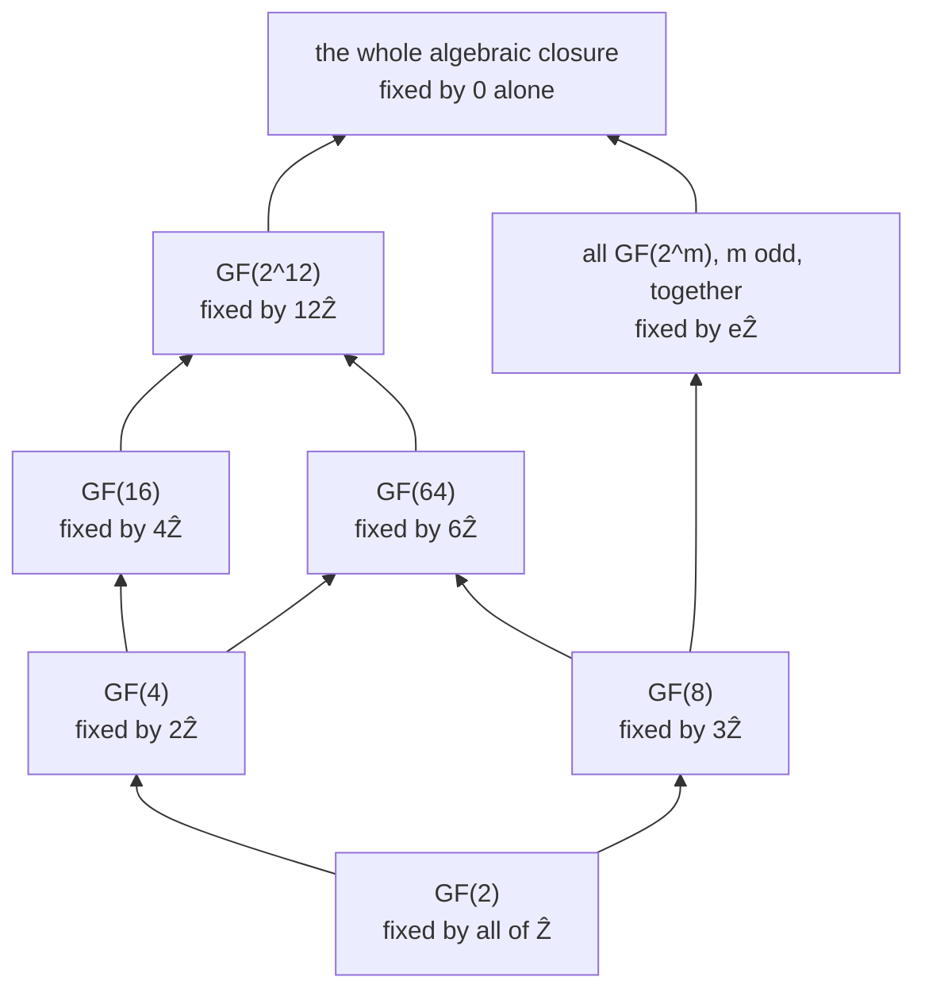

# Infinite Galois theory: the symmetries of all algebraic numbers at once, and why only closed subgroups count

[Syllabus](../../../SYLLABUS.md) → [Algebraic and analytic number theory](../README.md) → [Fields and Galois Theory](../README.md#s05) → Infinite Galois theory

---

## General Overview

The fields GF(2), GF(4), GF(8), GF(16) and every other GF($`2^n`$) fit inside one infinite field: the **algebraic closure** of GF(2), which holds a root of every polynomial whose coefficients are bits ([Splitting fields](03-splitting-fields-and-algebraic-closure.md)). A symmetry of that infinite field (a reshuffle that keeps sums and products) must act on each GF($`2^n`$) as some power of Frobenius, $`\mathrm{Frob}^{r}`$, squaring repeated $`r`$ times ([Finite fields](09-finite-fields-and-frobenius.md)).

So a symmetry is an endless list of clock readings $`r_1, r_2, r_3, \ldots`$, with $`r_n`$ in $`\mathbb{Z} \bmod n`$. The readings must agree where fields nest: GF(16) sits inside GF($`2^{12}`$), so $`r_{12}`$ and $`r_4`$ must match mod 4. Frobenius itself is the list 0, 1, 1, 1, … ($`r_1`$ is always 0, since $`\mathbb{Z} \bmod 1`$ has one element). But some lists come from no power of Frobenius at all. One of them, called $`e`$ on this card, starts 0, 1, 0, 1, 0, 3, 0, 1, 0, 5, 0, 9.

This breaks the dictionary of [The Galois correspondence](05-galois-groups-and-the-fundamental-theorem.md). The powers of Frobenius form a subgroup, and the whole group is bigger. Yet both fix the same field: GF(2) and nothing more. Two subgroups, one field.

The repair is a sense of "near". Two symmetries are close when they agree on a large finite field. Under that rule, called the **Krull topology**, the powers of Frobenius crowd densely into the whole group. The dictionary then holds again, provided it uses only **closed** subgroups: those that already contain every symmetry they crowd around.

A second example shows the scale of the problem. Adjoin $`\sqrt 2, \sqrt 3, \sqrt 5, \sqrt 7`$ and the square root of every other prime to the fractions. A symmetry chooses a sign for each $`\sqrt p`$, independently. There are uncountably many subgroups of index 2, but only countably many fields of degree 2 inside. So almost all of those subgroups match no field.

**The symmetries of an infinite Galois extension form a compact group, close when they agree on a big finite piece (a subfield of finite degree); with that topology the fields between bottom and top match exactly the closed subgroups, fields of finite degree matching open subgroups; and the symmetries of the algebraic closure of GF(p) are the profinite integers, with Frobenius generating a dense copy of the integers.**

**What kind of fact this is:** a theorem, Krull's theorem of 1928, proved on this card in Why it works. The code checks finite levels exactly: compatible lists, fixed-point counts in fields built in the code, up to GF($`2^{13}`$), sign patterns for eight primes. The proofs cover every level and the infinite field; the counts are evidence at the levels they reach. That non-closed subgroups of index 2 exist is proved with the axiom of choice; nobody can write one down, and the code does not try.

### The picture: some fields inside the algebraic closure of GF(2), and the subgroups that fix them



Each arrow means "sits inside". $`\widehat{\mathbb{Z}}`$ is the group of all compatible lists, defined under The formula, and $`n\widehat{\mathbb{Z}}`$ is the lists with $`r_n = 0`$: the symmetries that fix all of GF($`2^n`$). The box for odd $`m`$ is an infinite field. Its subgroup $`e\widehat{\mathbb{Z}}`$ is closed but not open, and has infinite index.

---

## The formula

Notation first, in words.

- $`\Omega/K`$ is a **Galois extension**, possibly infinite: every element of $`\Omega`$ is a root of a polynomial over $`K`$, and $`\Omega`$ is normal and separable over $`K`$ ([Normal and separable](04-normal-and-separable-extensions.md)).
- $`\mathrm{Gal}(\Omega/K)`$ is the group of symmetries of $`\Omega`$ that fix every element of $`K`$. For a subgroup $`H`$, the fixed field $`\Omega^H`$ is the elements every member of $`H`$ leaves in place, as on [The Galois correspondence](05-galois-groups-and-the-fundamental-theorem.md).
- $`E`$ is **finite over** $`K`$ when its degree $`[E : K]`$ is finite. This card calls such an $`E`$ a **finite piece**, to keep it apart from a finite field GF($`q`$). For a finite piece $`E`$, the subgroup $`U_E = \mathrm{Gal}(\Omega/E)`$ is the symmetries that fix all of $`E`$.

The **Krull topology** says which sets of symmetries are open: unions of the sets $`\sigma U_E`$.

```math
\sigma U_E = \{\, \tau \in \mathrm{Gal}(\Omega/K) : \tau(x) = \sigma(x) \text{ for every } x \in E \,\}, \qquad E \text{ finite over } K
```

**Read it aloud:** the symmetries near $`\sigma`$ are those that agree with $`\sigma`$ on some finite piece $`E`$; a bigger $`E`$ means nearer.

A set of symmetries is **open** when around each of its members some $`\sigma U_E`$ stays inside the set ([Topological space](../../17-Topology/02-Topological%20Spaces/01-topological-spaces-and-bases.md)). The **closure** $`\mathrm{cl}(H)`$ is every $`\sigma`$ whose every $`\sigma U_E`$ meets $`H`$; $`H`$ is **closed** when $`\mathrm{cl}(H) = H`$ ([Closure, interior and boundary](../../17-Topology/02-Topological%20Spaces/02-closure-interior-and-boundary.md)).

Krull's theorem is the correspondence with one word added:

```math
E \longmapsto \mathrm{Gal}(\Omega/E), \qquad H \longmapsto \Omega^H, \qquad \mathrm{Gal}(\Omega/\Omega^H) = \mathrm{cl}(H)
```

**Read it aloud:** send a field to the symmetries fixing it and a subgroup to what it fixes; these undo each other on closed subgroups, and an arbitrary subgroup comes back as its closure.

Finite pieces $`E`$ match the **open** subgroups, with $`[E : K]`$ equal to the index. Fields normal over $`K`$ match normal closed subgroups.

The example. The algebraic closure of GF($`p`$) has the group of **profinite integers**:

```math
\mathrm{Gal}(\overline{\mathrm{GF}(p)}/\mathrm{GF}(p)) \cong \widehat{\mathbb{Z}} = \{\, (r_1, r_2, r_3, \ldots) : r_n \in \mathbb{Z} \bmod n, \ r_m \equiv r_n \pmod n \text{ whenever } n \mid m \,\}
```

**Read it aloud:** a symmetry is a compatible list of Frobenius powers, one per finite field; the list $`(r_n)`$ acts on GF($`p^n`$) as $`\mathrm{Frob}^{r_n}`$.

Lists add entry by entry. An ordinary integer $`k`$ gives the list $`(k \bmod n)`$, which is $`\mathrm{Frob}^k`$. The subgroup $`n\widehat{\mathbb{Z}}`$ fixes exactly GF($`p^n`$), and has index $`n`$.

| Symbol | Plain meaning | In our example | Push it up and the answer… |
| --- | --- | --- | --- |
| $`K`$, $`\Omega`$ | the bottom field; the infinite top field | GF(2); its algebraic closure | — |
| $`E`$, $`M`$ | a field between them; $`M`$, in the fold, a finite piece Galois over $`K`$ | GF(16), or all GF($`2^m`$) with $`m`$ odd | a bigger $`E`$ has a smaller $`\mathrm{Gal}(\Omega/E)`$ |
| $`\sigma`$, $`\tau`$, $`\sigma\vert_E`$ | symmetries of $`\Omega`$ fixing $`K`$; $`\sigma\vert_E`$ (also $`\sigma_E`$) is $`\sigma`$ restricted to $`E`$ | $`\mathrm{Frob}^{3465}`$ and $`e`$ | — |
| $`U_E`$, $`\sigma U_E`$ | the symmetries fixing $`E`$; those agreeing with $`\sigma`$ on $`E`$ | $`U_{\mathrm{GF}(2^n)} = n\widehat{\mathbb{Z}}`$ | bigger $`E`$: a smaller, nearer set |
| $`H`$, $`\mathrm{cl}(H)`$, $`h`$, $`H_E`$ | a subgroup; its closure; one member of $`H`$; $`H`$ restricted to $`E`$ | Frobenius powers; closure all of $`\widehat{\mathbb{Z}}`$ | — |
| $`\Omega^H`$, $`x`$ | what $`H`$ fixes; $`x`$ one element of $`\Omega`$ | GF(2) for both | a bigger $`H`$ fixes less |
| $`\mathrm{Frob}^r`$, $`r_n`$ | squaring $`r`$ times; the reading on GF($`2^n`$) | $`e`$ has $`r_{12} = 9`$ | — |
| $`n`$, $`m`$, $`N`$, $`k`$ | a field's degree; a second degree; a degree that all of 1 to $`m`$ divide; an ordinary integer | $`n = 13`$, $`k = 3465`$ | — |
| $`\widehat{\mathbb{Z}}`$, $`e`$, $`\mathbb{Z}_\ell`$ | all compatible lists; the list 1 mod the power of 2 in $`n`$, 0 mod the odd part; the $`\ell`$-adic integers, one factor of $`\widehat{\mathbb{Z}}`$ per prime $`\ell`$ | $`e`$ = 0, 1, 0, 1, 0, 3, … | — |
| $`p`$, $`q`$ | primes: $`p`$ under a square root, or the field size; $`q`$ a test prime | $`\sqrt 7`$; $`q = 311`$ | — |
| $`d`$ | a product of distinct primes | $`\sqrt{210}`$ | — |
| $`L`$ | the house splitting field $`\mathbb{Q}(2^{1/4}, i)`$ | degree 8 | — |

### When it holds

- **The top field is Galois over the bottom.** Every element must have all its conjugates inside, with no repeated roots. Without that, too few symmetries exist to fix only the bottom, as in the finite case.
- **The open sets come from finite pieces.** Call every set open (the **discrete** topology) and $`\{\mathrm{id}\}`$ becomes open. Open subgroups match finite pieces, so $`\Omega`$ would have to be finite over $`K`$: false here.
- **Only closed subgroups take part.** The Frobenius powers and $`\widehat{\mathbb{Z}}`$ both fix GF(2) alone. Frob fixes only the roots of $`x^2 = x`$, which are 0 and 1, so neither subgroup fixes more than GF(2); the code's count of 2 fixed elements in every GF($`2^n`$) up to $`n = 12`$ agrees.
- **Finite extensions see nothing new.** There $`U_\Omega = \{\mathrm{id}\}`$ is open, every subgroup is closed, and the theorem is the finite one.
- **Choice enters at two places.** Extending a symmetry from a finite piece to all of $`\Omega`$ uses Zorn's lemma when $`\Omega`$ is uncountable. Building a non-closed subgroup of index 2 uses a basis that only the axiom of choice supplies.

---

## Why it works

### Step 0: an infinite field is the union of its finite pieces

Every element of $`\Omega`$ is a root of one polynomial, so it lies in a finite piece $`E`$ that is Galois over $`K`$: the splitting field of that polynomial. A symmetry is therefore known once its effect on every finite $`E`$ is known.

That makes "agree on a big finite piece" the right meaning of "near". Every fact on this card follows from it, plus the finite theorem applied one piece at a time.

### Step 1: the group is the set of compatible lists

Restrict a symmetry $`\sigma`$ to each finite Galois $`E`$. The result $`\sigma|_E`$ lies in the finite group $`\mathrm{Gal}(E/K)`$. When $`E \subseteq E'`$, restricting $`\sigma|_{E'}`$ to $`E`$ gives $`\sigma|_E`$: the list is **compatible**.

Every compatible list comes from exactly one symmetry. Define $`\sigma(x) = \sigma_E(x)`$ for any finite $`E`$ holding $`x`$. Two choices $`E`$ and $`E'`$ both sit inside the finite piece $`EE'`$ they generate, so compatibility gives one answer. Any two elements share a finite $`E`$, so $`\sigma`$ keeps sums and products.

For finite fields this is the list of the overview. $`\mathrm{Gal}(\mathrm{GF}(p^n)/\mathrm{GF}(p))`$ is $`\mathrm{Frob}^0`$ to $`\mathrm{Frob}^{n-1}`$, the clock $`\mathbb{Z} \bmod n`$. Inside GF($`p^m`$), $`\mathrm{Frob}^r`$ acts on the subfield GF($`p^n`$) as $`\mathrm{Frob}^{r \bmod n}`$, since $`\mathrm{Frob}^n`$ fixes GF($`p^n`$). The code checks this in GF($`2^{12}`$): $`\mathrm{Frob}^9`$ equals Frob on all 16 elements of GF(16), though the two differ at 4,080 of the 4,096 elements of the big field.

At level 8 the code lists all $`1 \times 2 \times \cdots \times 8 = 40{,}320`$ choices of $`(r_1, \ldots, r_8)`$. Exactly 840 are compatible, and each is $`(k \bmod n)`$ for one $`k`$ in $`\mathbb{Z} \bmod 840`$, where 840 is the least common multiple of 1 to 8.

### Step 2: the topology makes the group compact

The compatible lists sit inside the product of all the finite groups $`\mathrm{Gal}(E/K)`$, each with every subset open ([Subspace, product and quotient](../../17-Topology/02-Topological%20Spaces/04-subspace-product-and-quotient-topologies.md)). The product topology's basic boxes fix finitely many coordinates. Fixing the coordinate at $`E`$ to $`\sigma|_E`$ is exactly the set $`\sigma U_E`$. So the Krull topology is the product topology, cut down to the compatible lists.

A finite set with every subset open is compact. Tychonoff's theorem makes the product compact ([Compactness with no distances, and Tychonoff](../../17-Topology/02-Topological%20Spaces/06-compactness-and-tychonoff.md)). Each compatibility condition looks at two coordinates, so it cuts out a closed set. The compatible lists are an intersection of closed sets inside a compact space, hence compact.

Two more properties come free.

Two symmetries that differ at some $`x`$ sit in disjoint open sets $`\sigma U_{K(x)}`$ and $`\tau U_{K(x)}`$, so the group is Hausdorff ([Hausdorff and its ladder](../../17-Topology/02-Topological%20Spaces/05-separation-axioms-and-hausdorff.md)). Each $`U_E`$ is open, and its complement is a union of open cosets, so it is also closed. A compact Hausdorff group built from finite groups this way is called **profinite**. $`\widehat{\mathbb{Z}}`$ as a space is a Cantor set ([The test spaces](../../17-Topology/02-Topological%20Spaces/09-standard-examples-and-counterexamples.md)).

### Step 3: open subgroups are exactly the finite pieces

For finite Galois $`E`$, restriction sends $`\mathrm{Gal}(\Omega/K)`$ onto $`\mathrm{Gal}(E/K)`$ with kernel $`U_E`$. So $`U_E`$ has index $`[E : K]`$. That restriction is onto because a symmetry of $`E`$ extends to $`\Omega`$: Step 1 builds the extension one finite piece at a time when $`\Omega`$ is countable, and Zorn's lemma does it in general.

An open subgroup contains some $`U_E`$, so what it fixes lies inside $`E`$: a finite piece. Its cosets are open and cover the compact group, so finitely many do: its index is finite.

A closed subgroup of finite index is open, since its complement is finitely many closed cosets. So for subgroups of finite index, "open" and "closed" agree. For subgroups of infinite index they do not: $`e\widehat{\mathbb{Z}}`$ is closed, being the image of the compact $`\widehat{\mathbb{Z}}`$ under multiplication by $`e`$, but it is not open.

### Step 4: a subgroup and its closure fix the same things

The symmetries that fix one element $`x`$ form $`U_{K(x)}`$, which is closed by Step 2. If $`H`$ fixes $`x`$, then $`H`$ lies inside that closed set, and so does $`\mathrm{cl}(H)`$. So $`\Omega^{H} = \Omega^{\mathrm{cl}(H)}`$.

This is why only closed subgroups count. The map from subgroups to fields cannot tell $`H`$ from its closure, so it can be one-to-one only on closed subgroups.

### Step 5: the correspondence

Two facts finish the theorem; the fold has both proofs.

- $`\mathrm{Gal}(\Omega/\Omega^H) = \mathrm{cl}(H)`$: what fixes everything $`H`$ fixes is exactly the closure of $`H`$.
- $`\Omega^{\mathrm{Gal}(\Omega/E)} = E`$: the symmetries fixing $`E`$ fix nothing more.

Each reduces to [The Galois correspondence](05-galois-groups-and-the-fundamental-theorem.md) on one finite piece at a time. Normal closed subgroups match normal fields by the same conjugation argument as there.

<details>
<summary>Detailed proof: both halves of the correspondence, one finite piece at a time</summary>

**Closure.** Step 4 gives $`\mathrm{cl}(H) \subseteq \mathrm{Gal}(\Omega/\Omega^H)`$. Conversely let $`\sigma`$ fix $`\Omega^H`$, and take any finite Galois $`E`$. Restrict $`H`$ to $`E`$: the restrictions form a subgroup $`H_E`$ of $`\mathrm{Gal}(E/K)`$. What $`H_E`$ fixes in $`E`$ is $`E \cap \Omega^H`$. Now $`\sigma|_E`$ fixes $`E \cap \Omega^H = E^{H_E}`$, so by the finite theorem

$`\displaystyle \sigma|_E \in \mathrm{Gal}(E/E^{H_E}) = H_E.`$

So some $`h`$ in $`H`$ agrees with $`\sigma`$ on $`E`$: $`h \in \sigma U_E`$. Every basic set around $`\sigma`$ meets $`H`$, so $`\sigma \in \mathrm{cl}(H)`$.

**Fields.** Clearly $`E \subseteq \Omega^{\mathrm{Gal}(\Omega/E)}`$. Take $`x`$ not in $`E`$, and a finite Galois $`M`$ over $`K`$ holding $`x`$. The field $`M \cap E`$ does not hold $`x`$, so by the finite theorem some $`\tau`$ in $`\mathrm{Gal}(M/M \cap E)`$ moves $`x`$. The field $`ME`$ is Galois over $`E`$, and restriction from $`\mathrm{Gal}(ME/E)`$ to $`\mathrm{Gal}(M/M \cap E)`$ is onto (the standard translation theorem, in Milne's notes, chapter 3). Lift $`\tau`$ to $`ME`$, then extend it to $`\Omega`$ as in Step 3. The result fixes $`E`$ and moves $`x`$.

</details>

### Step 6: Frobenius generates a dense copy of the integers

The basic sets around a list $`(r_n)`$ are its agreements on one GF($`p^N`$), which pins $`r_n`$ for every $`n`$ dividing $`N`$. Taking $`N`$ to be the least common multiple of 1 to $`m`$ pins $`r_1`$ to $`r_m`$. One integer $`k \equiv r_N \pmod N`$ meets all of that. So every open set meets the Frobenius powers: they are **dense**, and their closure is all of $`\widehat{\mathbb{Z}}`$.

They are not all of it. The list $`e`$ is 1 mod the power of 2 dividing $`n`$ and 0 mod the odd part of $`n`$. Its readings are compatible, so it is a symmetry. No integer $`k`$ equals it: $`e`$ forces $`k`$ odd (reading at 2), and also $`k \equiv 0`$ mod every odd $`n`$, which fails at any odd $`n`$ bigger than $`\lvert k\rvert`$. The code finds, for each $`k`$ with $`\lvert k\rvert \le 1000`$, a field where they differ; the worst is $`k = 945`$, caught at $`n = 11`$.

Powers of Frobenius approach $`e`$. The smallest power matching $`e`$ on every GF($`2^n`$) with $`n \le 12`$ is $`\mathrm{Frob}^{3465}`$; for $`n \le 16`$ it is $`\mathrm{Frob}^{585585}`$, matching mod 720,720. The exponents never settle, because no integer is the limit.

What $`e`$ fixes: on GF($`2^n`$) it is $`\mathrm{Frob}^{r_n}`$, which fixes $`2^{\gcd(r_n, n)}`$ elements. Here $`\gcd(r_n, n)`$ is the odd part of $`n`$. So $`e`$ fixes exactly the union of all GF($`2^m`$) with $`m`$ odd, an infinite field. Its closed subgroup $`e\widehat{\mathbb{Z}}`$ is a copy of the 2-adic integers $`\mathbb{Z}_2`$ ([The p-adic numbers](../06-Algebraic%20Numbers/10-p-adic-numbers-and-hensels-lemma.md)). By the Chinese remainder theorem, $`\widehat{\mathbb{Z}}`$ splits into one $`\mathbb{Z}_\ell`$ for each prime $`\ell`$, and $`e`$ is 1 in $`\mathbb{Z}_2`$ and 0 in the others.

### Step 7: square roots of all the primes

Let $`\Omega = \mathbb{Q}(\sqrt 2, \sqrt 3, \sqrt 5, \ldots)`$. A symmetry sends each $`\sqrt p`$ to $`\pm\sqrt p`$, so it is a choice of sign for every prime.

Every choice occurs, at every level $`k`$. Take the field made by the square roots of the first $`k`$ primes. It is the splitting field of $`(x^2 - 2)(x^2 - 3)\cdots`$, so it is Galois over $`\mathbb{Q}`$. A symmetry of it is fixed by its $`k`$ signs, so its symmetries form a subgroup of the $`2^k`$ sign choices.

Suppose that subgroup missed a choice. The sign choices form a vector space over GF(2), adding by multiplying signs, and a proper subspace passes a parity test: for some nonempty set of the $`k`$ primes, every symmetry gives a minus sign to an even number of them. (A proper subspace lies in the kernel of a nonzero linear map to GF(2), and such a map counts minus signs over a set of positions.) Then every symmetry fixes $`\sqrt d`$, where $`d`$ is the product of that set, since $`\sqrt d`$ picks up an even number of minus signs. By [The Galois correspondence](05-galois-groups-and-the-fundamental-theorem.md), $`\sqrt d`$ would lie in $`\mathbb{Q}`$. It cannot: $`d`$ is a product of distinct primes, so it is squarefree and bigger than 1, and its square root is irrational. So all $`2^k`$ choices are symmetries, and the degree is $`2^k`$. Step 1 then assembles compatible choices into every infinite sign list.

The code meets the same fact by counting, as evidence at $`k \le 8`$ only. For a prime $`q`$ outside the list, the Frobenius symmetry at $`q`$, taught later on [Chebotarev](../06-Algebraic%20Numbers/09-chebotarev-density-and-splitting-statistics.md), gives $`\sqrt p`$ the sign of the Legendre symbol $`(p/q)`$ ([Quadratic residues](../03-Characters%20and%20L-functions/02-quadratic-residues-and-the-legendre-symbol.md)). Distinct patterns are distinct symmetries. The code meets all 16 patterns for $`\sqrt 2`$ to $`\sqrt 7`$ by $`q = 311`$, and all 256 for the first eight primes by $`q = 10{,}559`$, as the proof predicts.

A closed subgroup of index 2 is open (Step 3), so it fixes a field of degree 2: some $`\mathbb{Q}(\sqrt d)`$, with $`d`$ a product of distinct primes. There are countably many such $`d`$. At level 4 the code tests all 6,435 halves of the 16 sign choices that contain the identity: 15 are subgroups, each fixing exactly one $`\sqrt d`$, for $`d`$ = 2, 3, 5, 6, 7, 10, 14, 15, 21, 30, 35, 42, 70, 105, 210.

The whole group has far more index-2 subgroups.

1. The sign lists form a vector space over GF(2), adding by multiplying signs. It is uncountable, so any basis is uncountable; the axiom of choice supplies one.
2. For each basis vector, "its coefficient" maps the group onto GF(2). Its kernel has index 2, and different basis vectors give different kernels.
3. Only countably many of these uncountably many kernels are closed. Each other one has a closure strictly bigger than itself, so its closure is the whole group, and it fixes $`\mathbb{Q}`$ alone.

---

## Worked numbers, by hand

The symmetry $`e`$ on three fields, and the power of Frobenius that mimics it.

| Step | Arithmetic | Value |
| --- | --- | --- |
| $`r_{12}`$ for $`e`$ | 1 mod 4 and 0 mod 3: try 3, 6, 9 | 9 |
| compatible with GF(16) and GF(64)? | 9 mod 4 = 1 = $`r_4`$; 9 mod 6 = 3 = $`r_6`$ | yes |
| fixed by $`e`$ in GF($`2^{12}`$) | $`2^{\gcd(9, 12)} = 2^3`$ | 8: the field GF(8) |
| least common multiple of 1 to 12 | $`8 \times 9 \times 5 \times 7 \times 11`$ | 27,720 |
| smallest $`k`$ matching $`e`$ up to $`n = 12`$ | 0 mod 3,465 and 1 mod 8; 3,465 is already 1 mod 8 | 3,465 |
| $`\mathrm{Frob}^{3465}`$ on GF($`2^{13}`$) | 3,465 mod 13 = 7; fixes $`2^{\gcd(7, 13)}`$ | 2 elements |
| $`e`$ on GF($`2^{13}`$) | 13 is odd, so $`r_{13} = 0`$: fixes $`2^{13}`$ | **8,192 elements** |

$`\mathrm{Frob}^{3465}`$ sits in the open set "agrees with $`e`$ on every GF($`2^n`$), $`n \le 12`$", yet differs from $`e`$ one field later: close, not equal.

### What breaks if you drop a piece

| Mistake | Comes out at | What went wrong |
| --- | --- | --- |
| Use every subgroup, not only closed ones | Frob alone fixes 2 elements of every GF($`2^n`$), $`n \le 12`$, as all of $`\widehat{\mathbb{Z}}`$ does | the Frobenius powers are not closed: two subgroups, one field |
| Take $`\mathrm{Frob}^{3465}`$ for $`e`$ | fixes 2 elements of GF($`2^{13}`$); $`e`$ fixes 8,192 | agreeing on finitely many fields is nearness, not equality |
| Adjoin $`\sqrt 2`$ and $`\sqrt 8`$ as if independent | 2 sign patterns of 4: degree 2 | $`\sqrt 8 = 2\sqrt 2`$; only products of distinct primes give new square roots |

The code prints all three.

---

## Code, from first principles, and it actually runs

Nothing is imported except `gcd`, `product` and `combinations`. The code builds each GF($`2^n`$) from an irreducible polynomial found by trial division, and counts fixed points by trying every element. It takes four roads.

1. **Compatible lists** by brute force over all 40,320 choices at level 8, against the clock $`\mathbb{Z} \bmod 840`$.
2. **The symmetry $`e`$** by its residues, then by fixed-point counts in fields built in the code, up to GF($`2^{13}`$), against $`2^{\text{odd part of } n}`$; the restriction from GF($`2^{12}`$) to GF(16) checked element by element.
3. **Square roots of primes** by Frobenius sign patterns at primes below 200,000, evidence at the first eight primes for what Step 7 proves at every level, and index-2 subgroups by testing every half of the 16 sign choices.
4. **The house example**: the primes where $`x^4 - 2`$ has 4 roots, whose share estimates the size of an open subgroup.

### Python

```python
# Infinite Galois theory: Gal(algebraic closure of F_2 / F_2) as compatible residues, and Q(sqrt 2, sqrt 3, ...).
from math import gcd
from itertools import product, combinations

def lcm_upto(m):
    L = 1
    for n in range(1, m + 1):
        L = L * n // gcd(L, n)
    return L

def two_part(n):
    t = 1
    while n % (2 * t) == 0:
        t *= 2
    return t

def e_mod(n):  # the symmetry e on GF(2^n): Frob^r with r = 1 mod the 2-part of n, 0 mod the odd part
    t = two_part(n)
    o = n // t
    return next(o * s % n for s in range(t) if o * s % t == 1 % t)

def pmod(a, m):  # remainder of polynomial a by polynomial m, bits as coefficients mod 2
    while a.bit_length() >= m.bit_length():
        a ^= m << (a.bit_length() - m.bit_length())
    return a

def irreducible(n):  # first degree-n polynomial with no factor of degree 1 to n/2
    return next(f for f in range(1 << n | 1, 1 << (n + 1), 2)
                if all(pmod(f, g) for g in range(2, 1 << (n // 2 + 1))))

def mul(a, b, f):
    r = 0
    while b:
        if b & 1:
            r ^= a
        b >>= 1
        a <<= 1
        if a >> (f.bit_length() - 1):
            a ^= f
    return r

def frob(x, k, f):  # x to the power 2^k
    for _ in range(k):
        x = mul(x, x, f)
    return x

def fixed(n, k):  # how many elements of GF(2^n) Frob^k leaves unmoved, by trying every one
    f = irreducible(n)
    return sum(frob(x, k, f) == x for x in range(1 << n))

# Road 1: the inverse limit at level 8 is the clock of lcm(1..8), by brute force over all tuples
M = 8
compat = [t for t in product(*[range(n) for n in range(1, M + 1)])
          if all(t[m - 1] % n == t[n - 1] for m in range(1, M + 1) for n in range(1, m) if m % n == 0)]
from_clock = {tuple(k % n for n in range(1, M + 1)) for k in range(lcm_upto(M))}
assert len(compat) == lcm_upto(M) and set(compat) == from_clock
print(f"tuples (r1..r{M}) with r_n in Z mod n: {len(list(product(*[range(n) for n in range(1, M + 1)])))}; compatible: {len(compat)}; lcm(1..{M}) = {lcm_upto(M)}; each is k mod n for one k: yes")
# Road 2: the symmetry e, residue by residue, and its fixed points counted in fields built here
E = [e_mod(n) for n in range(1, 17)]
assert all(e_mod(m) % n == e_mod(n) for m in range(1, 17) for n in range(1, m) if m % n == 0)
print(f"e on GF(2^n) is Frob^r, n = 1..16, r = {E}; compatible: yes")
fx = [fixed(n, e_mod(n)) for n in range(1, 13)]
assert fx == [2 ** (n // two_part(n)) for n in range(1, 13)]
print("elements of GF(2^n) fixed by e, n = 1..12, counted:", fx)
print("  = 2^(odd part of n): yes, so e fixes exactly the fields GF(2^m) with m odd")
fr = [fixed(n, 1) for n in range(1, 13)]
assert fr == [2] * 12
print("elements fixed by Frob itself, n = 1..12:", fr)
f12 = irreducible(12)
sub16 = [x for x in range(1 << 12) if frob(x, 4, f12) == x]
assert len(sub16) == 16 and all(frob(x, 9, f12) == frob(x, 1, f12) for x in sub16)
diff = sum(frob(x, 9, f12) != frob(x, 1, f12) for x in range(1 << 12))
print(f"GF(2^12) built from {f12:x}; GF(16) inside it has {len(sub16)} elements; Frob^9 = Frob on all of them: yes; on GF(2^12) they differ at {diff} elements")
for m in (2, 4, 6, 8, 10, 12, 16):
    L = lcm_upto(m)
    k = e_mod(L)
    assert all(k % n == e_mod(n) for n in range(1, m + 1))
    print(f"Frob^k agrees with e on GF(2^n) for every n <= {m}: lcm = {L}, smallest k = {k}")
wit = {k: next(n for n in range(1, 5000) if k % n != e_mod(n)) for k in range(-1000, 1001)}
worst = max(wit, key=lambda k: (wit[k], k))
print(f"every integer k with |k| <= 1000 differs from e on some GF(2^n): yes; largest n needed {wit[worst]}, at k = {worst}")
# Road 3: Q(sqrt 2, sqrt 3, ...): Frobenius sign patterns at primes q, evidence for k <= 8 that the degree is 2^k
N = 200000
sieve = bytearray([1]) * N
sieve[0] = sieve[1] = 0
for i in range(2, int(N ** 0.5) + 1):
    if sieve[i]:
        sieve[i * i::i] = bytearray(len(range(i * i, N, i)))
P = [2, 3, 5, 7, 11, 13, 17, 19]
odd = [q for q in range(3, N) if sieve[q]]
pat = {q: tuple(pow(p, (q - 1) // 2, q) == 1 for p in P) for q in odd}
for k in range(1, 9):
    seen, last = set(), 0
    for q in odd:
        if q not in P[:k] and pat[q][:k] not in seen:
            seen.add(pat[q][:k])
            last = q
    assert len(seen) == 2 ** k
    print(f"k = {k}: sign patterns of sqrt 2 .. sqrt {P[k - 1]} at primes q < {N}: {len(seen)} of {2 ** k}; last new one at q = {last}")
Q4 = [q for q in odd if q not in P[:4]]
cnt = {}
for q in Q4:
    cnt[pat[q][:4]] = cnt.get(pat[q][:4], 0) + 1
print(f"k = 4: {len(Q4)} primes q, each of the 16 patterns met between {min(cnt.values())} and {max(cnt.values())} times")
G = list(product([1, -1], repeat=4))
halves = list(combinations(G[1:], 7))
idx2 = [H for H in halves if all(tuple(a * b for a, b in zip(g, h)) in H + (G[0],) for g in H for h in H)]
D = [S for r in range(1, 5) for S in combinations(range(4), r)]
sign = lambda h, S: [1, -1][sum(h[i] == -1 for i in S) % 2]
match = [[S for S in D if all(sign(h, S) == 1 for h in H)] for H in idx2]
assert len(idx2) == 15 and all(len(m) == 1 for m in match) and len({m[0] for m in match}) == 15
ds = []
for m in match:
    d = 1
    for i in m[0]:
        d *= P[i]
    ds.append(d)
print(f"subgroups of index 2 in the 16 sign choices, by testing all {len(halves)} halves: {len(idx2)}; each fixes one sqrt d, d =", sorted(ds))
two8 = {(pow(2, (q - 1) // 2, q) == 1, pow(8, (q - 1) // 2, q) == 1) for q in odd}
assert len(two8) == 2
print(f"mistake, sqrt 2 with sqrt 8: sign patterns met {len(two8)} of 4, so degree 2, not 4")
# Road 4: the house example; the open subgroup fixing the splitting field of x^4 - 2 has index 8
hp = [q for q in odd if q < 10000]
split = [q for q in hp if sum(pow(x, 4, q) == 2 % q for x in range(q)) == 4]
assert abs(len(split) / len(hp) - 1 / 8) < 0.02
print(f"house: odd primes q < 10000: {len(hp)}; x^4 - 2 has 4 roots mod q for {len(split)}; share {len(split) / len(hp):.4f} against 1/8 = 0.1250")
k12 = e_mod(lcm_upto(12))
print(f"mistake, Frob^{k12} taken for e: {k12} mod 13 = {k12 % 13}; on GF(2^13) it fixes {fixed(13, k12 % 13)}, e fixes {fixed(13, e_mod(13))}")
assert fixed(13, k12 % 13) == 2 and fixed(13, e_mod(13)) == 8192
print("ALL CHECKS PASS")
```

**Ran 2026-11-24 on macOS, Python 3.14.10, standard library only. All checks passed. Output, pasted from the run:**

```
tuples (r1..r8) with r_n in Z mod n: 40320; compatible: 840; lcm(1..8) = 840; each is k mod n for one k: yes
e on GF(2^n) is Frob^r, n = 1..16, r = [0, 1, 0, 1, 0, 3, 0, 1, 0, 5, 0, 9, 0, 7, 0, 1]; compatible: yes
elements of GF(2^n) fixed by e, n = 1..12, counted: [2, 2, 8, 2, 32, 8, 128, 2, 512, 32, 2048, 8]
  = 2^(odd part of n): yes, so e fixes exactly the fields GF(2^m) with m odd
elements fixed by Frob itself, n = 1..12: [2, 2, 2, 2, 2, 2, 2, 2, 2, 2, 2, 2]
GF(2^12) built from 1009; GF(16) inside it has 16 elements; Frob^9 = Frob on all of them: yes; on GF(2^12) they differ at 4080 elements
Frob^k agrees with e on GF(2^n) for every n <= 2: lcm = 2, smallest k = 1
Frob^k agrees with e on GF(2^n) for every n <= 4: lcm = 12, smallest k = 9
Frob^k agrees with e on GF(2^n) for every n <= 6: lcm = 60, smallest k = 45
Frob^k agrees with e on GF(2^n) for every n <= 8: lcm = 840, smallest k = 105
Frob^k agrees with e on GF(2^n) for every n <= 10: lcm = 2520, smallest k = 945
Frob^k agrees with e on GF(2^n) for every n <= 12: lcm = 27720, smallest k = 3465
Frob^k agrees with e on GF(2^n) for every n <= 16: lcm = 720720, smallest k = 585585
every integer k with |k| <= 1000 differs from e on some GF(2^n): yes; largest n needed 11, at k = 945
k = 1: sign patterns of sqrt 2 .. sqrt 2 at primes q < 200000: 2 of 2; last new one at q = 7
k = 2: sign patterns of sqrt 2 .. sqrt 3 at primes q < 200000: 4 of 4; last new one at q = 23
k = 3: sign patterns of sqrt 2 .. sqrt 5 at primes q < 200000: 8 of 8; last new one at q = 71
k = 4: sign patterns of sqrt 2 .. sqrt 7 at primes q < 200000: 16 of 16; last new one at q = 311
k = 5: sign patterns of sqrt 2 .. sqrt 11 at primes q < 200000: 32 of 32; last new one at q = 479
k = 6: sign patterns of sqrt 2 .. sqrt 13 at primes q < 200000: 64 of 64; last new one at q = 1559
k = 7: sign patterns of sqrt 2 .. sqrt 17 at primes q < 200000: 128 of 128; last new one at q = 5711
k = 8: sign patterns of sqrt 2 .. sqrt 19 at primes q < 200000: 256 of 256; last new one at q = 10559
k = 4: 17980 primes q, each of the 16 patterns met between 1069 and 1145 times
subgroups of index 2 in the 16 sign choices, by testing all 6435 halves: 15; each fixes one sqrt d, d = [2, 3, 5, 6, 7, 10, 14, 15, 21, 30, 35, 42, 70, 105, 210]
mistake, sqrt 2 with sqrt 8: sign patterns met 2 of 4, so degree 2, not 4
house: odd primes q < 10000: 1228; x^4 - 2 has 4 roots mod q for 143; share 0.1164 against 1/8 = 0.1250
mistake, Frob^3465 taken for e: 3465 mod 13 = 7; on GF(2^13) it fixes 2, e fixes 8192
ALL CHECKS PASS
```

### Rust

Same numbers, same labels, built with `rustc --edition 2021 -O`.

```rust
// Infinite Galois theory: Gal(algebraic closure of F_2 / F_2) as compatible residues, and Q(sqrt 2, sqrt 3, ...).
use std::collections::{HashMap, HashSet};

fn gcd(a: i64, b: i64) -> i64 { if b == 0 { a } else { gcd(b, a % b) } }
fn lcm_upto(m: i64) -> i64 { (1..=m).fold(1, |l, n| l * n / gcd(l, n)) }
fn two_part(n: i64) -> i64 { let mut t = 1; while n % (2 * t) == 0 { t *= 2; } t }
// the symmetry e on GF(2^n): Frob^r with r = 1 mod the 2-part of n, 0 mod the odd part
fn e_mod(n: i64) -> i64 {
    let t = two_part(n);
    let o = n / t;
    (0..t).find(|s| o * s % t == 1 % t).map(|s| o * s % n).unwrap()
}
fn bits(a: u64) -> u32 { 64 - a.leading_zeros() }
fn pmod(mut a: u64, m: u64) -> u64 { while bits(a) >= bits(m) { a ^= m << (bits(a) - bits(m)); } a }
fn irreducible(n: u32) -> u64 {
    (((1u64 << n) | 1)..(1u64 << (n + 1))).step_by(2)
        .find(|&f| (2..(1u64 << (n / 2 + 1))).all(|g| pmod(f, g) != 0)).unwrap()
}
fn mul(mut a: u64, mut b: u64, f: u64) -> u64 {
    let mut r = 0;
    while b != 0 {
        if b & 1 == 1 { r ^= a; }
        b >>= 1;
        a <<= 1;
        if a >> (bits(f) - 1) != 0 { a ^= f; }
    }
    r
}
fn frob(mut x: u64, k: i64, f: u64) -> u64 { for _ in 0..k { x = mul(x, x, f); } x }
fn fixed(n: u32, k: i64) -> u64 { let f = irreducible(n); (0..(1u64 << n)).filter(|&x| frob(x, k, f) == x).count() as u64 }
fn powmod(mut b: u64, mut e: u64, m: u64) -> u64 {
    let mut r = 1 % m; b %= m;
    while e > 0 { if e & 1 == 1 { r = r * b % m; } b = b * b % m; e >>= 1; }
    r
}
fn list<T: std::fmt::Display>(v: &[T]) -> String {
    format!("[{}]", v.iter().map(|x| x.to_string()).collect::<Vec<_>>().join(", "))
}

fn main() {
    // Road 1: the inverse limit at level 8 is the clock of lcm(1..8), by brute force over all tuples
    let m = 8usize;
    let total: usize = (1..=m).product();
    let mut compat: HashSet<Vec<i64>> = HashSet::new();
    for code in 0..total {
        let mut t = vec![0i64; m];
        let mut c = code;
        for n in 1..=m { t[n - 1] = (c % n) as i64; c /= n; }
        let ok = (1..=m).all(|a| (1..a).all(|b| a % b != 0 || t[a - 1] % b as i64 == t[b - 1]));
        if ok { compat.insert(t); }
    }
    let l8 = lcm_upto(m as i64);
    let clock: HashSet<Vec<i64>> = (0..l8).map(|k| (1..=m as i64).map(|n| k % n).collect()).collect();
    assert!(compat.len() as i64 == l8 && compat == clock);
    println!("tuples (r1..r{}) with r_n in Z mod n: {}; compatible: {}; lcm(1..{}) = {}; each is k mod n for one k: yes", m, total, compat.len(), m, l8);
    // Road 2: the symmetry e, residue by residue, and its fixed points counted in fields built here
    let e: Vec<i64> = (1..=16).map(e_mod).collect();
    assert!((1..=16).all(|a| (1..a).all(|b| a % b != 0 || e_mod(a) % b == e_mod(b))));
    println!("e on GF(2^n) is Frob^r, n = 1..16, r = {}; compatible: yes", list(&e));
    let fx: Vec<u64> = (1..=12).map(|n| fixed(n, e_mod(n as i64))).collect();
    let want: Vec<u64> = (1..=12).map(|n: i64| 1u64 << (n / two_part(n))).collect();
    assert!(fx == want);
    println!("elements of GF(2^n) fixed by e, n = 1..12, counted: {}", list(&fx));
    println!("  = 2^(odd part of n): yes, so e fixes exactly the fields GF(2^m) with m odd");
    let fr: Vec<u64> = (1..=12).map(|n| fixed(n, 1)).collect();
    assert!(fr.iter().all(|&c| c == 2));
    println!("elements fixed by Frob itself, n = 1..12: {}", list(&fr));
    let f12 = irreducible(12);
    let sub16: Vec<u64> = (0..1u64 << 12).filter(|&x| frob(x, 4, f12) == x).collect();
    assert!(sub16.len() == 16 && sub16.iter().all(|&x| frob(x, 9, f12) == frob(x, 1, f12)));
    let diff = (0..1u64 << 12).filter(|&x| frob(x, 9, f12) != frob(x, 1, f12)).count();
    println!("GF(2^12) built from {:x}; GF(16) inside it has {} elements; Frob^9 = Frob on all of them: yes; on GF(2^12) they differ at {} elements", f12, sub16.len(), diff);
    for &mm in &[2i64, 4, 6, 8, 10, 12, 16] {
        let l = lcm_upto(mm);
        let k = e_mod(l);
        assert!((1..=mm).all(|n| k % n == e_mod(n)));
        println!("Frob^k agrees with e on GF(2^n) for every n <= {}: lcm = {}, smallest k = {}", mm, l, k);
    }
    let (mut wn, mut wk) = (0i64, 0i64);
    for k in -1000i64..=1000 {
        let n = (1..5000).find(|&n| k.rem_euclid(n) != e_mod(n)).unwrap();
        if (n, k) > (wn, wk) { wn = n; wk = k; }
    }
    println!("every integer k with |k| <= 1000 differs from e on some GF(2^n): yes; largest n needed {}, at k = {}", wn, wk);
    // Road 3: Q(sqrt 2, sqrt 3, ...): Frobenius sign patterns at primes q, evidence for k <= 8 that the degree is 2^k
    let big = 200000usize;
    let mut sieve = vec![true; big];
    sieve[0] = false; sieve[1] = false;
    let mut i = 2;
    while i * i < big { if sieve[i] { let mut j = i * i; while j < big { sieve[j] = false; j += i; } } i += 1; }
    let p: [u64; 8] = [2, 3, 5, 7, 11, 13, 17, 19];
    let odd: Vec<u64> = (3..big as u64).filter(|&q| sieve[q as usize]).collect();
    let pat: HashMap<u64, Vec<bool>> = odd.iter().map(|&q| (q, p.iter().map(|&a| powmod(a, (q - 1) / 2, q) == 1).collect())).collect();
    for k in 1..=8usize {
        let mut seen: HashSet<Vec<bool>> = HashSet::new();
        let mut last = 0;
        for &q in &odd {
            if !p[..k].contains(&q) && seen.insert(pat[&q][..k].to_vec()) { last = q; }
        }
        assert!(seen.len() == 1 << k);
        println!("k = {}: sign patterns of sqrt 2 .. sqrt {} at primes q < {}: {} of {}; last new one at q = {}", k, p[k - 1], big, seen.len(), 1 << k, last);
    }
    let q4: Vec<u64> = odd.iter().cloned().filter(|q| !p[..4].contains(q)).collect();
    let mut cnt: HashMap<Vec<bool>, u64> = HashMap::new();
    for q in &q4 { *cnt.entry(pat[q][..4].to_vec()).or_insert(0) += 1; }
    println!("k = 4: {} primes q, each of the 16 patterns met between {} and {} times", q4.len(), cnt.values().min().unwrap(), cnt.values().max().unwrap());
    // the 16 sign choices as 4-bit masks (bit set = sign -1), so composing is XOR
    let mut halves = 0;
    let mut ds: Vec<u64> = Vec::new();
    for mask in 0u32..(1 << 15) {
        if mask.count_ones() != 7 { continue; }
        halves += 1;
        let mut h: Vec<u32> = vec![0];
        h.extend((1..16u32).filter(|g| mask >> (g - 1) & 1 == 1));
        if !h.iter().all(|a| h.iter().all(|b| h.contains(&(a ^ b)))) { continue; }
        let fixed_d: Vec<u32> = (1..16u32).filter(|s| h.iter().all(|g| (g & s).count_ones() % 2 == 0)).collect();
        assert!(fixed_d.len() == 1);
        ds.push((0..4).filter(|i| fixed_d[0] >> i & 1 == 1).map(|i| p[i]).product());
    }
    ds.sort();
    assert!(ds.len() == 15 && ds.windows(2).all(|w| w[0] < w[1]));
    println!("subgroups of index 2 in the 16 sign choices, by testing all {} halves: {}; each fixes one sqrt d, d = {}", halves, ds.len(), list(&ds));
    let two8: HashSet<(bool, bool)> = odd.iter().map(|&q| (powmod(2, (q - 1) / 2, q) == 1, powmod(8, (q - 1) / 2, q) == 1)).collect();
    assert!(two8.len() == 2);
    println!("mistake, sqrt 2 with sqrt 8: sign patterns met {} of 4, so degree 2, not 4", two8.len());
    // Road 4: the house example; the open subgroup fixing the splitting field of x^4 - 2 has index 8
    let hp: Vec<u64> = odd.iter().cloned().filter(|&q| q < 10000).collect();
    let split = hp.iter().filter(|&&q| (0..q).filter(|&x| powmod(x, 4, q) == 2 % q).count() == 4).count();
    let share = split as f64 / hp.len() as f64;
    assert!((share - 0.125).abs() < 0.02);
    println!("house: odd primes q < 10000: {}; x^4 - 2 has 4 roots mod q for {}; share {:.4} against 1/8 = 0.1250", hp.len(), split, share);
    let k12 = e_mod(lcm_upto(12));
    println!("mistake, Frob^{} taken for e: {} mod 13 = {}; on GF(2^13) it fixes {}, e fixes {}", k12, k12, k12 % 13, fixed(13, k12 % 13), fixed(13, e_mod(13)));
    assert!(fixed(13, k12 % 13) == 2 && fixed(13, e_mod(13)) == 8192);
    println!("ALL CHECKS PASS");
}
```

**Ran 2026-11-24 on macOS, rustc 1.98.1, no crates. All checks passed. Output, pasted from the run:**

```
tuples (r1..r8) with r_n in Z mod n: 40320; compatible: 840; lcm(1..8) = 840; each is k mod n for one k: yes
e on GF(2^n) is Frob^r, n = 1..16, r = [0, 1, 0, 1, 0, 3, 0, 1, 0, 5, 0, 9, 0, 7, 0, 1]; compatible: yes
elements of GF(2^n) fixed by e, n = 1..12, counted: [2, 2, 8, 2, 32, 8, 128, 2, 512, 32, 2048, 8]
  = 2^(odd part of n): yes, so e fixes exactly the fields GF(2^m) with m odd
elements fixed by Frob itself, n = 1..12: [2, 2, 2, 2, 2, 2, 2, 2, 2, 2, 2, 2]
GF(2^12) built from 1009; GF(16) inside it has 16 elements; Frob^9 = Frob on all of them: yes; on GF(2^12) they differ at 4080 elements
Frob^k agrees with e on GF(2^n) for every n <= 2: lcm = 2, smallest k = 1
Frob^k agrees with e on GF(2^n) for every n <= 4: lcm = 12, smallest k = 9
Frob^k agrees with e on GF(2^n) for every n <= 6: lcm = 60, smallest k = 45
Frob^k agrees with e on GF(2^n) for every n <= 8: lcm = 840, smallest k = 105
Frob^k agrees with e on GF(2^n) for every n <= 10: lcm = 2520, smallest k = 945
Frob^k agrees with e on GF(2^n) for every n <= 12: lcm = 27720, smallest k = 3465
Frob^k agrees with e on GF(2^n) for every n <= 16: lcm = 720720, smallest k = 585585
every integer k with |k| <= 1000 differs from e on some GF(2^n): yes; largest n needed 11, at k = 945
k = 1: sign patterns of sqrt 2 .. sqrt 2 at primes q < 200000: 2 of 2; last new one at q = 7
k = 2: sign patterns of sqrt 2 .. sqrt 3 at primes q < 200000: 4 of 4; last new one at q = 23
k = 3: sign patterns of sqrt 2 .. sqrt 5 at primes q < 200000: 8 of 8; last new one at q = 71
k = 4: sign patterns of sqrt 2 .. sqrt 7 at primes q < 200000: 16 of 16; last new one at q = 311
k = 5: sign patterns of sqrt 2 .. sqrt 11 at primes q < 200000: 32 of 32; last new one at q = 479
k = 6: sign patterns of sqrt 2 .. sqrt 13 at primes q < 200000: 64 of 64; last new one at q = 1559
k = 7: sign patterns of sqrt 2 .. sqrt 17 at primes q < 200000: 128 of 128; last new one at q = 5711
k = 8: sign patterns of sqrt 2 .. sqrt 19 at primes q < 200000: 256 of 256; last new one at q = 10559
k = 4: 17980 primes q, each of the 16 patterns met between 1069 and 1145 times
subgroups of index 2 in the 16 sign choices, by testing all 6435 halves: 15; each fixes one sqrt d, d = [2, 3, 5, 6, 7, 10, 14, 15, 21, 30, 35, 42, 70, 105, 210]
mistake, sqrt 2 with sqrt 8: sign patterns met 2 of 4, so degree 2, not 4
house: odd primes q < 10000: 1228; x^4 - 2 has 4 roots mod q for 143; share 0.1164 against 1/8 = 0.1250
mistake, Frob^3465 taken for e: 3465 mod 13 = 7; on GF(2^13) it fixes 2, e fixes 8192
ALL CHECKS PASS
```

The two outputs match line for line.

### Lean

Lean proves Krull's theorem for every Galois extension, and finds $`\widehat{\mathbb{Z}}`$ for the algebraic closure of every GF($`p`$).

- Take any Galois extension $`\Omega/K`$ with the Krull topology. Then $`\mathrm{Gal}(\Omega/K)`$ is compact.
- Take any field $`E`$ between $`K`$ and $`\Omega`$. Then $`\mathrm{Gal}(\Omega/E)`$ is closed, and it fixes exactly $`E`$.
- Take any subgroup $`H`$. Then $`\mathrm{Gal}(\Omega/\Omega^H) = \mathrm{cl}(H)`$, so fields match closed subgroups one to one.
- Take any field $`E`$ between $`K`$ and $`\Omega`$. Then $`\mathrm{Gal}(\Omega/E)`$ is open exactly when $`E`$ is a finite piece, and then its index is $`[E : K]`$.
- Take any prime $`p`$. Then the symmetries of the algebraic closure of GF($`p`$) match $`\widehat{\mathbb{Z}}`$, as a group and as a space.
- Take that match. Then Frobenius is the list $`(1 \bmod n)`$, and a symmetry has $`r_n = 0`$ exactly when it fixes all of GF($`p^n`$).
- Take any prime $`p`$. Then the Frobenius powers are dense in the whole group, yet they are not all of it.
- Take any prime $`p`$. Then the Frobenius powers and the whole group both fix GF($`p`$) alone: two subgroups, one field.
- Take the readings of $`e`$ up to $`n = 16`$. Then they are compatible, and $`\mathrm{Frob}^{585585}`$ matches all of them.
- The worked numbers are checked: 40,320 lists, 840 compatible ones, least common multiples 27,720 and 720,720, and $`k = 945`$ caught at $`n = 11`$.
- The arithmetic of the GF($`2^{13}`$) row is checked too: 3,465 mod 13 is 7, and $`2^{13}`$ is 8,192.

Fixed-point counts in built fields, square roots of the primes, index-2 subgroups and the house primes are left to the Python and Rust checks.

```lean
-- Infinite Galois theory: for a Galois extension the fixed-field map matches intermediate fields with closed subgroups of the compact Krull-topology group, and the group for the algebraic closure of GF(p) is the profinite integers with Frobenius dense.
import Mathlib.FieldTheory.Galois.Infinite
import Mathlib.FieldTheory.Galois.Profinite
import Mathlib.FieldTheory.Finite.Basic
import Mathlib.FieldTheory.IsAlgClosed.AlgebraicClosure
import Mathlib.Topology.Instances.ZMod
import Mathlib.Topology.Algebra.ContinuousMonoidHom
import Mathlib.FieldTheory.IsSepClosed
import Mathlib.Topology.Baire.LocallyCompactRegular
import Mathlib.FieldTheory.Finite.GaloisField

open IntermediateField

/-- The profinite integers `Ẑ`, as on the card: the lists `(r₁, r₂, r₃, …)` with `rₙ` in
`ℤ mod n`, compatible in the sense that `rₘ ≡ rₙ (mod n)` whenever `n ∣ m`.
Lists add entry by entry. -/
def profiniteIntegers : AddSubgroup ((n : ℕ+) → ZMod n) where
  carrier := {r | ∀ (n m : ℕ+) (h : (n : ℕ) ∣ m), ZMod.castHom h (ZMod n) (r m) = r n}
  zero_mem' := by
    intro n m h
    simp
  add_mem' := by
    intro a b ha hb n m h
    simp only [Pi.add_apply, map_add]
    rw [ha n m h, hb n m h]
  neg_mem' := by
    intro a ha n m h
    simp only [Pi.neg_apply, map_neg]
    rw [ha n m h]

/-- The list `(1 mod n)`: the element of `Ẑ` that the integer 1, and so Frobenius, gives. -/
def profiniteIntegers.one : profiniteIntegers :=
  ⟨fun _ => 1, fun n _ h => map_one (ZMod.castHom h (ZMod n))⟩

/-! Helper lemmas for the proofs below. -/

namespace GalFp

open Polynomial

variable (p : ℕ) [Fact p.Prime]

theorem frob_pow_apply (L : Type*) [Field L] [Algebra (ZMod p) L] [Algebra.IsAlgebraic (ZMod p) L]
    (k : ℕ) (y : L) :
    (FiniteField.frobeniusAlgEquivOfAlgebraic (ZMod p) L ^ k) y = y ^ p ^ k := by
  induction k with
  | zero => simp
  | succ k ih =>
    rw [pow_succ', AlgEquiv.mul_apply, ih, FiniteField.coe_frobeniusAlgEquivOfAlgebraic]
    simp only [ZMod.card]
    rw [← pow_mul, ← pow_succ]

#print axioms frob_pow_apply

theorem pow_pow_dvd (x : AlgebraicClosure (ZMod p)) {n k : ℕ} (hx : x ^ p ^ n = x) (h : n ∣ k) :
    x ^ p ^ k = x := by
  obtain ⟨c, rfl⟩ := h
  induction c with
  | zero => simp
  | succ c ih => rw [Nat.mul_succ, pow_add, pow_mul, ih, hx]

#print axioms pow_pow_dvd

noncomputable def S (n : ℕ) : IntermediateField (ZMod p) (AlgebraicClosure (ZMod p)) :=
  IntermediateField.adjoin (ZMod p)
    ((X ^ p ^ n - X : Polynomial (ZMod p)).rootSet (AlgebraicClosure (ZMod p)))

instance S_isSplittingField (n : ℕ) :
    IsSplittingField (ZMod p) (S p n) (X ^ p ^ n - X : Polynomial (ZMod p)) :=
  IntermediateField.adjoin_rootSet_isSplittingField (IsAlgClosed.splits _)

instance S_normal (n : ℕ) : Normal (ZMod p) (S p n) :=
  Normal.of_isSplittingField (X ^ p ^ n - X : Polynomial (ZMod p))

instance S_fd (n : ℕ) : FiniteDimensional (ZMod p) (S p n) :=
  IsSplittingField.finiteDimensional _ (X ^ p ^ n - X : Polynomial (ZMod p))

instance S_finite (n : ℕ) : Finite (S p n) := Module.finite_of_finite (ZMod p)

theorem S_finrank {n : ℕ} (hn : n ≠ 0) : Module.finrank (ZMod p) (S p n) = n := by
  rw [(IsSplittingField.algEquiv (S p n) (X ^ p ^ n - X : Polynomial (ZMod p))).toLinearEquiv.finrank_eq]
  exact GaloisField.finrank p hn

#print axioms S_finrank

theorem mem_S_iff {n : ℕ} (hn : n ≠ 0) (x : AlgebraicClosure (ZMod p)) :
    x ∈ S p n ↔ x ^ p ^ n = x := by
  constructor
  · intro hx
    have := Fintype.ofFinite (S p n)
    have hcard : Fintype.card (S p n) = p ^ n := by
      rw [Module.card_eq_pow_finrank (K := ZMod p), ZMod.card, S_finrank p hn]
    have h := FiniteField.pow_card (⟨x, hx⟩ : S p n)
    rw [hcard] at h
    exact congrArg Subtype.val h
  · intro hx
    apply IntermediateField.subset_adjoin
    rw [Polynomial.mem_rootSet]
    refine ⟨X_pow_sub_X_ne_zero ?_, ?_⟩
    · exact Nat.one_lt_pow hn (Fact.out : p.Prime).one_lt
    · simp [hx]

#print axioms mem_S_iff

theorem exists_pow (n : ℕ) (g : Gal(S p n/ZMod p)) :
    ∃ k : ℕ, FiniteField.frobeniusAlgEquivOfAlgebraic (ZMod p) (S p n) ^ k = g := by
  obtain ⟨i, hi⟩ := (FiniteField.bijective_frobeniusAlgEquivOfAlgebraic_pow (ZMod p) (S p n)).2 g
  exact ⟨i.1, hi⟩

#print axioms exists_pow

noncomputable def rrAux (n : ℕ) (g : Gal(S p n/ZMod p)) : ZMod n :=
  ((exists_pow p n g).choose : ZMod n)

noncomputable def rr (n : ℕ) (σ : Gal(AlgebraicClosure (ZMod p)/ZMod p)) : ZMod n :=
  rrAux p n (AlgEquiv.restrictNormalHom (F := ZMod p) (K₁ := AlgebraicClosure (ZMod p)) (S p n) σ)

theorem rr_eq_of {n : ℕ} (hn : n ≠ 0) (σ : Gal(AlgebraicClosure (ZMod p)/ZMod p)) (k : ℕ)
    (h : ∀ x : AlgebraicClosure (ZMod p), x ^ p ^ n = x → σ x = x ^ p ^ k) :
    rr p n σ = k := by
  unfold rr rrAux
  set g := AlgEquiv.restrictNormalHom (F := ZMod p) (K₁ := AlgebraicClosure (ZMod p)) (S p n) σ
  have hspec := (exists_pow p n g).choose_spec
  have hk : FiniteField.frobeniusAlgEquivOfAlgebraic (ZMod p) (S p n) ^ k = g := by
    ext y
    rw [frob_pow_apply, AlgEquiv.restrictNormalHom_apply]
    push_cast
    exact (h y.1 ((mem_S_iff p hn y.1).mp y.2)).symm
  have := pow_eq_pow_iff_modEq.mp (hspec.trans hk.symm)
  rw [FiniteField.orderOf_frobeniusAlgEquivOfAlgebraic, S_finrank p hn] at this
  exact (ZMod.natCast_eq_natCast_iff _ _ _).mpr this

#print axioms rr_eq_of

theorem rr_spec {n : ℕ} (hn : n ≠ 0) (σ : Gal(AlgebraicClosure (ZMod p)/ZMod p)) :
    ∃ k : ℕ, rr p n σ = k ∧
      ∀ x : AlgebraicClosure (ZMod p), x ^ p ^ n = x → σ x = x ^ p ^ k := by
  refine ⟨(exists_pow p n (AlgEquiv.restrictNormalHom (F := ZMod p)
    (K₁ := AlgebraicClosure (ZMod p)) (S p n) σ)).choose, rfl, fun x hx => ?_⟩
  have hspec := (exists_pow p n (AlgEquiv.restrictNormalHom (F := ZMod p)
    (K₁ := AlgebraicClosure (ZMod p)) (S p n) σ)).choose_spec
  have := congrArg (fun g => ((g ⟨x, (mem_S_iff p hn x).mpr hx⟩ : S p n) : AlgebraicClosure (ZMod p)))
    hspec
  simp only [AlgEquiv.restrictNormalHom_apply, frob_pow_apply] at this
  push_cast at this
  exact this.symm

#print axioms rr_spec

theorem rr_ker_iff {n : ℕ} (hn : n ≠ 0) (σ : Gal(AlgebraicClosure (ZMod p)/ZMod p)) :
    rr p n σ = 0 ↔ ∀ x : AlgebraicClosure (ZMod p), x ^ p ^ n = x → σ x = x := by
  constructor
  · intro h0 x hx
    obtain ⟨k, hk, hσ⟩ := rr_spec p hn σ
    rw [h0, eq_comm, CharP.cast_eq_zero_iff (ZMod n) n] at hk
    rw [hσ x hx, pow_pow_dvd p x hx hk]
  · intro h
    have := rr_eq_of p hn σ 0 (fun x hx => by rw [h x hx, pow_zero, pow_one])
    simpa using this

#print axioms rr_ker_iff

theorem rr_mul {n : ℕ} (hn : n ≠ 0) (σ τ : Gal(AlgebraicClosure (ZMod p)/ZMod p)) :
    rr p n (σ * τ) = rr p n σ + rr p n τ := by
  obtain ⟨a, ha, hσ⟩ := rr_spec p hn σ
  obtain ⟨b, hb, hτ⟩ := rr_spec p hn τ
  rw [ha, hb, ← Nat.cast_add]
  apply rr_eq_of p hn
  intro x hx
  have hx' : (x ^ p ^ b) ^ p ^ n = x ^ p ^ b := by rw [pow_right_comm, hx]
  rw [AlgEquiv.mul_apply, hτ x hx, hσ _ hx', ← pow_mul, pow_add, mul_comm]

#print axioms rr_mul

theorem rr_compat {n m : ℕ} (hn : n ≠ 0) (hm : m ≠ 0) (h : n ∣ m)
    (σ : Gal(AlgebraicClosure (ZMod p)/ZMod p)) :
    ZMod.castHom h (ZMod n) (rr p m σ) = rr p n σ := by
  obtain ⟨k, hk, hσ⟩ := rr_spec p hm σ
  rw [hk, map_natCast]
  symm
  exact rr_eq_of p hn σ k fun x hx => hσ x (pow_pow_dvd p x hx h)

#print axioms rr_compat

theorem rr_frob_pow {n : ℕ} (hn : n ≠ 0) (k : ℕ) :
    rr p n (FiniteField.frobeniusAlgEquivOfAlgebraic (ZMod p) (AlgebraicClosure (ZMod p)) ^ k)
      = k :=
  rr_eq_of p hn _ k fun x _ => frob_pow_apply p _ k x

#print axioms rr_frob_pow

theorem rr_continuous (n : ℕ) : Continuous (rr p n) :=
  (continuous_of_discreteTopology (f := rrAux p n)).comp
    (InfiniteGalois.restrictNormalHom_continuous (S p n))

#print axioms rr_continuous

theorem exists_pnat (x : AlgebraicClosure (ZMod p)) : ∃ n : ℕ+, x ^ p ^ (n : ℕ) = x := by
  set E := IntermediateField.adjoin (ZMod p) {x}
  have : FiniteDimensional (ZMod p) E :=
    IntermediateField.adjoin.finiteDimensional (Algebra.IsIntegral.isIntegral x)
  have : Finite E := Module.finite_of_finite (ZMod p)
  have := Fintype.ofFinite E
  refine ⟨⟨Module.finrank (ZMod p) E, Module.finrank_pos⟩, ?_⟩
  have h := FiniteField.pow_card (⟨x, IntermediateField.mem_adjoin_simple_self _ x⟩ : E)
  rw [Module.card_eq_pow_finrank (K := ZMod p), ZMod.card] at h
  exact congrArg Subtype.val h

#print axioms exists_pnat

noncomputable def psiFun (σ : Gal(AlgebraicClosure (ZMod p)/ZMod p)) : profiniteIntegers :=
  ⟨fun n => rr p n σ, fun n m h => rr_compat p n.ne_zero m.ne_zero h σ⟩

noncomputable def psi : Gal(AlgebraicClosure (ZMod p)/ZMod p) →* Multiplicative profiniteIntegers :=
  MonoidHom.mk' (fun σ => Multiplicative.ofAdd (psiFun p σ)) (fun σ τ => by
    rw [← ofAdd_add]
    congr 1
    apply Subtype.ext
    funext n
    exact rr_mul p n.ne_zero σ τ)

theorem psi_continuous : Continuous (psi p) := by
  have : Continuous (psiFun p) :=
    continuous_induced_rng.2 (continuous_pi fun n => rr_continuous p n)
  exact continuous_ofAdd.comp this

#print axioms psi_continuous

theorem psi_injective : Function.Injective (psi p) := by
  refine (injective_iff_map_eq_one (psi p)).mpr fun σ hσ => ?_
  have h0 : ∀ n : ℕ+, rr p n σ = 0 := fun n =>
    congrArg (fun z : Multiplicative profiniteIntegers => (Multiplicative.toAdd z).1 n) hσ
  ext x
  obtain ⟨n, hn⟩ := exists_pnat p x
  exact (rr_ker_iff p n.ne_zero σ).mp (h0 n) x hn

#print axioms psi_injective

theorem psi_surjective : Function.Surjective (psi p) := by
  intro r
  set r' := Multiplicative.toAdd r
  let t : ℕ+ → Set Gal(AlgebraicClosure (ZMod p)/ZMod p) := fun N => {σ | rr p N σ = r'.1 N}
  have hd : Directed (· ⊇ ·) t := by
    intro a b
    have hab : ∀ c d : ℕ+, (c : ℕ) ∣ ((c * d : ℕ+) : ℕ) := fun c d => by
      rw [PNat.mul_coe]; exact Dvd.intro _ rfl
    have key : ∀ c d : ℕ+, t (c * d) ⊆ t c := fun c d σ hσ => by
      simp only [t, Set.mem_ofPred_eq] at hσ ⊢
      rw [← rr_compat p c.ne_zero (c * d).ne_zero (hab c d), hσ]
      exact r'.2 c (c * d) (hab c d)
    refine ⟨a * b, key a b, ?_⟩
    rw [mul_comm]
    exact key b a
  have hn : ∀ N, (t N).Nonempty := fun N =>
    ⟨FiniteField.frobeniusAlgEquivOfAlgebraic (ZMod p) (AlgebraicClosure (ZMod p)) ^ (r'.1 N).val,
      by simp only [t, Set.mem_ofPred_eq]; rw [rr_frob_pow p N.ne_zero, ZMod.natCast_zmod_val]⟩
  have hcl : ∀ N, IsClosed (t N) := fun N => isClosed_singleton.preimage (rr_continuous p N)
  obtain ⟨σ, hσ⟩ := IsCompact.nonempty_iInter_of_directed_nonempty_isCompact_isClosed t hd hn
    (fun N => (hcl N).isCompact) hcl
  refine ⟨σ, ?_⟩
  show Multiplicative.ofAdd (psiFun p σ) = Multiplicative.ofAdd r'
  congr 1
  apply Subtype.ext
  funext N
  exact Set.mem_iInter.mp hσ N

#print axioms psi_surjective

end GalFp

theorem fixedField_frob_eq_bot (p : ℕ) [Fact p.Prime] :
    fixedField (Subgroup.zpowers
      (FiniteField.frobeniusAlgEquivOfAlgebraic (ZMod p) (AlgebraicClosure (ZMod p)))) = ⊥ := by
  set Ω := AlgebraicClosure (ZMod p)
  apply le_antisymm _ bot_le
  intro x hx
  have hfx := (mem_fixedField_iff _ x).mp hx _ (Subgroup.mem_zpowers _)
  rw [FiniteField.coe_frobeniusAlgEquivOfAlgebraic, ZMod.card p] at hfx
  rw [IntermediateField.mem_bot]
  have hinj : Function.Injective (algebraMap (ZMod p) Ω) := (algebraMap (ZMod p) Ω).injective
  have hq : (Polynomial.X ^ Fintype.card (ZMod p) - Polynomial.X : Polynomial (ZMod p)) ≠ 0 :=
    Polynomial.X_pow_sub_X_ne_zero Fintype.one_lt_card
  have hroots := Polynomial.roots_map_of_injective_of_card_eq_natDegree hinj
    (p := (Polynomial.X ^ Fintype.card (ZMod p) - Polynomial.X : Polynomial (ZMod p))) (by
      rw [FiniteField.roots_X_pow_card_sub_X, Polynomial.natDegree_X_pow_sub_X Fintype.one_lt_card]
      simp)
  have hx' : x ∈ ((Polynomial.X ^ Fintype.card (ZMod p) - Polynomial.X : Polynomial (ZMod p)).map
      (algebraMap (ZMod p) Ω)).roots := by
    rw [Polynomial.mem_roots_map_of_injective hinj hq]
    simp [ZMod.card p, hfx]
  rw [← hroots, FiniteField.roots_X_pow_card_sub_X] at hx'
  obtain ⟨a, -, ha⟩ := Multiset.mem_map.mp hx'
  exact ⟨a, ha⟩

#print axioms fixedField_frob_eq_bot

/-- **Krull's theorem.** Let `Ω / K` be a Galois extension, possibly infinite, and give
`Gal(Ω/K)` the Krull topology (symmetries are near when they agree on a finite piece).
Then the group is compact; the subgroup fixing an intermediate field `E` is closed and fixes
exactly `E`; for every subgroup `H`, the symmetries fixing everything `H` fixes are exactly
the closure of `H`, so fields match closed subgroups one to one; and the subgroup fixing `E`
is open exactly when `E` has finite degree over `K`, with that degree equal to its index. -/
theorem krull_galois_correspondence (K Ω : Type*) [Field K] [Field Ω] [Algebra K Ω]
    [IsGalois K Ω] :
    CompactSpace Gal(Ω/K) ∧
    (∀ E : IntermediateField K Ω,
      IsClosed (E.fixingSubgroup : Set Gal(Ω/K)) ∧ fixedField E.fixingSubgroup = E) ∧
    (∀ H : Subgroup Gal(Ω/K), (fixedField H).fixingSubgroup = H.topologicalClosure) ∧
    (∀ E : IntermediateField K Ω,
      (IsOpen (E.fixingSubgroup : Set Gal(Ω/K)) ↔ FiniteDimensional K E) ∧
      Module.finrank K E = E.fixingSubgroup.index) := by
  refine ⟨inferInstance, fun E => ⟨InfiniteGalois.fixingSubgroup_isClosed E,
    InfiniteGalois.fixedField_fixingSubgroup E⟩, fun H => ?_, fun E =>
    ⟨InfiniteGalois.isOpen_iff_finite E, IntermediateField.finrank_eq_fixingSubgroup_index Ω E⟩⟩
  have hcl : IsClosed ((fixedField H).fixingSubgroup : Set Gal(Ω/K)) :=
    InfiniteGalois.fixingSubgroup_isClosed _
  have hle : H ≤ (fixedField H).fixingSubgroup :=
    (IntermediateField.le_fixedField_iff_le_fixingSubgroup _ _).mp le_rfl
  apply le_antisymm
  · let C : ClosedSubgroup Gal(Ω/K) := ⟨H.topologicalClosure, H.isClosed_topologicalClosure⟩
    have h1 : fixedField C.1 ≤ fixedField H :=
      IntermediateField.fixedField_antitone H.le_topologicalClosure
    have h2 : fixedField H ≤ fixedField C.1 :=
      (IntermediateField.le_fixedField_iff_le_fixingSubgroup _ _).mpr
        (H.topologicalClosure_minimal hle hcl)
    rw [le_antisymm h2 h1, InfiniteGalois.fixingSubgroup_fixedField C]
  · exact H.topologicalClosure_minimal hle hcl

/-- **The algebraic closure of GF(p).** Its Galois group is the profinite integers `Ẑ`, as a
group and as a topological space: Frobenius `x ↦ x ^ p` goes to the list `(1 mod n)`, and a
symmetry has reading `rₙ = 0` exactly when it fixes every element of GF(p^n), the roots of
`x ^ (p ^ n) = x`. -/
theorem galois_group_of_algebraic_closure_of_GFp_is_profinite_integers
    (p : ℕ) [Fact p.Prime] :
    ∃ φ : Gal(AlgebraicClosure (ZMod p)/ZMod p) ≃ₜ* Multiplicative profiniteIntegers,
      φ (FiniteField.frobeniusAlgEquivOfAlgebraic (ZMod p) (AlgebraicClosure (ZMod p))) =
          Multiplicative.ofAdd profiniteIntegers.one ∧
      ∀ (σ : Gal(AlgebraicClosure (ZMod p)/ZMod p)) (n : ℕ+),
        ((Multiplicative.toAdd (φ σ)).1 n = 0 ↔
          ∀ x : AlgebraicClosure (ZMod p), x ^ (p ^ (n : ℕ)) = x → σ x = x) := by
  have hbij : Function.Bijective (GalFp.psi p) := ⟨GalFp.psi_injective p, GalFp.psi_surjective p⟩
  let e := MulEquiv.ofBijective (GalFp.psi p) hbij
  let h := Continuous.homeoOfEquivCompactToT2 (f := e.toEquiv) (GalFp.psi_continuous p)
  refine ⟨⟨e, h.continuous_toFun, h.continuous_invFun⟩, ?_, ?_⟩
  · show Multiplicative.ofAdd (GalFp.psiFun p _) = _
    congr 1
    apply Subtype.ext
    funext n
    have := GalFp.rr_frob_pow p n.ne_zero 1
    rw [pow_one, Nat.cast_one] at this
    exact this
  · intro σ n
    exact GalFp.rr_ker_iff p n.ne_zero σ

/-- **Frobenius generates a dense copy of the integers, and only closed subgroups count.**
Over GF(p), the powers of Frobenius are dense in the Galois group of the algebraic closure,
yet are not the whole group; both fix GF(p) and nothing more, so two different subgroups
give one field. -/
theorem frobenius_powers_dense_not_closed (p : ℕ) [Fact p.Prime] :
    let F := FiniteField.frobeniusAlgEquivOfAlgebraic (ZMod p) (AlgebraicClosure (ZMod p))
    Dense (Subgroup.zpowers F : Set Gal(AlgebraicClosure (ZMod p)/ZMod p)) ∧
    Subgroup.zpowers F ≠ ⊤ ∧
    fixedField (Subgroup.zpowers F) = ⊥ ∧
    fixedField (⊤ : Subgroup Gal(AlgebraicClosure (ZMod p)/ZMod p)) = ⊥ := by
  intro F
  set Ω := AlgebraicClosure (ZMod p)
  have hfix : fixedField (Subgroup.zpowers F) = ⊥ := fixedField_frob_eq_bot p
  refine ⟨?_, ?_, hfix, InfiniteGalois.fixedField_bot⟩
  · rw [dense_iff_closure_eq, ← Subgroup.topologicalClosure_coe]
    have := (krull_galois_correspondence (ZMod p) Ω).2.2.1 (Subgroup.zpowers F)
    rw [← this, hfix, IntermediateField.fixingSubgroup_bot, Subgroup.coe_top]
  · intro htop
    have hU : ⋃ k : ℤ, ({F ^ k} : Set Gal(Ω/ZMod p)) = Set.univ := by
      ext σ
      simp only [Set.mem_iUnion, Set.mem_singleton_iff, Set.mem_univ, iff_true]
      have : σ ∈ Subgroup.zpowers F := htop ▸ Subgroup.mem_top σ
      obtain ⟨k, hk⟩ := Subgroup.mem_zpowers_iff.mp this
      exact ⟨k, hk.symm⟩
    obtain ⟨k, hk⟩ := nonempty_interior_of_iUnion_of_closed (fun _ => isClosed_singleton) hU
    have hopen : IsOpen ({F ^ k} : Set Gal(Ω/ZMod p)) := by
      rw [← (Set.Nonempty.subset_singleton_iff hk).mp interior_subset]
      exact isOpen_interior
    have h1 : IsOpen ({1} : Set Gal(Ω/ZMod p)) := by
      have := (Homeomorph.mulLeft (F ^ k)⁻¹).isOpenMap _ hopen
      simpa using this
    have h2 : IsOpen ((⊤ : IntermediateField (ZMod p) Ω).fixingSubgroup : Set Gal(Ω/ZMod p)) := by
      rw [IntermediateField.fixingSubgroup_top, Subgroup.coe_bot]
      exact h1
    have hfd : FiniteDimensional (ZMod p) (⊤ : IntermediateField (ZMod p) Ω) :=
      (InfiniteGalois.isOpen_iff_finite _).mp h2
    have : FiniteDimensional (ZMod p) Ω :=
      IntermediateField.topEquiv.toLinearEquiv.finiteDimensional
    have : Finite Ω := Module.finite_of_finite (ZMod p)
    exact not_finite Ω

/-! The card's whole-number worked examples. -/

-- 1 × 2 × ⋯ × 8 = 40,320 choices of (r₁, …, r₈); lcm(1..8) = 840 of them are compatible.
example : Nat.factorial 8 = 40320 := by decide
example : (List.range' 1 8).foldl Nat.lcm 1 = 840 := by decide
-- lcm(1..12) = 27,720 = 8 × 9 × 5 × 7 × 11, and lcm(1..16) = 720,720.
example : (List.range' 1 12).foldl Nat.lcm 1 = 27720 ∧ 8 * 9 * 5 * 7 * 11 = 27720 := by decide
example : (List.range' 1 16).foldl Nat.lcm 1 = 720720 := by decide
-- The symmetry e: r_n = 1 mod the 2-part of n, 0 mod the odd part; its readings are compatible.
example : ∀ m ∈ List.range' 1 16, ∀ n ∈ List.range' 1 16, n ∣ m →
    ([0, 1, 0, 1, 0, 3, 0, 1, 0, 5, 0, 9, 0, 7, 0, 1].getD (m - 1) 0) % n =
      [0, 1, 0, 1, 0, 3, 0, 1, 0, 5, 0, 9, 0, 7, 0, 1].getD (n - 1) 0 := by decide
-- Frob^3465 agrees with e on GF(2^n) for n ≤ 12; Frob^585585 for n ≤ 16.
example : (List.range' 1 12).map (3465 % ·) = [0, 1, 0, 1, 0, 3, 0, 1, 0, 5, 0, 9] := by decide
example : (List.range' 1 16).map (585585 % ·) =
    [0, 1, 0, 1, 0, 3, 0, 1, 0, 5, 0, 9, 0, 7, 0, 1] := by decide
-- r₁₂ = 9: 9 mod 4 = 1 = r₄, 9 mod 6 = 3 = r₆; e fixes 2^gcd(9,12) = 8 elements of GF(2^12).
example : 9 % 4 = 1 ∧ 9 % 6 = 3 ∧ 2 ^ Nat.gcd 9 12 = 8 := by decide
-- One field later: 3465 mod 13 = 7, so Frob^3465 fixes 2^gcd(7,13) = 2 elements of GF(2^13);
-- e has r₁₃ = 0 and fixes all 2^13 = 8,192.
example : 3465 % 13 = 7 ∧ 2 ^ Nat.gcd 7 13 = 2 ∧ 2 ^ 13 = 8192 := by decide
-- k = 945 agrees with e up to n = 10 and is caught at n = 11.
example : (List.range' 1 10).map (945 % ·) = [0, 1, 0, 1, 0, 3, 0, 1, 0, 5] ∧ 945 % 11 ≠ 0 := by
  decide

#print axioms krull_galois_correspondence
#print axioms galois_group_of_algebraic_closure_of_GFp_is_profinite_integers
#print axioms frobenius_powers_dense_not_closed
```

**Checked 2026-11-24 on macOS, Lean 4.36.0-rc2, Mathlib v4.36.0-rc2. Every proof is complete and uses only Lean's standard axioms. Output, pasted from the run:**

```
'GalFp.frob_pow_apply' depends on axioms: [propext, Classical.choice, Quot.sound]
'GalFp.pow_pow_dvd' depends on axioms: [propext, Classical.choice, Quot.sound]
'GalFp.S_finrank' depends on axioms: [propext, Classical.choice, Quot.sound]
'GalFp.mem_S_iff' depends on axioms: [propext, Classical.choice, Quot.sound]
'GalFp.exists_pow' depends on axioms: [propext, Classical.choice, Quot.sound]
'GalFp.rr_eq_of' depends on axioms: [propext, Classical.choice, Quot.sound]
'GalFp.rr_spec' depends on axioms: [propext, Classical.choice, Quot.sound]
'GalFp.rr_ker_iff' depends on axioms: [propext, Classical.choice, Quot.sound]
'GalFp.rr_mul' depends on axioms: [propext, Classical.choice, Quot.sound]
'GalFp.rr_compat' depends on axioms: [propext, Classical.choice, Quot.sound]
'GalFp.rr_frob_pow' depends on axioms: [propext, Classical.choice, Quot.sound]
'GalFp.rr_continuous' depends on axioms: [propext, Classical.choice, Quot.sound]
'GalFp.exists_pnat' depends on axioms: [propext, Classical.choice, Quot.sound]
'GalFp.psi_continuous' depends on axioms: [propext, Classical.choice, Quot.sound]
'GalFp.psi_injective' depends on axioms: [propext, Classical.choice, Quot.sound]
'GalFp.psi_surjective' depends on axioms: [propext, Classical.choice, Quot.sound]
'fixedField_frob_eq_bot' depends on axioms: [propext, Classical.choice, Quot.sound]
'krull_galois_correspondence' depends on axioms: [propext, Classical.choice, Quot.sound]
'galois_group_of_algebraic_closure_of_GFp_is_profinite_integers' depends on axioms: [propext, Classical.choice, Quot.sound]
'frobenius_powers_dense_not_closed' depends on axioms: [propext, Classical.choice, Quot.sound]
```

> [!TIP]
> **Try changing**
> Guess first, then run it.
> - **One more level.** Set `M = 9` in Python and `let m = 9usize` in Rust. Guess how many of the 362,880 lists are compatible. The run prints 2,520, the least common multiple of 1 to 9: the level-9 picture of $`\widehat{\mathbb{Z}}`$ is the clock $`\mathbb{Z} \bmod 2520`$.
> - **Frobenius backwards.** In `e_mod`, return `(n - 1) % n` instead, the list for $`\mathrm{Frob}^{-1}`$. Guess what it fixes. It fixes 2 elements of every field, like Frobenius, so the assert that expects $`2^{\text{odd part of } n}`$ stops the run: $`\mathrm{Frob}^{-1}`$ is an integer power, and its closed subgroup is all of $`\widehat{\mathbb{Z}}`$ again.
> - **A smaller house.** In the house line, replace `2 % q` with `4 % q`. Since $`x^4 - 4 = (x^2 - 2)(x^2 + 2)`$, the splitting field is $`\mathbb{Q}(\sqrt 2, i)`$, of degree 4. Guess the share: 295 of 1,228 primes, 0.2402, near 1/4, and the assert expecting 1/8 stops the run.

---

## The usual mistake

> [!warning]
> **Taking every subgroup of an infinite Galois group to match a field.** The Frobenius powers form a subgroup, a copy of the integers, strictly smaller than $`\widehat{\mathbb{Z}}`$, yet both fix only GF(2). The dictionary is one-to-one only on closed subgroups, and a subgroup's field is the field of its closure.
>
> - **Thinking each symmetry is a power of Frobenius.** $`e`$ is not: every integer $`k`$ with $`\lvert k\rvert \le 1000`$ differs from it on some GF($`2^n`$) with $`n \le 11`$.
> - **Reading "index" as degree for infinite index.** $`e\widehat{\mathbb{Z}}`$ has infinite index and fixes an infinite field; only open subgroups have finite index equal to a degree.
> - **Expecting one index-2 subgroup per quadratic field.** At level 4 there are 15 of each. In the full group, uncountably many index-2 subgroups face countably many fields $`\mathbb{Q}(\sqrt d)`$.
> - **Treating $`\sqrt 8`$ as new.** It is $`2\sqrt 2`$; the pair $`\sqrt 2, \sqrt 8`$ shows 2 sign patterns, not 4.

---

## Where you meet it in real life

- **Counting primes by splitting pattern.** The group $`\mathrm{Gal}(\overline{\mathbb{Q}}/\mathbb{Q})`$ of all algebraic numbers is profinite. For the house polynomial $`x^4 - 2`$, the symmetries fixing its splitting field $`L`$ form an open subgroup of index 8. Of the 1,228 odd primes below 10,000, the code finds 143 where $`x^4 - 2`$ has 4 roots, a share of 0.1164 against the 1/8 that [Chebotarev](../06-Algebraic%20Numbers/09-chebotarev-density-and-splitting-statistics.md) proves in the limit.
- **Computer algebra over many finite fields.** A system working in GF(16) and GF($`2^{12}`$) together must embed one inside the other, compatibly with every other field it uses. Conway polynomials, one fixed defining polynomial for each GF($`p^n`$), are a standard way to make those embeddings agree. That is the field side of Step 0, the closure as a union of finite pieces; Step 1's compatible lists are the same bookkeeping seen from the symmetries.
- **Roots of one and the abelian symmetries of the fractions.** Adjoining every root of one to $`\mathbb{Q}`$ gives a group that is again a list of compatible clock readings, the units of $`\widehat{\mathbb{Z}}`$ ([Cyclotomic fields](08-cyclotomic-extensions-and-roots-of-unity.md)).

> **Say it back**
> A symmetry of an infinite Galois field is a compatible list of symmetries of its finite pieces. Two symmetries are near when they agree on a big finite piece, and that Krull topology makes the group compact. A subgroup fixes the same field as its closure, so fields match closed subgroups, and finite pieces match open ones. Over GF(2) the group is the profinite integers $`\widehat{\mathbb{Z}}`$: Frobenius powers are dense but not everything, as the list $`e`$ shows. For square roots of all primes, countably many quadratic fields face uncountably many subgroups of index 2.

---

## What this builds on

- [The Galois correspondence](05-galois-groups-and-the-fundamental-theorem.md): the finite theorem, applied here one finite piece at a time.
- [Finite fields](09-finite-fields-and-frobenius.md): GF($`p^n`$) has exactly the $`n`$ symmetries $`\mathrm{Frob}^0`$ to $`\mathrm{Frob}^{n-1}`$, and one subfield per divisor.
- [Compactness with no distances, and Tychonoff](../../17-Topology/02-Topological%20Spaces/06-compactness-and-tychonoff.md): any product of compact spaces is compact, which makes the group compact.
- [Subspace, product and quotient](../../17-Topology/02-Topological%20Spaces/04-subspace-product-and-quotient-topologies.md): the product topology, whose basic boxes are the sets $`\sigma U_E`$.
- [Splitting fields](03-splitting-fields-and-algebraic-closure.md): the algebraic closure exists, and every element lies in a finite splitting field.
- [Quadratic residues](../03-Characters%20and%20L-functions/02-quadratic-residues-and-the-legendre-symbol.md): Euler's test computes the Legendre signs used in Step 7.

## Where this goes next

- [Chebotarev](../06-Algebraic%20Numbers/09-chebotarev-density-and-splitting-statistics.md): Frobenius elements at primes, spread over the Galois group in proportion to size.
- [The p-adic numbers](../06-Algebraic%20Numbers/10-p-adic-numbers-and-hensels-lemma.md): $`\mathbb{Z}_p`$, the factors of $`\widehat{\mathbb{Z}}`$, and the 2-adic group $`e\widehat{\mathbb{Z}}`$ of Step 6.
- [Adeles and ideles](../09-Local%20Fields%20and%20Class%20Field%20Theory/06-adeles-and-ideles.md): the idele class group maps onto the largest abelian quotient of $`\mathrm{Gal}(\overline{\mathbb{Q}}/\mathbb{Q})`$.

The card describes $`\mathrm{Gal}(\overline{\mathrm{GF}(p)}/\mathrm{GF}(p))`$ completely, but the full group $`\mathrm{Gal}(\overline{\mathbb{Q}}/\mathbb{Q})`$ remains far from understood: whether every finite group is a Galois group over $`\mathbb{Q}`$, the inverse Galois problem, is open as of 2026-11-24.

---

## Sources

Verified 2026-11-24: every link below resolves to the publisher's page.

- Krull, Wolfgang. "Galoissche Theorie der unendlichen algebraischen Erweiterungen." *Mathematische Annalen* 100 (1928): 687–698. [doi:10.1007/BF01448872](https://doi.org/10.1007/BF01448872). The original paper: the topology and the closed-subgroup correspondence.
- Neukirch, Jürgen. *Algebraic Number Theory*. Springer, Grundlehren 322, 1999. [doi:10.1007/978-3-662-03983-0](https://doi.org/10.1007/978-3-662-03983-0). Chapter IV, section 1, proves the infinite correspondence and computes $`\widehat{\mathbb{Z}}`$ for finite fields.
- Milne, James S. *Fields and Galois Theory*, course notes. [Author's page](https://www.jmilne.org/math/CourseNotes/ft.html). Chapter 7, on infinite Galois extensions, follows the same route as this card; chapter 3 has the translation theorem used in the fold.
- Ribes, Luis, and Pavel Zalesskii. *Profinite Groups*, 2nd ed. Springer, 2010. [doi:10.1007/978-3-642-01642-4](https://doi.org/10.1007/978-3-642-01642-4). Profinite groups as inverse limits, their open and closed subgroups, and $`\widehat{\mathbb{Z}}`$ as a product of the $`\mathbb{Z}_\ell`$.
