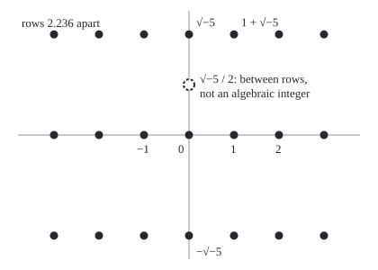

# Algebraic integers: the numbers inside a bigger field that behave like whole numbers

[Syllabus](../../../SYLLABUS.md) → [Algebraic and analytic number theory](../README.md) → [Algebraic Numbers](../README.md#s06) → Algebraic integers

---

## General Overview

The number 6 splits into primes one way: 2 × 3 ([Why the factorisation is unique](../../02-Number%20theory/02-Greatest%20Common%20Divisor%20and%20Euclid%27s%20Algorithm/07-unique-factorisation.md)). Now add one new number, $`\sqrt{-5}`$, the number whose square is −5. Then 6 also equals $`(1 + \sqrt{-5})(1 - \sqrt{-5})`$, since that product is 1 − (−5) = 6. Two different splits of the same number.

That claim only means something once "whole number" is settled in the bigger system. If fractions count, every nonzero number divides every other, and factoring says nothing. So the question comes first: among numbers like $`a + b\sqrt{-5}`$, which ones are the whole numbers?

The answer is a test. Find the simplest polynomial equation the number solves, with leading coefficient 1. If every other coefficient is a whole number, the number is an **algebraic integer**. $`\sqrt{-5}`$ solves $`x^2 + 5 = 0`$, so it passes. Its half solves $`x^2 + \tfrac{5}{4} = 0`$ at best, so it fails.

The same polynomial also describes the bigger system. The numbers $`a + b\sqrt{-5}`$, with $`a`$ and $`b`$ fractions, form a **number field**: adding, subtracting, multiplying and dividing (except by 0) never leave it. Its size, the **degree**, is 2, the degree of $`x^2 + 5`$.

**A number is an algebraic integer exactly when its minimal polynomial has whole-number coefficients, and the algebraic integers inside a number field form a ring that plays the part of the whole numbers there.**

**What kind of fact this is:** a definition (algebraic integer, number field) with two theorems, proved on this card in Why it works: the minimal polynomial alone decides the test, and the algebraic integers are closed under adding and multiplying.

### The picture: the whole numbers of the field with root minus five

<p align="center"></p>

Each dot is $`a + b\sqrt{-5}`$ with $`a`$ and $`b`$ whole, drawn in the plane of complex numbers, to scale. The rows sit $`\sqrt{5} \approx 2.236`$ apart. The hollow ring is $`\sqrt{-5}/2`$: it lies in the field but between the rows, and the test rejects it.

---

## The formula

Notation first, in words. $`\mathbb{Q}`$ is the rational numbers (fractions), $`\mathbb{Z}`$ the whole numbers, and $`\mathbb{Z}[x]`$ the polynomials in $`x`$ whose coefficients are whole numbers. A polynomial is **monic** when its leading coefficient (the number in front of the highest power) is 1.

The **minimal polynomial** $`m_\alpha(x)`$ of a number $`\alpha`$ is the monic polynomial with rational coefficients, of lowest degree, that has $`\alpha`$ as a root ([Minimal polynomials](../05-Fields%20and%20Galois%20Theory/02-minimal-polynomials-and-conjugates.md)). A number with one is **algebraic**.

```math
\alpha \text{ is an algebraic integer} \iff m_\alpha(x) \in \mathbb{Z}[x]
```

**Read it aloud:** a number is an algebraic integer exactly when its simplest monic equation has whole-number coefficients.

The usual definition asks for less: *some* monic polynomial in $`\mathbb{Z}[x]`$ with $`\alpha`$ as a root. Step 1 shows the two agree, which is what makes the test a finite check.

The field side is one more line. Adjoining $`\alpha`$ to $`\mathbb{Q}`$ gives the field $`K = \mathbb{Q}(\alpha)`$, and

```math
K = \mathbb{Q}(\alpha) = \{\, c_0 + c_1\alpha + \dots + c_{n-1}\alpha^{n-1} : c_i \in \mathbb{Q} \,\}, \qquad n = [K:\mathbb{Q}] = \deg m_\alpha
```

**Read it aloud:** the field made from $`\alpha`$ is every rational combination of its first $`n`$ powers, and $`n`$, the degree, is the degree of its minimal polynomial.

For a number $`a + b\sqrt{d}`$, with $`d`$ a whole number that is not a square and $`b \neq 0`$, the minimal polynomial comes from squaring $`x - a = b\sqrt{d}`$:

```math
m_{a + b\sqrt{d}}(x) = x^2 - 2a\,x + (a^2 - d\,b^2)
```

So the whole test, for these numbers, is two checks: $`2a`$ is whole and $`a^2 - d\,b^2`$ is whole. These two numbers are the trace and the norm of [Norm, trace and discriminant](02-norms-traces-and-discriminants.md).

| Symbol | Plain meaning | In our example | Push it up and the answer… |
| --- | --- | --- | --- |
| $`\alpha`$; $`\beta`$ | the number being tested; in Step 2, the half | $`\sqrt{-5}`$, then $`\sqrt{-5}/2`$ | — |
| $`m_\alpha(x)`$ | its minimal polynomial: monic, rational, lowest degree | $`x^2 + 5`$, then $`x^2 + \tfrac54`$ | — |
| $`\mathbb{Q}`$, $`\mathbb{Z}`$, $`\mathbb{Z}[x]`$ | fractions; whole numbers; polynomials with whole-number coefficients | $`x^2 + 5`$ is in $`\mathbb{Z}[x]`$ | — |
| $`f`$, $`g`$, $`h`$ | other polynomials, in the proofs | $`x^4 - 25`$ | — |
| $`K`$ | the number field, $`\mathbb{Q}(\alpha)`$ | all $`a + b\sqrt{-5}`$, $`a, b`$ fractions | — |
| $`n`$, $`[K:\mathbb{Q}]`$, $`\deg`$ | the degree: how many basis numbers $`K`$ needs; $`\deg`$ is a polynomial's highest power | 2: the numbers 1 and $`\sqrt{-5}`$ | more room, longer minimal polynomials |
| $`\mathcal{O}_K`$ | the ring of integers: every algebraic integer in $`K`$ | all $`a + b\sqrt{-5}`$, $`a, b`$ whole | — |
| $`d`$ | the whole number under the square root | −5 | the shape of $`\mathcal{O}_K`$ changes (Step 4) |
| $`a`$, $`b`$ | the rational coordinates of $`a + b\sqrt{d}`$ | 0 and 1, then 0 and ½ | a larger denominator usually fails the test |
| $`c_i`$ | coefficients: of a combination of powers, of a polynomial in Step 0, and the small multipliers in the 13-polynomial count | $`c_0 = a`$, $`c_1 = b`$ | — |
| $`u/v`$ | a fraction in lowest terms (Step 0 and the Gauss's lemma fold) | — | — |
| $`\varphi`$ | the golden ratio, $`(1 + \sqrt5)/2`$ | an algebraic integer of $`\mathbb{Q}(\sqrt5)`$ | — |

On notation: $`\mathcal{O}_K`$ is a script O and has nothing to do with big O. The letters $`K`$ and $`\mathcal{O}_K`$ are this card's, and the later cards on this shelf use them freely. On the minimal-polynomials card $`K`$ was the base field; from here on it is the number field, and the base is always $`\mathbb{Q}`$.

### When it holds

- **The polynomial must be monic.** Drop that and $`\sqrt{-5}/2`$ passes, since it solves $`4x^2 + 5 = 0`$. So does every fraction: $`\tfrac34`$ solves $`4x - 3 = 0`$. All 289 numbers of the test grid in Worked numbers would pass.
- **Only the minimal polynomial can say no.** $`\sqrt{-5}`$ also solves $`x^3 - \tfrac12 x^2 + 5x - \tfrac52 = 0`$, which is $`(x^2 + 5)(x - \tfrac12)`$. Its coefficients are not whole, yet $`\sqrt{-5}`$ is an algebraic integer. A non-minimal polynomial with fractions proves nothing.
- **The number must be algebraic.** $`\pi`$ solves no polynomial with rational coefficients, so it is neither an algebraic integer nor in any number field.
- **The degree comes from the minimal polynomial too.** $`\sqrt{-5}`$ solves $`x^4 - 25 = 0`$, but the field it makes has degree 2, not 4.

---

## Why it works

### Step 0: monic is the condition that gives back the ordinary whole numbers

A good definition of "integer" must agree with the old one on the fractions. Monic does that: a fraction that is a root of a monic polynomial in $`\mathbb{Z}[x]`$ is a whole number.

Take $`u/v`$ in lowest terms as a root of $`x^n + c_{n-1}x^{n-1} + \dots + c_0`$, all $`c_i`$ whole. Multiply through by $`v^n`$:

```math
u^n = -v\,(c_{n-1}u^{n-1} + c_{n-2}u^{n-2}v + \dots + c_0 v^{n-1})
```

So $`v`$ divides $`u^n`$. But $`u`$ and $`v`$ share no prime, so $`v = 1`$. This is the rational root test with leading coefficient 1.

Without "monic", $`\tfrac12`$ would count, as a root of $`2x - 1`$. With it, the algebraic integers that are fractions are exactly 0, ±1, ±2, and so on.

### Step 1: the minimal polynomial alone decides

Suppose $`\alpha`$ is a root of some monic $`f`$ in $`\mathbb{Z}[x]`$. Dividing $`f`$ by $`m_\alpha`$ leaves a remainder of lower degree with $`\alpha`$ as a root, so the remainder is 0. So $`f = m_\alpha \cdot g`$ with $`g`$ monic and rational.

Gauss's lemma then says: when a monic whole-number polynomial is a product of two monic rational ones, both have whole-number coefficients. So $`m_\alpha`$ is in $`\mathbb{Z}[x]`$. The converse is free: $`m_\alpha`$ itself is a monic polynomial with $`\alpha`$ as a root.

The practical result: one polynomial to check, instead of an endless search.

<details>
<summary>Detailed proof: Gauss's lemma for monic factors</summary>

Call a polynomial in $`\mathbb{Z}[x]`$ **primitive** when no prime divides all its coefficients. Any monic rational polynomial is $`r \cdot P`$, with $`r`$ a positive fraction and $`P`$ primitive with a positive leading coefficient.

First, a product of primitive polynomials is primitive. Take a prime $`p`$ and work with remainders after division by $`p`$. Neither factor becomes zero, and polynomials over the remainders mod $`p`$ have no zero divisors (the leading terms multiply to a nonzero leading term). So the product is not zero mod $`p`$: $`p`$ does not divide every coefficient.

Now let $`f = m \cdot g`$, all three monic, $`f`$ in $`\mathbb{Z}[x]`$. Write $`m = r P`$ and $`g = s G`$ as above. Then

$`\displaystyle f = (rs)\, P G`$

with $`PG`$ primitive. Write $`rs = u/v`$ in lowest terms. Then $`v f = u\, PG`$. Any prime dividing $`v`$ divides every coefficient of $`u\,PG`$. Since $`PG`$ is primitive, that prime divides $`u`$, which is impossible in lowest terms; so $`v = 1`$. Compare leading coefficients: the left side is 1, so $`u`$ times a positive whole number is 1, and $`u = 1`$.

So $`rs = 1`$. The leading coefficient of $`m`$ is 1, so $`r`$ times the leading coefficient of $`P`$ is 1, and $`1/r`$ is a whole number. In the same way $`1/s`$ is whole. Their product is $`1/(rs) = 1`$, so both are 1. Hence $`m = P`$ and $`g = G`$, both in $`\mathbb{Z}[x]`$.

</details>

### Step 2: the test on the two examples

**$`\sqrt{-5}`$.** Here $`a = 0`$, $`b = 1`$, $`d = -5`$. The minimal polynomial is $`x^2 - 0x + (0 + 5) = x^2 + 5`$. Both coefficients are whole: an algebraic integer.

**$`\sqrt{-5}/2`$.** Here $`b = \tfrac12`$. The minimal polynomial is $`x^2 + \tfrac54`$. The constant is not whole: not an algebraic integer, by Step 1.

A second road reaches the same "no" without Gauss's lemma. Call the half $`\beta = \sqrt{-5}/2`$. Its square is $`-\tfrac54`$. If $`\beta`$ solves a monic $`f`$ in $`\mathbb{Z}[x]`$, then $`f(x)f(-x)`$ contains only even powers of $`x`$, so it is $`\pm h(x^2)`$ for a monic $`h`$ in $`\mathbb{Z}[x]`$, and $`h(\beta^2) = 0`$. So $`-\tfrac54`$ would be a fraction solving a monic whole-number polynomial, which Step 0 forbids.

### Step 3: the number field, by degree and generator

The field $`\mathbb{Q}(\sqrt{-5})`$ needs only two basis numbers, 1 and $`\sqrt{-5}`$. Every higher power folds back: $`\sqrt{-5}^{\,2} = -5`$, $`\sqrt{-5}^{\,3} = -5\sqrt{-5}`$, $`\sqrt{-5}^{\,4} = 25`$. Division stays inside too:

```math
\frac{1}{a + b\sqrt{-5}} = \frac{a - b\sqrt{-5}}{a^2 + 5b^2}
```

The bottom is a positive fraction unless $`a = b = 0`$. So $`K = \{a + b\sqrt{-5}\}`$ is a field of degree 2 over $`\mathbb{Q}`$.

In general, $`\alpha^n`$ is a rational combination of lower powers, because $`m_\alpha(\alpha) = 0`$. No shorter combination vanishes, because $`m_\alpha`$ has the lowest degree. So $`1, \alpha, \dots, \alpha^{n-1}`$ is a basis and the degree is $`n`$ ([Minimal polynomials](../05-Fields%20and%20Galois%20Theory/02-minimal-polynomials-and-conjugates.md) gives the details).

A number field is a field of finite degree over $`\mathbb{Q}`$. One generator always suffices for it (the primitive element theorem of [Normal and separable](../05-Fields%20and%20Galois%20Theory/04-normal-and-separable-extensions.md)), and the field does not care which. $`\sqrt{-5}/2`$ and $`1 + \sqrt{-5}`$ generate the same field, since $`\sqrt{-5} = 2 \cdot (\sqrt{-5}/2) = (1 + \sqrt{-5}) - 1`$. All three minimal polynomials have degree 2. The field ignores scaling by fractions; the integer test does not.

### Step 4: the algebraic integers form a ring

The sum and product of two algebraic integers are algebraic integers. So the algebraic integers inside $`K`$ form a ring ([Rings](../../03-Algebra/09-Rings%20and%20Fields/01-rings.md)): the **ring of integers** $`\mathcal{O}_K`$. This is the system in which factoring makes sense.

<details>
<summary>Detailed proof: sums and products stay algebraic integers</summary>

**Matrices instead of polynomials.** A number $`\alpha`$ is an algebraic integer exactly when it is an eigenvalue of a square matrix of whole numbers. (An eigenvalue of $`A`$ is a number $`\lambda`$ with $`Av = \lambda v`$ for some nonzero vector $`v`$, so it solves $`\det(xI - A) = 0`$.) One way: the polynomial $`\det(xI - A)`$ of a whole-number matrix $`A`$ is monic with whole coefficients. The other way: if $`\alpha`$ solves $`x^n + c_{n-1}x^{n-1} + \dots + c_0`$, the $`n \times n`$ companion matrix (1s just below the diagonal, last column $`-c_0, \dots, -c_{n-1}`$) has $`\alpha`$ as an eigenvalue. For $`x^2 + 5`$ it is `[[0, -5], [1, 0]]`.

**Combining eigenvectors.** Let $`Av = \alpha v`$ and $`Bw = \beta w`$, with $`A`$ of size $`n`$ and $`B`$ of size $`k`$. Build the $`nk`$ numbers $`v_i w_j`$ into one vector $`u`$. The matrix with entries $`A_{ii'}B_{jj'}`$ sends $`u`$ to $`\alpha\beta\, u`$. The matrix with entries $`A_{ii'}[j = j'] + [i = i']B_{jj'}`$ sends $`u`$ to $`(\alpha + \beta)\, u`$. Here $`[j = j']`$ is 1 when the indices match and 0 otherwise.

Both matrices have whole-number entries. So $`\alpha\beta`$ and $`\alpha + \beta`$ are eigenvalues of whole-number matrices, hence algebraic integers. Negatives are immediate: $`-\alpha`$ is an eigenvalue of $`-A`$.

</details>

**Which ring, for $`d = -5`$.** Put $`a + b\sqrt{-5}`$ through the two checks: $`2a`$ whole and $`a^2 + 5b^2`$ whole. If $`a`$ is whole, then $`5b^2`$ is whole, which forces $`b`$ whole. If $`a`$ is an odd number of halves, the second check needs $`b`$ to be an odd number of halves too, and then $`a^2 + 5b^2`$ is an odd square plus 5 times an odd square, over 4. That top is 6 more than a multiple of 8, so the fraction is not whole. Hence

```math
\mathcal{O}_K = \mathbb{Z}[\sqrt{-5}] = \{\, a + b\sqrt{-5} : a, b \in \mathbb{Z} \,\}
```

These are exactly the dots in the picture. The card [Rings of integers](03-rings-of-integers-and-integral-bases.md) does this for every $`d`$. It finds the surprise when $`d`$ leaves remainder 1 after division by 4: then halves get in. The golden ratio $`(1 + \sqrt5)/2`$ solves $`x^2 - x - 1 = 0`$, so it is an algebraic integer.

---

## Worked numbers, by hand

| Step | Arithmetic | Value |
| --- | --- | --- |
| square the first number | $`\sqrt{-5}^{\,2}`$ | −5 |
| its minimal polynomial | $`x^2 - 2(0)x + (0^2 + 5 \cdot 1^2)`$ | $`x^2 + 5`$ |
| coefficients whole? | 0 and 5 | **yes: an algebraic integer** |
| square the half | $`(\sqrt{-5}/2)^2 = -5/4`$ | −5/4 |
| its minimal polynomial | $`x^2 - 0x + (0 + 5 \cdot \tfrac14)`$ | $`x^2 + \tfrac54`$ |
| coefficients whole? | 5/4 is not | **no** |
| the field | basis 1 and $`\sqrt{-5}`$; powers fold back via $`\sqrt{-5}^{\,2} = -5`$ | degree **2** |
| a third number | $`1 + \sqrt{-5}`$: $`x^2 - 2x + (1 + 5)`$ | $`x^2 - 2x + 6`$, yes |
| the house example | $`2 \times 3`$ and $`(1 + \sqrt{-5})(1 - \sqrt{-5}) = 1 + 5`$ | **6 both ways** |

$`\sqrt{-5}`$ is a whole number of the field $`\mathbb{Q}(\sqrt{-5})`$, its half is a fraction there, and inside the ring of whole numbers 6 has two different factorisations.

A brute-force count backs this up. Among all monic whole-number polynomials of degree 1 to 4 with coefficients from −6 to 6, exactly 13 have $`\sqrt{-5}`$ as a root, and none has $`\sqrt{-5}/2`$. The 13 are predicted in advance: $`x^2 + 5`$ times 1, times $`x + c_0`$, or times $`x^2 + c_1 x + c_0`$, with each $`c_i`$ equal to −1, 0 or 1 to keep the coefficients in range. That is 1 + 3 + 9.

Then a whole grid. Take every $`a + b\sqrt{d}`$ with $`a`$ and $`b`$ in quarters from −2 to 2: 17 × 17 = 289 numbers.

| Grid of 289 numbers | Minimal-polynomial test | Search, monic of degree 1 or 2 | Whole $`a`$ and $`b`$ |
| --- | ---: | ---: | ---: |
| $`d = -5`$ | 25 | 25 | 25 |
| $`d = 5`$ | 41 | 41 | 25 |

For $`d = -5`$ all three agree: the algebraic integers are exactly the 25 whole-coordinate points. For $`d = 5`$ the 16 extra are the points with both coordinates an odd number of halves, such as the golden ratio.

The search is evidence inside a box; the proof is Step 4. The house example gets the same treatment: in the box $`|a|, |b| \le 6`$, each of 2, 3 and $`1 + \sqrt{-5}`$ has exactly 4 factor pairs, and every pair uses 1 or −1. Why no proper split exists anywhere is the norm argument of [Norm, trace and discriminant](02-norms-traces-and-discriminants.md).

### What breaks if you drop a piece

| Mistake | Comes out at | What went wrong |
| --- | --- | --- |
| Accept any whole-number polynomial, monic or not | all 289 grid numbers pass, $`\sqrt{-5}/2`$ included | clearing denominators makes every fraction pass |
| Judge $`\sqrt{-5}`$ by $`x^3 - \tfrac12 x^2 + 5x - \tfrac52`$ | "not an integer" | that polynomial is $`(x^2 + 5)(x - \tfrac12)`$, not minimal |
| Read the degree off $`x^4 - 25`$ | degree 4 | the minimal polynomial $`x^2 + 5`$ has degree 2 |
| Take whole coordinates as the rule for $`d = 5`$ | 25 integers in the grid | the true count is 41: $`(1 + \sqrt5)/2`$ and its kind get in |

The code prints all four.

---

## Code, from first principles, and it actually runs

Both programs store $`a + b\sqrt{d}`$ as a pair of exact fractions and multiply with $`\sqrt{d}^{\,2} = d`$; nothing imported knows about algebraic numbers. They take **two independent roads** to every verdict. Road 1 writes down the minimal polynomial $`x^2 - 2a\,x + (a^2 - d\,b^2)`$ and checks its coefficients. Road 2 never forms a minimal polynomial: it evaluates every monic whole-number polynomial in a box, exactly, and records which ones vanish. Along the way they check the 13-polynomial prediction, the grid counts against the whole-coordinate rule, the house example, every row of What breaks, and one use of Step 4 (the Lucas numbers, in Where you meet it).

### Python

```python
# Algebraic integers in Q(sqrt d): a number a + b*sqrt(d) is stored as the pair (a, b) of fractions.
from fractions import Fraction as F
from itertools import product
from math import gcd

def mul(x, y, d):
    return (x[0] * y[0] + d * x[1] * y[1], x[0] * y[1] + x[1] * y[0])

def show(cs):
    """A polynomial, highest power first, written out: [1, -2, 6] -> x^2 - 2x + 6."""
    out, n = "", len(cs) - 1
    for i, c in enumerate(cs):
        c, e = F(c), n - i
        if c == 0:
            continue
        mono = "" if e == 0 else "x" if e == 1 else f"x^{e}"
        num = "" if e > 0 and abs(c) == 1 else f"({abs(c)})" if e > 0 and c.denominator > 1 else str(abs(c))
        out += ("-" if c < 0 else "") + num + mono if not out else (" - " if c < 0 else " + ") + num + mono
    return out

def root_of(coeffs, x, d):
    """Road 2's tool: evaluate a polynomial (highest power first) at x exactly, by Horner's rule."""
    acc = (F(0), F(0))
    for c in coeffs:
        acc = mul(acc, x, d)
        acc = (acc[0] + c, acc[1])
    return acc == (0, 0)

def minpoly(a, b, d):
    """Road 1: the monic minimal polynomial over Q, from (x - a)^2 = d b^2."""
    if b == 0:
        return [F(1), -a]
    return [F(1), -2 * a, a * a - d * b * b]

def road1(a, b, d):
    return all(c.denominator == 1 for c in minpoly(a, b, d))

def search(x, d, deg, h):
    """Road 2: every monic integer polynomial of degree 1..deg, coefficients -h..h, with x as a root."""
    found = []
    for n in range(1, deg + 1):
        for cs in product(range(-h, h + 1), repeat=n):
            if root_of([1, *cs], x, d):
                found.append([1, *cs])
    return found

D = -5
r5, half = (F(0), F(1)), (F(0), F(1, 2))
print("the field Q(sqrt -5): generator sqrt(-5), basis 1, sqrt(-5)")
for name, (a, b) in [("sqrt(-5)", r5), ("sqrt(-5)/2", half), ("1 + sqrt(-5)", (F(1), F(1)))]:
    m = minpoly(a, b, D)
    print(f"{name}: minimal polynomial {show(m)}, degree {len(m) - 1}, algebraic integer {road1(a, b, D)}")
assert road1(*r5, D) and not road1(*half, D)
p = (F(1), F(0))
pw = []
for k in range(5):
    pw.append(p)
    p = mul(p, r5, D)
print("powers of sqrt(-5) as (a, b):", ", ".join(f"({a}, {b})" for a, b in pw))
assert pw[2] == (-5, 0) and pw[3] == (0, -5), "sqrt(-5)^2 = -5 keeps every power in degree 2"

# Road 2: brute-force search, degree up to 4, coefficients -H..H
H = 6
f5, fh = search(r5, D, 4, H), search(half, D, 4, H)
print(f"monic integer polys, degree <= 4, coefficients -{H}..{H}: {len(f5)} have root sqrt(-5), {len(fh)} have root sqrt(-5)/2")
print("  the shortest one for sqrt(-5):", show(min(f5, key=len)))
small = range(-(H // 5), H // 5 + 1)   # 5*c0 and 5*c1 must stay within -H..H
predicted = len(small) ** 2 + len(small) + 1   # (x^2+5)(x^2+c1*x+c0), (x^2+5)(x+c0), x^2+5
print(f"  predicted from multiples of x^2 + 5: 1 + {len(small)} + {len(small) ** 2} = {predicted}")
assert len(f5) == predicted and fh == [], "every hit is a multiple of x^2 + 5; the half has none"
sq = mul(half, half, D)
hits = search(sq, D, 3, 6)
print(f"(sqrt(-5)/2)^2 = {sq[0]}; monic integer polys, degree <= 3, coefficients -6..6, with that root: {len(hits)}")
assert sq == (F(-5, 4), 0) and hits == []

# The grid: a, b in quarters from -2 to 2, so 289 numbers a + b*sqrt(d)
grid = [F(k, 4) for k in range(-8, 9)]
polys = [[1, c] for c in range(-2, 3)] + [[1, p_, q] for p_ in range(-4, 5) for q in range(-24, 25)]
for d in (-5, 5):
    r1 = [(a, b) for a in grid for b in grid if road1(a, b, d)]
    r2 = [(a, b) for a in grid for b in grid if any(root_of(c, (a, b), d) for c in polys)]
    coords = [(a, b) for a in grid for b in grid if a.denominator == 1 and b.denominator == 1]
    print(f"d = {d}: grid {len(grid)} x {len(grid)} = {len(grid) ** 2}, road 1 (minimal polynomial) {len(r1)}, "
          f"road 2 (search) {len(r2)}, whole a and b {len(coords)}, extra {len(r1) - len(coords)}")
    assert r1 == r2
    assert (len(r1) == len(coords)) == (d == -5), "Z[sqrt -5] is everything for d = -5, not for d = 5"
phi = (F(1, 2), F(1, 2))
print(f"golden ratio (1 + sqrt 5)/2: minimal polynomial {show(minpoly(*phi, 5))}, algebraic integer {road1(*phi, 5)}")

# The house example: 6 two ways, and no proper split of 2, 3 or 1 + sqrt(-5) in a box
print("2 x 3 =", mul((F(2), F(0)), (F(3), F(0)), D)[0], "; (1 + sqrt-5)(1 - sqrt-5) =", mul((F(1), F(1)), (F(1), F(-1)), D)[0])
box = [(F(a), F(b)) for a in range(-6, 7) for b in range(-6, 7)]
for name, t in [("2", (F(2), F(0))), ("3", (F(3), F(0))), ("1 + sqrt(-5)", (F(1), F(1)))]:
    pairs = [(x, y) for x in box for y in box if mul(x, y, D) == t]
    trivial = all(x in [(1, 0), (-1, 0)] or y in [(1, 0), (-1, 0)] for x, y in pairs)
    print(f"factor pairs of {name} with |a|, |b| <= 6: {len(pairs)}, every one uses 1 or -1: {trivial}")
    assert len(pairs) == 4 and trivial

# What breaks
def cleared(a, b, d):   # the minimal polynomial times the lcm of its denominators: integer, not monic
    m = minpoly(a, b, d)
    k = 1
    for c in m:
        k = k * c.denominator // gcd(k, c.denominator)
    return [c * k for c in m]
nonmonic = sum(1 for a in grid for b in grid
               if all(c.denominator == 1 for c in cleared(a, b, D)) and root_of(cleared(a, b, D), (a, b), D))
print("accept any integer polynomial, monic or not: grid numbers passing", nonmonic)
wrong = [F(1), F(-1, 2), F(5), F(-5, 2)]         # (x^2 + 5)(x - 1/2)
print(f"sqrt(-5) is a root of {show(wrong)}: {root_of(wrong, r5, D)}; judged by it, not an integer")
assert root_of(wrong, r5, D) and not all(c.denominator == 1 for c in wrong)
x4 = [1, 0, 0, 0, -25]
print("degree read off x^4 - 25:", len(x4) - 1, "; true degree", len(minpoly(*r5, D)) - 1)
assert root_of(x4, r5, D) and nonmonic == len(grid) ** 2

# The ring property at work: phi^n + (1 - phi)^n is rational, so it is whole (the Lucas numbers)
x, y = (F(1), F(0)), (F(1), F(0))
for n in range(10):
    x, y = mul(x, phi, 5), mul(y, (F(1, 2), F(-1, 2)), 5)
s = (x[0] + y[0], x[1] + y[1])
lucas = [2, 1]
while len(lucas) < 11:
    lucas.append(lucas[-1] + lucas[-2])
print("phi^10 + (1 - phi)^10 =", s[0], "+", s[1], "sqrt 5; the whole-number recurrence 2, 1, 3, 4, ... gives", lucas[10])
assert s == (lucas[10], 0)
print(f"figure, sqrt(-5) at (0, {5 ** 0.5:.6f}), sqrt(-5)/2 at (0, {5 ** 0.5 / 2:.6f})")
print("ALL CHECKS PASS")
```

**Ran 2026-11-15 on macOS, Python 3.14.10, standard library only. All checks passed. Output, pasted from the run:**

```
the field Q(sqrt -5): generator sqrt(-5), basis 1, sqrt(-5)
sqrt(-5): minimal polynomial x^2 + 5, degree 2, algebraic integer True
sqrt(-5)/2: minimal polynomial x^2 + 5/4, degree 2, algebraic integer False
1 + sqrt(-5): minimal polynomial x^2 - 2x + 6, degree 2, algebraic integer True
powers of sqrt(-5) as (a, b): (1, 0), (0, 1), (-5, 0), (0, -5), (25, 0)
monic integer polys, degree <= 4, coefficients -6..6: 13 have root sqrt(-5), 0 have root sqrt(-5)/2
  the shortest one for sqrt(-5): x^2 + 5
  predicted from multiples of x^2 + 5: 1 + 3 + 9 = 13
(sqrt(-5)/2)^2 = -5/4; monic integer polys, degree <= 3, coefficients -6..6, with that root: 0
d = -5: grid 17 x 17 = 289, road 1 (minimal polynomial) 25, road 2 (search) 25, whole a and b 25, extra 0
d = 5: grid 17 x 17 = 289, road 1 (minimal polynomial) 41, road 2 (search) 41, whole a and b 25, extra 16
golden ratio (1 + sqrt 5)/2: minimal polynomial x^2 - x - 1, algebraic integer True
2 x 3 = 6 ; (1 + sqrt-5)(1 - sqrt-5) = 6
factor pairs of 2 with |a|, |b| <= 6: 4, every one uses 1 or -1: True
factor pairs of 3 with |a|, |b| <= 6: 4, every one uses 1 or -1: True
factor pairs of 1 + sqrt(-5) with |a|, |b| <= 6: 4, every one uses 1 or -1: True
accept any integer polynomial, monic or not: grid numbers passing 289
sqrt(-5) is a root of x^3 - (1/2)x^2 + 5x - 5/2: True; judged by it, not an integer
degree read off x^4 - 25: 4 ; true degree 2
phi^10 + (1 - phi)^10 = 123 + 0 sqrt 5; the whole-number recurrence 2, 1, 3, 4, ... gives 123
figure, sqrt(-5) at (0, 2.236068), sqrt(-5)/2 at (0, 1.118034)
ALL CHECKS PASS
```

### Rust

```rust
// Algebraic integers in Q(sqrt d): a number a + b*sqrt(d) is stored as the pair (a, b) of fractions.
use std::fmt;

#[derive(Clone, Copy, PartialEq, Debug)]
struct Q { n: i128, d: i128 } // a fraction in lowest terms, denominator positive

fn gcd(a: i128, b: i128) -> i128 { if b == 0 { a.abs() } else { gcd(b, a % b) } }
fn q(n: i128, d: i128) -> Q {
    let g = gcd(n, d).max(1);
    let s = if d < 0 { -1 } else { 1 };
    Q { n: s * n / g, d: s * d / g }
}
fn z(n: i128) -> Q { q(n, 1) }
impl Q {
    fn add(self, o: Q) -> Q {
        q(self.n.checked_mul(o.d).unwrap().checked_add(o.n.checked_mul(self.d).unwrap()).unwrap(), self.d.checked_mul(o.d).unwrap())
    }
    fn mul(self, o: Q) -> Q { q(self.n.checked_mul(o.n).unwrap(), self.d.checked_mul(o.d).unwrap()) }
    fn neg(self) -> Q { Q { n: -self.n, d: self.d } }
    fn abs(self) -> Q { Q { n: self.n.abs(), d: self.d } }
    fn whole(self) -> bool { self.d == 1 }
}
impl fmt::Display for Q {
    fn fmt(&self, f: &mut fmt::Formatter) -> fmt::Result {
        if self.d == 1 { write!(f, "{}", self.n) } else { write!(f, "{}/{}", self.n, self.d) }
    }
}
type E = (Q, Q);

fn mul(x: E, y: E, d: i128) -> E {
    (x.0.mul(y.0).add(z(d).mul(x.1).mul(y.1)), x.0.mul(y.1).add(x.1.mul(y.0)))
}
fn show(cs: &[Q]) -> String {
    // A polynomial, highest power first, written out: [1, -2, 6] -> x^2 - 2x + 6.
    let (mut out, n) = (String::new(), cs.len() - 1);
    for (i, &c) in cs.iter().enumerate() {
        let e = n - i;
        if c.n == 0 { continue; }
        let mono = if e == 0 { String::new() } else if e == 1 { "x".to_string() } else { format!("x^{}", e) };
        let a = c.abs();
        let num = if e > 0 && a == z(1) { String::new() } else if e > 0 && a.d > 1 { format!("({})", a) } else { a.to_string() };
        let sign = if out.is_empty() { if c.n < 0 { "-" } else { "" } } else if c.n < 0 { " - " } else { " + " };
        out += &format!("{}{}{}", sign, num, mono);
    }
    out
}
fn root_of(cs: &[Q], x: E, d: i128) -> bool {
    // Road 2's tool: evaluate a polynomial (highest power first) at x exactly, by Horner's rule.
    let mut acc = (z(0), z(0));
    for &c in cs { acc = mul(acc, x, d); acc = (acc.0.add(c), acc.1); }
    acc == (z(0), z(0))
}
fn minpoly(a: Q, b: Q, d: i128) -> Vec<Q> {
    // Road 1: the monic minimal polynomial over Q, from (x - a)^2 = d b^2.
    if b.n == 0 { return vec![z(1), a.neg()]; }
    vec![z(1), z(-2).mul(a), a.mul(a).add(z(-d).mul(b).mul(b))]
}
fn road1(a: Q, b: Q, d: i128) -> bool { minpoly(a, b, d).iter().all(|c| c.whole()) }
fn search(x: E, d: i128, deg: usize, h: i128) -> Vec<Vec<Q>> {
    // Road 2: every monic integer polynomial of degree 1..deg, coefficients -h..h, with x as a root.
    let mut found = vec![];
    for n in 1..=deg {
        let w = (2 * h + 1) as usize;
        for code in 0..w.pow(n as u32) {
            let mut cs = vec![z(1)];
            let mut k = code;
            let mut tail = vec![];
            for _ in 0..n { tail.push(z((k % w) as i128 - h)); k /= w; }
            tail.reverse();
            cs.extend(tail);
            if root_of(&cs, x, d) { found.push(cs); }
        }
    }
    found
}
fn tf(b: bool) -> &'static str { if b { "True" } else { "False" } }
fn zs(v: &[i128]) -> Vec<Q> { v.iter().map(|&n| z(n)).collect() }

fn main() {
    let dd = -5;
    let (r5, half) = ((z(0), z(1)), (z(0), q(1, 2)));
    println!("the field Q(sqrt -5): generator sqrt(-5), basis 1, sqrt(-5)");
    for (name, (a, b)) in [("sqrt(-5)", r5), ("sqrt(-5)/2", half), ("1 + sqrt(-5)", (z(1), z(1)))] {
        let m = minpoly(a, b, dd);
        println!("{}: minimal polynomial {}, degree {}, algebraic integer {}", name, show(&m), m.len() - 1, tf(road1(a, b, dd)));
    }
    assert!(road1(r5.0, r5.1, dd) && !road1(half.0, half.1, dd));
    let mut p = (z(1), z(0));
    let mut pw = vec![];
    for _ in 0..5 { pw.push(p); p = mul(p, r5, dd); }
    println!("powers of sqrt(-5) as (a, b): {}", pw.iter().map(|(a, b)| format!("({}, {})", a, b)).collect::<Vec<_>>().join(", "));
    assert!(pw[2] == (z(-5), z(0)) && pw[3] == (z(0), z(-5)), "sqrt(-5)^2 = -5 keeps every power in degree 2");

    // Road 2: brute-force search, degree up to 4, coefficients -H..H
    let h = 6;
    let (f5, fh) = (search(r5, dd, 4, h), search(half, dd, 4, h));
    println!("monic integer polys, degree <= 4, coefficients -{}..{}: {} have root sqrt(-5), {} have root sqrt(-5)/2", h, h, f5.len(), fh.len());
    println!("  the shortest one for sqrt(-5): {}", show(f5.iter().min_by_key(|c| c.len()).unwrap()));
    let small = (2 * (h / 5) + 1) as usize; // 5*c0 and 5*c1 must stay within -H..H
    let predicted = small * small + small + 1; // (x^2+5)(x^2+c1*x+c0), (x^2+5)(x+c0), x^2+5
    println!("  predicted from multiples of x^2 + 5: 1 + {} + {} = {}", small, small * small, predicted);
    assert!(f5.len() == predicted && fh.is_empty(), "every hit is a multiple of x^2 + 5; the half has none");
    let sq = mul(half, half, dd);
    let hits = search(sq, dd, 3, 6);
    println!("(sqrt(-5)/2)^2 = {}; monic integer polys, degree <= 3, coefficients -6..6, with that root: {}", sq.0, hits.len());
    assert!(sq == (q(-5, 4), z(0)) && hits.is_empty());

    // The grid: a, b in quarters from -2 to 2, so 289 numbers a + b*sqrt(d)
    let grid: Vec<Q> = (-8..=8).map(|k| q(k, 4)).collect();
    let mut polys: Vec<Vec<Q>> = (-2..=2).map(|c| zs(&[1, c])).collect();
    for p_ in -4..=4 { for c in -24..=24 { polys.push(zs(&[1, p_, c])); } }
    for d in [-5i128, 5] {
        let (mut r1, mut r2, mut coords) = (vec![], vec![], 0);
        for &a in &grid { for &b in &grid {
            if road1(a, b, d) { r1.push((a, b)); }
            if polys.iter().any(|c| root_of(c, (a, b), d)) { r2.push((a, b)); }
            if a.whole() && b.whole() { coords += 1; }
        } }
        println!("d = {}: grid {} x {} = {}, road 1 (minimal polynomial) {}, road 2 (search) {}, whole a and b {}, extra {}",
                 d, grid.len(), grid.len(), grid.len() * grid.len(), r1.len(), r2.len(), coords, r1.len() - coords);
        assert_eq!(r1, r2);
        assert!((r1.len() == coords) == (d == -5), "Z[sqrt -5] is everything for d = -5, not for d = 5");
    }
    let phi = (q(1, 2), q(1, 2));
    println!("golden ratio (1 + sqrt 5)/2: minimal polynomial {}, algebraic integer {}", show(&minpoly(phi.0, phi.1, 5)), tf(road1(phi.0, phi.1, 5)));

    // The house example: 6 two ways, and no proper split of 2, 3 or 1 + sqrt(-5) in a box
    println!("2 x 3 = {} ; (1 + sqrt-5)(1 - sqrt-5) = {}", mul((z(2), z(0)), (z(3), z(0)), dd).0, mul((z(1), z(1)), (z(1), z(-1)), dd).0);
    let mut bx = vec![];
    for a in -6..=6 { for b in -6..=6 { bx.push((z(a), z(b))); } }
    let unit = |x: &E| *x == (z(1), z(0)) || *x == (z(-1), z(0));
    for (name, t) in [("2", (z(2), z(0))), ("3", (z(3), z(0))), ("1 + sqrt(-5)", (z(1), z(1)))] {
        let mut pairs = vec![];
        for &x in &bx { for &y in &bx { if mul(x, y, dd) == t { pairs.push((x, y)); } } }
        let trivial = pairs.iter().all(|(x, y)| unit(x) || unit(y));
        println!("factor pairs of {} with |a|, |b| <= 6: {}, every one uses 1 or -1: {}", name, pairs.len(), tf(trivial));
        assert!(pairs.len() == 4 && trivial);
    }

    // What breaks
    let cleared = |a: Q, b: Q| -> Vec<Q> {
        // the minimal polynomial times the lcm of its denominators: integer, not monic
        let m = minpoly(a, b, dd);
        let k = m.iter().fold(1, |k, c| k * c.d / gcd(k, c.d));
        m.iter().map(|c| c.mul(z(k))).collect()
    };
    let mut nonmonic = 0;
    for &a in &grid { for &b in &grid {
        let c = cleared(a, b);
        if c.iter().all(|v| v.whole()) && root_of(&c, (a, b), dd) { nonmonic += 1; }
    } }
    println!("accept any integer polynomial, monic or not: grid numbers passing {}", nonmonic);
    let wrong = [z(1), q(-1, 2), z(5), q(-5, 2)]; // (x^2 + 5)(x - 1/2)
    println!("sqrt(-5) is a root of {}: {}; judged by it, not an integer", show(&wrong), tf(root_of(&wrong, r5, dd)));
    assert!(root_of(&wrong, r5, dd) && !wrong.iter().all(|c| c.whole()));
    let x4 = zs(&[1, 0, 0, 0, -25]);
    println!("degree read off x^4 - 25: {} ; true degree {}", x4.len() - 1, minpoly(r5.0, r5.1, dd).len() - 1);
    assert!(root_of(&x4, r5, dd) && nonmonic == grid.len() * grid.len());

    // The ring property at work: phi^n + (1 - phi)^n is rational, so it is whole (the Lucas numbers)
    let (mut x, mut y) = ((z(1), z(0)), (z(1), z(0)));
    for _ in 0..10 { x = mul(x, phi, 5); y = mul(y, (q(1, 2), q(-1, 2)), 5); }
    let s = (x.0.add(y.0), x.1.add(y.1));
    let mut lucas = vec![2i128, 1];
    while lucas.len() < 11 { let n = lucas.len(); lucas.push(lucas[n - 1] + lucas[n - 2]); }
    println!("phi^10 + (1 - phi)^10 = {} + {} sqrt 5; the whole-number recurrence 2, 1, 3, 4, ... gives {}", s.0, s.1, lucas[10]);
    assert!(s == (z(lucas[10]), z(0)));
    println!("figure, sqrt(-5) at (0, {:.6}), sqrt(-5)/2 at (0, {:.6})", 5f64.sqrt(), 5f64.sqrt() / 2.0);
    println!("ALL CHECKS PASS");
}
```

**Ran 2026-11-15 on macOS, rustc 1.98.1, no crates. All checks passed. Output, pasted from the run:**

```
the field Q(sqrt -5): generator sqrt(-5), basis 1, sqrt(-5)
sqrt(-5): minimal polynomial x^2 + 5, degree 2, algebraic integer True
sqrt(-5)/2: minimal polynomial x^2 + 5/4, degree 2, algebraic integer False
1 + sqrt(-5): minimal polynomial x^2 - 2x + 6, degree 2, algebraic integer True
powers of sqrt(-5) as (a, b): (1, 0), (0, 1), (-5, 0), (0, -5), (25, 0)
monic integer polys, degree <= 4, coefficients -6..6: 13 have root sqrt(-5), 0 have root sqrt(-5)/2
  the shortest one for sqrt(-5): x^2 + 5
  predicted from multiples of x^2 + 5: 1 + 3 + 9 = 13
(sqrt(-5)/2)^2 = -5/4; monic integer polys, degree <= 3, coefficients -6..6, with that root: 0
d = -5: grid 17 x 17 = 289, road 1 (minimal polynomial) 25, road 2 (search) 25, whole a and b 25, extra 0
d = 5: grid 17 x 17 = 289, road 1 (minimal polynomial) 41, road 2 (search) 41, whole a and b 25, extra 16
golden ratio (1 + sqrt 5)/2: minimal polynomial x^2 - x - 1, algebraic integer True
2 x 3 = 6 ; (1 + sqrt-5)(1 - sqrt-5) = 6
factor pairs of 2 with |a|, |b| <= 6: 4, every one uses 1 or -1: True
factor pairs of 3 with |a|, |b| <= 6: 4, every one uses 1 or -1: True
factor pairs of 1 + sqrt(-5) with |a|, |b| <= 6: 4, every one uses 1 or -1: True
accept any integer polynomial, monic or not: grid numbers passing 289
sqrt(-5) is a root of x^3 - (1/2)x^2 + 5x - 5/2: True; judged by it, not an integer
degree read off x^4 - 25: 4 ; true degree 2
phi^10 + (1 - phi)^10 = 123 + 0 sqrt 5; the whole-number recurrence 2, 1, 3, 4, ... gives 123
figure, sqrt(-5) at (0, 2.236068), sqrt(-5)/2 at (0, 1.118034)
ALL CHECKS PASS
```

### Lean

Lean proves the test, the ring rule and the degree rule in general, and checks the sums behind the worked numbers.

- Take an algebraic number $`\alpha`$. Then $`\alpha`$ is an algebraic integer exactly when every coefficient of $`m_\alpha(x)`$ is a whole number.
- Take two algebraic integers in a number field $`K`$. Then their sum and their product are algebraic integers too, as in Step 4.
- Take an algebraic number $`\alpha`$. Then the degree of $`\mathbb{Q}(\alpha)`$ is the degree of $`m_\alpha(x)`$, as in Step 3.
- In $`\mathbb{Z}[\sqrt{-5}]`$, the product $`(1 + \sqrt{-5})(1 - \sqrt{-5})`$ is 6.
- The formula gives whole coefficients for $`\sqrt{-5}`$ (0 and 5) and for $`1 + \sqrt{-5}`$ (−2 and 6).
- For $`\sqrt{-5}/2`$ it gives the constant $`\tfrac54`$, and no whole number equals $`\tfrac54`$.
- Take $`a`$ and $`b`$ odd, each from 0 to 7. Then $`a^2 + 5b^2`$ leaves remainder 6 after division by 8.
- Take $`a = b = \tfrac12`$ and $`d = 5`$. Then $`-2a = -1`$ and $`a^2 - d\,b^2 = -1`$, which gives $`x^2 - x - 1`$.
- The counts add up: 1 + 3 + 9 = 13, 17 × 17 = 289 and 25 + 16 = 41.

Computing minimal polynomials, the searches that find 13 and 0 polynomials, and the 289-number grid are left to the Python and Rust checks.

```lean
-- Algebraic integers: a number is an algebraic integer exactly when its minimal polynomial has whole-number coefficients, the algebraic integers of a number field are closed under adding and multiplying, and the field made from a number has the degree of its minimal polynomial.
import Mathlib.FieldTheory.Minpoly.IsIntegrallyClosed
import Mathlib.FieldTheory.IntermediateField.Adjoin.Basic
import Mathlib.NumberTheory.NumberField.Basic
import Mathlib.NumberTheory.Zsqrtd.Basic
import Mathlib.Tactic.NormNum

open Polynomial IntermediateField

/-- The card's test: an algebraic number `α` (one that solves some nonzero polynomial with
rational coefficients) is an algebraic integer, meaning a root of some monic polynomial with
whole-number coefficients, exactly when every coefficient of its minimal polynomial over `ℚ`
is a whole number. -/
theorem isIntegral_iff_minpoly_coeffs_int {L : Type*} [Field L] [CharZero L] (α : L)
    (hα : IsAlgebraic ℚ α) :
    IsIntegral ℤ α ↔ ∀ n : ℕ, ∃ z : ℤ, (minpoly ℚ α).coeff n = (z : ℚ) := by
  have hint : IsIntegral ℚ α := hα.isIntegral
  constructor
  · intro h n
    rw [minpoly.isIntegrallyClosed_eq_field_fractions' ℚ h, Polynomial.coeff_map]
    exact ⟨(minpoly ℤ α).coeff n, rfl⟩
  · intro h
    have hl : minpoly ℚ α ∈ Polynomial.lifts (algebraMap ℤ ℚ) := by
      rw [Polynomial.lifts_iff_coeff_lifts]
      intro n
      obtain ⟨z, hz⟩ := h n
      exact ⟨z, by rw [hz]; rfl⟩
    obtain ⟨q, hq, -, hmon⟩ :=
      Polynomial.lifts_and_degree_eq_and_monic hl (minpoly.monic hint)
    refine ⟨q, hmon, ?_⟩
    have h0 : Polynomial.aeval α (q.map (algebraMap ℤ ℚ)) = 0 := by
      rw [hq]; exact minpoly.aeval ℚ α
    rw [Polynomial.aeval_map_algebraMap] at h0
    exact h0

/-- Step 4: in a number field `K`, the sum and the product of two algebraic integers are
algebraic integers, so the algebraic integers of `K` form a ring. -/
theorem isIntegral_add_and_mul_of_numberField {K : Type*} [Field K] [NumberField K] {x y : K}
    (hx : IsIntegral ℤ x) (hy : IsIntegral ℤ y) :
    IsIntegral ℤ (x + y) ∧ IsIntegral ℤ (x * y) := by
  exact ⟨hx.add hy, hx.mul hy⟩

/-- Step 3: the field `ℚ(α)` made from an algebraic number `α` has degree over `ℚ` equal to the
degree of the minimal polynomial of `α`. -/
theorem finrank_adjoin_eq_natDegree_minpoly {L : Type*} [Field L] [CharZero L] (α : L)
    (hα : IsAlgebraic ℚ α) :
    Module.finrank ℚ ℚ⟮α⟯ = (minpoly ℚ α).natDegree := by
  exact IntermediateField.adjoin.finrank hα.isIntegral

-- Worked numbers. The house example in Z[√-5]: (1 + √-5)(1 - √-5) = 6 = 2 × 3.
example : (⟨1, 1⟩ : ℤ√(-5)) * ⟨1, -1⟩ = 6 := by decide

-- Minimal polynomial x^2 - 2a x + (a^2 - d b^2), with d = -5:
-- for √-5 (a = 0, b = 1) the constant is 5; for 1 + √-5 it is 6, with middle coefficient -2.
example : (0 : ℤ) ^ 2 - (-5) * 1 ^ 2 = 5 := by norm_num
example : (1 : ℤ) ^ 2 - (-5) * 1 ^ 2 = 6 ∧ -2 * (1 : ℤ) = -2 := by norm_num
-- For the half √-5/2 (a = 0, b = 1/2) the constant is 5/4, not a whole number.
example : (0 : ℚ) ^ 2 - (-5) * (1 / 2) ^ 2 = 5 / 4 := by norm_num
example : ¬ ∃ z : ℤ, ((z : ℚ) = 5 / 4) := by
  rintro ⟨z, hz⟩
  have h : (4 * z : ℚ) = 5 := by rw [hz]; norm_num
  have h2 : 4 * z = 5 := by exact_mod_cast h
  omega
-- Powers of √-5 fold back: (√-5)^2 = -5, (√-5)^4 = 25.
example : (-5 : ℤ) ^ 2 = 25 := by norm_num
-- Step 4 for d = -5: if a and b are both odd, a^2 + 5 b^2 leaves remainder 6 after division by 8.
example : ∀ a b : Fin 8, (a.val % 2 = 1 ∧ b.val % 2 = 1) →
    (a.val ^ 2 + 5 * b.val ^ 2) % 8 = 6 := by decide
-- The search count 13 = 1 + 3 + 9 and the grid 17 × 17 = 289; 41 = 25 + 16 for d = 5.
example : 1 + 3 + 9 = 13 ∧ 17 * 17 = 289 ∧ 25 + 16 = 41 := by norm_num
-- The golden ratio (1 + √5)/2 has minimal polynomial x^2 - x - 1: a = b = 1/2, d = 5.
example : -2 * (1 / 2 : ℚ) = -1 ∧ (1 / 2 : ℚ) ^ 2 - 5 * (1 / 2) ^ 2 = -1 := by norm_num

#print axioms isIntegral_iff_minpoly_coeffs_int
#print axioms isIntegral_add_and_mul_of_numberField
#print axioms finrank_adjoin_eq_natDegree_minpoly
```

**Checked 2026-11-15 on macOS, Lean 4.36.0-rc2, Mathlib v4.36.0-rc2. Every proof is complete and uses only Lean's standard axioms. Output, pasted from the run:**

```
'isIntegral_iff_minpoly_coeffs_int' depends on axioms: [propext, Classical.choice, Quot.sound]
'isIntegral_add_and_mul_of_numberField' depends on axioms: [propext, Classical.choice, Quot.sound]
'finrank_adjoin_eq_natDegree_minpoly' depends on axioms: [propext, Classical.choice, Quot.sound]
```

> [!TIP]
> **Try changing**
> Guess first, then run the Python.
> - **Guess first:** does $`\sqrt{-5}/3`$ pass? Set `half` to `(F(0), F(1, 3))`. Its minimal polynomial is $`x^2 + \tfrac59`$, so no, and the search still finds 0 polynomials. The run stops at the assert on the square, which expects −5/4 and gets −5/9.
> - **Guess first:** how many polynomials reach $`\sqrt{-5}`$ with coefficients from −10 to 10? Set `H = 10`. Now each $`c_i`$ may run from −2 to 2, so the count is 1 + 5 + 25 = 31, and the run still passes.
> - **Guess first:** what is the grid count for $`d = -3`$? Change `(-5, 5)` to `(-5, -3)`. Both roads find 41, as for $`d = 5`$, because −3 also leaves remainder 1 after division by 4; $`(1 + \sqrt{-3})/2`$ solves $`x^2 - x + 1 = 0`$.
> - **Guess first:** what does a sign slip in the minimal polynomial do? Change `a * a - d * b * b` to `a * a + d * b * b`. Road 1 now counts 41 for $`d = -5`$, road 2 still 25, and `assert r1 == r2` stops it.

---

## The usual mistake

> [!warning]
> **"It solves an equation with whole-number coefficients, so it is an algebraic integer."** Not unless the equation is monic. $`\sqrt{-5}/2`$ solves $`4x^2 + 5 = 0`$, and every fraction solves some whole-number equation once denominators are cleared. Without "monic", all 289 grid numbers pass and the idea of a whole number disappears.
>
> - **A denominator means "not an integer".** False in general. The golden ratio $`(1 + \sqrt5)/2`$ solves $`x^2 - x - 1 = 0`$, so it is an algebraic integer; the $`d = 5`$ grid holds 41 algebraic integers, not the 25 with whole coordinates.
> - **Testing whatever polynomial is at hand.** $`\sqrt{-5}`$ solves $`x^3 - \tfrac12 x^2 + 5x - \tfrac52 = 0`$. Fractions there prove nothing; only the minimal polynomial decides.
> - **Degree from any polynomial.** $`x^4 - 25`$ has $`\sqrt{-5}`$ as a root and degree 4; the field has degree 2.
> - **Mixing up the field and its integers.** $`\mathbb{Q}(\sqrt{-5}/2)`$ is the same field as $`\mathbb{Q}(\sqrt{-5})`$, yet its generator is not an algebraic integer. A generator names the field; the test is about single numbers.

---

## Where you meet it in real life

- **Fermat's Last Theorem, historically.** An 1847 attempted proof factored $`x^p + y^p`$, for a prime $`p`$, using the $`p`$-th roots of 1, and assumed factorisation into primes was unique among their algebraic integers. It is not, in general: the same failure as 6 here. Repairing it produced the ideals of [Ideals factor uniquely even where numbers do not](04-ideals-and-unique-factorisation-in-dedekind-domains.md).
- **Factoring large numbers.** The number field sieve, the fastest known general method for factoring numbers of hundreds of digits (its running time sets the key sizes of RSA, the public-key code), does its arithmetic in a ring of algebraic integers of a chosen number field.
- **Post-quantum encryption.** The lattice standard ML-KEM computes in polynomials modulo $`x^{256} + 1`$. Taken with whole-number coefficients, before that reduction mod a prime, those polynomials form the ring of integers of a cyclotomic field ([Cyclotomic fields](../05-Fields%20and%20Galois%20Theory/08-cyclotomic-extensions-and-roots-of-unity.md)), and the hard problems it relies on are lattice problems in that ring.
- **Whole numbers from irrational formulas.** The golden ratio $`\varphi = (1 + \sqrt5)/2`$ and $`1 - \varphi`$ are algebraic integers. By Step 4, $`\varphi^{10} + (1 - \varphi)^{10}`$ is an algebraic integer; it is also rational, so by Step 0 it is whole. The code finds 123, the 10th Lucas number, and the whole-number recurrence 2, 1, 3, 4, … (each term the sum of the two before) agrees.

> **Say it back**
> A number is an algebraic integer when it solves a monic polynomial with whole-number coefficients. Gauss's lemma means only its minimal polynomial needs checking. $`\sqrt{-5}`$ passes with $`x^2 + 5`$; its half fails with $`x^2 + \tfrac54`$. A number field such as $`\mathbb{Q}(\sqrt{-5})`$ is described by a generator and a degree, here 2, the minimal polynomial's degree. Its algebraic integers form the ring $`\mathcal{O}_K = \mathbb{Z}[\sqrt{-5}]`$, where 6 = 2 × 3 = $`(1 + \sqrt{-5})(1 - \sqrt{-5})`$.

---

## What this builds on

- [Minimal polynomials](../05-Fields%20and%20Galois%20Theory/02-minimal-polynomials-and-conjugates.md): the monic polynomial of lowest degree, and why it divides every other polynomial with the same root; Step 1 starts there.
- [Rings](../../03-Algebra/09-Rings%20and%20Fields/01-rings.md): what a ring is, and units, the members with an undo for multiplying; Step 4 shows $`\mathcal{O}_K`$ is one.
- [Why the factorisation is unique](../../02-Number%20theory/02-Greatest%20Common%20Divisor%20and%20Euclid%27s%20Algorithm/07-unique-factorisation.md): unique factorisation in $`\mathbb{Z}`$, the property the house example shows can fail in $`\mathbb{Z}[\sqrt{-5}]`$.

## Where this goes next

- [Norm, trace and discriminant](02-norms-traces-and-discriminants.md): the two numbers $`2a`$ and $`a^2 - d\,b^2`$ of the test, made into tools; the norm proves 2, 3 and $`1 \pm \sqrt{-5}`$ have no proper factors.
- [The p-adic numbers](10-p-adic-numbers-and-hensels-lemma.md): a second meaning of "integer", measured one prime at a time.
- [Gelfond-Schneider](../07-Diophantine%20and%20Modular/14-gelfond-schneider-theorem.md): 2 to the power root 2 is transcendental, Hilbert's seventh problem.

The rest of the shelf: [Rings of integers](03-rings-of-integers-and-integral-bases.md) finds $`\mathcal{O}_K`$ for every quadratic field, [Ideals factor uniquely even where numbers do not](04-ideals-and-unique-factorisation-in-dedekind-domains.md) repairs the house example, and [Class groups](05-class-groups-and-the-minkowski-bound.md), [The class number formula](06-class-number-formula-and-the-dedekind-zeta-function.md), [The unit theorem](07-dirichlets-unit-theorem.md), [Splitting and ramification](08-splitting-and-ramification.md) and [Chebotarev](09-chebotarev-density-and-splitting-statistics.md) measure the ring from other sides.

The question this card leaves open: in $`\mathbb{Z}[\sqrt{-5}]`$, 6 splits two ways, so what does stay unique, and how badly can factorisation fail?

---

## Sources

Verified 2026-11-15: every link below resolves to the publisher's page.

- Marcus, Daniel A. *Number Fields*, 2nd ed. Springer, 2018. [doi:10.1007/978-3-319-90233-3](https://doi.org/10.1007/978-3-319-90233-3). Chapter 2: algebraic integers, the monic definition, closure, and the quadratic rings of integers.
- Ireland, Kenneth, and Michael Rosen. *A Classical Introduction to Modern Number Theory*, 2nd ed. Springer, 1990. [doi:10.1007/978-1-4757-2103-4](https://doi.org/10.1007/978-1-4757-2103-4). Chapter 6, section 1: algebraic numbers and algebraic integers, and why the rational ones are whole (Step 0).
- Stewart, Ian, and David Tall. *Algebraic Number Theory and Fermat's Last Theorem*, 5th ed. Chapman and Hall/CRC, 2025. [doi:10.1201/9781003462002](https://doi.org/10.1201/9781003462002). Gauss's lemma, number fields by degree and generator, and the factorisation of 6 in $`\mathbb{Z}[\sqrt{-5}]`$.
- Neukirch, Jürgen. *Algebraic Number Theory*. Springer, 1999. [doi:10.1007/978-3-662-03983-0](https://doi.org/10.1007/978-3-662-03983-0). Chapter I, section 2: integrality, and the ring of integers as the integral closure of $`\mathbb{Z}`$.
