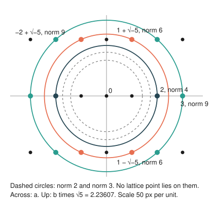

# Norm, trace and discriminant: collapsing an algebraic number into ordinary integers

[Syllabus](../../../SYLLABUS.md) → [Algebraic and analytic number theory](../README.md) → [Algebraic Numbers](../README.md#s06) → Norm, trace and discriminant

---

## General Overview

The number 6 is 2 × 3. Now allow one new number, $`\sqrt{-5}`$, whose square is $`-5`$. Then 6 also equals $`(1 + \sqrt{-5})(1 - \sqrt{-5})`$: expand, and the middle terms cancel, leaving $`1 + 5 = 6`$.

So 6 has two factorisations. Is one of them hiding a smaller split? That is hard to see directly. The new numbers $`a + b\sqrt{-5}`$ do not sit on a line, so "smaller" means nothing yet.

The **norm** fixes this. It collapses each number $`a + b\sqrt{-5}`$ into one ordinary whole number, $`a^2 + 5b^2`$. For $`1 + \sqrt{-5}`$ that is $`1 + 5 = 6`$.

The norm keeps track of multiplication: the norm of a product is the product of the norms. A split of 2 would therefore split its norm 4 as 2 × 2, and need a number of norm 2. But $`a^2 + 5b^2`$ is never 2. So 2 cannot split. The same test clears 3, $`1 + \sqrt{-5}`$ and $`1 - \sqrt{-5}`$, and 6 really does factor two different ways.

Two partners come with the norm:

- The **trace** adds instead of multiplying: $`(1 + \sqrt{-5}) + (1 - \sqrt{-5}) = 2`$.
- The **discriminant** collapses the whole number system into one integer, $`-20`$ here. Its prime factors, 2 and 5, mark the primes that behave oddly in the bigger system.

**Multiply or add a number with all of its mirror images and every root cancels, leaving an ordinary integer that remembers products and sums, so questions about a bigger number system become questions about whole numbers.**

**What kind of fact this is:** three definitions carrying theorems proved on this card in Why it works: the norm and trace of an algebraic integer are integers, the norm multiplies, and the discriminant does not depend on the basis chosen. That the primes dividing the discriminant are exactly the ramified ones is stated here and proved on [Splitting and ramification](08-splitting-and-ramification.md).

### The picture: no number lands on norm 2 or norm 3

<p align="center"></p>

Each dot is a number $`a + b\sqrt{-5}`$: $`a`$ across and $`b\sqrt{5}`$ up, so the rows sit 2.23607 apart. The norm is the squared distance from 0. The circle of norm 4 holds two dots ($`\pm 2`$), norm 6 holds four ($`\pm 1 \pm \sqrt{-5}`$), and norm 9 holds six ($`\pm 3`$ and $`\pm 2 \pm \sqrt{-5}`$). The dashed circles of norm 2 and norm 3 hold none: the gap between rows is too wide.

---

## The formula

Some words first, from [Algebraic integers](01-algebraic-integers-and-number-fields.md).

- A **number field** $`K`$ is the rational numbers with one new root $`\theta`$ added, such as $`\mathbb{Q}(\sqrt{-5})`$, all $`x + y\sqrt{-5}`$ with $`x, y`$ rational.
- Its **degree** $`n`$ is the number of coordinates a member needs: 2 here.
- Its **ring of integers** $`\mathcal{O}_K`$ holds its algebraic integers, the members that are roots of a monic polynomial with whole coefficients. Here $`\mathcal{O}_K = \mathbb{Z}[\sqrt{-5}]`$, all $`a + b\sqrt{-5}`$ with $`a, b`$ whole.

New on this card: an **embedding** $`\sigma_i`$ is one of the $`n`$ ways to place $`K`$ inside the complex numbers. Each one sends $`\theta`$ to a different root of $`\theta`$'s polynomial and keeps all sums and products. The values $`\sigma_1(\alpha), \dots, \sigma_n(\alpha)`$ are the **conjugates** of $`\alpha`$, its mirror images.

```math
N(\alpha) = \sigma_1(\alpha)\,\sigma_2(\alpha)\cdots\sigma_n(\alpha), \qquad \mathrm{Tr}(\alpha) = \sigma_1(\alpha) + \sigma_2(\alpha) + \cdots + \sigma_n(\alpha)
```

**Read it aloud:** the norm of alpha is the product of all its conjugates, and the trace is their sum.

For a square root $`\sqrt{d}`$ the two embeddings send $`\sqrt{d}`$ to $`+\sqrt{d}`$ and to $`-\sqrt{d}`$, so

```math
N(a + b\sqrt{d}) = (a + b\sqrt{d})(a - b\sqrt{d}) = a^2 - d\,b^2, \qquad \mathrm{Tr}(a + b\sqrt{d}) = 2a
```

With $`d = -5`$ this is $`a^2 + 5b^2`$. With $`d = -1`$ it is the Gaussian norm $`a^2 + b^2`$ of [Gaussian integers](../../03-Algebra/10-For%20the%20Curious/03-gaussian-integers-and-sums-of-two-squares.md).

The discriminant needs an **integral basis** $`w_1, \dots, w_n`$: members of $`\mathcal{O}_K`$ whose whole-number combinations give all of $`\mathcal{O}_K`$, each member exactly once. For $`\mathbb{Z}[\sqrt{-5}]`$ that is $`1, \sqrt{-5}`$.

```math
d_K = \det\big[\mathrm{Tr}(w_i\,w_j)\big] = \big(\det\big[\sigma_i(w_j)\big]\big)^2
```

**Read it aloud:** the discriminant of K is the determinant of the table of traces of basis products, which equals the square of the determinant of the table of basis conjugates.

| Symbol | Plain meaning | In our example | Push it up and the answer… |
| --- | --- | --- | --- |
| $`K`$ | the number field | $`\mathbb{Q}(\sqrt{-5})`$ | — |
| $`\theta`$, $`f`$ | the root that generates $`K`$, and the polynomial it solves | $`\sqrt{-5}`$ with $`f = x^2 + 5`$; $`\sqrt[3]{2}`$ with $`f = x^3 - 2`$ in the cubic example | — |
| $`n`$ | the degree: coordinates per member | 2 (3 for the cubic) | more conjugates in each product |
| $`\mathcal{O}_K`$ | the ring of integers | $`\mathbb{Z}[\sqrt{-5}]`$ | — |
| $`\alpha, \beta, \delta`$ | members of $`K`$; in the cubic example $`\beta = 1 + \sqrt[3]{2}`$ | $`\alpha = 1 + \sqrt{-5}`$ | larger norm |
| $`a, b`$ | its whole coordinates | 1 and 1 | norm grows as $`a^2 + 5b^2`$ |
| $`d`$ | the number under the square root | $`-5`$ | rows of the picture spread apart |
| $`\sigma_i`$ | the $`i`$-th embedding into the complex numbers | $`\sqrt{-5} \mapsto \pm 2.23607i`$ | — |
| $`N(\alpha)`$, $`\mathrm{Tr}(\alpha)`$ | the norm (product of conjugates) and the trace (their sum) | 6 and 2 | — |
| $`M_\alpha`$ | the matrix of "multiply by $`\alpha`$" | rows $`(1, -5)`$ and $`(1, 1)`$ | its determinant and trace are the norm and trace |
| $`w_j`$ | an integral basis | $`1, \sqrt{-5}`$ | — |
| $`d_K`$ | the field discriminant | $`-20`$ | more primes behave oddly |

### When it holds

- **One field at a time.** The norm depends on the field. In $`\mathbb{Q}(\sqrt{-5})`$ the number 3 has norm 9, the product of its two equal conjugates. Mix fields and the multiplication rule breaks.
- **Algebraic integers give integers.** For a member of $`\mathcal{O}_K`$ the norm and trace are whole numbers. For a fraction such as half of $`\sqrt{-5}`$ the norm is not whole, and the factoring test says nothing.
- **All n conjugates, not some.** Leave one out and the roots no longer cancel: for $`1 + \sqrt[3]{2}`$, two of its three conjugates multiply to 1.32748.
- **A basis of the whole ring.** A basis of a smaller ring inflates the discriminant by a square: $`1, \sqrt{5}`$ gives 20 for $`\mathbb{Q}(\sqrt{5})`$, whose true $`d_K`$ is 5.
- **The norm test runs one way.** If $`\beta`$ divides $`\alpha`$, then $`N(\beta)`$ divides $`N(\alpha)`$. The reverse fails: $`1 - \sqrt{-5}`$ and $`1 + \sqrt{-5}`$ share norm 6, yet neither divides the other.

---

## Why it works

### Step 0: mirror images cancel the roots

$`(a + b\sqrt{d})(a - b\sqrt{d})`$ loses its root because $`+b\sqrt{d}`$ and $`-b\sqrt{d}`$ cancel in the middle. The sum $`2a`$ loses it the same way.

In every degree the conjugates are treated alike: swapping any two leaves their product and their sum unchanged. A quantity that no swap can change cannot involve the root, so it is rational. Step 1 makes this exact.

### Step 1: the norm is a determinant, the trace a matrix trace

Multiplying by $`\alpha`$ moves every member of $`K`$ to another member, and it respects sums. So it has a matrix in the basis $`1, \theta, \dots, \theta^{n-1}`$. For $`\alpha = 1 + \sqrt{-5}`$:

- $`\alpha \cdot 1 = 1 + 1\sqrt{-5}`$, first column $`(1, 1)`$.
- $`\alpha \cdot \sqrt{-5} = -5 + 1\sqrt{-5}`$, second column $`(-5, 1)`$.

```math
M_\alpha = \begin{pmatrix} 1 & -5 \\ 1 & 1 \end{pmatrix}, \qquad \det M_\alpha = 1 + 5 = 6, \qquad \text{trace } M_\alpha = 1 + 1 = 2
```

The matrix's eigenvalues (its stretch factors: the numbers by which it multiplies some nonzero vector) are exactly the conjugates of $`\alpha`$. A determinant is the product of the eigenvalues and a matrix trace is their sum. So $`N(\alpha) = \det M_\alpha`$ and $`\mathrm{Tr}(\alpha) = \text{trace } M_\alpha`$.

For $`\alpha`$ in $`\mathcal{O}_K`$, written in an integral basis, the matrix has whole entries. A change of basis does not change a determinant or a trace. A determinant and a trace of whole numbers are whole. That proves the integer claim.

<details>
<summary>Detailed proof: the eigenvalues of the multiplication matrix are the conjugates</summary>

Write $`\alpha\,\theta^j = \sum_i m_{ij}\,\theta^i`$ with rational $`m_{ij}`$, the entries of $`M_\alpha`$. Apply an embedding $`\sigma`$. It keeps sums, products and rationals, so

$`\displaystyle \sigma(\alpha)\,\sigma(\theta)^j = \sum_i m_{ij}\,\sigma(\theta)^i .`$

Read this as a row vector $`r = (1, \sigma(\theta), \dots, \sigma(\theta)^{n-1})`$ times $`M_\alpha`$: it says $`r\,M_\alpha = \sigma(\alpha)\,r`$. So $`\sigma(\alpha)`$ is an eigenvalue.

The $`n`$ embeddings send $`\theta`$ to $`n`$ different roots. Their row vectors form a Vandermonde matrix with distinct entries, whose determinant is not zero, so the rows are independent. An $`n \times n`$ matrix with $`n`$ independent eigenvectors has those eigenvalues and no others. Hence the eigenvalues are $`\sigma_1(\alpha), \dots, \sigma_n(\alpha)`$, counted once each.

</details>

A second check: the matrix's characteristic polynomial is $`x^2 - \mathrm{Tr}(\alpha)\,x + N(\alpha) = x^2 - 2x + 6`$. Put $`\alpha`$ in: $`\alpha^2 = -4 + 2\sqrt{-5}`$, and $`-4 + 2\sqrt{-5} - 2(1 + \sqrt{-5}) + 6 = 0`$. Norm and trace are the coefficients of the polynomial $`\alpha`$ solves.

### Step 2: the norm multiplies and the trace adds

Each embedding keeps products: $`\sigma(\alpha\beta) = \sigma(\alpha)\,\sigma(\beta)`$. Multiply over all embeddings and

```math
N(\alpha\beta) = N(\alpha)\,N(\beta), \qquad \mathrm{Tr}(\alpha + \beta) = \mathrm{Tr}(\alpha) + \mathrm{Tr}(\beta)
```

The matrix road says the same: $`M_{\alpha\beta} = M_\alpha M_\beta`$, and determinants multiply.

A **unit** is a member with an inverse inside $`\mathcal{O}_K`$. From $`\alpha \cdot \alpha^{-1} = 1`$ the two norms are whole numbers multiplying to 1, so a unit has norm $`\pm 1`$. In $`\mathbb{Z}[\sqrt{-5}]`$, $`a^2 + 5b^2 = 1`$ only for $`\pm 1`$.

### Step 3: factoring with the norm

Suppose $`2 = \beta\delta`$ with neither factor a unit. Then $`N(\beta)\,N(\delta) = 4`$ and neither norm is 1, so $`N(\beta) = 2`$. But $`a^2 + 5b^2 = 2`$ is impossible:

- If $`b \ne 0`$, then $`5b^2 \ge 5`$, too big.
- If $`b = 0`$, then $`a^2 = 2`$, and 2 is not a square.

So 2 is **irreducible**: it has no split into two non-units. The same argument works for the others:

| Number | Norm | A split would need a factor of norm | Possible? |
| --- | --- | --- | --- |
| 2 | 4 | 2 | no |
| 3 | 9 | 3 | no |
| $`1 + \sqrt{-5}`$ | 6 | 2 or 3 | no |
| $`1 - \sqrt{-5}`$ | 6 | 2 or 3 | no |

The two factorisations are also genuinely different. If 2 divided $`1 + \sqrt{-5}`$, then 4 would divide 6. It does not.

**Where proof ends and evidence begins.** The code searches every $`a + b\sqrt{-5}`$ with $`|a|, |b| \le 10`$ and finds no proper divisor of 2, 3 or $`1 \pm \sqrt{-5}`$. That search is a complete proof here, because a divisor of norm below 9 must have $`|a| \le 2`$ and $`b = 0`$ or $`\pm 1`$, inside the box. The code also checks $`N(xy) = N(x)N(y)`$ on 28,561 pairs. That is evidence only; Step 2 is the proof.

**A cubic field.** Take $`K = \mathbb{Q}(\sqrt[3]{2})`$, degree 3, and $`\beta = 1 + \sqrt[3]{2}`$. Its three conjugates are $`2.25992`$ and $`0.37004 \pm 1.09112i`$. Their product is 3 and their sum is 3. The 3 × 3 matrix gives the same norm and trace. A third road: the conjugates of $`\sqrt[3]{2}`$ are the roots of $`f(x) = x^3 - 2`$, so $`N(1 + \sqrt[3]{2}) = -f(-1) = 3`$.

Norm 3 points at a factor of 3, and the code finds it: $`(1 + \sqrt[3]{2})(1 - \sqrt[3]{2} + \sqrt[3]{4}) = 3`$. In this bigger ring, 3 is no longer prime.

### Step 4: the discriminant, and why the basis does not matter

For the basis $`1, \sqrt{-5}`$ the traces of products are $`\mathrm{Tr}(1) = 2`$, $`\mathrm{Tr}(\sqrt{-5}) = 0`$ and $`\mathrm{Tr}(-5) = -10`$:

```math
d_K = \det\begin{pmatrix} 2 & 0 \\ 0 & -10 \end{pmatrix} = -20
```

The embedding road gives the table $`\sigma_i(w_j)`$ with rows $`(1, \sqrt{-5})`$ and $`(1, -\sqrt{-5})`$. Its determinant is $`-2\sqrt{-5}`$, about $`-4.47214i`$, and its square is $`-20`$. The two roads agree because $`\mathrm{Tr}(w_iw_j) = \sum_k \sigma_k(w_i)\,\sigma_k(w_j)`$: the trace table is the conjugate table's transpose times itself.

Any other integral basis is the first one mixed by a whole-number matrix whose inverse is also whole, so that matrix has determinant $`\pm 1`$. The discriminant changes by the square of that determinant, which is 1. So it belongs to the field, not the basis.

A basis of a smaller ring multiplies it by the square of the index, the number of points of the full ring for each point of the smaller one. That is how $`\mathbb{Z}[\sqrt{5}]`$ gets 20 instead of 5: index 2, factor 4. The polynomial $`x^2 - 5`$ also gives 20, because its discriminant is that of $`\mathbb{Z}[\sqrt{5}]`$, not of the field.

**What the discriminant measures.** In the picture each grid cell is 1 wide and 2.23607 tall. That area is the square root of 20, halved: $`|d_K|`$ measures how spread out the ring of integers is. Its prime factors are the primes that **ramify**, meaning they pick up a repeated prime factor in $`\mathcal{O}_K`$. For 5 it shows on the numbers: $`5 = -(\sqrt{-5})^2`$. For 2 the repeated factor is an ideal (a set of multiples), not a number, because 2 is irreducible; [Ideals factor uniquely even where numbers do not](04-ideals-and-unique-factorisation-in-dedekind-domains.md) shows it. For $`\mathbb{Q}(\sqrt{-5})`$ those are 2 and 5; that is stated here and proved on [Splitting and ramification](08-splitting-and-ramification.md).

For $`\mathbb{Q}(\sqrt[3]{2})`$ with basis $`1, \sqrt[3]{2}, \sqrt[3]{4}`$ the trace table has determinant $`-108`$. That $`\mathbb{Z}[\sqrt[3]{2}]`$ is the whole ring of integers is stated with a source (Marcus, below), not proved here. The polynomial formula for a cubic with no $`x^2`$ term, minus 4 times the cube of the $`x`$ coefficient minus 27 times the square of the constant, gives $`-4 \cdot 0^3 - 27 \cdot (-2)^2 = -108`$ again.

---

## Worked numbers, by hand

| Step | Arithmetic | Value |
| --- | --- | --- |
| conjugates of $`1 + \sqrt{-5}`$ | $`1 \pm 2.23607i`$ | two numbers |
| norm | $`1^2 + 5 \times 1^2`$ | **6** |
| trace | $`2 \times 1`$ | **2** |
| norms of 2, 3, $`1 \pm \sqrt{-5}`$ | $`4,\ 9,\ 6,\ 6`$ | four norms |
| norms below 10 that occur | $`a^2 + 5b^2`$ | 0, 1, 4, 5, 6, 9 |
| factor of norm 2 or 3 | not in that list | **none** |
| 2 divides $`1 + \sqrt{-5}`$? | does 4 divide 6? | **no** |
| norm of $`1 + \sqrt[3]{2}`$ | $`2.25992 \times (0.37004^2 + 1.09112^2)`$ | **3** |
| trace table of $`1, \sqrt{-5}`$ | $`2 \times (-10) - 0 \times 0`$ | **$`-20`$** |
| primes dividing $`-20`$ | $`-20 = -2^2 \times 5`$ | **2 and 5** |

Six splits as 2 × 3 and as $`(1 + \sqrt{-5})(1 - \sqrt{-5})`$, all four factors irreducible, so $`\mathbb{Z}[\sqrt{-5}]`$ does not factor uniquely. Its discriminant $`-20`$ names 2 and 5 as the primes to watch.

### What breaks if you drop a piece

| Mistake | Comes out at | What went wrong |
| --- | --- | --- |
| Gaussian norm $`a^2 + b^2`$ on $`1 + \sqrt{-5}`$ | 2, not 6 | The norm depends on $`d`$; here $`d = -5`$ |
| $`1 + \sqrt[3]{2}`$ times only its complex conjugate | 1.32748, not whole | A degree-3 norm needs all three conjugates |
| $`\mathbb{Z}[\sqrt{5}]`$ taken for the ring of integers | $`d_K = 20`$, not 5 | $`(1 + \sqrt{5})/2`$ is an integer too; index 2 gives 4 × 5 |
| Norm 6 divides norm 6, so $`1 - \sqrt{-5}`$ divides $`1 + \sqrt{-5}`$ | quotient $`-\tfrac{2}{3} + \tfrac{1}{3}\sqrt{-5}`$ | The norm test only rules divisors out |
| Embedding determinant not squared | $`-4.47214i`$ | Only the square is basis-free and rational |

The code prints every row.

---

## Code, from first principles, and it actually runs

The code takes three independent roads to each norm, trace and discriminant. Road 1 builds the multiplication matrix and takes exact determinants and traces with fractions. Road 2 plugs the number into every complex embedding and multiplies or adds, rounded to 5 places. Road 3 uses the closed formulas: $`a^2 + 5b^2`$, $`2a`$, $`-f(-1)`$ and the polynomial discriminant. A brute-force search for divisors backs the factoring argument.

### Python

```python
# Norm, trace and discriminant -- the check behind the card.  Standard library
# only.  Road 1 multiplies an element's matrix exactly (fractions.Fraction);
# road 2 plugs it into every complex embedding (math.cos, sin, sqrt; rounded
# to 5 places); road 3 uses the closed formulas a^2 + 5b^2, 2a and the
# polynomial discriminant.  A brute-force search in Z[sqrt-5] backs the norm test.
from fractions import Fraction as F
from math import cos, sin, sqrt, pi

def companion(p):                    # theta times theta^c, for theta^n = sum p[r] theta^r
    n = len(p)
    return [[F(1) if r == c + 1 else F(0) for c in range(n - 1)] + [F(p[r])] for r in range(n)]

def matmul(A, B):
    return [[sum(A[i][k] * B[k][j] for k in range(len(B))) for j in range(len(B[0]))] for i in range(len(A))]

def mat_of(x, p):                    # road 1: the matrix of "multiply by x" on 1, theta, theta^2
    n, C = len(p), companion(p)
    M, P = [[F(0)] * n for _ in range(n)], [[F(int(i == j)) for j in range(n)] for i in range(n)]
    for c in x:
        M = [[M[i][j] + F(c) * P[i][j] for j in range(n)] for i in range(n)]
        P = matmul(C, P)
    return M

def det(M):                          # Laplace expansion: works for fractions and complex numbers
    if len(M) == 1:
        return M[0][0]
    return sum((-1) ** j * M[0][j] * det([row[:j] + row[j + 1:] for row in M[1:]]) for j in range(len(M)))

def mul(x, y, p):
    M = mat_of(x, p)
    return [sum(M[i][k] * F(y[k]) for k in range(len(p))) for i in range(len(p))]

def norm(x, p):  return det(mat_of(x, p))
def trace(x, p): return sum(mat_of(x, p)[i][i] for i in range(len(p)))
def gram(basis, p): return [[trace(mul(u, v, p), p) for v in basis] for u in basis]
def disc(basis, p): return det(gram(basis, p))
def embed(x, root): return sum(F(c).numerator / F(c).denominator * root ** i for i, c in enumerate(x))

def disc_embed(basis, roots):        # road 2: square of det[sigma_k(w_j)]
    return det([[embed(w, r) for w in basis] for r in roots]) ** 2

def prod(zs):
    out = 1
    for z in zs:
        out = out * z
    return out

def fr(v): return round(v + 0.0, 5) + 0.0
def fc(z): return f"{fr(z.real):.5f} {'-' if fr(z.imag) < 0 else '+'} {abs(fr(z.imag)):.5f}i"
def fl(v): return f"{fr(v):.5f}"
def vec(x): return "[" + ", ".join(str(F(c)) for c in x) + "]"
def yn(c): return "yes" if c else "no"

M5, C2, P5 = [-5, 0], [2, 0, 0], [5, 0]                   # theta^2 = -5, theta^3 = 2, theta^2 = 5
r5 = [complex(0, sqrt(5)), complex(0, -sqrt(5))]
c = 2 ** (1 / 3)
r2 = [complex(c * cos(2 * pi * k / 3), c * sin(2 * pi * k / 3)) for k in range(3)]
alpha = [1, 1]
conj = [embed(alpha, r) for r in r5]
N_mat, T_mat = norm(alpha, M5), trace(alpha, M5)
N_cnj, T_cnj = prod(conj), sum(conj)
N_frm, T_frm = 1 ** 2 + 5 * 1 ** 2, 2 * 1
sq = mul(alpha, alpha, M5)
minpoly_at = [sq[i] - T_mat * alpha[i] + (N_mat if i == 0 else 0) for i in range(2)]
print("field Q(sqrt-5), theta^2 = -5; alpha = 1 + sqrt-5, written [1, 1] on the basis 1, sqrt-5")
print(f"conjugates of alpha: {fc(conj[0])} and {fc(conj[1])}")
print(f"N(alpha): product of conjugates {fc(N_cnj)}; matrix determinant {N_mat}; a^2 + 5b^2 = {N_frm}")
print(f"Tr(alpha): sum of conjugates {fc(T_cnj)}; matrix trace {T_mat}; 2a = {T_frm}")
print("matrix of multiply-by-alpha: [" + ", ".join(vec(row) for row in mat_of(alpha, M5)) + "]")
print(f"alpha squared {vec(sq)}; alpha^2 - {T_mat} alpha + {N_mat} = {vec(minpoly_at)}")
named = [("2", [2, 0]), ("3", [3, 0]), ("1 + sqrt-5", [1, 1]), ("1 - sqrt-5", [1, -1])]
print("norms of " + ", ".join(s for s, _ in named) + ": " + ", ".join(str(norm(x, M5)) for _, x in named))
box = [(a, b) for a in range(-10, 11) for b in range(-10, 11)]          # every element with N <= 100
values = sorted({a * a + 5 * b * b for a, b in box if a * a + 5 * b * b <= 30})
counts = [sum(1 for a, b in box if a * a + 5 * b * b == n) for n in (1, 2, 3, 4, 6, 9)]
print(f"norm values up to 30: {values}")
print(f"elements of norm 1, 2, 3, 4, 6, 9: {', '.join(map(str, counts))}")
small = [(a, b) for a in range(-6, 7) for b in range(-6, 7)]
good = all(((a*c - 5*b*d) ** 2 + 5 * (a*d + b*c) ** 2) == (a*a + 5*b*b) * (c*c + 5*d*d)
           for a, b in small for c, d in small)
print(f"N(xy) = N(x)N(y) on all {len(small) ** 2} pairs with |a|, |b| <= 6: {yn(good)}")

def divides(y, x):                   # y | x in Z[sqrt-5]: x times conj(y) over N(y) is whole
    n, (a, b), (p, q) = y[0] ** 2 + 5 * y[1] ** 2, x, y
    return n != 0 and (a * p + 5 * b * q) % n == 0 and (b * p - a * q) % n == 0

proper = [sum(1 for y in box if 1 < y[0] ** 2 + 5 * y[1] ** 2 < norm(x, M5) and divides(y, x)) for _, x in named]
print("proper divisors found by search: " + "; ".join(f"of {s}: {k}" for (s, _), k in zip(named, proper)))
print(f"2 divides 1 + sqrt-5: {yn(divides((2, 0), (1, 1)))}; 3 divides 1 + sqrt-5: {yn(divides((3, 0), (1, 1)))}")
beta, cof = [1, 1, 0], [1, -1, 1]
conj3 = [embed(beta, r) for r in r2]
print("field Q(cbrt 2), theta^3 = 2; beta = 1 + cbrt2, written [1, 1, 0]")
print("conjugates of beta: " + "; ".join(fc(z) for z in conj3))
print(f"N(beta): product {fc(prod(conj3))}; determinant {norm(beta, C2)}; -f(-1) = {-((-1) ** 3 - 2)}")
print(f"Tr(beta): sum {fc(sum(conj3))}; trace {trace(beta, C2)}")
print(f"(1 + cbrt2)(1 - cbrt2 + cbrt4) = {vec(mul(beta, cof, C2))}")
fields = [("Q(sqrt-5), basis 1, sqrt-5", [[1, 0], [0, 1]], M5, r5, 0 ** 2 - 4 * 5),
          ("Q(cbrt 2), basis 1, cbrt2, cbrt4", [[1, 0, 0], [0, 1, 0], [0, 0, 1]], C2, r2, -4 * 0 ** 3 - 27 * 2 ** 2),
          ("Q(sqrt 5), basis 1, (1 + sqrt5)/2", [[1, 0], [F(1, 2), F(1, 2)]], P5, [sqrt(5), -sqrt(5)], 0 ** 2 + 4 * 5)]
ds = []
for name, basis, p, roots, polyd in fields:
    d, de = disc(basis, p), disc_embed(basis, roots)
    ds.append((d, de, polyd))
    print(f"d_K for {name}: Tr(w_i w_j) = [{', '.join(vec(r) for r in gram(basis, p))}]")
    print(f"    its determinant {d}; embeddings squared {fc(complex(de))}; polynomial formula {polyd}")
primes = [[q for q in range(2, abs(int(d)) + 1) if d % q == 0 and all(q % s for s in range(2, q))] for d, _, _ in ds]
print(f"primes dividing -20: {primes[0]}; -108: {primes[1]}; 5: {primes[2]}")
wrong5 = disc([[1, 0], [0, 1]], P5)
quot = [F(v, 6) for v in mul([1, 1], [1, 1], M5)]                    # (1 + s)/(1 - s) = (1 + s)^2 / 6
half = det([[embed(w, r) for w in [[1, 0], [0, 1]]] for r in r5])
print(f"mistake 1, the Gaussian norm a^2 + b^2 on 1 + sqrt-5: {1 + 1}, not {N_mat}")
print(f"mistake 2, beta times its complex conjugate only: {fl((conj3[1] * conj3[2]).real)}, not a whole number")
print(f"mistake 3, Z[sqrt5] taken for the ring of integers: {wrong5}, not {ds[2][0]}; ratio {wrong5 / ds[2][0]}")
print(f"mistake 4, N(1 - sqrt-5) = 6 divides 6, yet (1 + sqrt-5)/(1 - sqrt-5) = {vec(quot)}, not whole")
print(f"mistake 5, the embedding determinant not squared: {fc(half)}")
on = [sum(1 for a, b in box if a * a + 5 * b * b == n) for n in (2, 3, 4, 6, 9)]
print(f"figure, 50 px per unit, rows at b*sqrt5 = {fl(sqrt(5))}; radii {fl(sqrt(2))}, {fl(sqrt(3))}, 2, "
      f"{fl(sqrt(6))}, 3; lattice points on them {on}")
assert N_mat == N_frm == round(N_cnj.real) == 6 and T_mat == T_frm == round(T_cnj.real) == 2
assert minpoly_at == [0, 0] and norm(beta, C2) == round(prod(conj3).real) == -((-1) ** 3 - 2) == 3
assert mul(beta, cof, C2) == [3, 0, 0] and good and values[:5] == [0, 1, 4, 5, 6]
assert counts == [2, 0, 0, 2, 4, 6] and proper == [0, 0, 0, 0] and not divides((2, 0), (1, 1)) and divides((1, 1), (-4, 2))
assert all(d == round(de.real) for d, de, _ in ds) and [pd for _, _, pd in ds] == [-20, -108, 20] and [d for d, _, _ in ds] == [-20, -108, 5]
assert wrong5 == 4 * ds[2][0] and quot == [F(-2, 3), F(1, 3)] and abs(half.real) < 1e-9
print("ALL CHECKS PASS")
```

**Ran 2026-11-15 on macOS, Python 3.14.10, standard library only. All checks passed. Output, pasted from the run:**

```
field Q(sqrt-5), theta^2 = -5; alpha = 1 + sqrt-5, written [1, 1] on the basis 1, sqrt-5
conjugates of alpha: 1.00000 + 2.23607i and 1.00000 - 2.23607i
N(alpha): product of conjugates 6.00000 + 0.00000i; matrix determinant 6; a^2 + 5b^2 = 6
Tr(alpha): sum of conjugates 2.00000 + 0.00000i; matrix trace 2; 2a = 2
matrix of multiply-by-alpha: [[1, -5], [1, 1]]
alpha squared [-4, 2]; alpha^2 - 2 alpha + 6 = [0, 0]
norms of 2, 3, 1 + sqrt-5, 1 - sqrt-5: 4, 9, 6, 6
norm values up to 30: [0, 1, 4, 5, 6, 9, 14, 16, 20, 21, 24, 25, 29, 30]
elements of norm 1, 2, 3, 4, 6, 9: 2, 0, 0, 2, 4, 6
N(xy) = N(x)N(y) on all 28561 pairs with |a|, |b| <= 6: yes
proper divisors found by search: of 2: 0; of 3: 0; of 1 + sqrt-5: 0; of 1 - sqrt-5: 0
2 divides 1 + sqrt-5: no; 3 divides 1 + sqrt-5: no
field Q(cbrt 2), theta^3 = 2; beta = 1 + cbrt2, written [1, 1, 0]
conjugates of beta: 2.25992 + 0.00000i; 0.37004 + 1.09112i; 0.37004 - 1.09112i
N(beta): product 3.00000 + 0.00000i; determinant 3; -f(-1) = 3
Tr(beta): sum 3.00000 + 0.00000i; trace 3
(1 + cbrt2)(1 - cbrt2 + cbrt4) = [3, 0, 0]
d_K for Q(sqrt-5), basis 1, sqrt-5: Tr(w_i w_j) = [[2, 0], [0, -10]]
    its determinant -20; embeddings squared -20.00000 + 0.00000i; polynomial formula -20
d_K for Q(cbrt 2), basis 1, cbrt2, cbrt4: Tr(w_i w_j) = [[3, 0, 0], [0, 0, 6], [0, 6, 0]]
    its determinant -108; embeddings squared -108.00000 + 0.00000i; polynomial formula -108
d_K for Q(sqrt 5), basis 1, (1 + sqrt5)/2: Tr(w_i w_j) = [[2, 1], [1, 3]]
    its determinant 5; embeddings squared 5.00000 + 0.00000i; polynomial formula 20
primes dividing -20: [2, 5]; -108: [2, 3]; 5: [5]
mistake 1, the Gaussian norm a^2 + b^2 on 1 + sqrt-5: 2, not 6
mistake 2, beta times its complex conjugate only: 1.32748, not a whole number
mistake 3, Z[sqrt5] taken for the ring of integers: 20, not 5; ratio 4
mistake 4, N(1 - sqrt-5) = 6 divides 6, yet (1 + sqrt-5)/(1 - sqrt-5) = [-2/3, 1/3], not whole
mistake 5, the embedding determinant not squared: 0.00000 - 4.47214i
figure, 50 px per unit, rows at b*sqrt5 = 2.23607; radii 1.41421, 1.73205, 2, 2.44949, 3; lattice points on them [0, 0, 2, 4, 6]
ALL CHECKS PASS
```

### Rust

Same numbers, same labels, built with `rustc --edition 2021 -O`.

```rust
// Norm, trace and discriminant -- the same check as the Python, in Rust.  No
// crates.  Road 1 multiplies an element's matrix exactly (a small fraction
// type); road 2 plugs it into every complex embedding (a small complex type;
// rounded to 5 places); road 3 uses the closed formulas a^2 + 5b^2, 2a and the
// polynomial discriminant.  A brute-force search in Z[sqrt-5] backs the norm test.
use std::ops::{Add, Mul, Sub};

fn gcd(a: i128, b: i128) -> i128 { if b == 0 { a.abs() } else { gcd(b, a % b) } }

#[derive(Clone, Copy, PartialEq, Debug)]
struct Fr { n: i128, d: i128 }
fn fr(n: i128, d: i128) -> Fr { let g = gcd(n, d).max(1) * d.signum(); Fr { n: n / g, d: d / g } }
impl Add for Fr { type Output = Fr; fn add(self, o: Fr) -> Fr { fr(self.n.checked_mul(o.d).unwrap().checked_add(o.n.checked_mul(self.d).unwrap()).unwrap(), self.d.checked_mul(o.d).unwrap()) } }
impl Sub for Fr { type Output = Fr; fn sub(self, o: Fr) -> Fr { fr(self.n.checked_mul(o.d).unwrap().checked_sub(o.n.checked_mul(self.d).unwrap()).unwrap(), self.d.checked_mul(o.d).unwrap()) } }
impl Mul for Fr { type Output = Fr; fn mul(self, o: Fr) -> Fr { fr(self.n.checked_mul(o.n).unwrap(), self.d.checked_mul(o.d).unwrap()) } }
impl std::fmt::Display for Fr {
    fn fmt(&self, f: &mut std::fmt::Formatter) -> std::fmt::Result {
        if self.d == 1 { write!(f, "{}", self.n) } else { write!(f, "{}/{}", self.n, self.d) }
    }
}

#[derive(Clone, Copy, Debug)]
struct Cx { re: f64, im: f64 }
impl Add for Cx { type Output = Cx; fn add(self, o: Cx) -> Cx { Cx { re: self.re + o.re, im: self.im + o.im } } }
impl Sub for Cx { type Output = Cx; fn sub(self, o: Cx) -> Cx { Cx { re: self.re - o.re, im: self.im - o.im } } }
impl Mul for Cx {
    type Output = Cx;
    fn mul(self, o: Cx) -> Cx { Cx { re: self.re * o.re - self.im * o.im, im: self.re * o.im + self.im * o.re } }
}

// Laplace expansion: works for fractions and complex numbers
fn det<T: Copy + Add<Output = T> + Sub<Output = T> + Mul<Output = T>>(m: &Vec<Vec<T>>) -> T {
    if m.len() == 1 { return m[0][0]; }
    let mut out: Option<T> = None;
    for j in 0..m.len() {
        let minor: Vec<Vec<T>> = m[1..].iter().map(|r| [&r[..j], &r[j + 1..]].concat()).collect();
        let t = m[0][j] * det(&minor);
        out = Some(match out { None => if j % 2 == 0 { t } else { t - t - t }, Some(s) => if j % 2 == 0 { s + t } else { s - t } });
    }
    out.unwrap()
}

type V = Vec<Fr>;
fn iv(xs: &[i128]) -> V { xs.iter().map(|&x| fr(x, 1)).collect() }
fn mat_of(x: &V, p: &[i128]) -> Vec<V> {  // road 1: the matrix of "multiply by x"
    let n = p.len();
    let c: Vec<V> = (0..n).map(|r| (0..n).map(|k| if k == n - 1 { fr(p[r], 1) } else { fr((r == k + 1) as i128, 1) }).collect()).collect();
    let mut m = vec![vec![fr(0, 1); n]; n];
    let mut pw: Vec<V> = (0..n).map(|i| (0..n).map(|j| fr((i == j) as i128, 1)).collect()).collect();
    for &ci in x {
        for i in 0..n { for j in 0..n { m[i][j] = m[i][j] + ci * pw[i][j]; } }
        pw = (0..n).map(|i| (0..n).map(|j| (0..n).fold(fr(0, 1), |s, k| s + c[i][k] * pw[k][j])).collect()).collect();
    }
    m
}
fn mul(x: &V, y: &V, p: &[i128]) -> V {
    let m = mat_of(x, p);
    (0..p.len()).map(|i| (0..p.len()).fold(fr(0, 1), |s, k| s + m[i][k] * y[k])).collect()
}
fn norm(x: &V, p: &[i128]) -> Fr { det(&mat_of(x, p)) }
fn trace(x: &V, p: &[i128]) -> Fr { let m = mat_of(x, p); (0..p.len()).fold(fr(0, 1), |s, i| s + m[i][i]) }
fn gram(b: &Vec<V>, p: &[i128]) -> Vec<V> { b.iter().map(|u| b.iter().map(|v| trace(&mul(u, v, p), p)).collect()).collect() }
fn disc(b: &Vec<V>, p: &[i128]) -> Fr { det(&gram(b, p)) }
fn embed(x: &V, r: Cx) -> Cx {
    let (mut s, mut pw) = (Cx { re: 0.0, im: 0.0 }, Cx { re: 1.0, im: 0.0 });
    for c in x { s = s + Cx { re: c.n as f64 / c.d as f64, im: 0.0 } * pw; pw = pw * r; }
    s
}
fn embed_mat(b: &Vec<V>, roots: &[Cx]) -> Vec<Vec<Cx>> { roots.iter().map(|&r| b.iter().map(|w| embed(w, r)).collect()).collect() }
fn prod(zs: &[Cx]) -> Cx { zs.iter().fold(Cx { re: 1.0, im: 0.0 }, |s, &z| s * z) }
fn sum(zs: &[Cx]) -> Cx { zs.iter().fold(Cx { re: 0.0, im: 0.0 }, |s, &z| s + z) }
fn cl(v: f64) -> f64 { if (v * 1e5).round() == 0.0 { 0.0 } else { v } }
fn fl(v: f64) -> String { format!("{:.5}", cl(v)) }
fn fc(z: Cx) -> String { format!("{:.5} {} {:.5}i", cl(z.re), if cl(z.im) < 0.0 { "-" } else { "+" }, cl(z.im).abs()) }
fn vecs(x: &V) -> String { format!("[{}]", x.iter().map(|c| c.to_string()).collect::<Vec<_>>().join(", ")) }
fn yn(c: bool) -> &'static str { if c { "yes" } else { "no" } }
fn divides(y: (i128, i128), x: (i128, i128)) -> bool {  // y | x: x times conj(y) over N(y) is whole
    let n = y.0 * y.0 + 5 * y.1 * y.1;
    n != 0 && (x.0 * y.0 + 5 * x.1 * y.1) % n == 0 && (x.1 * y.0 - x.0 * y.1) % n == 0
}

fn main() {
    let (m5, c2, p5): (&[i128], &[i128], &[i128]) = (&[-5, 0], &[2, 0, 0], &[5, 0]);
    let s5 = 5f64.sqrt();
    let r5 = [Cx { re: 0.0, im: s5 }, Cx { re: 0.0, im: -s5 }];
    let c = 2f64.powf(1.0 / 3.0);
    let pi = std::f64::consts::PI;
    let r2: Vec<Cx> = (0..3).map(|k| { let t = 2.0 * pi * k as f64 / 3.0; Cx { re: c * t.cos(), im: c * t.sin() } }).collect();
    let alpha = iv(&[1, 1]);
    let conj: Vec<Cx> = r5.iter().map(|&r| embed(&alpha, r)).collect();
    let (n_mat, t_mat) = (norm(&alpha, m5), trace(&alpha, m5));
    let (n_cnj, t_cnj) = (prod(&conj), sum(&conj));
    let (n_frm, t_frm) = (1 * 1 + 5 * 1 * 1, 2 * 1);
    let sq = mul(&alpha, &alpha, m5);
    let minpoly_at: V = (0..2).map(|i| sq[i] - t_mat * alpha[i] + if i == 0 { n_mat } else { fr(0, 1) }).collect();
    println!("field Q(sqrt-5), theta^2 = -5; alpha = 1 + sqrt-5, written [1, 1] on the basis 1, sqrt-5");
    println!("conjugates of alpha: {} and {}", fc(conj[0]), fc(conj[1]));
    println!("N(alpha): product of conjugates {}; matrix determinant {}; a^2 + 5b^2 = {}", fc(n_cnj), n_mat, n_frm);
    println!("Tr(alpha): sum of conjugates {}; matrix trace {}; 2a = {}", fc(t_cnj), t_mat, t_frm);
    println!("matrix of multiply-by-alpha: [{}]", mat_of(&alpha, m5).iter().map(vecs).collect::<Vec<_>>().join(", "));
    println!("alpha squared {}; alpha^2 - {} alpha + {} = {}", vecs(&sq), t_mat, n_mat, vecs(&minpoly_at));
    let named: Vec<(&str, (i128, i128))> = vec![("2", (2, 0)), ("3", (3, 0)), ("1 + sqrt-5", (1, 1)), ("1 - sqrt-5", (1, -1))];
    let nq = |x: (i128, i128)| x.0 * x.0 + 5 * x.1 * x.1;
    let ns: Vec<String> = named.iter().map(|(_, x)| norm(&iv(&[x.0, x.1]), m5).to_string()).collect();
    println!("norms of {}: {}", named.iter().map(|(s, _)| *s).collect::<Vec<_>>().join(", "), ns.join(", "));
    let bx: Vec<(i128, i128)> = (-10..11).flat_map(|a| (-10..11).map(move |b| (a, b))).collect();
    let mut values: Vec<i128> = bx.iter().map(|&x| nq(x)).filter(|&n| n <= 30).collect();
    values.sort(); values.dedup();
    let cnt = |n: i128| bx.iter().filter(|&&x| nq(x) == n).count();
    let counts: Vec<usize> = [1, 2, 3, 4, 6, 9].iter().map(|&n| cnt(n)).collect();
    println!("norm values up to 30: {:?}", values);
    println!("elements of norm 1, 2, 3, 4, 6, 9: {}", counts.iter().map(|k| k.to_string()).collect::<Vec<_>>().join(", "));
    let small: Vec<(i128, i128)> = (-6..7).flat_map(|a| (-6..7).map(move |b| (a, b))).collect();
    let good = small.iter().all(|&(a, b)| small.iter().all(|&(c, d)| nq((a * c - 5 * b * d, a * d + b * c)) == nq((a, b)) * nq((c, d))));
    println!("N(xy) = N(x)N(y) on all {} pairs with |a|, |b| <= 6: {}", small.len() * small.len(), yn(good));
    let proper: Vec<usize> = named.iter().map(|&(_, x)| bx.iter().filter(|&&y| 1 < nq(y) && nq(y) < nq(x) && divides(y, x)).count()).collect();
    println!("proper divisors found by search: {}", named.iter().zip(&proper).map(|((s, _), k)| format!("of {}: {}", s, k)).collect::<Vec<_>>().join("; "));
    println!("2 divides 1 + sqrt-5: {}; 3 divides 1 + sqrt-5: {}", yn(divides((2, 0), (1, 1))), yn(divides((3, 0), (1, 1))));
    let (beta, cof) = (iv(&[1, 1, 0]), iv(&[1, -1, 1]));
    let conj3: Vec<Cx> = r2.iter().map(|&r| embed(&beta, r)).collect();
    let nb = norm(&beta, c2);
    println!("field Q(cbrt 2), theta^3 = 2; beta = 1 + cbrt2, written [1, 1, 0]");
    println!("conjugates of beta: {}", conj3.iter().map(|&z| fc(z)).collect::<Vec<_>>().join("; "));
    println!("N(beta): product {}; determinant {}; -f(-1) = {}", fc(prod(&conj3)), nb, -(-1 - 2));
    println!("Tr(beta): sum {}; trace {}", fc(sum(&conj3)), trace(&beta, c2));
    println!("(1 + cbrt2)(1 - cbrt2 + cbrt4) = {}", vecs(&mul(&beta, &cof, c2)));
    let r5r = [Cx { re: s5, im: 0.0 }, Cx { re: -s5, im: 0.0 }];
    let fields: Vec<(&str, Vec<V>, &[i128], &[Cx], i128)> = vec![
        ("Q(sqrt-5), basis 1, sqrt-5", vec![iv(&[1, 0]), iv(&[0, 1])], m5, &r5, 0 - 4 * 5),
        ("Q(cbrt 2), basis 1, cbrt2, cbrt4", vec![iv(&[1, 0, 0]), iv(&[0, 1, 0]), iv(&[0, 0, 1])], c2, &r2, -4 * 0 - 27 * 4),
        ("Q(sqrt 5), basis 1, (1 + sqrt5)/2", vec![iv(&[1, 0]), vec![fr(1, 2), fr(1, 2)]], p5, &r5r, 0 + 4 * 5)];
    let mut ds: Vec<(Fr, Cx, i128)> = vec![];
    for (name, basis, p, roots, polyd) in &fields {
        let (d, e) = (disc(basis, p), det(&embed_mat(basis, roots)));
        ds.push((d, e * e, *polyd));
        println!("d_K for {}: Tr(w_i w_j) = [{}]", name, gram(basis, p).iter().map(vecs).collect::<Vec<_>>().join(", "));
        println!("    its determinant {}; embeddings squared {}; polynomial formula {}", d, fc(e * e), polyd);
    }
    let primes: Vec<Vec<i128>> = ds.iter().map(|(d, _, _)| (2..=d.n.abs()).filter(|&q| d.n % q == 0 && (2..q).all(|s| q % s != 0)).collect()).collect();
    println!("primes dividing -20: {:?}; -108: {:?}; 5: {:?}", primes[0], primes[1], primes[2]);
    let wrong5 = disc(&vec![iv(&[1, 0]), iv(&[0, 1])], p5);
    let quot: V = mul(&alpha, &alpha, m5).iter().map(|&v| v * fr(1, 6)).collect();
    let half = det(&embed_mat(&vec![iv(&[1, 0]), iv(&[0, 1])], &r5));
    println!("mistake 1, the Gaussian norm a^2 + b^2 on 1 + sqrt-5: {}, not {}", 1 + 1, n_mat);
    println!("mistake 2, beta times its complex conjugate only: {}, not a whole number", fl((conj3[1] * conj3[2]).re));
    println!("mistake 3, Z[sqrt5] taken for the ring of integers: {}, not {}; ratio {}", wrong5, ds[2].0, fr(wrong5.n * ds[2].0.d, wrong5.d * ds[2].0.n));
    println!("mistake 4, N(1 - sqrt-5) = 6 divides 6, yet (1 + sqrt-5)/(1 - sqrt-5) = {}, not whole", vecs(&quot));
    println!("mistake 5, the embedding determinant not squared: {}", fc(half));
    let on: Vec<usize> = [2, 3, 4, 6, 9].iter().map(|&n| cnt(n)).collect();
    println!("figure, 50 px per unit, rows at b*sqrt5 = {}; radii {}, {}, 2, {}, 3; lattice points on them {:?}",
             fl(s5), fl(2f64.sqrt()), fl(3f64.sqrt()), fl(6f64.sqrt()), on);
    assert!(n_mat == fr(n_frm, 1) && n_cnj.re.round() == 6.0 && t_mat == fr(t_frm, 1) && t_cnj.re.round() == 2.0);
    assert!(minpoly_at == iv(&[0, 0]) && nb == fr(3, 1) && prod(&conj3).re.round() == 3.0);
    assert!(mul(&beta, &cof, c2) == iv(&[3, 0, 0]) && good && values[..5] == [0, 1, 4, 5, 6]);
    assert!(counts == vec![2, 0, 0, 2, 4, 6] && proper == vec![0, 0, 0, 0] && !divides((2, 0), (1, 1)) && divides((1, 1), (-4, 2)));
    assert!(ds.iter().all(|(d, e, _)| d.d == 1 && d.n as f64 == e.re.round()));
    assert!(ds.iter().map(|x| x.0.n).collect::<Vec<_>>() == vec![-20, -108, 5] && ds.iter().map(|x| x.2).collect::<Vec<_>>() == vec![-20, -108, 20]);
    assert!(wrong5 == fr(4 * ds[2].0.n, 1) && quot == vec![fr(-2, 3), fr(1, 3)] && half.re.abs() < 1e-9);
    println!("ALL CHECKS PASS");
}
```

**Ran 2026-11-15 on macOS, rustc 1.98.1, no crates. All checks passed. Output, pasted from the run:**

```
field Q(sqrt-5), theta^2 = -5; alpha = 1 + sqrt-5, written [1, 1] on the basis 1, sqrt-5
conjugates of alpha: 1.00000 + 2.23607i and 1.00000 - 2.23607i
N(alpha): product of conjugates 6.00000 + 0.00000i; matrix determinant 6; a^2 + 5b^2 = 6
Tr(alpha): sum of conjugates 2.00000 + 0.00000i; matrix trace 2; 2a = 2
matrix of multiply-by-alpha: [[1, -5], [1, 1]]
alpha squared [-4, 2]; alpha^2 - 2 alpha + 6 = [0, 0]
norms of 2, 3, 1 + sqrt-5, 1 - sqrt-5: 4, 9, 6, 6
norm values up to 30: [0, 1, 4, 5, 6, 9, 14, 16, 20, 21, 24, 25, 29, 30]
elements of norm 1, 2, 3, 4, 6, 9: 2, 0, 0, 2, 4, 6
N(xy) = N(x)N(y) on all 28561 pairs with |a|, |b| <= 6: yes
proper divisors found by search: of 2: 0; of 3: 0; of 1 + sqrt-5: 0; of 1 - sqrt-5: 0
2 divides 1 + sqrt-5: no; 3 divides 1 + sqrt-5: no
field Q(cbrt 2), theta^3 = 2; beta = 1 + cbrt2, written [1, 1, 0]
conjugates of beta: 2.25992 + 0.00000i; 0.37004 + 1.09112i; 0.37004 - 1.09112i
N(beta): product 3.00000 + 0.00000i; determinant 3; -f(-1) = 3
Tr(beta): sum 3.00000 + 0.00000i; trace 3
(1 + cbrt2)(1 - cbrt2 + cbrt4) = [3, 0, 0]
d_K for Q(sqrt-5), basis 1, sqrt-5: Tr(w_i w_j) = [[2, 0], [0, -10]]
    its determinant -20; embeddings squared -20.00000 + 0.00000i; polynomial formula -20
d_K for Q(cbrt 2), basis 1, cbrt2, cbrt4: Tr(w_i w_j) = [[3, 0, 0], [0, 0, 6], [0, 6, 0]]
    its determinant -108; embeddings squared -108.00000 + 0.00000i; polynomial formula -108
d_K for Q(sqrt 5), basis 1, (1 + sqrt5)/2: Tr(w_i w_j) = [[2, 1], [1, 3]]
    its determinant 5; embeddings squared 5.00000 + 0.00000i; polynomial formula 20
primes dividing -20: [2, 5]; -108: [2, 3]; 5: [5]
mistake 1, the Gaussian norm a^2 + b^2 on 1 + sqrt-5: 2, not 6
mistake 2, beta times its complex conjugate only: 1.32748, not a whole number
mistake 3, Z[sqrt5] taken for the ring of integers: 20, not 5; ratio 4
mistake 4, N(1 - sqrt-5) = 6 divides 6, yet (1 + sqrt-5)/(1 - sqrt-5) = [-2/3, 1/3], not whole
mistake 5, the embedding determinant not squared: 0.00000 - 4.47214i
figure, 50 px per unit, rows at b*sqrt5 = 2.23607; radii 1.41421, 1.73205, 2, 2.44949, 3; lattice points on them [0, 0, 2, 4, 6]
ALL CHECKS PASS
```

The two outputs match line for line.

### Lean

Lean proves the general facts for every number field, and the factoring facts and worked numbers for $`\mathbb{Z}[\sqrt{-5}]`$.

- Take any number field $`K`$ and any $`\alpha`$ in $`\mathcal{O}_K`$. Then $`N(\alpha)`$ is the product of its conjugates, and $`\mathrm{Tr}(\alpha)`$ is their sum.
- For such $`\alpha`$, both $`N(\alpha)`$ and $`\mathrm{Tr}(\alpha)`$ are whole numbers.
- Take $`\alpha`$ and $`\beta`$ in $`\mathcal{O}_K`$. Then $`N(\alpha\beta) = N(\alpha)\,N(\beta)`$ and $`\mathrm{Tr}(\alpha + \beta) = \mathrm{Tr}(\alpha) + \mathrm{Tr}(\beta)`$.
- Take any two integral bases of $`\mathcal{O}_K`$. Then their trace tables have the same determinant, and it equals $`d_K`$.
- No member of $`\mathbb{Z}[\sqrt{-5}]`$ has norm 2 or norm 3.
- In $`\mathbb{Z}[\sqrt{-5}]`$, 6 equals 2 × 3 and equals $`(1 + \sqrt{-5})(1 - \sqrt{-5})`$.
- The four factors 2, 3, $`1 + \sqrt{-5}`$ and $`1 - \sqrt{-5}`$ are all irreducible.
- 2 divides neither $`1 + \sqrt{-5}`$ nor $`1 - \sqrt{-5}`$, so the two factorisations are genuinely different.
- The norms 6, 6, 4 and 9 are checked. So are the matrix $`M_\alpha`$, with determinant 6 and trace 2, and $`\alpha^2 - 2\alpha + 6 = 0`$.
- The determinants of the four trace tables, $`-20`$, 5, 20 and $`-108`$, are checked, and so is the cubic formula's $`-108`$.
- Take any $`\theta`$ with $`\theta^3 = 2`$. Then $`(1 + \theta)(1 - \theta + \theta^2) = 3`$.

The embedding road to $`d_K`$, the cubic conjugates, the units and the five mistakes are left to the Python and Rust checks.

```lean
-- Norm, trace and discriminant: in a number field the norm and trace of an algebraic integer are the product and sum of its conjugates, both are whole numbers, the norm multiplies and the trace adds, the discriminant of an integral basis does not depend on the basis, and in Z[√-5] the number 6 = 2 · 3 = (1 + √-5)(1 - √-5) splits into irreducibles two genuinely different ways.
import Mathlib.NumberTheory.NumberField.Discriminant.Defs
import Mathlib.RingTheory.Norm.Transitivity
import Mathlib.RingTheory.Trace.Basic
import Mathlib.NumberTheory.Zsqrtd.Basic
import Mathlib.Analysis.Complex.Polynomial.Basic
import Mathlib.LinearAlgebra.Matrix.Determinant.Basic

open NumberField

/-- Norm and trace collapse an algebraic integer into whole numbers that remember products and
sums. Let K be a number field and α, β members of its ring of integers 𝓞 K. The norm N(α) is
the product of the conjugates σ(α) over all n embeddings σ of K into the complex numbers, and
the trace Tr(α) is their sum. Both are whole numbers. The norm multiplies,
N(αβ) = N(α) N(β), and the trace adds, Tr(α + β) = Tr(α) + Tr(β). -/
theorem norm_trace_of_algebraic_integer_are_integers_multiply_and_add
    (K : Type*) [Field K] [NumberField K] (α β : 𝓞 K) :
    algebraMap ℚ ℂ (Algebra.norm ℚ (α : K)) = ∏ σ : K →ₐ[ℚ] ℂ, σ (α : K) ∧
      algebraMap ℚ ℂ (Algebra.trace ℚ K (α : K)) = ∑ σ : K →ₐ[ℚ] ℂ, σ (α : K) ∧
      (∃ n : ℤ, Algebra.norm ℚ (α : K) = n) ∧
      (∃ t : ℤ, Algebra.trace ℚ K (α : K) = t) ∧
      Algebra.norm ℚ ((α * β : 𝓞 K) : K) = Algebra.norm ℚ (α : K) * Algebra.norm ℚ (β : K) ∧
      Algebra.trace ℚ K ((α + β : 𝓞 K) : K) =
        Algebra.trace ℚ K (α : K) + Algebra.trace ℚ K (β : K) := by
  refine ⟨Algebra.norm_eq_prod_embeddings ℚ ℂ (α : K),
    trace_eq_sum_embeddings ℂ, ?_, ?_, ?_, ?_⟩
  · have h : IsIntegral ℤ (Algebra.norm ℚ (α : K)) :=
      Algebra.isIntegral_norm ℚ (RingOfIntegers.isIntegral_coe α)
    obtain ⟨n, hn⟩ := IsIntegrallyClosed.isIntegral_iff.mp h
    exact ⟨n, by rw [← hn]; simp⟩
  · have h : IsIntegral ℤ (Algebra.trace ℚ K (α : K)) :=
      Algebra.isIntegral_trace (RingOfIntegers.isIntegral_coe α)
    obtain ⟨t, ht⟩ := IsIntegrallyClosed.isIntegral_iff.mp h
    exact ⟨t, by rw [← ht]; simp⟩
  · push_cast
    exact map_mul _ _ _
  · push_cast
    exact map_add _ _ _

/-- The discriminant belongs to the field, not the basis. For any two integral bases
w_1, …, w_n and w'_1, …, w'_n of the ring of integers 𝓞 K, the determinants of their trace
tables agree: det [Tr(w_i w_j)] = det [Tr(w'_i w'_j)]. This common value is d_K. -/
theorem discriminant_does_not_depend_on_integral_basis
    (K : Type*) [Field K] [NumberField K] {ι ι' : Type*} [Fintype ι] [DecidableEq ι]
    [Fintype ι'] [DecidableEq ι'] (b : Module.Basis ι ℤ (𝓞 K)) (b' : Module.Basis ι' ℤ (𝓞 K)) :
    (Algebra.traceMatrix ℤ b).det = (Algebra.traceMatrix ℤ b').det ∧
      Algebra.discr ℤ b = NumberField.discr K := by
  have h1 : Algebra.discr ℤ b = NumberField.discr K := NumberField.discr_eq_discr K b
  have h2 : Algebra.discr ℤ b' = NumberField.discr K := NumberField.discr_eq_discr K b'
  rw [Algebra.discr_def] at h1 h2
  exact ⟨h1.trans h2.symm, by rw [Algebra.discr_def]; exact h1⟩

/-- No element of Z[√-5] has norm 2 or 3. -/
theorem zsqrt5_norm_ne_two_three (z : ℤ√(-5)) : z.norm ≠ 2 ∧ z.norm ≠ 3 := by
  rw [Zsqrtd.norm_def]
  rcases eq_or_ne z.im 0 with h | h
  · rw [h]
    have hb : z.re * z.re ≠ 2 ∧ z.re * z.re ≠ 3 := by
      constructor <;> intro he
      · have : -2 ≤ z.re ∧ z.re ≤ 2 := ⟨by nlinarith, by nlinarith⟩
        obtain ⟨l, u⟩ := this
        interval_cases z.re <;> omega
      · have : -2 ≤ z.re ∧ z.re ≤ 2 := ⟨by nlinarith, by nlinarith⟩
        obtain ⟨l, u⟩ := this
        interval_cases z.re <;> omega
    simpa using hb
  · have h1 : 1 ≤ z.im * z.im := by
      rcases lt_or_gt_of_ne h with h' | h' <;> nlinarith
    constructor <;> nlinarith [mul_self_nonneg z.re]

/-- An element of Z[√-5] whose norm is 4, 6 or 9 is irreducible. -/
theorem zsqrt5_irreducible_of_norm (p : ℤ√(-5)) (hn : 4 ≤ p.norm) (hn' : p.norm ≤ 9 ∧
    p.norm ≠ 5 ∧ p.norm ≠ 7 ∧ p.norm ≠ 8) : Irreducible p := by
  have hd : (-5 : ℤ) ≤ 0 := by norm_num
  refine ⟨fun hu => ?_, fun a b hab => ?_⟩
  · have := (Zsqrtd.norm_eq_one_iff' hd p).mpr hu
    omega
  · have hnorm := congrArg Zsqrtd.norm hab
    rw [Zsqrtd.norm_mul] at hnorm
    have ha := Zsqrtd.norm_nonneg hd a
    have hb := Zsqrtd.norm_nonneg hd b
    obtain ⟨ha2, ha3⟩ := zsqrt5_norm_ne_two_three a
    obtain ⟨hb2, hb3⟩ := zsqrt5_norm_ne_two_three b
    have key : a.norm = 1 ∨ b.norm = 1 := by
      have hb1 : 1 ≤ b.norm := by
        rcases eq_or_lt_of_le hb with h | h
        · rw [← h] at hnorm; omega
        · omega
      have ha9 : a.norm ≤ 9 := by nlinarith
      have ha1 : 1 ≤ a.norm := by
        rcases eq_or_lt_of_le ha with h | h
        · rw [← h] at hnorm; omega
        · omega
      generalize a.norm = x at *
      generalize b.norm = y at *
      interval_cases x <;> omega
    rcases key with h | h
    · exact Or.inl ((Zsqrtd.norm_eq_one_iff' hd a).mp h)
    · exact Or.inr ((Zsqrtd.norm_eq_one_iff' hd b).mp h)

/-- Six factors two different ways in Z[√-5]: 6 = 2 · 3 = (1 + √-5)(1 - √-5). All four factors
are irreducible (no split into two non-units), and the two factorisations are genuinely
different: 2 divides neither 1 + √-5 nor 1 - √-5. -/
theorem six_factors_two_ways_in_zsqrt_neg_five :
    (2 : ℤ√(-5)) * 3 = 6 ∧
      (⟨1, 1⟩ : ℤ√(-5)) * ⟨1, -1⟩ = 6 ∧
      Irreducible (2 : ℤ√(-5)) ∧ Irreducible (3 : ℤ√(-5)) ∧
      Irreducible (⟨1, 1⟩ : ℤ√(-5)) ∧ Irreducible (⟨1, -1⟩ : ℤ√(-5)) ∧
      ¬ (2 : ℤ√(-5)) ∣ ⟨1, 1⟩ ∧ ¬ (2 : ℤ√(-5)) ∣ ⟨1, -1⟩ := by
  refine ⟨by decide, by decide, zsqrt5_irreducible_of_norm _ (by decide) (by decide),
    zsqrt5_irreducible_of_norm _ (by decide) (by decide),
    zsqrt5_irreducible_of_norm _ (by decide) (by decide),
    zsqrt5_irreducible_of_norm _ (by decide) (by decide), ?_, ?_⟩
  · rintro ⟨c, hc⟩
    have h := congrArg Zsqrtd.norm hc
    rw [Zsqrtd.norm_mul] at h
    have h4 : Zsqrtd.norm (2 : ℤ√(-5)) = 4 := by decide
    have h6 : Zsqrtd.norm (⟨1, 1⟩ : ℤ√(-5)) = 6 := by decide
    rw [h4, h6] at h
    omega
  · rintro ⟨c, hc⟩
    have h := congrArg Zsqrtd.norm hc
    rw [Zsqrtd.norm_mul] at h
    have h4 : Zsqrtd.norm (2 : ℤ√(-5)) = 4 := by decide
    have h6 : Zsqrtd.norm (⟨1, -1⟩ : ℤ√(-5)) = 6 := by decide
    rw [h4, h6] at h
    omega

-- The norm a^2 + 5b^2 in Z[√-5]: N(1 + √-5) = 6, N(1 - √-5) = 6, N(2) = 4, N(3) = 9.
example : Zsqrtd.norm (⟨1, 1⟩ : ℤ√(-5)) = 6 := by decide
example : Zsqrtd.norm (⟨1, -1⟩ : ℤ√(-5)) = 6 := by decide
example : Zsqrtd.norm (⟨2, 0⟩ : ℤ√(-5)) = 4 := by decide
example : Zsqrtd.norm (⟨3, 0⟩ : ℤ√(-5)) = 9 := by decide
-- Trace: (1 + √-5) + (1 - √-5) = 2.
example : (⟨1, 1⟩ : ℤ√(-5)) + ⟨1, -1⟩ = 2 := by decide
-- (1 + √-5)^2 = -4 + 2√-5, and alpha^2 - 2 alpha + 6 = 0.
example : (⟨1, 1⟩ : ℤ√(-5)) * ⟨1, 1⟩ = ⟨-4, 2⟩ := by decide
example : (⟨1, 1⟩ : ℤ√(-5)) * ⟨1, 1⟩ - 2 * ⟨1, 1⟩ + 6 = 0 := by decide
-- The matrix of multiply-by-(1 + √-5): determinant 6, trace 2.
example : (!![1, -5; 1, 1] : Matrix (Fin 2) (Fin 2) ℤ).det = 6 := by
  norm_num [Matrix.det_fin_two_of]
example : (!![1, -5; 1, 1] : Matrix (Fin 2) (Fin 2) ℤ).trace = 2 := by
  norm_num [Matrix.trace_fin_two]
-- Trace tables: basis 1, √-5 gives -20; basis 1, (1 + √5)/2 gives 5; the smaller ring's
-- basis 1, √5 gives 20; basis 1, ∛2, ∛4 gives -108.
example : (!![2, 0; 0, -10] : Matrix (Fin 2) (Fin 2) ℤ).det = -20 := by
  norm_num [Matrix.det_fin_two_of]
example : (!![2, 1; 1, 3] : Matrix (Fin 2) (Fin 2) ℤ).det = 5 := by
  norm_num [Matrix.det_fin_two_of]
example : (!![2, 0; 0, 10] : Matrix (Fin 2) (Fin 2) ℤ).det = 20 := by
  norm_num [Matrix.det_fin_two_of]
example : (!![3, 0, 0; 0, 0, 6; 0, 6, 0] : Matrix (Fin 3) (Fin 3) ℤ).det = -108 := by
  norm_num [Matrix.det_fin_three]
-- -20 = -(2^2 · 5), and the polynomial formula -4 · 0^3 - 27 · (-2)^2 = -108.
example : (-20 : ℤ) = -(2 ^ 2 * 5) := by norm_num
example : (-4 * 0 ^ 3 - 27 * (-2) ^ 2 : ℤ) = -108 := by norm_num
-- The cubic field: N(1 + ∛2) = -f(-1) = 3 for f = x^3 - 2, and
-- (1 + ∛2)(1 - ∛2 + ∛4) = 3 for any θ with θ^3 = 2.
example : -((-1 : ℤ) ^ 3 - 2) = 3 := by norm_num
example (θ : ℝ) (h : θ ^ 3 = 2) : (1 + θ) * (1 - θ + θ ^ 2) = 3 := by
  linear_combination h

#print axioms zsqrt5_norm_ne_two_three
#print axioms zsqrt5_irreducible_of_norm
#print axioms norm_trace_of_algebraic_integer_are_integers_multiply_and_add
#print axioms discriminant_does_not_depend_on_integral_basis
#print axioms six_factors_two_ways_in_zsqrt_neg_five
```

**Checked 2026-11-15 on macOS, Lean 4.36.0-rc2, Mathlib v4.36.0-rc2. Every proof is complete and uses only Lean's standard axioms. Output, pasted from the run:**

```
'zsqrt5_norm_ne_two_three' depends on axioms: [propext, Classical.choice, Quot.sound]
'zsqrt5_irreducible_of_norm' depends on axioms: [propext, Classical.choice, Quot.sound]
'norm_trace_of_algebraic_integer_are_integers_multiply_and_add' depends on axioms: [propext, Classical.choice, Quot.sound]
'discriminant_does_not_depend_on_integral_basis' depends on axioms: [propext, Classical.choice, Quot.sound]
'six_factors_two_ways_in_zsqrt_neg_five' depends on axioms: [propext, Classical.choice, Quot.sound]
```

> [!TIP]
> **Try changing**
> Guess first, then run it. The asserts pin the card's numbers, so expect one to stop the program.
> - **Another field.** Set `M5 = [-6, 0]`, so the root is $`\sqrt{-6}`$. Guess the matrix norm of $`1 + \sqrt{-6}`$ first. It prints 7 and a trace-form discriminant of $`-24`$, while roads 2 and 3 still use $`\sqrt{-5}`$, so the first assert stops it.
> - **Another cubic.** Set `beta = [1, 0, 1]`, which is $`1 + \sqrt[3]{4}`$. Guess its norm first. Both the conjugate product and the determinant give 5; the trace stays 3.
> - **The wrong basis.** In `fields`, give $`\mathbb{Q}(\sqrt{5})`$ the basis `[1, 0], [0, 1]`, meaning $`1, \sqrt{5}`$. Guess first. Both roads now print 20, and the last-but-one assert stops it.

---

## The usual mistake

> [!warning]
> **Reading the norm test backwards.** If $`\beta`$ divides $`\alpha`$, then $`N(\beta)`$ divides $`N(\alpha)`$, but not the other way round. $`N(1 - \sqrt{-5}) = 6`$ divides $`N(1 + \sqrt{-5}) = 6`$, yet the quotient is $`-\tfrac{2}{3} + \tfrac{1}{3}\sqrt{-5}`$, which is not in the ring. The norm can rule a divisor out. It can never rule one in.
>
> - **The wrong norm formula.** $`a^2 + b^2`$ belongs to the Gaussian integers. On $`1 + \sqrt{-5}`$ it gives 2, not 6.
> - **Too few conjugates.** In degree 3, $`1 + \sqrt[3]{2}`$ times its complex conjugate alone is 1.32748, not a whole number.
> - **The wrong ring.** Using $`1, \sqrt{5}`$ as the basis of $`\mathbb{Q}(\sqrt{5})`$ gives 20, four times the true $`d_K = 5`$.
> - **Forgetting the square.** The determinant of conjugates, $`-4.47214i`$, is not even real. Its square, $`-20`$, is the discriminant.

---

## Where you meet it in real life

- **Factoring large numbers.** The number field sieve, the fastest known general method for factoring very large numbers, works in a number field. It hunts for many members $`a - b\theta`$ whose norms have only small prime factors. The norm turns that hunt into a search over ordinary integers.
- **Pell's equation.** The whole-number solutions of $`x^2 - 2y^2 = 1`$ are exactly the members $`x + y\sqrt{2}`$ of norm 1: the units of $`\mathbb{Z}[\sqrt{2}]`$ with norm $`+1`$ ([Pell's equation](../../03-Algebra/10-For%20the%20Curious/04-pell-equation-and-root-two.md)).
- **Sums of two squares.** A whole number is a sum of two squares exactly when it is a Gaussian norm, as the [Gaussian integers](../../03-Algebra/10-For%20the%20Curious/03-gaussian-integers-and-sums-of-two-squares.md) card shows.
- **Tables of number fields.** Number fields are catalogued by degree and discriminant. Hermite proved that only finitely many fields share one discriminant, so a table sorted by $`|d_K|`$ can be complete up to a bound.

> **Say it back**
> The norm multiplies a number by all of its conjugates, and the trace adds them. Both are integers for algebraic integers, because they are the determinant and trace of a whole-number matrix. The norm multiplies, so a factor of 2 in $`\mathbb{Z}[\sqrt{-5}]`$ would need norm 2, which $`a^2 + 5b^2`$ never takes. That proves 6 factors two different ways. The discriminant, $`-20`$ here, is the determinant of the trace table of an integral basis, and its primes 2 and 5 are the ones that ramify.

---

## What this builds on

- [Algebraic integers](01-algebraic-integers-and-number-fields.md): number fields, their degree, and the ring of integers $`\mathcal{O}_K`$.
- [Gaussian integers](../../03-Algebra/10-For%20the%20Curious/03-gaussian-integers-and-sums-of-two-squares.md): the norm $`a^2 + b^2`$ and its multiplication rule, used there to factor 5 and 13. This card is the same idea in every number field.

## Where this goes next

- [Rings of integers](03-rings-of-integers-and-integral-bases.md): finds the integral basis the discriminant needs, including $`(1 + \sqrt{5})/2`$.
- [Splitting and ramification](08-splitting-and-ramification.md): proves that the primes dividing $`d_K`$ are the ramified ones.
- [Ideals factor uniquely even where numbers do not](04-ideals-and-unique-factorisation-in-dedekind-domains.md): repairs the two factorisations of 6 with ideals, using the norm of an ideal.
- [Class groups](05-class-groups-and-the-minkowski-bound.md): uses $`|d_K|`$ to bound how far one must search for ideals.
- [The unit theorem](07-dirichlets-unit-theorem.md): counts the members of norm $`\pm 1`$.
- [Gelfond-Schneider](../07-Diophantine%20and%20Modular/14-gelfond-schneider-theorem.md): 2 to the power root 2 is transcendental, Hilbert's seventh problem.
- [Local fields](../09-Local%20Fields%20and%20Class%20Field%20Theory/03-local-fields-and-the-different.md): completing a number field at one prime, and the different that measures ramification.

The norm proves that 6 has two factorisations, but it cannot say what single factorisation lies underneath them.

---

## Sources

Verified 2026-11-15: every link below resolves to the publisher's page.

- Marcus, Daniel A. *Number Fields*, 2nd ed. Springer, 2018. [doi:10.1007/978-3-319-90233-3](https://doi.org/10.1007/978-3-319-90233-3). Norm, trace and discriminant in chapter 2, with pure cubic fields such as $`\mathbb{Q}(\sqrt[3]{2})`$ in the exercises.
- Ireland, Kenneth, and Michael Rosen. *A Classical Introduction to Modern Number Theory*, 2nd ed. Springer, 1990. [doi:10.1007/978-1-4757-2103-4](https://doi.org/10.1007/978-1-4757-2103-4). Norm and trace through the multiplication matrix.
- Neukirch, Jürgen. *Algebraic Number Theory*. Springer, 1999. [doi:10.1007/978-3-662-03983-0](https://doi.org/10.1007/978-3-662-03983-0). The discriminant as a lattice volume, ramification, and Hermite's finiteness theorem.
- Cohen, Henri. *A Course in Computational Algebraic Number Theory*. Springer, 1993. [doi:10.1007/978-3-662-02945-9](https://doi.org/10.1007/978-3-662-02945-9). Computing norms, traces and discriminants exactly.
- Lenstra, A. K., H. W. Lenstra, M. S. Manasse, and J. M. Pollard. "The number field sieve." In *The Development of the Number Field Sieve*, Lecture Notes in Mathematics 1554. Springer, 1993. [doi:10.1007/BFb0091537](https://doi.org/10.1007/BFb0091537). Norms with small prime factors as the engine of factoring.
