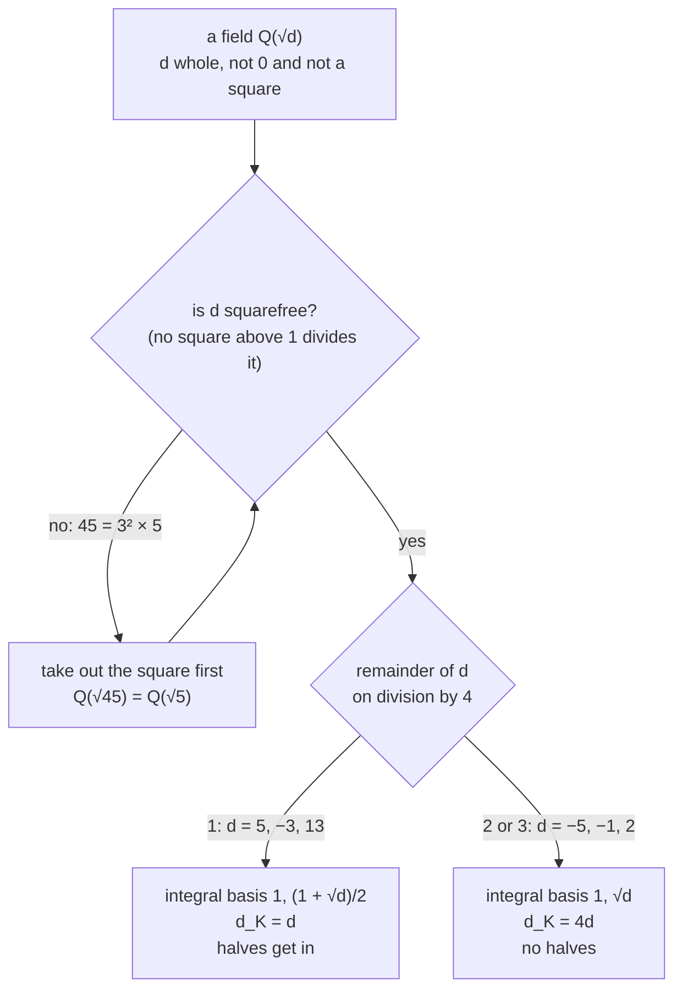

# Rings of integers: finding an integral basis, and the surprise when the root is 1 mod 4

[Syllabus](../../../SYLLABUS.md) → [Algebraic and analytic number theory](../README.md) → [Algebraic Numbers](../README.md#s06) → Rings of integers

---

## General Overview

The golden ratio $`\varphi = (1 + \sqrt5)/2`$ is the ratio of a regular pentagon's diagonal to its side. Its powers carry the Fibonacci numbers 0, 1, 1, 2, 3, 5, 8, …, each the sum of the two before. The tenth power is $`\varphi^{10} = 34 + 55\varphi`$, and 34 and 55 are Fibonacci numbers 9 and 10, counting the first 0 as number 0.

Write the same number with $`\sqrt5`$ instead of $`\varphi`$ and halves appear: $`\varphi^{10} = (123 + 55\sqrt5)/2`$. So which description shows the "whole numbers" of the field built from $`\sqrt5`$? The obvious guess is the numbers $`a + b\sqrt5`$ with $`a`$ and $`b`$ whole. That guess is wrong. $`\varphi`$ solves $`x^2 - x - 1 = 0`$, a monic equation (leading coefficient 1) with whole coefficients, so it passes the integer test of [Algebraic integers](01-algebraic-integers-and-number-fields.md), halves and all.

This card finds the whole numbers, the **ring of integers**, of every field made by adjoining one square root to the fractions. It also writes down an **integral basis**: two numbers such that every whole number of the field is one whole combination of them.

The answer depends on one remainder. When the number under the root leaves remainder 1 after division by 4, as 5 does, halves get in. Otherwise they stay out, as in the house example $`\mathbb{Z}[\sqrt{-5}]`$ (the numbers $`a + b\sqrt{-5}`$ with $`a, b`$ whole), where 6 = 2 × 3 = $`(1 + \sqrt{-5})(1 - \sqrt{-5})`$.

**For a squarefree whole number $`d`$, the whole numbers of $`\mathbb{Q}(\sqrt d)`$ are the whole combinations of 1 and $`(1 + \sqrt d)/2`$ when $`d`$ leaves remainder 1 on division by 4, and of 1 and $`\sqrt d`$ otherwise.**

**What kind of fact this is:** a theorem about every quadratic field, proved on this card in Why it works. The code adds evidence: a full search of a grid of 2,401 numbers in each of 16 fields, and a second, discriminant-based test that also works in higher degree.

### The picture: one remainder decides



---

## The formula

Notation first, in words. $`K = \mathbb{Q}(\sqrt d)`$ is the field of all $`a + b\sqrt d`$ with $`a`$ and $`b`$ fractions. $`\mathcal{O}_K`$ (a script O, not big O) is its ring of integers, the algebraic integers inside $`K`$. $`\varphi`$ is the golden ratio throughout, not the totient $`\varphi(n)`$. $`\mathbb{Z}[\theta]`$ means every whole-number combination $`x + y\theta`$. $`d \equiv 1 \pmod 4`$ means $`d`$ leaves remainder 1 on division by 4. A whole number is **squarefree** when no square larger than 1 divides it.

```math
\mathcal{O}_K = \begin{cases} \mathbb{Z}[\omega], \quad \omega = \dfrac{1 + \sqrt d}{2}, \quad d_K = d, & d \equiv 1 \pmod 4 \\[4pt] \mathbb{Z}[\sqrt d], \quad d_K = 4d, & d \equiv 2, 3 \pmod 4 \end{cases}
```

**Read it aloud:** the whole numbers of the field are the whole combinations of 1 and $`\omega`$ when $`d`$ is 1 more than a multiple of 4, and of 1 and $`\sqrt d`$ otherwise; the discriminant is $`d`$ in the first case and $`4d`$ in the second.

An **integral basis** is a list $`e_1, e_2`$ in $`\mathcal{O}_K`$ such that every element of $`\mathcal{O}_K`$ is $`x e_1 + y e_2`$ for exactly one pair of whole numbers $`x, y`$. Here the basis is 1, $`\omega`$ or 1, $`\sqrt d`$. The **field discriminant** $`d_K`$ is the discriminant of an integral basis, the determinant of its trace matrix ([Norm, trace and discriminant](02-norms-traces-and-discriminants.md)). It does not depend on which integral basis is chosen.

For $`d = 5`$, $`\omega`$ is the golden ratio $`\varphi`$, so $`\mathcal{O}_K = \mathbb{Z}[\varphi]`$ and $`d_K = 5`$. For the house example, $`-5`$ leaves remainder 3, so $`\mathcal{O}_K = \mathbb{Z}[\sqrt{-5}]`$ and $`d_K = -20`$.

| Symbol | Plain meaning | In our example | Push it up and the answer… |
| --- | --- | --- | --- |
| $`d`$ | the squarefree whole number under the root | 5; house example −5 | the basis flips with $`d`$'s remainder mod 4 |
| $`K`$ | the field $`\mathbb{Q}(\sqrt d)`$ | all $`a + b\sqrt5`$, $`a, b`$ fractions | — |
| $`\mathcal{O}_K`$ | the ring of integers: the algebraic integers in $`K`$ | $`\mathbb{Z}[\varphi]`$ | — |
| $`\omega`$, $`\varphi`$ | $`(1 + \sqrt d)/2`$, the half that may get in; for $`d = 5`$ it is the golden ratio $`\varphi`$ | $`\varphi`$, root of $`x^2 - x - 1`$ | — |
| $`e_1, e_2`$ | an integral basis | 1 and $`\varphi`$ | — |
| $`x, y`$ | the whole coordinates in the integral basis | $`\varphi^{10}`$: 34 and 55 | — |
| $`a, b`$; $`m, n`$ | the fraction coordinates in 1, $`\sqrt d`$; $`m = 2a`$, $`n = 2b`$ | $`\varphi^{10}`$: 123/2 and 55/2; 123 and 55 | denominators larger than 2 never pass |
| $`\mathrm{Tr}`$, $`N`$ | trace $`2a`$ and norm $`a^2 - d\,b^2`$ | $`\varphi`$: trace 1, norm −1 | both must be whole for an integer |
| $`d_K`$ | the field discriminant | 5; house example −20 | larger $`\lvert d_K \rvert`$: the integers more spread out |
| $`R`$, $`k`$ | a sub-ring spanned by a list of integers, and its index: how many times smaller it is | $`\mathbb{Z}[\sqrt5]`$ inside $`\mathbb{Z}[\varphi]`$: 2 | disc grows by $`k^2`$ |
| $`p`$; $`c_1, c_2`$ | a prime tried in the discriminant test; the whole numbers 0 to $`p - 1`$ in a candidate $`(c_1 e_1 + c_2 e_2)/p`$ | 2; 1 and 1, giving $`\varphi`$ | larger $`p`$, $`p^2 - 1`$ candidates |
| $`A, B, q`$ | the code's storage of $`(A + B\sqrt d)/q`$ | $`\varphi`$ is (1, 1, 2) | — |

### When it holds

- **$`d`$ must be squarefree.** For $`d = 45`$ the rule offers $`(1 + \sqrt{45})/2`$ with discriminant 45. But $`\sqrt{45} = 3\sqrt5`$, the field is $`\mathbb{Q}(\sqrt5)`$, and $`d_K`$ is 5. Take the square out first.
- **$`d`$ must not be a square.** For $`d = 1`$ or $`d = 4`$ the field is just $`\mathbb{Q}`$ and $`\mathcal{O}_K = \mathbb{Z}`$, with one basis number, not two.
- **The basis must span the integers, not just the field.** 1 and $`\sqrt5`$ give every number of $`\mathbb{Q}(\sqrt5)`$ using fractions, but whole combinations of them miss $`\varphi`$. They are a basis of the field and not an integral basis.
- **The rule is for degree 2 only.** Higher degrees have no remainder-mod-4 rule; Step 4's discriminant test still works.

---

## Why it works

### Step 0: two whole numbers decide, and only one of them can block a half

From [Algebraic integers](01-algebraic-integers-and-number-fields.md): $`\alpha = a + b\sqrt d`$ (with $`b \ne 0`$) has minimal polynomial $`x^2 - 2a\,x + (a^2 - d\,b^2)`$. So $`\alpha`$ is an algebraic integer exactly when its trace $`2a`$ and its norm $`a^2 - d\,b^2`$ are both whole.

The trace test lets $`a`$ be a half: $`2 \cdot \tfrac12 = 1`$ is whole. So halves are not ruled out at the start. Whether one gets in is decided by the norm, and the norm's answer depends on $`d`$ modulo 4.

### Step 1: no denominator bigger than 2

Put $`m = 2a`$ (whole, by the trace test) and $`n = 2b`$. Then

```math
m^2 - d\,n^2 = 4\,(a^2 - d\,b^2) = 4N,
```

which is whole. So $`d\,n^2`$ is whole. If $`n`$ had a denominator, its square would divide $`d`$, and squarefree $`d`$ has no square factor above 1. So $`n`$ is whole too. Both coordinates are whole numbers of halves: $`\alpha = (m + n\sqrt d)/2`$. In the code's grids, in steps of 1/12 and 1/30, no third, quarter, fifth or sixth ever passes.

### Step 2: the mod-4 decision

Now $`\alpha = (m + n\sqrt d)/2`$ is an integer exactly when $`m^2 - d\,n^2`$ is a multiple of 4. A square leaves remainder 0 on division by 4 (if even) or 1 (if odd). Go through the three remainders of a squarefree $`d`$ (none is 0, since 4 would divide it):

| $`d`$ mod 4 | Condition $`m^2 \equiv d\,n^2 \pmod 4`$ | What it forces |
| --- | --- | --- |
| 1 | $`m^2 \equiv n^2`$ | $`m`$ and $`n`$ both even or both odd |
| 2 | $`m^2 \equiv 2n^2`$ | $`m`$ even; then $`2n^2 \equiv 0`$, so $`n`$ even |
| 3 | $`m^2 + n^2 \equiv 0`$ | both even (two odd squares sum to 2) |

For remainders 2 and 3, $`m`$ and $`n`$ are even, so $`a`$ and $`b`$ are whole. No halves.

For remainder 1, "both odd" is allowed. The smallest case is $`m = n = 1`$: $`\omega = (1 + \sqrt d)/2`$, with norm $`(1 - d)/4`$, whole exactly because $`d \equiv 1`$.

### Step 3: the answer as a basis

When $`d \equiv 1 \pmod 4`$ and $`m, n`$ have the same parity:

```math
\frac{m + n\sqrt d}{2} = \frac{m - n}{2} + n\,\omega
```

Both $`(m - n)/2`$ and $`n`$ are whole. So every integer is $`x + y\omega`$ with whole $`x, y`$, and the pair is unique because 1 and $`\omega`$ are independent over the fractions. That is an integral basis.

It is also a ring, closed under multiplying, because $`\omega`$ satisfies

```math
\omega^2 = \omega + \frac{d - 1}{4}
```

and $`(d - 1)/4`$ is whole. For $`d = 5`$ this is $`\varphi^2 = \varphi + 1`$. Multiplying by $`\varphi`$ sends $`x + y\varphi`$ to $`y + (x + y)\varphi`$: the Fibonacci step. Ten steps from 1 give $`34 + 55\varphi`$.

### Step 4: the discriminant certifies the answer, in any degree

Steps 1 to 3 are special to square roots. A test that works in every degree uses the discriminant from [Norm, trace and discriminant](02-norms-traces-and-discriminants.md).

**The index formula.** Suppose a list $`e_1, e_2`$ of integers spans a sub-ring $`R`$ inside $`\mathcal{O}_K`$, and $`R`$ has index $`k`$: $`\mathcal{O}_K`$ splits into $`k`$ shifted copies of $`R`$. Then

```math
\mathrm{disc}(e_1, e_2) = k^2 \, d_K
```

**Read it aloud:** the discriminant of a smaller ring is the field's discriminant times the square of how many times smaller it is. For $`\mathbb{Z}[\sqrt5]`$: $`20 = 2^2 \times 5`$.

**The test.** If $`k > 1`$, some prime $`p`$ divides $`k`$, and then $`p^2`$ divides the discriminant. For that $`p`$ there is an integer of the form $`(c_1 e_1 + c_2 e_2)/p`$ with $`c_1, c_2`$ between 0 and $`p - 1`$, not both 0. So: list the primes whose square divides the discriminant, try those $`p^2 - 1`$ candidates for each, and run the trace and norm test. If none passes, the list is an integral basis.

For 1, $`\sqrt d`$ the discriminant is $`4d`$. With $`d`$ squarefree, only $`p = 2`$ qualifies. The three candidates are $`\tfrac12`$, $`\tfrac{\sqrt d}{2}`$ and $`\tfrac{1 + \sqrt d}{2}`$, with norms $`\tfrac14`$, $`-\tfrac d4`$ and $`\tfrac{1 - d}{4}`$. Only the last can be whole, and only when $`d \equiv 1 \pmod 4`$. Same answer as Step 2, by a road that never looked at parities. Computer algebra systems find integral bases by a refined form of this test, repeated until no prime is left (the Round 2 algorithm, in the last source below).

<details>
<summary>Detailed proof: the index formula and the candidates</summary>

**The index formula.** Let $`f_1, f_2`$ be an integral basis and write $`e_i = M_{i1} f_1 + M_{i2} f_2`$ with whole numbers $`M_{ij}`$. The index $`k`$ equals $`\lvert \det M \rvert`$: this is the area rule for lattices, since $`M`$ maps the unit cell of $`\mathcal{O}_K`$ onto the cell of $`R`$. The trace matrix $`T_{ij} = \mathrm{Tr}(e_i e_j)`$ is linear in each slot, so

$`\displaystyle T(e) = M \, T(f) \, M^{\mathsf T}`$

and taking determinants,

$`\displaystyle \mathrm{disc}(e_1, e_2) = (\det M)^2 \, \mathrm{disc}(f_1, f_2) = k^2 \, d_K.`$

**The candidates.** The quotient $`\mathcal{O}_K / R`$ is a finite group with $`k`$ elements under adding. If a prime $`p`$ divides $`k`$, the group has an element of order $`p`$ (Cauchy's theorem for groups). Pick $`\gamma`$ in $`\mathcal{O}_K`$ representing it. Then $`p\gamma`$ is in $`R`$, so $`p\gamma = c_1 e_1 + c_2 e_2`$ with whole $`c_i`$, not both divisible by $`p`$. Subtracting a whole combination of $`e_1, e_2`$ from $`\gamma`$ keeps it in $`\mathcal{O}_K`$ and brings each $`c_i`$ into 0 to $`p - 1`$.

</details>

**Where proof ends and evidence begins.** Steps 1 to 3 prove the rule for every squarefree $`d`$. The code's grid search and discriminant test are checks on 16 fields, $`d`$ from −11 to 13; Step 4's test is itself a proof for each field it is run on.

---

## Worked numbers, by hand

The field $`\mathbb{Q}(\sqrt5)`$, with the golden ratio.

| Step | Arithmetic | Value |
| --- | --- | --- |
| $`d`$ mod 4 | 5 = 4 + 1 | remainder 1 |
| candidate $`\tfrac12`$ | trace 1, norm $`\tfrac14`$ | not an integer |
| candidate $`\tfrac{\sqrt5}{2}`$ | trace 0, norm $`-\tfrac54`$ | not an integer |
| candidate $`\tfrac{1 + \sqrt5}{2} = \varphi`$ | trace 1, norm $`\tfrac{1 - 5}{4}`$ | −1: **an integer** |
| $`\varphi^2`$ | $`\tfrac{1 + 2\sqrt5 + 5}{4} = \tfrac{3 + \sqrt5}{2}`$ | $`\varphi + 1`$ |
| disc of 1, $`\sqrt5`$ | traces 2, 0, 10: $`2 \times 10 - 0^2`$ | 20 |
| disc of 1, $`\varphi`$ | traces 2, 1, 3: $`2 \times 3 - 1^2`$ | 5 |
| index of $`\mathbb{Z}[\sqrt5]`$ | $`\sqrt{20 / 5}`$ | 2 |
| $`\varphi^{10}`$ in 1, $`\varphi`$ | ten Fibonacci steps from (1, 0) | (34, 55) |
| $`\varphi^{10}`$ in 1, $`\sqrt5`$ | $`34 + 55 \cdot \tfrac{1 + \sqrt5}{2}`$ | $`\tfrac{123 + 55\sqrt5}{2}`$ |
| **the answer** | | $`\mathcal{O}_K = \mathbb{Z}[\varphi]`$, **basis 1, $`\varphi`$**, $`d_K = 5`$ |

The whole numbers of $`\mathbb{Q}(\sqrt5)`$ are twice as dense as $`\mathbb{Z}[\sqrt5]`$: half of them have halves in both coordinates on 1 and $`\sqrt5`$, as $`\varphi`$ and $`\varphi^{10} = (123 + 55\sqrt5)/2`$ do. All powers of $`\varphi`$ lie in the ring, since it is closed under multiplying.

The house example, $`d = -5`$, goes the other way. The candidate $`(1 + \sqrt{-5})/2`$ has norm $`(1 + 5)/4 = 6/4`$, not whole. So $`\mathcal{O}_K = \mathbb{Z}[\sqrt{-5}]`$ and $`d_K = 4 \times (-5) = -20`$, and the two factorisations of 6 really are factorisations of whole numbers.

Across 16 fields the code finds the same split. In the grid of $`a + b\sqrt d`$ with $`a, b`$ in steps of 1/12 from −2 to 2, every field with $`d \equiv 1`$ has 41 integers and every other field has 25. The 41 are the 25 whole points plus 16 points with both coordinates odd halves.

### What breaks if you drop a piece

| Mistake | Comes out at | What went wrong |
| --- | --- | --- |
| Take $`\mathbb{Z}[\sqrt5]`$ as the ring of integers | 25 integers in the grid, true 41; disc 20, true 5; 2 looks ramified | $`\varphi`$ is missing. $`x^2 - 5`$ is $`(x + 1)^2`$ mod 2, a repeated root, but the true polynomial $`x^2 - x - 1`$ has no root mod 2: 2 is inert, not ramified |
| Let halves in for $`d = -5`$ | 41 grid points, true 25 | $`(1 + \sqrt{-5})/2`$ has norm 6/4; remainder 3 keeps halves out |
| Forget to make $`d`$ squarefree, $`d = 45`$ | disc 45, true 5 | the test finds $`(3 + \sqrt{45})/6 = \varphi`$ at $`p = 3`$: $`45 = 3^2 \times 5`$ |
| Take $`\mathbb{Z}[\sqrt{-3}]`$ for $`d = -3`$ | disc −12 and 2 units, true −3 and 6 | the missing $`\omega = (1 + \sqrt{-3})/2`$ is a sixth root of 1 |

Here a **unit** is an integer whose reciprocal is also an integer, and 2 being **inert** or **ramified** describes how it factors in $`\mathcal{O}_K`$ ([Splitting and ramification](08-splitting-and-ramification.md)). The code prints every number in this table.

---

## Code, from first principles, and it actually runs

Both programs store $`(A + B\sqrt d)/q`$ as three whole numbers and use only whole-number arithmetic; nothing imported knows about number fields. They take **three independent roads** to $`\mathcal{O}_K`$ for each squarefree $`d`$ from −11 to 13: the mod-4 rule; a trace-and-norm test of all 2,401 grid points, which must match the rule's ring exactly; and Step 4's discriminant test. They also compute $`d_K`$ by two formulas (trace matrix and norm form: one identity written two ways, so a check on the code rather than a fourth road), check the golden-ratio powers against the Fibonacci recurrence, and print every row of What breaks.

### Python

```python
# Rings of integers of the quadratic fields Q(sqrt d): the mod-4 rule against two other roads.
# A number (A + B*sqrt(d))/q is stored as three whole numbers (A, B, q) with q > 0.

def integral(d, A, B, q):  # the test: trace 2A/q and norm (A^2 - d B^2)/q^2 both whole
    return (2 * A) % q == 0 and (A * A - d * B * B) % (q * q) == 0

def squarefree(n):
    p = 2
    while p * p <= abs(n):
        if n % (p * p) == 0:
            return False
        p += 1
    return True

def rule(d):  # Road 1, the theorem: the second basis number; the first is always 1
    return (1, 1, 2) if d % 4 == 1 else (0, 1, 1)

def disc(d, e):  # determinant of the trace matrix of the basis 1, e
    A, B, q = e
    top = 2 * 2 * (A * A + d * B * B) - (2 * A) ** 2  # Tr(1)Tr(e^2) - Tr(e)^2, over q^2
    assert top % (q * q) == 0
    return top // (q * q)

def form_disc(d, e):  # N(x + y e) = x^2 + Tr(e) xy + N(e) y^2; discriminant Tr(e)^2 - 4 N(e)
    A, B, q = e
    tr, nq = 2 * A // q, A * A - d * B * B
    assert nq % (q * q) == 0
    return tr * tr - 4 * (nq // (q * q))

def p_test(d, e):  # Road 3: for each prime p with p^2 | disc, try every (c1 + c2 e)/p
    D, (A, B, q), found = disc(d, e), e, []
    for p in range(2, abs(D) + 1):
        if D % (p * p) or any(p % r == 0 for r in range(2, p)):
            continue
        for c1 in range(p):
            for c2 in range(p):
                if (c1, c2) != (0, 0) and integral(d, c1 * q + c2 * A, c2 * B, p * q):
                    found.append((p, c1, c2))
    return found

def in_ring(i, j, den, e):  # is i/den + (j/den) sqrt d equal to x + y e with x, y whole?
    A, B, q = e
    if (j * q) % (den * B):
        return False
    y = j * q // (den * B)
    return (i * q - y * A * den) % (den * q) == 0

def grid(d, e, den):  # Road 2: test every a + b sqrt d, a and b in steps of 1/den from -2 to 2
    hits = clash = 0
    for i in range(-2 * den, 2 * den + 1):
        for j in range(-2 * den, 2 * den + 1):
            t = integral(d, i, j, den)
            hits += t
            clash += t != in_ring(i, j, den, e)
    return hits, clash

print(f"grid: steps of 1/12 from -2 to 2, {(4 * 12 + 1) ** 2} points per field")
print(" d  d mod 4  integral basis      d_K  grid  rule=grid  p-test")
rows = 0
for d in range(-11, 14):
    if d in (0, 1) or not squarefree(d):
        continue
    e, plain, rows = rule(d), (0, 1, 1), rows + 1
    dK, (hits, clash) = disc(d, e), grid(d, e, 12)
    name = "1, (1+sqrt d)/2" if e != plain else "1, sqrt d"
    print(f"{d:>3}  {d % 4:>4}     {name:<16} {dK:>5}  {hits:>4}  {'yes' if clash == 0 else 'no':>9}  {len(p_test(d, e))}")
    assert clash == 0 and p_test(d, e) == [] and form_disc(d, e) == dK
    assert dK == (d if d % 4 == 1 else 4 * d) and hits == (41 if d % 4 == 1 else 25)
    k2, extra = disc(d, plain) // dK, p_test(d, plain)
    assert (k2 == 4) == (d % 4 == 1) == (extra == [(2, 1, 1)]) and k2 in (1, 4)

h = (1 + (-5) * 1 * (-1), 1 * (-1) + 1 * 1, 1)  # (1 + sqrt-5)(1 - sqrt-5)
print(f"fields checked: {rows}")
yn = lambda t: "yes" if t else "no"
print(f"house d=-5: (1+sqrt-5)(1-sqrt-5) = {h[0]}; (1+sqrt-5)/2 has norm {1 + 5}/4, integral {yn(integral(-5, 1, 1, 2))};"
      f" d_K = {disc(-5, rule(-5))}")
assert h[1:] == (0, 1)
PA, PB, Pq = rule(5)
k = next(k for k in range(1, 9) if k * k * disc(5, rule(5)) == disc(5, (0, 1, 1)))
print(f"d=5: disc of 1, sqrt5 = {disc(5, (0, 1, 1))}; disc of 1, phi = {disc(5, rule(5))}; index {k};"
      f" traces of 1, phi, phi^2: 2, {2 * PA // Pq}, {2 * (PA * PA + 5 * PB * PB) // (Pq * Pq)}; of 5: {2 * 5}")
for e, nm in [((1, 0, 2), "1/2"), ((0, 1, 2), "sqrt5/2"), ((1, 1, 2), "(1+sqrt5)/2")]:
    print(f"  candidate {nm}: trace {2 * e[0]}/2, norm {e[0] ** 2 - 5 * e[1] ** 2}/4, integral {yn(integral(5, *e))}")
print(f"  p-test on 1, sqrt5 finds (p, c1, c2): {p_test(5, (0, 1, 1))}; on 1, sqrt12: {p_test(12, (0, 1, 1))}")

def mul(u, v, c):  # (x1 + y1 w)(x2 + y2 w) with w^2 = w + c, c = (d - 1)/4
    return (u[0] * v[0] + c * u[1] * v[1], u[0] * v[1] + v[0] * u[1] + u[1] * v[1])

p10, fib = (1, 0), [0, 1]
for n in range(10):
    p10 = mul(p10, (0, 1), 1)
    fib.append(fib[-1] + fib[-2])
A10, B10 = 2 * p10[0] + p10[1], p10[1]  # x + y phi = (2x + y + y sqrt5)/2
print(f"phi^10 = {p10[0]} + {p10[1]} phi = ({A10} + {B10} sqrt5)/2; Fibonacci F0 to F11 = {fib};"
      f" norm {(A10 * A10 - 5 * B10 * B10) // 4}")
assert p10 == (fib[9], fib[10]) and integral(5, A10, B10, 2) and (A10, B10) == (123, 55)
inv1, inv2 = (-1, 1), (2, -1)
assert mul(inv1, (0, 1), 1) == (1, 0) and mul(mul(inv2, (0, 1), 1), (0, 1), 1) == (1, 0)
print(f"phi^-1 = {inv1[0]} + {inv1[1]} phi, phi^-2 = {inv2[0]} + ({inv2[1]}) phi: pentagram pieces")
print(f"norm form d=5: x^2 + xy - y^2, disc {form_disc(5, rule(5))}; d=-5: x^2 + 5y^2, disc {form_disc(-5, rule(-5))}")
fine = 30
g30 = [grid(d, rule(d), fine) for d in (5, -5)]
print(f"grid in steps of 1/{fine} ({(4 * fine + 1) ** 2} points): d=5 {g30[0][0]}, d=-5 {g30[1][0]}")
assert g30 == [(41, 0), (25, 0)]

roots = lambda f: [x for x in (0, 1) if f(x) % 2 == 0]
z5, half_in = grid(5, (0, 1, 1), 12), grid(-5, (1, 1, 2), 12)
print(f"break: 1, sqrt5 as basis: ring has {z5[0] - z5[1]} grid points, true {z5[0]};"
      f" roots mod 2 of x^2-5: {roots(lambda x: x * x - 5)}, of x^2-x-1: {roots(lambda x: x * x - x - 1)}")
print(f"break: halves let in at d=-5: ring has {half_in[0] + half_in[1]} grid points, true {half_in[0]}")
assert z5 == (41, 16) and half_in == (25, 16)
print(f"break: d=45 not squarefree: rule disc {disc(45, rule(45))}; p-test finds {p_test(45, rule(45))};"
      f" true d_K {disc(5, rule(5))}")
assert p_test(45, rule(45)) == [(3, 1, 1), (3, 2, 2)] and disc(45, rule(45)) == 9 * disc(5, rule(5))
units = lambda nf: sum(nf(x, y) == 1 for x in range(-3, 4) for y in range(-3, 4))
u_omega, u_plain = units(lambda x, y: x * x + x * y + y * y), units(lambda x, y: x * x + 3 * y * y)
print(f"break: d=-3 as 1, sqrt-3: disc {disc(-3, (0, 1, 1))}, units {u_plain};"
      f" true 1, omega: disc {disc(-3, rule(-3))}, units {u_omega}")
assert (u_omega, u_plain) == (6, 2)
print("ALL CHECKS PASS")
```

**Ran 2026-11-15 on macOS, Python 3.14.10, standard library only. All checks passed. Output, pasted from the run:**

```
grid: steps of 1/12 from -2 to 2, 2401 points per field
 d  d mod 4  integral basis      d_K  grid  rule=grid  p-test
-11     1     1, (1+sqrt d)/2    -11    41        yes  0
-10     2     1, sqrt d          -40    25        yes  0
 -7     1     1, (1+sqrt d)/2     -7    41        yes  0
 -6     2     1, sqrt d          -24    25        yes  0
 -5     3     1, sqrt d          -20    25        yes  0
 -3     1     1, (1+sqrt d)/2     -3    41        yes  0
 -2     2     1, sqrt d           -8    25        yes  0
 -1     3     1, sqrt d           -4    25        yes  0
  2     2     1, sqrt d            8    25        yes  0
  3     3     1, sqrt d           12    25        yes  0
  5     1     1, (1+sqrt d)/2      5    41        yes  0
  6     2     1, sqrt d           24    25        yes  0
  7     3     1, sqrt d           28    25        yes  0
 10     2     1, sqrt d           40    25        yes  0
 11     3     1, sqrt d           44    25        yes  0
 13     1     1, (1+sqrt d)/2     13    41        yes  0
fields checked: 16
house d=-5: (1+sqrt-5)(1-sqrt-5) = 6; (1+sqrt-5)/2 has norm 6/4, integral no; d_K = -20
d=5: disc of 1, sqrt5 = 20; disc of 1, phi = 5; index 2; traces of 1, phi, phi^2: 2, 1, 3; of 5: 10
  candidate 1/2: trace 2/2, norm 1/4, integral no
  candidate sqrt5/2: trace 0/2, norm -5/4, integral no
  candidate (1+sqrt5)/2: trace 2/2, norm -4/4, integral yes
  p-test on 1, sqrt5 finds (p, c1, c2): [(2, 1, 1)]; on 1, sqrt12: [(2, 0, 1)]
phi^10 = 34 + 55 phi = (123 + 55 sqrt5)/2; Fibonacci F0 to F11 = [0, 1, 1, 2, 3, 5, 8, 13, 21, 34, 55, 89]; norm 1
phi^-1 = -1 + 1 phi, phi^-2 = 2 + (-1) phi: pentagram pieces
norm form d=5: x^2 + xy - y^2, disc 5; d=-5: x^2 + 5y^2, disc -20
grid in steps of 1/30 (14641 points): d=5 41, d=-5 25
break: 1, sqrt5 as basis: ring has 25 grid points, true 41; roots mod 2 of x^2-5: [1], of x^2-x-1: []
break: halves let in at d=-5: ring has 41 grid points, true 25
break: d=45 not squarefree: rule disc 45; p-test finds [(3, 1, 1), (3, 2, 2)]; true d_K 5
break: d=-3 as 1, sqrt-3: disc -12, units 2; true 1, omega: disc -3, units 6
ALL CHECKS PASS
```

### Rust

The Rust uses plain `i64` without overflow checks. Every value stays small: the same file built with `-C overflow-checks=on`, which stops at any overflow, prints the same output.

```rust
// Rings of integers of the quadratic fields Q(sqrt d): the mod-4 rule against two other roads.
// A number (A + B*sqrt(d))/q is stored as three whole numbers (A, B, q) with q > 0.
type E = (i64, i64, i64);

// the test: trace 2A/q and norm (A^2 - d B^2)/q^2 both whole
fn integral(d: i64, a: i64, b: i64, q: i64) -> bool {
    (2 * a) % q == 0 && (a * a - d * b * b) % (q * q) == 0
}

fn squarefree(n: i64) -> bool {
    let mut p = 2;
    while p * p <= n.abs() {
        if n % (p * p) == 0 {
            return false;
        }
        p += 1;
    }
    true
}

// Road 1, the theorem: the second basis number; the first is always 1
fn rule(d: i64) -> E { if d.rem_euclid(4) == 1 { (1, 1, 2) } else { (0, 1, 1) } }

// determinant of the trace matrix of the basis 1, e
fn disc(d: i64, e: E) -> i64 {
    let (a, b, q) = e;
    let top = 2 * 2 * (a * a + d * b * b) - (2 * a) * (2 * a); // Tr(1)Tr(e^2) - Tr(e)^2, over q^2
    assert!(top % (q * q) == 0);
    top / (q * q)
}

// N(x + y e) = x^2 + Tr(e) xy + N(e) y^2; discriminant Tr(e)^2 - 4 N(e)
fn form_disc(d: i64, e: E) -> i64 {
    let (a, b, q) = e;
    let (tr, nq) = (2 * a / q, a * a - d * b * b);
    assert!(nq % (q * q) == 0);
    tr * tr - 4 * (nq / (q * q))
}

// Road 3: for each prime p with p^2 | disc, try every (c1 + c2 e)/p
fn p_test(d: i64, e: E) -> Vec<E> {
    let (dd, (a, b, q)) = (disc(d, e), e);
    let mut found = Vec::new();
    for p in 2..=dd.abs() {
        if dd % (p * p) != 0 || (2..p).any(|r| p % r == 0) {
            continue;
        }
        for c1 in 0..p {
            for c2 in 0..p {
                if (c1, c2) != (0, 0) && integral(d, c1 * q + c2 * a, c2 * b, p * q) {
                    found.push((p, c1, c2));
                }
            }
        }
    }
    found
}

// is i/den + (j/den) sqrt d equal to x + y e with x, y whole?
fn in_ring(i: i64, j: i64, den: i64, e: E) -> bool {
    let (a, b, q) = e;
    if (j * q) % (den * b) != 0 {
        return false;
    }
    let y = j * q / (den * b);
    (i * q - y * a * den) % (den * q) == 0
}

// Road 2: test every a + b sqrt d, a and b in steps of 1/den from -2 to 2
fn grid(d: i64, e: E, den: i64) -> (i64, i64) {
    let (mut hits, mut clash) = (0, 0);
    for i in -2 * den..=2 * den {
        for j in -2 * den..=2 * den {
            let t = integral(d, i, j, den);
            hits += t as i64;
            clash += (t != in_ring(i, j, den, e)) as i64;
        }
    }
    (hits, clash)
}

// (x1 + y1 w)(x2 + y2 w) with w^2 = w + c, c = (d - 1)/4
fn mul(u: (i64, i64), v: (i64, i64), c: i64) -> (i64, i64) {
    (u.0 * v.0 + c * u.1 * v.1, u.0 * v.1 + v.0 * u.1 + u.1 * v.1)
}

fn yn(t: bool) -> &'static str { if t { "yes" } else { "no" } }

fn roots(f: impl Fn(i64) -> i64) -> Vec<i64> {
    (0..2).filter(|&x| f(x) % 2 == 0).collect()
}

fn units(nf: impl Fn(i64, i64) -> i64) -> i64 {
    let mut n = 0;
    for x in -3..4 {
        for y in -3..4 {
            n += (nf(x, y) == 1) as i64;
        }
    }
    n
}

fn main() {
    println!("grid: steps of 1/12 from -2 to 2, {} points per field", (4 * 12 + 1) * (4 * 12 + 1));
    println!(" d  d mod 4  integral basis      d_K  grid  rule=grid  p-test");
    let mut rows = 0;
    for d in -11i64..14 {
        if d == 0 || d == 1 || !squarefree(d) {
            continue;
        }
        let (e, plain) = (rule(d), (0, 1, 1));
        rows += 1;
        let (dk, (hits, clash)) = (disc(d, e), grid(d, e, 12));
        let name = if e != plain { "1, (1+sqrt d)/2" } else { "1, sqrt d" };
        let m = d.rem_euclid(4);
        println!("{:>3}  {:>4}     {:<16} {:>5}  {:>4}  {:>9}  {}", d, m, name, dk, hits, yn(clash == 0), p_test(d, e).len());
        assert!(clash == 0 && p_test(d, e).is_empty() && form_disc(d, e) == dk);
        assert!(dk == (if m == 1 { d } else { 4 * d }) && hits == (if m == 1 { 41 } else { 25 }));
        let (k2, extra) = (disc(d, plain) / dk, p_test(d, plain));
        assert!((k2 == 4) == (m == 1) && (m == 1) == (extra == vec![(2, 1, 1)]) && (k2 == 1 || k2 == 4));
    }

    println!("fields checked: {}", rows);
    let h = (1 + (-5) * 1 * (-1), 1 * (-1) + 1 * 1, 1); // (1 + sqrt-5)(1 - sqrt-5)
    println!("house d=-5: (1+sqrt-5)(1-sqrt-5) = {}; (1+sqrt-5)/2 has norm {}/4, integral {}; d_K = {}",
             h.0, 1 + 5, yn(integral(-5, 1, 1, 2)), disc(-5, rule(-5)));
    assert!(h.1 == 0 && h.2 == 1);
    let (pa, pb, pq) = rule(5);
    let k = (1..9).find(|k| k * k * disc(5, rule(5)) == disc(5, (0, 1, 1))).unwrap();
    println!("d=5: disc of 1, sqrt5 = {}; disc of 1, phi = {}; index {}; traces of 1, phi, phi^2: 2, {}, {}; of 5: {}",
             disc(5, (0, 1, 1)), disc(5, rule(5)), k, 2 * pa / pq, 2 * (pa * pa + 5 * pb * pb) / (pq * pq), 2 * 5);
    for (e, nm) in [((1, 0, 2), "1/2"), ((0, 1, 2), "sqrt5/2"), ((1, 1, 2), "(1+sqrt5)/2")] {
        println!("  candidate {}: trace {}/2, norm {}/4, integral {}", nm, 2 * e.0, e.0 * e.0 - 5 * e.1 * e.1,
                 yn(integral(5, e.0, e.1, e.2)));
    }
    println!("  p-test on 1, sqrt5 finds (p, c1, c2): {:?}; on 1, sqrt12: {:?}", p_test(5, (0, 1, 1)), p_test(12, (0, 1, 1)));

    let (mut p10, mut fib) = ((1i64, 0i64), vec![0i64, 1]);
    for _ in 0..10 {
        p10 = mul(p10, (0, 1), 1);
        let n = fib.len();
        fib.push(fib[n - 1] + fib[n - 2]);
    }
    let (a10, b10) = (2 * p10.0 + p10.1, p10.1); // x + y phi = (2x + y + y sqrt5)/2
    println!("phi^10 = {} + {} phi = ({} + {} sqrt5)/2; Fibonacci F0 to F11 = {:?}; norm {}",
             p10.0, p10.1, a10, b10, fib, (a10 * a10 - 5 * b10 * b10) / 4);
    assert!(p10 == (fib[9], fib[10]) && integral(5, a10, b10, 2) && (a10, b10) == (123, 55));
    let (inv1, inv2) = ((-1i64, 1i64), (2i64, -1i64));
    assert!(mul(inv1, (0, 1), 1) == (1, 0) && mul(mul(inv2, (0, 1), 1), (0, 1), 1) == (1, 0));
    println!("phi^-1 = {} + {} phi, phi^-2 = {} + ({}) phi: pentagram pieces", inv1.0, inv1.1, inv2.0, inv2.1);
    println!("norm form d=5: x^2 + xy - y^2, disc {}; d=-5: x^2 + 5y^2, disc {}", form_disc(5, rule(5)), form_disc(-5, rule(-5)));
    let fine = 30;
    let g30 = [grid(5, rule(5), fine), grid(-5, rule(-5), fine)];
    println!("grid in steps of 1/{} ({} points): d=5 {}, d=-5 {}", fine, (4 * fine + 1) * (4 * fine + 1), g30[0].0, g30[1].0);
    assert!(g30 == [(41, 0), (25, 0)]);

    let (z5, half_in) = (grid(5, (0, 1, 1), 12), grid(-5, (1, 1, 2), 12));
    println!("break: 1, sqrt5 as basis: ring has {} grid points, true {}; roots mod 2 of x^2-5: {:?}, of x^2-x-1: {:?}",
             z5.0 - z5.1, z5.0, roots(|x| x * x - 5), roots(|x| x * x - x - 1));
    println!("break: halves let in at d=-5: ring has {} grid points, true {}", half_in.0 + half_in.1, half_in.0);
    assert!(z5 == (41, 16) && half_in == (25, 16));
    println!("break: d=45 not squarefree: rule disc {}; p-test finds {:?}; true d_K {}",
             disc(45, rule(45)), p_test(45, rule(45)), disc(5, rule(5)));
    assert!(p_test(45, rule(45)) == vec![(3, 1, 1), (3, 2, 2)] && disc(45, rule(45)) == 9 * disc(5, rule(5)));
    let (u_omega, u_plain) = (units(|x, y| x * x + x * y + y * y), units(|x, y| x * x + 3 * y * y));
    println!("break: d=-3 as 1, sqrt-3: disc {}, units {}; true 1, omega: disc {}, units {}",
             disc(-3, (0, 1, 1)), u_plain, disc(-3, rule(-3)), u_omega);
    assert!((u_omega, u_plain) == (6, 2));
    println!("ALL CHECKS PASS");
}
```

**Ran 2026-11-15 on macOS, rustc 1.98.1, no crates. All checks passed. Output, pasted from the run:**

```
grid: steps of 1/12 from -2 to 2, 2401 points per field
 d  d mod 4  integral basis      d_K  grid  rule=grid  p-test
-11     1     1, (1+sqrt d)/2    -11    41        yes  0
-10     2     1, sqrt d          -40    25        yes  0
 -7     1     1, (1+sqrt d)/2     -7    41        yes  0
 -6     2     1, sqrt d          -24    25        yes  0
 -5     3     1, sqrt d          -20    25        yes  0
 -3     1     1, (1+sqrt d)/2     -3    41        yes  0
 -2     2     1, sqrt d           -8    25        yes  0
 -1     3     1, sqrt d           -4    25        yes  0
  2     2     1, sqrt d            8    25        yes  0
  3     3     1, sqrt d           12    25        yes  0
  5     1     1, (1+sqrt d)/2      5    41        yes  0
  6     2     1, sqrt d           24    25        yes  0
  7     3     1, sqrt d           28    25        yes  0
 10     2     1, sqrt d           40    25        yes  0
 11     3     1, sqrt d           44    25        yes  0
 13     1     1, (1+sqrt d)/2     13    41        yes  0
fields checked: 16
house d=-5: (1+sqrt-5)(1-sqrt-5) = 6; (1+sqrt-5)/2 has norm 6/4, integral no; d_K = -20
d=5: disc of 1, sqrt5 = 20; disc of 1, phi = 5; index 2; traces of 1, phi, phi^2: 2, 1, 3; of 5: 10
  candidate 1/2: trace 2/2, norm 1/4, integral no
  candidate sqrt5/2: trace 0/2, norm -5/4, integral no
  candidate (1+sqrt5)/2: trace 2/2, norm -4/4, integral yes
  p-test on 1, sqrt5 finds (p, c1, c2): [(2, 1, 1)]; on 1, sqrt12: [(2, 0, 1)]
phi^10 = 34 + 55 phi = (123 + 55 sqrt5)/2; Fibonacci F0 to F11 = [0, 1, 1, 2, 3, 5, 8, 13, 21, 34, 55, 89]; norm 1
phi^-1 = -1 + 1 phi, phi^-2 = 2 + (-1) phi: pentagram pieces
norm form d=5: x^2 + xy - y^2, disc 5; d=-5: x^2 + 5y^2, disc -20
grid in steps of 1/30 (14641 points): d=5 41, d=-5 25
break: 1, sqrt5 as basis: ring has 25 grid points, true 41; roots mod 2 of x^2-5: [1], of x^2-x-1: []
break: halves let in at d=-5: ring has 41 grid points, true 25
break: d=45 not squarefree: rule disc 45; p-test finds [(3, 1, 1), (3, 2, 2)]; true d_K 5
break: d=-3 as 1, sqrt-3: disc -12, units 2; true 1, omega: disc -3, units 6
ALL CHECKS PASS
```

### Lean

Lean proves the rule for every squarefree $`d`$ that is not a square, together with the discriminant and the by-hand numbers.

- Take $`d`$ squarefree and not a square, and let $`e`$ be $`\omega`$ if $`d \equiv 1 \pmod 4`$ and $`\sqrt d`$ otherwise. Then the algebraic integers of $`\mathbb{Q}(\sqrt d)`$ are the $`x + ye`$ with $`x, y`$ whole, each written one way only.
- Take the same $`d`$ and $`e`$. Then the discriminant of 1, $`e`$ is $`d_K = d`$ when $`d \equiv 1 \pmod 4`$, and $`4d`$ otherwise.
- Take the same $`d`$. Then $`\omega = (1 + \sqrt d)/2`$ is an algebraic integer exactly when $`d \equiv 1 \pmod 4`$.
- Lean also checks the by-hand numbers: $`\varphi^{10} = 34 + 55\varphi`$, the three candidate norms for $`d = 5`$, and the discriminants 20 and 5.
- Work in $`\mathbb{Z}[\sqrt{-5}]`$. Then $`(1 + \sqrt{-5})(1 - \sqrt{-5}) = 6`$, the house example.
- Take $`d = -3`$. Then on a small grid, the norm is 1 at 6 points for $`\mathbb{Z}[\omega]`$ and at 2 for $`\mathbb{Z}[\sqrt{-3}]`$.

The grid searches over 16 fields and Step 4's discriminant test are left to the Python and Rust checks.

```lean
-- Rings of integers: for a squarefree whole number d that is not a square, the algebraic integers of Q(√d) are exactly the whole combinations x + y·e, in one way only, of 1 and e = (1 + √d)/2 when d leaves remainder 1 on division by 4 and e = √d otherwise, and the discriminant of the basis 1, e is d or 4d.
import Mathlib.Algebra.QuadraticAlgebra.Integral
import Mathlib.Algebra.QuadraticAlgebra.Int
import Mathlib.RingTheory.Discriminant
import Mathlib.Algebra.Squarefree.Basic
import Mathlib.Data.Int.Interval
import Mathlib.Tactic.NormNum
import Mathlib.Algebra.GCDMonoid.IntegrallyClosed
import Mathlib.Data.ZMod.Basic

open QuadraticAlgebra

/-- The second integral-basis number of `ℚ(√d)`, written in the model
`QuadraticAlgebra ℚ d 0` of `ℚ(√d)`, where `ω` is `√d` (`ω ^ 2 = d`):
`(1 + √d)/2` when `d ≡ 1 (mod 4)`, and `√d` otherwise. -/
noncomputable def basisTwo (d : ℤ) : QuadraticAlgebra ℚ (d : ℚ) 0 :=
  if d % 4 = 1 then (2 : ℚ)⁻¹ • (1 + ω) else ω

theorem roi_intClosed : IsIntegrallyClosedIn ℤ ℚ :=
  (isIntegrallyClosed_iff_isIntegrallyClosedIn ℚ).mp inferInstance

theorem roi_isIntegral_iff (d : ℤ) (z : QuadraticAlgebra ℚ (d : ℚ) 0) :
    IsIntegral ℤ z ↔ (∃ t : ℤ, 2 * z.re = t) ∧ ∃ n : ℤ, z.re * z.re - d * z.im * z.im = n := by
  have := roi_intClosed
  rw [isIntegral_iff, trace_def, norm_def]
  simp only [Set.mem_range, algebraMap_int_eq, eq_intCast, zero_mul, add_zero]
  constructor
  · rintro ⟨⟨t, ht⟩, ⟨n, hn⟩⟩; exact ⟨⟨t, ht.symm⟩, ⟨n, hn.symm⟩⟩
  · rintro ⟨⟨t, ht⟩, ⟨n, hn⟩⟩; exact ⟨⟨t, ht.symm⟩, ⟨n, hn.symm⟩⟩

theorem roi_sqfree_rat (d : ℤ) (hsf : Squarefree d) (q : ℚ) (k : ℤ) (h : (d : ℚ) * q ^ 2 = k) :
    ∃ m : ℤ, q = m := by
  have hden : (q.den : ℚ) ≠ 0 := by positivity
  have hq : q = q.num / q.den := (Rat.num_div_den q).symm
  have key : d * q.num ^ 2 = k * (q.den : ℤ) ^ 2 := by
    have : (d : ℚ) * (q.num : ℚ) ^ 2 = (k : ℚ) * ((q.den : ℤ) : ℚ) ^ 2 := by
      rw [hq] at h; field_simp at h; push_cast; linarith
    exact_mod_cast this
  have hcop : IsCoprime ((q.den : ℤ) ^ 2) (q.num ^ 2) := by
    apply IsCoprime.pow
    rw [Int.isCoprime_iff_gcd_eq_one, Int.gcd_comm]
    exact q.reduced
  have hdvd : (q.den : ℤ) ^ 2 ∣ d := by
    have : (q.den : ℤ) ^ 2 ∣ q.num ^ 2 * d := ⟨k, by linarith [key]⟩
    exact hcop.dvd_of_dvd_mul_left this
  have hu : IsUnit (q.den : ℤ) := hsf _ (by rw [← sq]; exact hdvd)
  have h1 : q.den = 1 := by
    rcases Int.isUnit_iff.mp hu with h1 | h1 <;> omega
  exact ⟨q.num, by rw [hq, h1]; simp⟩

theorem roi_zmod_one : ∀ T U : ZMod 4, T ^ 2 - 1 * U ^ 2 = 0 → 2 * (T - U) = 0 := by decide
theorem roi_zmod_two : ∀ T U : ZMod 4, T ^ 2 - 2 * U ^ 2 = 0 → 2 * T = 0 ∧ 2 * U = 0 := by decide
theorem roi_zmod_three : ∀ T U : ZMod 4, T ^ 2 - 3 * U ^ 2 = 0 → 2 * T = 0 ∧ 2 * U = 0 := by decide

theorem roi_dvd_four (x : ℤ) (h : ((x : ℤ) : ZMod 4) = 0) : 4 ∣ x :=
  (ZMod.intCast_zmod_eq_zero_iff_dvd x 4).mp h

theorem roi_cast_mod (d c : ℤ) (h : d % 4 = c) : ((d : ℤ) : ZMod 4) = ((c : ℤ) : ZMod 4) := by
  rw [← h]; exact (ZMod.intCast_mod d 4).symm

theorem roi_mod4_ne_zero (d : ℤ) (hsf : Squarefree d) : d % 4 ≠ 0 := by
  intro h
  have : (2 : ℤ) * 2 ∣ d := by omega
  have := hsf 2 this
  rw [Int.isUnit_iff] at this; omega

theorem roi_algTrace (d : ℤ) (z : QuadraticAlgebra ℚ (d : ℚ) 0) :
    Algebra.trace ℚ (QuadraticAlgebra ℚ (d : ℚ) 0) z = QuadraticAlgebra.trace z := by
  rw [Algebra.trace_eq_matrix_trace (QuadraticAlgebra.basis (d : ℚ) 0)]
  simp [Matrix.trace, Fin.sum_univ_two, Algebra.leftMulMatrix_eq_repr_mul, trace_def]
  ring

/-- The card's main claim. Let `d` be a squarefree whole number that is not a square, and
`K = ℚ(√d)`. A number `z` of `K` is an algebraic integer (a root of a monic polynomial with whole
coefficients) exactly when `z = x + y·e` for whole numbers `x, y`, and then the pair `x, y` is
unique. Here `e = (1 + √d)/2` when `d` leaves remainder 1 on division by 4, and `e = √d`
otherwise. So `1, e` is an integral basis of the ring of integers `O_K`. -/
theorem ring_of_integers_quadratic_field (d : ℤ) (hsf : Squarefree d) (hns : ¬ IsSquare d)
    (z : QuadraticAlgebra ℚ (d : ℚ) 0) :
    IsIntegral ℤ z ↔
      ∃! xy : ℤ × ℤ, z = (xy.1 : QuadraticAlgebra ℚ (d : ℚ) 0) +
        (xy.2 : QuadraticAlgebra ℚ (d : ℚ) 0) * basisTwo d := by
  rw [roi_isIntegral_iff]
  by_cases hd : d % 4 = 1
  · have hd' : (d : ℚ) = 4 * ((d / 4 : ℤ) : ℚ) + 1 := by exact_mod_cast (by omega : d = 4 * (d / 4) + 1)
    constructor
    · rintro ⟨⟨t, ht⟩, ⟨n, hn⟩⟩
      obtain ⟨u, hu⟩ := roi_sqfree_rat d hsf (2 * z.im) (t ^ 2 - 4 * n) (by
        push_cast; rw [← ht, ← hn]; ring)
      have heq : t ^ 2 - d * u ^ 2 = 4 * n := by
        have : (t : ℚ) ^ 2 - d * (u : ℚ) ^ 2 = 4 * n := by rw [← ht, ← hu, ← hn]; ring
        exact_mod_cast this
      have hz : ((2 * (t - u) : ℤ) : ZMod 4) = 0 := by
        have hc := congrArg (Int.cast : ℤ → ZMod 4) heq
        push_cast at hc ⊢
        rw [roi_cast_mod d 1 hd] at hc
        have h4 : (4 : ZMod 4) = 0 := by decide
        rw [h4, zero_mul] at hc
        exact roi_zmod_one _ _ (by simpa using hc)
      obtain ⟨k, hk⟩ := roi_dvd_four _ hz
      refine ⟨⟨k, u⟩, ?_, ?_⟩
      · have hk' : (t : ℚ) = 2 * k + u := by exact_mod_cast (by omega : t = 2 * k + u)
        ext <;> simp [basisTwo, hd] <;> linarith
      · rintro ⟨x, y⟩ hxy
        have h1 := congrArg QuadraticAlgebra.re hxy
        have h2 := congrArg QuadraticAlgebra.im hxy
        simp [basisTwo, hd] at h1 h2
        have hy : (y : ℚ) = u := by linarith
        have hy' : y = u := by exact_mod_cast hy
        have hx : (x : ℚ) = k := by
          have hk' : (t : ℚ) = 2 * k + u := by exact_mod_cast (by omega : t = 2 * k + u)
          linarith
        have hx' : x = k := by exact_mod_cast hx
        simp [hx', hy']
    · rintro ⟨⟨x, y⟩, rfl, -⟩
      refine ⟨⟨2 * x + y, ?_⟩, ⟨x * x + x * y - (d / 4) * y * y, ?_⟩⟩
      · simp [basisTwo, hd]; ring
      · simp [basisTwo, hd]; rw [hd']; push_cast; ring
  · have hd0 := roi_mod4_ne_zero d hsf
    constructor
    · rintro ⟨⟨t, ht⟩, ⟨n, hn⟩⟩
      obtain ⟨u, hu⟩ := roi_sqfree_rat d hsf (2 * z.im) (t ^ 2 - 4 * n) (by
        push_cast; rw [← ht, ← hn]; ring)
      have heq : t ^ 2 - d * u ^ 2 = 4 * n := by
        have : (t : ℚ) ^ 2 - d * (u : ℚ) ^ 2 = 4 * n := by rw [← ht, ← hu, ← hn]; ring
        exact_mod_cast this
      have hz : ((2 * t : ℤ) : ZMod 4) = 0 ∧ ((2 * u : ℤ) : ZMod 4) = 0 := by
        have hc := congrArg (Int.cast : ℤ → ZMod 4) heq
        push_cast at hc ⊢
        have h4 : (4 : ZMod 4) = 0 := by decide
        rw [h4, zero_mul] at hc
        have : d % 4 = 2 ∨ d % 4 = 3 := by omega
        rcases this with h | h
        · rw [roi_cast_mod d 2 h] at hc
          exact roi_zmod_two _ _ (by simpa using hc)
        · rw [roi_cast_mod d 3 h] at hc
          exact roi_zmod_three _ _ (by simpa using hc)
      obtain ⟨k, hk⟩ := roi_dvd_four _ hz.1
      obtain ⟨l, hl⟩ := roi_dvd_four _ hz.2
      have hk' : (t : ℚ) = 2 * k := by exact_mod_cast (by omega : t = 2 * k)
      have hl' : (u : ℚ) = 2 * l := by exact_mod_cast (by omega : u = 2 * l)
      refine ⟨⟨k, l⟩, ?_, ?_⟩
      · ext <;> simp [basisTwo, hd] <;> linarith
      · rintro ⟨x, y⟩ hxy
        have h1 := congrArg QuadraticAlgebra.re hxy
        have h2 := congrArg QuadraticAlgebra.im hxy
        simp [basisTwo, hd] at h1 h2
        have hy : (y : ℚ) = l := by linarith
        have hy' : y = l := by exact_mod_cast hy
        have hx : (x : ℚ) = k := by linarith
        have hx' : x = k := by exact_mod_cast hx
        simp [hx', hy']
    · rintro ⟨⟨x, y⟩, rfl, -⟩
      refine ⟨⟨2 * x, ?_⟩, ⟨x * x - d * y * y, ?_⟩⟩
      · simp [basisTwo, hd]
      · simp [basisTwo, hd]

/-- The field discriminant. With the same hypotheses, the discriminant of the integral basis
`1, e` (the determinant of its trace matrix) is `d_K = d` when `d ≡ 1 (mod 4)` and
`d_K = 4d` otherwise. -/
theorem discriminant_quadratic_field (d : ℤ) (hsf : Squarefree d) (hns : ¬ IsSquare d) :
    Algebra.discr ℚ ![(1 : QuadraticAlgebra ℚ (d : ℚ) 0), basisTwo d] =
      if d % 4 = 1 then (d : ℚ) else 4 * d := by
  rw [Algebra.discr_def, Matrix.det_fin_two]
  simp only [Algebra.traceMatrix_apply, Algebra.traceForm_apply, roi_algTrace, trace_def]
  by_cases hd : d % 4 = 1
  · simp [basisTwo, hd]
    ring
  · simp [basisTwo, hd]
    ring

/-- The half that gets in. For `d ≡ 1 (mod 4)`, `ω = (1 + √d)/2` satisfies
`ω ^ 2 = ω + (d - 1)/4`, a monic equation with whole coefficients, so `ω` is an algebraic
integer; for `d ≡ 2` or `3 (mod 4)` it is not. -/
theorem half_is_integral_iff (d : ℤ) (hsf : Squarefree d) (hns : ¬ IsSquare d) :
    IsIntegral ℤ ((2 : ℚ)⁻¹ • (1 + ω) : QuadraticAlgebra ℚ (d : ℚ) 0) ↔ d % 4 = 1 := by
  rw [roi_isIntegral_iff]
  simp only [re_smul, im_smul, re_add, im_add, re_one, im_one, re_omega, im_omega, smul_eq_mul]
  constructor
  · rintro ⟨-, ⟨n, hn⟩⟩
    have : (1 : ℚ) - d = 4 * n := by linarith
    have : (1 : ℤ) - d = 4 * n := by exact_mod_cast this
    omega
  · intro hd
    have hd' : (d : ℚ) = 4 * ((d / 4 : ℤ) : ℚ) + 1 := by exact_mod_cast (by omega : d = 4 * (d / 4) + 1)
    refine ⟨⟨1, by norm_num⟩, ⟨-(d / 4), ?_⟩⟩
    rw [hd']; push_cast; ring

-- The card's whole-number worked examples.
-- 5 leaves remainder 1 on division by 4; −5 leaves remainder 3.
example : (5 : ℤ) % 4 = 1 ∧ (-5 : ℤ) % 4 = 3 := by decide
-- In Z[φ] (φ² = 1 + φ), the tenth power of the golden ratio is 34 + 55φ.
example : (ω : QuadraticAlgebra ℤ 1 1) ^ 10 = ⟨34, 55⟩ := by decide
-- In 1, √5 coordinates the same number is (123 + 55√5)/2: 34 + 55/2 = 123/2.
example : (34 : ℚ) + 55 / 2 = 123 / 2 := by norm_num
-- Candidates for d = 5: norms 1/4, −5/4 and (1 − 5)/4 = −1; only the last is whole.
example : QuadraticAlgebra.norm (⟨1/2, 0⟩ : QuadraticAlgebra ℚ 5 0) = 1/4 := by
  simp [QuadraticAlgebra.norm_def]; norm_num
example : QuadraticAlgebra.norm (⟨0, 1/2⟩ : QuadraticAlgebra ℚ 5 0) = -5/4 := by
  simp [QuadraticAlgebra.norm_def]; norm_num
example : QuadraticAlgebra.norm (⟨1/2, 1/2⟩ : QuadraticAlgebra ℚ 5 0) = -1 := by
  simp [QuadraticAlgebra.norm_def]; norm_num
-- Discriminants by trace matrices: 1, √5 has traces 2, 0, 10, giving 2·10 − 0² = 20;
-- 1, φ has traces 2, 1, 3, giving 2·3 − 1² = 5; the index of Z[√5] is 2, as 20 = 2² · 5.
example : (2 : ℤ) * 10 - 0 ^ 2 = 20 ∧ (2 : ℤ) * 3 - 1 ^ 2 = 5 ∧ (20 : ℤ) = 2 ^ 2 * 5 := by
  norm_num
-- House example: (1 + √−5)(1 − √−5) = 6 in Z[√−5], and 6 = 2 · 3.
example : (⟨1, 1⟩ : QuadraticAlgebra ℤ (-5) 0) * ⟨1, -1⟩ = 6 := by decide
-- (1 + √−5)/2 has norm 6/4, not whole, so halves stay out; d_K = 4 · (−5) = −20.
example : (6 : ℤ) % 4 ≠ 0 ∧ 4 * (-5 : ℤ) = -20 := by decide
-- d = 45 is not squarefree: 45 = 3² · 5, so Q(√45) = Q(√5).
example : (45 : ℤ) = 3 ^ 2 * 5 := by norm_num
-- d = −3: the norm form x² + xy + y² of Z[ω] takes the value 1 six times on the grid
-- −3..3, while a² + 3b² of Z[√−3] takes it twice.
example : ((Finset.Icc (-3 : ℤ) 3 ×ˢ Finset.Icc (-3 : ℤ) 3).filter
    (fun p => p.1 ^ 2 + p.1 * p.2 + p.2 ^ 2 = 1)).card = 6 := by decide
example : ((Finset.Icc (-3 : ℤ) 3 ×ˢ Finset.Icc (-3 : ℤ) 3).filter
    (fun p => p.1 ^ 2 + 3 * p.2 ^ 2 = 1)).card = 2 := by decide

#print axioms roi_intClosed
#print axioms roi_isIntegral_iff
#print axioms roi_sqfree_rat
#print axioms roi_zmod_one
#print axioms roi_zmod_two
#print axioms roi_zmod_three
#print axioms roi_dvd_four
#print axioms roi_cast_mod
#print axioms roi_mod4_ne_zero
#print axioms roi_algTrace
#print axioms ring_of_integers_quadratic_field
#print axioms discriminant_quadratic_field
#print axioms half_is_integral_iff
```

**Checked 2026-11-15 on macOS, Lean 4.36.0-rc2, Mathlib v4.36.0-rc2. Every proof is complete and uses only Lean's standard axioms. Output, pasted from the run:**

```
'roi_intClosed' depends on axioms: [propext, Classical.choice, Quot.sound]
'roi_isIntegral_iff' depends on axioms: [propext, Classical.choice, Quot.sound]
'roi_sqfree_rat' depends on axioms: [propext, Classical.choice, Quot.sound]
'roi_zmod_one' depends on axioms: [propext, Classical.choice, Quot.sound]
'roi_zmod_two' depends on axioms: [propext, Classical.choice, Quot.sound]
'roi_zmod_three' depends on axioms: [propext, Classical.choice, Quot.sound]
'roi_dvd_four' depends on axioms: [propext, Classical.choice, Quot.sound]
'roi_cast_mod' depends on axioms: [propext, Classical.choice, Quot.sound]
'roi_mod4_ne_zero' depends on axioms: [propext, Classical.choice, Quot.sound]
'roi_algTrace' depends on axioms: [propext, Classical.choice, Quot.sound]
'ring_of_integers_quadratic_field' depends on axioms: [propext, Classical.choice, Quot.sound]
'discriminant_quadratic_field' depends on axioms: [propext, Classical.choice, Quot.sound]
'half_is_integral_iff' depends on axioms: [propext, Classical.choice, Quot.sound]
```

> [!TIP]
> **Try changing**
> - **Guess first:** which basis does $`d = 17`$ get? It leaves remainder 1, so 1, $`(1 + \sqrt{17})/2`$, a root of $`x^2 - x - 4`$, and $`d_K = 17`$. Change the loop to `range(-11, 30)` and the table grows to include it; every new row still says `yes` and 0.
> - **Guess first:** do finer steps let new numbers in? Change `fine = 30` to `fine = 60`, a grid of 58,081 points. Step 1 says no: the counts stay 41 and 25.
> - **Guess first:** what does the test find for $`d = 12`$, which is not squarefree? The output already shows it: `[(2, 0, 1)]`, the candidate $`\sqrt{12}/2 = \sqrt3`$. The field is $`\mathbb{Q}(\sqrt3)`$.
> - **Guess first:** what happens if the rule lets halves in for remainder 2? In `rule`, change `d % 4 == 1` to `d % 4 in (1, 2)`. The −10 row prints `no`: the rule's ring has 41 grid points but only 25 are integers, and the asserts stop the run.

---

## The usual mistake

> [!warning]
> **"The whole numbers of $`\mathbb{Q}(\sqrt d)`$ are the $`a + b\sqrt d`$ with $`a, b`$ whole."** True only when $`d`$ leaves remainder 2 or 3 on division by 4. For $`d = 5`$ it misses the golden ratio and half of all integers: the grid has 41, not 25. Every later invariant then comes out wrong: discriminant 20 instead of 5, and 2 looks ramified when it is inert.
>
> - **Reading the rule off $`d`$ before making it squarefree.** $`d = 45`$ gives discriminant 45; the field is $`\mathbb{Q}(\sqrt5)`$ with $`d_K = 5`$.
> - **Letting halves in everywhere.** For $`d = -5`$, $`(1 + \sqrt{-5})/2`$ has norm 6/4. The grid would count 41 numbers, of which only 25 are integers.
> - **Taking $`4d`$ as the discriminant always.** For $`d = -3`$ that gives −12, the discriminant of $`\mathbb{Z}[\sqrt{-3}]`$, a ring with 2 units where $`\mathcal{O}_K`$ has 6.
> - **Thinking the integral basis is unique.** 1, $`\varphi`$ and 1, $`1 + \varphi`$ both work; any whole change of basis with determinant ±1 does. The discriminant, 5, is the same for all of them.

---

## Where you meet it in real life

- **Fibonacci and Lucas numbers.** Powers of $`\varphi`$ in the basis 1, $`\varphi`$ are pairs of Fibonacci numbers: $`\varphi^{10} = 34 + 55\varphi`$. Squaring in $`\mathbb{Z}[\varphi]`$ computes the $`n`$th Fibonacci number exactly in about $`\log_2 n`$ multiplications. The $`\sqrt5`$ form shows the Lucas number 123 as twice the first coordinate (Lucas numbers follow the Fibonacci sum rule, started from 2 and 1).
- **The pentagram.** In a regular pentagon with side 1 the diagonal is $`\varphi`$, and the diagonals cut each other into pieces $`\varphi^{-1} = -1 + \varphi`$ and $`\varphi^{-2} = 2 - \varphi`$. All are whole combinations of 1 and $`\varphi`$, because $`\varphi`$ has norm −1 and is a unit.
- **Quadratic forms.** The norm of $`x + y\varphi`$ is $`x^2 + xy - y^2`$, a form whose discriminant $`1^2 - 4(1)(-1)`$ is 5, the field discriminant. For the house example the norm form is $`x^2 + 5y^2`$ with discriminant −20. Sorting forms of one discriminant is the class group of [Class groups](05-class-groups-and-the-minkowski-bound.md).
- **Computer algebra.** Computing class groups, units or prime splitting in any number field starts from an integral basis, found by Step 4's test.

> **Say it back**
> The ring of integers of $`\mathbb{Q}(\sqrt d)`$, with $`d`$ squarefree, is the set of numbers whose trace and norm are whole. The norm allows at most halves, and halves pass exactly when $`d`$ leaves remainder 1 on division by 4. Then the integral basis is 1 and $`(1 + \sqrt d)/2`$ and $`d_K = d`$; otherwise it is 1 and $`\sqrt d`$ and $`d_K = 4d`$. For $`d = 5`$ the golden ratio is an integer and $`d_K = 5`$; for the house example $`d = -5`$ the ring is $`\mathbb{Z}[\sqrt{-5}]`$ with $`d_K = -20`$. The discriminant test confirms a basis by trying only primes whose square divides its discriminant.

---

## What this builds on

- [Algebraic integers](01-algebraic-integers-and-number-fields.md): the monic-polynomial test and the two checks, trace $`2a`$ and norm $`a^2 - d\,b^2`$, that Step 0 starts from.
- [Norm, trace and discriminant](02-norms-traces-and-discriminants.md): the trace matrix and its determinant, the discriminant, which Step 4 turns into a test for an integral basis.
- [Rings](../../03-Algebra/09-Rings%20and%20Fields/01-rings.md): what a ring is, and units, the elements with a multiplicative undo; Step 3 shows $`\mathbb{Z}[\omega]`$ is a ring.

## Where this goes next

- [Ideals factor uniquely even where numbers do not](04-ideals-and-unique-factorisation-in-dedekind-domains.md): with $`\mathcal{O}_K = \mathbb{Z}[\sqrt{-5}]`$ settled, 6 = 2 × 3 = $`(1 + \sqrt{-5})(1 - \sqrt{-5})`$ is repaired by factoring ideals instead of numbers. That works only in the full ring of integers.
- [Splitting and ramification](08-splitting-and-ramification.md): the primes dividing $`d_K`$ are exactly the ramified ones, so 2 is unramified in $`\mathbb{Q}(\sqrt5)`$ and ramified in $`\mathbb{Q}(\sqrt{-5})`$.
- [The unit theorem](07-dirichlets-unit-theorem.md) and [Class groups](05-class-groups-and-the-minkowski-bound.md): units such as $`\varphi`$ and the class group are computed from the integral basis found here.

The question this card leaves open: in $`\mathbb{Z}[\sqrt{-5}]`$ the number 6 still factors two ways, so what object does factor uniquely?

---

## Sources

Verified 2026-11-15: every link below resolves to the publisher's page.

- Marcus, Daniel A. *Number Fields*, 2nd ed. Springer, 2018. [doi:10.1007/978-3-319-90233-3](https://doi.org/10.1007/978-3-319-90233-3). Chapter 2: the ring of integers of a quadratic field, integral bases, and the discriminant and index.
- Ireland, Kenneth, and Michael Rosen. *A Classical Introduction to Modern Number Theory*, 2nd ed. Springer, 1990. [doi:10.1007/978-1-4757-2103-4](https://doi.org/10.1007/978-1-4757-2103-4). Chapter 13: quadratic fields and their rings of integers.
- Stewart, Ian, and David Tall. *Algebraic Number Theory and Fermat's Last Theorem*, 5th ed. CRC Press, 2025. [doi:10.1201/9781003462002](https://doi.org/10.1201/9781003462002). Quadratic fields: the mod-4 case split and the discriminants $`d`$ and $`4d`$.
- Cohen, Henri. *A Course in Computational Algebraic Number Theory*. Springer, 1993. [doi:10.1007/978-3-662-02945-9](https://doi.org/10.1007/978-3-662-02945-9). Chapter 5 on quadratic fields and Chapter 6 on the Round 2 algorithm, the prime-by-prime test of Step 4.
