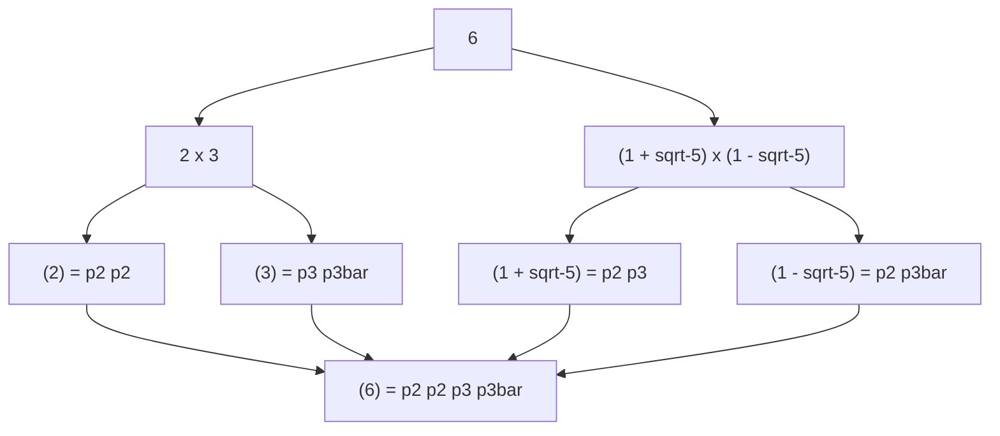

# Ideals factor uniquely even where numbers do not

[Syllabus](../../../SYLLABUS.md) → [Algebraic and analytic number theory](../README.md) → [Algebraic Numbers](../README.md#s06) → Ideals factor uniquely even where numbers do not

---

## General Overview

In the numbers $`a + b\sqrt{-5}`$, with $`a`$ and $`b`$ whole numbers, the number 6 splits two ways: 6 = 2 × 3, and 6 = $`(1 + \sqrt{-5})(1 - \sqrt{-5})`$, since that product is 1 − (−5) = 6. None of the four factors splits any further, as the norm proves on [Norm, trace and discriminant](02-norms-traces-and-discriminants.md). So "the" prime factors of 6 are not settled ([Algebraic integers](01-algebraic-integers-and-number-fields.md)).

The repair is to stop factoring numbers and factor sets of multiples instead. Such a set is an **ideal**: a collection of numbers that is closed under adding and absorbs multiplication by anything in the ring ([Ideals and quotient rings](../../03-Algebra/09-Rings%20and%20Fields/04-ideals-and-quotient-rings.md)). Every number gives one, its multiples, but there are more ideals than numbers.

Three of the extra ideals do the work here. Call them $`\mathfrak{p}_2`$, $`\mathfrak{p}_3`$ and $`\bar{\mathfrak{p}}_3`$. Each is a **prime ideal**: it is not the whole ring, and whenever a product lies in it, one of the two factors does, the way a prime number divides a product only by dividing a factor. None of the three is the multiples of a single number. The two splits of 6 turn out to be two ways of pairing the same list of four prime ideals, $`\mathfrak{p}_2`$ taken twice:

| Split of 6 | First factor | Second factor |
| --- | --- | --- |
| 2 × 3 | $`(2) = \mathfrak{p}_2\,\mathfrak{p}_2`$ | $`(3) = \mathfrak{p}_3\,\bar{\mathfrak{p}}_3`$ |
| $`(1 + \sqrt{-5})(1 - \sqrt{-5})`$ | $`(1 + \sqrt{-5}) = \mathfrak{p}_2\,\mathfrak{p}_3`$ | $`(1 - \sqrt{-5}) = \mathfrak{p}_2\,\bar{\mathfrak{p}}_3`$ |

**In the ring of integers of a number field (the whole numbers of a field such as all $`a + b\sqrt{-5}`$ with $`a`$, $`b`$ fractions), a number can factor into unsplittable numbers in several ways, but every nonzero ideal factors into prime ideals in exactly one way.**

**What kind of fact this is:** a theorem. The factorisation of (6) is computed by hand and proved on this card in Why it works. The general theorem is proved here for quadratic fields from one quoted identity, which the code checks on all 140 ideals of norm up to 100. For every number field it is stated with a source.

### The picture: two splits, one list of prime ideals



Both routes end at the same four prime ideals, in different pairs.

---

## The formula

Notation first, in words.

- $`\mathcal{O}_K`$ is the ring of integers of the field $`K`$. Here $`K`$ is all $`a + b\sqrt{-5}`$ with $`a`$, $`b`$ fractions, and $`\mathcal{O}_K = \mathbb{Z}[\sqrt{-5}]`$, the same with $`a`$, $`b`$ whole ([Rings of integers](03-rings-of-integers-and-integral-bases.md)).
- $`(a, b)`$ is the ideal **generated** by $`a`$ and $`b`$: every sum $`a x + b y`$ with $`x`$, $`y`$ in $`\mathcal{O}_K`$. One generator, $`(\alpha)`$, gives the multiples of $`\alpha`$, a **principal** ideal.
- Gothic letters $`\mathfrak{a}`$, $`\mathfrak{b}`$ name ideals. $`\mathfrak{p}`$ names a **prime ideal**: it is not the whole ring, and if a product $`xy`$ lies in $`\mathfrak{p}`$, then $`x`$ or $`y`$ does.
- The **product** $`\mathfrak{a}\mathfrak{b}`$ is every finite sum of products $`xy`$, with $`x`$ in $`\mathfrak{a}`$ and $`y`$ in $`\mathfrak{b}`$.
- The **norm** $`N(\mathfrak{a})`$ counts the classes left when $`\mathfrak{a}`$ is collapsed to zero: the size of $`\mathcal{O}_K/\mathfrak{a}`$. For a number, $`N(a + b\sqrt{-5}) = a^2 + 5b^2`$, and $`N((\alpha)) = N(\alpha)`$.

The house example, written with these:

```math
(6) = \mathfrak{p}_2^{\,2}\;\mathfrak{p}_3\;\bar{\mathfrak{p}}_3, \qquad \mathfrak{p}_2 = (2,\, 1 + \sqrt{-5}),\quad \mathfrak{p}_3 = (3,\, 1 + \sqrt{-5}),\quad \bar{\mathfrak{p}}_3 = (3,\, 1 - \sqrt{-5})
```

**Read it aloud:** the multiples of 6 are the prime ideal over 2 twice, times the two prime ideals over 3.

The general statement, the **Dedekind property**:

```math
\mathfrak{a} = \mathfrak{p}_1^{\,n_1}\,\mathfrak{p}_2^{\,n_2}\cdots\mathfrak{p}_k^{\,n_k}, \qquad N(\mathfrak{a}) = N(\mathfrak{p}_1)^{n_1}\cdots N(\mathfrak{p}_k)^{n_k}
```

**Read it aloud:** every nonzero ideal is a product of prime ideals, the list of primes and their counts is unique apart from order, and the norms multiply along.

On the example, the norms read 36 = 2 × 2 × 3 × 3, and $`N(6) = 6^2 + 5 \cdot 0^2 = 36`$ agrees.

A **Dedekind domain** is an integral domain (no zero divisors) with the three properties listed in Step 5. The Dedekind property holds in every one, and the ring $`\mathcal{O}_K`$ of every number field is one.

| Symbol | Plain meaning | In our example | Push it up and the answer… |
| --- | --- | --- | --- |
| $`K`$, $`\mathcal{O}_K`$ | the number field; its whole numbers | $`a + b\sqrt{-5}`$; $`\mathbb{Z}[\sqrt{-5}]`$ | — |
| $`(a, b)`$, $`(\alpha)`$ | the ideal generated by the listed numbers | $`(2, 1 + \sqrt{-5})`$; $`(6)`$ | more generators, a bigger ideal |
| $`\mathfrak{a}`$, $`\mathfrak{b}`$, $`\mathfrak{c}`$ | ideals, nonzero | $`(6)`$ | — |
| $`\mathfrak{a}\mathfrak{b}`$ | the product of two ideals | $`\mathfrak{p}_2\mathfrak{p}_3 = (1 + \sqrt{-5})`$ | a smaller set |
| $`\mathfrak{p}`$, $`\mathfrak{p}_i`$ | a prime ideal | $`\mathfrak{p}_2`$, $`\mathfrak{p}_3`$, $`\bar{\mathfrak{p}}_3`$ | — |
| $`\mathfrak{q}_7`$, $`\bar{\mathfrak{q}}_7`$ | the two prime ideals over 7 | $`(7, 3 + \sqrt{-5})`$, $`(7, 3 - \sqrt{-5})`$ | — |
| $`\bar{\mathfrak{a}}`$ | the mirror ideal: $`\sqrt{-5}`$ replaced by $`-\sqrt{-5}`$ | the mirror of $`\mathfrak{p}_3`$ is $`\bar{\mathfrak{p}}_3`$ | — |
| $`N(\mathfrak{a})`$ | the norm: classes left after collapsing $`\mathfrak{a}`$ | $`N((6)) = 36`$, $`N(\mathfrak{p}_2) = 2`$ | a smaller ideal |
| $`N(\alpha)`$ | the norm of a number, $`a^2 + 5b^2`$ | $`N(1 + \sqrt{-5}) = 6`$ | — |
| $`n_i`$, $`k`$ | how often $`\mathfrak{p}_i`$ appears; how many different primes | $`n = 2, 1, 1`$; $`k = 3`$ | a larger norm |
| $`(a, b, c)`$ in the code | an ideal as a grid: whole combinations of $`a`$ and $`b + c\sqrt{-5}`$ | $`\mathfrak{p}_2`$ is $`(2, 1, 1)`$ | norm $`a \times c`$ grows |

The letters $`(a, b)`$ in brackets are an ideal; bare $`a`$ and $`b`$ are the whole numbers in $`a + b\sqrt{-5}`$. The code writes r for $`\sqrt{-5}`$, P2, P3, Q3 for $`\mathfrak{p}_2`$, $`\mathfrak{p}_3`$, $`\bar{\mathfrak{p}}_3`$, and R7, S7 for $`\mathfrak{q}_7`$, $`\bar{\mathfrak{q}}_7`$.

### When it holds

- **The ring must be the full ring of integers.** In $`\mathbb{Z}[\sqrt{-3}]`$, which misses the integer $`(1 + \sqrt{-3})/2`$, the ideal $`\mathfrak{p} = (2, 1 + \sqrt{-3})`$ has norm 2 but $`\mathfrak{p}\mathfrak{p}`$ has norm 8, not 4. Also $`\mathfrak{p}\mathfrak{p} = (2)\,\mathfrak{p}`$ with $`\mathfrak{p} \ne (2)`$, so cancelling fails and factorisations stop being unique.
- **The ideal must be nonzero.** The zero ideal has no factorisation. The whole ring $`(1)`$ counts as the empty product, as the number 1 does among the whole numbers.
- **The factors must be prime ideals, not unsplittable numbers.** The number 2 does not split, yet $`(2)`$ is not a prime ideal: 2 divides $`(1 + \sqrt{-5})(1 - \sqrt{-5}) = 6`$ and neither factor.
- **Every nonzero prime ideal must be maximal** (no ideal fits between it and the whole ring). In polynomials with whole-number coefficients this fails: the prime ideal $`(x)`$ sits inside $`(2, x)`$. There $`(2, x^2)`$ is no product of prime ideals at all. It lies strictly between $`(2, x)^2`$ and $`(2, x)`$, and $`(2, x)`$ is the only prime ideal containing it, so a product of primes equal to it would have to be a power of $`(2, x)`$.

---

## Why it works

### Step 0: a number is replaced by its multiples, and missing common factors appear

"$`\alpha`$ divides $`\beta`$" says the same as "$`(\alpha)`$ contains $`(\beta)`$". So dividing is containing, and the bigger set is the smaller number.

Now take 2 and $`1 + \sqrt{-5}`$. A common factor would have a norm dividing both 4 and 6, so a norm of 1 or 2. No number has norm 2, since $`a^2 + 5b^2 = 2`$ has no whole solution. So as numbers they share only $`\pm 1`$.

Yet the set $`\mathfrak{p}_2 = (2, 1 + \sqrt{-5})`$ is not the whole ring: it behaves exactly like their greatest common factor. It is an "ideal number", a factor that exists as a set but not as a number.

### Step 1: multiplying ideals

To multiply two ideals given by generators, multiply every generator of one by every generator of the other. Those products generate $`\mathfrak{a}\mathfrak{b}`$.

Principal ideals multiply like their numbers: $`(\alpha)(\beta) = (\alpha\beta)`$. So nothing is lost by moving from numbers to ideals. The ideals only add the missing factors.

### Step 2: the three prime ideals, and why they are prime

Send $`a + b\sqrt{-5}`$ to the remainder of $`a - b`$ after dividing by 2. This respects adding and multiplying, because $`\sqrt{-5}`$ goes to $`-1`$, and $`(-1)^2 = 1`$ agrees with $`-5`$ after dividing by 2. What goes to 0 is exactly $`\mathfrak{p}_2`$, since $`a + b\sqrt{-5} = (a - b) + b(1 + \sqrt{-5})`$.

So collapsing $`\mathfrak{p}_2`$ leaves the two remainders 0 and 1, and $`N(\mathfrak{p}_2) = 2`$. Those two remainders form $`\mathbb{Z}`$ mod 2, which has no zero divisors (two nonzero classes multiplying to 0), so $`\mathfrak{p}_2`$ is prime.

The same move after dividing by 3 works twice: $`\sqrt{-5}`$ can go to $`-1`$ or to $`+1`$, since both square to 1, which agrees with $`-5`$ after dividing by 3. The first kills $`\mathfrak{p}_3 = (3, 1 + \sqrt{-5})`$, the second $`\bar{\mathfrak{p}}_3 = (3, 1 - \sqrt{-5})`$. Both leave three remainders, so both are prime of norm 3.

None of the three is principal: a generator would need norm 2 or 3, and no number has either.

### Step 3: the products, by hand

Each product is shown equal to a principal ideal two ways round. Every generator is a multiple of the number, and the number is a sum of generators.

| Product | Its generators | All multiples of | The number from the generators |
| --- | --- | --- | --- |
| $`\mathfrak{p}_2\mathfrak{p}_2`$ | 4, $`2 + 2\sqrt{-5}`$, $`-4 + 2\sqrt{-5}`$ | 2 | $`2 = -4 + (2 + 2\sqrt{-5}) - (-4 + 2\sqrt{-5})`$ |
| $`\mathfrak{p}_3\bar{\mathfrak{p}}_3`$ | 9, $`3 - 3\sqrt{-5}`$, $`3 + 3\sqrt{-5}`$, 6 | 3 | $`3 = 9 - 6`$ |
| $`\mathfrak{p}_2\mathfrak{p}_3`$ | 6, $`2 + 2\sqrt{-5}`$, $`3 + 3\sqrt{-5}`$, $`-4 + 2\sqrt{-5}`$ | $`1 + \sqrt{-5}`$ | $`1 + \sqrt{-5} = -6 + (3 + 3\sqrt{-5}) - (-4 + 2\sqrt{-5})`$ |

The generator $`-4 + 2\sqrt{-5}`$ is $`(1 + \sqrt{-5})^2`$, and 6 is $`(1 + \sqrt{-5})(1 - \sqrt{-5})`$. The mirror of the last row gives $`\mathfrak{p}_2\bar{\mathfrak{p}}_3 = (1 - \sqrt{-5})`$.

### Step 4: the two splits regroup one list

Put the rows together:

```math
(2)(3) = \mathfrak{p}_2\mathfrak{p}_2 \cdot \mathfrak{p}_3\bar{\mathfrak{p}}_3 \qquad (1 + \sqrt{-5})(1 - \sqrt{-5}) = \mathfrak{p}_2\mathfrak{p}_3 \cdot \mathfrak{p}_2\bar{\mathfrak{p}}_3
```

Both are $`\mathfrak{p}_2^{\,2}\mathfrak{p}_3\bar{\mathfrak{p}}_3`$. The numbers 2, 3 and $`1 \pm \sqrt{-5}`$ have norms 4, 9, 6 and 6. A proper factor of any of them would need norm 2 or 3, so none splits. But none is a prime ideal either. Each is two prime ideals glued together, and the two splits glue them in different pairs.

The number-theory wing shows the same trouble in the numbers 1, 5, 9, 13, …, where 441 = 9 × 49 = 21 × 21 because Euclid's lemma (a prime that divides a product divides one of its factors) fails ([Why the factorisation is unique](../../02-Number%20theory/02-Greatest%20Common%20Divisor%20and%20Euclid%27s%20Algorithm/07-unique-factorisation.md)). Here the lemma is rescued by moving to ideals.

### Step 5: the Dedekind property in general

A **Dedekind domain** is an integral domain (no zero divisors) with three properties:

1. Every ideal is generated by finitely many elements.
2. It is integrally closed: a fraction of ring elements that is a root of a monic polynomial (leading coefficient 1) with coefficients in the ring already lies in the ring.
3. Every nonzero prime ideal is maximal: collapsing it leaves a field.

The theorem: in a Dedekind domain, every nonzero ideal is a product of prime ideals in exactly one way, apart from order. Every $`\mathcal{O}_K`$ is a Dedekind domain. Both facts are proved in Marcus, chapter 3, and Neukirch, chapter I (Sources).

For quadratic fields, the proof has the same shape as the proof in the whole numbers. One identity does the work:

```math
\mathfrak{a}\,\bar{\mathfrak{a}} = (N(\mathfrak{a}))
```

**Read it aloud:** an ideal times its mirror is the multiples of its norm. On the example, $`\mathfrak{p}_3\bar{\mathfrak{p}}_3 = (3)`$ and $`\mathfrak{p}_2\bar{\mathfrak{p}}_2 = \mathfrak{p}_2\mathfrak{p}_2 = (2)`$, since $`\mathfrak{p}_2`$ is its own mirror.

The identity is quoted from the sources, not proved here. The code checks it on all 140 ideals of norm up to 100. From it:

- **Cancelling works**, because multiplying by the mirror turns an ideal into a plain number.
- **To contain is to divide**: if $`\mathfrak{a}`$ contains $`\mathfrak{b}`$, then $`\mathfrak{b} = \mathfrak{a}\mathfrak{c}`$ for an ideal $`\mathfrak{c}`$.
- **Euclid's lemma for ideals**: if a prime ideal divides $`\mathfrak{a}\mathfrak{b}`$, it divides $`\mathfrak{a}`$ or $`\mathfrak{b}`$.
- **Splitting stops**, because each prime factor removed divides the norm by at least 2.

<details>
<summary>Detailed proof: unique factorisation in a quadratic ring of integers, from the mirror identity</summary>

Assume $`\mathfrak{a}\bar{\mathfrak{a}} = (N(\mathfrak{a}))`$ for every nonzero ideal $`\mathfrak{a}`$.

**Norms multiply.** Both $`(\mathfrak{a}\mathfrak{b})\overline{(\mathfrak{a}\mathfrak{b})}`$ and $`\mathfrak{a}\bar{\mathfrak{a}}\,\mathfrak{b}\bar{\mathfrak{b}}`$ are the same ideal, so $`(N(\mathfrak{a}\mathfrak{b})) = (N(\mathfrak{a})N(\mathfrak{b}))`$. Two positive whole numbers with the same multiples are equal.

**Cancelling.** If $`\mathfrak{a}\mathfrak{b} = \mathfrak{a}\mathfrak{c}`$, multiply by $`\bar{\mathfrak{a}}`$: $`(n)\mathfrak{b} = (n)\mathfrak{c}`$ with $`n = N(\mathfrak{a})`$. Divide every element by $`n`$: $`\mathfrak{b} = \mathfrak{c}`$.

**To contain is to divide.** Let $`\mathfrak{a}`$ contain $`\mathfrak{b}`$, and $`n = N(\mathfrak{a})`$. Then $`\mathfrak{b}\bar{\mathfrak{a}}`$ lies inside $`\mathfrak{a}\bar{\mathfrak{a}} = (n)`$, so every element of $`\mathfrak{b}\bar{\mathfrak{a}}`$ is $`n`$ times an element of $`\mathcal{O}_K`$. Those quotients form an ideal $`\mathfrak{c}`$ with $`(n)\mathfrak{c} = \mathfrak{b}\bar{\mathfrak{a}}`$. Multiply by $`\mathfrak{a}`$ and cancel $`(n)`$:

$`\displaystyle (n)\,\mathfrak{a}\mathfrak{c} = \mathfrak{b}\,\mathfrak{a}\bar{\mathfrak{a}} = (n)\,\mathfrak{b}, \quad\text{so}\quad \mathfrak{a}\mathfrak{c} = \mathfrak{b}.`$

**Euclid's lemma for ideals.** Let a prime $`\mathfrak{p}`$ contain $`\mathfrak{a}\mathfrak{b}`$ but not $`\mathfrak{a}`$. Pick $`x`$ in $`\mathfrak{a}`$ outside $`\mathfrak{p}`$. For every $`y`$ in $`\mathfrak{b}`$, $`xy`$ lies in $`\mathfrak{p}`$, so $`y`$ does. So $`\mathfrak{p}`$ contains $`\mathfrak{b}`$, and by the step above it divides $`\mathfrak{b}`$.

**Existence.** Let $`\mathfrak{a}`$ have norm above 1. Among the ideals that contain $`\mathfrak{a}`$ and are not the whole ring, take one, $`\mathfrak{p}`$, of smallest norm. A strictly bigger ideal has strictly smaller norm, so nothing fits between $`\mathfrak{p}`$ and the whole ring. Then $`\mathfrak{p}`$ is maximal, hence prime. It divides $`\mathfrak{a}`$: $`\mathfrak{a} = \mathfrak{p}\mathfrak{a}_1`$ with $`N(\mathfrak{a}_1) = N(\mathfrak{a})/N(\mathfrak{p}) < N(\mathfrak{a})`$. Repeat. The norm falls each time, so the process stops at norm 1, the whole ring.

**Uniqueness.** Take two prime factorisations of one ideal. The first prime of one list divides the product of the other, so by Euclid's lemma it divides one of its primes. Collapsing a nonzero prime ideal leaves a finite ring with no zero divisors, which is a field, so the ideal is maximal. Its only divisors are itself and the whole ring, so the two primes are equal. Cancel it from both sides and repeat. This is the argument of the whole numbers, word for word.

</details>

---

## Worked numbers, by hand

| Step | Arithmetic | Value |
| --- | --- | --- |
| two splits of 6 | 2 × 3, and $`(1 + \sqrt{-5})(1 - \sqrt{-5}) = 1 + 5`$ | 6 both ways |
| norms of the four factors | $`2^2`$, $`3^2`$, $`1 + 5`$, $`1 + 5`$ | 4, 9, 6, 6 |
| numbers of norm 2 or 3 | $`a^2 + 5b^2 = 2`$ or 3 | none, so all four are unsplittable |
| collapse $`\mathfrak{p}_2`$, $`\mathfrak{p}_3`$, $`\bar{\mathfrak{p}}_3`$ | remainders of $`a - b`$ or $`a + b`$ | 2, 3 and 3 classes: all prime |
| $`\mathfrak{p}_2\mathfrak{p}_2`$ | $`-4 + (2 + 2\sqrt{-5}) - (-4 + 2\sqrt{-5})`$ | $`(2)`$ |
| $`\mathfrak{p}_3\bar{\mathfrak{p}}_3`$ | 9 − 6 | $`(3)`$ |
| $`\mathfrak{p}_2\mathfrak{p}_3`$, $`\mathfrak{p}_2\bar{\mathfrak{p}}_3`$ | $`-6 + (3 + 3\sqrt{-5}) - (-4 + 2\sqrt{-5})`$, and its mirror | $`(1 + \sqrt{-5})`$, $`(1 - \sqrt{-5})`$ |
| norm check | 2 × 2 × 3 × 3 against $`6^2`$ | 36 = 36 |
| **the answer** | either split, regrouped | $`\mathbf{(6) = \mathfrak{p}_2^{\,2}\,\mathfrak{p}_3\,\bar{\mathfrak{p}}_3}`$ |

The two splits of 6 are not a contradiction: they are two pairings of one list of four prime ideals.

The same happens with 21 = 3 × 7 = $`(1 + 2\sqrt{-5})(1 - 2\sqrt{-5})`$ = $`(4 + \sqrt{-5})(4 - \sqrt{-5})`$, three splits of one number. The prime ideals over 7 are $`\mathfrak{q}_7 = (7, 3 + \sqrt{-5})`$ and its mirror $`\bar{\mathfrak{q}}_7`$:

| Number | Its prime ideals |
| --- | --- |
| 3, 7 | $`\mathfrak{p}_3\bar{\mathfrak{p}}_3`$, $`\mathfrak{q}_7\bar{\mathfrak{q}}_7`$ |
| $`1 + 2\sqrt{-5}`$, $`1 - 2\sqrt{-5}`$ | $`\bar{\mathfrak{p}}_3\bar{\mathfrak{q}}_7`$, $`\mathfrak{p}_3\mathfrak{q}_7`$ |
| $`4 + \sqrt{-5}`$, $`4 - \sqrt{-5}`$ | $`\mathfrak{p}_3\bar{\mathfrak{q}}_7`$, $`\bar{\mathfrak{p}}_3\mathfrak{q}_7`$ |

Four prime ideals can be paired in three ways, and each pairing is one split of 21.

### What breaks if you drop a piece

| Mistake | Comes out at | What went wrong |
| --- | --- | --- |
| Multiply only matching generators: $`\mathfrak{p}_2\mathfrak{p}_3`$ as $`(2 \cdot 3, (1 + \sqrt{-5})^2)`$ | norm 12, not 6 | The cross products $`2(1 + \sqrt{-5})`$ and $`3(1 + \sqrt{-5})`$ were dropped, so the set is too small |
| Treat $`(2)`$ as a prime ideal | 2 divides $`(1 + \sqrt{-5})(1 - \sqrt{-5}) = 6`$, but not $`1 + \sqrt{-5}`$ | Unsplittable is not prime: $`(2) = \mathfrak{p}_2\mathfrak{p}_2`$ |
| Work in $`\mathbb{Z}[\sqrt{-3}]`$, not integrally closed | $`\mathfrak{p}\mathfrak{p}`$ has norm 8, not 2 × 2 = 4; $`\mathfrak{p}\mathfrak{p} = (2)\mathfrak{p}`$ with $`\mathfrak{p} \ne (2)`$ | The hypothesis fails: norms stop multiplying and cancelling fails |

The code prints all three.

---

## Code, from first principles, and it actually runs

Nothing is imported. An ideal is stored as a grid of numbers: all whole combinations of $`a`$ and $`b + c\sqrt{-5}`$, written $`(a, b, c)`$, with $`0 \le b < a`$. Every ideal has exactly one such triple, and its norm is $`a \times c`$.

The factorisation of (6) is reached by two independent roads:

1. **Grid reduction.** Multiply the ideals, reduce the generators to their triple by Euclid's algorithm, and compare triples.
2. **Divisibility and a witness.** Test that every generator is a multiple of the number, and find the number as a sum of generators by searching small coefficients.

A third, the norm, checks the count: 2 × 2 × 3 × 3 against $`N(6) = 36`$.

Then the code tests the theorem to norm 100. It lists all 140 ideals of norm 1 to 100 and finds the prime ideals by definition: no two nonzero classes multiply to 0. For each of the 139 ideals above norm 1, it searches every list of prime ideals and counts how many multiply to that ideal. That count is evidence to norm 100, not a proof. The proof is in Why it works.

### Python

```python
# Ideals factor uniquely even where numbers do not -- the check behind the card.
# Nothing is imported.  A number x + y*sqrt(d) is the pair (x, y).  An ideal is
# stored by its lattice basis (a, 0), (b, c), with 0 <= b < a, so equal ideals
# have equal triples (a, b, c), and its norm (the count of classes) is a * c.
D, B = -5, 100                             # the ring Z[sqrt(-5)]; ideals up to norm 100

def mul(u, v, d=D):
    return (u[0] * v[0] + d * u[1] * v[1], u[0] * v[1] + u[1] * v[0])

def egcd(p, q):                            # Euclid, extended: p*s + q*t = g
    if q == 0:
        return (p, 1, 0)
    g, s, t = egcd(q, p % q)
    return (g, t, s - (p // q) * t)

def lattice(vecs):                         # road 1: reduce generators to (a, b, c)
    w = (0, 0)
    for v in vecs:
        g, s, t = egcd(w[1], v[1])
        w = (s * w[0] + t * v[0], g)
    if w[1] < 0:
        w = (-w[0], -w[1])
    a = 0
    for v in vecs:
        x = v[0] - (v[1] // w[1]) * w[0]
        a = egcd(a, x)[0]
    a = abs(a)
    return (a, w[0] % a, w[1])

def ideal(gens, d=D):                      # the multiples of the generators
    return lattice(list(gens) + [mul(g, (0, 1), d) for g in gens])

def basis(I):
    return [(I[0], 0), (I[1], I[2])]

def times(I, J, d=D):                      # every product of a member of I and of J
    return ideal([mul(u, v, d) for u in basis(I) for v in basis(J)], d)

def inside(I, v):
    return v[1] % I[2] == 0 and (v[0] - (v[1] // I[2]) * I[1]) % I[0] == 0

def norm(I):
    return I[0] * I[2]

def is_prime(I):                           # no two nonzero classes multiply to 0
    reps = [(x, y) for x in range(I[0]) for y in range(I[2])][1:]
    return norm(I) > 1 and all(not inside(I, mul(r, s)) for r in reps for s in reps)

def divides(d_, g):                        # road 2: is g a multiple of d_ in the ring?
    n = d_[0] ** 2 - D * d_[1] ** 2
    x, y = mul(g, (d_[0], -d_[1]))
    return x % n == 0 and y % n == 0

def witness(gens, target):                 # road 2: target as a small sum of generators
    k = len(gens)
    for code in range(3 ** k):
        cs = [(code // 3 ** i) % 3 - 1 for i in range(k)]
        if (sum(c * g[0] for c, g in zip(cs, gens)), sum(c * g[1] for c, g in zip(cs, gens))) == target:
            return cs
    return None

def factor_count(I, primes, start=0):      # lists of prime ideals multiplying to I
    if norm(I) == 1:
        return 1
    total = 0
    for i in range(start, len(primes)):
        P = primes[i]
        if norm(I) % norm(P) == 0 and inside(P, basis(I)[0]) and inside(P, basis(I)[1]):
            rest = [J for J in ideals if norm(J) == norm(I) // norm(P) and times(P, J) == I]
            total += sum(factor_count(J, primes, i) for J in rest)
    return total

def yn(claim):
    return "yes" if claim else "no"

def show(I):
    return f"(a, b, c) = {I}, norm {norm(I)}"

def fmt(v):                                # (4, -1) prints as 4 - r
    y = "" if v[1] == 0 else ("+ " if v[1] > 0 else "- ") + ("" if abs(v[1]) == 1 else str(abs(v[1]))) + "r"
    return f"{v[0]} {y}".strip()

p2, p3, q3 = ideal([(2, 0), (1, 1)]), ideal([(3, 0), (1, 1)]), ideal([(3, 0), (1, -1)])
six = ideal([(6, 0)])
print(f"6 = 2 x 3 = (1 + r)(1 - r), r = sqrt(-5): {fmt(mul((1, 1), (1, -1)))}; norms 4, 9, 6, 6")
print(f"numbers of norm 2 or 3: {[(x, y) for x in range(-2, 3) for y in range(-1, 2) if x * x + 5 * y * y in (2, 3)]}")
print(f"P2 = (2, 1 + r):  {show(p2)}; prime: {yn(is_prime(p2))}")
print(f"P3 = (3, 1 + r):  {show(p3)}; prime: {yn(is_prime(p3))}")
print(f"Q3 = (3, 1 - r):  {show(q3)}; prime: {yn(is_prime(q3))}")
pairs = [("P2 x P2", times(p2, p2), (2, 0)), ("P3 x Q3", times(p3, q3), (3, 0)),
         ("P2 x P3", times(p2, p3), (1, 1)), ("P2 x Q3", times(p2, q3), (1, -1))]
for name, I, num in pairs:
    print(f"road 1: {name} = {show(I)} = ({fmt(num)}): {yn(I == ideal([num]))}")
road2 = []
for name, gens, num in [("P2 x P2", [(4, 0), (2, 2), (-4, 2)], (2, 0)),
                        ("P3 x Q3", [(9, 0), (3, -3), (3, 3), (6, 0)], (3, 0)),
                        ("P2 x P3", [(6, 0), (2, 2), (3, 3), (-4, 2)], (1, 1))]:
    cs, ok = witness(gens, num), all(divides(num, g) for g in gens)
    road2.append(ok and cs is not None)
    print(f"road 2: {name}: generators {gens}, all multiples of {fmt(num)}: {yn(ok)}; {fmt(num)} = {cs} . generators")
whole = times(times(p2, p2), times(p3, q3))
other = times(times(p2, p3), times(p2, q3))
print(f"(6) = {show(six)}; (2)(3) grouping {yn(whole == six)}; (1 + r)(1 - r) grouping {yn(other == six)}")
print(f"norm check: N(6) = 6 x 6 = 36, ideal norms 2 x 2 x 3 x 3 = {norm(p2) ** 2 * norm(p3) * norm(q3)}")
ideals = [(a, b, c) for c in range(1, B + 1) for a in range(c, B // c + 1, c) for b in range(0, a, c)
          if inside((a, b, c), mul((a, 0), (0, 1))) and inside((a, b, c), mul((b, c), (0, 1)))]
primes = [I for I in ideals if is_prime(I)]
principal = [I for I in ideals if any(x * x - D * y * y == norm(I) and inside(I, (x, y))
                                      for x in range(11) for y in range(-10, 11))]
conj = [I for I in ideals if times(I, ideal([(I[1], -I[2])] + [(I[0], 0)])) == ideal([(norm(I), 0)])]
counts = [factor_count(I, primes) for I in ideals if norm(I) > 1]
print(f"ideals of norm 1 to {B}: {len(ideals)}; prime ideals among them: {len(primes)}; "
      f"principal (one number's multiples): {len(principal)}")
print(f"prime ideal norms: {sorted(norm(P) for P in primes)}")
print(f"ideal times its mirror = (its norm), all {len(ideals)} ideals: {yn(len(conj) == len(ideals))}")
print(f"factorisations into prime ideals, ideals of norm 2 to {B}: {len(counts)} ideals, "
      f"each with exactly one: {yn(set(counts) == {1})}")
r7, s7 = ideal([(7, 0), (3, 1)]), ideal([(7, 0), (3, -1)])
named = {"P3": p3, "Q3": q3, "R7": r7, "S7": s7}
split21 = {fmt(v): [m + " x " + n for m in ("P3", "Q3") for n in ("R7", "S7")
                    if times(named[m], named[n]) == ideal([v])] for v in [(1, 2), (1, -2), (4, 1), (4, -1)]}
print(f"21 = 3 x 7 = (1 + 2r)(1 - 2r) = (4 + r)(4 - r); R7 = (7, 3 + r) and S7 = (7, 3 - r) "
      f"prime: {yn(is_prime(r7) and is_prime(s7))}; (7) = R7 x S7: {yn(times(r7, s7) == ideal([(7, 0)]))}")
print("the other four factors: " + "; ".join(f"{k} = {' '.join(v)}" for k, v in split21.items()))
wrong = ideal([(6, 0), mul((1, 1), (1, 1))])
print(f"mistake 1, matching pairs only: P2 x P3 taken as (6, (1 + r)^2) has norm {norm(wrong)}, not {norm(times(p2, p3))}")
print(f"mistake 2, (2) taken as a prime ideal: prime? {yn(is_prime(ideal([(2, 0)])))}; 2 divides (1 + r)(1 - r) = 6, "
      f"divides 1 + r? {yn(divides((2, 0), (1, 1)))}")
p = ideal([(2, 0), (1, 1)], -3)
pp = times(p, p, -3)
print(f"mistake 3, Z[s], s = sqrt(-3): P = (2, 1 + s) norm {norm(p)}; P x P norm {norm(pp)}, not 4; "
      f"P x P = (2) x P: {yn(pp == times(ideal([(2, 0)], -3), p, -3))}; P = (2): {yn(p == ideal([(2, 0)], -3))}")
assert [norm(p2), norm(p3), norm(q3)] == [2, 3, 3] and all(map(is_prime, (p2, p3, q3)))
assert all(I == ideal([num]) for _, I, num in pairs) and all(road2)    # two roads agree
assert whole == six == other and norm(six) == 6 * 6                     # (6), and N(6) = 36
assert set(counts) == {1} and len(conj) == len(ideals)                  # Dedekind, to norm 100
assert len(principal) * 2 == len(ideals) and not is_prime(ideal([(2, 0)]))
assert all(len(v) == 1 for v in split21.values()) and norm(wrong) == 12
assert norm(pp) == 8 and p != ideal([(2, 0)], -3)                       # the failure case
print("ALL CHECKS PASS")
```

**Ran 2026-11-15 on macOS, Python 3.14.10, standard library only. All checks passed. Output, pasted from the run:**

```
6 = 2 x 3 = (1 + r)(1 - r), r = sqrt(-5): 6; norms 4, 9, 6, 6
numbers of norm 2 or 3: []
P2 = (2, 1 + r):  (a, b, c) = (2, 1, 1), norm 2; prime: yes
P3 = (3, 1 + r):  (a, b, c) = (3, 1, 1), norm 3; prime: yes
Q3 = (3, 1 - r):  (a, b, c) = (3, 2, 1), norm 3; prime: yes
road 1: P2 x P2 = (a, b, c) = (2, 0, 2), norm 4 = (2): yes
road 1: P3 x Q3 = (a, b, c) = (3, 0, 3), norm 9 = (3): yes
road 1: P2 x P3 = (a, b, c) = (6, 1, 1), norm 6 = (1 + r): yes
road 1: P2 x Q3 = (a, b, c) = (6, 5, 1), norm 6 = (1 - r): yes
road 2: P2 x P2: generators [(4, 0), (2, 2), (-4, 2)], all multiples of 2: yes; 2 = [-1, 1, -1] . generators
road 2: P3 x Q3: generators [(9, 0), (3, -3), (3, 3), (6, 0)], all multiples of 3: yes; 3 = [1, 0, 0, -1] . generators
road 2: P2 x P3: generators [(6, 0), (2, 2), (3, 3), (-4, 2)], all multiples of 1 + r: yes; 1 + r = [-1, 0, 1, -1] . generators
(6) = (a, b, c) = (6, 0, 6), norm 36; (2)(3) grouping yes; (1 + r)(1 - r) grouping yes
norm check: N(6) = 6 x 6 = 36, ideal norms 2 x 2 x 3 x 3 = 36
ideals of norm 1 to 100: 140; prime ideals among them: 24; principal (one number's multiples): 70
prime ideal norms: [2, 3, 3, 5, 7, 7, 23, 23, 29, 29, 41, 41, 43, 43, 47, 47, 61, 61, 67, 67, 83, 83, 89, 89]
ideal times its mirror = (its norm), all 140 ideals: yes
factorisations into prime ideals, ideals of norm 2 to 100: 139 ideals, each with exactly one: yes
21 = 3 x 7 = (1 + 2r)(1 - 2r) = (4 + r)(4 - r); R7 = (7, 3 + r) and S7 = (7, 3 - r) prime: yes; (7) = R7 x S7: yes
the other four factors: 1 + 2r = Q3 x S7; 1 - 2r = P3 x R7; 4 + r = P3 x S7; 4 - r = Q3 x R7
mistake 1, matching pairs only: P2 x P3 taken as (6, (1 + r)^2) has norm 12, not 6
mistake 2, (2) taken as a prime ideal: prime? no; 2 divides (1 + r)(1 - r) = 6, divides 1 + r? no
mistake 3, Z[s], s = sqrt(-3): P = (2, 1 + s) norm 2; P x P norm 8, not 4; P x P = (2) x P: yes; P = (2): no
ALL CHECKS PASS
```

The 70 principal ideals out of 140 are no accident. In the long run half of all ideals in this ring are the multiples of a single number, because its class number is 2 ([Class groups](05-class-groups-and-the-minkowski-bound.md)). Up to norm 100 the split happens to be exact.

### Rust

Same numbers, same labels, built with `rustc --edition 2021 -O`. It uses plain `i64` without overflow checks. Every value stays small: the same file built with `-C overflow-checks=on`, which stops at any overflow, prints the same output.

```rust
// Ideals factor uniquely even where numbers do not -- the same check as the
// Python, in Rust.  No crates.  A number x + y*sqrt(d) is the pair (x, y).  An
// ideal is stored by its lattice basis (a, 0), (b, c), with 0 <= b < a, so equal
// ideals have equal triples (a, b, c), and its norm (the count of classes) is a * c.
type V = (i64, i64);
type Id = (i64, i64, i64);
const D: i64 = -5;
const B: i64 = 100;                                // the ring Z[sqrt(-5)]; ideals up to norm 100

fn fdiv(a: i64, b: i64) -> i64 { let q = a / b; if a % b != 0 && ((a < 0) != (b < 0)) { q - 1 } else { q } }
fn fmod(a: i64, b: i64) -> i64 { a - b * fdiv(a, b) }
fn mul(u: V, v: V, d: i64) -> V { (u.0 * v.0 + d * u.1 * v.1, u.0 * v.1 + u.1 * v.0) }

fn egcd(p: i64, q: i64) -> (i64, i64, i64) {      // Euclid, extended: p*s + q*t = g
    if q == 0 { return (p, 1, 0) }
    let (g, s, t) = egcd(q, fmod(p, q));
    (g, t, s - fdiv(p, q) * t)
}

fn lattice(vecs: &[V]) -> Id {                     // road 1: reduce generators to (a, b, c)
    let mut w: V = (0, 0);
    for v in vecs { let (g, s, t) = egcd(w.1, v.1); w = (s * w.0 + t * v.0, g) }
    if w.1 < 0 { w = (-w.0, -w.1) }
    let mut a = 0;
    for v in vecs { a = egcd(a, v.0 - fdiv(v.1, w.1) * w.0).0 }
    let a = a.abs();
    (a, fmod(w.0, a), w.1)
}

fn ideal(gens: &[V], d: i64) -> Id {               // the multiples of the generators
    let mut all: Vec<V> = gens.to_vec();
    for g in gens { all.push(mul(*g, (0, 1), d)) }
    lattice(&all)
}

fn basis(i: Id) -> [V; 2] { [(i.0, 0), (i.1, i.2)] }

fn times(i: Id, j: Id, d: i64) -> Id {             // every product of a member of I and of J
    let mut g = Vec::new();
    for u in basis(i) { for v in basis(j) { g.push(mul(u, v, d)) } }
    ideal(&g, d)
}

fn inside(i: Id, v: V) -> bool { fmod(v.1, i.2) == 0 && fmod(v.0 - fdiv(v.1, i.2) * i.1, i.0) == 0 }
fn norm(i: Id) -> i64 { i.0 * i.2 }

fn is_prime(i: Id) -> bool {                       // no two nonzero classes multiply to 0
    let reps: Vec<V> = (0..i.0).flat_map(|x| (0..i.2).map(move |y| (x, y))).skip(1).collect();
    norm(i) > 1 && reps.iter().all(|&r| reps.iter().all(|&s| !inside(i, mul(r, s, D))))
}

fn divides(dd: V, g: V) -> bool {                  // road 2: is g a multiple of dd in the ring?
    let n = dd.0 * dd.0 - D * dd.1 * dd.1;
    let (x, y) = mul(g, (dd.0, -dd.1), D);
    fmod(x, n) == 0 && fmod(y, n) == 0
}

fn witness(gens: &[V], target: V) -> Option<Vec<i64>> { // road 2: target as a small sum of generators
    let k = gens.len() as u32;
    for code in 0..3i64.pow(k) {
        let cs: Vec<i64> = (0..k).map(|i| (code / 3i64.pow(i)) % 3 - 1).collect();
        let s = cs.iter().zip(gens).fold((0, 0), |acc, (c, g)| (acc.0 + c * g.0, acc.1 + c * g.1));
        if s == target { return Some(cs) }
    }
    None
}

fn factor_count(i: Id, primes: &[Id], ideals: &[Id], start: usize) -> i64 { // lists of prime ideals giving I
    if norm(i) == 1 { return 1 }
    let mut total = 0;
    for k in start..primes.len() {
        let p = primes[k];
        if norm(i) % norm(p) == 0 && inside(p, basis(i)[0]) && inside(p, basis(i)[1]) {
            for &j in ideals {
                if norm(j) == norm(i) / norm(p) && times(p, j, D) == i { total += factor_count(j, primes, ideals, k) }
            }
        }
    }
    total
}

fn yn(c: bool) -> &'static str { if c { "yes" } else { "no" } }
fn show(i: Id) -> String { format!("(a, b, c) = {:?}, norm {}", i, norm(i)) }

fn fmt(v: V) -> String {                           // (4, -1) prints as 4 - r
    if v.1 == 0 { return format!("{}", v.0) }
    let sign = if v.1 > 0 { "+" } else { "-" };
    let k = if v.1.abs() == 1 { String::new() } else { format!("{}", v.1.abs()) };
    format!("{} {} {}r", v.0, sign, k)
}

fn main() {
    let (p2, p3, q3) = (ideal(&[(2, 0), (1, 1)], D), ideal(&[(3, 0), (1, 1)], D), ideal(&[(3, 0), (1, -1)], D));
    let six = ideal(&[(6, 0)], D);
    let small: Vec<V> = (-2..3).flat_map(|x| (-1..2).map(move |y| (x, y))).filter(|&(x, y)| [2, 3].contains(&(x * x + 5 * y * y))).collect();
    println!("6 = 2 x 3 = (1 + r)(1 - r), r = sqrt(-5): {}; norms 4, 9, 6, 6", fmt(mul((1, 1), (1, -1), D)));
    println!("numbers of norm 2 or 3: {:?}", small);
    println!("P2 = (2, 1 + r):  {}; prime: {}", show(p2), yn(is_prime(p2)));
    println!("P3 = (3, 1 + r):  {}; prime: {}", show(p3), yn(is_prime(p3)));
    println!("Q3 = (3, 1 - r):  {}; prime: {}", show(q3), yn(is_prime(q3)));
    let pairs = [("P2 x P2", times(p2, p2, D), (2, 0)), ("P3 x Q3", times(p3, q3, D), (3, 0)),
                 ("P2 x P3", times(p2, p3, D), (1, 1)), ("P2 x Q3", times(p2, q3, D), (1, -1))];
    for (name, i, num) in pairs { println!("road 1: {} = {} = ({}): {}", name, show(i), fmt(num), yn(i == ideal(&[num], D))) }
    let mut road2 = Vec::new();
    let r2: [(&str, Vec<V>, V); 3] = [("P2 x P2", vec![(4, 0), (2, 2), (-4, 2)], (2, 0)),
        ("P3 x Q3", vec![(9, 0), (3, -3), (3, 3), (6, 0)], (3, 0)), ("P2 x P3", vec![(6, 0), (2, 2), (3, 3), (-4, 2)], (1, 1))];
    for (name, gens, num) in r2.iter() {
        let (cs, ok) = (witness(gens, *num), gens.iter().all(|&g| divides(*num, g)));
        road2.push(ok && cs.is_some());
        println!("road 2: {}: generators {:?}, all multiples of {}: {}; {} = {:?} . generators", name, gens, fmt(*num), yn(ok), fmt(*num), cs.unwrap_or_default());
    }
    let whole = times(times(p2, p2, D), times(p3, q3, D), D);
    let other = times(times(p2, p3, D), times(p2, q3, D), D);
    println!("(6) = {}; (2)(3) grouping {}; (1 + r)(1 - r) grouping {}", show(six), yn(whole == six), yn(other == six));
    println!("norm check: N(6) = 6 x 6 = 36, ideal norms 2 x 2 x 3 x 3 = {}", norm(p2) * norm(p2) * norm(p3) * norm(q3));
    let mut ideals: Vec<Id> = Vec::new();
    for c in 1..=B { for a in (c..=B / c).step_by(c as usize) { for b in (0..a).step_by(c as usize) {
        let i = (a, b, c);
        if inside(i, mul((a, 0), (0, 1), D)) && inside(i, mul((b, c), (0, 1), D)) { ideals.push(i) }
    } } }
    let primes: Vec<Id> = ideals.iter().copied().filter(|&i| is_prime(i)).collect();
    let principal = ideals.iter().filter(|&&i| (0..11).any(|x: i64| (-10..11).any(|y: i64| x * x - D * y * y == norm(i) && inside(i, (x, y))))).count();
    let conj = ideals.iter().filter(|&&i| times(i, ideal(&[(i.1, -i.2), (i.0, 0)], D), D) == ideal(&[(norm(i), 0)], D)).count();
    let counts: Vec<i64> = ideals.iter().filter(|&&i| norm(i) > 1).map(|&i| factor_count(i, &primes, &ideals, 0)).collect();
    let mut pn: Vec<i64> = primes.iter().map(|&p| norm(p)).collect();
    pn.sort();
    println!("ideals of norm 1 to {}: {}; prime ideals among them: {}; principal (one number's multiples): {}", B, ideals.len(), primes.len(), principal);
    println!("prime ideal norms: {:?}", pn);
    println!("ideal times its mirror = (its norm), all {} ideals: {}", ideals.len(), yn(conj == ideals.len()));
    let unique = counts.iter().all(|&c| c == 1);
    println!("factorisations into prime ideals, ideals of norm 2 to {}: {} ideals, each with exactly one: {}", B, counts.len(), yn(unique));
    let (r7, s7) = (ideal(&[(7, 0), (3, 1)], D), ideal(&[(7, 0), (3, -1)], D));
    let named = [("P3", p3), ("Q3", q3), ("R7", r7), ("S7", s7)];
    let mut parts = Vec::new();
    let mut single = true;
    for v in [(1, 2), (1, -2), (4, 1), (4, -1)] {
        let mut hits = Vec::new();
        for (m, pm) in &named[..2] { for (n, pn) in &named[2..] {
            if times(*pm, *pn, D) == ideal(&[v], D) { hits.push(format!("{} x {}", m, n)) }
        } }
        single &= hits.len() == 1;
        parts.push(format!("{} = {}", fmt(v), hits.join(" ")));
    }
    println!("21 = 3 x 7 = (1 + 2r)(1 - 2r) = (4 + r)(4 - r); R7 = (7, 3 + r) and S7 = (7, 3 - r) prime: {}; (7) = R7 x S7: {}",
             yn(is_prime(r7) && is_prime(s7)), yn(times(r7, s7, D) == ideal(&[(7, 0)], D)));
    println!("the other four factors: {}", parts.join("; "));
    let wrong = ideal(&[(6, 0), mul((1, 1), (1, 1), D)], D);
    println!("mistake 1, matching pairs only: P2 x P3 taken as (6, (1 + r)^2) has norm {}, not {}", norm(wrong), norm(times(p2, p3, D)));
    let two = ideal(&[(2, 0)], D);
    println!("mistake 2, (2) taken as a prime ideal: prime? {}; 2 divides (1 + r)(1 - r) = 6, divides 1 + r? {}", yn(is_prime(two)), yn(divides((2, 0), (1, 1))));
    let p = ideal(&[(2, 0), (1, 1)], -3);
    let pp = times(p, p, -3);
    let two3 = ideal(&[(2, 0)], -3);
    println!("mistake 3, Z[s], s = sqrt(-3): P = (2, 1 + s) norm {}; P x P norm {}, not 4; P x P = (2) x P: {}; P = (2): {}",
             norm(p), norm(pp), yn(pp == times(two3, p, -3)), yn(p == two3));
    assert!([norm(p2), norm(p3), norm(q3)] == [2, 3, 3] && is_prime(p2) && is_prime(p3) && is_prime(q3));
    assert!(pairs.iter().all(|&(_, i, num)| i == ideal(&[num], D)) && road2.iter().all(|&x| x)); // two roads agree
    assert!(whole == six && six == other && norm(six) == 6 * 6);                                 // (6), and N(6) = 36
    assert!(unique && conj == ideals.len());                                                      // Dedekind, to norm 100
    assert!(principal * 2 == ideals.len() && !is_prime(two));
    assert!(single && norm(wrong) == 12);
    assert!(norm(pp) == 8 && p != two3);                                                          // the failure case
    println!("ALL CHECKS PASS");
}
```

**Ran 2026-11-15 on macOS, rustc 1.98.1, no crates. All checks passed. Output, pasted from the run:**

```
6 = 2 x 3 = (1 + r)(1 - r), r = sqrt(-5): 6; norms 4, 9, 6, 6
numbers of norm 2 or 3: []
P2 = (2, 1 + r):  (a, b, c) = (2, 1, 1), norm 2; prime: yes
P3 = (3, 1 + r):  (a, b, c) = (3, 1, 1), norm 3; prime: yes
Q3 = (3, 1 - r):  (a, b, c) = (3, 2, 1), norm 3; prime: yes
road 1: P2 x P2 = (a, b, c) = (2, 0, 2), norm 4 = (2): yes
road 1: P3 x Q3 = (a, b, c) = (3, 0, 3), norm 9 = (3): yes
road 1: P2 x P3 = (a, b, c) = (6, 1, 1), norm 6 = (1 + r): yes
road 1: P2 x Q3 = (a, b, c) = (6, 5, 1), norm 6 = (1 - r): yes
road 2: P2 x P2: generators [(4, 0), (2, 2), (-4, 2)], all multiples of 2: yes; 2 = [-1, 1, -1] . generators
road 2: P3 x Q3: generators [(9, 0), (3, -3), (3, 3), (6, 0)], all multiples of 3: yes; 3 = [1, 0, 0, -1] . generators
road 2: P2 x P3: generators [(6, 0), (2, 2), (3, 3), (-4, 2)], all multiples of 1 + r: yes; 1 + r = [-1, 0, 1, -1] . generators
(6) = (a, b, c) = (6, 0, 6), norm 36; (2)(3) grouping yes; (1 + r)(1 - r) grouping yes
norm check: N(6) = 6 x 6 = 36, ideal norms 2 x 2 x 3 x 3 = 36
ideals of norm 1 to 100: 140; prime ideals among them: 24; principal (one number's multiples): 70
prime ideal norms: [2, 3, 3, 5, 7, 7, 23, 23, 29, 29, 41, 41, 43, 43, 47, 47, 61, 61, 67, 67, 83, 83, 89, 89]
ideal times its mirror = (its norm), all 140 ideals: yes
factorisations into prime ideals, ideals of norm 2 to 100: 139 ideals, each with exactly one: yes
21 = 3 x 7 = (1 + 2r)(1 - 2r) = (4 + r)(4 - r); R7 = (7, 3 + r) and S7 = (7, 3 - r) prime: yes; (7) = R7 x S7: yes
the other four factors: 1 + 2r = Q3 x S7; 1 - 2r = P3 x R7; 4 + r = P3 x S7; 4 - r = Q3 x R7
mistake 1, matching pairs only: P2 x P3 taken as (6, (1 + r)^2) has norm 12, not 6
mistake 2, (2) taken as a prime ideal: prime? no; 2 divides (1 + r)(1 - r) = 6, divides 1 + r? no
mistake 3, Z[s], s = sqrt(-3): P = (2, 1 + s) norm 2; P x P norm 8, not 4; P x P = (2) x P: yes; P = (2): no
ALL CHECKS PASS
```

The two outputs match line for line.

### Lean

Lean proves the Dedekind property in every Dedekind domain and every $`\mathcal{O}_K`$, and the house factorisation of (6).

- Take a nonzero ideal $`\mathfrak{a}`$ of $`\mathcal{O}_K`$, for any number field $`K`$. Then $`\mathfrak{a}`$ is a product of prime ideals in exactly one way, apart from order.
- Take any such factorisation of $`\mathfrak{a}`$. Then $`N(\mathfrak{a})`$ is the product of the norms of its prime factors.
- In any Dedekind domain, every nonzero ideal is a product of prime ideals in exactly one way, apart from order, as in Step 5.
- In $`\mathbb{Z}[\sqrt{-5}]`$, the ideals $`\mathfrak{p}_2`$, $`\mathfrak{p}_3`$ and $`\bar{\mathfrak{p}}_3`$ are prime ideals.
- Their products are $`(2) = \mathfrak{p}_2\mathfrak{p}_2`$ and $`(3) = \mathfrak{p}_3\bar{\mathfrak{p}}_3`$.
- Also $`(1 + \sqrt{-5}) = \mathfrak{p}_2\mathfrak{p}_3`$ and $`(1 - \sqrt{-5}) = \mathfrak{p}_2\bar{\mathfrak{p}}_3`$, as in Step 3.
- So $`(6) = \mathfrak{p}_2^{\,2}\mathfrak{p}_3\bar{\mathfrak{p}}_3`$, as in Step 4.
- The products 2 × 3 and $`(1 + \sqrt{-5})(1 - \sqrt{-5})`$ are both 6.
- The norms of 2, 3, $`1 + \sqrt{-5}`$ and $`1 - \sqrt{-5}`$ are 4, 9, 6 and 6.
- Take $`a`$ from −2 to 2 and $`b`$ from −1 to 1. Then $`a^2 + 5b^2`$ is never 2 or 3.
- The norm check holds: 2 × 2 × 3 × 3 = 36 = $`6^2 + 5 \cdot 0^2`$.
- The number 21 is 3 × 7, and also $`(1 + 2\sqrt{-5})(1 - 2\sqrt{-5})`$.
- It is also $`(4 + \sqrt{-5})(4 - \sqrt{-5})`$.

The mirror identity, the 140 ideals up to norm 100, and which ideals are principal are left to the Python and Rust checks.

```lean
-- Ideals factor uniquely even where numbers do not: every nonzero ideal of a ring of integers (and of any Dedekind domain) is a product of prime ideals in exactly one way, with the norms multiplying along, and in Z[√-5] the ideal (6) is P2² · P3 · P3bar.
import Mathlib.NumberTheory.NumberField.Basic
import Mathlib.RingTheory.DedekindDomain.Ideal.Basic
import Mathlib.RingTheory.DedekindDomain.Ideal.Lemmas
import Mathlib.RingTheory.Ideal.Norm.AbsNorm
import Mathlib.NumberTheory.Zsqrtd.Basic
import Mathlib.Data.Int.Interval

open NumberField

/-- In `ℤ[√-5]`, the ideal `(n, 1 + ε√-5)` is prime when `n` is prime, `ε * ε = 1`, and
`ε * ε = -5` modulo `n`: it is the kernel of the map to `ZMod n` sending `√-5` to `-ε`. -/
theorem zsqrtd_neg_five_span_isPrime (n : ℕ) [Fact n.Prime] (ε : ℤ) (hε : ε * ε = 1)
    (h5 : ((-ε : ℤ) : ZMod n) * ((-ε : ℤ) : ZMod n) = ((-5 : ℤ) : ZMod n)) :
    (Ideal.span {((n : ℤ) : ℤ√(-5)), 1 + (ε : ℤ√(-5)) * Zsqrtd.sqrtd}).IsPrime := by
  let f : ℤ√(-5) →+* ZMod n := Zsqrtd.lift ⟨((-ε : ℤ) : ZMod n), h5⟩
  have hker : Ideal.span {((n : ℤ) : ℤ√(-5)), 1 + (ε : ℤ√(-5)) * Zsqrtd.sqrtd} = RingHom.ker f := by
    apply le_antisymm
    · rw [Ideal.span_le, Set.insert_subset_iff, Set.singleton_subset_iff]
      refine ⟨?_, ?_⟩
      · simp [f, RingHom.mem_ker]
      · have : ((ε * ε : ℤ) : ZMod n) = 1 := by rw [hε]; simp
        simp only [SetLike.mem_coe, RingHom.mem_ker, map_add, map_one, map_mul, map_intCast, f]
        simp only [Zsqrtd.lift_apply_apply, Zsqrtd.re_sqrtd, Zsqrtd.im_sqrtd]
        push_cast at this ⊢
        linear_combination (-1 : ZMod n) * this
    · intro x hx
      rw [RingHom.mem_ker] at hx
      simp only [f, Zsqrtd.lift_apply_apply] at hx
      have hd : ((x.re - ε * x.im : ℤ) : ZMod n) = 0 := by
        push_cast at hx ⊢; linear_combination hx
      rw [ZMod.intCast_zmod_eq_zero_iff_dvd] at hd
      obtain ⟨k, hk⟩ := hd
      rw [Ideal.mem_span_pair]
      refine ⟨(k : ℤ√(-5)), ((ε * x.im : ℤ) : ℤ√(-5)), ?_⟩
      ext
      · simp; linear_combination (-1 : ℤ) * hk
      · simp; linear_combination (x.im) * hε
  rw [hker]
  exact RingHom.ker_isPrime f

#print axioms zsqrtd_neg_five_span_isPrime

/-- The Dedekind property in a ring of integers: in the ring of integers `𝓞 K` of a number
field `K`, every nonzero ideal `I` is a product of prime ideals, the list of prime ideals with
their counts (a multiset) is unique, and the norm of `I` (the number of classes in `𝓞 K / I`)
is the product of the norms of its prime factors. -/
theorem ideal_factors_uniquely_into_prime_ideals
    (K : Type*) [Field K] [NumberField K] (I : Ideal (𝓞 K)) (hI : I ≠ ⊥) :
    (∃! s : Multiset (Ideal (𝓞 K)), (∀ p ∈ s, p.IsPrime) ∧ s.prod = I) ∧
      ∀ s : Multiset (Ideal (𝓞 K)), (∀ p ∈ s, p.IsPrime) → s.prod = I →
        Ideal.absNorm I = (s.map Ideal.absNorm).prod := by
  have hexists : ∃! s : Multiset (Ideal (𝓞 K)), (∀ p ∈ s, p.IsPrime) ∧ s.prod = I := by
    refine ⟨UniqueFactorizationMonoid.normalizedFactors I, ⟨fun p hp => ?_, ?_⟩, ?_⟩
    · exact Ideal.isPrime_of_prime (UniqueFactorizationMonoid.prime_of_normalized_factor p hp)
    · exact Ideal.prod_normalizedFactors_eq_self hI
    · rintro t ⟨ht, rfl⟩
      have hp : ∀ p ∈ t, Prime p := by
        intro p hp
        refine Ideal.prime_of_isPrime ?_ (ht p hp)
        rintro rfl
        exact hI (Multiset.prod_eq_zero (by simpa using hp))
      exact (UniqueFactorizationMonoid.normalizedFactors_prod_of_prime hp).symm
  refine ⟨hexists, ?_⟩
  rintro s - rfl
  exact map_multiset_prod Ideal.absNorm s

/-- The Dedekind property in any Dedekind domain (a domain that is Noetherian, integrally
closed, and in which every nonzero prime ideal is maximal): every nonzero ideal is a product
of prime ideals in exactly one way, apart from order. -/
theorem dedekind_domain_ideal_factors_uniquely
    (R : Type*) [CommRing R] [IsDedekindDomain R] (I : Ideal R) (hI : I ≠ ⊥) :
    ∃! s : Multiset (Ideal R), (∀ p ∈ s, p.IsPrime) ∧ s.prod = I := by
  refine ⟨UniqueFactorizationMonoid.normalizedFactors I, ⟨fun p hp => ?_, ?_⟩, ?_⟩
  · exact Ideal.isPrime_of_prime (UniqueFactorizationMonoid.prime_of_normalized_factor p hp)
  · exact Ideal.prod_normalizedFactors_eq_self hI
  · rintro t ⟨ht, rfl⟩
    have hp : ∀ p ∈ t, Prime p := by
      intro p hp
      refine Ideal.prime_of_isPrime ?_ (ht p hp)
      rintro rfl
      exact hI (Multiset.prod_eq_zero (by simpa using hp))
    exact (UniqueFactorizationMonoid.normalizedFactors_prod_of_prime hp).symm

/-- The house example in `ℤ[√-5]`: `P2 = (2, 1 + √-5)`, `P3 = (3, 1 + √-5)` and
`P3bar = (3, 1 - √-5)` are prime ideals; `(2) = P2 · P2`, `(3) = P3 · P3bar`,
`(1 + √-5) = P2 · P3`, `(1 - √-5) = P2 · P3bar`; so both splits of 6 give
`(6) = P2² · P3 · P3bar`. -/
theorem six_factors_as_prime_ideals_in_zsqrtd_neg_five :
    let r : ℤ√(-5) := Zsqrtd.sqrtd
    let P2 : Ideal (ℤ√(-5)) := Ideal.span {2, 1 + r}
    let P3 : Ideal (ℤ√(-5)) := Ideal.span {3, 1 + r}
    let P3bar : Ideal (ℤ√(-5)) := Ideal.span {3, 1 - r}
    P2.IsPrime ∧ P3.IsPrime ∧ P3bar.IsPrime ∧
      Ideal.span {(2 : ℤ√(-5))} = P2 * P2 ∧
      Ideal.span {(3 : ℤ√(-5))} = P3 * P3bar ∧
      Ideal.span {1 + r} = P2 * P3 ∧
      Ideal.span {1 - r} = P2 * P3bar ∧
      Ideal.span {(6 : ℤ√(-5))} = P2 ^ 2 * P3 * P3bar := by
  intro r P2 P3 P3bar
  have hr : r * r = -5 := by
    simp only [r, Zsqrtd.dmuld]; norm_num
  have hP2 : P2.IsPrime := by
    have := zsqrtd_neg_five_span_isPrime 2 1 (by norm_num) (by decide)
    simpa [P2, P3, P3bar, r, sub_eq_add_neg] using this
  have hP3 : P3.IsPrime := by
    have := zsqrtd_neg_five_span_isPrime 3 1 (by norm_num) (by decide)
    simpa [P2, P3, P3bar, r, sub_eq_add_neg] using this
  have hP3bar : P3bar.IsPrime := by
    have := zsqrtd_neg_five_span_isPrime 3 (-1) (by norm_num) (by decide)
    simpa [P2, P3, P3bar, r, sub_eq_add_neg] using this
  -- (2) = P2 * P2
  have e2 : Ideal.span {(2 : ℤ√(-5))} = P2 * P2 := by
    simp only [P2, Ideal.span_pair_mul_span_pair]
    apply le_antisymm
    · rw [Ideal.span_le, Set.singleton_subset_iff, SetLike.mem_coe]
      have g1 : (2 * 2 : ℤ√(-5)) ∈ Ideal.span {2 * 2, 2 * (1 + r), (1 + r) * 2, (1 + r) * (1 + r)} :=
        Ideal.subset_span (by simp)
      have g2 : (2 * (1 + r) : ℤ√(-5)) ∈ Ideal.span {2 * 2, 2 * (1 + r), (1 + r) * 2, (1 + r) * (1 + r)} :=
        Ideal.subset_span (by simp)
      have g4 : ((1 + r) * (1 + r) : ℤ√(-5)) ∈ Ideal.span {2 * 2, 2 * (1 + r), (1 + r) * 2, (1 + r) * (1 + r)} :=
        Ideal.subset_span (by simp)
      have : (2 : ℤ√(-5)) = 2 * (1 + r) - (1 + r) * (1 + r) - 2 * 2 := by
        linear_combination hr
      rw [this]
      exact sub_mem (sub_mem g2 g4) g1
    · rw [Ideal.span_le]
      simp only [Set.insert_subset_iff, Set.singleton_subset_iff, SetLike.mem_coe,
        Ideal.mem_span_singleton]
      exact ⟨⟨2, rfl⟩, ⟨1 + r, rfl⟩, ⟨1 + r, by ring⟩, ⟨-2 + r, by linear_combination hr⟩⟩
  -- (3) = P3 * P3bar
  have e3 : Ideal.span {(3 : ℤ√(-5))} = P3 * P3bar := by
    simp only [P3, P3bar, Ideal.span_pair_mul_span_pair]
    apply le_antisymm
    · rw [Ideal.span_le, Set.singleton_subset_iff, SetLike.mem_coe]
      have g1 : (3 * 3 : ℤ√(-5)) ∈ Ideal.span {3 * 3, 3 * (1 - r), (1 + r) * 3, (1 + r) * (1 - r)} :=
        Ideal.subset_span (by simp)
      have g4 : ((1 + r) * (1 - r) : ℤ√(-5)) ∈ Ideal.span {3 * 3, 3 * (1 - r), (1 + r) * 3, (1 + r) * (1 - r)} :=
        Ideal.subset_span (by simp)
      have : (3 : ℤ√(-5)) = 3 * 3 - (1 + r) * (1 - r) := by
        linear_combination (-1 : ℤ√(-5)) * hr
      rw [this]
      exact sub_mem g1 g4
    · rw [Ideal.span_le]
      simp only [Set.insert_subset_iff, Set.singleton_subset_iff, SetLike.mem_coe,
        Ideal.mem_span_singleton]
      exact ⟨⟨3, rfl⟩, ⟨1 - r, rfl⟩, ⟨1 + r, by ring⟩, ⟨2, by linear_combination (-1 : ℤ√(-5)) * hr⟩⟩
  -- (1 + r) = P2 * P3
  have e1p : Ideal.span {1 + r} = P2 * P3 := by
    simp only [P2, P3, Ideal.span_pair_mul_span_pair]
    apply le_antisymm
    · rw [Ideal.span_le, Set.singleton_subset_iff, SetLike.mem_coe]
      have g2 : (2 * (1 + r) : ℤ√(-5)) ∈ Ideal.span {2 * 3, 2 * (1 + r), (1 + r) * 3, (1 + r) * (1 + r)} :=
        Ideal.subset_span (by simp)
      have g3 : ((1 + r) * 3 : ℤ√(-5)) ∈ Ideal.span {2 * 3, 2 * (1 + r), (1 + r) * 3, (1 + r) * (1 + r)} :=
        Ideal.subset_span (by simp)
      have : (1 + r : ℤ√(-5)) = (1 + r) * 3 - 2 * (1 + r) := by ring
      rw [this]
      exact sub_mem g3 g2
    · rw [Ideal.span_le]
      simp only [Set.insert_subset_iff, Set.singleton_subset_iff, SetLike.mem_coe,
        Ideal.mem_span_singleton]
      exact ⟨⟨1 - r, by linear_combination hr⟩, ⟨2, by ring⟩, ⟨3, rfl⟩,
        ⟨1 + r, rfl⟩⟩
  -- (1 - r) = P2 * P3bar
  have e1m : Ideal.span {1 - r} = P2 * P3bar := by
    simp only [P2, P3bar, Ideal.span_pair_mul_span_pair]
    apply le_antisymm
    · rw [Ideal.span_le, Set.singleton_subset_iff, SetLike.mem_coe]
      have g1 : (2 * 3 : ℤ√(-5)) ∈ Ideal.span {2 * 3, 2 * (1 - r), (1 + r) * 3, (1 + r) * (1 - r)} :=
        Ideal.subset_span (by simp)
      have g2 : (2 * (1 - r) : ℤ√(-5)) ∈ Ideal.span {2 * 3, 2 * (1 - r), (1 + r) * 3, (1 + r) * (1 - r)} :=
        Ideal.subset_span (by simp)
      have g3 : ((1 + r) * 3 : ℤ√(-5)) ∈ Ideal.span {2 * 3, 2 * (1 - r), (1 + r) * 3, (1 + r) * (1 - r)} :=
        Ideal.subset_span (by simp)
      have : (1 - r : ℤ√(-5)) = (-r) * ((1 + r) * 3) - 2 * (2 * 3) - 2 * (1 - r) := by
        linear_combination (3 : ℤ√(-5)) * hr
      rw [this]
      exact sub_mem (sub_mem (Ideal.mul_mem_left _ _ g3) (Ideal.mul_mem_left _ _ g1)) g2
    · rw [Ideal.span_le]
      simp only [Set.insert_subset_iff, Set.singleton_subset_iff, SetLike.mem_coe,
        Ideal.mem_span_singleton]
      exact ⟨⟨1 + r, by linear_combination hr⟩, ⟨2, by ring⟩,
        ⟨-2 + r, by linear_combination hr⟩, ⟨1 + r, by ring⟩⟩
  refine ⟨hP2, hP3, hP3bar, e2, e3, e1p, e1m, ?_⟩
  rw [pow_two, mul_assoc, ← e2, ← e3, Ideal.span_singleton_mul_span_singleton]
  norm_num

-- 6 = 2 × 3 = (1 + √-5)(1 - √-5) in ℤ[√-5].
example : (⟨1, 1⟩ : ℤ√(-5)) * ⟨1, -1⟩ = 6 := by decide
example : (2 : ℤ√(-5)) * 3 = 6 := by decide

-- The norms a² + 5b² of 2, 3, 1 + √-5, 1 - √-5 are 4, 9, 6, 6.
example : Zsqrtd.norm (2 : ℤ√(-5)) = 4 ∧ Zsqrtd.norm (3 : ℤ√(-5)) = 9 ∧
    Zsqrtd.norm (⟨1, 1⟩ : ℤ√(-5)) = 6 ∧ Zsqrtd.norm (⟨1, -1⟩ : ℤ√(-5)) = 6 := by decide

-- No number a + b√-5 has norm 2 or 3 (only |a| ≤ 1, b = 0 could, and those give 0 or 1).
example : ∀ a ∈ Finset.Icc (-2 : ℤ) 2, ∀ b ∈ Finset.Icc (-1 : ℤ) 1,
    a ^ 2 + 5 * b ^ 2 ≠ 2 ∧ a ^ 2 + 5 * b ^ 2 ≠ 3 := by decide

-- Norm check: 2 × 2 × 3 × 3 = 36 = 6² + 5 · 0².
example : 2 * 2 * 3 * 3 = 6 ^ 2 + 5 * 0 ^ 2 := by norm_num

-- 21 = 3 × 7 = (1 + 2√-5)(1 - 2√-5) = (4 + √-5)(4 - √-5).
example : (3 : ℤ√(-5)) * 7 = 21 ∧ (⟨1, 2⟩ : ℤ√(-5)) * ⟨1, -2⟩ = 21 ∧
    (⟨4, 1⟩ : ℤ√(-5)) * ⟨4, -1⟩ = 21 := by decide

#print axioms ideal_factors_uniquely_into_prime_ideals
#print axioms dedekind_domain_ideal_factors_uniquely
#print axioms six_factors_as_prime_ideals_in_zsqrtd_neg_five
```

**Checked 2026-11-15 on macOS, Lean 4.36.0-rc2, Mathlib v4.36.0-rc2. Every proof is complete and uses only Lean's standard axioms. Output, pasted from the run:**

```
'zsqrtd_neg_five_span_isPrime' depends on axioms: [propext, Classical.choice, Quot.sound]
'ideal_factors_uniquely_into_prime_ideals' depends on axioms: [propext, Classical.choice, Quot.sound]
'dedekind_domain_ideal_factors_uniquely' depends on axioms: [propext, Classical.choice, Quot.sound]
'six_factors_as_prime_ideals_in_zsqrtd_neg_five' depends on axioms: [propext, Classical.choice, Quot.sound]
```

> [!TIP]
> **Try changing**
> Guess first, then run it. The asserts are pinned to $`\mathbb{Z}[\sqrt{-5}]`$ up to norm 100, so expect one to stop the program.
> - **The Gaussian integers.** Set `D = -1`, the ring $`\mathbb{Z}[i]`$. Guess how many ideals are principal. All 79 of the 79 ideals up to norm 100 are, and each still factors one way. An assert stops it, since the house numbers no longer hold.
> - **A smaller range.** Set `B = 60`. There are 83 ideals and 16 prime ideals, and 42 are principal, not exactly half. The principal-count assert stops it: the half-and-half split shows only in the long run.
> - **A different generator.** Change $`\mathfrak{p}_3`$'s generator `(1, 1)` to `(2, 1)`, the number $`2 + \sqrt{-5}`$. The triple becomes (3, 2, 1), the same as $`\bar{\mathfrak{p}}_3`$, since $`3 - (2 + \sqrt{-5}) = 1 - \sqrt{-5}`$. Road 1 then reports "no" for $`\mathfrak{p}_3\bar{\mathfrak{p}}_3 = (3)`$ and for $`\mathfrak{p}_2\mathfrak{p}_3 = (1 + \sqrt{-5})`$, and an assert stops it.

---

## The usual mistake

> [!warning]
> **Calling a number prime because it does not split.** 2 has no proper factor in $`\mathbb{Z}[\sqrt{-5}]`$, yet it divides $`(1 + \sqrt{-5})(1 - \sqrt{-5}) = 6`$ without dividing either factor. In the whole numbers "unsplittable" and "prime" mean the same; here they part. The prime objects are the prime ideals, and $`(2) = \mathfrak{p}_2\mathfrak{p}_2`$.
>
> - **Multiplying only matching generators.** $`\mathfrak{p}_2\mathfrak{p}_3`$ taken as $`(6, (1 + \sqrt{-5})^2)`$ has norm 12, not 6: every cross product belongs in the list.
> - **Reading containment backwards.** A divisor is the bigger set: $`\mathfrak{p}_2`$ contains $`(6)`$, and its norm is 2 against 36.
> - **Using a ring that is too small.** In $`\mathbb{Z}[\sqrt{-3}]`$ the ideal $`(2, 1 + \sqrt{-3})`$ squares to norm 8, not 4, and unique factorisation of ideals fails. Take the full ring of integers.
> - **Looking for the prime ideals as numbers.** No number has norm 2 or 3, so $`\mathfrak{p}_2`$, $`\mathfrak{p}_3`$ and $`\bar{\mathfrak{p}}_3`$ have no single generator. They exist only as ideals.

---

## Where you meet it in real life

- **The history of Fermat's Last Theorem.** In 1847 a proposed proof factored $`x^n + y^n`$ into numbers and assumed the factors were unique. They are not, in general. Kummer's "ideal numbers", the ancestors of ideals, restored unique factorisation there, and with them he proved the theorem for every regular prime exponent (a prime that does not divide the class number of the field of its own roots of 1; 37 is the first prime that fails).
- **Factoring large numbers.** The number field sieve, the fastest known general method for factoring numbers of a few hundred digits, tracks prime ideals in a ring of algebraic integers built for the number being factored. Unique factorisation of ideals is what lets it combine them.
- **Class-group cryptography.** Some proposed cryptographic schemes, including verifiable delay functions (computations that take a known minimum time), compute with ideals of imaginary quadratic fields. They rely on the gap between ideals and numbers this card shows.
- **Geometry.** The polynomial functions on a smooth curve form a Dedekind domain. A nonzero prime ideal there is a point, and factoring an ideal lists the points where a function vanishes, with multiplicities.

> **Say it back**
> In $`\mathbb{Z}[\sqrt{-5}]`$, 6 splits as 2 × 3 and as $`(1 + \sqrt{-5})(1 - \sqrt{-5})`$, and none of those four numbers splits further. Replace each number by its multiples, an ideal, and the missing common factors appear as ideals with two generators. The four numbers become $`\mathfrak{p}_2\mathfrak{p}_2`$, $`\mathfrak{p}_3\bar{\mathfrak{p}}_3`$, $`\mathfrak{p}_2\mathfrak{p}_3`$ and $`\mathfrak{p}_2\bar{\mathfrak{p}}_3`$, so both splits give $`(6) = \mathfrak{p}_2^{\,2}\mathfrak{p}_3\bar{\mathfrak{p}}_3`$. In every ring of integers, every nonzero ideal factors into prime ideals in exactly one way: the Dedekind property. The proof is Euclid's, once "to contain is to divide" holds.

---

## What this builds on

- [Rings of integers](03-rings-of-integers-and-integral-bases.md): why $`\mathbb{Z}[\sqrt{-5}]`$ is the full ring of integers here, and why $`\mathbb{Z}[\sqrt{-3}]`$ is not.
- [Ideals and quotient rings](../../03-Algebra/09-Rings%20and%20Fields/04-ideals-and-quotient-rings.md): ideals, collapsing to a quotient ring, and prime and maximal ideals; this card multiplies them.
- [Why the factorisation is unique](../../02-Number%20theory/02-Greatest%20Common%20Divisor%20and%20Euclid%27s%20Algorithm/07-unique-factorisation.md): Euclid's lemma and the uniqueness proof that this card repeats for ideals.

## Where this goes next

- [Class groups](05-class-groups-and-the-minkowski-bound.md): measures how far ideals are from numbers; here 70 of the 140 ideals up to norm 100 are principal, and the class number is 2.
- [Splitting and ramification](08-splitting-and-ramification.md): how each ordinary prime factors as an ideal, as 2 into $`\mathfrak{p}_2^{\,2}`$ and 3 into $`\mathfrak{p}_3\bar{\mathfrak{p}}_3`$.
- [Two squares](../07-Diophantine%20and%20Modular/02-sums-of-squares-and-gaussian-integers.md): a ring where every ideal is principal, so numbers factor uniquely and primes of the form $`4k + 1`$ split into two squares.
- [Domains, principal ideals and unique factorisation](../../22-Algebraic%20geometry/06-Schemes%20and%20Modern%20Language/01-integral-domains-pids-and-unique-factorisation.md): the general links between principal ideals and unique factorisation of numbers.
- [Composition and genus](11-gauss-composition-and-genus-theory.md): multiplying binary quadratic forms is multiplying ideal classes.

The rest of the shelf: [Norm, trace and discriminant](02-norms-traces-and-discriminants.md) supplies the norm, and [The class number formula](06-class-number-formula-and-the-dedekind-zeta-function.md), [The unit theorem](07-dirichlets-unit-theorem.md), [Chebotarev](09-chebotarev-density-and-splitting-statistics.md) and [The p-adic numbers](10-p-adic-numbers-and-hensels-lemma.md) study the same ring from other sides.

The question this card leaves open: ideals repair factorisation, but how many ideals are not numbers, and can that gap be measured by one finite count?

---

## Sources

Verified 2026-11-15: every link below resolves to the publisher's page.

- Marcus, Daniel A. *Number Fields*, 2nd ed. Springer, 2018. [doi:10.1007/978-3-319-90233-3](https://doi.org/10.1007/978-3-319-90233-3). Chapter 3, "Prime Decomposition in Number Rings": ideal products, ideal norms, and unique factorisation into prime ideals in every ring of integers.
- Neukirch, Jürgen. *Algebraic Number Theory*. Springer, 1999. [doi:10.1007/978-3-662-03983-0](https://doi.org/10.1007/978-3-662-03983-0). Chapter I: Dedekind domains defined by the three properties, and the factorisation theorem for them.
- Ireland, Kenneth, and Michael Rosen. *A Classical Introduction to Modern Number Theory*, 2nd ed. Springer, 1990. [doi:10.1007/978-1-4757-2103-4](https://doi.org/10.1007/978-1-4757-2103-4). Chapter 12, "Algebraic Number Theory": unique factorisation of ideals in rings of integers, at an introductory pace.
- Stewart, Ian, and David Tall. *Algebraic Number Theory and Fermat's Last Theorem*, 5th ed. CRC Press, 2025. [doi:10.1201/9781003462002](https://doi.org/10.1201/9781003462002). The factorisation of 6 in $`\mathbb{Z}[\sqrt{-5}]`$, ideals as the repair, and the history through Fermat's Last Theorem.
