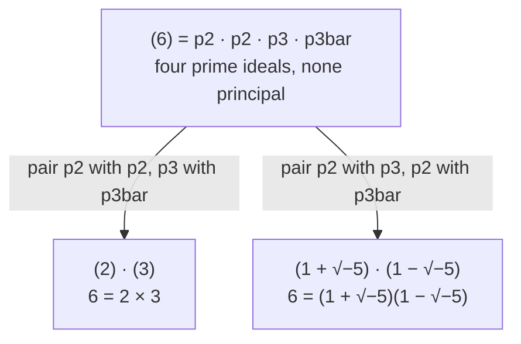
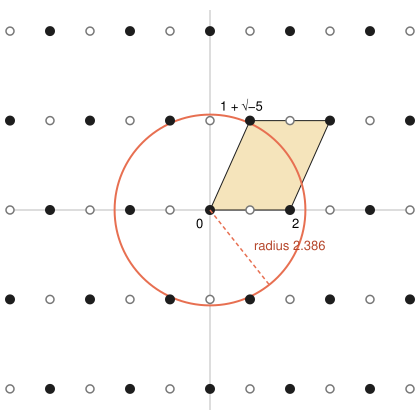

# Class groups: measuring how badly factorisation fails, and how far you must search

[Syllabus](../../../SYLLABUS.md) → [Algebraic and analytic number theory](../README.md) → [Algebraic Numbers](../README.md#s06) → Class groups

---

## General Overview

Among the numbers $`a + b\sqrt{-5}`$, with $`a`$ and $`b`$ whole numbers, 6 splits two ways: $`6 = 2 \times 3 = (1 + \sqrt{-5})(1 - \sqrt{-5})`$. None of the four factors splits further. So "factor into primes" has two answers here, not one.

[Ideals factor uniquely even where numbers do not](04-ideals-and-unique-factorisation-in-dedekind-domains.md) repairs this. An **ideal** is a set of numbers of the ring that is closed under adding, and under multiplying by any number of the ring. The ideal of all multiples of 6 factors uniquely into four prime ideals, $`(6) = \mathfrak{p}_2\,\mathfrak{p}_2\,\mathfrak{p}_3\,\bar{\mathfrak{p}}_3`$: $`\mathfrak{p}_2`$ is the one prime ideal that contains 2, and $`\mathfrak{p}_3`$ and its mirror image $`\bar{\mathfrak{p}}_3`$ are the two that contain 3. The trouble is that none of these four is the set of multiples of a single number.

This card measures that trouble. Sort the ideals into **classes**: two ideals are in the same class when a number rescales one into the other. The ideals that are the multiples of one number form a single class. The classes multiply, and they form a finite group, the **class group**. Its size, the **class number**, is 1 exactly when factorisation into primes is unique. For $`\sqrt{-5}`$ it is 2.

How do you find it? An infinite ring has infinitely many ideals. Minkowski's theorem says every class holds an ideal of small norm (its size: how many remainders it leaves on division), at most a computable bound, here 2.847. So one ideal of norm 2 settles the whole question.

**The class group is the group of ideals modulo the ideals generated by one number; it is finite because every class contains an ideal of norm at most Minkowski's bound, and its size is 1 exactly when factorisation into primes is unique.**

**What kind of fact this is:** theorems. Minkowski's bound is proved on this card for imaginary quadratic fields and stated for all number fields with a named source. The class number 2 of $`\mathbb{Q}(\sqrt{-5})`$ is proved by a finite search. "Class number 1 exactly when factorisation is unique" is proved in a fold. Code checks over ranges are evidence and are labelled so.

### The picture: two ways to pair the same four prime ideals



All four prime ideals sit in the one non-principal class, and any two of them multiply to a principal ideal. There are two ways to pair them, so 6 has two factorisations.

---

## The formula

Notation first. $`K = \mathbb{Q}(\sqrt{-5})`$ is the number field, and $`\mathcal{O}_K = \mathbb{Z}[\sqrt{-5}]`$ is its ring of integers ([Rings of integers](03-rings-of-integers-and-integral-bases.md)). $`(\alpha)`$ is the **principal ideal** of all multiples of one number $`\alpha`$. $`N(\mathfrak{a})`$, the **norm** of an ideal $`\mathfrak{a}`$, is how many remainders $`\mathcal{O}_K`$ leaves on division by it; for $`(\alpha)`$ it is $`\lvert N(\alpha)\rvert`$, and $`N(a + b\sqrt{-5}) = a^2 + 5b^2`$.

Two ideals $`\mathfrak{a}`$ and $`\mathfrak{b}`$ are in the same class when $`\alpha\mathfrak{a} = \beta\mathfrak{b}`$ for some nonzero numbers $`\alpha`$ and $`\beta`$ of $`\mathcal{O}_K`$. The classes form the **class group** $`\mathrm{Cl}(K)`$, multiplied by multiplying ideals. Its size is the **class number** $`h_K`$.

In group language, $`\mathrm{Cl}(K)`$ is a quotient group ([Normal subgroups and quotient groups](../../03-Algebra/08-Groups/06-normal-subgroups-and-quotient-groups.md)):

```math
\mathrm{Cl}(K) = \frac{\{\text{fractional ideals of } K\}}{\{\text{principal ideals } (\alpha),\ \alpha \in K,\ \alpha \neq 0\}}, \qquad h_K = \lvert \mathrm{Cl}(K) \rvert
```

**Read it aloud:** the class group is all ideals, with the principal ones collapsed to a single point; the class number counts what is left.

A fractional ideal is an ideal divided by one nonzero number, such as $`\tfrac12\mathfrak{p}_2`$; allowing these gives every ideal an inverse. The group is abelian (order of multiplying does not matter), so every subgroup is normal and the quotient exists.

The search bound is **Minkowski's bound**:

```math
M_K = \frac{n!}{n^n}\left(\frac{4}{\pi}\right)^{r_2}\sqrt{\lvert d_K\rvert}, \qquad \text{every class contains an ideal } \mathfrak{b} \text{ with } N(\mathfrak{b}) \le M_K
```

**Read it aloud:** every class has a member whose norm is at most Minkowski's bound, a constant set by the degree and the number of complex pairs, times the square root of the discriminant's size.

Here $`n`$ is the degree of $`K`$, $`r_1`$ counts its real embeddings (ways to place it inside the real numbers) and $`r_2`$ its pairs of complex ones, so $`n = r_1 + 2r_2`$. $`d_K`$ is the discriminant ([Norm, trace and discriminant](02-norms-traces-and-discriminants.md)). For $`\mathbb{Q}(\sqrt{-5})`$: $`n = 2`$, $`r_1 = 0`$, $`r_2 = 1`$, $`d_K = -20`$, so

```math
M_K = \frac{2}{4}\cdot\frac{4}{\pi}\cdot\sqrt{20} = \frac{2}{\pi}\sqrt{20} = 2.847
```

| Symbol | Plain meaning | In our example | Push it up and the answer… |
| --- | --- | --- | --- |
| $`K`$, $`\mathcal{O}_K`$ | the number field $`\mathbb{Q}(\sqrt{m})`$ ($`m`$ a negative whole number with no square factor) and its whole numbers | $`\mathbb{Q}(\sqrt{-5})`$, $`\mathbb{Z}[\sqrt{-5}]`$ | — |
| $`\alpha`$, $`(\alpha)`$; $`\beta`$, $`\gamma`$, $`\kappa`$ | a number of $`\mathcal{O}_K`$, and the principal ideal of its multiples; other numbers, $`\kappa`$ an irreducible | $`1 + \sqrt{-5}`$; $`(2)`$ | — |
| $`\mathfrak{a}`$, $`\mathfrak{b}`$, $`\mathfrak{P}`$ | ideals of $`\mathcal{O}_K`$; $`\mathfrak{P}`$ any prime ideal | $`\mathfrak{p}_2`$, $`(2)`$ | — |
| $`N(\cdot)`$ | norm: of a number $`a^2 + 5b^2`$; of an ideal, its count of remainders | $`N(1 + \sqrt{-5}) = 6`$, $`N(\mathfrak{p}_2) = 2`$ | — |
| $`\mathfrak{p}_2`$, $`\mathfrak{p}_3`$, $`\bar{\mathfrak{p}}_3`$, $`\mathfrak{p}_7`$, $`\bar{\mathfrak{p}}_7`$ | the prime ideals over 2, 3 and 7; a bar marks the conjugate | $`\mathfrak{p}_2 = (2, 1 + \sqrt{-5})`$ | — |
| $`\mathrm{Cl}(K)`$ | the class group | two classes: principal, and that of $`\mathfrak{p}_2`$ | — |
| $`h_K`$ | the class number, the size of $`\mathrm{Cl}(K)`$ | 2 | more ways for factorisations to differ |
| $`M_K`$, $`\pi`$ | Minkowski's bound; $`\pi = 3.14159`$, the circle constant | 2.847 | a longer search |
| $`n`$, $`r_1`$, $`r_2`$ | degree; real embeddings; pairs of complex embeddings | 2, 0, 1 | $`n`$ up: the factor $`n!/n^n`$ shrinks fast |
| $`d_K`$ | the discriminant: how spread out $`\mathcal{O}_K`$ is | −20 | bound grows like $`\sqrt{\lvert d_K\rvert}`$ |
| $`\mathrm{covol}`$ or $`c`$, $`\rho`$, $`D`$, $`L`$ | area of one cell of a lattice $`L`$; radius of a disc $`D`$ | 4.472 for $`\mathfrak{p}_2`$; 2.386 | — |
| $`x`$, $`y`$, $`\omega`$ | whole numbers fed into a quadratic form such as $`x^2 + 5y^2`$; in the code, $`x + y\omega`$ is a number of $`\mathcal{O}_K`$; this $`\omega`$ is $`\sqrt{m}`$, not the shelf's $`(1 + \sqrt{m})/2`$, unless $`m`$ leaves remainder 1 on division by 4 | $`x = 3`$, $`y = 2`$ gives 29; $`\omega = \sqrt{-5}`$ | — |

The letters $`\mathrm{Cl}(K)`$, $`h_K`$, $`M_K`$, $`r_1`$ and $`r_2`$ are this card's; later cards in this wing use them freely.

### When it holds

- **The ring must be the full ring of integers.** $`\mathbb{Q}(\sqrt{-11})`$ has $`h_K = 1`$, but its whole numbers include $`(1 + \sqrt{-11})/2`$. Use $`\mathbb{Z}[\sqrt{-11}]`$ instead and the count is 3.
- **The search must reach the bound.** In $`\mathbb{Q}(\sqrt{-14})`$, $`M_K = 4.764`$. Stop at norm 2 and 2 classes appear; the truth is 4, because a prime ideal over 3 has order 4.
- **The bound gives generators, not the classes themselves.** $`\mathbb{Q}(\sqrt{-23})`$ has 5 ideals of norm at most $`M_K = 3.053`$ but only 3 classes, so the group must be multiplied out.
- **The class number does not fix the group.** $`\mathbb{Q}(\sqrt{-14})`$ and $`\mathbb{Q}(\sqrt{-21})`$ both have $`h_K = 4`$. A finite abelian group splits into cyclic pieces in exactly one way ([Smith normal form](../../17-Topology/05-Homology/03-computing-homology-by-smith-normal-form.md) states this structure theorem). The first is cyclic of order 4; the second is two cyclic groups of order 2.
- **This card proves the bound only for imaginary quadratic fields** ($`n = 2`$, $`r_2 = 1`$). The general case uses the same idea with a convex body in $`n`$ dimensions in place of a disc: all points whose $`n`$ image sizes add up to at most a fixed amount.

---

## Why it works

### Step 0: every ideal holds a short number, so every class holds a small ideal

An ideal of $`\mathcal{O}_K`$ is a lattice: a grid of points in the plane. A big enough disc around 0 must catch a grid point other than 0, by area alone. That point is a number of small norm in the ideal. Dividing by the ideal leaves a small ideal in the opposite class. Small ideals are few, so the search is finite.

### Step 1: the classes form a group

Multiplying ideals respects classes: if $`\mathfrak{a}`$ and $`\mathfrak{a}_1`$ share a class, so do $`\mathfrak{a}\mathfrak{b}`$ and $`\mathfrak{a}_1\mathfrak{b}`$. The principal class is the identity, since multiplying by $`(\alpha)`$ only rescales.

Inverses come from conjugation, $`\sqrt{-5} \mapsto -\sqrt{-5}`$. For any ideal, $`\mathfrak{a}\,\bar{\mathfrak{a}} = (N(\mathfrak{a}))`$, a principal ideal, so the class of $`\bar{\mathfrak{a}}`$ undoes the class of $`\mathfrak{a}`$. Check on $`\mathfrak{p}_2 = (2, 1 + \sqrt{-5})`$: it equals its own conjugate, and $`\mathfrak{p}_2\,\mathfrak{p}_2 = (2)`$, norm 2 as promised.

### Step 2: an ideal is a lattice with a known cell area

Place $`a + b\sqrt{-5}`$ at the point $`(a, b\sqrt5)`$ of the plane. $`\mathcal{O}_K`$ becomes a grid of rectangles 1 wide and $`\sqrt5 = 2.236`$ tall, and $`\sqrt5 = \sqrt{20}/2`$. An ideal of norm $`N(\mathfrak{a})`$ keeps one point in every $`N(\mathfrak{a})`$, so its cells are $`N(\mathfrak{a})`$ times larger:

```math
\mathrm{covol}(\mathfrak{a}) = N(\mathfrak{a})\,\frac{\sqrt{\lvert d_K\rvert}}{2}
```

For $`\mathfrak{p}_2`$, which keeps the points with $`a`$ and $`b`$ both even or both odd, this is $`2 \times 2.236 = 4.472`$.

### Step 3: Minkowski's lattice point theorem

**A disc centred at 0, with area at least 4 times the cell area, contains a lattice point other than 0.** The proof slides half the disc into one cell: it has more area than the cell, so two of its points land on top of each other, and their difference is the lattice point.

<details>
<summary>Detailed proof: Minkowski's lattice point theorem in the plane</summary>

Let $`L`$ be a lattice with cell area $`c`$, and let $`D`$ be the open disc of radius $`\rho`$ about 0, with $`\pi\rho^2 > 4c`$.

The half disc $`\tfrac12 D`$ has area $`\pi\rho^2/4 > c`$. Cut the plane into cells of $`L`$ and translate every piece of $`\tfrac12 D`$ back into one cell. The total area exceeds the cell's area, so two pieces overlap: there are points $`u \neq v`$ in $`\tfrac12 D`$ with $`u - v \in L`$.

Now $`2u`$ and $`-2v`$ lie in $`D`$, since the disc is symmetric about 0. The disc is convex (it contains every segment between its points), so the midpoint of $`2u`$ and $`-2v`$ lies in $`D`$. That midpoint is $`u - v`$, a nonzero point of $`L`$.

If $`\pi\rho^2 = 4c`$ exactly, apply this to the radii $`\rho + 1/k`$ for $`k = 1, 2, 3, \dots`$. Each disc holds a nonzero lattice point, and all of these lie in the disc of radius $`\rho + 1`$, which holds only finitely many lattice points. So one point is chosen for infinitely many $`k`$, and its distance from 0 is at most $`\rho`$.

</details>

<p align="center"></p>

Filled dots are the ideal $`\mathfrak{p}_2`$; hollow dots are the rest of $`\mathbb{Z}[\sqrt{-5}]`$. The shaded cell has area 4.472. The circle has area $`4 \times 4.472`$, so radius 2.386, and it catches the point 2. The point $`1 + \sqrt{-5}`$ sits just outside, at distance 2.449. Drawn to scale.

### Step 4: a short number gives a small ideal in the opposite class

Take any ideal $`\mathfrak{a}`$. Choose the disc radius $`\rho`$ with $`\pi\rho^2 = 4\,\mathrm{covol}(\mathfrak{a})`$. Step 3 gives a nonzero $`\alpha`$ in $`\mathfrak{a}`$ with

```math
N(\alpha) = \lvert\alpha\rvert^2 \le \rho^2 = \frac{4}{\pi}\cdot N(\mathfrak{a})\frac{\sqrt{\lvert d_K\rvert}}{2} = M_K\,N(\mathfrak{a})
```

Since $`\alpha`$ lies in $`\mathfrak{a}`$, the ideal $`\mathfrak{a}`$ divides $`(\alpha)`$: to contain is to divide, by [Ideals factor uniquely even where numbers do not](04-ideals-and-unique-factorisation-in-dedekind-domains.md). So $`(\alpha) = \mathfrak{a}\mathfrak{b}`$ for an ideal $`\mathfrak{b}`$, with

```math
N(\mathfrak{b}) = \frac{N(\alpha)}{N(\mathfrak{a})} \le M_K
```

And $`\mathfrak{b}`$ is in the class inverse to $`\mathfrak{a}`$'s, since $`\mathfrak{a}\mathfrak{b}`$ is principal. As $`\mathfrak{a}`$ runs over every class, so does its inverse. So every class has a member of norm at most $`M_K`$.

There are finitely many such ideals: each contains its own norm, and a whole number has finitely many ideal factors. So $`\mathrm{Cl}(K)`$ is finite. For general $`K`$, the disc becomes a convex body in $`n`$ dimensions, and the same steps give the general $`M_K`$ (Marcus, chapter 5; Neukirch, chapter I).

### Step 5: the search for root minus five

$`M_K = 2.847`$, so only ideals of norm 1 or 2 matter. Norm 1 is $`\mathcal{O}_K`$ itself, the principal class.

Norm 2 means a prime ideal over 2. Reduce $`x^2 + 5`$ mod 2: it is $`(x + 1)^2`$, so 2 is ramified (a repeated prime factor), $`(2) = \mathfrak{p}_2^2`$ with $`\mathfrak{p}_2 = (2, 1 + \sqrt{-5})`$ ([Splitting and ramification](08-splitting-and-ramification.md)).

Is $`\mathfrak{p}_2`$ principal? A generator would be a number of norm 2, so $`a^2 + 5b^2 = 2`$. With $`b \neq 0`$ the left side is at least 5; with $`b = 0`$ it is a square. No solution, so $`\mathfrak{p}_2`$ is not principal. But $`\mathfrak{p}_2^2 = (2)`$ is.

So $`\mathrm{Cl}(K)`$ has exactly the two classes, the principal one and that of $`\mathfrak{p}_2`$, and $`h_K = 2`$. This is a proof: Step 4 guarantees nothing was missed.

### Step 6: the class group is the obstruction to unique factorisation

**$`h_K = 1`$ exactly when every number of $`\mathcal{O}_K`$ factors uniquely into irreducibles** (numbers with no factorisation except by units, the numbers with an inverse, here $`\pm1`$).

The idea: unique factorisation always holds for ideals. When every ideal is principal, it passes straight to numbers. When some prime ideal is not principal, its prime-ideal factors must pair up to make numbers, and different pairings give different factorisations.

<details>
<summary>Detailed proof: class number 1 exactly when factorisation is unique</summary>

If $`h_K = 1`$, every ideal is principal. Factor $`(\alpha)`$ uniquely into prime ideals $`(\kappa_1)\cdots(\kappa_k)`$. Each $`\kappa_i`$ is irreducible, and $`\alpha`$ is $`\kappa_1\cdots\kappa_k`$ times a unit. When every ideal is principal, an irreducible generates a prime ideal (its ideal is maximal among principal ones, hence among all). So a second factorisation into irreducibles gives a second prime-ideal factorisation, which must be the same list. Hence the factorisation is unique up to units and order.

Conversely, suppose factorisation into irreducibles is unique. Then every irreducible $`\kappa`$ is prime: if $`\kappa`$ divides $`\beta\gamma`$, it appears in the factorisation of $`\beta`$ or of $`\gamma`$. So $`(\kappa)`$ is a prime ideal. Take any nonzero prime ideal $`\mathfrak{P}`$ and a nonzero $`\alpha`$ in it. One irreducible factor $`\kappa`$ of $`\alpha`$ lies in $`\mathfrak{P}`$, since $`\mathfrak{P}`$ is prime. Then $`(\kappa) \subseteq \mathfrak{P}`$, and in $`\mathcal{O}_K`$ every nonzero prime ideal is maximal, so $`(\kappa) = \mathfrak{P}`$. Every prime ideal is principal, hence every ideal is, and $`h_K = 1`$.

</details>

How badly can it fail? In $`\mathbb{Z}[\sqrt{-5}]`$ the prime ideals $`\mathfrak{p}_2`$, $`\mathfrak{p}_3`$, $`\bar{\mathfrak{p}}_3`$, $`\mathfrak{p}_7`$ and $`\bar{\mathfrak{p}}_7`$ all lie in the non-principal class, and any two of them multiply to a principal ideal. So the count of factorisations is a count of pairings. For $`21 = 3 \times 7`$, $`(21) = \mathfrak{p}_3\bar{\mathfrak{p}}_3\mathfrak{p}_7\bar{\mathfrak{p}}_7`$: four different prime ideals pair up in 3 ways, and 21 has exactly 3 factorisations.

Every pairing uses two pairs, so every factorisation of 21 has two irreducibles. That is no accident. Carlitz proved in 1960 that $`h_K \le 2`$ exactly when all factorisations of each number into irreducibles have the same length. Class number 2 keeps the length; only class number 3 or more lets it vary.

---

## Worked numbers, by hand

| Step | Arithmetic | Value |
| --- | --- | --- |
| discriminant of $`\mathbb{Q}(\sqrt{-5})`$ | $`4 \times (-5)`$, since $`-5`$ leaves remainder 3 on division by 4 | −20 |
| Minkowski bound | $`\tfrac{2}{\pi}\sqrt{20}`$ | 2.847 |
| primes to test | primes at most 2.847 | only 2 |
| $`x^2 + 5`$ mod 2 | $`x^2 + 1 = (x + 1)^2`$ | $`(2) = \mathfrak{p}_2^2`$, $`N(\mathfrak{p}_2) = 2`$ |
| generator of norm 2? | $`a^2 + 5b^2 = 2`$: $`b = 0`$ gives a square, $`b \neq 0`$ gives at least 5 | none |
| $`\mathfrak{p}_2^2`$ | $`= (2)`$ | principal |
| class group | principal class and class of $`\mathfrak{p}_2`$ | **$`h_K = 2`$** |

So unique factorisation fails in $`\mathbb{Z}[\sqrt{-5}]`$, and it fails in the mildest way: one non-principal class, whose square is principal.

The house example, ideal by ideal:

| Ideal | Factors | Principal? |
| --- | --- | --- |
| $`(2)`$ | $`\mathfrak{p}_2\,\mathfrak{p}_2`$ | yes, generator 2 |
| $`(3)`$ | $`\mathfrak{p}_3\,\bar{\mathfrak{p}}_3`$, with $`\mathfrak{p}_3 = (3, 1 + \sqrt{-5})`$ | yes, generator 3 |
| $`(1 + \sqrt{-5})`$ | $`\mathfrak{p}_2\,\mathfrak{p}_3`$ | yes |
| $`(1 - \sqrt{-5})`$ | $`\mathfrak{p}_2\,\bar{\mathfrak{p}}_3`$ | yes |
| $`\mathfrak{p}_2`$, $`\mathfrak{p}_3`$, $`\bar{\mathfrak{p}}_3`$ | prime | no |

The same answer three ways. The Minkowski search gives 2. Gauss's reduced quadratic forms of discriminant −20 (one standard form for each class of forms) are $`x^2 + 5y^2`$ and $`2x^2 + 2xy + 3y^2`$: 2. [The class number formula](06-class-number-formula-and-the-dedekind-zeta-function.md) adds the 8 numbers below 20 that share no factor with 20, each signed +1 if −5 is a square modulo it and −1 if not: $`1 + 3 + 7 + 9 - 11 - 13 - 17 - 19 = -40`$, and $`h_K = 40/20 = 2`$.

Other fields, from the code:

| Field | $`d_K`$ | $`M_K`$ | ideals of norm $`\le M_K`$ | $`h_K`$, three ways | orders of the classes |
| --- | ---: | ---: | ---: | ---: | --- |
| $`\mathbb{Q}(\sqrt{-1})`$ | −4 | 1.2732 | 1 | 1 | 1 |
| $`\mathbb{Q}(\sqrt{-2})`$ | −8 | 1.8006 | 1 | 1 | 1 |
| $`\mathbb{Q}(\sqrt{-3})`$ | −3 | 1.1027 | 1 | 1 | 1 |
| $`\mathbb{Q}(\sqrt{-5})`$ | −20 | 2.8471 | 2 | 2 | 1, 2 |
| $`\mathbb{Q}(\sqrt{-6})`$ | −24 | 3.1188 | 3 | 2 | 1, 2 |
| $`\mathbb{Q}(\sqrt{-14})`$ | −56 | 4.7640 | 5 | 4 | 1, 2, 4, 4 |
| $`\mathbb{Q}(\sqrt{-21})`$ | −84 | 5.8347 | 6 | 4 | 1, 2, 2, 2 |
| $`\mathbb{Q}(\sqrt{-23})`$ | −23 | 3.0531 | 5 | 3 | 1, 3, 3 |
| $`\mathbb{Q}(\sqrt{-163})`$ | −163 | 8.1278 | 2 | 1 | 1 |

$`\mathbb{Q}(\sqrt{-163})`$ is the striking row. Its bound is 8.13, but 2, 3, 5 and 7 all stay prime there, so the only ideals of norm at most 8 are $`(1)`$ and $`(2)`$. Both are principal, so $`h_K = 1`$: a short search proves unique factorisation.

### What breaks if you drop a piece

| Mistake | Comes out at | What went wrong |
| --- | --- | --- |
| Search $`\mathbb{Q}(\sqrt{-14})`$ only to norm 2 | 2 classes | the bound is 4.764; the prime ideal over 3, of order 4, was skipped; truth 4 |
| Count the ideals of norm $`\le M_K`$ in $`\mathbb{Q}(\sqrt{-23})`$ as classes | 5 | they generate the group but share classes; truth 3 |
| Take $`\mathbb{Z}[\sqrt{-11}]`$ for the ring of integers | 3 classes (forms of discriminant −44) | the ring misses $`(1 + \sqrt{-11})/2`$; truth 1 |
| Read $`h_K = 4`$ as one group | "the same group" for −14 and −21 | orders 1, 2, 4, 4 against 1, 2, 2, 2 |

The code prints all four.

---

## Code, from first principles, and it actually runs

Both programs store $`x + y\omega`$ as a pair of whole numbers, where $`\omega`$ is $`\sqrt{m}`$, or $`(1 + \sqrt{m})/2`$ when $`m`$ leaves remainder 1 on division by 4. An ideal is stored as a lattice in Hermite normal form (a standard triangular basis), so equal ideals have equal triples. Nothing imported knows about number fields.

They take **three independent roads** to each class number. Road 1 is the Minkowski search: list every ideal of norm at most $`M_K`$, multiply them out, and test two ideals for the same class by asking whether $`\mathfrak{a}\bar{\mathfrak{b}}`$ has a generator. Road 2 counts Gauss's reduced quadratic forms. Road 3 is the class number formula. Two brute-force counts back these up: ideals of norm up to 60 against a divisor sum, and factorisations of 6 and 21 against pairings of prime ideals.

### Python

```python
# Class groups and the Minkowski bound, in the imaginary quadratic fields Q(sqrt m), m < 0.
# A number x + y*w is the pair (x, y), with w = sqrt(m), or w = (1 + sqrt(m))/2 when m = 1 mod 4.
# An ideal is (a, b, c): the whole numbers x*a + y*(b + c*w), a lattice in Hermite normal form.
from math import gcd, isqrt, pi

def wsq(m): return (m, 0) if m % 4 != 1 else ((m - 1) // 4, 1)   # w*w = s + r*w
def disc(m): return m if m % 4 == 1 else 4 * m
def mul(m, u, v):
    s, r = wsq(m); t = u[1] * v[1]
    return (u[0] * v[0] + t * s, u[0] * v[1] + u[1] * v[0] + t * r)
def norm(m, u):
    x, y = u
    return x * x - m * y * y if m % 4 != 1 else x * x + x * y + (1 - m) // 4 * y * y
def conj(m, u): return (u[0], -u[1]) if m % 4 != 1 else (u[0] + u[1], -u[1])

def hnf(vs):                       # the lattice spanned by integer vectors, as (a, b, c)
    vs = [v for v in vs if v != (0, 0)]
    while len([v for v in vs if v[1]]) > 1:
        vs.sort(key=lambda v: (v[1] == 0, abs(v[1])))
        p = vs[0]
        vs = [p] + [(v[0] - v[1] // p[1] * p[0], v[1] - v[1] // p[1] * p[1]) for v in vs[1:]]
    p = [v for v in vs if v[1]][0]
    if p[1] < 0: p = (-p[0], -p[1])
    a = gcd(*[v[0] for v in vs if v[1] == 0])
    return (a, p[0] % a, p[1])
def basis(I): return [(I[0], 0), (I[1], I[2])]
def ideal(m, gens): return hnf(gens + [mul(m, g, (0, 1)) for g in gens])
def imul(m, I, J): return hnf([mul(m, u, v) for u in basis(I) for v in basis(J)])
def iconj(m, I): return hnf([conj(m, u) for u in basis(I)])
def has(I, u): return u[1] % I[2] == 0 and (u[0] - u[1] // I[2] * I[1]) % I[0] == 0
def gen(m, I):                     # a generator if the ideal is principal: an element whose norm is N(I)
    N = I[0] * I[2]; Y = 2 * isqrt(N // -m) + 2; X = isqrt(N) + Y
    for y in range(-Y, Y + 1):
        for x in range(-X, X + 1):
            if norm(m, (x, y)) == N and has(I, (x, y)): return max((x, y), (-x, -y))
def same_class(m, I, J): return gen(m, imul(m, I, iconj(m, J))) is not None
def ideals_upto(m, B):             # every ideal of norm <= B: lattices closed under multiplying by w
    return [I for N in range(1, B + 1) for c in range(1, N + 1) if N % c == 0 for I in [(N // c, b, c) for b in range(N // c)]
            if has(I, (0, I[0])) and has(I, mul(m, (I[1], I[2]), (0, 1)))]
def class_group(m, gens):          # multiply out the generators until no new class appears
    reps = [(1, 0, 1)]
    for R in reps:
        for G in gens:
            P = imul(m, R, G)
            if not any(same_class(m, P, S) for S in reps): reps.append(P)
    return reps
def order(m, I):
    k, P = 1, I
    while gen(m, P) is None: k, P = k + 1, imul(m, P, I)
    return k
def forms(d):                      # road 2: Gauss's reduced forms a x^2 + b x y + c y^2, b^2 - 4ac = d
    out = []; a = 1
    while 3 * a * a <= -d:
        for b in range(-a + 1, a + 1):
            if (b * b - d) % (4 * a) == 0:
                c = (b * b - d) // (4 * a)
                if c >= a and not (b < 0 and a == c) and gcd(gcd(a, b), c) == 1: out.append((a, b, c))
        a += 1
    return out
def kron(d, n):                    # the Kronecker symbol (d/n), n > 0
    r = 1
    while n % 2 == 0:
        n //= 2
        if d % 2 == 0: return 0
        r *= 1 if d % 8 in (1, 7) else -1
    a = d % n
    while a:
        while a % 2 == 0:
            a //= 2
            if n % 8 in (3, 5): r = -r
        a, n = n, a
        if a % 4 == 3 and n % 4 == 3: r = -r
        a %= n
    return r if n == 1 else 0
def h_formula(d):                  # road 3: h = -(w_K / 2|d|) * sum of kron(d, a) * a for 0 < a < |d|
    w = 6 if d == -3 else 4 if d == -4 else 2
    S = sum(kron(d, a) * a for a in range(1, -d)); return S, -w * S // (2 * -d)
def mink(m): return 2 / pi * (-disc(m)) ** 0.5
def yn(b): return "yes" if b else "no"

m = -5; M = mink(m)
print(f"Q(sqrt -5): d_K = {disc(m)}, degree 2, r1 = 0, r2 = 1, Minkowski bound M_K = (2/pi) sqrt 20 = {M:.6f}")
small = ideals_upto(m, int(M)); print("ideals of norm <= M_K, as (a, b, c):", small)
p = ideal(m, [(2, 0), (1, 1)]); q = ideal(m, [(3, 0), (1, 1)]); q2 = ideal(m, [(3, 0), (1, -1)])
sols = [(x, y) for x in range(-2, 3) for y in range(-1, 2) if x * x + 5 * y * y == 2]
print("p2 = (2, 1 + sqrt-5) =", p, "; solutions of x^2 + 5y^2 = 2:", len(sols), "; p2^2 = (2):", yn(imul(m, p, p) == ideal(m, [(2, 0)])))
cl = class_group(m, small[1:]); fm = forms(-20); S, hf = h_formula(-20)
print("road 1, Minkowski search: h =", len(cl), "; road 2, reduced forms", fm, "h =", len(fm), "; road 3, formula: sum =", S, "h =", hf)
assert sols == [] and len(cl) == len(fm) == hf == 2
I2, I3 = ideal(m, [(2, 0)]), ideal(m, [(3, 0)]); A, B = ideal(m, [(1, 1)]), ideal(m, [(1, -1)])
fact = [I2 == imul(m, p, p), I3 == imul(m, q, q2), A == imul(m, p, q), B == imul(m, p, q2)]
print("6 = 2 x 3 = (1 + sqrt-5)(1 - sqrt-5); (2) = p2 p2, (3) = p3 p3bar, (1 + sqrt-5) = p2 p3, (1 - sqrt-5) = p2 p3bar:", yn(all(fact)))
print("generators: p2, p3, p3bar", *[gen(m, J) or "none" for J in (p, q, q2)], "; p2 p3, p2 p3bar, p3 p3bar", *[gen(m, imul(m, J, K)) for J, K in ((p, q), (p, q2), (q, q2))])
assert all(fact) and gen(m, p) is None and gen(m, q) is None and gen(m, imul(m, q, q2)) == (3, 0)
def pairs(n):                      # factorisations n = u * v into two non-units of Z[sqrt-5], up to sign and order
    out = set()
    for x in range(-n, n + 1):
        for y in range(-n, n + 1):
            N = norm(m, (x, y)); t = mul(m, (n, 0), conj(m, (x, y)))
            if 1 < N < n * n and t[0] % N == 0 and t[1] % N == 0:
                out.add(frozenset(max(u, (-u[0], -u[1])) for u in ((x, y), (t[0] // N, t[1] // N))))
    return sorted(sorted(f) for f in out)
def groupings(J):                  # ways to split four prime ideals into two pairs with principal products
    return {frozenset((imul(m, J[a], J[b]), imul(m, J[c], J[d]))) for a, b, c, d in ((0, 1, 2, 3), (0, 2, 1, 3), (0, 3, 1, 2))
            if gen(m, imul(m, J[a], J[b])) and gen(m, imul(m, J[c], J[d]))}
r = ideal(m, [(7, 0), (3, 1)]); r2 = ideal(m, [(7, 0), (3, -1)])
for n, J in ((6, [p, p, q, q2]), (21, [q, q2, r, r2])):
    print(f"{n}: factorisations found by search {pairs(n)}; pairings of its prime ideals {len(groupings(J))}")
    assert len(pairs(n)) == len(groupings(J))
print("no element has norm 2, 3 or 7:", yn(all(x * x + 5 * y * y not in (2, 3, 7) for x in range(3) for y in range(2))))
allI = ideals_upto(m, 60); npr = [J for J in allI if gen(m, J) is None]
cnt = sum(kron(-20, e) for n in range(1, 61) for e in range(1, n + 1) if n % e == 0)
print(f"ideals of norm <= 60: {len(allI)} (divisor sum of kron(-20, e): {cnt}); not principal {len(npr)}; each of those times p2 principal:",
      yn(all(gen(m, imul(m, J, p)) for J in npr)))
assert len(allI) == cnt and all(gen(m, imul(m, J, p)) for J in npr)
print("m, d_K, M_K, ideals searched, h by search, h by forms, h by formula, orders of the classes")
for m in (-1, -2, -3, -5, -6, -14, -21, -23, -163):
    d = disc(m); g = ideals_upto(m, int(mink(m))); cl = class_group(m, g[1:])
    od = sorted(order(m, J) for J in cl)
    print(m, d, f"{mink(m):.4f}", len(g), len(cl), len(forms(d)), h_formula(d)[1], od)
    assert len(cl) == len(forms(d)) == h_formula(d)[1]
fund = [d for d in range(-3, -1001, -1) if (d % 4 == 1 and all(d % (k * k) for k in range(3, isqrt(-d) + 1, 2)))
        or (d % 4 == 0 and (d // 4) % 4 in (2, 3) and all((d // 4) % (k * k) for k in range(2, isqrt(-d) + 1)))]
one = [d for d in fund if len(forms(d)) == 1]
print(f"fundamental discriminants from -3 to -1000: {len(fund)}; class number 1: {one}")
assert one == [-3, -4, -7, -8, -11, -19, -43, -67, -163]
ps = [n for n in range(2, 200) if all(n % k for k in range(2, isqrt(n) + 1))]
f1 = [n for n in ps if any(x * x + 5 * y * y == n for x in range(15) for y in range(7))]
f2 = [n for n in ps if any(2 * x * x + 2 * x * y + 3 * y * y == n for x in range(-10, 11) for y in range(-10, 11))]
print("primes below 200 of the form x^2 + 5y^2:", f1); print("of the form 2x^2 + 2xy + 3y^2:", f2)
assert f1 == [n for n in ps if n == 5 or n % 20 in (1, 9)] and f2 == [n for n in ps if n == 2 or n % 20 in (3, 7)]
m = -14; g = ideals_upto(m, 2)
print("what breaks: Q(sqrt -14) searched only to norm 2:", len(class_group(m, g[1:])), "classes; to the bound", f"{mink(m):.4f}:", len(class_group(m, ideals_upto(m, 4)[1:])))
m = -23; print("what breaks: Q(sqrt -23), ideals of norm <= M_K counted as classes:", len(ideals_upto(m, 3)), "; true h", len(forms(-23)))
print("what breaks: Z[sqrt -11] taken for the ring of integers: forms of discriminant -44 give", len(forms(-44)), "; true h", len(forms(-11)))
o14, o21 = [sorted(order(k, J) for J in class_group(k, ideals_upto(k, b)[1:])) for k, b in ((-14, 4), (-21, 5))]
print("what breaks: h = 4 for both, class orders -14", o14, "-21", o21); assert o14 == [1, 2, 4, 4] and o21 == [1, 2, 2, 2]
cov = 2 * 5 ** 0.5; rad = (4 * cov / pi) ** 0.5
print(f"figure, rows {5 ** 0.5:.6f} apart, p2 covolume {cov:.6f}, disc radius {rad:.6f}, radius squared {rad * rad:.6f} = M_K N(p2), |1 + sqrt-5| = {6 ** 0.5:.6f}, |2| = 2")
print("ALL CHECKS PASS")
```

**Ran 2026-11-15 on macOS, Python 3.14.10, standard library only. All checks passed. Output, pasted from the run:**

```
Q(sqrt -5): d_K = -20, degree 2, r1 = 0, r2 = 1, Minkowski bound M_K = (2/pi) sqrt 20 = 2.847050
ideals of norm <= M_K, as (a, b, c): [(1, 0, 1), (2, 1, 1)]
p2 = (2, 1 + sqrt-5) = (2, 1, 1) ; solutions of x^2 + 5y^2 = 2: 0 ; p2^2 = (2): yes
road 1, Minkowski search: h = 2 ; road 2, reduced forms [(1, 0, 5), (2, 2, 3)] h = 2 ; road 3, formula: sum = -40 h = 2
6 = 2 x 3 = (1 + sqrt-5)(1 - sqrt-5); (2) = p2 p2, (3) = p3 p3bar, (1 + sqrt-5) = p2 p3, (1 - sqrt-5) = p2 p3bar: yes
generators: p2, p3, p3bar none none none ; p2 p3, p2 p3bar, p3 p3bar (1, 1) (1, -1) (3, 0)
6: factorisations found by search [[(1, -1), (1, 1)], [(2, 0), (3, 0)]]; pairings of its prime ideals 2
21: factorisations found by search [[(1, -2), (1, 2)], [(3, 0), (7, 0)], [(4, -1), (4, 1)]]; pairings of its prime ideals 3
no element has norm 2, 3 or 7: yes
ideals of norm <= 60: 83 (divisor sum of kron(-20, e): 83); not principal 41; each of those times p2 principal: yes
m, d_K, M_K, ideals searched, h by search, h by forms, h by formula, orders of the classes
-1 -4 1.2732 1 1 1 1 [1]
-2 -8 1.8006 1 1 1 1 [1]
-3 -3 1.1027 1 1 1 1 [1]
-5 -20 2.8471 2 2 2 2 [1, 2]
-6 -24 3.1188 3 2 2 2 [1, 2]
-14 -56 4.7640 5 4 4 4 [1, 2, 4, 4]
-21 -84 5.8347 6 4 4 4 [1, 2, 2, 2]
-23 -23 3.0531 5 3 3 3 [1, 3, 3]
-163 -163 8.1278 2 1 1 1 [1]
fundamental discriminants from -3 to -1000: 305; class number 1: [-3, -4, -7, -8, -11, -19, -43, -67, -163]
primes below 200 of the form x^2 + 5y^2: [5, 29, 41, 61, 89, 101, 109, 149, 181]
of the form 2x^2 + 2xy + 3y^2: [2, 3, 7, 23, 43, 47, 67, 83, 103, 107, 127, 163, 167]
what breaks: Q(sqrt -14) searched only to norm 2: 2 classes; to the bound 4.7640: 4
what breaks: Q(sqrt -23), ideals of norm <= M_K counted as classes: 5 ; true h 3
what breaks: Z[sqrt -11] taken for the ring of integers: forms of discriminant -44 give 3 ; true h 1
what breaks: h = 4 for both, class orders -14 [1, 2, 4, 4] -21 [1, 2, 2, 2]
figure, rows 2.236068 apart, p2 covolume 4.472136, disc radius 2.386231, radius squared 5.694100 = M_K N(p2), |1 + sqrt-5| = 2.449490, |2| = 2
ALL CHECKS PASS
```

### Rust

```rust
// Class groups and the Minkowski bound, in the imaginary quadratic fields Q(sqrt m), m < 0.
// A number x + y*w is the pair (x, y), with w = sqrt(m), or w = (1 + sqrt(m))/2 when m = 1 mod 4.
// An ideal is (a, b, c): the whole numbers x*a + y*(b + c*w), a lattice in Hermite normal form.
use std::collections::BTreeSet;
type E = (i64, i64);
type I = (i64, i64, i64);

fn m1(m: i64) -> bool { m.rem_euclid(4) == 1 }
fn disc(m: i64) -> i64 { if m1(m) { m } else { 4 * m } }
fn mul(m: i64, u: E, v: E) -> E {
    let (s, r) = if m1(m) { ((m - 1) / 4, 1) } else { (m, 0) }; // w*w = s + r*w
    let t = u.1 * v.1;
    (u.0 * v.0 + t * s, u.0 * v.1 + u.1 * v.0 + t * r)
}
fn norm(m: i64, u: E) -> i64 { let (x, y) = u; if m1(m) { x * x + x * y + (1 - m) / 4 * y * y } else { x * x - m * y * y } }
fn conj(m: i64, u: E) -> E { if m1(m) { (u.0 + u.1, -u.1) } else { (u.0, -u.1) } }
fn gcd(a: i64, b: i64) -> i64 { if b == 0 { a.abs() } else { gcd(b, a % b) } }
fn isqrt(n: i64) -> i64 { let mut r = (n as f64).sqrt() as i64; while r * r > n { r -= 1; } while (r + 1) * (r + 1) <= n { r += 1; } r }

fn hnf(vs: Vec<E>) -> I { // the lattice spanned by integer vectors, as (a, b, c)
    let mut vs: Vec<E> = vs.into_iter().filter(|v| *v != (0, 0)).collect();
    while vs.iter().filter(|v| v.1 != 0).count() > 1 {
        vs.sort_by_key(|v| (v.1 == 0, v.1.abs()));
        let p = vs[0];
        let rest: Vec<E> = vs[1..].iter().map(|v| { let k = v.1.div_euclid(p.1); (v.0 - k * p.0, v.1 - k * p.1) }).collect();
        vs = vec![p]; vs.extend(rest);
    }
    let mut p = *vs.iter().find(|v| v.1 != 0).unwrap();
    if p.1 < 0 { p = (-p.0, -p.1); }
    let a = vs.iter().filter(|v| v.1 == 0).fold(0, |g, v| gcd(g, v.0));
    (a, p.0.rem_euclid(a), p.1)
}
fn basis(i: I) -> [E; 2] { [(i.0, 0), (i.1, i.2)] }
fn ideal(m: i64, gens: &[E]) -> I { let mut v = gens.to_vec(); for g in gens { v.push(mul(m, *g, (0, 1))); } hnf(v) }
fn imul(m: i64, a: I, b: I) -> I { let mut v = vec![]; for u in basis(a) { for w in basis(b) { v.push(mul(m, u, w)); } } hnf(v) }
fn iconj(m: i64, a: I) -> I { hnf(basis(a).iter().map(|u| conj(m, *u)).collect()) }
fn has(i: I, u: E) -> bool { u.1.rem_euclid(i.2) == 0 && (u.0 - u.1 / i.2 * i.1).rem_euclid(i.0) == 0 }
fn gen(m: i64, i: I) -> Option<E> { // a generator if the ideal is principal: an element whose norm is N(I)
    let n = i.0 * i.2; let yy = 2 * isqrt(n / -m) + 2; let xx = isqrt(n) + yy;
    for y in -yy..=yy { for x in -xx..=xx {
        if norm(m, (x, y)) == n && has(i, (x, y)) { return Some(std::cmp::max((x, y), (-x, -y))); }
    } }
    None
}
fn same_class(m: i64, a: I, b: I) -> bool { gen(m, imul(m, a, iconj(m, b))).is_some() }
fn ideals_upto(m: i64, b: i64) -> Vec<I> { // every ideal of norm <= B: lattices closed under multiplying by w
    let mut out = vec![];
    for n in 1..=b { for c in 1..=n { if n % c != 0 { continue; } for bb in 0..n / c {
        let i = (n / c, bb, c);
        if has(i, (0, i.0)) && has(i, mul(m, (bb, c), (0, 1))) { out.push(i); }
    } } }
    out
}
fn class_group(m: i64, gens: &[I]) -> Vec<I> { // multiply out the generators until no new class appears
    let mut reps = vec![(1, 0, 1)]; let mut k = 0;
    while k < reps.len() {
        for g in gens { let p = imul(m, reps[k], *g); if !reps.iter().any(|s| same_class(m, p, *s)) { reps.push(p); } }
        k += 1;
    }
    reps
}
fn order(m: i64, i: I) -> i64 { let (mut k, mut p) = (1, i); while gen(m, p).is_none() { k += 1; p = imul(m, p, i); } k }
fn forms(d: i64) -> Vec<I> { // road 2: Gauss's reduced forms a x^2 + b x y + c y^2, b^2 - 4ac = d
    let mut out = vec![]; let mut a = 1;
    while 3 * a * a <= -d {
        for b in -a + 1..=a {
            if (b * b - d) % (4 * a) == 0 {
                let c = (b * b - d) / (4 * a);
                if c >= a && !(b < 0 && a == c) && gcd(gcd(a, b), c) == 1 { out.push((a, b, c)); }
            }
        }
        a += 1;
    }
    out
}
fn kron(d: i64, n0: i64) -> i64 { // the Kronecker symbol (d/n), n > 0
    let (mut r, mut n) = (1, n0);
    while n % 2 == 0 { n /= 2; if d % 2 == 0 { return 0; } r *= if [1, 7].contains(&d.rem_euclid(8)) { 1 } else { -1 }; }
    let mut a = d.rem_euclid(n);
    while a != 0 {
        while a % 2 == 0 { a /= 2; if [3, 5].contains(&(n % 8)) { r = -r; } }
        std::mem::swap(&mut a, &mut n);
        if a % 4 == 3 && n % 4 == 3 { r = -r; }
        a %= n;
    }
    if n == 1 { r } else { 0 }
}
fn h_formula(d: i64) -> (i64, i64) { // road 3: h = -(w_K / 2|d|) * sum of kron(d, a) * a for 0 < a < |d|
    let w = if d == -3 { 6 } else if d == -4 { 4 } else { 2 };
    let s: i64 = (1..-d).map(|a| kron(d, a) * a).sum(); (s, -w * s / (2 * -d))
}
fn mink(m: i64) -> f64 { 2.0 / std::f64::consts::PI * ((-disc(m)) as f64).sqrt() }
fn yn(b: bool) -> &'static str { if b { "yes" } else { "no" } }
fn sh(g: Option<E>) -> String { match g { Some(u) => format!("{:?}", u), None => "none".to_string() } }
fn pairs(m: i64, n: i64) -> Vec<Vec<E>> { // factorisations n = u * v into two non-units of Z[sqrt-5], up to sign and order
    let mut out = BTreeSet::new();
    for x in -n..=n { for y in -n..=n {
        let nn = norm(m, (x, y)); let t = mul(m, (n, 0), conj(m, (x, y)));
        if 1 < nn && nn < n * n && t.0 % nn == 0 && t.1 % nn == 0 {
            let mut f: Vec<E> = [(x, y), (t.0 / nn, t.1 / nn)].iter().map(|u| std::cmp::max(*u, (-u.0, -u.1))).collect();
            f.sort(); f.dedup(); out.insert(f);
        }
    } }
    out.into_iter().collect()
}
fn groupings(m: i64, j: [I; 4]) -> usize { // ways to split four prime ideals into two pairs with principal products
    let mut out = BTreeSet::new();
    for [a, b, c, d] in [[0, 1, 2, 3], [0, 2, 1, 3], [0, 3, 1, 2]] {
        let (x, y) = (imul(m, j[a], j[b]), imul(m, j[c], j[d]));
        if gen(m, x).is_some() && gen(m, y).is_some() { out.insert(if x <= y { (x, y) } else { (y, x) }); }
    }
    out.len()
}
fn main() {
    let m = -5; let mk = mink(m);
    println!("Q(sqrt -5): d_K = {}, degree 2, r1 = 0, r2 = 1, Minkowski bound M_K = (2/pi) sqrt 20 = {:.6}", disc(m), mk);
    let small = ideals_upto(m, mk as i64); println!("ideals of norm <= M_K, as (a, b, c): {:?}", small);
    let p = ideal(m, &[(2, 0), (1, 1)]); let q = ideal(m, &[(3, 0), (1, 1)]); let q2 = ideal(m, &[(3, 0), (1, -1)]);
    let sols = (-2..3i64).flat_map(|x| (-1..2i64).map(move |y| (x, y))).filter(|(x, y)| x * x + 5 * y * y == 2).count();
    println!("p2 = (2, 1 + sqrt-5) = {:?} ; solutions of x^2 + 5y^2 = 2: {} ; p2^2 = (2): {}", p, sols, yn(imul(m, p, p) == ideal(m, &[(2, 0)])));
    let cl = class_group(m, &small[1..]); let fm = forms(-20); let (s, hf) = h_formula(-20);
    println!("road 1, Minkowski search: h = {} ; road 2, reduced forms {:?} h = {} ; road 3, formula: sum = {} h = {}", cl.len(), fm, fm.len(), s, hf);
    assert!(sols == 0 && cl.len() == 2 && fm.len() == 2 && hf == 2);
    let (i2, i3, a, b) = (ideal(m, &[(2, 0)]), ideal(m, &[(3, 0)]), ideal(m, &[(1, 1)]), ideal(m, &[(1, -1)]));
    let fact = [i2 == imul(m, p, p), i3 == imul(m, q, q2), a == imul(m, p, q), b == imul(m, p, q2)];
    println!("6 = 2 x 3 = (1 + sqrt-5)(1 - sqrt-5); (2) = p2 p2, (3) = p3 p3bar, (1 + sqrt-5) = p2 p3, (1 - sqrt-5) = p2 p3bar: {}", yn(fact.iter().all(|f| *f)));
    println!("generators: p2, p3, p3bar {} {} {} ; p2 p3, p2 p3bar, p3 p3bar {} {} {}", sh(gen(m, p)), sh(gen(m, q)), sh(gen(m, q2)),
        sh(gen(m, imul(m, p, q))), sh(gen(m, imul(m, p, q2))), sh(gen(m, imul(m, q, q2))));
    assert!(fact.iter().all(|f| *f) && gen(m, p).is_none() && gen(m, q).is_none() && gen(m, imul(m, q, q2)) == Some((3, 0)));
    let r = ideal(m, &[(7, 0), (3, 1)]); let r2 = ideal(m, &[(7, 0), (3, -1)]);
    for (n, j) in [(6, [p, p, q, q2]), (21, [q, q2, r, r2])] {
        let (f, g) = (pairs(m, n), groupings(m, j));
        println!("{}: factorisations found by search {:?}; pairings of its prime ideals {}", n, f, g);
        assert!(f.len() == g);
    }
    println!("no element has norm 2, 3 or 7: {}", yn((0..3i64).all(|x| (0..2i64).all(|y| ![2, 3, 7].contains(&(x * x + 5 * y * y))))));
    let all = ideals_upto(m, 60); let npr: Vec<I> = all.iter().cloned().filter(|j| gen(m, *j).is_none()).collect();
    let cnt: i64 = (1..61).map(|n| (1..=n).filter(|e| n % e == 0).map(|e| kron(-20, e)).sum::<i64>()).sum();
    let ok = npr.iter().all(|j| gen(m, imul(m, *j, p)).is_some());
    println!("ideals of norm <= 60: {} (divisor sum of kron(-20, e): {}); not principal {}; each of those times p2 principal: {}", all.len(), cnt, npr.len(), yn(ok));
    assert!(all.len() as i64 == cnt && ok);
    println!("m, d_K, M_K, ideals searched, h by search, h by forms, h by formula, orders of the classes");
    for m in [-1, -2, -3, -5, -6, -14, -21, -23, -163] {
        let d = disc(m); let g = ideals_upto(m, mink(m) as i64); let cl = class_group(m, &g[1..]);
        let mut od: Vec<i64> = cl.iter().map(|j| order(m, *j)).collect(); od.sort();
        println!("{} {} {:.4} {} {} {} {} {:?}", m, d, mink(m), g.len(), cl.len(), forms(d).len(), h_formula(d).1, od);
        assert!(cl.len() == forms(d).len() && cl.len() as i64 == h_formula(d).1);
    }
    let sqf = |n: i64, k0: i64, st: usize| (k0..=isqrt(n.abs())).step_by(st).all(|k| n % (k * k) != 0);
    let fund: Vec<i64> = (-1000i64..=-3).rev().filter(|&d| (d.rem_euclid(4) == 1 && sqf(d, 3, 2))
        || (d % 4 == 0 && [2, 3].contains(&(d / 4).rem_euclid(4)) && sqf(d / 4, 2, 1))).collect();
    let one: Vec<i64> = fund.iter().cloned().filter(|&d| forms(d).len() == 1).collect();
    println!("fundamental discriminants from -3 to -1000: {}; class number 1: {:?}", fund.len(), one);
    assert!(one == vec![-3, -4, -7, -8, -11, -19, -43, -67, -163]);
    let ps: Vec<i64> = (2..200).filter(|&n| (2..=isqrt(n)).all(|k| n % k != 0)).collect();
    let f1: Vec<i64> = ps.iter().cloned().filter(|&n| (0..15).any(|x: i64| (0..7).any(|y: i64| x * x + 5 * y * y == n))).collect();
    let f2: Vec<i64> = ps.iter().cloned().filter(|&n| (-10..11).any(|x: i64| (-10..11).any(|y: i64| 2 * x * x + 2 * x * y + 3 * y * y == n))).collect();
    println!("primes below 200 of the form x^2 + 5y^2: {:?}", f1); println!("of the form 2x^2 + 2xy + 3y^2: {:?}", f2);
    assert!(f1 == ps.iter().cloned().filter(|&n| n == 5 || [1, 9].contains(&(n % 20))).collect::<Vec<i64>>());
    assert!(f2 == ps.iter().cloned().filter(|&n| n == 2 || [3, 7].contains(&(n % 20))).collect::<Vec<i64>>());
    let cg = |m: i64, b: i64| class_group(m, &ideals_upto(m, b)[1..]);
    println!("what breaks: Q(sqrt -14) searched only to norm 2: {} classes; to the bound {:.4}: {}", cg(-14, 2).len(), mink(-14), cg(-14, 4).len());
    println!("what breaks: Q(sqrt -23), ideals of norm <= M_K counted as classes: {} ; true h {}", ideals_upto(-23, 3).len(), forms(-23).len());
    println!("what breaks: Z[sqrt -11] taken for the ring of integers: forms of discriminant -44 give {} ; true h {}", forms(-44).len(), forms(-11).len());
    let ords = |m: i64, b: i64| { let mut o: Vec<i64> = cg(m, b).iter().map(|j| order(m, *j)).collect(); o.sort(); o };
    let (o14, o21) = (ords(-14, 4), ords(-21, 5)); println!("what breaks: h = 4 for both, class orders -14 {:?} -21 {:?}", o14, o21); assert!(o14 == [1, 2, 4, 4] && o21 == [1, 2, 2, 2]);
    let cov = 2.0 * 5f64.sqrt(); let rad = (4.0 * cov / std::f64::consts::PI).sqrt();
    println!("figure, rows {:.6} apart, p2 covolume {:.6}, disc radius {:.6}, radius squared {:.6} = M_K N(p2), |1 + sqrt-5| = {:.6}, |2| = 2", 5f64.sqrt(), cov, rad, rad * rad, 6f64.sqrt());
    println!("ALL CHECKS PASS");
}
```

**Ran 2026-11-15 on macOS, rustc 1.98.1, no crates. All checks passed. Output, pasted from the run:**

```
Q(sqrt -5): d_K = -20, degree 2, r1 = 0, r2 = 1, Minkowski bound M_K = (2/pi) sqrt 20 = 2.847050
ideals of norm <= M_K, as (a, b, c): [(1, 0, 1), (2, 1, 1)]
p2 = (2, 1 + sqrt-5) = (2, 1, 1) ; solutions of x^2 + 5y^2 = 2: 0 ; p2^2 = (2): yes
road 1, Minkowski search: h = 2 ; road 2, reduced forms [(1, 0, 5), (2, 2, 3)] h = 2 ; road 3, formula: sum = -40 h = 2
6 = 2 x 3 = (1 + sqrt-5)(1 - sqrt-5); (2) = p2 p2, (3) = p3 p3bar, (1 + sqrt-5) = p2 p3, (1 - sqrt-5) = p2 p3bar: yes
generators: p2, p3, p3bar none none none ; p2 p3, p2 p3bar, p3 p3bar (1, 1) (1, -1) (3, 0)
6: factorisations found by search [[(1, -1), (1, 1)], [(2, 0), (3, 0)]]; pairings of its prime ideals 2
21: factorisations found by search [[(1, -2), (1, 2)], [(3, 0), (7, 0)], [(4, -1), (4, 1)]]; pairings of its prime ideals 3
no element has norm 2, 3 or 7: yes
ideals of norm <= 60: 83 (divisor sum of kron(-20, e): 83); not principal 41; each of those times p2 principal: yes
m, d_K, M_K, ideals searched, h by search, h by forms, h by formula, orders of the classes
-1 -4 1.2732 1 1 1 1 [1]
-2 -8 1.8006 1 1 1 1 [1]
-3 -3 1.1027 1 1 1 1 [1]
-5 -20 2.8471 2 2 2 2 [1, 2]
-6 -24 3.1188 3 2 2 2 [1, 2]
-14 -56 4.7640 5 4 4 4 [1, 2, 4, 4]
-21 -84 5.8347 6 4 4 4 [1, 2, 2, 2]
-23 -23 3.0531 5 3 3 3 [1, 3, 3]
-163 -163 8.1278 2 1 1 1 [1]
fundamental discriminants from -3 to -1000: 305; class number 1: [-3, -4, -7, -8, -11, -19, -43, -67, -163]
primes below 200 of the form x^2 + 5y^2: [5, 29, 41, 61, 89, 101, 109, 149, 181]
of the form 2x^2 + 2xy + 3y^2: [2, 3, 7, 23, 43, 47, 67, 83, 103, 107, 127, 163, 167]
what breaks: Q(sqrt -14) searched only to norm 2: 2 classes; to the bound 4.7640: 4
what breaks: Q(sqrt -23), ideals of norm <= M_K counted as classes: 5 ; true h 3
what breaks: Z[sqrt -11] taken for the ring of integers: forms of discriminant -44 give 3 ; true h 1
what breaks: h = 4 for both, class orders -14 [1, 2, 4, 4] -21 [1, 2, 2, 2]
figure, rows 2.236068 apart, p2 covolume 4.472136, disc radius 2.386231, radius squared 5.694100 = M_K N(p2), |1 + sqrt-5| = 2.449490, |2| = 2
ALL CHECKS PASS
```

### Lean

Lean proves Minkowski's bound for every number field, the class number 1 test, and the two factorisations of 6 in $`\mathbb{Z}[\sqrt{-5}]`$.

- Take any number field $`K`$. Then $`\mathrm{Cl}(K)`$ is finite, and every class contains a nonzero ideal $`\mathfrak{b}`$ with $`N(\mathfrak{b}) \le M_K`$.
- Take any number field $`K`$. Then $`h_K = 1`$ exactly when every number of $`\mathcal{O}_K`$ factors uniquely into irreducibles, up to units and order.
- Take any whole numbers $`a`$ and $`b`$. Then $`a^2 + 5b^2 \neq 2`$, so no number of $`\mathbb{Z}[\sqrt{-5}]`$ has norm 2.
- Work in $`\mathbb{Z}[\sqrt{-5}]`$. Then $`2 \times 3 = (1 + \sqrt{-5})(1 - \sqrt{-5})`$, and none of these four factors splits further.
- Take the factor 2 of 6. Then 2 is not $`1 + \sqrt{-5}`$ or $`1 - \sqrt{-5}`$ times a unit, so the two factorisations differ.
- Take the house field $`\mathbb{Q}(\sqrt{-5})`$. Then $`d_K = -20`$, and $`M_K = \tfrac{2}{\pi}\sqrt{20}`$ is below 3.
- The arithmetic behind the factorisations of 21, the two reduced forms and the formula sum −40 is checked too.

That $`h_K = 2`$, the other fields, the primes below 200 and every decimal are left to the Python and Rust checks.

```lean
-- Class groups: every ideal class of a number field holds an ideal of norm at most Minkowski's bound, so the class group is finite; the class number is 1 exactly when factorisation is unique; and in Z[√-5] the number 6 factors two ways because no number has norm 2.
import Mathlib.NumberTheory.NumberField.ClassNumber
import Mathlib.NumberTheory.Zsqrtd.Basic
import Mathlib.RingTheory.DedekindDomain.PID

open NumberField Module Real
open scoped nonZeroDivisors

/-- No number of `ℤ[√-5]` has norm 2 or norm 3. -/
theorem zsqrt_neg_five_norm_ne_two_three (z : ℤ√(-5)) : z.norm ≠ 2 ∧ z.norm ≠ 3 := by
  rw [Zsqrtd.norm_def]
  have h1 : 0 ≤ z.re * z.re := mul_self_nonneg _
  have h2 : 0 ≤ z.im * z.im := mul_self_nonneg _
  constructor
  · intro h
    have hre : z.re ≤ 2 := by nlinarith
    have hre' : -2 ≤ z.re := by nlinarith
    have him : z.im ≤ 1 := by nlinarith
    have him' : -1 ≤ z.im := by nlinarith
    revert h
    generalize z.re = a at *
    generalize z.im = b at *
    interval_cases a <;> interval_cases b <;> norm_num
  · intro h
    have hre : z.re ≤ 2 := by nlinarith
    have hre' : -2 ≤ z.re := by nlinarith
    have him : z.im ≤ 1 := by nlinarith
    have him' : -1 ≤ z.im := by nlinarith
    revert h
    generalize z.re = a at *
    generalize z.im = b at *
    interval_cases a <;> interval_cases b <;> norm_num

/-- In `ℤ[√-5]`, a number of norm 4, 6 or 9 is irreducible, since a proper factor would
have norm 2 or 3. -/
theorem zsqrt_neg_five_irreducible_of_norm (x : ℤ√(-5))
    (hx : x.norm = 4 ∨ x.norm = 6 ∨ x.norm = 9) : Irreducible x := by
  rw [irreducible_iff]
  constructor
  · rw [← Zsqrtd.norm_eq_one_iff' (by norm_num)]
    omega
  · intro a b h
    have hn := congrArg Zsqrtd.norm h
    rw [Zsqrtd.norm_mul] at hn
    have ha := Zsqrtd.norm_nonneg (by norm_num) a
    have hb := Zsqrtd.norm_nonneg (by norm_num) b
    have ha23 := zsqrt_neg_five_norm_ne_two_three a
    have hb23 := zsqrt_neg_five_norm_ne_two_three b
    rw [← Zsqrtd.norm_eq_one_iff' (by norm_num), ← Zsqrtd.norm_eq_one_iff' (by norm_num)]
    generalize a.norm = p at *
    generalize b.norm = q at *
    have hp1 : 1 ≤ p := by
      rcases hx with h' | h' | h' <;> rw [h'] at hn <;>
        (by_contra hc; have : p = 0 := by omega
         subst this; simp at hn)
    have hq1 : 1 ≤ q := by
      rcases hx with h' | h' | h' <;> rw [h'] at hn <;>
        (by_contra hc; have : q = 0 := by omega
         subst this; simp at hn)
    have hp9 : p ≤ 9 := by rcases hx with h' | h' | h' <;> rw [h'] at hn <;> nlinarith
    interval_cases p <;> omega

#print axioms zsqrt_neg_five_norm_ne_two_three
#print axioms zsqrt_neg_five_irreducible_of_norm

/-- Minkowski's bound: for a number field `K` of degree `n` with `r₂` pairs of complex
embeddings and discriminant `d_K`, the class group of its ring of integers is finite, and every
class contains a nonzero ideal `𝔟` with `N(𝔟) ≤ M_K = (n!/n^n) (4/π)^{r₂} √|d_K|`. -/
theorem every_class_contains_ideal_of_norm_le_minkowski_bound
    (K : Type*) [Field K] [NumberField K] :
    Finite (ClassGroup (𝓞 K)) ∧
      ∀ C : ClassGroup (𝓞 K), ∃ I : (Ideal (𝓞 K))⁰, ClassGroup.mk0 I = C ∧
        (Ideal.absNorm (I : Ideal (𝓞 K)) : ℝ) ≤
          ((finrank ℚ K).factorial / (finrank ℚ K : ℝ) ^ (finrank ℚ K)) *
            (4 / π) ^ InfinitePlace.nrComplexPlaces K * √|(discr K : ℝ)| := by
  refine ⟨inferInstance, fun C => ?_⟩
  obtain ⟨I, hI, hle⟩ := exists_ideal_in_class_of_norm_le C
  refine ⟨I, hI, le_of_le_of_eq hle ?_⟩
  ring

/-- The class number of a number field is 1 exactly when every number of its ring of
integers factors uniquely into irreducibles (up to units and order). -/
theorem classNumber_eq_one_iff_unique_factorisation
    (K : Type*) [Field K] [NumberField K] :
    classNumber K = 1 ↔ UniqueFactorizationMonoid (𝓞 K) := by
  rw [classNumber_eq_one_iff]
  exact ⟨fun _ => inferInstance,
    fun _ => IsPrincipalIdealRing.of_isDedekindDomain_of_uniqueFactorizationMonoid _⟩

/-- The house example in `ℤ[√-5]`: no number `a + b√-5` has norm `a² + 5b² = 2`, and
`6 = 2 × 3 = (1 + √-5)(1 - √-5)` with all four factors irreducible and `2` associated to
neither `1 + √-5` nor `1 - √-5`, so 6 has two different factorisations into irreducibles. -/
theorem six_factors_two_ways_in_zsqrt_neg_five :
    (∀ z : ℤ√(-5), z.norm ≠ 2) ∧
    (2 * 3 : ℤ√(-5)) = (1 + Zsqrtd.sqrtd) * (1 - Zsqrtd.sqrtd) ∧
    Irreducible (2 : ℤ√(-5)) ∧ Irreducible (3 : ℤ√(-5)) ∧
    Irreducible (1 + Zsqrtd.sqrtd : ℤ√(-5)) ∧ Irreducible (1 - Zsqrtd.sqrtd : ℤ√(-5)) ∧
    ¬ Associated (2 : ℤ√(-5)) (1 + Zsqrtd.sqrtd) ∧
    ¬ Associated (2 : ℤ√(-5)) (1 - Zsqrtd.sqrtd) := by
  have h2 : (2 : ℤ√(-5)).norm = 4 := by decide
  have h3 : (3 : ℤ√(-5)).norm = 9 := by decide
  have hp : (1 + Zsqrtd.sqrtd : ℤ√(-5)).norm = 6 := by decide
  have hm : (1 - Zsqrtd.sqrtd : ℤ√(-5)).norm = 6 := by decide
  refine ⟨fun z => (zsqrt_neg_five_norm_ne_two_three z).1, by decide,
    zsqrt_neg_five_irreducible_of_norm _ (by omega),
    zsqrt_neg_five_irreducible_of_norm _ (by omega),
    zsqrt_neg_five_irreducible_of_norm _ (by omega),
    zsqrt_neg_five_irreducible_of_norm _ (by omega), ?_, ?_⟩
  · intro h
    have := Zsqrtd.norm_eq_of_associated (by norm_num) h
    omega
  · intro h
    have := Zsqrtd.norm_eq_of_associated (by norm_num) h
    omega

-- The card's worked numbers.
-- The discriminant of Q(√-5) is 4 × (-5) = -20.
example : (4 : ℤ) * (-5) = -20 := by norm_num
-- Minkowski's bound for Q(√-5): (2!/2²)(4/π)√20 = (2/π)√20 is below 3, so only norms 1 and 2 matter.
example : (2 / π) * √20 < 3 := by
  have hpi := Real.pi_gt_three
  have hs : √20 < 9 / 2 := by
    rw [Real.sqrt_lt' (by norm_num)]; norm_num
  rw [div_mul_eq_mul_div, div_lt_iff₀ (by positivity)]
  nlinarith [Real.sqrt_nonneg 20]
-- No a² + 5b² equals 2 (|a| ≤ 2, |b| ≤ 1 covers every candidate).
example : ∀ a b : Fin 3, (a : ℕ) ^ 2 + 5 * (b : ℕ) ^ 2 ≠ 2 := by decide
-- N(1 + √-5) = 6, and (1 + √-5)(1 - √-5) = 6 in Z[√-5].
example : (1 + Zsqrtd.sqrtd : ℤ√(-5)).norm = 6 := by decide
example : ((⟨1, 1⟩ : ℤ√(-5)) * ⟨1, -1⟩) = ⟨6, 0⟩ := by decide
-- 21 = 3 × 7 = (1 + 2√-5)(1 - 2√-5) = (4 + √-5)(4 - √-5).
example : ((⟨1, 2⟩ : ℤ√(-5)) * ⟨1, -2⟩) = ⟨21, 0⟩ := by decide
example : ((⟨4, 1⟩ : ℤ√(-5)) * ⟨4, -1⟩) = ⟨21, 0⟩ := by decide
-- The two reduced forms of discriminant -20: x² + 5y² and 2x² + 2xy + 3y².
example : (0 : ℤ) ^ 2 - 4 * 1 * 5 = -20 ∧ (2 : ℤ) ^ 2 - 4 * 2 * 3 = -20 := by norm_num
-- The class number formula sum: 1 + 3 + 7 + 9 - 11 - 13 - 17 - 19 = -40, and h = 40/20 = 2.
example : (1 + 3 + 7 + 9 - 11 - 13 - 17 - 19 : ℤ) = -40 ∧ (40 : ℤ) / 20 = 2 := by norm_num
-- Primes of each form: 29 = 3² + 5·2², 41 = 6² + 5·1², 7 = 2 + 2 + 3, 23 = 2·2² + 2·2·(-3) + 3·(-3)².
example : (29 : ℤ) = 3 ^ 2 + 5 * 2 ^ 2 ∧ (41 : ℤ) = 6 ^ 2 + 5 * 1 ^ 2 ∧
    (7 : ℤ) = 2 * 1 ^ 2 + 2 * 1 * 1 + 3 * 1 ^ 2 ∧
    (23 : ℤ) = 2 * 2 ^ 2 + 2 * 2 * (-3) + 3 * (-3) ^ 2 := by norm_num

#print axioms every_class_contains_ideal_of_norm_le_minkowski_bound
#print axioms classNumber_eq_one_iff_unique_factorisation
#print axioms six_factors_two_ways_in_zsqrt_neg_five
```

**Checked 2026-11-15 on macOS, Lean 4.36.0-rc2, Mathlib v4.36.0-rc2. Every proof is complete and uses only Lean's standard axioms. Output, pasted from the run:**

```
'zsqrt_neg_five_norm_ne_two_three' depends on axioms: [propext, Classical.choice, Quot.sound]
'zsqrt_neg_five_irreducible_of_norm' depends on axioms: [propext, Classical.choice, Quot.sound]
'every_class_contains_ideal_of_norm_le_minkowski_bound' depends on axioms: [propext, Classical.choice, Quot.sound]
'classNumber_eq_one_iff_unique_factorisation' depends on axioms: [propext, Classical.choice, Quot.sound]
'six_factors_two_ways_in_zsqrt_neg_five' depends on axioms: [propext, Classical.choice, Quot.sound]
```

> [!TIP]
> **Try changing**
> - **Stop the house search early.** Guess first, then change `int(M)` to `1` on the line that sets `small`. The search sees only $`(1)`$, reports $`h_K = 1`$, and the first assert stops it.
> - **Search $`\mathbb{Q}(\sqrt{-14})`$ to norm 3.** Guess first, then change `ideals_upto(m, 2)` to `ideals_upto(m, 3)` on the line that sets `m = -14`. Answer: 4 classes (the label still says norm 2), because the prime ideal over 3 has order 4 and reaches every class alone.
> - **Add a field.** Guess first, then add `-47` to the field list. Answer: bound 4.364, 8 ideals searched, $`h_K = 5`$ by all three roads, orders 1, 5, 5, 5, 5: a cyclic group of order 5.
> - **Another order-4 group.** Add `-30` instead. Answer: $`h_K = 4`$ with orders 1, 2, 2, 2, the same shape as $`\mathbb{Q}(\sqrt{-21})`$.

---

## The usual mistake

> [!warning]
> **"Class number 2 means a number factors at most two ways."** No. The class number counts classes of ideals, not factorisations. In $`\mathbb{Z}[\sqrt{-5}]`$, 21 has three: $`3 \times 7`$, $`(1 + 2\sqrt{-5})(1 - 2\sqrt{-5})`$ and $`(4 + \sqrt{-5})(4 - \sqrt{-5})`$. What class number 2 does fix is the number of irreducible factors in each factorisation.
>
> - **Counting the ideals found by the search.** $`\mathbb{Q}(\sqrt{-23})`$: 5 ideals, 3 classes.
> - **Equal class numbers, equal groups.** $`\mathbb{Q}(\sqrt{-14})`$ and $`\mathbb{Q}(\sqrt{-21})`$: 4 classes each, one group cyclic, one not.
> - **The wrong ring.** $`\mathbb{Z}[\sqrt{-11}]`$ gives 3 classes; the true answer is 1.
> - **"A bound below 3 means nothing to check."** Norm 2 is below 2.847, and the one ideal of norm 2 is the whole story: it is not principal. Skip it and the answer is $`h_K = 1`$; the truth is 2.

---

## Where you meet it in real life

- **Fermat's Last Theorem, historically.** Kummer proved $`x^p + y^p = z^p`$ has no solution in positive whole numbers when the prime $`p`$ does not divide the class number of the field of $`p`$-th roots of 1. Such primes are called regular; 37 is the first that is not. See [Fermat's last theorem](../07-Diophantine%20and%20Modular/04-fermats-last-theorem-history-and-descent.md).
- **Gauss's class number problem.** Which imaginary quadratic fields have unique factorisation? The code checks all 305 discriminants of imaginary quadratic fields (fundamental discriminants) from −3 to −1000 and finds class number 1 for exactly nine: −3, −4, −7, −8, −11, −19, −43, −67, −163. That is evidence to 1,000. The proof that the list is complete came from Heegner (1952), Baker (1966) and Stark (1967).
- **Which primes are $`x^2 + 5y^2`$.** The two classes of $`\mathbb{Q}(\sqrt{-5})`$ match the two forms $`x^2 + 5y^2`$ and $`2x^2 + 2xy + 3y^2`$. Below 200, the primes 5, 29, 41, 61, 89, 101, 109, 149, 181 take the first form, and 2, 3, 7, 23, 43, 47, 67, 83, 103, 107, 127, 163, 167 the second. Apart from 2 and 5, that is remainders 1 or 9 against 3 or 7 on division by 20. The code confirms it below 200; the proof is in Cox's book.

> **Say it back**
> In $`\mathbb{Z}[\sqrt{-5}]`$, 6 factors two ways, but its ideal factors into four prime ideals in one way. The class group sorts ideals by rescaling, with the principal ideals as one class, and its size is 1 exactly when factorisation of numbers is unique. Every ideal is a lattice, and a disc four cells in area catches a short number in it, so every class holds an ideal of norm at most Minkowski's bound. For root minus five the bound is 2.847, the one ideal of norm 2 is not principal, and its square is: class number 2. The two factorisations of 6 are the two ways to pair its prime ideals.

---

## What this builds on

- [Ideals factor uniquely even where numbers do not](04-ideals-and-unique-factorisation-in-dedekind-domains.md): unique factorisation into prime ideals, the norm of an ideal, and "to contain is to divide", which Step 4 uses.
- [Normal subgroups and quotient groups](../../03-Algebra/08-Groups/06-normal-subgroups-and-quotient-groups.md): collapsing a subgroup to a point, here the principal ideals inside all ideals.

## Where this goes next

- [The class number formula](06-class-number-formula-and-the-dedekind-zeta-function.md): $`h_K`$ read off a zeta function, the third road in the code.
- [The unit theorem](07-dirichlets-unit-theorem.md): the other half of the structure of $`\mathcal{O}_K`$: its units (the numbers with an inverse), which the class group ignores.
- [Fermat's last theorem](../07-Diophantine%20and%20Modular/04-fermats-last-theorem-history-and-descent.md): Kummer's use of class numbers, and why it stopped at the regular primes.
- [Composition and genus](11-gauss-composition-and-genus-theory.md): multiplying binary quadratic forms is multiplying ideal classes.
- [Cubic reciprocity](12-cubic-reciprocity-and-jacobi-sums.md): Jacobi sums, primes in the Eisenstein integers, and when 2 is a cube.
- [Artin reciprocity](../09-Local%20Fields%20and%20Class%20Field%20Theory/05-artin-reciprocity-and-the-hilbert-class-field.md): a prime's Frobenius depends only on its ideal class, and the Hilbert class field.
- [Andre-Oort and o-minimality](../../25-Frontier/06-Algebra%2C%20Logic%20and%20Computation/08-andre-oort-and-o-minimality.md): special points on modular curves, counted with logic.

The question this card leaves open: imaginary quadratic fields of class number 1 are finitely many, but are there infinitely many real quadratic fields with class number 1? Gauss expected so; as of 2026-11-15 it is unproved.

---

## Sources

Verified 2026-11-15: every link below resolves to the publisher's page.

- Marcus, Daniel A. *Number Fields*, 2nd ed. Springer, 2018. [doi:10.1007/978-3-319-90233-3](https://doi.org/10.1007/978-3-319-90233-3). Chapter 5: the class group, Minkowski's lattice point theorem and the bound in general degree, with quadratic examples.
- Neukirch, Jürgen. *Algebraic Number Theory*. Springer, 1999. [doi:10.1007/978-3-662-03983-0](https://doi.org/10.1007/978-3-662-03983-0). Chapter I, sections 4 to 6: lattices, Minkowski theory and the finiteness of the class number.
- Cox, David A. *Primes of the Form x² + ny²*, 2nd ed. Wiley, 2013. [doi:10.1002/9781118400722](https://doi.org/10.1002/9781118400722). Reduced forms, their match with ideal classes, and the primes of the form $`x^2 + 5y^2`$.
- Stark, H. M. "A complete determination of the complex quadratic fields of class-number one." *Michigan Mathematical Journal* 14 (1967). [doi:10.1307/mmj/1028999653](https://doi.org/10.1307/mmj/1028999653). The proof that the nine fields are all.
- Carlitz, L. "A characterization of algebraic number fields with class number two." *Proceedings of the American Mathematical Society* 11 (1960). [doi:10.1090/S0002-9939-1960-0111741-2](https://doi.org/10.1090/S0002-9939-1960-0111741-2). Class number at most 2 exactly when factorisation lengths agree.
