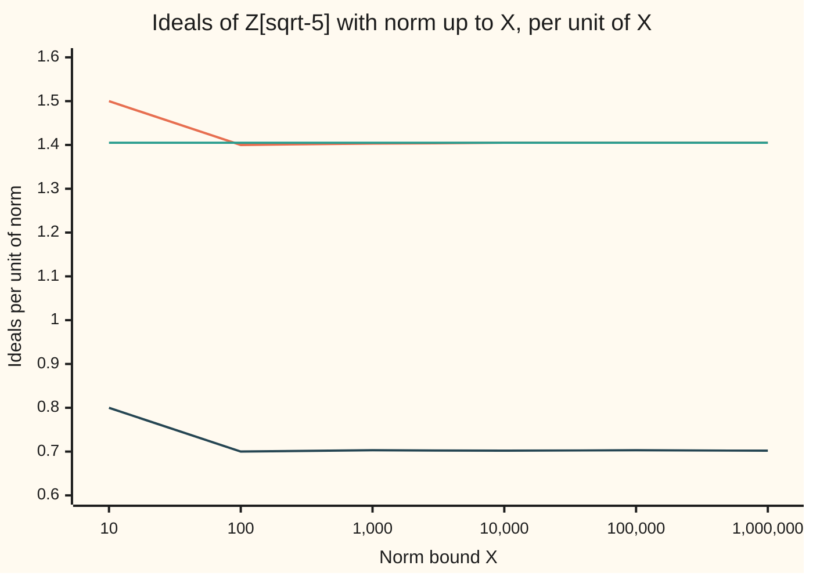

# The class number formula: an analytic limit that counts the failure of factorisation

[Syllabus](../../../SYLLABUS.md) → [Algebraic and analytic number theory](../README.md) → [Algebraic Numbers](../README.md#s06) → The class number formula

---

## General Overview

Allow the number $`\sqrt{-5}`$, whose square is $`-5`$. Then 6 factors two different ways: $`6 = 2 \times 3 = (1 + \sqrt{-5})(1 - \sqrt{-5})`$, and none of the four factors splits further. Ideals (sets of numbers of the ring closed under adding and under multiplying by any number of the ring, the repair for broken factorisation) restore one factorisation. The price is a second kind of ideal that no single number generates. The **class number** $`h`$ counts the kinds: $`h = 2`$ here, where 1 would mean unique factorisation.

This card finds that 2 in a second, very different way: by counting. List every ideal of the ring and record its norm (the number of remainders it leaves, a whole number). With norm up to one million there are 1,404,984 ideals. That is 1.40498 ideals per unit of norm. The share settles on $`2\pi/\sqrt{20} = 1.404963`$.

Why that number? Each kind of ideal is a grid of points in the plane. Counting the ideals of one kind means counting grid points inside a growing circle, and every kind adds the same 0.70248 per unit. Two kinds give 1.404963. So the count per unit, divided by one kind's share, is the class number.

A series packs the same count. The **Dedekind zeta function** adds $`1/N(\mathfrak{a})^s`$ over every ideal $`\mathfrak{a}`$. Near $`s = 1`$ it blows up like $`1.404963/(s - 1)`$. That coefficient, the **residue**, is the count per unit. For this field it equals $`L(1, \chi) = 1.404963`$, the value at 1 of a Dirichlet L-function (a series $`\sum \chi(n)/n^s`$ built from a pattern of signs $`\chi`$ fixed by the field), and the class number drops out: $`h = 2`$.

**The ideals of a number field, counted by norm, grow at a fixed rate; each ideal class contributes an equal share of it, so that rate, the residue of the Dedekind zeta function at one, is the class number times known constants.**

**What kind of fact this is:** a theorem. The imaginary quadratic case is proved on this card in Why it works, by the lattice count; the factor $`\zeta_K = \zeta \cdot L`$ rests on the splitting law proved on [Splitting and ramification](08-splitting-and-ramification.md); the finite sum for $`L(1, \chi)`$ and the formula for every number field are stated with sources.

### The picture: the count per unit settles on the residue



Orange: all ideals with norm up to $`X`$, divided by $`X`$. Green: the residue 1.405, the line the count settles on. Dark blue: the principal ideals alone (those generated by one number), which settle on half of it, 0.702. The two halves are the two ideal classes.

---

## The formula

Some words first, from earlier cards.

- $`K = \mathbb{Q}(\sqrt{-5})`$ is the number field, and $`O_K = \mathbb{Z}[\sqrt{-5}]`$ its ring of integers: all $`a + b\sqrt{-5}`$ with $`a, b`$ whole ([Algebraic integers](01-algebraic-integers-and-number-fields.md)).
- The **discriminant** $`d_K = -20`$ measures the spread of $`O_K`$ ([Norm, trace and discriminant](02-norms-traces-and-discriminants.md)).
- The **norm** of an ideal, $`N(\mathfrak{a})`$, is the number of remainders modulo it: $`N(2, 1 + \sqrt{-5}) = 2`$ ([Ideals factor uniquely even where numbers do not](04-ideals-and-unique-factorisation-in-dedekind-domains.md)).
- The **class group** $`\mathrm{Cl}(K)`$ sorts ideals into classes, two ideals sharing a class when multiplying each by a suitable nonzero number makes them equal; its size is the class number $`h_K`$ ([Class groups](05-class-groups-and-the-minkowski-bound.md)).

New on this card, in words first. The Dedekind zeta function $`\zeta_K(s)`$ adds one over each ideal's norm to the power $`s`$. The number $`w_K`$ counts the roots of unity in $`O_K`$: here only $`\pm 1`$, so $`w_K = 2`$. The **Kronecker symbol** $`\chi(n) = (d_K/n)`$ records how ordinary primes break up in $`O_K`$. For a prime $`p`$ it is $`+1`$ if $`p`$ **splits** into two different prime ideals, $`-1`$ if $`p`$ stays prime (**inert**), and $`0`$ if $`p`$ **ramifies** into a prime ideal squared. For other $`n`$, multiply the values at its prime factors.

```math
\zeta_K(s) = \sum_{\mathfrak{a} \ne 0} \frac{1}{N(\mathfrak{a})^s} = \sum_{n=1}^{\infty} \frac{a_n}{n^s} = \zeta(s)\, L(s, \chi), \qquad \lim_{s \to 1}\,(s - 1)\,\zeta_K(s) = \frac{2\pi\, h_K}{w_K \sqrt{|d_K|}}
```

**Read it aloud:** the Dedekind zeta function adds one over the norm to the s over all nonzero ideals; it equals the Riemann zeta function times the L-function of the field's character; and its residue at one is two pi times the class number, over the number of roots of unity times the root of the discriminant's size.

The residue of $`\zeta(s)`$ at 1 is 1 ([Zeta of a complex variable](../02-The%20Zeta%20Function%20and%20the%20Prime%20Number%20Theorem/01-zeta-and-the-euler-product-revisited.md)), so the residue of $`\zeta_K`$ is $`L(1, \chi)`$. Solve for the class number:

```math
h_K = \frac{w_K \sqrt{|d_K|}}{2\pi}\, L(1, \chi) = -\frac{w_K}{2|d_K|} \sum_{a=1}^{|d_K|} \chi(a)\, a
```

**Read it aloud:** the class number is the units count times root twenty over two pi, times L at one; equivalently, minus the units count over twice twenty, times the sum of chi of a times a over one full period.

For our field: $`2 \times \sqrt{20} \times 1.404963 / (2\pi) = 2`$, and $`-(2/40) \times (-40) = 2`$.

For every number field the residue is $`2^{r_1}(2\pi)^{r_2}\, h_K R_K / (w_K \sqrt{|d_K|})`$. Here $`r_1`$ and $`r_2`$ count the real embeddings and the pairs of complex ones, and the **regulator** $`R_K`$ measures the size of the infinitely many units of fields like $`\mathbb{Q}(\sqrt{5})`$; [The unit theorem](07-dirichlets-unit-theorem.md) defines it. An imaginary quadratic field has $`r_1 = 0`$, $`r_2 = 1`$ and $`R_K = 1`$, which gives the formula above.

| Symbol | Plain meaning | In our example | Push it up and the answer… |
| --- | --- | --- | --- |
| $`K`$, $`O_K`$ | the number field and its ring of integers | $`\mathbb{Q}(\sqrt{-5})`$, $`\mathbb{Z}[\sqrt{-5}]`$ | — |
| $`\mathfrak{a}`$, $`N(\mathfrak{a})`$; $`\mathfrak{b}`$, $`\alpha`$; $`\mathfrak{p}_2`$, $`\mathfrak{p}_3`$ | a nonzero ideal and its norm; in Steps 1 and 2, a fixed ideal of the inverse class and a number in it, written $`u + v\sqrt{-5}`$ or $`2x + y(1 + \sqrt{-5})`$ with $`u, v, x, y`$ whole; the prime ideals $`(2, 1 + \sqrt{-5})`$ and $`(3, 1 + \sqrt{-5})`$ | $`N(\mathfrak{p}_2) = 2`$; $`\mathfrak{b} = \mathfrak{p}_2`$ for the other class | — |
| $`s`$ | the variable of the series, a complex number with real part above 1 | near 1 | larger $`s`$ shrinks every term |
| $`\zeta_K(s)`$, $`a_n`$, $`e`$ | the Dedekind zeta function; $`a_n`$ is the number of ideals of norm $`n`$, the sum of $`\chi(e)`$ over the divisors $`e`$ of $`n`$ | $`a_6 = 2`$, $`a_9 = 3`$, $`a_{11} = 0`$ | — |
| $`X`$ | the norm bound for counting ideals | 10 up to 1,000,000 | count grows as 1.404963 X |
| $`A(X)`$, $`E(X)`$; $`C`$, $`\rho`$, $`\delta`$, $`c`$, $`k`$ | ideals with norm up to $`X`$; its gap from $`\kappa X`$; in the fold under Step 2, the constant in the bound, a disc radius, a cell diameter, a cell area and a count of grid points | 1,404,984; 21.05 at a million | $`E`$ stays below a constant times $`\sqrt{X}`$ |
| $`\kappa`$ | the residue: ideals per unit of norm, read "kappa" | 1.404963 | proportional to $`h_K`$ |
| $`\zeta(s)`$, $`L(s, \chi)`$ | the Riemann zeta function; the series $`\sum \chi(n)/n^s`$ | $`L(1, \chi) = 1.404963`$ | — |
| $`\chi(n)`$ | the Kronecker symbol $`(d_K/n)`$: $`+1`$ split, $`-1`$ inert, $`0`$ ramified, extended by multiplying | $`+1`$ at 1, 3, 7, 9; $`-1`$ at 11, 13, 17, 19 (period 20) | — |
| $`d_K`$ | the discriminant | $`-20`$ | per-class share falls as $`1/\sqrt{\lvert d_K \rvert}`$, so $`h_K`$ tends to grow |
| $`w_K`$, $`R_K`$; $`r_1`$, $`r_2`$ | roots of unity in $`O_K`$; the regulator; real embeddings; pairs of complex embeddings | 2; 1; 0; 1 | for fixed $`h_K`$: more units $`w_K`$, fewer ideals per unit of norm; larger $`R_K`$, more |
| $`h_K`$; $`\varepsilon`$ | the class number: how many ideal classes; in Siegel's bound, any small positive exponent | 2 | more ideals per unit of norm |

### When it holds

- **Sum over the ideals of the full ring of integers.** A smaller ring breaks it. Taking $`\mathbb{Z}[\sqrt{-3}]`$ for the ring of $`\mathbb{Q}(\sqrt{-3})`$ uses $`d = -12`$, and the finite sum returns 2/3, not a whole number. The true $`d_K = -3`$ with $`w_K = 6`$ returns 1.
- **Count the roots of unity.** $`w_K = 2`$ except for $`\mathbb{Q}(i)`$, with 4, and $`\mathbb{Q}(\sqrt{-3})`$, with 6. Leave $`w_K`$ out and $`\mathbb{Q}(\sqrt{-5})`$ reads $`h = 1`$.
- **Imaginary quadratic, or carry the regulator.** For a real quadratic field ($`r_1 = 2`$, $`r_2 = 0`$, $`w_K = 2`$) the residue formula above gives $`h_K R_K = \sqrt{d_K}\,L(1, \chi)/2`$. For $`\mathbb{Q}(\sqrt{5})`$, $`L(1, \chi) = 0.43041`$ and $`\sqrt{5}\,L/2 = 0.48121`$, not a whole number. That value is the regulator $`R_K = 0.48121`$; dividing it out gives $`h_K = 1`$.
- **The value at 1 is a limit, not a quick sum.** The series for $`L(1, \chi)`$ converges slowly. Cut at 100 terms it gives 1.38499, and $`h`$ reads as 1.97157.

---

## Why it works

### Step 0: count the ideals one class at a time

Inside one class, every ideal comes from a point of one fixed grid in the plane. Counting ideals of norm up to $`X`$ is then counting grid points inside a circle: about the circle's area over one cell's area.

For each class, the circle and the cell grow by the same factor, so they cancel. Every class contributes the same number of ideals per unit of norm. A series whose coefficients pile up at a steady rate has that rate as its residue at $`s = 1`$. Steps 1 to 3 make this exact; Steps 4 and 5 turn the residue into a value of $`L`$.

### Step 1: the ideals of one class are the points of one grid

Fix an ideal $`\mathfrak{b}`$ in the inverse class (the class that multiplies the given one back to the principal class). For each ideal $`\mathfrak{a}`$ in the given class, the product $`\mathfrak{a}\mathfrak{b}`$ is principal: $`\mathfrak{a}\mathfrak{b} = (\alpha)`$ for some number $`\alpha`$ in $`\mathfrak{b}`$.

- Norms multiply, so $`N(\mathfrak{a}) = N(\alpha)/N(\mathfrak{b})`$.
- $`\alpha`$ is fixed up to a unit, one of the $`w_K = 2`$ numbers $`\pm 1`$.
- Every nonzero $`\alpha`$ in $`\mathfrak{b}`$ gives back an ideal, $`(\alpha)\mathfrak{b}^{-1}`$, in the class.

So the ideals of the class with norm up to $`X`$ are the nonzero points $`\alpha`$ of $`\mathfrak{b}`$ with $`N(\alpha) \le X \cdot N(\mathfrak{b})`$, divided by 2.

For $`\mathbb{Z}[\sqrt{-5}]`$ the two classes give two whole-number formulas:

| Class | Grid $`\mathfrak{b}`$ | Point | Norm of the ideal |
| --- | --- | --- | --- |
| principal | $`O_K`$ | $`x + y\sqrt{-5}`$ | $`x^2 + 5y^2`$ |
| the other | $`\mathfrak{p}_2 = (2, 1 + \sqrt{-5})`$, its own inverse since $`\mathfrak{p}_2^2 = (2)`$ | $`2x + y(1 + \sqrt{-5})`$ | $`\big((2x + y)^2 + 5y^2\big)/2 = 2x^2 + 2xy + 3y^2`$ |

These are the two **reduced quadratic forms** of discriminant $`-20`$: Gauss showed that each class holds exactly one form of this tidy shape, so listing them is a second road to $`h_K = 2`$ (Cox, below).

The house example sits in the table of counts. Norm 6 has 2 ideals, both principal: the four numbers $`\pm 1 \pm \sqrt{-5}`$ have norm 6, and dividing by the two units leaves $`(1 + \sqrt{-5})`$ and $`(1 - \sqrt{-5})`$. Norms 2 and 3 have only ideals of the other class, because $`x^2 + 5y^2`$ never equals 2 or 3. Those are ideals with no single generator. Two of them multiply to a principal one: $`(1 + \sqrt{-5}) = \mathfrak{p}_2\,\mathfrak{p}_3`$, where $`\mathfrak{p}_3 = (3, 1 + \sqrt{-5})`$ is a prime ideal of norm 3.

### Step 2: grid points in a circle, and why every class gets the same share

Put $`\alpha = u + v\sqrt{-5}`$ at the point $`(u, v\sqrt{5})`$. Then $`N(\alpha) = u^2 + 5v^2`$ is the squared distance from 0. The points with $`N(\alpha) \le X N(\mathfrak{b})`$ fill a disc of area $`\pi X N(\mathfrak{b})`$.

The grid $`O_K`$ has cells 1 wide and $`\sqrt{5}`$ tall, of area $`\sqrt{20}/2 = 2.23607`$. A grid $`\mathfrak{b}`$ has $`N(\mathfrak{b})`$ times fewer points, so its cells have area $`N(\mathfrak{b}) \sqrt{20}/2`$. Divide, then divide by the 2 units:

```math
\#\{\mathfrak{a} \text{ in one class} : N(\mathfrak{a}) \le X\} \approx \frac{1}{w_K}\cdot\frac{\pi X N(\mathfrak{b})}{N(\mathfrak{b})\sqrt{|d_K|}/2} = \frac{2\pi}{w_K\sqrt{|d_K|}}\, X = 0.70248\, X
```

$`N(\mathfrak{b})`$ cancels. Each class gets 0.70248 ideals per unit of norm, so all $`h_K`$ classes together give $`\kappa = 2\pi h_K/(w_K\sqrt{|d_K|})`$. The chart shows both: all ideals near 1.405, principal ones near 0.702.

<details>
<summary>Detailed proof: the error in the grid count is at most a constant times the root of X</summary>

Give each grid point its own cell, the parallelogram it sits at the corner of. Every cell lies within one cell diameter $`\delta`$ of its point. So the cells of points inside the disc of radius $`\rho`$ cover the disc of radius $`\rho - \delta`$ and lie inside the disc of radius $`\rho + \delta`$. With $`k`$ points and cell area $`c`$:

$`\displaystyle \pi(\rho - \delta)^2 \le k\,c \le \pi(\rho + \delta)^2 .`$

So $`k = \pi\rho^2/c + E`$ with $`|E| \le (2\pi\rho\delta + \pi\delta^2)/c`$. Here $`\rho^2 = X N(\mathfrak{b})`$, so $`|E|`$ is at most a constant times $`\sqrt{X}`$, and the constant depends only on $`\mathfrak{b}`$. Removing the point 0 and dividing by $`w_K`$ changes nothing in this bound. Summing over the $`h_K`$ classes:

$`\displaystyle A(X) = \#\{\mathfrak{a} : N(\mathfrak{a}) \le X\} = \kappa X + E(X), \qquad |E(X)| \le C\sqrt{X}.`$

</details>

### Step 3: a steady count rate is the residue

Write $`A(X) = a_1 + a_2 + \dots + a_{\lfloor X \rfloor}`$, the number of ideals with norm up to $`X`$. [Partial summation](../01-Arithmetic%20Functions%20Again/06-abel-and-partial-summation.md) turns the series into an integral against this running total, for real part of $`s`$ above 1:

```math
\zeta_K(s) = s \int_1^{\infty} \frac{A(x)}{x^{s+1}}\, dx = \frac{\kappa\, s}{s - 1} + s \int_1^{\infty} \frac{E(x)}{x^{s+1}}\, dx
```

Since $`|E(x)| \le C\sqrt{x}`$, the last integral converges for real part of $`s`$ above $`\tfrac12`$, so it stays finite at $`s = 1`$. Multiply by $`s - 1`$ and let $`s \to 1`$: only $`\kappa`$ survives. So $`\lim_{s \to 1}(s - 1)\zeta_K(s) = \kappa`$. Hecke later proved that $`\zeta_K`$ continues to the whole complex plane with this one simple pole (Neukirch, below); this card needs only the limit.

### Step 4: the Euler product, prime by prime

Ideals factor uniquely into prime ideals ([Ideals factor uniquely even where numbers do not](04-ideals-and-unique-factorisation-in-dedekind-domains.md)). So, exactly as for the Riemann zeta function, $`\zeta_K(s)`$ is a product over prime ideals of $`1/(1 - N(\mathfrak{p})^{-s})`$. Group the prime ideals by the ordinary prime $`p`$ below them. Three things can happen, decided by $`\chi(p)`$; [Splitting and ramification](08-splitting-and-ramification.md) proves which, and for an odd $`p`$ not dividing 20 it comes down to whether $`-20`$ is a square modulo $`p`$, tested by Euler's criterion.

| What $`p`$ does | Examples | Prime ideals above $`p`$ | Factor in $`\zeta_K`$ | Equals $`\frac{1}{1 - p^{-s}}\cdot\frac{1}{1 - \chi(p)p^{-s}}`$ with |
| --- | --- | --- | --- | --- |
| splits | 3, 7, 23, 29 | two, each of norm $`p`$ | $`(1 - p^{-s})^{-2}`$ | $`\chi(p) = +1`$ |
| inert | 11, 13 | one, of norm $`p^2`$ | $`(1 - p^{-2s})^{-1}`$ | $`\chi(p) = -1`$ |
| ramifies | 2, 5 | one, of norm $`p`$, squared | $`(1 - p^{-s})^{-1}`$ | $`\chi(p) = 0`$ |

The inert row uses $`1 - p^{-2s} = (1 - p^{-s})(1 + p^{-s})`$. Multiply every row over all $`p`$: the first factors build $`\zeta(s)`$ and the second factors build $`L(s, \chi)`$. So $`\zeta_K(s) = \zeta(s)L(s, \chi)`$, and multiplying the two series ([Dirichlet series](../../07-Complex%20analysis/09-Special%20Functions%20and%20the%20Zeta%20Function/06-dirichlet-series-and-mobius-inversion.md)) gives $`a_n = \sum_{e \mid n}\chi(e)`$. At $`s = 2`$ the series, the product over primes up to 100,000 and $`\zeta(2)L(2, \chi)`$ give 1.85554, 1.85556 and 1.85556; the series is cut at 100,000 terms.

### Step 5: the residue is L at one, and L at one is a finite sum

$`\zeta(s)`$ has residue 1 at $`s = 1`$, and $`L(s, \chi)`$ is smooth there, because $`\chi`$ sums to zero over each period of 20. So the residue of $`\zeta_K`$ is $`L(1, \chi)`$, and with Step 2:

```math
L(1, \chi) = \frac{2\pi h_K}{w_K\sqrt{|d_K|}} \quad\Longrightarrow\quad h_K = \frac{w_K\sqrt{|d_K|}}{2\pi}\, L(1, \chi)
```

Dirichlet found $`L(1, \chi)`$ in closed form in 1839. For a field discriminant $`d_K < 0`$, $`L(1, \chi) = -\pi \sum_{a=1}^{|d_K|}\chi(a)\,a \,/\, |d_K|^{3/2}`$. The proof expands $`\chi`$ with a Gauss sum (a weighted sum of roots of unity, on [Gauss sums](../03-Characters%20and%20L-functions/06-gauss-sums.md)) and sums the series for the logarithm; it is stated here with Davenport's book as the source. For $`d_K = -20`$ it gives $`40\pi/20^{3/2} = 2\pi/\sqrt{20}`$, matching the partial sums to 1.404961 at a million terms.

**Where proof ends and evidence begins.** Steps 1 to 3 are a complete proof that the residue is $`2\pi h_K/(w_K\sqrt{|d_K|})`$. The code then counts ideals exactly two ways, by $`\sum_{e \mid n}\chi(e)`$ and by grid points of the two forms, and the totals agree at six sizes up to a million. It also finds $`h`$ for 11 fields by reduced forms and by the finite sum, and they agree every time. Those agreements are evidence; the proofs are above and in the sources.

---

## Worked numbers, by hand

| Step | Arithmetic | Value |
| --- | --- | --- |
| $`\chi(a)`$ for $`a`$ = 1 to 20 | Euler's criterion on $`-20`$, primes 2 and 5 give 0 | $`+1`$ at 1, 3, 7, 9; $`-1`$ at 11, 13, 17, 19 |
| $`\sum \chi(a)\,a`$ | $`(1 + 3 + 7 + 9) - (11 + 13 + 17 + 19) = 20 - 60`$ | $`-40`$ |
| $`h`$ by the finite sum | $`-(2/40) \times (-40)`$ | 2 |
| $`L(1, \chi)`$ | $`2\pi/\sqrt{20}`$ | 1.404963 |
| $`h`$ from $`L`$ | $`2 \times \sqrt{20} \times 1.404963 / (2\pi)`$ | 2.00000 |
| ideals of norm 6 | $`\chi(1) + \chi(2) + \chi(3) + \chi(6) = 1 + 0 + 1 + 0`$ | 2 |
| principal ideals of norm 6 | four numbers $`\pm 1 \pm \sqrt{-5}`$, over 2 units | 2 |
| ideals of norm 3 | $`\chi(1) + \chi(3)`$; none principal | 2 |
| one class's share | $`2\pi/(2\sqrt{20})`$ | 0.70248 |
| ideals of norm up to 1,000,000 | count | 1,404,984 |
| count per unit | $`1{,}404{,}984 / 1{,}000{,}000`$ | 1.40498, near $`2 \times 0.70248`$ |
| **class number** | $`1.40498 / 0.70248`$, rounded | **2** |

The ring $`\mathbb{Z}[\sqrt{-5}]`$ has exactly two ideal classes: the principal ideals and one other kind, which is why 6 can factor in two ways. Unique factorisation fails, but only by a factor of two.

### What breaks if you drop a piece

| Mistake | Comes out at | What went wrong |
| --- | --- | --- |
| $`w_K`$ left out: $`\sqrt{20}\,L(1, \chi)/(2\pi)`$ | 1.00000 | Each ideal has 2 generators, $`\pm\alpha`$; not dividing by 2 halves $`h`$ |
| Count principal ideals only | 0.70249 per unit; $`h`$ read as 1.00001 | One class's share, not all of them |
| $`\mathbb{Z}[\sqrt{-3}]`$ taken for the ring, $`d = -12`$ | 2/3 | Not the full ring of integers; $`d_K = -3`$, $`w_K = 6`$ gives 1 |
| $`\mathbb{Q}(\sqrt{5})`$ without the regulator | 0.48121 | Real fields have infinitely many units; $`R_K = 0.48121`$, and with it $`h = 1.00000`$ |
| $`L(1, \chi)`$ cut at 100 terms | 1.38499; $`h`$ read as 1.97157 | The series converges slowly; the tail is still 0.02 |

The code prints every row.

---

## Code, from first principles, and it actually runs

The code takes four independent roads to $`h = 2`$. Road 1 lists the reduced quadratic forms of discriminant $`-20`$. Road 2 sums $`\chi(n)/n`$ to a million terms and applies the formula. Road 3 is the finite sum. Road 4 counts ideals exactly by divisor sums of $`\chi`$ and again by grid points of the two forms, and sets the count beside $`\kappa X`$. $`\chi`$ itself comes from Euler's criterion, not from a table. A sieve also checks $`\zeta_K(2) = \zeta(2)L(2, \chi)`$ against the Euler product.

### Python

```python
# The class number formula -- the check behind the card.  Standard library only.
# Field K = Q(sqrt-5): discriminant d = -20, w = 2 units (+1 and -1), regulator 1.
# Road 1 counts reduced quadratic forms of discriminant d: one per ideal class.
# Road 2 reads h off the L-value: partial sums of chi(n)/n, then h = w sqrt|d| L / (2 pi).
# Road 3 is the finite sum h = -(w / 2|d|) * (sum of chi(a) a for a = 1 to |d|).
# Road 4 counts ideals of norm <= X two ways (divisor sums of chi; lattice points of
# the forms) and sets the count beside residue times X.  chi comes from Euler's criterion.
from fractions import Fraction as F
from math import isqrt, pi, sqrt, log

def kronecker(d, n):                   # (d/n), d a field discriminant, n >= 1, by factoring n
    out, p = 1, 2
    while n > 1:
        if p * p > n:
            p = n
        while n % p == 0:
            n //= p
            if p == 2:
                out *= 0 if d % 2 == 0 else (1 if d % 8 in (1, 7) else -1)
            else:
                r = pow(d % p, (p - 1) // 2, p)      # Euler's criterion
                out *= -1 if r == p - 1 else r
        p += 1
    return out

def reduced_forms(d):                  # (a, b, c), b^2 - 4ac = d, |b| <= a <= c, b >= 0 on the edges
    out = []
    for a in range(1, isqrt(-d // 3) + 1):
        for b in range(-a + 1, a + 1):
            if (b * b - d) % (4 * a) == 0:
                c = (b * b - d) // (4 * a)
                if c >= a and not (a == c and b < 0):
                    out.append((a, b, c))
    return out

def finite_h(d, w):                    # road 3
    return -F(w, 2 * abs(d)) * sum(kronecker(d, a) * a for a in range(1, abs(d) + 1))

def L1(d, N):                          # road 2: chi(1)/1 + ... + chi(N)/N, chi from one period
    per = [kronecker(d, a) for a in range(1, abs(d) + 1)]
    return sum(per[(n - 1) % abs(d)] / n for n in range(1, N + 1))

def points(form, X):                   # (x, y) with a x^2 + b x y + c y^2 <= X, origin included
    a, b, c = form
    D, tot, y = 4 * a * c - b * b, 0, 0
    while D * y * y <= 4 * a * X:      # 4a Q = (2ax + by)^2 + D y^2
        m, r = isqrt(4 * a * X - D * y * y), (b * y) % (2 * a)
        k = (m - r) // (2 * a) - (-m - 1 - r) // (2 * a)
        tot, y = tot + (k if y == 0 else 2 * k), y + 1
    return tot

d, w = -20, 2
chi = [kronecker(d, a) for a in range(1, 21)]
periodic = all(kronecker(d, n) == chi[(n - 1) % 20] for n in range(21, 4001))
print(f"field Q(sqrt-5): d = {d}, w = {w}; chi(a) for a = 1..20: {chi}")
print(f"chi repeats with period 20 for n up to 4000: {'yes' if periodic else 'no'}")
kind = {1: "split", -1: "inert", 0: "ramified"}
print("primes: " + ", ".join(f"{p} {kind[kronecker(d, p)]}" for p in (2, 3, 5, 7, 11, 13, 23, 29)))
forms = reduced_forms(d)
an = [sum(kronecker(d, e) for e in range(1, n + 1) if n % e == 0) for n in range(1, 21)]
def reps(f, n): return points(f, n) - points(f, n - 1)
prin, nonp = [reps(forms[0], n) // w for n in range(1, 21)], [reps(forms[1], n) // w for n in range(1, 21)]
print(f"ideals of norm n, n = 1..20: {an}")
print(f"  principal (x^2 + 5y^2):    {prin}")
print(f"  other class (2x^2+2xy+3y^2): {nonp}")
six = [(x, y) for x in range(-3, 4) for y in range(-2, 3) if x * x + 5 * y * y == 6]
print(f"elements of norm 6: {six}; ideals {len(six) // w}")
h1 = len(forms)
print(f"road 1, reduced forms of discriminant -20: {forms}; h = {h1}")
for N in (100, 10 ** 4, 10 ** 6):
    print(f"road 2, L(1, chi) summed to N = {N:>7}: {L1(d, N):.6f}")
L, exact = L1(d, 10 ** 6), 2 * pi / sqrt(20)
h2 = w * sqrt(20) * L / (2 * pi)
h3 = finite_h(d, w)
print(f"        2 pi / sqrt 20 = {exact:.6f}; h = w sqrt|d| L / (2 pi) = {h2:.5f}")
print(f"road 3, -(2/40) * sum chi(a) a = -(1/20) * {sum(c * a for a, c in enumerate(chi, 1))} = {h3}")
kappa = 2 * pi * h1 / (w * sqrt(20))
print(f"residue of zeta_K at 1: 2 pi h / (w sqrt 20) = {kappa:.6f}")
print(f"lattice cell area sqrt20 / 2 = {sqrt(20) / 2:.5f}; share of one class 2 pi / (w sqrt 20) = {kappa / h1:.5f}")
print("road 4, ideals of norm <= X: X, by divisor sums, by lattice points, count/X, count - kappa X, principal/X")
ratios, prat = [], []
for X in (10, 100, 1000, 10 ** 4, 10 ** 5, 10 ** 6):
    S = sum(chi[(e - 1) % 20] * (X // e) for e in range(1, X + 1))
    lat = sum(points(f, X) - 1 for f in forms) // w
    P = (points(forms[0], X) - 1) // w
    ratios.append(S / X); prat.append(P / X)
    print(f"  {X:>7} {S:>8} {lat:>8} {S / X:.5f} {S - kappa * X:>9.2f} {P / X:.5f}")
    assert S == lat, "the two ideal counts must agree exactly"
NZ = 10 ** 5
a_sieve = [0] * (NZ + 1)
for e in range(1, NZ + 1):
    for m in range(e, NZ + 1, e):
        a_sieve[m] += chi[(e - 1) % 20]
series = sum(a_sieve[n] / n ** 2 for n in range(1, NZ + 1))
sieve = [True] * (NZ + 1)
prod = 1.0
for p in range(2, NZ + 1):
    if sieve[p]:
        for m in range(p * p, NZ + 1, p): sieve[m] = False
        c = kronecker(d, p)
        prod *= 1 / (1 - p ** -2) if c == 0 else (1 / (1 - p ** -2) ** 2 if c == 1 else 1 / (1 - p ** -4))
zL = pi ** 2 / 6 * sum(chi[(n - 1) % 20] / n ** 2 for n in range(1, NZ + 1))
print(f"zeta_K(2): sum a_n/n^2 {series:.5f}; Euler product {prod:.5f}; zeta(2) L(2, chi) {zL:.5f}")
table = [(D, len(reduced_forms(D)), finite_h(D, 6 if D == -3 else 4 if D == -4 else 2))
         for D in (-3, -4, -7, -8, -15, -20, -23, -24, -47, -71, -163)]
print("other fields, d: forms h / finite-sum h: " + ", ".join(f"{D}: {a}/{b}" for D, a, b in table))
L5, R5 = L1(5, 10 ** 6), log((1 + sqrt(5)) / 2)
print(f"mistake, w left out: sqrt 20 L / (2 pi) = {sqrt(20) * L / (2 * pi):.5f}")
print(f"mistake, principal ideals only at X = 10^6: {prat[-1]:.5f} per unit of X; h read as {prat[-1] / kappa * h1:.5f}")
print(f"mistake, Z[sqrt-3] with d = -12 in the finite sum: {finite_h(-12, 2)}; true d = -3, w = 6: {finite_h(-3, 6)}")
print(f"mistake, Q(sqrt5) without the regulator: L(1) = {L5:.5f}, sqrt5 L / 2 = {sqrt(5) * L5 / 2:.5f}; "
      f"R = {R5:.5f}; with R: {sqrt(5) * L5 / (2 * R5):.5f}")
L100 = L1(d, 100)
print(f"mistake, L(1, chi) cut at 100 terms: {L100:.5f}; h read as {w * sqrt(20) * L100 / (2 * pi):.5f}")
print("chart, X: 10^1 .. 10^6; ideals/X " + " ".join(f"{r:.3f}" for r in ratios)
      + "; principal/X " + " ".join(f"{r:.3f}" for r in prat) + f"; kappa {kappa:.3f}")
assert h1 == 2 and h3 == 2 and abs(h2 - 2) < 1e-5, "three roads to h = 2"
assert abs(L - exact) < 5e-6, "partial sums of chi(n)/n must approach 2 pi / sqrt 20"
assert periodic and an[5] == 2 and len(six) == 4
assert [p + q for p, q in zip(prin, nonp)] == an, "ideal counts by class must add to the divisor sums"
assert abs(ratios[-1] - kappa) < 1e-3 and abs(prat[-1] - kappa / 2) < 1e-3
assert abs(series - zL) < 1e-4 and abs(prod - zL) < 1e-4
assert all(a == b for _, a, b in table) and finite_h(-12, 2) == F(2, 3)
assert abs(sqrt(5) * L5 / (2 * R5) - 1) < 1e-5
print("ALL CHECKS PASS")
```

**Ran 2026-11-15 on macOS, Python 3.14.10, standard library only. All checks passed. Output, pasted from the run:**

```
field Q(sqrt-5): d = -20, w = 2; chi(a) for a = 1..20: [1, 0, 1, 0, 0, 0, 1, 0, 1, 0, -1, 0, -1, 0, 0, 0, -1, 0, -1, 0]
chi repeats with period 20 for n up to 4000: yes
primes: 2 ramified, 3 split, 5 ramified, 7 split, 11 inert, 13 inert, 23 split, 29 split
ideals of norm n, n = 1..20: [1, 1, 2, 1, 1, 2, 2, 1, 3, 1, 0, 2, 0, 2, 2, 1, 0, 3, 0, 1]
  principal (x^2 + 5y^2):    [1, 0, 0, 1, 1, 2, 0, 0, 3, 0, 0, 0, 0, 2, 0, 1, 0, 0, 0, 1]
  other class (2x^2+2xy+3y^2): [0, 1, 2, 0, 0, 0, 2, 1, 0, 1, 0, 2, 0, 0, 2, 0, 0, 3, 0, 0]
elements of norm 6: [(-1, -1), (-1, 1), (1, -1), (1, 1)]; ideals 2
road 1, reduced forms of discriminant -20: [(1, 0, 5), (2, 2, 3)]; h = 2
road 2, L(1, chi) summed to N =     100: 1.384993
road 2, L(1, chi) summed to N =   10000: 1.404763
road 2, L(1, chi) summed to N = 1000000: 1.404961
        2 pi / sqrt 20 = 1.404963; h = w sqrt|d| L / (2 pi) = 2.00000
road 3, -(2/40) * sum chi(a) a = -(1/20) * -40 = 2
residue of zeta_K at 1: 2 pi h / (w sqrt 20) = 1.404963
lattice cell area sqrt20 / 2 = 2.23607; share of one class 2 pi / (w sqrt 20) = 0.70248
road 4, ideals of norm <= X: X, by divisor sums, by lattice points, count/X, count - kappa X, principal/X
       10       15       15 1.50000      0.95 0.80000
      100      140      140 1.40000     -0.50 0.70000
     1000     1403     1403 1.40300     -1.96 0.70300
    10000    14047    14047 1.40470     -2.63 0.70180
   100000   140492   140492 1.40492     -4.29 0.70267
  1000000  1404984  1404984 1.40498     21.05 0.70249
zeta_K(2): sum a_n/n^2 1.85554; Euler product 1.85556; zeta(2) L(2, chi) 1.85556
other fields, d: forms h / finite-sum h: -3: 1/1, -4: 1/1, -7: 1/1, -8: 1/1, -15: 2/2, -20: 2/2, -23: 3/3, -24: 2/2, -47: 5/5, -71: 7/7, -163: 1/1
mistake, w left out: sqrt 20 L / (2 pi) = 1.00000
mistake, principal ideals only at X = 10^6: 0.70249 per unit of X; h read as 1.00001
mistake, Z[sqrt-3] with d = -12 in the finite sum: 2/3; true d = -3, w = 6: 1
mistake, Q(sqrt5) without the regulator: L(1) = 0.43041, sqrt5 L / 2 = 0.48121; R = 0.48121; with R: 1.00000
mistake, L(1, chi) cut at 100 terms: 1.38499; h read as 1.97157
chart, X: 10^1 .. 10^6; ideals/X 1.500 1.400 1.403 1.405 1.405 1.405; principal/X 0.800 0.700 0.703 0.702 0.703 0.702; kappa 1.405
ALL CHECKS PASS
```

Four roads, one class number. The two ideal counts agree exactly at all six sizes, and at those six sizes the count minus $`\kappa X`$ stays below 22 in size. Between them it can stray further; what is proved, in the fold under Step 2, is only that it stays below a constant times $`\sqrt{X}`$.

### Rust

Same numbers, same labels, built with `rustc --edition 2021 -O`.

```rust
// The class number formula -- the same check as the Python, in Rust.  No crates.
// Field K = Q(sqrt-5): discriminant d = -20, w = 2 units (+1 and -1), regulator 1.
// Road 1 counts reduced quadratic forms of discriminant d: one per ideal class.
// Road 2 reads h off the L-value: partial sums of chi(n)/n, then h = w sqrt|d| L / (2 pi).
// Road 3 is the finite sum h = -(w / 2|d|) * (sum of chi(a) a for a = 1 to |d|).
// Road 4 counts ideals of norm <= X two ways (divisor sums of chi; lattice points of
// the forms) and sets the count beside residue times X.  chi comes from Euler's criterion.
use std::f64::consts::PI;

fn powmod(mut b: i64, mut e: i64, m: i64) -> i64 {
    let mut r = 1 % m;
    while e > 0 { if e & 1 == 1 { r = r * b % m; } b = b * b % m; e >>= 1; }
    r
}

fn kronecker(d: i64, mut n: i64) -> i64 { // (d/n), d a field discriminant, n >= 1, by factoring n
    let (mut out, mut p) = (1i64, 2i64);
    while n > 1 {
        if p * p > n { p = n; }
        while n % p == 0 {
            n /= p;
            if p == 2 {
                out *= if d % 2 == 0 { 0 } else if [1, 7].contains(&d.rem_euclid(8)) { 1 } else { -1 };
            } else {
                let r = powmod(d.rem_euclid(p), (p - 1) / 2, p); // Euler's criterion
                out *= if r == p - 1 { -1 } else { r };
            }
        }
        p += 1;
    }
    out
}

fn isqrt(n: i64) -> i64 {
    let mut r = (n as f64).sqrt() as i64;
    while r * r > n { r -= 1; } while (r + 1) * (r + 1) <= n { r += 1; } r
}

fn reduced_forms(d: i64) -> Vec<(i64, i64, i64)> {
    let mut out = vec![];
    for a in 1..=isqrt(-d / 3) {
        for b in (-a + 1)..=a {
            if (b * b - d) % (4 * a) == 0 {
                let c = (b * b - d) / (4 * a);
                if c >= a && !(a == c && b < 0) { out.push((a, b, c)); }
            }
        }
    }
    out
}

fn gcd(a: i64, b: i64) -> i64 { if b == 0 { a.abs() } else { gcd(b, a % b) } }

fn finite_h(d: i64, w: i64) -> (i64, i64) { // road 3, as a reduced fraction
    let s: i64 = (1..=d.abs()).map(|a| kronecker(d, a) * a).sum();
    let (num, den) = (-w * s, 2 * d.abs());
    let g = gcd(num, den);
    (num / g, den / g)
}

fn fr((n, d): (i64, i64)) -> String { if d == 1 { format!("{}", n) } else { format!("{}/{}", n, d) } }

fn l1(d: i64, n: i64) -> f64 { // road 2: chi(1)/1 + ... + chi(N)/N, chi from one period
    let per: Vec<i64> = (1..=d.abs()).map(|a| kronecker(d, a)).collect();
    (1..=n).map(|k| per[((k - 1) % d.abs()) as usize] as f64 / k as f64).sum()
}

fn points(f: (i64, i64, i64), x: i64) -> i64 { // (x, y) with a x^2 + b x y + c y^2 <= X, origin included
    let (a, b, c) = f;
    let (dd, mut tot, mut y) = (4 * a * c - b * b, 0i64, 0i64);
    while dd * y * y <= 4 * a * x { // 4a Q = (2ax + by)^2 + D y^2
        let (m, r) = (isqrt(4 * a * x - dd * y * y), (b * y).rem_euclid(2 * a));
        let k = (m - r).div_euclid(2 * a) - (-m - 1 - r).div_euclid(2 * a);
        tot += if y == 0 { k } else { 2 * k };
        y += 1;
    }
    tot
}

fn list(v: &[i64]) -> String { format!("[{}]", v.iter().map(|x| x.to_string()).collect::<Vec<_>>().join(", ")) }

fn main() {
    let (d, w) = (-20i64, 2i64);
    let chi: Vec<i64> = (1..=20).map(|a| kronecker(d, a)).collect();
    let periodic = (21..=4000).all(|n| kronecker(d, n) == chi[((n - 1) % 20) as usize]);
    println!("field Q(sqrt-5): d = {}, w = {}; chi(a) for a = 1..20: {}", d, w, list(&chi));
    println!("chi repeats with period 20 for n up to 4000: {}", if periodic { "yes" } else { "no" });
    let kind = |c: i64| if c == 1 { "split" } else if c == -1 { "inert" } else { "ramified" };
    let pr: Vec<String> = [2, 3, 5, 7, 11, 13, 23, 29].iter().map(|&p| format!("{} {}", p, kind(kronecker(d, p)))).collect();
    println!("primes: {}", pr.join(", "));
    let forms = reduced_forms(d);
    let an: Vec<i64> = (1..=20).map(|n| (1..=n).filter(|e| n % e == 0).map(|e| kronecker(d, e)).sum()).collect();
    let reps = |f: (i64, i64, i64), n: i64| points(f, n) - points(f, n - 1);
    let prin: Vec<i64> = (1..=20).map(|n| reps(forms[0], n) / w).collect();
    let nonp: Vec<i64> = (1..=20).map(|n| reps(forms[1], n) / w).collect();
    println!("ideals of norm n, n = 1..20: {}", list(&an));
    println!("  principal (x^2 + 5y^2):    {}", list(&prin));
    println!("  other class (2x^2+2xy+3y^2): {}", list(&nonp));
    let mut six = vec![];
    for x in -3..4i64 { for y in -2..3i64 { if x * x + 5 * y * y == 6 { six.push(format!("({}, {})", x, y)); } } }
    println!("elements of norm 6: [{}]; ideals {}", six.join(", "), six.len() as i64 / w);
    let h1 = forms.len() as i64;
    let fs: Vec<String> = forms.iter().map(|f| format!("({}, {}, {})", f.0, f.1, f.2)).collect();
    println!("road 1, reduced forms of discriminant -20: [{}]; h = {}", fs.join(", "), h1);
    for n in [100i64, 10_000, 1_000_000] {
        println!("road 2, L(1, chi) summed to N = {:>7}: {:.6}", n, l1(d, n));
    }
    let (l, exact) = (l1(d, 1_000_000), 2.0 * PI / 20f64.sqrt());
    let h2 = w as f64 * 20f64.sqrt() * l / (2.0 * PI);
    let h3 = finite_h(d, w);
    println!("        2 pi / sqrt 20 = {:.6}; h = w sqrt|d| L / (2 pi) = {:.5}", exact, h2);
    let sca: i64 = chi.iter().enumerate().map(|(i, c)| c * (i as i64 + 1)).sum();
    println!("road 3, -(2/40) * sum chi(a) a = -(1/20) * {} = {}", sca, fr(h3));
    let kappa = 2.0 * PI * h1 as f64 / (w as f64 * 20f64.sqrt());
    println!("residue of zeta_K at 1: 2 pi h / (w sqrt 20) = {:.6}", kappa);
    println!("lattice cell area sqrt20 / 2 = {:.5}; share of one class 2 pi / (w sqrt 20) = {:.5}", 20f64.sqrt() / 2.0, kappa / h1 as f64);
    println!("road 4, ideals of norm <= X: X, by divisor sums, by lattice points, count/X, count - kappa X, principal/X");
    let (mut ratios, mut prat) = (vec![], vec![]);
    for x in [10i64, 100, 1000, 10_000, 100_000, 1_000_000] {
        let s: i64 = (1..=x).map(|e| chi[((e - 1) % 20) as usize] * (x / e)).sum();
        let lat = forms.iter().map(|&f| points(f, x) - 1).sum::<i64>() / w;
        let p = (points(forms[0], x) - 1) / w;
        ratios.push(s as f64 / x as f64); prat.push(p as f64 / x as f64);
        println!("  {:>7} {:>8} {:>8} {:.5} {:>9.2} {:.5}", x, s, lat, s as f64 / x as f64,
                 s as f64 - kappa * x as f64, p as f64 / x as f64);
        assert!(s == lat, "the two ideal counts must agree exactly");
    }
    let nz = 100_000usize;
    let mut a_sieve = vec![0i64; nz + 1];
    for e in 1..=nz { let mut m = e; while m <= nz { a_sieve[m] += chi[(e - 1) % 20]; m += e; } }
    let mut series = 0.0; for n in 1..=nz { series += a_sieve[n] as f64 / (n * n) as f64; }
    let (mut sieve, mut prod) = (vec![true; nz + 1], 1.0f64);
    for p in 2..=nz {
        if sieve[p] {
            let mut m = p * p; while m <= nz { sieve[m] = false; m += p; }
            let (c, q) = (kronecker(d, p as i64), (p as f64).powi(-2));
            prod *= if c == 0 { 1.0 / (1.0 - q) } else if c == 1 { 1.0 / ((1.0 - q) * (1.0 - q)) } else { 1.0 / (1.0 - (p as f64).powi(-4)) };
        }
    }
    let mut l2 = 0.0; for n in 1..=nz { l2 += chi[(n - 1) % 20] as f64 / (n * n) as f64; }
    let zl = PI * PI / 6.0 * l2;
    println!("zeta_K(2): sum a_n/n^2 {:.5}; Euler product {:.5}; zeta(2) L(2, chi) {:.5}", series, prod, zl);
    let table: Vec<(i64, i64, (i64, i64))> = [-3i64, -4, -7, -8, -15, -20, -23, -24, -47, -71, -163].iter()
        .map(|&dd| (dd, reduced_forms(dd).len() as i64, finite_h(dd, if dd == -3 { 6 } else if dd == -4 { 4 } else { 2 }))).collect();
    let ts: Vec<String> = table.iter().map(|(dd, a, b)| format!("{}: {}/{}", dd, a, fr(*b))).collect();
    println!("other fields, d: forms h / finite-sum h: {}", ts.join(", "));
    let (l5, r5) = (l1(5, 1_000_000), ((1.0 + 5f64.sqrt()) / 2.0).ln());
    println!("mistake, w left out: sqrt 20 L / (2 pi) = {:.5}", 20f64.sqrt() * l / (2.0 * PI));
    let lp = prat[prat.len() - 1];
    println!("mistake, principal ideals only at X = 10^6: {:.5} per unit of X; h read as {:.5}", lp, lp / kappa * h1 as f64);
    println!("mistake, Z[sqrt-3] with d = -12 in the finite sum: {}; true d = -3, w = 6: {}", fr(finite_h(-12, 2)), fr(finite_h(-3, 6)));
    println!("mistake, Q(sqrt5) without the regulator: L(1) = {:.5}, sqrt5 L / 2 = {:.5}; R = {:.5}; with R: {:.5}",
             l5, 5f64.sqrt() * l5 / 2.0, r5, 5f64.sqrt() * l5 / (2.0 * r5));
    let l100 = l1(d, 100);
    println!("mistake, L(1, chi) cut at 100 terms: {:.5}; h read as {:.5}", l100, w as f64 * 20f64.sqrt() * l100 / (2.0 * PI));
    let j = |v: &[f64]| v.iter().map(|r| format!("{:.3}", r)).collect::<Vec<_>>().join(" ");
    println!("chart, X: 10^1 .. 10^6; ideals/X {}; principal/X {}; kappa {:.3}", j(&ratios), j(&prat), kappa);
    assert!(h1 == 2 && h3 == (2, 1) && (h2 - 2.0).abs() < 1e-5, "three roads to h = 2");
    assert!((l - exact).abs() < 5e-6, "partial sums of chi(n)/n must approach 2 pi / sqrt 20");
    assert!(periodic && an[5] == 2 && six.len() == 4);
    assert!(prin.iter().zip(&nonp).map(|(p, q)| p + q).collect::<Vec<_>>() == an, "ideal counts by class must add to the divisor sums");
    assert!((ratios[5] - kappa).abs() < 1e-3 && (lp - kappa / 2.0).abs() < 1e-3);
    assert!((series - zl).abs() < 1e-4 && (prod - zl).abs() < 1e-4);
    assert!(table.iter().all(|(_, a, b)| *b == (*a, 1)) && finite_h(-12, 2) == (2, 3));
    assert!((5f64.sqrt() * l5 / (2.0 * r5) - 1.0).abs() < 1e-5);
    println!("ALL CHECKS PASS");
}
```

**Ran 2026-11-15 on macOS, rustc 1.98.1, no crates. All checks passed. Output, pasted from the run:**

```
field Q(sqrt-5): d = -20, w = 2; chi(a) for a = 1..20: [1, 0, 1, 0, 0, 0, 1, 0, 1, 0, -1, 0, -1, 0, 0, 0, -1, 0, -1, 0]
chi repeats with period 20 for n up to 4000: yes
primes: 2 ramified, 3 split, 5 ramified, 7 split, 11 inert, 13 inert, 23 split, 29 split
ideals of norm n, n = 1..20: [1, 1, 2, 1, 1, 2, 2, 1, 3, 1, 0, 2, 0, 2, 2, 1, 0, 3, 0, 1]
  principal (x^2 + 5y^2):    [1, 0, 0, 1, 1, 2, 0, 0, 3, 0, 0, 0, 0, 2, 0, 1, 0, 0, 0, 1]
  other class (2x^2+2xy+3y^2): [0, 1, 2, 0, 0, 0, 2, 1, 0, 1, 0, 2, 0, 0, 2, 0, 0, 3, 0, 0]
elements of norm 6: [(-1, -1), (-1, 1), (1, -1), (1, 1)]; ideals 2
road 1, reduced forms of discriminant -20: [(1, 0, 5), (2, 2, 3)]; h = 2
road 2, L(1, chi) summed to N =     100: 1.384993
road 2, L(1, chi) summed to N =   10000: 1.404763
road 2, L(1, chi) summed to N = 1000000: 1.404961
        2 pi / sqrt 20 = 1.404963; h = w sqrt|d| L / (2 pi) = 2.00000
road 3, -(2/40) * sum chi(a) a = -(1/20) * -40 = 2
residue of zeta_K at 1: 2 pi h / (w sqrt 20) = 1.404963
lattice cell area sqrt20 / 2 = 2.23607; share of one class 2 pi / (w sqrt 20) = 0.70248
road 4, ideals of norm <= X: X, by divisor sums, by lattice points, count/X, count - kappa X, principal/X
       10       15       15 1.50000      0.95 0.80000
      100      140      140 1.40000     -0.50 0.70000
     1000     1403     1403 1.40300     -1.96 0.70300
    10000    14047    14047 1.40470     -2.63 0.70180
   100000   140492   140492 1.40492     -4.29 0.70267
  1000000  1404984  1404984 1.40498     21.05 0.70249
zeta_K(2): sum a_n/n^2 1.85554; Euler product 1.85556; zeta(2) L(2, chi) 1.85556
other fields, d: forms h / finite-sum h: -3: 1/1, -4: 1/1, -7: 1/1, -8: 1/1, -15: 2/2, -20: 2/2, -23: 3/3, -24: 2/2, -47: 5/5, -71: 7/7, -163: 1/1
mistake, w left out: sqrt 20 L / (2 pi) = 1.00000
mistake, principal ideals only at X = 10^6: 0.70249 per unit of X; h read as 1.00001
mistake, Z[sqrt-3] with d = -12 in the finite sum: 2/3; true d = -3, w = 6: 1
mistake, Q(sqrt5) without the regulator: L(1) = 0.43041, sqrt5 L / 2 = 0.48121; R = 0.48121; with R: 1.00000
mistake, L(1, chi) cut at 100 terms: 1.38499; h read as 1.97157
chart, X: 10^1 .. 10^6; ideals/X 1.500 1.400 1.403 1.405 1.405 1.405; principal/X 0.800 0.700 0.703 0.702 0.703 0.702; kappa 1.405
ALL CHECKS PASS
```

The two outputs match line for line.

### Lean

Lean proves the class number formula for every number field, its imaginary quadratic form, and the card's whole-number checks for $`\mathbb{Q}(\sqrt{-5})`$.

- Take any imaginary quadratic field $`K`$. Then $`(s - 1)\,\zeta_K(s)`$ tends to $`2\pi h_K/(w_K\sqrt{|d_K|})`$ as $`s`$ comes down to 1.
- Take the same field. Then the ideals of norm up to $`X`$, divided by $`X`$, tend to that same residue as $`X`$ grows.
- Take any number field $`K`$. Then the residue is $`2^{r_1}(2\pi)^{r_2} h_K R_K/(w_K\sqrt{|d_K|})`$.
- Take an imaginary quadratic field. Then $`r_1 = 0`$, $`r_2 = 1`$ and $`R_K = 1`$, which turns the general formula into the first.
- Take $`a`$ from 1 to 20 in $`\mathbb{Q}(\sqrt{-5})`$. Then $`\chi(a)`$ is $`+1`$ at 1, 3, 7, 9, $`-1`$ at 11, 13, 17, 19, and 0 elsewhere.
- The sum of $`\chi(a)\,a`$ over one period is $`-40`$, so the finite sum gives $`h = 2`$.
- The divisor sums of $`\chi`$ give $`a_n`$ for $`n`$ = 1 to 20, as printed, with $`a_6 = 2`$ and $`a_9 = 3`$.
- Exactly four numbers $`x + y\sqrt{-5}`$ with $`|x|, |y| \le 3`$ have norm 6: $`\pm 1 \pm \sqrt{-5}`$.
- Take whole $`x`$, $`y`$ with $`|x| \le 2`$ and $`|y| \le 1`$. Then $`x^2 + 5y^2`$ is never 2 or 3.

The value of $`L(1, \chi)`$, ideal counts up to a million and the other fields are left to the Python and Rust checks.

```lean
-- The class number formula: for an imaginary quadratic field the Dedekind zeta function has residue 2π·h_K/(w_K·√|d_K|) at s = 1, the ideals of norm up to X number about that residue times X, and for every number field the residue is 2^r₁·(2π)^r₂·h_K·R_K/(w_K·√|d_K|).
import Mathlib.NumberTheory.NumberField.DedekindZeta
import Mathlib.NumberTheory.LegendreSymbol.JacobiSymbol

open Filter Topology NumberField NumberField.InfinitePlace NumberField.Units Ideal
open scoped Real

theorem nrComplexPlaces_eq_one_of_imagQuad
    (K : Type*) [Field K] [NumberField K] [IsTotallyComplex K]
    (hK : Module.finrank ℚ K = 2) : nrComplexPlaces K = 1 := by
  have h := card_add_two_mul_card_eq_rank K
  rw [IsTotallyComplex.nrRealPlaces_eq_zero K, hK] at h
  omega

theorem regulator_eq_one_of_imagQuad
    (K : Type*) [Field K] [NumberField K] [IsTotallyComplex K]
    (hK : Module.finrank ℚ K = 2) : regulator K = 1 := by
  classical
  have hc : Fintype.card (InfinitePlace K) = 1 := by
    rw [card_eq_nrRealPlaces_add_nrComplexPlaces, IsTotallyComplex.nrRealPlaces_eq_zero K,
      nrComplexPlaces_eq_one_of_imagQuad K hK]
  have hs : ∀ a b : InfinitePlace K, a = b := Fintype.card_le_one_iff.mp hc.le
  have : ∀ w' : InfinitePlace K, IsEmpty {w // w ≠ w'} :=
    fun w' ↦ ⟨fun w ↦ w.2 (hs _ _)⟩
  rw [regulator_eq_det', Matrix.det_isEmpty, abs_one]

theorem dedekindZeta_residue_imagQuad
    (K : Type*) [Field K] [NumberField K] [IsTotallyComplex K]
    (hK : Module.finrank ℚ K = 2) :
    dedekindZeta_residue K =
      (2 * π * classNumber K) / (torsionOrder K * Real.sqrt |(discr K : ℝ)|) := by
  rw [dedekindZeta_residue_def, IsTotallyComplex.nrRealPlaces_eq_zero K,
    nrComplexPlaces_eq_one_of_imagQuad K hK, regulator_eq_one_of_imagQuad K hK]
  simp

#print axioms nrComplexPlaces_eq_one_of_imagQuad
#print axioms regulator_eq_one_of_imagQuad
#print axioms dedekindZeta_residue_imagQuad

/-- **The class number formula, imaginary quadratic case.** Let K be an imaginary quadratic
field: degree 2 over ℚ with no real embedding. Then (s − 1)·ζ_K(s) tends to
2π·h_K / (w_K·√|d_K|) as s comes down to 1, where ζ_K(s) adds 1/N(𝔞)^s over the ideals of the
full ring of integers O_K, h_K is the class number, w_K the number of roots of unity in O_K and
d_K the discriminant. -/
theorem residue_dedekindZeta_imaginary_quadratic
    (K : Type*) [Field K] [NumberField K] [IsTotallyComplex K]
    (hK : Module.finrank ℚ K = 2) :
    Tendsto (fun s : ℝ ↦ ((s : ℂ) - 1) * dedekindZeta K s) (𝓝[>] 1)
      (𝓝 (((2 * π * classNumber K) / (torsionOrder K * Real.sqrt |(discr K : ℝ)|) : ℝ) : ℂ)) := by
  rw [← dedekindZeta_residue_imagQuad K hK]
  exact tendsto_sub_one_mul_dedekindZeta_nhdsGT K

/-- **Ideals per unit of norm.** In an imaginary quadratic field, the number A(X) of ideals of
O_K with norm at most X, divided by X, tends to 2π·h_K / (w_K·√|d_K|): every ideal class adds
the same share 2π/(w_K·√|d_K|) per unit of norm. -/
theorem ideal_count_div_tendsto_imaginary_quadratic
    (K : Type*) [Field K] [NumberField K] [IsTotallyComplex K]
    (hK : Module.finrank ℚ K = 2) :
    Tendsto (fun X : ℝ ↦ (Nat.card {I : Ideal (𝓞 K) // absNorm I ≤ X} : ℝ) / X) atTop
      (𝓝 ((2 * π * classNumber K) / (torsionOrder K * Real.sqrt |(discr K : ℝ)|))) := by
  rw [← dedekindZeta_residue_imagQuad K hK]
  exact Ideal.tendsto_norm_le_div_atTop K

/-- **The formula for every number field (carry the regulator).** For any number field K,
(s − 1)·ζ_K(s) tends to 2^r₁·(2π)^r₂·h_K·R_K / (w_K·√|d_K|) as s comes down to 1, where r₁
counts the real embeddings, r₂ the pairs of complex ones and R_K is the regulator. -/
theorem residue_dedekindZeta_general (K : Type*) [Field K] [NumberField K] :
    Tendsto (fun s : ℝ ↦ ((s : ℂ) - 1) * dedekindZeta K s) (𝓝[>] 1)
      (𝓝 (((2 ^ nrRealPlaces K * (2 * π) ^ nrComplexPlaces K * regulator K * classNumber K) /
        (torsionOrder K * Real.sqrt |(discr K : ℝ)|) : ℝ) : ℂ)) := by
  exact tendsto_sub_one_mul_dedekindZeta_nhdsGT K

/-! ### The card's whole-number worked examples for ℚ(√−5), d_K = −20, w_K = 2 -/

/-- The Kronecker symbol χ(n) = (−20/n): 0 at even n (2 divides 20), the Jacobi symbol at odd n. -/
def chi20 (n : ℕ) : ℤ := if n % 2 = 0 then 0 else jacobiSym (-20) n

/-- a_n, the number of ideals of norm n: the sum of χ(e) over the divisors e of n. -/
def idealCount20 (n : ℕ) : ℤ := ∑ e ∈ n.divisors, chi20 e

-- χ(a) for a = 1 to 20: +1 at 1, 3, 7, 9; −1 at 11, 13, 17, 19; 0 elsewhere.
example : (List.range 20).map (fun a ↦ chi20 (a + 1)) =
    [1, 0, 1, 0, 0, 0, 1, 0, 1, 0, -1, 0, -1, 0, 0, 0, -1, 0, -1, 0] := by
  decide +kernel

-- The finite sum: Σ χ(a)·a over a = 1 to 20 is (1 + 3 + 7 + 9) − (11 + 13 + 17 + 19) = −40.
example : ∑ a ∈ Finset.Icc 1 20, chi20 a * (a : ℤ) = -40 := by
  decide +kernel

-- h = −(w/(2|d|))·Σ χ(a)·a = −(2/40)·(−40) = 2.
example : -((2 : ℚ) / (2 * 20)) * (-40) = 2 := by norm_num

-- Ideals of norm n for n = 1 to 20: [1, 1, 2, 1, 1, 2, 2, 1, 3, 1, 0, 2, 0, 2, 2, 1, 0, 3, 0, 1].
example : (List.range 20).map (fun n ↦ idealCount20 (n + 1)) =
    [1, 1, 2, 1, 1, 2, 2, 1, 3, 1, 0, 2, 0, 2, 2, 1, 0, 3, 0, 1] := by
  decide +kernel

-- Norm 6: the four numbers ±1 ± √−5, solutions of x² + 5y² = 6 (all lie in |x|, |y| ≤ 3).
example : ((Finset.Icc (-3 : ℤ) 3 ×ˢ Finset.Icc (-3 : ℤ) 3).filter
    (fun p ↦ p.1 ^ 2 + 5 * p.2 ^ 2 = 6)) = {(-1, -1), (-1, 1), (1, -1), (1, 1)} := by
  decide

-- x² + 5y² never equals 2 or 3, so the ideals of norm 2 and 3 are not principal.
example : ∀ x ∈ Finset.Icc (-2 : ℤ) 2, ∀ y ∈ Finset.Icc (-1 : ℤ) 1,
    x ^ 2 + 5 * y ^ 2 ≠ 2 ∧ x ^ 2 + 5 * y ^ 2 ≠ 3 := by
  decide

#print axioms residue_dedekindZeta_imaginary_quadratic
#print axioms ideal_count_div_tendsto_imaginary_quadratic
#print axioms residue_dedekindZeta_general
```

**Checked 2026-11-15 on macOS, Lean 4.36.0-rc2, Mathlib v4.36.0-rc2. Every proof is complete and uses only Lean's standard axioms. Output, pasted from the run:**

```
'nrComplexPlaces_eq_one_of_imagQuad' depends on axioms: [propext, Classical.choice, Quot.sound]
'regulator_eq_one_of_imagQuad' depends on axioms: [propext, Classical.choice, Quot.sound]
'dedekindZeta_residue_imagQuad' depends on axioms: [propext, Classical.choice, Quot.sound]
'residue_dedekindZeta_imaginary_quadratic' depends on axioms: [propext, Classical.choice, Quot.sound]
'ideal_count_div_tendsto_imaginary_quadratic' depends on axioms: [propext, Classical.choice, Quot.sound]
'residue_dedekindZeta_general' depends on axioms: [propext, Classical.choice, Quot.sound]
```

> [!TIP]
> **Try changing**
> Guess first, then run it. The asserts pin the card's numbers, so some changes stop the program at an assert.
> - **Another field.** Add `-84` to the list of fields in `table`. Guess its class number first. Both roads print `-84: 4/4`, and every assert still passes.
> - **The wrong unit count.** In `table`, give $`d = -4`$ (the Gaussian integers) $`w = 2`$ instead of 4. Guess first. The finite sum returns 1/2, and the assert on the table stops the program.
> - **A bigger count.** Add `10 ** 7` to the list of norm bounds `X`. Guess the count per unit first. It prints 14,049,618 ideals, 1.40496 per unit, and a difference of $`-11.46`$ from $`\kappa X`$: tiny beside ten million.
> - **A longer cut.** In the mistake line, sum $`L(1, \chi)`$ to 1000 terms instead of 100. Guess first. It prints 1.40296, and $`h`$ reads as 1.99715.

---

## The usual mistake

> [!warning]
> **Reading the residue as the class number.** The residue 1.404963 is not $`h`$. It is $`h`$ times one class's share, $`2\pi/(w_K\sqrt{|d_K|}) = 0.70248`$. That share changes with the field: it holds the units $`w_K`$, the discriminant and, for real fields, the regulator. Divide by the whole share, or the answer is off by a constant that looks harmless.
>
> - **Forgetting the units.** Without $`w_K = 2`$ the formula gives 1.00000, and unique factorisation looks true when it is false.
> - **Using the wrong ring.** $`\mathbb{Z}[\sqrt{-3}]`$ with $`d = -12`$ gives 2/3. A class number that is not whole signals a wrong $`d_K`$ or $`w_K`$.
> - **Trusting a short partial sum.** 100 terms give $`h = 1.97157`$. For a large discriminant the tail can push $`h`$ past the nearest whole number; the finite sum has no tail.
> - **Dropping the regulator.** For a real quadratic field the residue gives $`h_K R_K = \sqrt{d_K}\,L(1, \chi)/2`$. Leave $`R_K`$ out and $`\mathbb{Q}(\sqrt{5})`$ reads $`h = 0.48121`$, the regulator itself.

---

## Where you meet it in real life

- **Computer algebra.** Programs that compute class groups use a short Euler product for $`L(1, \chi)`$ to estimate $`h`$ first, then search near that estimate. Shanks's baby-step giant-step method for class numbers works this way (Cohen, below).
- **Quadratic forms.** Which primes are $`x^2 + 5y^2`$? Exactly those in the principal class, such as $`29 = 3^2 + 5 \times 2^2`$. The ideal counts for norms 1 to 20 put 3 and 7 in the other class, written $`2x^2 + 2xy + 3y^2`$; [Class groups](05-class-groups-and-the-minkowski-bound.md) lists the primes of each form below 200. With $`h = 2`$ the classes can be told apart by $`p`$ modulo 20 (Cox, below).
- **Gauss's class number one problem.** The formula turns "which imaginary quadratic fields factor uniquely?" into a question about $`L(1, \chi)`$. The answer is nine fields, the largest with $`d_K = -163`$; Heegner, Baker and Stark settled it by 1967 (Cox, below). The code confirms $`h = 1`$ for $`-163`$ both ways.
- **Cryptography.** Some key exchanges and delay functions compute in class groups with discriminants of thousands of bits. The formula says $`h`$ is roughly $`\sqrt{|d_K|}`$ in size but not exactly what it is, and that gap is the security assumption.

> **Say it back**
> The Dedekind zeta function adds one over the norm to the power s over every ideal of a number field. Inside one ideal class, ideals are grid points up to units, so counting them by norm counts grid points in a circle, and every class adds the same share, $`2\pi/(w_K\sqrt{|d_K|})`$, per unit. The residue at one is that count rate, $`h_K`$ times the share. For a quadratic field $`\zeta_K = \zeta \cdot L`$, so the residue is $`L(1, \chi)`$. For $`\mathbb{Q}(\sqrt{-5})`$, $`L(1, \chi) = 2\pi/\sqrt{20}`$ gives $`h = 2`$: two ideal classes, which is why 6 factors two ways.

---

## What this builds on

- [Class groups](05-class-groups-and-the-minkowski-bound.md): defines the class group and finds $`h = 2`$ by a finite search below the Minkowski bound. This card reaches the same 2 by analysis.
- [Dirichlet L-functions](../03-Characters%20and%20L-functions/03-dirichlet-l-functions.md): defines $`L(s, \chi)`$ for a character $`\chi`$ and its Euler product, the second factor of $`\zeta_K`$.
- [Dirichlet series](../../07-Complex%20analysis/09-Special%20Functions%20and%20the%20Zeta%20Function/06-dirichlet-series-and-mobius-inversion.md): multiplying two series convolves their coefficients over divisors, which gives $`a_n = \sum_{e \mid n}\chi(e)`$.
- [Zeta of a complex variable](../02-The%20Zeta%20Function%20and%20the%20Prime%20Number%20Theorem/01-zeta-and-the-euler-product-revisited.md): the Euler product and the residue 1 of $`\zeta`$ at one.
- [Partial summation](../01-Arithmetic%20Functions%20Again/06-abel-and-partial-summation.md): turns the steady ideal count into the residue.

## Where this goes next

- [The unit theorem](07-dirichlets-unit-theorem.md): defines the regulator $`R_K`$ that the formula needs for every field with infinitely many units, such as $`\mathbb{Q}(\sqrt{5})`$.
- [Splitting and ramification](08-splitting-and-ramification.md): proves the splitting law that Step 4 uses, $`\chi(p)`$ deciding whether $`p`$ splits, stays inert or ramifies.
- [Chebotarev](09-chebotarev-density-and-splitting-statistics.md): uses the pole of $`\zeta_K`$ at one, and of its relatives, to find what share of the primes splits in each pattern.
- [Dirichlet's theorem](../03-Characters%20and%20L-functions/04-dirichlets-theorem-on-primes-in-progressions.md): needs $`L(1, \chi) \ne 0`$. For a real character the class number formula proves it at once, since $`h \ge 1`$ makes $`L(1, \chi)`$ positive.
- [Birch-Swinnerton-Dyer](../07-Diophantine%20and%20Modular/06-birch-swinnerton-dyer-and-the-congruent-number-problem.md): a conjectured formula of the same shape for elliptic curves, reading a group's size off the leading term of an L-function at one.

The formula gives $`h`$ exactly, but it gives little control over how $`h`$ grows: for imaginary quadratic fields Siegel proved $`h`$ is at least $`|d_K|^{1/2 - \varepsilon}`$ for large $`|d_K|`$, for any small $`\varepsilon > 0`$, yet no one can compute the constant in that bound.

---

## Sources

Verified 2026-11-15: every link below resolves to the publisher's page.

- Davenport, Harold. *Multiplicative Number Theory*, 2nd ed., revised by Hugh L. Montgomery. Springer, 1980. [doi:10.1007/978-1-4757-5927-3](https://doi.org/10.1007/978-1-4757-5927-3). Dirichlet's class number formula for quadratic fields, with the finite sum for $`L(1, \chi)`$ through Gauss sums, and Siegel's theorem.
- Marcus, Daniel A. *Number Fields*, 2nd ed. Springer, 2018. [doi:10.1007/978-3-319-90233-3](https://doi.org/10.1007/978-3-319-90233-3). The Dedekind zeta function, the ideal count by lattice points and the class number formula for every number field.
- Neukirch, Jürgen. *Algebraic Number Theory*. Springer, 1999. [doi:10.1007/978-3-662-03983-0](https://doi.org/10.1007/978-3-662-03983-0). Hecke's continuation of $`\zeta_K`$ to the whole plane and the residue formula with the regulator.
- Cox, David A. *Primes of the Form x² + ny²*. Wiley, 1989. [doi:10.1002/9781118032756](https://doi.org/10.1002/9781118032756). Reduced forms and Gauss's reduction, the primes $`x^2 + 5y^2`$, and the class number one problem.
- Cohen, Henri. *A Course in Computational Algebraic Number Theory*. Springer, 1993. [doi:10.1007/978-3-662-02945-9](https://doi.org/10.1007/978-3-662-02945-9). Computing class numbers of quadratic fields, with the analytic formula as estimate and check.
