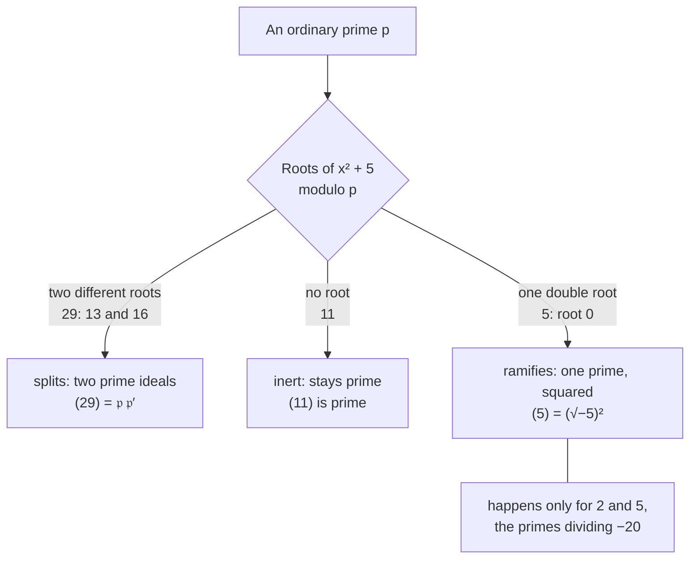

# Splitting and ramification: what becomes of an ordinary prime in a bigger ring

[Syllabus](../../../SYLLABUS.md) → [Algebraic and analytic number theory](../README.md) → [Algebraic Numbers](../README.md#s06) → Splitting and ramification

---

## General Overview

Among whole numbers, 29 is prime. Now allow one new number, $`\sqrt{-5}`$, whose square is $`-5`$. Then $`29 = (3 + 2\sqrt{-5})(3 - 2\sqrt{-5})`$: expand, the middle terms cancel, and $`9 + 5 \times 4 = 29`$. In the bigger ring, 29 **splits** into two different factors.

The prime 5 does something else. Since $`(\sqrt{-5})^2 = -5`$, we get $`5 = -(\sqrt{-5})^2`$: the same factor twice. Such a prime **ramifies**: it picks up a repeated factor. The prime 11 does neither. It has no factors in the bigger ring, so it stays prime there, or is **inert**.

Every prime does one of these three things, and a short test decides which. Reduce $`x^2 + 5`$ modulo the prime and count its roots by trying every remainder:

- modulo 29 it has two roots, 13 and 16, so 29 splits;
- modulo 5 it has one root, 0, counted twice, so 5 ramifies;
- modulo 11 it has no root, so 11 is inert.

Only two primes ramify here: 2 and 5. They are exactly the primes dividing $`-20`$, the discriminant of this number system from [Norm, trace and discriminant](02-norms-traces-and-discriminants.md). That is no accident, and this card proves it.

**A prime splits, stays inert or ramifies in a bigger ring according to how one polynomial factors modulo that prime, and it ramifies exactly when it divides the discriminant.**

**What kind of fact this is:** two theorems. The factoring rule (the Kummer–Dedekind theorem) is proved on this card for rings built from one root, such as $`\mathbb{Z}[\sqrt{-5}]`$. The discriminant rule (Dedekind's theorem) is proved on this card for every number field. The even split between split and inert primes is counted here, not proved; [Chebotarev](09-chebotarev-density-and-splitting-statistics.md) proves it.

### The picture: one test, three outcomes



The code runs this test on all 1,229 primes below 10,000.

---

## The formula

Some words first, from earlier cards on this shelf.

- A **number field** $`K`$ is the rational numbers with one new root added; here $`K = \mathbb{Q}(\sqrt{-5})`$. Its **degree** $`n`$ is the number of coordinates a member needs: 2 here ([Algebraic integers](01-algebraic-integers-and-number-fields.md)).
- Its **ring of integers** $`O_K`$ is its algebraic integers. Here $`O_K = \mathbb{Z}[\sqrt{-5}]`$: all $`a + b\sqrt{-5}`$ with $`a, b`$ whole ([Rings of integers](03-rings-of-integers-and-integral-bases.md)).
- An **ideal** $`(a, b)`$ is every combination $`ax + by`$ with $`x, y`$ in $`O_K`$. A **prime ideal** $`\mathfrak{p}`$ is the ideal version of a prime. The **norm** $`N(\mathfrak{p})`$ counts the remainders modulo $`\mathfrak{p}`$. In $`O_K`$ every nonzero ideal factors into prime ideals in exactly one way ([Ideals factor uniquely even where numbers do not](04-ideals-and-unique-factorisation-in-dedekind-domains.md)).

New on this card: what happens to an ordinary prime $`p`$. Write $`p\,O_K`$ for the ideal $`(p)`$, all multiples of $`p`$ in the bigger ring, and factor it.

```math
p\,O_K = \mathfrak{p}_1^{e_1}\,\mathfrak{p}_2^{e_2}\cdots\mathfrak{p}_g^{e_g}, \qquad N(\mathfrak{p}_i) = p^{f_i}, \qquad e_1 f_1 + e_2 f_2 + \cdots + e_g f_g = n
```

**Read it aloud:** the multiples of p factor into g prime ideals, the i-th one raised to the power e-i; each has norm p to the power f-i; and the e-times-f products add up to the degree.

The **ramification index** $`e_i`$ counts how often $`\mathfrak{p}_i`$ repeats. The **residue degree** $`f_i`$ measures how big that prime's remainder system is. In degree 2 the sum $`e_1 f_1 + \cdots = 2`$ allows only three patterns:

| Pattern | $`g`$, $`e`$, $`f`$ | Name | In $`\mathbb{Z}[\sqrt{-5}]`$ |
| --- | --- | --- | --- |
| two different primes | $`g = 2`$, $`e = f = 1`$ for each | **split** | 3, 7, 29 |
| one prime, nothing repeated | $`g = 1`$, $`e = 1`$, $`f = 2`$ | **inert** | 11 |
| one prime, squared | $`g = 1`$, $`e = 2`$, $`f = 1`$ | **ramified** | 2, 5 |

A prime $`p`$ **ramifies** when some $`e_i`$ is at least 2. Two rules compute the pattern.

**The factoring rule (Kummer–Dedekind).** Suppose $`O_K = \mathbb{Z}[\theta]`$, where $`\theta`$ has the monic polynomial $`f(x)`$ (here $`\theta = \sqrt{-5}`$ and $`f(x) = x^2 + 5`$). Factor $`f`$ modulo $`p`$ into irreducible pieces $`g_i(x)`$. (Two different f's: $`f(x)`$ is the polynomial, while $`f_i`$ with a subscript is a residue degree. Likewise $`g`$ alone counts the prime ideals, while $`g_i(x)`$ is a piece.) Then

```math
f(x) \equiv g_1(x)^{e_1} \cdots g_g(x)^{e_g} \pmod p \quad\Longrightarrow\quad p\,O_K = (p,\ g_1(\theta))^{e_1} \cdots (p,\ g_g(\theta))^{e_g}, \qquad f_i = \deg g_i
```

**Read it aloud:** however f breaks up modulo p, the prime p breaks up the same way, with one prime ideal for each piece, the same repeats, and residue degree equal to the piece's degree.

**The discriminant rule (Dedekind).** With $`d_K`$ the field discriminant:

```math
p \text{ ramifies in } K \iff p \mid d_K
```

**Read it aloud:** p picks up a repeated prime factor exactly when p divides the discriminant of K.

Worked once: $`d_K = -20 = -2^2 \times 5`$, so 2 and 5 ramify and no other prime does.

| Symbol | Plain meaning | In our example | Push it up and the answer… |
| --- | --- | --- | --- |
| $`K`$ | the number field | $`\mathbb{Q}(\sqrt{-5})`$ | — |
| $`n`$ | its degree | 2 | more room for patterns: $`e_i f_i`$ must add to $`n`$ |
| $`O_K`$ | its ring of integers | $`\mathbb{Z}[\sqrt{-5}]`$ | — |
| $`\theta`$; $`a + b\theta`$ | the root that builds $`O_K`$; a member with whole $`a, b`$ | $`\sqrt{-5}`$; $`3 + 2\sqrt{-5}`$ | — |
| $`f(x)`$, $`g_i(x)`$ | the monic polynomial of $`\theta`$; its irreducible pieces modulo $`p`$ | $`x^2 + 5`$; modulo 29, $`x - 13`$ and $`x - 16`$ | more pieces, more prime ideals |
| $`p`$; $`p\,O_K`$ | an ordinary prime; the ideal of all its multiples in $`O_K`$ | 29; $`(29)`$ | — |
| $`\mathfrak{p}_1, \dots, \mathfrak{p}_g`$ | the $`g`$ prime ideals that divide $`p\,O_K`$ | $`(29, \sqrt{-5} - 13)`$ and $`(29, \sqrt{-5} - 16)`$ | — |
| $`e_i`$ | ramification index: how often $`\mathfrak{p}_i`$ repeats | 1 for 29; 2 for 5 | above 1 means ramified |
| $`f_i`$ | residue degree: $`N(\mathfrak{p}_i) = p^{f_i}`$ | 1 for 29; 2 for 11 | fewer, bigger prime ideals |
| $`N(\mathfrak{p})`$ | norm of an ideal: how many remainders it leaves | 29 | — |
| $`d_K`$ | the field discriminant | $`-20`$ | more prime factors, more ramified primes |
| $`\omega_i`$; $`A`$; $`\mathrm{Tr}`$ | in the folded proofs: an integral basis; the finite ring $`O_K/p\,O_K`$; the trace, the sum of a member's conjugates | $`1, \sqrt{-5}`$; 841 members at 29; $`\mathrm{Tr}(a + b\sqrt{-5}) = 2a`$ | — |

### When it holds

- **The whole ring of integers, for the factoring rule.** The rule needs $`O_K = \mathbb{Z}[\theta]`$. For $`\mathbb{Q}(\sqrt{5})`$ the ring $`\mathbb{Z}[\sqrt{5}]`$ is too small: $`x^2 - 5`$ has a double root modulo 2, so 2 looks ramified, but 2 is inert. The right polynomial is $`x^2 - x - 1`$, for $`(1 + \sqrt{5})/2`$.
- **The field discriminant, for the discriminant rule.** Read off the polynomial discriminant 20 instead of $`d_K = 5`$, and 2 is wrongly flagged.
- **Ideals, not numbers.** The prime 3 splits as ideals, yet no member has norm 3, because $`a^2 + 5b^2 = 3`$ has no solution. Numbers alone would call 3 inert. The ideals are real but not generated by one number ([Class groups](05-class-groups-and-the-minkowski-bound.md)).

---

## Why it works

### Step 0: reduce modulo p and look at a finite ring

Keep $`a`$ and $`b`$ of each $`a + b\sqrt{-5}`$ only modulo $`p`$. This gives a finite ring $`O_K/p\,O_K`$ with $`p^2`$ members, and everything that happens to $`p`$ shows up in it.

That ring has only three possible shapes, one for each fate. [The Chinese remainder theorem](../../02-Number%20theory/03-Clock%20Arithmetic/06-chinese-remainder-theorem.md), which says a remainder system built from coprime pieces is those pieces side by side, reads the shape off how $`x^2 + 5`$ breaks up.

### Step 1: the finite ring is polynomials modulo f and p

In $`O_K/p\,O_K`$, the symbol $`\sqrt{-5}`$ is just something whose square is $`-5`$. So the ring is the polynomials in $`x`$ with coefficients modulo $`p`$, where $`x^2 + 5`$ counts as zero. In symbols, $`\mathbb{Z}[\theta]/(p) = (\mathbb{Z} \bmod p)[x]/(f(x))`$. This is where $`O_K = \mathbb{Z}[\theta]`$ is used.

Modulo 29: $`13^2 = 169 = 5 \times 29 + 24`$, and $`24 \equiv -5`$. So 13 is a root of $`x^2 + 5`$, and so is $`29 - 13 = 16`$. Modulo 29 the polynomial factors as $`(x - 13)(x - 16)`$.

### Step 2: coprime factors give separate prime ideals

The factors $`x - 13`$ and $`x - 16`$ share no root. By the Chinese remainder theorem the finite ring is two copies of the remainders modulo 29, side by side. The first copy sends $`\sqrt{-5}`$ to 13, the second to 16.

Each copy is what remains after dividing by one prime ideal:

- $`\mathfrak{p} = (29, \sqrt{-5} - 13)`$, where $`\sqrt{-5}`$ acts as 13;
- $`\mathfrak{p}' = (29, \sqrt{-5} - 16)`$, where $`\sqrt{-5}`$ acts as 16.

Each leaves 29 remainders, so each has norm 29 and $`f = 1`$, and $`(29) = \mathfrak{p}\,\mathfrak{p}'`$.

The number $`3 + 2\sqrt{-5}`$ lies in $`\mathfrak{p}`$: put 13 in for $`\sqrt{-5}`$ and get $`3 + 26 = 29 \equiv 0`$. Its norm is also 29, so it generates $`\mathfrak{p}`$ exactly. Likewise $`3 - 2\sqrt{-5}`$ generates $`\mathfrak{p}'`$.

### Step 3: the three shapes, and why e times f adds to n

A degree-2 polynomial modulo $`p`$ either has two different roots, no root, or one double root.

| Shape of $`f`$ mod $`p`$ | Finite ring | Members with an inverse | Fate |
| --- | --- | --- | --- |
| two different roots | two copies of the remainders mod $`p`$ | $`(p - 1)^2`$: 784 of 841 at 29 | split |
| no root (irreducible) | one field with $`p^2`$ members | $`p^2 - 1`$: 120 of 121 at 11 | inert |
| one double root | $`\theta`$ minus that root is nonzero with square 0 | $`p(p - 1)`$: 20 of 25 at 5 | ramified |

In the ramified row, $`\theta`$ minus the root is a **nilpotent**: a nonzero member that some power sends to zero. At 5 the root is 0 and $`(\sqrt{-5})^2 = -5 \equiv 0`$. That repeated factor in the polynomial becomes a repeated prime ideal: $`(5) = (\sqrt{-5})^2`$.

Why the $`e_i f_i`$ add to $`n`$: the ideal $`(p)`$ leaves $`p^n`$ remainders, one for each choice of $`n`$ coordinates modulo $`p`$. Ideal norms multiply, so $`p^n = N(\mathfrak{p}_1)^{e_1} \cdots N(\mathfrak{p}_g)^{e_g} = p^{e_1 f_1 + \cdots + e_g f_g}`$. Compare the powers of $`p`$.

<details>
<summary>Detailed proof: the factoring rule in any degree</summary>

Let $`O_K = \mathbb{Z}[\theta]`$ with $`f`$ the monic polynomial of $`\theta`$, of degree $`n`$. Write $`\bar f`$ for $`f`$ with its coefficients reduced modulo $`p`$, and factor it as $`\bar f = g_1^{e_1} \cdots g_g^{e_g}`$, the $`g_i`$ different, irreducible and monic.

**The finite ring.** Write $`\cong`$ for "is the same ring as, under renaming". Sending $`x`$ to $`\theta`$ gives $`O_K/p\,O_K \cong (\mathbb{Z} \bmod p)[x]/(\bar f)`$, because both sides are $`\mathbb{Z}[x]`$ with $`f`$ and $`p`$ set to zero.

**The prime ideals.** Let $`\mathfrak{p}_i = (p, g_i(\theta))`$. Then $`O_K/\mathfrak{p}_i \cong (\mathbb{Z} \bmod p)[x]/(g_i)`$, a field with $`p^{\deg g_i}`$ members, since $`g_i`$ is irreducible. So $`\mathfrak{p}_i`$ is prime with $`f_i = \deg g_i`$. The $`\mathfrak{p}_i`$ differ, because the $`g_i`$ share no root.

**The product.** Multiplying ideals multiplies their generators, so $`\mathfrak{p}_1^{e_1} \cdots \mathfrak{p}_g^{e_g}`$ is contained in $`(p, g_1(\theta)^{e_1} \cdots g_g(\theta)^{e_g}) = (p, f(\theta) + p\,h(\theta)) = (p)`$, for some whole polynomial $`h`$. So $`(p)`$ divides that product.

**The count.** The product has norm $`p^{e_1 \deg g_1 + \cdots + e_g \deg g_g} = p^{\deg f} = p^n`$, the same as $`(p)`$. An ideal that contains another with the same norm equals it. So $`p\,O_K = \mathfrak{p}_1^{e_1} \cdots \mathfrak{p}_g^{e_g}`$.

</details>

### Step 4: ramified exactly when p divides the discriminant

A polynomial has a repeated factor modulo $`p`$ exactly when its discriminant is 0 modulo $`p`$. The discriminant of $`x^2 + bx + c`$ is $`b^2 - 4c`$; for $`x^2 + 5`$ it is $`0 - 20 = -20`$. When $`O_K = \mathbb{Z}[\theta]`$ this polynomial discriminant equals $`d_K`$ ([Norm, trace and discriminant](02-norms-traces-and-discriminants.md)). So, from Step 3:

```math
p \text{ ramifies} \iff x^2 + 5 \text{ has a double root mod } p \iff p \mid -20 \iff p = 2 \text{ or } 5
```

**Read it aloud:** a prime ramifies when the polynomial has a double root modulo it, which happens when it divides minus twenty, so only for 2 and 5.

At 2: $`x^2 + 5 \equiv x^2 + 1 = (x + 1)^2`$ modulo 2. So $`(2) = (2, 1 + \sqrt{-5})^2`$. Check: the square of that ideal is generated by $`4`$, $`2 + 2\sqrt{-5}`$ and $`(1 + \sqrt{-5})^2 = -4 + 2\sqrt{-5}`$. All three are multiples of 2, and $`(2 + 2\sqrt{-5}) - (-4 + 2\sqrt{-5}) - 4 = 2`$. So the square is exactly $`(2)`$.

This settles the shelf's house example, $`6 = 2 \times 3 = (1 + \sqrt{-5})(1 - \sqrt{-5})`$. Put 2 for $`\sqrt{-5}`$ and $`1 + \sqrt{-5}`$ becomes $`3 \equiv 0`$ modulo 3; so it lies in $`(3, \sqrt{-5} - 2)`$ as well as in $`(2, 1 + \sqrt{-5})`$. Its norm $`1 + 5 = 6`$ equals the product of those two ideals' norms, $`2 \times 3`$. So $`(1 + \sqrt{-5}) = (2, 1 + \sqrt{-5})(3, \sqrt{-5} - 2)`$, and likewise $`(1 - \sqrt{-5}) = (2, 1 + \sqrt{-5})(3, \sqrt{-5} - 1)`$. Both factorisations of 6 give the same prime ideals, $`(2, 1 + \sqrt{-5})`$ twice and the two over 3, grouped two ways.

The rule holds in every number field, even where no single root builds $`O_K`$. The proof uses the trace in place of the polynomial.

<details>
<summary>Detailed proof: p ramifies exactly when p divides d_K, in any number field</summary>

Let $`\omega_1, \dots, \omega_n`$ be an integral basis, so $`d_K = \det[\mathrm{Tr}(\omega_i \omega_j)]`$. Reduce modulo $`p`$. The ring $`A = O_K/p\,O_K`$ has basis $`\bar\omega_1, \dots, \bar\omega_n`$ over the remainders modulo $`p`$. The trace of multiplication on $`A`$ is the trace on $`O_K`$, reduced. So $`d_K`$ modulo $`p`$ is the determinant of the **trace form** $`(x, y) \mapsto \mathrm{Tr}_A(xy)`$ on $`A`$.

By the Chinese remainder theorem, $`A \cong O_K/\mathfrak{p}_1^{e_1} \times \cdots \times O_K/\mathfrak{p}_g^{e_g}`$.

**If p ramifies**, some $`e_i \ge 2`$. Pick a member $`\pi`$ in $`\mathfrak{p}_i`$ but not in $`\mathfrak{p}_i^2`$. Let $`x`$ be the member of $`A`$ that is $`\pi`$ in the $`i`$-th factor and 0 in the others. It is nonzero, and $`x^{e_i} = 0`$, so $`x`$ is a nilpotent. For every $`y`$ in $`A`$, $`xy`$ is nilpotent too. Multiplication by a nilpotent has every eigenvalue 0, so its trace is 0. Then $`\mathrm{Tr}_A(xy) = 0`$ for all $`y`$, the trace form has a nonzero vector in its kernel, its determinant is 0, and $`p \mid d_K`$.

**If p does not ramify**, every $`e_i = 1`$ and $`A`$ is a product of finite fields. On a finite field with $`p^{f}`$ members the trace is $`x + x^p + \cdots + x^{p^{f - 1}}`$, a polynomial of degree $`p^{f - 1}`$. It cannot vanish on all $`p^f`$ members, so some $`z`$ has $`\mathrm{Tr}(z) \ne 0`$. For any nonzero $`x`$, take $`y = x^{-1}z`$: then $`\mathrm{Tr}(xy) \ne 0`$. So the trace form of a finite field is nondegenerate. A product of nondegenerate forms is nondegenerate, so $`d_K \not\equiv 0`$ modulo $`p`$.

</details>

### Step 5: which odd primes split, by a rule modulo 20

For $`p`$ not 2 or 5, $`p`$ splits exactly when $`-5`$ is a square modulo $`p`$. **Euler's criterion** ([Quadratic residues](../03-Characters%20and%20L-functions/02-quadratic-residues-and-the-legendre-symbol.md)) tests that directly: $`-5`$ is a square modulo $`p`$ exactly when $`(-5)^{(p - 1)/2} \equiv 1`$.

[Quadratic reciprocity](../03-Characters%20and%20L-functions/07-quadratic-reciprocity-via-gauss-sums.md) turns the test into a rule about $`p`$ modulo 20:

1. $`-1`$ is a square modulo $`p`$ exactly when $`p \equiv 1 \pmod 4`$.
2. $`5`$ is a square modulo $`p`$ exactly when $`p \equiv \pm 1 \pmod 5`$, by reciprocity.
3. $`-5 = (-1) \times 5`$ is a square when both are squares or neither is.
4. Both: $`p \equiv 1`$ or $`9 \pmod{20}`$. Neither: $`p \equiv 3`$ or $`7 \pmod{20}`$.

So $`p`$ splits when $`p \equiv 1, 3, 7, 9 \pmod{20}`$ and is inert when $`p \equiv 11, 13, 17, 19 \pmod{20}`$. The code confirms all three tests agree on the 1,229 primes below 10,000.

The [Gaussian integers](../../03-Algebra/10-For%20the%20Curious/03-gaussian-integers-and-sums-of-two-squares.md) are the first example of all this. There $`f(x) = x^2 + 1`$ and $`d_K = -4`$: 5 and 13 split, 3 and 7 stay prime, and 2 alone ramifies, as $`2 = -i(1 + i)^2`$.

### Step 6: past degree 2

In degree 3 there are more patterns. Take $`K = \mathbb{Q}(\sqrt[3]{2})`$, where $`O_K = \mathbb{Z}[\sqrt[3]{2}]`$ (stated with a source on [Norm, trace and discriminant](02-norms-traces-and-discriminants.md)), $`f(x) = x^3 - 2`$ and $`d_K = -108 = -2^2 \times 3^3`$.

| $`p`$ | roots of $`x^3 - 2`$ mod $`p`$ | factors | fate |
| --- | --- | --- | --- |
| 2 | 0, three times | $`x^3`$ | ramified, $`e = 3`$ |
| 3 | 2, three times | $`(x - 2)^3`$ | ramified, $`e = 3`$ |
| 5 | 3 only | a line times an irreducible quadratic | $`f = 1`$ and $`f = 2`$ |
| 7 | none | irreducible | inert, $`f = 3`$ |
| 31 | 4, 7, 20 | three lines | split completely |

Again the ramified primes are 2 and 3, the primes dividing $`-108`$.

**Where proof ends and evidence begins.** Both rules are proved above for every prime; the code's agreement below 10,000 checks the code, not the theorems. The shares are another matter. Below 10,000, 614 primes split and 613 stay inert. That near-even split is evidence here; [Chebotarev](09-chebotarev-density-and-splitting-statistics.md) proves it.

---

## Worked numbers, by hand

| Step | Arithmetic | Value |
| --- | --- | --- |
| discriminant of $`x^2 + 5`$ | $`0^2 - 4 \times 5`$ | $`-20`$ |
| primes dividing it | $`-20 = -2^2 \times 5`$ | 2 and 5 ramify |
| a root of $`x^2 + 5`$ mod 29 | $`13^2 = 169 = 5 \times 29 + 24`$, and $`24 \equiv -5`$ | 13 |
| the other root | $`29 - 13`$ | 16 |
| 29's two prime ideals | one per root | $`(29, \sqrt{-5} - 13)`$, $`(29, \sqrt{-5} - 16)`$ |
| a generator of the first | $`3 + 2 \times 13 = 29 \equiv 0`$ | $`3 + 2\sqrt{-5}`$ |
| its norm | $`3^2 + 5 \times 2^2`$ | 29 |
| roots mod 5 | only $`0^2 + 5 \equiv 0`$ | one double root |
| 5's factorisation | $`(\sqrt{-5})^2 = -5`$ | $`(5) = (\sqrt{-5})^2`$ |
| roots mod 11 | none of 0 to 10 works | 11 inert |
| the fates of 29, 5, 11 | | **29 splits, 5 ramifies, 11 is inert** |

In $`\mathbb{Z}[\sqrt{-5}]`$ the prime 29 becomes two primes, $`3 \pm 2\sqrt{-5}`$; 5 becomes one prime counted twice; 11 stays prime; and the discriminant $`-20`$ names in advance the only two primes that repeat.

### What breaks if you drop a piece

| Mistake | Comes out at | What went wrong |
| --- | --- | --- |
| $`\mathbb{Z}[\sqrt{5}]`$ taken for the ring of integers of $`\mathbb{Q}(\sqrt{5})`$ | 2 looks ramified: $`x^2 - 5`$ has the double root 1 mod 2 | $`x^2 - x - 1`$, the true polynomial, has no root mod 2: 2 is inert, and $`d_K = 5`$, not 20 |
| "No member has norm $`p`$, so $`p`$ is inert" | 45 split primes below 1,000 misread, first 3, 7, 23 | They split as ideals that one number cannot generate |
| Testing whether 5, not $`-5`$, is a square | 87 of the 166 primes below 1,000 other than 2 and 5 misread, first 3, 7, 11 | The polynomial is $`x^2 + 5`$, so the square needed is $`-5`$ |
| Ramified primes read off $`-5`$, the number under the root | only 5, missing 2 | The discriminant is $`-20`$, which carries the 2 |

The code prints all four.

---

## Code, from first principles, and it actually runs

The code classifies every prime by three roads that share no arithmetic.

1. Road 1 counts the roots of $`x^2 + 5`$ modulo $`p`$ by trying every remainder.
2. Road 2 never touches the polynomial's roots. It counts nilpotents and members with an inverse in the finite ring, as in Step 3's table, for the 46 primes below 200.
3. Road 3 uses Euler's criterion for $`-5`$ and, separately, the rule modulo 20 from Step 5.

It also runs the cubic $`\mathbb{Q}(\sqrt[3]{2})`$ and prints every wrong answer in the What-breaks table.

### Python

```python
# Splitting and ramification -- the check behind the card.  Nothing is imported.
# Field Q(sqrt-5), ring of integers Z[sqrt-5], f(x) = x^2 + 5, d_K = -20.  Every
# prime is classified three ways: road 1 counts the roots of f mod p by trying
# every residue; road 2 counts nilpotents and units in the residue ring
# O_K/pO_K, never touching f's roots; road 3 is Euler's criterion for -5 and the
# rule mod 20 that reciprocity gives.  The cubic Q(cbrt 2) shows patterns past 2.
def primes_below(n):                     # sieve of Eratosthenes, written out here
    s = [True] * n
    s[0] = s[1] = False
    for i in range(2, int(n ** 0.5) + 1):
        if s[i]:
            s[i * i::i] = [False] * len(s[i * i::i])
    return [i for i in range(n) if s[i]]

def powmod(a, k, m):                     # square-and-multiply
    out, a = 1, a % m
    while k:
        if k & 1:
            out = out * a % m
        a, k = a * a % m, k >> 1
    return out

def roots(coeffs, p):                    # road 1: residues r with f(r) = 0 mod p
    return [r for r in range(p) if sum(c * r ** i for i, c in enumerate(coeffs)) % p == 0]

def by_roots(p, f=(5, 0, 1)):            # quadratic f: 2 roots split, 1 ramifies, 0 inert
    return {2: "split", 1: "ramified", 0: "inert"}[len(roots(f, p))]

def residue_ring(p):                     # road 2: a + b sqrt-5 with a, b taken mod p
    nil = sum(1 for a in range(p) for b in range(p)          # nonzero, square 0: the nilpotents
              if (a or b) and (a * a - 5 * b * b) % p == 0 and 2 * a * b % p == 0)
    units = sum(1 for a in range(p) for b in range(p) if (a * a + 5 * b * b) % p)
    kind = "ramified" if nil else ("split" if units == (p - 1) ** 2 else "inert")
    return nil, units, kind

def by_euler(p):                         # road 3a: p | d_K ramifies, else is -5 a square?
    if 20 % p == 0:
        return "ramified"
    return "split" if powmod(-5, (p - 1) // 2, p) == 1 else "inert"

def by_mod20(p):                         # road 3b: reciprocity's answer, a rule mod 20
    return "ramified" if 20 % p == 0 else ("split" if p % 20 in (1, 3, 7, 9) else "inert")

def mul(x, y):                           # (a + b sqrt-5)(c + d sqrt-5) in Z[sqrt-5]
    return (x[0] * y[0] - 5 * x[1] * y[1], x[0] * y[1] + x[1] * y[0])

def is_norm(p):                          # is p = a^2 + 5b^2 for whole a, b?
    return any(int((p - 5 * b * b) ** 0.5) ** 2 == p - 5 * b * b
               for b in range(int((p / 5) ** 0.5) + 1))

EF = {"split": "e = 1, f = 1 twice", "inert": "e = 1, f = 2", "ramified": "e = 2, f = 1"}
print("field Q(sqrt-5): f(x) = x^2 + 5, ring of integers Z[sqrt-5], d_K = 0^2 - 4*5 =", 0 - 4 * 5)
for p in (2, 3, 5, 7, 11, 29):
    nil, units, kind = residue_ring(p)
    print(f"p = {p}: roots of x^2 + 5 mod p {roots((5, 0, 1), p)}; nilpotents {nil}, "
          f"units {units} of {p * p}; {by_roots(p)} ({EF[by_roots(p)]})")
small = primes_below(200)
road2_ok = all(residue_ring(p)[2] == by_roots(p) for p in small)
print(f"road 2 agrees with road 1 for all {len(small)} primes below 200: {'yes' if road2_ok else 'no'}")
prod29 = mul((3, 2), (3, -2))
r29 = roots((5, 0, 1), 29)
print(f"29: (3 + 2 sqrt-5)(3 - 2 sqrt-5) = {prod29[0]} + {prod29[1]} sqrt-5; norm 3^2 + 5*2^2 = {9 + 5 * 4}")
print(f"square roots of -5 mod 29: {r29}; 13^2 = {13 * 13} = 5*29 + {13 * 13 - 5 * 29}, and {13 * 13 - 5 * 29} = -5 mod 29")
print(f"3 + 2*{r29[0]} = {3 + 2 * r29[0]}, so 3 + 2 sqrt-5 lies in (29, sqrt-5 - {r29[0]})")
print(f"5: (sqrt-5)^2 = {mul((0, 1), (0, 1))[0]}, so (5) = (sqrt-5)^2, one prime, e = 2")
t, u = (2, 0), (1, 1)                            # the generators 2 and 1 + sqrt-5
sq2 = [mul(t, t), mul(t, u), mul(u, u)]          # the square's generators: all products of two
even = all(a % 2 == 0 and b % 2 == 0 for a, b in sq2)
two = (sq2[1][0] - sq2[2][0] - sq2[0][0], sq2[1][1] - sq2[2][1] - sq2[0][1])
print(f"2: (2, 1 + sqrt-5)^2 holds {sq2}, all multiples of 2: {'yes' if even else 'no'}; "
      f"(2 + 2 sqrt-5) - (-4 + 2 sqrt-5) - 4 = {two[0]} + {two[1]} sqrt-5, so it is (2)")
print(f"3 = a^2 + 5b^2 has a solution: {'yes' if is_norm(3) else 'no'}; yet x^2 + 5 = (x - 1)(x - 2) mod 3, "
      f"so (3) = (3, sqrt-5 - 1)(3, sqrt-5 - 2)")
r3 = roots((5, 0, 1), 3)
print(f"6 = 2*3 = (1 + sqrt-5)(1 - sqrt-5), norm {1 + 5}: 1 + sqrt-5 lies in (3, sqrt-5 - {r3[1]}) as "
      f"1 + {r3[1]} = {1 + r3[1]}; 1 - sqrt-5 in (3, sqrt-5 - {r3[0]}) as 1 - {r3[0]} = {1 - r3[0]}")
big = primes_below(10000)
agree = all(by_roots(p) == by_euler(p) == by_mod20(p) for p in big)
print(f"roads 1 and 3 agree on all {len(big)} primes below 10,000: {'yes' if agree else 'no'}")
table = {}
for n in (100, 1000, 10000):
    kinds = [by_euler(p) for p in big if p < n]
    table[n] = [len(kinds)] + [kinds.count(k) for k in ("split", "inert", "ramified")]
    s, i = table[n][1], table[n][2]
    print(f"primes below {n}: {table[n][0]}; split {s}, inert {i}, ramified {table[n][3]}; "
          f"split share of unramified {s / (s + i):.4f}")
ram = [p for p in big if by_roots(p) == "ramified"]
dk_primes = [q for q in primes_below(21) if 20 % q == 0]
print(f"ramified primes below 10,000: {ram}; primes dividing d_K = -20: {dk_primes}")
q1000 = primes_below(1000)
spl = [p for p in q1000 if by_euler(p) == "split"]
nonprin = [p for p in spl if not is_norm(p)]
print(f"split primes below 1000 equal to a^2 + 5b^2: {len(spl) - len(nonprin)}; split but not: "
      f"{len(nonprin)}, first {nonprin[:6]}")
rule = all(is_norm(p) == (p % 20 in (1, 9)) for p in spl)
print(f"a^2 + 5b^2 exactly when p = 1 or 9 mod 20, among split primes below 1000: {'yes' if rule else 'no'}")
gauss = [f"{p} {({2: 'split', 1: 'ramified', 0: 'inert'})[len(roots((1, 0, 1), p))]}" for p in (2, 3, 5, 7, 13)]
print(f"Gaussian integers, x^2 + 1, d = -4: {', '.join(gauss)}")

def cubic(p):                            # x^3 - 2 mod p, read off its roots
    rs = roots((-2, 0, 0, 1), p)
    if any(3 * r * r % p == 0 for r in rs):          # also a root of f' = 3x^2: repeated
        return "ramified, e = 3"
    return {3: "split completely, f = 1, 1, 1", 1: "f = 1, 2", 0: "inert, f = 3"}[len(rs)]

print("cubic Q(cbrt 2): f(x) = x^3 - 2, d_K = -4*0^3 - 27*2^2 =", -27 * 4)
for p in (2, 3, 5, 7, 31):
    print(f"p = {p}: roots of x^3 - 2 mod p {roots((-2, 0, 0, 1), p)}; {cubic(p)}")
pat = [cubic(p).split(",")[0] for p in q1000 if cubic(p)[0] != "r"]
counts3 = [pat.count(k) for k in ("split completely", "f = 1", "inert")]
print(f"unramified primes below 1000: {len(pat)}; split completely {counts3[0]}, f = 1, 2 {counts3[1]}, "
      f"inert {counts3[2]}")
rep = [p for p in q1000 if cubic(p)[0] == "r"]
d108 = [q for q in primes_below(109) if 108 % q == 0]
print(f"shares {counts3[0] / len(pat):.4f}, {counts3[1] / len(pat):.4f}, {counts3[2] / len(pat):.4f}; "
      f"Chebotarev's 1/6, 1/2, 1/3 = {1 / 6:.4f}, {1 / 2:.4f}, {1 / 3:.4f}")
print(f"primes below 1000 where x^3 - 2 has a repeated root: {rep}; primes dividing 108: {d108}")
w1 = (roots((-5, 0, 1), 2), roots((-1, -1, 1), 2))
print(f"mistake 1, Z[sqrt5] for Q(sqrt5): x^2 - 5 mod 2 has roots {w1[0]}, a double root, so 2 looks "
      f"ramified; x^2 - x - 1 has roots {w1[1]}, so 2 is inert; d_K = 5, not 20")
print(f"mistake 2, no element of norm p read as inert: {len(nonprin)} split primes below 1000 misread, "
      f"first {nonprin[:3]}")
w3 = [p for p in q1000 if 20 % p and (powmod(5, (p - 1) // 2, p) == 1) != (by_euler(p) == "split")]
print(f"mistake 3, testing 5 instead of -5: {len(w3)} of {len(q1000) - 2} primes below 1000 misread, first {w3[:3]}")
print(f"mistake 4, ramified primes read off -5 instead of d_K = -20: {[q for q in (2, 3, 5) if 5 % q == 0]}, "
      f"missing 2")
assert road2_ok and agree and ram == dk_primes == [2, 5]                       # three roads, one answer
assert r29 == [13, 16] and (3 + 2 * r29[0]) % 29 == 0                         # roots of x^2 + 5 mod 29
assert prod29 == (29, 0) and even and two == (2, 0)          # ring products: (29) and (2, 1 + sqrt-5)^2 = (2)
assert table[1000] == [168, 81, 85, 2] and table[10000] == [1229, 614, 613, 2]
assert rule and len(nonprin) == 45 and not is_norm(3) and r3 == [1, 2] and (1 + r3[1]) % 3 == 0 == (1 - r3[0]) % 3
assert rep == d108 == [2, 3] and counts3 == [24, 86, 56] and w1 == ([1], []) and len(w3) == 87
print("ALL CHECKS PASS")
```

**Ran 2026-11-15 on macOS, Python 3.14.10, standard library only. All checks passed. Output, pasted from the run:**

```
field Q(sqrt-5): f(x) = x^2 + 5, ring of integers Z[sqrt-5], d_K = 0^2 - 4*5 = -20
p = 2: roots of x^2 + 5 mod p [1]; nilpotents 1, units 2 of 4; ramified (e = 2, f = 1)
p = 3: roots of x^2 + 5 mod p [1, 2]; nilpotents 0, units 4 of 9; split (e = 1, f = 1 twice)
p = 5: roots of x^2 + 5 mod p [0]; nilpotents 4, units 20 of 25; ramified (e = 2, f = 1)
p = 7: roots of x^2 + 5 mod p [3, 4]; nilpotents 0, units 36 of 49; split (e = 1, f = 1 twice)
p = 11: roots of x^2 + 5 mod p []; nilpotents 0, units 120 of 121; inert (e = 1, f = 2)
p = 29: roots of x^2 + 5 mod p [13, 16]; nilpotents 0, units 784 of 841; split (e = 1, f = 1 twice)
road 2 agrees with road 1 for all 46 primes below 200: yes
29: (3 + 2 sqrt-5)(3 - 2 sqrt-5) = 29 + 0 sqrt-5; norm 3^2 + 5*2^2 = 29
square roots of -5 mod 29: [13, 16]; 13^2 = 169 = 5*29 + 24, and 24 = -5 mod 29
3 + 2*13 = 29, so 3 + 2 sqrt-5 lies in (29, sqrt-5 - 13)
5: (sqrt-5)^2 = -5, so (5) = (sqrt-5)^2, one prime, e = 2
2: (2, 1 + sqrt-5)^2 holds [(4, 0), (2, 2), (-4, 2)], all multiples of 2: yes; (2 + 2 sqrt-5) - (-4 + 2 sqrt-5) - 4 = 2 + 0 sqrt-5, so it is (2)
3 = a^2 + 5b^2 has a solution: no; yet x^2 + 5 = (x - 1)(x - 2) mod 3, so (3) = (3, sqrt-5 - 1)(3, sqrt-5 - 2)
6 = 2*3 = (1 + sqrt-5)(1 - sqrt-5), norm 6: 1 + sqrt-5 lies in (3, sqrt-5 - 2) as 1 + 2 = 3; 1 - sqrt-5 in (3, sqrt-5 - 1) as 1 - 1 = 0
roads 1 and 3 agree on all 1229 primes below 10,000: yes
primes below 100: 25; split 11, inert 12, ramified 2; split share of unramified 0.4783
primes below 1000: 168; split 81, inert 85, ramified 2; split share of unramified 0.4880
primes below 10000: 1229; split 614, inert 613, ramified 2; split share of unramified 0.5004
ramified primes below 10,000: [2, 5]; primes dividing d_K = -20: [2, 5]
split primes below 1000 equal to a^2 + 5b^2: 36; split but not: 45, first [3, 7, 23, 43, 47, 67]
a^2 + 5b^2 exactly when p = 1 or 9 mod 20, among split primes below 1000: yes
Gaussian integers, x^2 + 1, d = -4: 2 ramified, 3 inert, 5 split, 7 inert, 13 split
cubic Q(cbrt 2): f(x) = x^3 - 2, d_K = -4*0^3 - 27*2^2 = -108
p = 2: roots of x^3 - 2 mod p [0]; ramified, e = 3
p = 3: roots of x^3 - 2 mod p [2]; ramified, e = 3
p = 5: roots of x^3 - 2 mod p [3]; f = 1, 2
p = 7: roots of x^3 - 2 mod p []; inert, f = 3
p = 31: roots of x^3 - 2 mod p [4, 7, 20]; split completely, f = 1, 1, 1
unramified primes below 1000: 166; split completely 24, f = 1, 2 86, inert 56
shares 0.1446, 0.5181, 0.3373; Chebotarev's 1/6, 1/2, 1/3 = 0.1667, 0.5000, 0.3333
primes below 1000 where x^3 - 2 has a repeated root: [2, 3]; primes dividing 108: [2, 3]
mistake 1, Z[sqrt5] for Q(sqrt5): x^2 - 5 mod 2 has roots [1], a double root, so 2 looks ramified; x^2 - x - 1 has roots [], so 2 is inert; d_K = 5, not 20
mistake 2, no element of norm p read as inert: 45 split primes below 1000 misread, first [3, 7, 23]
mistake 3, testing 5 instead of -5: 87 of 166 primes below 1000 misread, first [3, 7, 11]
mistake 4, ramified primes read off -5 instead of d_K = -20: [5], missing 2
ALL CHECKS PASS
```

### Rust

Same numbers, same labels, built with `rustc --edition 2021 -O`.

```rust
// Splitting and ramification -- the same check as the Python, in Rust.  No crates.
// Field Q(sqrt-5), ring of integers Z[sqrt-5], f(x) = x^2 + 5, d_K = -20.  Every
// prime is classified three ways: road 1 counts the roots of f mod p by trying
// every residue; road 2 counts nilpotents and units in the residue ring
// O_K/pO_K, never touching f's roots; road 3 is Euler's criterion for -5 and the
// rule mod 20 that reciprocity gives.  The cubic Q(cbrt 2) shows patterns past 2.
fn primes_below(n: usize) -> Vec<i64> {                // sieve of Eratosthenes
    let mut s = vec![true; n];
    s[0] = false;
    s[1] = false;
    let mut i = 2;
    while i * i < n {
        if s[i] { let mut j = i * i; while j < n { s[j] = false; j += i; } }
        i += 1;
    }
    (0..n).filter(|&k| s[k]).map(|k| k as i64).collect()
}

fn powmod(a: i64, mut k: i64, m: i64) -> i64 {         // square-and-multiply
    let (mut out, mut a) = (1i64, a.rem_euclid(m));
    while k > 0 {
        if k & 1 == 1 { out = out * a % m; }
        a = a * a % m;
        k >>= 1;
    }
    out
}

fn roots(c: &[i64], p: i64) -> Vec<i64> {              // road 1: residues r with f(r) = 0 mod p
    (0..p).filter(|&r| {
        let (mut s, mut pw) = (0i64, 1i64);
        for &ci in c { s = (s + ci * pw).rem_euclid(p); pw = pw * r % p; }
        s == 0
    }).collect()
}

fn by_roots(p: i64) -> &'static str {                  // 2 roots split, 1 ramifies, 0 inert
    match roots(&[5, 0, 1], p).len() { 2 => "split", 1 => "ramified", _ => "inert" }
}

fn residue_ring(p: i64) -> (usize, usize, &'static str) {  // road 2: a + b sqrt-5 mod p
    let (mut nil, mut units) = (0, 0);
    for a in 0..p {
        for b in 0..p {
            if (a != 0 || b != 0) && (a * a - 5 * b * b).rem_euclid(p) == 0 && 2 * a * b % p == 0 { nil += 1; }   // the nilpotents
            if (a * a + 5 * b * b) % p != 0 { units += 1; }
        }
    }
    let kind = if nil > 0 { "ramified" } else if units as i64 == (p - 1) * (p - 1) { "split" } else { "inert" };
    (nil, units, kind)
}

fn by_euler(p: i64) -> &'static str {                  // road 3a: p | d_K ramifies, else is -5 a square?
    if 20 % p == 0 { return "ramified"; }
    if powmod(-5, (p - 1) / 2, p) == 1 { "split" } else { "inert" }
}

fn by_mod20(p: i64) -> &'static str {                  // road 3b: reciprocity's answer, a rule mod 20
    if 20 % p == 0 { "ramified" } else if [1, 3, 7, 9].contains(&(p % 20)) { "split" } else { "inert" }
}

fn mul(x: (i64, i64), y: (i64, i64)) -> (i64, i64) { (x.0 * y.0 - 5 * x.1 * y.1, x.0 * y.1 + x.1 * y.0) }  // in Z[sqrt-5]

fn is_norm(p: i64) -> bool {                           // is p = a^2 + 5b^2 for whole a, b?
    (0..).take_while(|b| 5 * b * b <= p).any(|b| {
        let t = p - 5 * b * b;
        let a = (t as f64).sqrt() as i64;
        a * a == t
    })
}

fn ef(kind: &str) -> &'static str {
    match kind { "split" => "e = 1, f = 1 twice", "inert" => "e = 1, f = 2", _ => "e = 2, f = 1" }
}

fn cubic(p: i64) -> &'static str {                     // x^3 - 2 mod p, read off its roots
    let rs = roots(&[-2, 0, 0, 1], p);
    if rs.iter().any(|&r| 3 * r * r % p == 0) { return "ramified, e = 3"; }   // also a root of f' = 3x^2
    match rs.len() { 3 => "split completely, f = 1, 1, 1", 1 => "f = 1, 2", _ => "inert, f = 3" }
}

fn yn(c: bool) -> &'static str { if c { "yes" } else { "no" } }

fn main() {
    println!("field Q(sqrt-5): f(x) = x^2 + 5, ring of integers Z[sqrt-5], d_K = 0^2 - 4*5 = {}", 0 - 4 * 5);
    for p in [2i64, 3, 5, 7, 11, 29] {
        let (nil, units, _) = residue_ring(p);
        println!("p = {}: roots of x^2 + 5 mod p {:?}; nilpotents {}, units {} of {}; {} ({})",
                 p, roots(&[5, 0, 1], p), nil, units, p * p, by_roots(p), ef(by_roots(p)));
    }
    let small = primes_below(200);
    let road2_ok = small.iter().all(|&p| residue_ring(p).2 == by_roots(p));
    println!("road 2 agrees with road 1 for all {} primes below 200: {}", small.len(), yn(road2_ok));
    let prod29 = mul((3, 2), (3, -2));
    let r29 = roots(&[5, 0, 1], 29);
    println!("29: (3 + 2 sqrt-5)(3 - 2 sqrt-5) = {} + {} sqrt-5; norm 3^2 + 5*2^2 = {}", prod29.0, prod29.1, 9 + 5 * 4);
    println!("square roots of -5 mod 29: {:?}; 13^2 = {} = 5*29 + {}, and {} = -5 mod 29",
             r29, 13 * 13, 13 * 13 - 5 * 29, 13 * 13 - 5 * 29);
    println!("3 + 2*{} = {}, so 3 + 2 sqrt-5 lies in (29, sqrt-5 - {})", r29[0], 3 + 2 * r29[0], r29[0]);
    println!("5: (sqrt-5)^2 = {}, so (5) = (sqrt-5)^2, one prime, e = 2", mul((0, 1), (0, 1)).0);
    let (t, u) = ((2i64, 0i64), (1i64, 1i64));                       // the generators 2 and 1 + sqrt-5
    let sq2 = vec![mul(t, t), mul(t, u), mul(u, u)];                // the square's generators: all products of two
    let even = sq2.iter().all(|&(a, b)| a % 2 == 0 && b % 2 == 0);
    let two = (sq2[1].0 - sq2[2].0 - sq2[0].0, sq2[1].1 - sq2[2].1 - sq2[0].1);
    println!("2: (2, 1 + sqrt-5)^2 holds {:?}, all multiples of 2: {}; (2 + 2 sqrt-5) - (-4 + 2 sqrt-5) - 4 = {} + {} sqrt-5, so it is (2)",
             sq2, yn(even), two.0, two.1);
    println!("3 = a^2 + 5b^2 has a solution: {}; yet x^2 + 5 = (x - 1)(x - 2) mod 3, so (3) = (3, sqrt-5 - 1)(3, sqrt-5 - 2)",
             yn(is_norm(3)));
    let r3 = roots(&[5, 0, 1], 3);
    println!("6 = 2*3 = (1 + sqrt-5)(1 - sqrt-5), norm {}: 1 + sqrt-5 lies in (3, sqrt-5 - {}) as 1 + {} = {}; 1 - sqrt-5 in (3, sqrt-5 - {}) as 1 - {} = {}",
             1 + 5, r3[1], r3[1], 1 + r3[1], r3[0], r3[0], 1 - r3[0]);
    let big = primes_below(10000);
    let agree = big.iter().all(|&p| by_roots(p) == by_euler(p) && by_euler(p) == by_mod20(p));
    println!("roads 1 and 3 agree on all {} primes below 10,000: {}", big.len(), yn(agree));
    let mut table: Vec<Vec<usize>> = vec![];
    for n in [100i64, 1000, 10000] {
        let kinds: Vec<&str> = big.iter().filter(|&&p| p < n).map(|&p| by_euler(p)).collect();
        let c = |k: &str| kinds.iter().filter(|&&q| q == k).count();
        let row = vec![kinds.len(), c("split"), c("inert"), c("ramified")];
        println!("primes below {}: {}; split {}, inert {}, ramified {}; split share of unramified {:.4}",
                 n, row[0], row[1], row[2], row[3], row[1] as f64 / (row[1] + row[2]) as f64);
        table.push(row);
    }
    let ram: Vec<i64> = big.iter().copied().filter(|&p| by_roots(p) == "ramified").collect();
    let dk_primes: Vec<i64> = primes_below(21).into_iter().filter(|q| 20 % q == 0).collect();
    println!("ramified primes below 10,000: {:?}; primes dividing d_K = -20: {:?}", ram, dk_primes);
    let q1000 = primes_below(1000);
    let spl: Vec<i64> = q1000.iter().copied().filter(|&p| by_euler(p) == "split").collect();
    let nonprin: Vec<i64> = spl.iter().copied().filter(|&p| !is_norm(p)).collect();
    println!("split primes below 1000 equal to a^2 + 5b^2: {}; split but not: {}, first {:?}",
             spl.len() - nonprin.len(), nonprin.len(), &nonprin[..6]);
    let rule = spl.iter().all(|&p| is_norm(p) == [1, 9].contains(&(p % 20)));
    println!("a^2 + 5b^2 exactly when p = 1 or 9 mod 20, among split primes below 1000: {}", yn(rule));
    let gauss: Vec<String> = [2i64, 3, 5, 7, 13].iter()
        .map(|&p| format!("{} {}", p, match roots(&[1, 0, 1], p).len() { 2 => "split", 1 => "ramified", _ => "inert" })).collect();
    println!("Gaussian integers, x^2 + 1, d = -4: {}", gauss.join(", "));
    println!("cubic Q(cbrt 2): f(x) = x^3 - 2, d_K = -4*0^3 - 27*2^2 = {}", -27 * 4);
    for p in [2i64, 3, 5, 7, 31] {
        println!("p = {}: roots of x^3 - 2 mod p {:?}; {}", p, roots(&[-2, 0, 0, 1], p), cubic(p));
    }
    let pat: Vec<&str> = q1000.iter().filter(|&&p| !cubic(p).starts_with('r')).map(|&p| cubic(p).split(',').next().unwrap()).collect();
    let c3 = |k: &str| pat.iter().filter(|&&q| q == k).count();
    let counts3 = [c3("split completely"), c3("f = 1"), c3("inert")];
    println!("unramified primes below 1000: {}; split completely {}, f = 1, 2 {}, inert {}",
             pat.len(), counts3[0], counts3[1], counts3[2]);
    println!("shares {:.4}, {:.4}, {:.4}; Chebotarev's 1/6, 1/2, 1/3 = {:.4}, {:.4}, {:.4}",
             counts3[0] as f64 / pat.len() as f64, counts3[1] as f64 / pat.len() as f64, counts3[2] as f64 / pat.len() as f64, 1.0 / 6.0, 0.5, 1.0 / 3.0);
    let rep: Vec<i64> = q1000.iter().copied().filter(|&p| cubic(p).starts_with('r')).collect();
    let d108: Vec<i64> = primes_below(109).into_iter().filter(|q| 108 % q == 0).collect();
    println!("primes below 1000 where x^3 - 2 has a repeated root: {:?}; primes dividing 108: {:?}", rep, d108);
    let w1 = (roots(&[-5, 0, 1], 2), roots(&[-1, -1, 1], 2));
    println!("mistake 1, Z[sqrt5] for Q(sqrt5): x^2 - 5 mod 2 has roots {:?}, a double root, so 2 looks ramified; x^2 - x - 1 has roots {:?}, so 2 is inert; d_K = 5, not 20",
             w1.0, w1.1);
    println!("mistake 2, no element of norm p read as inert: {} split primes below 1000 misread, first {:?}",
             nonprin.len(), &nonprin[..3]);
    let w3: Vec<i64> = q1000.iter().copied()
        .filter(|&p| 20 % p != 0 && (powmod(5, (p - 1) / 2, p) == 1) != (by_euler(p) == "split")).collect();
    println!("mistake 3, testing 5 instead of -5: {} of {} primes below 1000 misread, first {:?}",
             w3.len(), q1000.len() - 2, &w3[..3]);
    let w4: Vec<i64> = [2i64, 3, 5].into_iter().filter(|q| 5 % q == 0).collect();
    println!("mistake 4, ramified primes read off -5 instead of d_K = -20: {:?}, missing 2", w4);
    assert!(road2_ok && agree && ram == dk_primes && ram == vec![2, 5]);          // three roads, one answer
    assert!(r29 == vec![13, 16] && (3 + 2 * r29[0]) % 29 == 0);                      // roots of x^2 + 5 mod 29
    assert!(prod29 == (29, 0) && even && two == (2, 0));        // ring products: (29) and (2, 1 + sqrt-5)^2 = (2)
    assert!(table[1] == vec![168, 81, 85, 2] && table[2] == vec![1229, 614, 613, 2]);
    assert!(rule && nonprin.len() == 45 && !is_norm(3) && r3 == vec![1, 2] && (1 + r3[1]) % 3 == 0 && (1 - r3[0]) % 3 == 0);
    assert!(rep == d108 && rep == vec![2, 3] && counts3 == [24, 86, 56] && w1 == (vec![1], vec![]) && w3.len() == 87);
    println!("ALL CHECKS PASS");
}
```

**Ran 2026-11-15 on macOS, rustc 1.98.1, no crates. All checks passed. Output, pasted from the run:**

```
field Q(sqrt-5): f(x) = x^2 + 5, ring of integers Z[sqrt-5], d_K = 0^2 - 4*5 = -20
p = 2: roots of x^2 + 5 mod p [1]; nilpotents 1, units 2 of 4; ramified (e = 2, f = 1)
p = 3: roots of x^2 + 5 mod p [1, 2]; nilpotents 0, units 4 of 9; split (e = 1, f = 1 twice)
p = 5: roots of x^2 + 5 mod p [0]; nilpotents 4, units 20 of 25; ramified (e = 2, f = 1)
p = 7: roots of x^2 + 5 mod p [3, 4]; nilpotents 0, units 36 of 49; split (e = 1, f = 1 twice)
p = 11: roots of x^2 + 5 mod p []; nilpotents 0, units 120 of 121; inert (e = 1, f = 2)
p = 29: roots of x^2 + 5 mod p [13, 16]; nilpotents 0, units 784 of 841; split (e = 1, f = 1 twice)
road 2 agrees with road 1 for all 46 primes below 200: yes
29: (3 + 2 sqrt-5)(3 - 2 sqrt-5) = 29 + 0 sqrt-5; norm 3^2 + 5*2^2 = 29
square roots of -5 mod 29: [13, 16]; 13^2 = 169 = 5*29 + 24, and 24 = -5 mod 29
3 + 2*13 = 29, so 3 + 2 sqrt-5 lies in (29, sqrt-5 - 13)
5: (sqrt-5)^2 = -5, so (5) = (sqrt-5)^2, one prime, e = 2
2: (2, 1 + sqrt-5)^2 holds [(4, 0), (2, 2), (-4, 2)], all multiples of 2: yes; (2 + 2 sqrt-5) - (-4 + 2 sqrt-5) - 4 = 2 + 0 sqrt-5, so it is (2)
3 = a^2 + 5b^2 has a solution: no; yet x^2 + 5 = (x - 1)(x - 2) mod 3, so (3) = (3, sqrt-5 - 1)(3, sqrt-5 - 2)
6 = 2*3 = (1 + sqrt-5)(1 - sqrt-5), norm 6: 1 + sqrt-5 lies in (3, sqrt-5 - 2) as 1 + 2 = 3; 1 - sqrt-5 in (3, sqrt-5 - 1) as 1 - 1 = 0
roads 1 and 3 agree on all 1229 primes below 10,000: yes
primes below 100: 25; split 11, inert 12, ramified 2; split share of unramified 0.4783
primes below 1000: 168; split 81, inert 85, ramified 2; split share of unramified 0.4880
primes below 10000: 1229; split 614, inert 613, ramified 2; split share of unramified 0.5004
ramified primes below 10,000: [2, 5]; primes dividing d_K = -20: [2, 5]
split primes below 1000 equal to a^2 + 5b^2: 36; split but not: 45, first [3, 7, 23, 43, 47, 67]
a^2 + 5b^2 exactly when p = 1 or 9 mod 20, among split primes below 1000: yes
Gaussian integers, x^2 + 1, d = -4: 2 ramified, 3 inert, 5 split, 7 inert, 13 split
cubic Q(cbrt 2): f(x) = x^3 - 2, d_K = -4*0^3 - 27*2^2 = -108
p = 2: roots of x^3 - 2 mod p [0]; ramified, e = 3
p = 3: roots of x^3 - 2 mod p [2]; ramified, e = 3
p = 5: roots of x^3 - 2 mod p [3]; f = 1, 2
p = 7: roots of x^3 - 2 mod p []; inert, f = 3
p = 31: roots of x^3 - 2 mod p [4, 7, 20]; split completely, f = 1, 1, 1
unramified primes below 1000: 166; split completely 24, f = 1, 2 86, inert 56
shares 0.1446, 0.5181, 0.3373; Chebotarev's 1/6, 1/2, 1/3 = 0.1667, 0.5000, 0.3333
primes below 1000 where x^3 - 2 has a repeated root: [2, 3]; primes dividing 108: [2, 3]
mistake 1, Z[sqrt5] for Q(sqrt5): x^2 - 5 mod 2 has roots [1], a double root, so 2 looks ramified; x^2 - x - 1 has roots [], so 2 is inert; d_K = 5, not 20
mistake 2, no element of norm p read as inert: 45 split primes below 1000 misread, first [3, 7, 23]
mistake 3, testing 5 instead of -5: 87 of 166 primes below 1000 misread, first [3, 7, 11]
mistake 4, ramified primes read off -5 instead of d_K = -20: [5], missing 2
ALL CHECKS PASS
```

The two outputs match line for line.

### Lean

Lean proves the discriminant rule in every number field, the factoring rule whenever $`O_K = \mathbb{Z}[\theta]`$, and the rule modulo 20.

- Take any number field $`K`$ and any prime $`p`$. Then $`p`$ ramifies in $`K`$ exactly when $`p \mid d_K`$.
- Suppose $`O_K = \mathbb{Z}[\theta]`$ and $`g(x)`$ is a monic irreducible piece of $`f(x)`$ modulo $`p`$. Then $`(p, g(\theta))`$ is a prime ideal, its ramification index is how often $`g`$ repeats, and its residue degree is $`\deg g`$.
- Suppose $`O_K = \mathbb{Z}[\theta]`$ and $`\mathfrak{p}`$ is a prime ideal containing $`p`$. Then $`\mathfrak{p} = (p, g(\theta))`$ for one such piece $`g(x)`$.
- Take a prime $`p`$ other than 2 and 5. Then $`-5`$ is a square modulo $`p`$ exactly when $`p \equiv 1, 3, 7`$ or $`9 \pmod{20}`$.
- The worked numbers are checked too, such as the roots of $`x^2 + 5`$ modulo 29 and $`d_K = -20`$.

The runs over the primes below 10,000, the residue-ring counts and the cubic's shares are left to the Python and Rust checks.

```lean
-- Splitting and ramification: a prime p ramifies in a number field exactly when p divides the field discriminant, and when O_K = ℤ[θ] each monic irreducible factor of θ's polynomial mod p gives a prime ideal (p, g(θ)) whose ramification index is the factor's multiplicity and whose residue degree is its degree.
import Mathlib.NumberTheory.NumberField.Discriminant.Different
import Mathlib.NumberTheory.NumberField.Ideal.KummerDedekind
import Mathlib.NumberTheory.Zsqrtd.Basic
import Mathlib.NumberTheory.LegendreSymbol.QuadraticReciprocity
import Mathlib.Tactic.NormNum.LegendreSymbol

open NumberField Polynomial

/-- Dedekind's discriminant rule: in any number field `K`, a prime `p` ramifies (some prime
ideal `𝔭` of `O_K` containing `p` has ramification index `e ≥ 2`) exactly when `p` divides the
field discriminant `d_K`. -/
theorem ramifies_iff_dvd_discr (K : Type*) [Field K] [NumberField K] (p : ℕ) (hp : p.Prime) :
    (∃ P : Ideal (𝓞 K), P.IsPrime ∧ (p : 𝓞 K) ∈ P ∧ 2 ≤ P.ramificationIdx ℤ) ↔
      (p : ℤ) ∣ discr K := by
  have hpZ : Prime (p : ℤ) := Nat.prime_iff_prime_int.mp hp
  have h := NumberField.not_dvd_discr_iff_forall_mem K (𝓞 K) hpZ
  have : Ring.HasFiniteQuotients ℤ := .of_module_finite ℤ _
  rw [← not_iff_not, h]
  push Not
  apply forall_congr'; intro P
  apply forall_congr'; intro hP
  have hcast : (((p : ℤ) : 𝓞 K)) = (p : 𝓞 K) := Int.cast_natCast p
  rw [hcast]
  apply imp_congr_right; intro _
  rw [← Ideal.ramificationIdx_eq_one_iff]
  have := Ideal.ramificationIdx_pos ℤ P
  omega

/-- The Kummer–Dedekind factoring rule: suppose `O_K = ℤ[θ]` and `g` is a monic irreducible
factor of `f`, the monic polynomial of `θ`, modulo `p`, with `Q` any whole-number polynomial
reducing to `g`. Then `(p, Q(θ))` is a prime ideal; its ramification index is how often `g`
repeats in `f` mod `p`, and its residue degree is the degree of `g`. Every prime ideal
containing `p` arises this way. -/
theorem kummer_dedekind_factoring_rule (K : Type*) [Field K] [NumberField K] (θ : 𝓞 K)
    (hθ : Algebra.adjoin ℤ {θ} = ⊤) (p : ℕ) (hp : p.Prime) :
    (∀ Q : ℤ[X], (Q.map (Int.castRingHom (ZMod p))).Monic →
        Irreducible (Q.map (Int.castRingHom (ZMod p))) →
        Q.map (Int.castRingHom (ZMod p)) ∣ (minpoly ℤ θ).map (Int.castRingHom (ZMod p)) →
        (Ideal.span {(p : 𝓞 K), aeval θ Q}).IsPrime ∧
        (Ideal.span {(p : 𝓞 K), aeval θ Q}).ramificationIdx ℤ =
          multiplicity (Q.map (Int.castRingHom (ZMod p)))
            ((minpoly ℤ θ).map (Int.castRingHom (ZMod p))) ∧
        (Ideal.span {(p : 𝓞 K), aeval θ Q}).inertiaDeg ℤ =
          (Q.map (Int.castRingHom (ZMod p))).natDegree) ∧
    (∀ P : Ideal (𝓞 K), P.IsPrime → (p : 𝓞 K) ∈ P →
      ∃ Q : ℤ[X], (Q.map (Int.castRingHom (ZMod p))).Monic ∧
        Irreducible (Q.map (Int.castRingHom (ZMod p))) ∧
        Q.map (Int.castRingHom (ZMod p)) ∣ (minpoly ℤ θ).map (Int.castRingHom (ZMod p)) ∧
        P = Ideal.span {(p : 𝓞 K), aeval θ Q}) := by
  have : Fact p.Prime := ⟨hp⟩
  have hexp : ¬ p ∣ RingOfIntegers.exponent θ := by
    rw [RingOfIntegers.exponent_eq_one_iff.mpr hθ]
    exact hp.not_dvd_one
  refine ⟨fun Q hmon hirr hdvd ↦ ?_, fun P hP hmem ↦ ?_⟩
  · have hQ : Q.map (Int.castRingHom (ZMod p)) ∈ RingOfIntegers.monicFactorsMod θ p :=
      RingOfIntegers.mem_monicFactorsMod_iff.mpr ⟨hirr, hmon, hdvd⟩
    have hspan := NumberField.Ideal.primesOverSpanEquivMonicFactorsMod_symm_apply_eq_span hexp hQ
    refine ⟨?_, ?_, ?_⟩
    · rw [← hspan]
      exact ((NumberField.Ideal.primesOverSpanEquivMonicFactorsMod hexp).symm ⟨_, hQ⟩).prop.1
    · rw [← hspan]
      exact NumberField.Ideal.ramificationIdx_primesOverSpanEquivMonicFactorsMod_symm_apply hexp hQ
    · rw [← hspan]
      exact NumberField.Ideal.inertiaDeg_primesOverSpanEquivMonicFactorsMod_symm_apply hexp hQ
  · have hlies : P.LiesOver (Ideal.span {(p : ℤ)}) := by
      rw [Ideal.liesOver_span_iff hP.ne_top (Nat.prime_iff_prime_int.mp hp)]
      simpa using hmem
    let P' : (Ideal.span {(p : ℤ)}).primesOver (𝓞 K) := ⟨P, hP, hlies⟩
    let F := NumberField.Ideal.primesOverSpanEquivMonicFactorsMod (K := K) hexp P'
    obtain ⟨Q, hQ⟩ := (map_surjective _ (ZMod.ringHom_surjective (Int.castRingHom (ZMod p))))
      (F : (ZMod p)[X])
    have hF : Q.map (Int.castRingHom (ZMod p)) ∈ RingOfIntegers.monicFactorsMod θ p := by
      rw [hQ]; exact F.2
    obtain ⟨hirr, hmon, hdvd⟩ := RingOfIntegers.mem_monicFactorsMod_iff.mp hF
    refine ⟨Q, hmon, hirr, hdvd, ?_⟩
    rw [← NumberField.Ideal.primesOverSpanEquivMonicFactorsMod_symm_apply_eq_span hexp hF]
    have : (⟨Q.map (Int.castRingHom (ZMod p)), hF⟩ : RingOfIntegers.monicFactorsMod θ p) = F :=
      Subtype.ext hQ
    rw [this, Equiv.symm_apply_apply]

/-- The rule modulo 20 for `ℤ[√-5]`: for a prime `p` other than 2 and 5, `-5` is a square
modulo `p` (so `x² + 5` has two roots and `p` splits) exactly when `p ≡ 1, 3, 7` or `9`
modulo 20; otherwise `p` is inert. -/
theorem neg_five_square_iff_mod_twenty (p : ℕ) (hp : p.Prime) (h2 : p ≠ 2) (h5 : p ≠ 5) :
    IsSquare (-5 : ZMod p) ↔ p % 20 = 1 ∨ p % 20 = 3 ∨ p % 20 = 7 ∨ p % 20 = 9 := by
  have := Fact.mk hp
  have : Fact (Nat.Prime 5) := ⟨Nat.prime_five⟩
  have hne : (((-5 : ℤ)) : ZMod p) ≠ 0 := by
    intro h
    have h' : ((5 : ℤ) : ZMod p) = 0 := by
      have := congrArg Neg.neg h
      simpa using this
    rw [ZMod.intCast_zmod_eq_zero_iff_dvd] at h'
    have : p ∣ 5 := by exact_mod_cast h'
    have := (Nat.prime_dvd_prime_iff_eq hp Nat.prime_five).mp this
    exact h5 this
  have key : IsSquare (-5 : ZMod p) ↔ legendreSym p (-5) = 1 := by
    rw [legendreSym.eq_one_iff p hne]; push_cast; rfl
  rw [key, show (-5 : ℤ) = -1 * 5 by norm_num, legendreSym.mul, legendreSym.at_neg_one h2]
  have qr : legendreSym p ((5 : ℕ) : ℤ) = legendreSym 5 (p : ℤ) :=
    legendreSym.quadratic_reciprocity_one_mod_four (p := 5) (q := p) (by norm_num) h2
  simp only [Nat.cast_ofNat] at qr
  rw [qr, legendreSym.mod 5 (p : ℤ), ZMod.χ₄_nat_mod_four]
  have h4 : p % 2 = 1 := (Nat.Prime.mod_two_eq_one_iff_ne_two (Fact.out)).mpr h2
  have h5' : p % 5 ≠ 0 := by
    intro h
    have : 5 ∣ p := Nat.dvd_of_mod_eq_zero h
    exact h5 ((Nat.prime_dvd_prime_iff_eq Nat.prime_five hp).mp this).symm
  have hcast : ((p : ℤ) % ((5 : ℕ) : ℤ)) = ((p % 5 : ℕ) : ℤ) := by push_cast; rfl
  rw [hcast]
  have : p % 20 = 1 ∨ p % 20 = 3 ∨ p % 20 = 7 ∨ p % 20 = 9 ∨ p % 20 = 11 ∨ p % 20 = 13 ∨
      p % 20 = 17 ∨ p % 20 = 19 := by omega
  rcases this with h | h | h | h | h | h | h | h <;>
  · rw [show p % 4 = (p % 20) % 4 by omega, show p % 5 = (p % 20) % 5 by omega, h]
    norm_num

-- The card's worked numbers.
-- The discriminant of x² + 5 is 0² - 4 × 5 = -20 = -2² × 5.
example : (0 : ℤ) ^ 2 - 4 * 5 = -20 ∧ (-20 : ℤ) = -(2 ^ 2 * 5) := by norm_num
-- Modulo 29, x² + 5 has exactly the two roots 13 and 16, so 29 splits.
example : ∀ x : ZMod 29, x ^ 2 + 5 = 0 ↔ x = 13 ∨ x = 16 := by decide
-- 13² = 169 = 5 × 29 + 24, and 3 + 2 × 13 = 29.
example : (13 : ℤ) ^ 2 = 5 * 29 + 24 ∧ (3 : ℤ) + 2 * 13 = 29 := by norm_num
-- 29 = (3 + 2√-5)(3 - 2√-5), and N(3 + 2√-5) = 3² + 5 × 2² = 29.
example : ((⟨3, 2⟩ : ℤ√(-5)) * ⟨3, -2⟩) = ⟨29, 0⟩ := by decide
example : (⟨3, 2⟩ : ℤ√(-5)).norm = 29 := by decide
-- Modulo 5, x² + 5 has the single root 0, and (√-5)² = -5: 5 ramifies.
example : ∀ x : ZMod 5, x ^ 2 + 5 = 0 ↔ x = 0 := by decide
example : (Zsqrtd.sqrtd : ℤ√(-5)) * Zsqrtd.sqrtd = -5 := by decide
-- Modulo 11, x² + 5 has no root: 11 is inert.
example : ∀ x : ZMod 11, x ^ 2 + 5 ≠ 0 := by decide
-- Modulo 2, x² + 5 = (x + 1)², and (1 + √-5)² = -4 + 2√-5; 2 + 2√-5 - (-4 + 2√-5) - 4 = 2.
example : ∀ x : ZMod 2, x ^ 2 + 5 = (x + 1) ^ 2 := by decide
example : ((⟨1, 1⟩ : ℤ√(-5)) * ⟨1, 1⟩) = ⟨-4, 2⟩ ∧
    (⟨2, 2⟩ : ℤ√(-5)) - ⟨-4, 2⟩ - 4 = 2 := by decide
-- Modulo 3, x² + 5 has roots 1 and 2, so 3 splits, yet no a² + 5b² equals 3.
example : ∀ x : ZMod 3, x ^ 2 + 5 = 0 ↔ x = 1 ∨ x = 2 := by decide
example : ∀ a b : Fin 2, (a : ℕ) ^ 2 + 5 * (b : ℕ) ^ 2 ≠ 3 := by decide
-- 6 = 2 × 3 = (1 + √-5)(1 - √-5), with N(1 + √-5) = 6 = 2 × 3.
example : ((⟨1, 1⟩ : ℤ√(-5)) * ⟨1, -1⟩) = 2 * 3 := by decide
-- Gaussian integers: x² + 1 has two roots mod 5 and 13, none mod 3 and 7, one double root mod 2.
example : (∀ x : ZMod 5, x ^ 2 + 1 = 0 ↔ x = 2 ∨ x = 3) ∧
    (∀ x : ZMod 13, x ^ 2 + 1 = 0 ↔ x = 5 ∨ x = 8) ∧
    (∀ x : ZMod 3, x ^ 2 + 1 ≠ 0) ∧ (∀ x : ZMod 7, x ^ 2 + 1 ≠ 0) ∧
    (∀ x : ZMod 2, x ^ 2 + 1 = (x + 1) ^ 2) := by decide
-- The cubic x³ - 2: d = -27 × 2² = -108 = -(2² × 3³).
example : (-27 : ℤ) * 2 ^ 2 = -108 ∧ (-108 : ℤ) = -(2 ^ 2 * 3 ^ 3) := by norm_num
-- Roots of x³ - 2: mod 2 only 0, mod 3 only 2, mod 5 only 3, mod 7 none, mod 31 exactly 4, 7, 20.
example : (∀ x : ZMod 2, x ^ 3 - 2 = 0 ↔ x = 0) ∧ (∀ x : ZMod 3, x ^ 3 - 2 = 0 ↔ x = 2) ∧
    (∀ x : ZMod 5, x ^ 3 - 2 = 0 ↔ x = 3) ∧ (∀ x : ZMod 7, x ^ 3 - 2 ≠ 0) ∧
    (∀ x : ZMod 31, x ^ 3 - 2 = 0 ↔ x = 4 ∨ x = 7 ∨ x = 20) := by decide
-- What breaks: x² - 5 has the double root 1 mod 2, but x² - x - 1 has no root mod 2.
example : (∀ x : ZMod 2, x ^ 2 - 5 = (x + 1) ^ 2) ∧ (∀ x : ZMod 2, x ^ 2 - x - 1 ≠ 0) := by decide
-- The field discriminant of Q(√5) is 1² - 4 × (-1) = 5, while x² - 5 has discriminant 20.
example : (1 : ℤ) ^ 2 - 4 * (-1) = 5 ∧ (0 : ℤ) ^ 2 - 4 * (-5) = 20 := by norm_num

#print axioms ramifies_iff_dvd_discr
#print axioms kummer_dedekind_factoring_rule
#print axioms neg_five_square_iff_mod_twenty
```

**Checked 2026-11-15 on macOS, Lean 4.36.0-rc2, Mathlib v4.36.0-rc2. Every proof is complete and uses only Lean's standard axioms. Output, pasted from the run:**

```
'ramifies_iff_dvd_discr' depends on axioms: [propext, Classical.choice, Quot.sound]
'kummer_dedekind_factoring_rule' depends on axioms: [propext, Classical.choice, Quot.sound]
'neg_five_square_iff_mod_twenty' depends on axioms: [propext, Classical.choice, Quot.sound]
```

> [!TIP]
> **Try changing**
> Guess first, then run it. The asserts pin this card's numbers, so the last two experiments stop the program.
> - **Another prime.** Add 41 to the list `(2, 3, 5, 7, 11, 29)`. Guess its fate from 41 modulo 20 first. It is 1, so 41 splits: the roots are 6 and 35, and $`41 = 6^2 + 5 \times 1^2`$.
> - **Break the rule modulo 20.** In `by_mod20`, replace 9 by 11. Guess how soon it fails. The first assert stops it, since the root count finds 11 inert and 29 split.
> - **The wrong polynomial.** In `by_roots`, change `f=(5, 0, 1)` to `f=(-5, 0, 1)`, the polynomial $`x^2 - 5`$ of $`\mathbb{Q}(\sqrt{5})`$. Guess first. Roads 1 and 2 now disagree, so the first assert stops it.

---

## The usual mistake

> [!warning]
> **Using the polynomial of a ring that is too small.** For $`\mathbb{Q}(\sqrt{5})`$, $`x^2 - 5`$ is $`(x + 1)^2`$ modulo 2, so 2 looks ramified. But $`(1 + \sqrt{5})/2`$ is an algebraic integer too, and it builds the true ring of integers. Its polynomial $`x^2 - x - 1`$ has no root modulo 2, so 2 is inert, and $`d_K = 5`$, not 20. The factoring rule needs a root that builds the whole ring of integers.
>
> - **Numbers in place of ideals.** No member of $`\mathbb{Z}[\sqrt{-5}]`$ has norm 3, yet 3 splits. Reading "no member of norm $`p`$" as "inert" misreads 45 split primes below 1,000.
> - **The wrong square.** Testing 5 instead of $`-5`$ misreads 87 of 166 primes below 1,000, starting with 3.
> - **The number under the root as the discriminant.** Reading ramification off $`-5`$ finds only 5 and misses 2; the discriminant is $`-20`$.

---

## Where you meet it in real life

- **Which primes are $`a^2 + 5b^2`$.** Among the split primes, exactly those that are 1 or 9 modulo 20 have this form, as $`29 = 3^2 + 5 \times 2^2`$ does: 36 of the 81 split primes below 1,000. Which primes are $`x^2 + ny^2`$ is a splitting question (Cox, below).
- **Factoring large numbers.** The number field sieve, the fastest known method for factoring very large numbers, keeps a list of small prime ideals. It finds them as a prime together with a root of $`f`$ modulo that prime: this card's factoring rule, run over many primes.
- **Lattice-based encryption.** Newer public-key ciphers compute with polynomials modulo $`x^n + 1`$ and a prime $`q`$ chosen so that $`x^n + 1`$ breaks into many factors modulo $`q`$: $`q`$ splits into many prime ideals. The Chinese remainder theorem then turns one slow multiplication into many small fast ones.

> **Say it back**
> In a bigger ring of integers, an ordinary prime splits into different prime ideals, stays prime, or picks up a repeated prime factor. How the ring's polynomial factors modulo the prime decides which. In $`\mathbb{Z}[\sqrt{-5}]`$, $`x^2 + 5`$ has two roots modulo 29, none modulo 11 and a double root modulo 5: 29 splits, 11 stays prime, 5 ramifies. A prime ramifies exactly when it divides the discriminant, so only 2 and 5 do. The rule needs the whole ring of integers, and it speaks of ideals, not single numbers.

---

## What this builds on

- [Ideals factor uniquely even where numbers do not](04-ideals-and-unique-factorisation-in-dedekind-domains.md): prime ideals, their norms, and the unique factorisation that makes $`e_i`$ and $`f_i`$ well defined.
- [Norm, trace and discriminant](02-norms-traces-and-discriminants.md): the discriminant $`-20`$ and the trace form, both used in Step 4.
- [The Chinese remainder theorem](../../02-Number%20theory/03-Clock%20Arithmetic/06-chinese-remainder-theorem.md): coprime pieces of a remainder system sit side by side, which turns a factorisation of $`f`$ into separate prime ideals.
- [Gaussian integers](../../03-Algebra/10-For%20the%20Curious/03-gaussian-integers-and-sums-of-two-squares.md): the first example, with 5 and 13 splitting, 3 and 7 staying prime, and 2 ramifying.

See also [Class groups](05-class-groups-and-the-minkowski-bound.md), earlier on this shelf: it explains why the prime ideals over 3 and 7 need two generators, while those over 29 need one.

## Where this goes next

- [Chebotarev](09-chebotarev-density-and-splitting-statistics.md): proves that half the primes split in $`\mathbb{Z}[\sqrt{-5}]`$, and states, with a proof of the 1/6 share, that in $`\mathbb{Q}(\sqrt[3]{2})`$ the shares are 1/6, 1/2 and 1/3, against the counts 24, 86 and 56 of 166 printed here.
- [The p-adic numbers](10-p-adic-numbers-and-hensels-lemma.md): lifts a root modulo $`p`$, such as 13 modulo 29, to a root modulo every power of $`p`$, the local picture of a split prime.
- [Flat, smooth and etale](../../22-Algebraic%20geometry/08-Sheaf%20Cohomology%20and%20Differentials/03-flat-smooth-and-etale-morphisms.md): families without jumps, and maps that look locally like isomorphisms.
- [Composition and genus](11-gauss-composition-and-genus-theory.md): multiplying binary quadratic forms is multiplying ideal classes.
- [Cubic reciprocity](12-cubic-reciprocity-and-jacobi-sums.md): Jacobi sums, primes in the Eisenstein integers, and when 2 is a cube.
- [Decomposition and inertia groups](../09-Local%20Fields%20and%20Class%20Field%20Theory/02-decomposition-and-inertia-groups.md): how one prime's splitting sits inside the Galois group.
- [Local fields](../09-Local%20Fields%20and%20Class%20Field%20Theory/03-local-fields-and-the-different.md): completing a number field at one prime, and the different that measures ramification.

This card says which primes split, but not how often in the long run, nor which pattern a given prime picks when the field has many symmetries.

---

## Sources

Verified 2026-11-15: every link below resolves to the publisher's page.

- Marcus, Daniel A. *Number Fields*, 2nd ed. Springer, 2018. [doi:10.1007/978-3-319-90233-3](https://doi.org/10.1007/978-3-319-90233-3). Chapter 3: prime decomposition, the sum of $`e_i f_i`$, the factoring rule and ramification at the discriminant.
- Neukirch, Jürgen. *Algebraic Number Theory*. Springer, 1999. [doi:10.1007/978-3-662-03983-0](https://doi.org/10.1007/978-3-662-03983-0). Chapters I and III: extensions of Dedekind domains, the factoring rule, and Dedekind's discriminant theorem.
- Ireland, Kenneth, and Michael Rosen. *A Classical Introduction to Modern Number Theory*, 2nd ed. Springer, 1990. [doi:10.1007/978-1-4757-2103-4](https://doi.org/10.1007/978-1-4757-2103-4). Splitting of primes in quadratic fields through Legendre symbols and reciprocity.
- Cox, David A. *Primes of the Form x² + ny²*, 2nd ed. Wiley, 2013. [doi:10.1002/9781118400722](https://doi.org/10.1002/9781118400722). Which primes are $`x^2 + 5y^2`$, the rule modulo 20, and its link to how primes split.
