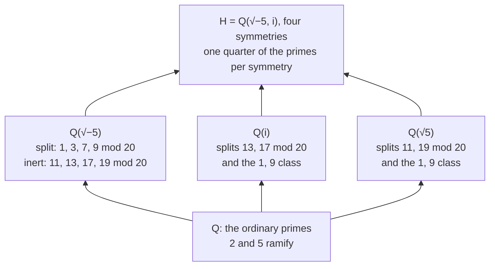

# Chebotarev: what share of the primes split in each possible pattern

[Syllabus](../../../SYLLABUS.md) → [Algebraic and analytic number theory](../README.md) → [Algebraic Numbers](../README.md#s06) → Chebotarev

---

## General Overview

In the field with root minus five, $`K = \mathbb{Q}(\sqrt{-5})`$, the number 6 factors two ways: $`2 \times 3`$ and $`(1 + \sqrt{-5})(1 - \sqrt{-5})`$. Every ordinary prime meets one of three fates there ([Splitting and ramification](08-splitting-and-ramification.md)):

- **split**: it breaks into two different prime ideals, as 3 does;
- **inert**: it stays prime, as 11 does;
- **ramified**: it becomes the square of one prime ideal. Only 2 and 5 do this, the primes dividing the discriminant −20.

Below 50 the score is seven split (3, 7, 23, 29, 41, 43, 47) and six inert (11, 13, 17, 19, 31, 37). Up to a million it is 39,140 split and 39,356 inert, a split share of 49.86%. The question is whether that near-even score is luck or law.

It is law. Each prime leaves a fingerprint in the field's symmetry group, its **Frobenius element**. Chebotarev's theorem says the fingerprints spread evenly over the group. $`K`$ has two symmetries: do nothing, or swap $`\sqrt{-5}`$ with $`-\sqrt{-5}`$. A prime splits when its fingerprint is "do nothing", so half of all primes split.

The same rule predicts the shares for any Galois number field, however many symmetries it has. A number field is Galois when, for each of its numbers, it also holds every other root of that number's minimal polynomial. (These are not the finite fields $`\mathrm{GF}(p^k)`$, also called Galois fields.) The card checks it on three fields against exact counts to a million.

**Each unramified prime picks out a class of symmetries of a Galois number field, and the share of primes picking a class equals that class's share of the group: so half of all primes split in the field with root minus five.**

**What kind of fact this is:** a theorem, proved by Chebotarev and published in 1926. This card proves the half for $`\mathbb{Q}(\sqrt{-5})`$ from [Dirichlet's theorem](../03-Characters%20and%20L-functions/04-dirichlets-theorem-on-primes-in-progressions.md) in its prime-number-theorem form, which that card states with a source. It proves the "split completely" share for every Galois number field in a folded proof (as a Dirichlet density, defined there), and outlines the general case with a source. The counts to a million are evidence, not proof.

### The picture: four fates in one field of four symmetries



Each arrow means "sits inside". The top field $`H`$ holds $`\sqrt{-5}`$, $`i`$ and $`\sqrt{5}`$. Its four symmetries sort the unramified primes into four classes mod 20, a quarter each. Two of them are the split primes of $`\mathbb{Q}(\sqrt{-5})`$, and the split pair separates the primes that are sums $`x^2 + 5y^2`$ from those that are not.

---

## The formula

Notation first, in words. $`L`$ is a Galois number field over the rationals $`\mathbb{Q}`$ and $`G`$ its group of symmetries, with $`\lvert G\rvert`$ members ([The Galois correspondence](../05-Fields%20and%20Galois%20Theory/05-galois-groups-and-the-fundamental-theorem.md)). Two symmetries $`\sigma`$ and $`\tau\sigma\tau^{-1}`$ are **conjugate**: one is the other seen after relabelling by $`\tau`$. A **conjugacy class** $`C`$ is a full set of mutually conjugate symmetries. $`\mathrm{Frob}_p`$ is the class picked out by the prime $`p`$, defined in Step 0.

The count is $`\pi_C(x)`$, the number of primes $`p \le x`$ that do not ramify in $`L`$ and have $`\mathrm{Frob}_p = C`$. As before, $`\pi(x)`$ counts all primes up to $`x`$.

```math
\lim_{x \to \infty} \frac{\pi_C(x)}{\pi(x)} = \frac{\lvert C\rvert}{\lvert G\rvert}
```

**Read it aloud:** among the primes up to $`x`$, the share whose Frobenius lands in the class $`C`$ tends to the share of the group that $`C`$ fills.

In $`\mathbb{Q}(\sqrt{-5})`$ the group has two members, each its own class. The class "do nothing" has $`\lvert C\rvert = 1`$, so the split share tends to $`1/2`$. The count at a million gives 49.86%.

| Symbol | Plain meaning | In our example | Push it up and the answer… |
| --- | --- | --- | --- |
| $`K`$, $`L`$, $`H`$ | a number field; $`L`$ a Galois one; $`H`$ the four-symmetry field $`\mathbb{Q}(\sqrt{-5}, i)`$ | $`K = L = \mathbb{Q}(\sqrt{-5})`$ | a bigger field has more patterns |
| $`G`$, $`\lvert G\rvert`$, $`n`$ | the symmetries of $`L`$, and how many; $`\lvert G\rvert`$ is also the degree $`n`$ of $`L`$ | two: do nothing, and swap $`\pm\sqrt{-5}`$ | each class gets a smaller share |
| $`\sigma`$, $`\tau`$ | single symmetries in $`G`$ | the swap | — |
| $`C`$, $`\lvert C\rvert`$ | a conjugacy class and its size | "do nothing", size 1 | more primes land in it |
| $`p`$ | an ordinary prime | 3, 11, 29 | — |
| $`\mathfrak{P}`$, $`N(\mathfrak{P})`$ | a prime ideal of $`L`$ containing $`p`$; its norm $`p^f`$, the size of its residue field | $`(3, 1 + \sqrt{-5})`$ | — |
| $`\mathrm{Frob}_p`$ | the class of symmetries that acts like the $`p`$-th power near $`p`$ | "do nothing" for 3, the swap for 11 | — |
| $`f`$, $`g`$ | size of each prime ideal's residue field as a power of $`p`$, and the number of prime ideals | $`f = 1, g = 2`$ for 3; $`f = 2, g = 1`$ for 11 | $`g`$ falls, since $`f \times g = n`$ for unramified $`p`$ |
| $`(a/p)`$, $`\chi(p)`$ | the Legendre symbol: +1 if $`a`$ is a nonzero square mod $`p`$, −1 if not; $`\chi(p) = (-5/p)`$, with its L-function $`L(s, \chi)`$ | $`(-5/3) = +1`$ | — |
| $`d_K`$, $`d_L`$ | the discriminant; its prime factors are the ramified primes | $`-20`$: 2 and 5 ramify | more primes are set aside |
| $`x`$, $`\pi(x)`$, $`\pi_C(x)`$, $`\mathrm{Li}(x)`$ | a cutoff; all primes up to it; those with Frobenius in $`C`$; the offset logarithmic integral, a smooth estimate of $`\pi(x)`$ | at a million: 78,498 and 39,140 | the share settles toward $`\lvert C\rvert / \lvert G\rvert`$ |
| $`s`$, $`\zeta_L(s)`$ | a real number above 1; the Dedekind zeta function, a product over the prime ideals of $`L`$ | used in Step 3 | $`\zeta_L(s)`$ blows up as $`s`$ falls to 1 |

### When it holds

- **The field must be Galois.** Only then is there a symmetry group to share out. For the non-Galois cubic field $`\mathbb{Q}(\sqrt[3]{2})`$, the guess "a third of primes split completely" is wrong: the count is 16.60%, a sixth. The share belongs to the Galois group of the smallest Galois number field around it.
- **Ramified primes are set aside.** They have no single Frobenius. There are finitely many, so they change no share. Read naively, $`x^3 - 2`$ mod 3 looks like the pattern "2 + 1" when it is a triple root.
- **Weight each class by its size.** A class of three symmetries gets three times the share of a class of one. Counting patterns as equally likely gives 33.33% each for $`x^3 - 2`$, against counts of 16.60%, 50.02% and 33.38%.
- **The theorem is a limit, not a rate.** It says nothing about $`x`$ = 100, where the split share is 47.83%. Unconditional error terms are proved but weak; good ones need the generalised Riemann hypothesis (Step 4).

---

## Why it works

### Step 0: each prime picks out a symmetry

Look at $`L`$ "near $`p`$": reduce its integers modulo a prime ideal $`\mathfrak{P}`$ above $`p`$. The result is a finite field, and on a finite field the $`p`$-th power map is a symmetry, the Frobenius map ([Finite fields](../05-Fields%20and%20Galois%20Theory/09-finite-fields-and-frobenius.md)).

When $`p`$ does not ramify, exactly one symmetry $`\sigma`$ of $`L`$ reduces to that map: $`\sigma(a) \equiv a^p`$ modulo $`\mathfrak{P}`$ for every integer $`a`$ of $`L`$. Moving to another prime ideal $`\tau\mathfrak{P}`$ above $`p`$ replaces $`\sigma`$ by $`\tau\sigma\tau^{-1}`$. So the prime picks out a whole conjugacy class, $`\mathrm{Frob}_p`$, and nothing finer.

The class records the splitting. If $`f`$ is the order of $`\sigma`$ (how many repeats return it to "do nothing"), then $`p`$ splits into $`g = n/f`$ prime ideals, each with residue field of size $`p^f`$ ([Splitting and ramification](08-splitting-and-ramification.md)). "Do nothing" means $`f = 1`$, $`g = n`$: $`p`$ **splits completely**. When $`L`$ is the splitting field of a polynomial and $`p`$ does not divide its discriminant, the cycle lengths of $`\sigma`$ on the roots are the degrees of the polynomial's factors mod $`p`$ ([Computing a Galois group](../05-Fields%20and%20Galois%20Theory/06-computing-a-galois-group.md)).

### Step 1: in the field with root minus five, Frobenius is Euler's test

Take $`p`$ odd and not 5. The Frobenius $`\sigma`$ must send $`\sqrt{-5}`$ to $`\pm\sqrt{-5}`$, and modulo $`\mathfrak{P}`$ it must agree with the $`p`$-th power:

```math
(\sqrt{-5})^p = (-5)^{(p-1)/2}\,\sqrt{-5} \equiv \left(\frac{-5}{p}\right)\sqrt{-5} \pmod{\mathfrak{P}}
```

The last step is Euler's test ([Quadratic residues](../03-Characters%20and%20L-functions/02-quadratic-residues-and-the-legendre-symbol.md)): a number to the power $`(p-1)/2`$ is $`+1`$ or $`-1`$ mod $`p`$, according as it is a square or not. The two signs stay distinct mod $`\mathfrak{P}`$, since $`2\sqrt{-5}`$ is not divisible by $`\mathfrak{P}`$ when $`p`$ does not divide 20. So $`\mathrm{Frob}_p`$ is "do nothing" exactly when $`(-5/p) = +1`$.

Two cases by hand. For $`p = 3`$: $`(-5)^1 \bmod 3 = 1`$, so 3 splits. For $`p = 11`$: $`(-5)^5 \bmod 11 = 10`$, which is $`-1`$, so 11 is inert.

### Step 2: reciprocity turns the test into a remainder mod 20

[Splitting and ramification](08-splitting-and-ramification.md) proves, in its Step 5, that $`p`$ splits exactly when it is 1, 3, 7 or 9 mod 20: the two signs in $`(-5/p) = (-1/p)(5/p)`$ agree on exactly those remainders.

[Dirichlet's theorem](../03-Characters%20and%20L-functions/04-dirichlets-theorem-on-primes-in-progressions.md), in its prime-number-theorem form (stated there with a source), says each of the eight remainders mod 20 that share no factor with 20 gets one eighth of the primes. Four of them split, so **half of all primes split**. For this field, given that theorem, the proof is complete.

The code checks Step 1 against Step 2 for every prime up to a million, and against a hunt for a square root of −5 up to 10,000.

### Step 3: why a share of one over the group size splits completely

A second proof shows where $`1/\lvert G\rvert`$ comes from, for the class "do nothing" in any Galois number field. It counts poles, not primes.

The **Dedekind zeta function** $`\zeta_L(s)`$ multiplies one factor $`(1 - N(\mathfrak{P})^{-s})^{-1}`$ for each prime ideal, where the norm $`N(\mathfrak{P}) = p^f`$ is the size of its residue field. Like $`\zeta(s)`$, it has a simple pole at $`s = 1`$ ([The class number formula](06-class-number-formula-and-the-dedekind-zeta-function.md)). Taking logs turns the pole into growth like $`\log \tfrac{1}{s-1}`$ on both sides.

On the prime side, only prime ideals with $`f = 1`$ matter: the rest contribute a bounded amount. A prime $`p`$ has prime ideals with $`f = 1`$ only when it splits completely, and then it has $`n`$ of them. So $`n`$ times the sum of $`p^{-s}`$ over completely split primes grows like the sum over all primes. The share is $`1/n = 1/\lvert G\rvert`$.

<details>
<summary>Detailed proof: primes that split completely have Dirichlet density 1/n</summary>

The **Dirichlet density** of a set $`S`$ of primes is the limit, as $`s`$ falls to 1, of the sum of $`p^{-s}`$ over $`S`$ divided by the sum over all primes. When a natural density exists, the Dirichlet density equals it.

For $`s > 1`$ the Euler product gives:

$`\displaystyle \log \zeta_L(s) = \sum_{\mathfrak{P}} \sum_{k \ge 1} \frac{N(\mathfrak{P})^{-ks}}{k} = \sum_{\mathfrak{P}} N(\mathfrak{P})^{-s} + O(1).`$

The terms with $`k \ge 2`$ stay bounded as $`s \to 1`$: at most $`n`$ prime ideals lie above each $`p`$, and the sum of $`p^{-k}`$ over all primes and all $`k \ge 2`$ is finite.

Split the remaining sum by $`f`$. A prime ideal with $`f \ge 2`$ has norm at least $`p^2`$, so those terms are bounded too. Ramified primes are finitely many. An unramified $`p`$ has prime ideals of norm $`p`$ only when $`f = 1`$, that is, when it splits completely, and then all $`g = n`$ of them have norm $`p`$. So:

$`\displaystyle \log \zeta_L(s) = n \sum_{p \text{ splits completely}} p^{-s} + O(1).`$

The simple pole gives $`\log \zeta_L(s) = \log \frac{1}{s-1} + O(1)`$. The same holds for $`\zeta(s)`$, so $`\sum_p p^{-s} = \log \frac{1}{s-1} + O(1)`$. Divide, and let $`s \to 1`$: the density of completely split primes is $`1/n`$.

For a quadratic field the argument gives both classes at once. There $`\zeta_K(s) = \zeta(s)\, L(s, \chi)`$, where $`\chi(p)`$ is $`+1`$ for split and $`-1`$ for inert $`p`$. Since $`L(1, \chi)`$ is finite and not zero, $`\log L(s, \chi) = \sum_p \chi(p) p^{-s} + O(1)`$ stays bounded. The split sum minus the inert sum stays bounded while each grows without limit, so each is half.

</details>

### Step 4: every class, and how fast

For a class other than "do nothing", Chebotarev's 1926 argument runs in two moves. First, fix a symmetry $`\sigma`$ in $`C`$ and pass to the field fixed by the powers of $`\sigma`$; over it, the extension is cyclic (its group is generated by $`\sigma`$ alone). Second, cross that cyclic extension with a field of roots of unity ([Cyclotomic fields](../05-Fields%20and%20Galois%20Theory/08-cyclotomic-extensions-and-roots-of-unity.md)). There the primes are counted by characters and their L-functions, as in Dirichlet's theorem. Stevenhagen and Lenstra, cited below, give the full argument and its history.

That argument proves the Dirichlet density. The natural density, the limit in the formula, follows from zero-free regions for the L-functions of the cyclic case, as in the prime number theorem (Serre, cited below).

The rate is a separate question. On the generalised Riemann hypothesis (GRH), the gap between $`\pi_C(x)`$ and $`(\lvert C\rvert / \lvert G\rvert)\,\mathrm{Li}(x)`$ is at most a fixed multiple of $`(\lvert C\rvert/\lvert G\rvert)\sqrt{x}\,(\log \lvert d_L\rvert + n \log x)`$. Here $`\mathrm{Li}(x)`$ is the offset logarithmic integral, the integral of $`1/\log t`$ from 2 to $`x`$. Without GRH, the proved error terms are effective but far weaker. Both are in Serre's 1981 paper.

Frobenius proved a weaker version in 1896. It counts primes whose symmetry generates a given cyclic subgroup, so it lumps $`\sigma`$ with $`\sigma^2`$ and other powers. For the groups on this card, that already suffices: in the groups of order 2 and 4 used here and in $`S_3`$, each symmetry is conjugate to the powers that generate the same subgroup. In a cyclic group of order 3 it is not, and only Chebotarev separates $`\sigma`$ from $`\sigma^2`$.

### Step 5: a field with classes of different sizes

The splitting field of $`x^3 - 2`$ has six symmetries, all the shuffles of the three roots: the group $`S_3`$ (polynomial discriminant −108, so only 2 and 3 ramify). The classes and their predicted shares:

| Class | Size | Pattern of $`x^3 - 2`$ mod $`p`$ | Predicted share |
| --- | --- | --- | --- |
| do nothing | 1 | three roots, 1 + 1 + 1 | 1/6 = 16.67% |
| swap two roots | 3 | one root, 2 + 1 | 1/2 = 50.00% |
| cycle all three | 2 | no root, 3 | 1/3 = 33.33% |

Mod 5 the only root is 3; mod 7 there is none; mod 31 the roots are 4, 7 and 20. The counts below a million:

```
1+1+1, identity   16.60% ##########
2+1, three swaps  50.02% ##############################
3, two 3-cycles   33.38% ####################
```

Each bar is the share of the 78,496 primes from 5 to a million with that pattern. No congruence mod any fixed number separates the first row from the third (Cox, cited below). Gauss found the rule instead: for $`p`$ that is 1 mod 3, 2 is a cube mod $`p`$ exactly when $`p = x^2 + 27y^2`$, as $`31 = 2^2 + 27 \cdot 1^2`$. The code confirms it for every such prime up to a million.

---

## Worked numbers, by hand

| Step | Arithmetic | Value |
| --- | --- | --- |
| The group | do nothing, or swap $`\pm\sqrt{-5}`$ | 2 symmetries |
| Frobenius at 3 | $`(-5)^1 \bmod 3`$ | 1: do nothing, 3 splits |
| Frobenius at 11 | $`(-5)^5 \bmod 11`$ | 10, that is −1: the swap, 11 is inert |
| Remainders mod 20 | 3 is in 1, 3, 7, 9; 11 is not | the same verdicts |
| Predicted share | $`\lvert C\rvert / \lvert G\rvert = 1/2`$ | 50.00% |
| Counted to a million | 39,140 split of 78,496 unramified | **49.86%** |
| Split minus inert | 39,140 − 39,356 | −216 |

So just under half of the primes up to a million split, as the theorem says. The difference split minus inert changes sign along the way: −1 at 100, −4 at 1,000, +1 at 10,000, −44 at 100,000. A small lead for the inert side is typical (a "Chebyshev bias"), and it does not move the limit.

### The four fates of the primes up to a million

The field $`H = \mathbb{Q}(\sqrt{-5}, i)`$ has four symmetries, one per class. Its Frobenius at $`p`$ is the pair of signs $`(-1/p)`$ and $`(5/p)`$ from Step 2:

```
split, principal    1 9 mod 20   19,514  24.86% ###############
split, not principal 3 7 mod 20  19,626  25.00% ###############
inert, splits in Q(i) 13 17      19,660  25.05% ###############
inert, splits in Q(sqrt5) 11 19  19,696  25.09% ###############
```

Each bar is a share of the 78,496 unramified primes, and each is predicted at 25.00%. The first two rows split $`\mathbb{Q}(\sqrt{-5})`$'s split primes in half. In the first, $`p`$ is a sum $`x^2 + 5y^2`$, as $`29 = 3^2 + 5 \cdot 2^2`$ and $`41 = 6^2 + 5 \cdot 1^2`$: $`p`$ factors as a number times its conjugate. In the second, $`p`$ is $`2x^2 + 2xy + 3y^2`$ instead, as 3 at $`(0, 1)`$ and 7 at $`(1, 1)`$, and its prime ideals are not principal (not generated by one number). That is why 6 factors two ways: 3 splits, but into ideals that no single number generates ([Class groups](05-class-groups-and-the-minkowski-bound.md)). $`H`$ is the field that sees this difference, and the code confirms the rule for every prime to a million.

### What breaks if you drop a piece

| Mistake | Comes out at | What went wrong |
| --- | --- | --- |
| Take $`\mathbb{Q}(\sqrt[3]{2})`$ as Galois: degree 3, so "a third split completely" | predicts 33.33%; the count is 16.60% | the field has only one symmetry; the shares belong to the six symmetries of its Galois closure |
| Count each pattern of $`x^3 - 2`$ as equally likely | 33.33% each; the counts are 16.60%, 50.02%, 33.38% | classes have sizes 1, 3 and 2 |
| Read the ramified prime 3 as unramified | one root, 2, so "2 + 1" | $`x^3 - 2 = (x + 1)^3`$ mod 3: a triple root, no Frobenius |
| Read "splits" as "is $`x^2 + 5y^2`$" | predicts 50.00%; the count is 24.86% | splitting into ideals is not factoring into numbers; that needs the bigger field $`H`$ |

The code prints all four.

---

## Code, from first principles, and it actually runs

The code sieves the primes to a million and reaches each Frobenius by **three roads**. For $`\mathbb{Q}(\sqrt{-5})`$: Euler's test, the remainder mod 20 from reciprocity, and a brute-force hunt for a square root of −5 below 10,000. For the principal split, it lists every value of $`x^2 + 5y^2`$ and $`2x^2 + 2xy + 3y^2`$ up to a million. For $`x^3 - 2`$: a cube test, a brute-force root count below 10,000, and Gauss's $`x^2 + 27y^2`$. The shares are then set against $`\lvert C\rvert / \lvert G\rvert`$, with a tolerance of three standard errors for the half. `pow(a, k, n)` is used as a tool; every count is made here.

### Python

```python
# Chebotarev density -- the check behind the card.  Standard library only.
# Field 1: Q(sqrt-5), from x^2 + 5, group of order 2.  Field 2: the splitting
# field of x^3 - 2, group S3 of order 6.  Every prime is sieved here, every
# Frobenius found two or three ways, and the shares compared with |C|/|G|.
N = 1_000_000
sieve = bytearray([1]) * (N + 1)
sieve[0] = sieve[1] = 0
for i in range(2, int(N ** 0.5) + 1):
    if sieve[i]:
        sieve[i * i::i] = bytearray(len(range(i * i, N + 1, i)))
primes = [p for p in range(N + 1) if sieve[p]]

def reps(form):                          # every value of a form up to N
    out, lim = set(), int(N ** 0.5) + 2
    for x in range(-lim, lim + 1):
        for y in range(0, lim + 1):
            v = form(x, y)
            if 0 < v <= N:
                out.add(v)
    return out

def first_rep(form, v):                  # smallest (x, y), y first, with form(x, y) = v
    return next((x, y) for y in range(v + 1) for x in range(v + 1) if form(x, y) == v)

def pct(a, b):
    return f"{100 * a / b:6.2f}%"

def yn(claim):
    return "yes" if claim else "no"

def bar(a, b):
    return "#" * round(60 * a / b)

# Road 1: Frobenius on sqrt-5 is multiplication by (-5)^((p-1)/2) mod p.
def frob_sign(p):
    return 1 if pow(-5 % p, (p - 1) // 2, p) == 1 else -1

SPLIT20 = {1, 3, 7, 9}                   # Road 2: reciprocity's answer mod 20
odd = [p for p in primes if p not in (2, 5)]
agree = all((frob_sign(p) == 1) == (p % 20 in SPLIT20) for p in odd)
brute = all((frob_sign(p) == 1) == any((x * x + 5) % p == 0 for x in range(p))
            for p in odd if p < 10_000)  # Road 3: hunt a square root of -5
small = [p for p in primes if p < 50]
print("field Q(sqrt-5): polynomial x^2 + 5, discriminant -20, group of order 2")
print("p=3: (-5)^1 mod 3 =", pow(-5 % 3, 1, 3), "| p=11: (-5)^5 mod 11 =", pow(-5 % 11, 5, 11))
sp = [p for p in small if p in odd and frob_sign(p) == 1]
ine = [p for p in small if p in odd and frob_sign(p) == -1]
print("primes below 50: ramified 2 5 | split", len(sp), ":", *sp, "| inert", len(ine), ":", *ine)
print("house: (1 + sqrt-5)(1 - sqrt-5) = 1 + 5 =", 1 + 5, "= 2 x 3")
print("Euler test = residue mod 20, every prime to 1,000,000:", yn(agree),
      "| = square-root hunt, p < 10,000:", yn(brute))
print("x          pi(x)    split    inert  split share  split - inert")
rows = {}
for x in (100, 1_000, 10_000, 100_000, 1_000_000):
    u = [p for p in odd if p <= x]
    s = sum(1 for p in u if frob_sign(p) == 1)
    rows[x] = (len(u) + 2, s, len(u) - s)
    print(f"{x:<9,} {len(u) + 2:7,} {s:8,} {len(u) - s:8,}     {pct(s, len(u))}  {2 * s - len(u):+6,}")
pi_N, split_N, _ = rows[N]
fates = [("split, principal    1 9 mod 20", {1, 9}),
         ("split, not principal 3 7 mod 20", {3, 7}),
         ("inert, splits in Q(i) 13 17", {13, 17}),
         ("inert, splits in Q(sqrt5) 11 19", {11, 19})]
counts = [sum(1 for p in odd if p % 20 in cl) for _, cl in fates]
print(f"the four fates to 1,000,000 among {len(odd):,} unramified primes; each predicted 25.00%")
for (name, _), c in zip(fates, counts):
    print(f"{name:<32}{c:7,} {pct(c, len(odd))} {bar(c, len(odd))}")
norm1 = reps(lambda x, y: x * x + 5 * y * y)
norm2 = reps(lambda x, y: 2 * x * x + 2 * x * y + 3 * y * y)
print("29 = x^2 + 5y^2 at", first_rep(lambda x, y: x * x + 5 * y * y, 29),
      "| 41 at", first_rep(lambda x, y: x * x + 5 * y * y, 41),
      "| 3 = 2x^2 + 2xy + 3y^2 at", first_rep(lambda x, y: 2 * x * x + 2 * x * y + 3 * y * y, 3),
      "| 7 at", first_rep(lambda x, y: 2 * x * x + 2 * x * y + 3 * y * y, 7))
f1 = all((p in norm1) == (p % 20 in {1, 9}) for p in odd)
f2 = all((p in norm2) == (p % 20 in {3, 7}) for p in odd)
print("p = x^2 + 5y^2 exactly when p = 1, 9 mod 20:", yn(f1),
      "| p = 2x^2 + 2xy + 3y^2 exactly when p = 3, 7 mod 20:", yn(f2))

# Field 2: x^3 - 2.  Roots mod p by the cube test (Road 1) and by brute force.
def roots_test(p):
    if p % 3 == 2:
        return 1
    return 3 if pow(2, (p - 1) // 3, p) == 1 else 0

big = [p for p in primes if p > 3]
cube_ok = all(roots_test(p) == sum(1 for x in range(p) if (x ** 3 - 2) % p == 0)
              for p in big if p < 10_000)
print("x^3 - 2: discriminant -108, group S3 of 6 symmetries, classes of size 1, 3, 2")
print("roots of x^3 - 2 mod 5, 7, 31:", *[[x for x in range(p) if (x ** 3 - 2) % p == 0]
      for p in (5, 7, 31)], "| 31 = x^2 + 27y^2 at", first_rep(lambda x, y: x * x + 27 * y * y, 31))
print("cube test = brute-force root count, every prime 5 to 10,000:", yn(cube_ok))
print("x          primes  1+1+1 (3 roots)  2+1 (1 root)   3 (0 roots)")
for x in (1_000, 10_000, 100_000, 1_000_000):
    u = [p for p in big if p <= x]
    c = [sum(1 for p in u if roots_test(p) == r) for r in (3, 1, 0)]
    print(f"{x:<9,} {len(u):7,} {c[0]:7,} {pct(c[0], len(u))} {c[1]:6,} {pct(c[1], len(u))}"
          f" {c[2]:6,} {pct(c[2], len(u))}")
s3 = c
print("S3 predicts                1/6 = 16.67%      1/2 = 50.00%  1/3 = 33.33%")
for name, k, d in (("1+1+1, identity", s3[0], 6), ("2+1, three swaps", s3[1], 2),
                   ("3, two 3-cycles", s3[2], 3)):
    print(f"{name:<17}{pct(k, len(u))} {bar(k, len(u))}")
form27 = reps(lambda x, y: x * x + 27 * y * y)
gauss = all((roots_test(p) == 3) == (p in form27) for p in big if p % 3 == 1)
print("for p = 1 mod 3: 2 is a cube mod p exactly when p = x^2 + 27y^2, to 1,000,000:", yn(gauss))

print("mistake 1, Q(cbrt 2) taken as Galois: predicts 33.33% split completely, count", pct(s3[0], len(u)))
print("mistake 2, every pattern equally likely: predicts 33.33% each, count",
      pct(s3[0], len(u)), pct(s3[1], len(u)), pct(s3[2], len(u)))
r3 = [x for x in range(3) if (x ** 3 - 2) % 3 == 0]
cubed = all(((x + 1) ** 3 - (x ** 3 - 2)) % 3 == 0 for x in range(3))
print(f"mistake 3, ramified p = 3: roots {r3}, one root, looks like 2+1;"
      f" but x^3 - 2 = (x + 1)^3 mod 3: {yn(cubed)}, a triple root")
print("mistake 4, 'splits' read as 'p = x^2 + 5y^2': predicts 50.00%, count",
      pct(counts[0], len(odd)))
assert agree and brute and f1 and f2 and cube_ok and gauss          # roads agree
assert pi_N == 78_498                                              # sieve vs known pi(10^6)
assert split_N == counts[0] + counts[1]                             # Euler count = mod-20 count
assert abs(split_N / (pi_N - 2) - 0.5) < 1.5 / (pi_N - 2) ** 0.5     # density 1/2, 3 std errors
assert all(abs(c / len(odd) - 0.25) < 0.01 for c in counts)          # four quarters
assert all(abs(k / len(u) - f) < 0.01 for k, f in zip(s3, (1 / 6, 1 / 2, 1 / 3)))
assert abs(s3[0] / len(u) - 1 / 3) > 0.1                           # mistake 1 really misses
assert r3 == [2]                                                    # mistake 3: one root mod 3
assert cubed                                                        # yet a triple root
print("ALL CHECKS PASS")
```

**Ran 2026-11-15 on macOS, Python 3.14.10, standard library only. All checks passed. Output, pasted from the run:**

```
field Q(sqrt-5): polynomial x^2 + 5, discriminant -20, group of order 2
p=3: (-5)^1 mod 3 = 1 | p=11: (-5)^5 mod 11 = 10
primes below 50: ramified 2 5 | split 7 : 3 7 23 29 41 43 47 | inert 6 : 11 13 17 19 31 37
house: (1 + sqrt-5)(1 - sqrt-5) = 1 + 5 = 6 = 2 x 3
Euler test = residue mod 20, every prime to 1,000,000: yes | = square-root hunt, p < 10,000: yes
x          pi(x)    split    inert  split share  split - inert
100            25       11       12      47.83%      -1
1,000         168       81       85      48.80%      -4
10,000      1,229      614      613      50.04%      +1
100,000     9,592    4,773    4,817      49.77%     -44
1,000,000  78,498   39,140   39,356      49.86%    -216
the four fates to 1,000,000 among 78,496 unramified primes; each predicted 25.00%
split, principal    1 9 mod 20   19,514  24.86% ###############
split, not principal 3 7 mod 20  19,626  25.00% ###############
inert, splits in Q(i) 13 17      19,660  25.05% ###############
inert, splits in Q(sqrt5) 11 19  19,696  25.09% ###############
29 = x^2 + 5y^2 at (3, 2) | 41 at (6, 1) | 3 = 2x^2 + 2xy + 3y^2 at (0, 1) | 7 at (1, 1)
p = x^2 + 5y^2 exactly when p = 1, 9 mod 20: yes | p = 2x^2 + 2xy + 3y^2 exactly when p = 3, 7 mod 20: yes
x^3 - 2: discriminant -108, group S3 of 6 symmetries, classes of size 1, 3, 2
roots of x^3 - 2 mod 5, 7, 31: [3] [] [4, 7, 20] | 31 = x^2 + 27y^2 at (2, 1)
cube test = brute-force root count, every prime 5 to 10,000: yes
x          primes  1+1+1 (3 roots)  2+1 (1 root)   3 (0 roots)
1,000         166      24  14.46%     86  51.81%     56  33.73%
10,000      1,227     200  16.30%    616  50.20%    411  33.50%
100,000     9,590   1,559  16.26%  4,806  50.11%  3,225  33.63%
1,000,000  78,496  13,032  16.60% 39,265  50.02% 26,199  33.38%
S3 predicts                1/6 = 16.67%      1/2 = 50.00%  1/3 = 33.33%
1+1+1, identity   16.60% ##########
2+1, three swaps  50.02% ##############################
3, two 3-cycles   33.38% ####################
for p = 1 mod 3: 2 is a cube mod p exactly when p = x^2 + 27y^2, to 1,000,000: yes
mistake 1, Q(cbrt 2) taken as Galois: predicts 33.33% split completely, count  16.60%
mistake 2, every pattern equally likely: predicts 33.33% each, count  16.60%  50.02%  33.38%
mistake 3, ramified p = 3: roots [2], one root, looks like 2+1; but x^3 - 2 = (x + 1)^3 mod 3: yes, a triple root
mistake 4, 'splits' read as 'p = x^2 + 5y^2': predicts 50.00%, count  24.86%
ALL CHECKS PASS
```

### Rust

Same numbers, same labels, built with `rustc --edition 2021 -O`.

```rust
// Chebotarev density -- the same check as the Python, in Rust.  No crates.
// Field 1: Q(sqrt-5), from x^2 + 5, group of order 2.  Field 2: the splitting
// field of x^3 - 2, group S3 of order 6.  Every prime is sieved here, every
// Frobenius found two or three ways, and the shares compared with |C|/|G|.
const N: usize = 1_000_000;

fn pow_mod(b: i64, e: i64, m: i64) -> i64 {
    let (mut r, mut b, mut e, m) = (1u128, (b.rem_euclid(m)) as u128, e, m as u128);
    while e > 0 {
        if e & 1 == 1 { r = r * b % m }
        b = b * b % m;
        e >>= 1;
    }
    r as i64
}

fn commas(n: i64) -> String {
    let s = n.abs().to_string();
    let mut out = String::new();
    for (i, ch) in s.chars().enumerate() {
        if i > 0 && (s.len() - i) % 3 == 0 { out.push(',') }
        out.push(ch);
    }
    if n < 0 { format!("-{}", out) } else { out }
}

fn reps(form: impl Fn(i64, i64) -> i64) -> Vec<bool> {   // every value of a form up to N
    let mut out = vec![false; N + 1];
    let lim = (N as f64).sqrt() as i64 + 2;
    for x in -lim..=lim {
        for y in 0..=lim {
            let v = form(x, y);
            if v > 0 && v <= N as i64 { out[v as usize] = true }
        }
    }
    out
}

fn first_rep(form: impl Fn(i64, i64) -> i64, v: i64) -> (i64, i64) {  // smallest (x, y), y first
    for y in 0..=v { for x in 0..=v { if form(x, y) == v { return (x, y) } } }
    panic!("no representation")
}

fn pct(a: usize, b: usize) -> String { format!("{:6.2}%", 100.0 * a as f64 / b as f64) }
fn yn(claim: bool) -> &'static str { if claim { "yes" } else { "no" } }
fn bar(a: usize, b: usize) -> String { "#".repeat((60.0 * a as f64 / b as f64).round() as usize) }
fn list(v: &[i64]) -> String { v.iter().map(|p| p.to_string()).collect::<Vec<_>>().join(" ") }

// Road 1: Frobenius on sqrt-5 is multiplication by (-5)^((p-1)/2) mod p.
fn frob_sign(p: i64) -> i64 { if pow_mod(-5, (p - 1) / 2, p) == 1 { 1 } else { -1 } }

fn roots_test(p: i64) -> usize {                           // roots of x^3 - 2 mod p
    if p % 3 == 2 { return 1 }
    if pow_mod(2, (p - 1) / 3, p) == 1 { 3 } else { 0 }
}

fn main() {
    let mut sieve = vec![true; N + 1];
    sieve[0] = false;
    sieve[1] = false;
    let mut i = 2;
    while i * i <= N {
        if sieve[i] { let mut j = i * i; while j <= N { sieve[j] = false; j += i } }
        i += 1;
    }
    let primes: Vec<i64> = (0..=N).filter(|&p| sieve[p]).map(|p| p as i64).collect();
    let split20 = [1, 3, 7, 9];                            // Road 2: reciprocity mod 20
    let odd: Vec<i64> = primes.iter().copied().filter(|&p| p != 2 && p != 5).collect();
    let agree = odd.iter().all(|&p| (frob_sign(p) == 1) == split20.contains(&(p % 20)));
    let brute = odd.iter().filter(|&&p| p < 10_000)        // Road 3: hunt a square root of -5
        .all(|&p| (frob_sign(p) == 1) == (0..p).any(|x| (x * x + 5) % p == 0));
    let small: Vec<i64> = primes.iter().copied().filter(|&p| p < 50).collect();
    let sp: Vec<i64> = small.iter().copied().filter(|&p| p != 2 && p != 5 && frob_sign(p) == 1).collect();
    let ine: Vec<i64> = small.iter().copied().filter(|&p| p != 2 && p != 5 && frob_sign(p) == -1).collect();
    println!("field Q(sqrt-5): polynomial x^2 + 5, discriminant -20, group of order 2");
    println!("p=3: (-5)^1 mod 3 = {} | p=11: (-5)^5 mod 11 = {}", pow_mod(-5, 1, 3), pow_mod(-5, 5, 11));
    println!("primes below 50: ramified 2 5 | split {} : {} | inert {} : {}", sp.len(), list(&sp), ine.len(), list(&ine));
    println!("house: (1 + sqrt-5)(1 - sqrt-5) = 1 + 5 = {} = 2 x 3", 1 + 5);
    println!("Euler test = residue mod 20, every prime to 1,000,000: {} | = square-root hunt, p < 10,000: {}",
             yn(agree), yn(brute));
    println!("x          pi(x)    split    inert  split share  split - inert");
    let mut rows = Vec::new();
    for &x in &[100i64, 1_000, 10_000, 100_000, 1_000_000] {
        let u: Vec<i64> = odd.iter().copied().filter(|&p| p <= x).collect();
        let s = u.iter().filter(|&&p| frob_sign(p) == 1).count();
        rows.push((u.len() + 2, s, u.len() - s));
        let d = 2 * s as i64 - u.len() as i64;
        let ds = if d >= 0 { format!("+{}", commas(d)) } else { commas(d) };
        println!("{:<9} {:>7} {:>8} {:>8}     {}  {:>6}", commas(x), commas(u.len() as i64 + 2),
                 commas(s as i64), commas((u.len() - s) as i64), pct(s, u.len()), ds);
    }
    let (pi_n, split_n, _) = rows[4];
    let fates: [(&str, [i64; 2]); 4] = [("split, principal    1 9 mod 20", [1, 9]),
        ("split, not principal 3 7 mod 20", [3, 7]), ("inert, splits in Q(i) 13 17", [13, 17]),
        ("inert, splits in Q(sqrt5) 11 19", [11, 19])];
    let counts: Vec<usize> = fates.iter().map(|(_, cl)| odd.iter().filter(|&&p| cl.contains(&(p % 20))).count()).collect();
    println!("the four fates to 1,000,000 among {} unramified primes; each predicted 25.00%", commas(odd.len() as i64));
    for ((name, _), &c) in fates.iter().zip(&counts) {
        println!("{:<32}{:>7} {} {}", name, commas(c as i64), pct(c, odd.len()), bar(c, odd.len()));
    }
    let norm1 = reps(|x, y| x * x + 5 * y * y);
    let norm2 = reps(|x, y| 2 * x * x + 2 * x * y + 3 * y * y);
    let (a, b) = (|x: i64, y: i64| x * x + 5 * y * y, |x: i64, y: i64| 2 * x * x + 2 * x * y + 3 * y * y);
    println!("29 = x^2 + 5y^2 at {:?} | 41 at {:?} | 3 = 2x^2 + 2xy + 3y^2 at {:?} | 7 at {:?}",
             first_rep(a, 29), first_rep(a, 41), first_rep(b, 3), first_rep(b, 7));
    let f1 = odd.iter().all(|&p| norm1[p as usize] == [1, 9].contains(&(p % 20)));
    let f2 = odd.iter().all(|&p| norm2[p as usize] == [3, 7].contains(&(p % 20)));
    println!("p = x^2 + 5y^2 exactly when p = 1, 9 mod 20: {} | p = 2x^2 + 2xy + 3y^2 exactly when p = 3, 7 mod 20: {}",
             yn(f1), yn(f2));
    // Field 2: x^3 - 2.  Roots mod p by the cube test (Road 1) and by brute force.
    let big: Vec<i64> = primes.iter().copied().filter(|&p| p > 3).collect();
    let cube_ok = big.iter().filter(|&&p| p < 10_000)
        .all(|&p| roots_test(p) == (0..p).filter(|&x| (x * x % p * x - 2).rem_euclid(p) == 0).count());
    println!("x^3 - 2: discriminant -108, group S3 of 6 symmetries, classes of size 1, 3, 2");
    let rts: Vec<String> = [5i64, 7, 31].iter()
        .map(|&p| format!("{:?}", (0..p).filter(|&x| (x * x * x - 2).rem_euclid(p) == 0).collect::<Vec<i64>>())).collect();
    println!("roots of x^3 - 2 mod 5, 7, 31: {} | 31 = x^2 + 27y^2 at {:?}", rts.join(" "), first_rep(|x, y| x * x + 27 * y * y, 31));
    println!("cube test = brute-force root count, every prime 5 to 10,000: {}", yn(cube_ok));
    println!("x          primes  1+1+1 (3 roots)  2+1 (1 root)   3 (0 roots)");
    let (mut s3, mut nu) = (vec![0usize; 3], 0usize);
    for &x in &[1_000i64, 10_000, 100_000, 1_000_000] {
        let u: Vec<i64> = big.iter().copied().filter(|&p| p <= x).collect();
        let c: Vec<usize> = [3, 1, 0].iter().map(|&r| u.iter().filter(|&&p| roots_test(p) == r).count()).collect();
        println!("{:<9} {:>7} {:>7} {} {:>6} {} {:>6} {}", commas(x), commas(u.len() as i64),
                 commas(c[0] as i64), pct(c[0], u.len()), commas(c[1] as i64), pct(c[1], u.len()),
                 commas(c[2] as i64), pct(c[2], u.len()));
        s3 = c;
        nu = u.len();
    }
    println!("S3 predicts                1/6 = 16.67%      1/2 = 50.00%  1/3 = 33.33%");
    for (name, k) in [("1+1+1, identity", s3[0]), ("2+1, three swaps", s3[1]), ("3, two 3-cycles", s3[2])] {
        println!("{:<17}{} {}", name, pct(k, nu), bar(k, nu));
    }
    let form27 = reps(|x, y| x * x + 27 * y * y);
    let gauss = big.iter().filter(|&&p| p % 3 == 1).all(|&p| (roots_test(p) == 3) == form27[p as usize]);
    println!("for p = 1 mod 3: 2 is a cube mod p exactly when p = x^2 + 27y^2, to 1,000,000: {}", yn(gauss));
    println!("mistake 1, Q(cbrt 2) taken as Galois: predicts 33.33% split completely, count {}", pct(s3[0], nu));
    println!("mistake 2, every pattern equally likely: predicts 33.33% each, count {} {} {}",
             pct(s3[0], nu), pct(s3[1], nu), pct(s3[2], nu));
    let r3: Vec<i64> = (0..3).filter(|&x| (x * x * x - 2i64).rem_euclid(3) == 0).collect();
    let cubed = (0..3i64).all(|x| ((x + 1).pow(3) - (x * x * x - 2)).rem_euclid(3) == 0);
    println!("mistake 3, ramified p = 3: roots {:?}, one root, looks like 2+1; but x^3 - 2 = (x + 1)^3 mod 3: {}, a triple root",
             r3, yn(cubed));
    println!("mistake 4, 'splits' read as 'p = x^2 + 5y^2': predicts 50.00%, count {}", pct(counts[0], odd.len()));
    assert!(agree && brute && f1 && f2 && cube_ok && gauss);              // roads agree
    assert!(pi_n == 78_498);                                              // sieve vs known pi(10^6)
    assert!(split_n == counts[0] + counts[1]);                            // Euler count = mod-20 count
    assert!((split_n as f64 / (pi_n - 2) as f64 - 0.5).abs() < 1.5 / ((pi_n - 2) as f64).sqrt());
    assert!(counts.iter().all(|&c| (c as f64 / odd.len() as f64 - 0.25).abs() < 0.01));
    assert!(s3.iter().zip([1.0 / 6.0, 0.5, 1.0 / 3.0]).all(|(&k, f)| (k as f64 / nu as f64 - f).abs() < 0.01));
    assert!((s3[0] as f64 / nu as f64 - 1.0 / 3.0).abs() > 0.1);          // mistake 1 really misses
    assert!(r3 == vec![2]);                                               // mistake 3: one root mod 3
    assert!(cubed);                                                       // yet a triple root
    println!("ALL CHECKS PASS");
}
```

**Ran 2026-11-15 on macOS, rustc 1.98.1, no crates. All checks passed. Output, pasted from the run:**

```
field Q(sqrt-5): polynomial x^2 + 5, discriminant -20, group of order 2
p=3: (-5)^1 mod 3 = 1 | p=11: (-5)^5 mod 11 = 10
primes below 50: ramified 2 5 | split 7 : 3 7 23 29 41 43 47 | inert 6 : 11 13 17 19 31 37
house: (1 + sqrt-5)(1 - sqrt-5) = 1 + 5 = 6 = 2 x 3
Euler test = residue mod 20, every prime to 1,000,000: yes | = square-root hunt, p < 10,000: yes
x          pi(x)    split    inert  split share  split - inert
100            25       11       12      47.83%      -1
1,000         168       81       85      48.80%      -4
10,000      1,229      614      613      50.04%      +1
100,000     9,592    4,773    4,817      49.77%     -44
1,000,000  78,498   39,140   39,356      49.86%    -216
the four fates to 1,000,000 among 78,496 unramified primes; each predicted 25.00%
split, principal    1 9 mod 20   19,514  24.86% ###############
split, not principal 3 7 mod 20  19,626  25.00% ###############
inert, splits in Q(i) 13 17      19,660  25.05% ###############
inert, splits in Q(sqrt5) 11 19  19,696  25.09% ###############
29 = x^2 + 5y^2 at (3, 2) | 41 at (6, 1) | 3 = 2x^2 + 2xy + 3y^2 at (0, 1) | 7 at (1, 1)
p = x^2 + 5y^2 exactly when p = 1, 9 mod 20: yes | p = 2x^2 + 2xy + 3y^2 exactly when p = 3, 7 mod 20: yes
x^3 - 2: discriminant -108, group S3 of 6 symmetries, classes of size 1, 3, 2
roots of x^3 - 2 mod 5, 7, 31: [3] [] [4, 7, 20] | 31 = x^2 + 27y^2 at (2, 1)
cube test = brute-force root count, every prime 5 to 10,000: yes
x          primes  1+1+1 (3 roots)  2+1 (1 root)   3 (0 roots)
1,000         166      24  14.46%     86  51.81%     56  33.73%
10,000      1,227     200  16.30%    616  50.20%    411  33.50%
100,000     9,590   1,559  16.26%  4,806  50.11%  3,225  33.63%
1,000,000  78,496  13,032  16.60% 39,265  50.02% 26,199  33.38%
S3 predicts                1/6 = 16.67%      1/2 = 50.00%  1/3 = 33.33%
1+1+1, identity   16.60% ##########
2+1, three swaps  50.02% ##############################
3, two 3-cycles   33.38% ####################
for p = 1 mod 3: 2 is a cube mod p exactly when p = x^2 + 27y^2, to 1,000,000: yes
mistake 1, Q(cbrt 2) taken as Galois: predicts 33.33% split completely, count  16.60%
mistake 2, every pattern equally likely: predicts 33.33% each, count  16.60%  50.02%  33.38%
mistake 3, ramified p = 3: roots [2], one root, looks like 2+1; but x^3 - 2 = (x + 1)^3 mod 3: yes, a triple root
mistake 4, 'splits' read as 'p = x^2 + 5y^2': predicts 50.00%, count  24.86%
ALL CHECKS PASS
```

The two outputs match line for line.

### Lean

Lean proves Steps 1 and 2 for the field with root minus five, the class sizes of Step 5, and the worked numbers.

- Take a prime $`p`$ other than 2 and 5. Then $`-5`$ is a square mod $`p`$ exactly when $`p`$ is 1, 3, 7 or 9 mod 20.
- Take the same prime $`p`$. Then Euler's test, $`(-5)^{(p-1)/2}`$ mod $`p`$, gives 1 exactly when $`-5`$ is a square mod $`p`$.
- By cycle lengths, the six symmetries of $`x^3 - 2`$ are one "do nothing", three swaps of two roots and two 3-cycles.
- Euler's test gives 1 at 3 and 10 at 11, and $`(1 + \sqrt{-5})(1 - \sqrt{-5}) = 6`$.
- Below 50 the mod-20 rule picks seven split and six inert primes. Below 100 it picks 11 and 12.
- The sums $`x^2 + 5y^2`$, $`2x^2 + 2xy + 3y^2`$ and $`x^2 + 27y^2`$ for 29, 41, 3, 7 and 31 are checked.
- The roots of $`x^3 - 2`$ mod 5, 7 and 31 are as listed. Mod 3 it is $`(x + 1)^3`$.

The density theorem itself, every share and every count to a million are left to the Python and Rust checks.

```lean
-- Chebotarev: in the field with root minus five a prime other than 2 and 5 splits (minus five is a square mod p) exactly when it is 1, 3, 7 or 9 mod 20, Euler's test picks out the same primes, and the six symmetries of x^3 - 2 fall into classes of sizes 1, 3 and 2.
import Mathlib.NumberTheory.LegendreSymbol.QuadraticReciprocity
import Mathlib.GroupTheory.Perm.Cycle.Type
import Mathlib.NumberTheory.Zsqrtd.Basic
import Mathlib.Data.Nat.Prime.Basic

open Equiv

/-- Helper: `-5` is not zero mod a prime `p ≠ 5`. -/
theorem neg_five_cast_ne_zero (p : ℕ) (hp : p.Prime) (h5 : p ≠ 5) : ((-5 : ℤ) : ZMod p) ≠ 0 := by
  intro h
  rw [ZMod.intCast_zmod_eq_zero_iff_dvd] at h
  have : (p : ℤ) ∣ 5 := by simpa using h
  have h' : p ∣ 5 := by exact_mod_cast this
  rcases (Nat.dvd_prime Nat.prime_five).1 h' with h1 | h1
  · exact hp.one_lt.ne' h1
  · exact h5 h1

/-- Helper: the Legendre symbol mod 5 on the residues 1, 2, 3, 4. -/
theorem legendre_five_table :
    @legendreSym 5 ⟨Nat.prime_five⟩ 1 = 1 ∧ @legendreSym 5 ⟨Nat.prime_five⟩ 2 = -1 ∧
    @legendreSym 5 ⟨Nat.prime_five⟩ 3 = -1 ∧ @legendreSym 5 ⟨Nat.prime_five⟩ 4 = 1 := by
  decide

/-- Helper: the character mod 4 on the odd residues 1 and 3. -/
theorem chi_four_table : ZMod.χ₄ (1 : ℕ) = 1 ∧ ZMod.χ₄ (3 : ℕ) = -1 := by decide

/-- Steps 1 and 2 of the card: for a prime `p` that does not ramify in `Q(√-5)`
(so `p ≠ 2` and `p ≠ 5`), `x^2 + 5` has a root mod `p` (the prime splits, its
Frobenius is "do nothing") exactly when `p` is 1, 3, 7 or 9 mod 20. -/
theorem neg_five_isSquare_iff_mod_twenty (p : ℕ) (hp : p.Prime) (h2 : p ≠ 2) (h5 : p ≠ 5) :
    IsSquare (-5 : ZMod p) ↔ p % 20 = 1 ∨ p % 20 = 3 ∨ p % 20 = 7 ∨ p % 20 = 9 := by
  have : Fact p.Prime := ⟨hp⟩
  have h0 := neg_five_cast_ne_zero p hp h5
  have key : IsSquare (-5 : ZMod p) ↔ legendreSym p (-5) = 1 := by
    rw [legendreSym.eq_one_iff p h0]; push_cast; rfl
  rw [key]
  have hm : legendreSym p (-5) = legendreSym p (-1) * legendreSym p 5 := by
    rw [← legendreSym.mul]; norm_num
  rw [hm, legendreSym.at_neg_one h2, ZMod.χ₄_nat_mod_four]
  have hr : legendreSym p 5 = @legendreSym 5 ⟨Nat.prime_five⟩ (p % 5 : ℕ) := by
    have h := @legendreSym.quadratic_reciprocity_one_mod_four 5 p ⟨Nat.prime_five⟩ _
      (by norm_num) h2
    rw [show legendreSym p 5 = legendreSym p ((5 : ℕ) : ℤ) by norm_num, h,
      @legendreSym.mod 5 ⟨Nat.prime_five⟩ (p : ℤ)]
    push_cast; rfl
  rw [hr]
  obtain ⟨t1, t2, t3, t4⟩ := legendre_five_table
  obtain ⟨c1, c3⟩ := chi_four_table
  have hodd : p % 2 = 1 := by
    rcases hp.eq_two_or_odd with h | h <;> omega
  have h5' : p % 5 ≠ 0 := by
    intro h
    have : 5 ∣ p := Nat.dvd_of_mod_eq_zero h
    rcases (Nat.dvd_prime hp).1 this with h1 | h1 <;> omega
  have : p % 20 = 1 ∨ p % 20 = 3 ∨ p % 20 = 7 ∨ p % 20 = 9 ∨ p % 20 = 11 ∨ p % 20 = 13 ∨
      p % 20 = 17 ∨ p % 20 = 19 := by omega
  rcases this with h | h | h | h | h | h | h | h
  all_goals
    have e4 : p % 4 = (p % 20) % 4 := by omega
    have e5 : p % 5 = (p % 20) % 5 := by omega
    rw [e4, e5, h]
    norm_num [t1, t2, t3, t4, c1, c3]

/-- Step 1 of the card: Frobenius on `√-5` is Euler's test. For a prime `p ≠ 2, 5`,
`(-5)^((p-1)/2)` is `1` mod `p` exactly when `-5` is a square mod `p`, that is,
exactly when `p` splits in `Q(√-5)`. -/
theorem euler_test_iff_neg_five_isSquare (p : ℕ) (hp : p.Prime) (h2 : p ≠ 2) (h5 : p ≠ 5) :
    (-5 : ZMod p) ^ ((p - 1) / 2) = 1 ↔ IsSquare (-5 : ZMod p) := by
  have : Fact p.Prime := ⟨hp⟩
  have h0 := neg_five_cast_ne_zero p hp h5
  push_cast at h0
  rw [ZMod.euler_criterion p h0]
  have hodd : p % 2 = 1 := by
    rcases hp.eq_two_or_odd with h | h <;> omega
  have : (p - 1) / 2 = p / 2 := by omega
  rw [this]

/-- Step 5 of the card: the six symmetries `S_3` of the splitting field of `x^3 - 2`
fall into three conjugacy classes (by cycle type): one "do nothing", three swaps of two
roots, two 3-cycles. So Chebotarev's shares are 1/6, 1/2 and 1/3, not a third each. -/
theorem s3_class_sizes :
    Fintype.card (Perm (Fin 3)) = 6 ∧
    (Finset.univ.filter (fun σ : Perm (Fin 3) => σ.cycleType = 0)).card = 1 ∧
    (Finset.univ.filter (fun σ : Perm (Fin 3) => σ.cycleType = {2})).card = 3 ∧
    (Finset.univ.filter (fun σ : Perm (Fin 3) => σ.cycleType = {3})).card = 2 := by
  decide

-- Worked numbers: Euler's test at 3 (splits) and at 11 (inert, 10 = -1).
example : (-5 : ZMod 3) ^ 1 = 1 := by decide
example : (-5 : ZMod 11) ^ 5 = -1 := by decide
example : ((-5 : ℤ) ^ 5) % 11 = 10 := by norm_num
-- The house example: (1 + √-5)(1 - √-5) = 6 = 2 × 3.
example : (⟨1, 1⟩ : ℤ√(-5)) * ⟨1, -1⟩ = 6 := by decide
-- Primes below 50 other than 2 and 5: seven split, six inert, by the mod-20 rule.
example : (List.range 50).filter (fun p => p.Prime ∧ p ≠ 2 ∧ p ≠ 5 ∧
    (p % 20 = 1 ∨ p % 20 = 3 ∨ p % 20 = 7 ∨ p % 20 = 9)) = [3, 7, 23, 29, 41, 43, 47] := by
  decide
example : (List.range 50).filter (fun p => p.Prime ∧ p ≠ 2 ∧ p ≠ 5 ∧
    ¬ (p % 20 = 1 ∨ p % 20 = 3 ∨ p % 20 = 7 ∨ p % 20 = 9)) = [11, 13, 17, 19, 31, 37] := by
  decide
-- Below 100: 25 primes, 11 split and 12 inert.
example : ((List.range 101).filter (fun p => p.Prime ∧ p ≠ 2 ∧ p ≠ 5 ∧
    (p % 20 = 1 ∨ p % 20 = 3 ∨ p % 20 = 7 ∨ p % 20 = 9))).length = 11 := by
  decide
example : ((List.range 101).filter (fun p => p.Prime ∧ p ≠ 2 ∧ p ≠ 5 ∧
    ¬ (p % 20 = 1 ∨ p % 20 = 3 ∨ p % 20 = 7 ∨ p % 20 = 9))).length = 12 := by
  decide
-- Sums of forms: 29 and 41 are x^2 + 5y^2; 3 and 7 are 2x^2 + 2xy + 3y^2; 31 is x^2 + 27y^2.
example : (29 : ℤ) = 3 ^ 2 + 5 * 2 ^ 2 := by norm_num
example : (41 : ℤ) = 6 ^ 2 + 5 * 1 ^ 2 := by norm_num
example : (3 : ℤ) = 2 * 0 ^ 2 + 2 * 0 * 1 + 3 * 1 ^ 2 := by norm_num
example : (7 : ℤ) = 2 * 1 ^ 2 + 2 * 1 * 1 + 3 * 1 ^ 2 := by norm_num
example : (31 : ℤ) = 2 ^ 2 + 27 * 1 ^ 2 := by norm_num
-- Roots of x^3 - 2: mod 5 only 3; mod 7 none; mod 31 exactly 4, 7 and 20.
example : (Finset.univ.filter (fun x : ZMod 5 => x ^ 3 - 2 = 0)) = {3} := by decide
example : (Finset.univ.filter (fun x : ZMod 7 => x ^ 3 - 2 = 0)) = ∅ := by decide
example : (Finset.univ.filter (fun x : ZMod 31 => x ^ 3 - 2 = 0)) = {4, 7, 20} := by decide
-- The ramified prime 3: one root, 2, yet x^3 - 2 = (x + 1)^3 mod 3, a triple root.
example : (Finset.univ.filter (fun x : ZMod 3 => x ^ 3 - 2 = 0)) = {2} := by decide
example : ∀ x : ZMod 3, x ^ 3 - 2 = (x + 1) ^ 3 := by decide

#print axioms neg_five_cast_ne_zero
#print axioms legendre_five_table
#print axioms chi_four_table
#print axioms neg_five_isSquare_iff_mod_twenty
#print axioms euler_test_iff_neg_five_isSquare
#print axioms s3_class_sizes
```

**Checked 2026-11-15 on macOS, Lean 4.36.0-rc2, Mathlib v4.36.0-rc2. Every proof is complete and uses only Lean's standard axioms. Output, pasted from the run:**

```
'neg_five_cast_ne_zero' depends on axioms: [propext, Classical.choice, Quot.sound]
'legendre_five_table' depends on axioms: [propext, Classical.choice, Quot.sound]
'chi_four_table' depends on axioms: [propext, Classical.choice, Quot.sound]
'neg_five_isSquare_iff_mod_twenty' depends on axioms: [propext, Classical.choice, Quot.sound]
'euler_test_iff_neg_five_isSquare' depends on axioms: [propext, Classical.choice, Quot.sound]
's3_class_sizes' depends on axioms: [propext, Classical.choice, Quot.sound]
```

> [!TIP]
> **Try changing**
> - **Guess first:** does $`x^3 - 3`$ share out the same way? Change `pow(2, (p - 1) // 3, p)` to `pow(3, (p - 1) // 3, p)` and `(x ** 3 - 2) % p` to `(x ** 3 - 3) % p`. Its group is also $`S_3`$, so the shares stay near a sixth, a half and a third (16.62%, 50.02%, 33.36%). Gauss's $`x^2 + 27y^2`$ rule belongs to 2 alone: it now prints "no" and the first assert stops the run.
> - **Guess first:** what if reciprocity had the table wrong? Change `SPLIT20 = {1, 3, 7, 9}` to `{1, 3, 7, 11}`. Euler's test disagrees with the table at the primes 9 and 11 mod 20, and the first assert stops the run.
> - **Guess first:** is a hundred thousand enough? Set `N = 100_000`. The split share is 49.77%, still near a half, but the sieve no longer finds the 78,498 primes below a million, and the second assert stops the run.

---

## The usual mistake

> [!warning]
> **Sharing the primes out by patterns, not by symmetries.** The share of a pattern is the number of symmetries that produce it, divided by the size of the Galois group. For $`x^3 - 2`$ the three patterns get 16.60%, 50.02% and 33.38%, not a third each. For the non-Galois number field $`\mathbb{Q}(\sqrt[3]{2})`$, the group to use is the six-member group of its Galois closure, so a sixth of primes split completely, not a third.
>
> - **Splitting taken for factoring.** In $`\mathbb{Q}(\sqrt{-5})`$ half the primes split, but only 24.86% are $`x^2 + 5y^2`$. The prime 3 splits, yet no number of norm 3 exists.
> - **Keeping the ramified primes.** Mod 3, $`x^3 - 2`$ has the one root 2 and looks like "2 + 1"; it is $`(x + 1)^3`$.
> - **Reading a lead as a bias in the limit.** Inert primes lead split ones by 216 at a million, yet the split share is 49.86% and the limit is exactly a half.
> - **Trusting a small range.** At 100 the split share is 47.83%; at 1,000 the three-root share for $`x^3 - 2`$ is 14.46%. The theorem promises a limit, not a speed.

---

## Where you meet it in real life

- **Computer algebra.** Software that finds the Galois group of a polynomial factors it mod many primes and tallies the patterns. Chebotarev says the tallies approach the class shares, so a missing pattern after many primes is strong evidence, though not proof ([Computing a Galois group](../05-Fields%20and%20Galois%20Theory/06-computing-a-galois-group.md)).
- **Primes of a given form.** Which primes are $`x^2 + 5y^2`$, or $`x^2 + 27y^2`$? Each such question is a splitting question in a bigger Galois number field, and Chebotarev gives the share: a quarter of all primes for $`x^2 + 5y^2`$. Cox's book, cited below, is built on this.
- **The number field sieve.** This factoring method needs primes at which a chosen polynomial has roots. Chebotarev says how often: for $`x^3 - 2`$, three roots for a sixth of primes, one root for a half and none for a third.
- **Elliptic curves.** The point counts of a curve mod $`p`$ are read from Frobenius elements in ever bigger fields. Serre's 1981 paper uses Chebotarev to study how those counts are distributed over the primes.

> **Say it back**
> Each prime that does not ramify in a Galois number field picks out a class of symmetries, its Frobenius, and that class decides how the prime splits. Chebotarev's theorem says the share of primes picking a class equals the class's share of the group. In the field with root minus five there are two symmetries, so half the primes split; the count to a million gives 49.86%. In the splitting field of $`x^3 - 2`$, classes of sizes 1, 3 and 2 give shares of a sixth, a half and a third. The theorem gives the limit; how fast the shares settle is controlled well only on GRH.

---

## What this builds on

- [Splitting and ramification](08-splitting-and-ramification.md): the three fates of a prime, and the count of its prime ideals and their sizes, which Step 0 reads off the Frobenius.
- [The Galois correspondence](../05-Fields%20and%20Galois%20Theory/05-galois-groups-and-the-fundamental-theorem.md): the group of symmetries, and the fixed fields Step 4 passes to.
- [Finite fields](../05-Fields%20and%20Galois%20Theory/09-finite-fields-and-frobenius.md): the $`p`$-th power map that every Frobenius element reduces to.
- [The class number formula](06-class-number-formula-and-the-dedekind-zeta-function.md): the Dedekind zeta function and its simple pole at 1, the engine of Step 3.
- [Class groups](05-class-groups-and-the-minkowski-bound.md): the non-principal ideals that separate the two split classes mod 20.

## Where this goes next

- [The p-adic numbers](10-p-adic-numbers-and-hensels-lemma.md): the next card. It looks at the field one prime at a time, where a split prime is one at which $`x^2 + 5`$ has a root that lifts to every power of $`p`$.
- [Two squares](../07-Diophantine%20and%20Modular/02-sums-of-squares-and-gaussian-integers.md): $`p = x^2 + y^2`$ exactly when $`p`$ is 1 mod 4, the same splitting question in $`\mathbb{Q}(i)`$, whose ideals are all principal.
- [Modularity](../07-Diophantine%20and%20Modular/08-modularity-and-the-proof-of-fermat.md): Frobenius elements acting on the points of an elliptic curve, whose traces are the coefficients of a modular form.

The question this card leaves open: without assuming GRH, how large can the first prime with a given Frobenius class be?

---

## Sources

Verified 2026-11-15: every link below resolves to the publisher's page.

- Tschebotareff, N. "Die Bestimmung der Dichtigkeit einer Menge von Primzahlen, welche zu einer gegebenen Substitutionsklasse gehören." *Mathematische Annalen* 95 (1926): 191–228. [doi:10.1007/BF01206606](https://doi.org/10.1007/BF01206606). The theorem, for every conjugacy class.
- Stevenhagen, Peter, and Hendrik W. Lenstra Jr. "Chebotarëv and His Density Theorem." *The Mathematical Intelligencer* 18, no. 2 (1996): 26–37. [doi:10.1007/BF03027290](https://doi.org/10.1007/BF03027290). Frobenius elements, Frobenius's weaker theorem, and Chebotarev's crossing argument of Step 4, with history.
- Serre, Jean-Pierre. "Quelques applications du théorème de densité de Chebotarev." *Publications Mathématiques de l'IHÉS* 54 (1981): 123–201. [doi:10.1007/BF02698692](https://doi.org/10.1007/BF02698692). The natural-density form and the error terms with and without GRH, and applications to elliptic curves.
- Cox, David A. *Primes of the Form x² + ny²*, 2nd ed. Wiley, 2013. [doi:10.1002/9781118400722](https://doi.org/10.1002/9781118400722). The field $`\mathbb{Q}(\sqrt{-5}, i)`$, primes $`x^2 + 5y^2`$ and $`x^2 + 27y^2`$, and the Chebotarev density theorem.
- Neukirch, Jürgen. *Algebraic Number Theory*. Springer, 1999. [doi:10.1007/978-3-662-03983-0](https://doi.org/10.1007/978-3-662-03983-0). Frobenius elements, Dedekind zeta functions and a full proof of the density theorem.
